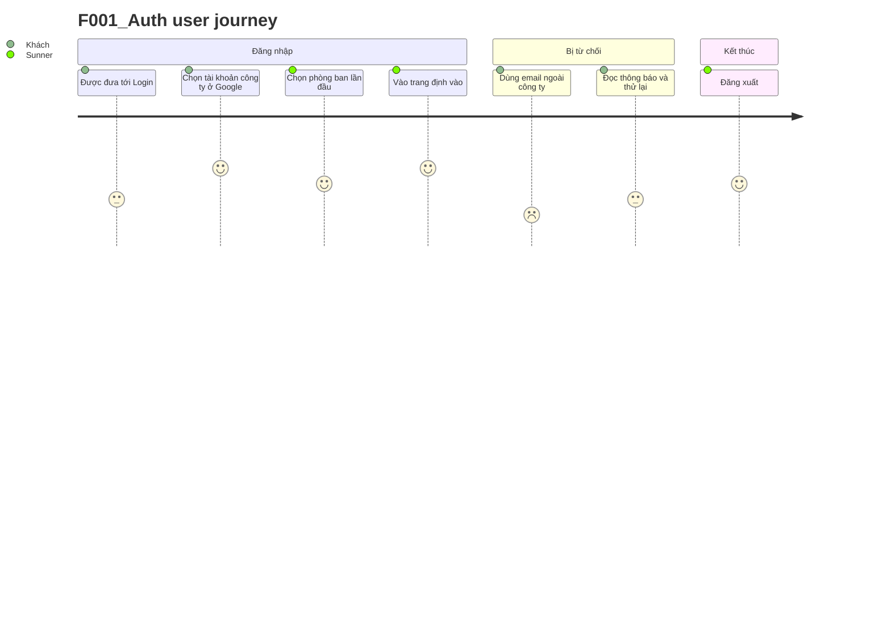

<!-- layout-exempt: rebuild-spec owns all docs/system|features|generated|flows paths — all references here are output targets or internal definitions -->
<!-- Contract: references/feature-spec-researcher-contract.md -->
<!-- Nửa BA/QA của cặp spec: ngôn ngữ thường, không file:line, không tên class, không động từ HTTP. Chi tiết kỹ thuật nằm ở technical-spec.md. -->

# Functional Spec — F001_Auth

**Priority**: P0
**Type**: mixed
**Generated**: 2026-11-24

**See also:** [`technical-spec.md`](./technical-spec.md) — handler, trigger, bảng dữ liệu, trích dẫn mã nguồn và cách kiểm thử cho Dev/QA/SA.

**Traceability:** F001_Auth → SCR001_Login, SCR020_OnboardingDepartment → US016, US018, US019 → BL001, BL004, BL005, BL011, BL018, BL019, BL020, BL021, BL022 → ROUTE020, ROUTE021, ROUTE022, ROUTE035

## 1. Overview

**Problem:** Hệ thống Kudos SAA 2025 là nội bộ Sun*, nên chỉ nhân viên có email công ty mới được vào, và hệ thống cần biết ai là ai (tên, avatar, phòng ban, vai trò) để mọi tính năng còn lại có người dùng để gắn dữ liệu vào.
**Solution:** Sunner đăng nhập bằng tài khoản Google công ty; ở lần đầu hệ thống tự tạo hồ sơ rồi mời chọn phòng ban một lần. Phiên đăng nhập được giữ và kiểm tra ở mọi trang, khách bị đưa về màn đăng nhập, người không phải Admin bị chặn khỏi khu quản trị, và người dùng đăng xuất được khỏi thiết bị đang dùng.
**Scope:** Đăng nhập Google giới hạn email công ty; tạo hồ sơ Sunner lần đầu với vai trò User; chọn phòng ban lần đầu; nâng Admin theo danh sách cấu hình mỗi lần đăng nhập; đăng xuất thiết bị đang dùng; các cổng truy cập (trang công khai, bắt buộc có phiên, khu Admin); nạp danh mục phòng ban, hashtag và giải Secret Box bằng một lệnh vận hành.
**Non-Scope:** Header, footer, đổi ngôn ngữ, menu tài khoản chứa nút đăng xuất và giao diện trang 403/404 (thuộc F002_AppShell); màn đếm ngược trước giờ mở và luật chuyển về đó (thuộc F006_AwardsPortal); giao diện đổi vai trò người dùng (thuộc F014_AdminUserManagement); đổi phòng ban sau lần chọn đầu và xem hồ sơ cá nhân (ngoài phạm vi, hoặc thuộc F012_Profile).

**Actors**

| Actor | Description | Primary goal |
|-------|--------------|---------------|
| Khách chưa đăng nhập | Người mở hệ thống khi chưa có phiên | Đăng nhập bằng tài khoản Google công ty |
| Sunner | Nhân viên Sun* đã đăng nhập, vai trò User | Hoàn tất hồ sơ lần đầu, dùng các tính năng dành cho nhân viên, đăng xuất khi xong |
| Admin | Sunner có vai trò Admin | Vào thêm khu quản trị mà User không vào được |
| Người vận hành | Người triển khai và bảo trì hệ thống | Nạp lại danh mục phòng ban, hashtag, giải Secret Box một cách an toàn |

Feature này không thuộc luồng liên-feature nào.

## 2. Functional Capabilities

| ID | Capability | What the user can do | User Stories | Requirements | Business Rules | Screens |
|----|------------|------------------------|-----------------|---------------|-------------------|---------|
| CAP-01 | Đăng nhập Google chỉ email công ty | Đăng nhập bằng Google; email ngoài công ty bị từ chối kèm thông báo rõ; quay lại đúng trang đã định vào | US016 | FR-201, FR-202, FR-203, FR-204, FR-401, FR-402, FR-404, FR-601 | BR-001, BR-004, BR-005, DEC-001, DEC-002, DEC-003 | SCR001_Login |
| CAP-02 | Hồ sơ Sunner và chọn phòng ban lần đầu | Có hồ sơ tự tạo ở lần đăng nhập đầu rồi chọn phòng ban đúng một lần | US018 | FR-001, FR-003, FR-301, FR-302, FR-303 | BR-002, BR-003, BR-006, BR-008, DEC-006, DEC-007, SM-001 | SCR020_OnboardingDepartment |
| CAP-03 | Đăng xuất | Kết thúc phiên trên thiết bị đang dùng, các thiết bị khác giữ nguyên | US019 | FR-403 | BR-007 | N/A — nút Logout nằm trong menu tài khoản do feature khác sở hữu |
| CAP-04 | Cổng phiên và vai trò | Ở lại trong hệ thống khi đã đăng nhập, bị đưa về Login khi chưa, và chỉ Admin vào được khu quản trị | N/A — cổng truy cập không có câu chuyện riêng | FR-101, FR-102, FR-602, FR-603, FR-604, FR-605 | DEC-004, DEC-005, SM-002 | N/A — không có màn hình riêng |
| CAP-05 | Dữ liệu tham chiếu ban đầu | Người vận hành nạp danh mục phòng ban, hashtag và giải Secret Box, chạy lại bao nhiêu lần cũng được | N/A — việc vận hành, không có câu chuyện người dùng | FR-002 | BR-009 | N/A — không có màn hình |

## 3. Open Decisions

| D### | Decision | Default proposal | Rationale | Blocks work |
|------|----------|-------------------|-----------|--------------|
| D001 | Danh sách phòng ban và các tên hiển thị đã đúng với tổ chức hiện tại chưa? | Giữ danh sách lấy nguyên văn từ thiết kế Figma (sáu đơn vị); BTC sửa trong file seed rồi nạp lại | BTC chưa xác nhận danh sách; nạp lại giữ nguyên id nên hồ sơ cũ không mất phòng ban | no |
| D002 | Địa chỉ gốc dùng để quay về sau khi đăng nhập Google cố định một giá trị hay cho nhiều giá trị (bản xem trước)? | Hiện lấy theo địa chỉ của chính yêu cầu, được hệ thống xác thực đối chiếu với danh sách địa chỉ cho phép; chọn khi biết nơi triển khai | Rủi ro thấp nhờ danh sách cho phép, nhưng phải chốt trước khi lên bản chính thức | yes |
| D003 | Trước giờ mở, người dùng gọi thẳng thao tác chọn phòng ban hoặc đổi ngôn ngữ vẫn thực hiện được; có cần chặn không? | Chấp nhận: chỉ ghi vào hồ sơ của chính người đó, ảnh hưởng thấp; đăng xuất và đổi ngôn ngữ luôn mở | Chặn thêm không bảo vệ dữ liệu của ai khác | no |

## 4. Requirements

### Foundation (0xx)

- **FR-001** Lần đăng nhập đầu của một email hợp lệ tự tạo hồ sơ Sunner gồm email, tên, avatar, vai trò User, phòng ban để trống.
- **FR-002** Phòng ban, hashtag và giải Secret Box có thể được nạp hoặc nạp lại bằng một lệnh vận hành mà không hỏng dữ liệu đang dùng.
- **FR-003** Email trong hồ sơ luôn bằng email hiện tại của tài khoản đăng nhập, kể cả khi email tài khoản đổi.

### Navigation (1xx)

- **FR-101** Khách vào trang cần đăng nhập thì được đưa về Login, và sau khi đăng nhập quay lại đúng trang đó.
- **FR-102** Người đã đăng nhập mở màn Login thì được đưa về trang chủ.

### Login (2xx)

- **FR-201** Màn Login chỉ có một cách đăng nhập là nút đăng nhập bằng Google.
- **FR-202** Khi email không thuộc công ty, màn Login báo rõ rằng chỉ tài khoản công ty được phép.
- **FR-203** Khi đăng nhập thất bại hoặc bị huỷ vì lý do khác, màn Login báo lỗi chung và cho thử lại.
- **FR-204** Trong lúc đang chuyển sang Google, nút bị khoá kèm biểu tượng chờ để không bấm đúp.

### Onboarding (3xx)

- **FR-301** Trang chọn phòng ban liệt kê các phòng ban đã nạp theo thứ tự cố định, tên theo ngôn ngữ đang chọn, là một nhóm lựa chọn bắt buộc chọn một.
- **FR-302** Chọn xong thì phòng ban được ghi vào hồ sơ của chính người đó đúng một lần rồi chuyển tới trang họ định vào.
- **FR-303** Lựa chọn không hợp lệ hoặc không lưu được thì ở lại trang kèm thông báo rõ.

### Interaction (4xx)

- **FR-401** Sau khi Google xác nhận, hệ thống mở phiên, cập nhật thời điểm đăng nhập cuối rồi đưa người dùng tới trang chọn phòng ban (nếu chưa có) hoặc trang họ định vào.
- **FR-402** Email nằm trong danh sách Admin cấu hình được đặt vai trò Admin ở mọi lần đăng nhập.
- **FR-403** Đăng xuất kết thúc phiên trên thiết bị đang dùng và đưa người dùng về Login.
- **FR-404** Nếu bước hoàn tất đăng nhập thất bại thì phiên vừa mở bị đóng ngay và người dùng về Login kèm thông báo.

### Security (6xx)

- **FR-601** Chỉ email thuộc tên miền công ty được đăng nhập, và việc này được chặn ở nhiều lớp ở phía máy chủ chứ không chỉ ở giao diện.
- **FR-602** Khu Admin chỉ dành cho Admin; người khác mở thì thấy trang từ chối truy cập thật (không chỉ ẩn nút).
- **FR-603** Vai trò của người dùng luôn được xác định ở máy chủ từ dữ liệu hồ sơ, không dựa vào dữ liệu người dùng tự gửi lên.
- **FR-604** Mọi bảng dữ liệu của hệ thống đều bật kiểm soát hàng và không mở quyền cho trình duyệt đọc trực tiếp.
- **FR-605** Mọi trang, thao tác và điểm cấp dữ liệu của Sunner tự kiểm tra phiên (và phòng ban) thay vì chỉ dựa vào lớp chặn chung.

## 5. Business Rules

- Chỉ email đúng tên miền công ty được vào; không nhận sub-domain, gợi ý ở màn Google chỉ để thuận tiện, kiểm tra thật nằm ở máy chủ (BR-001)
- Hồ sơ mới luôn có vai trò User; không bao giờ tự tạo Admin (BR-002)
- Mỗi tài khoản có đúng một hồ sơ; tên lấy theo thứ tự tên Google, tên hiển thị, phần đầu email; avatar chỉ lấy một lần (BR-003)
- Đường dẫn quay lại chỉ nhận trang nội bộ cùng hệ thống, sai thì về trang chủ (BR-004)
- Email trong danh sách Admin cấu hình được nâng Admin ở mọi lần đăng nhập, nên Admin cấu hình qua danh sách bị hạ trên giao diện sẽ thành Admin lại lần sau (BR-005)
- Phòng ban chỉ đặt được một lần, khi hồ sơ còn trống; gửi lại không đổi gì (BR-006)
- Đăng xuất chỉ kết thúc phiên của thiết bị đang dùng, thiết bị khác giữ nguyên (BR-007)
- Email trong hồ sơ được chép theo email tài khoản, viết thường, để lần đăng ký sau bằng địa chỉ cũ không vướng trùng (BR-008)
- Nạp danh mục tham chiếu là một giao dịch và chạy lại an toàn: hỏng một bảng thì hoàn tác cả ba, id cũ được giữ (BR-009)
- Sau đăng nhập: hồ sơ chưa có phòng ban thì tới trang chọn phòng ban, đã có thì tới trang định vào, thất bại thì về Login (DEC-001)
- Khi Google không trả mã xác nhận, chỉ lỗi từ chối tên miền cho thông báo riêng, mọi lỗi khác cho thông báo chung (DEC-002)
- Thông báo trên màn Login lấy lỗi của lần bấm mới nhất; bắt đầu lần thử mới thì thông báo cũ ẩn (DEC-003)
- Trang công khai cho đi tiếp, trang còn lại cần phiên: khách về Login kèm đường dẫn định vào, lời gọi lấy dữ liệu nhận từ chối thay vì chuyển hướng (DEC-004)
- Người không phải Admin mở khu Admin nhận trang từ chối truy cập thật, thao tác tự động nhận từ chối dạng dữ liệu (DEC-005)
- Trang chọn phòng ban tự xét: khách về Login, hồ sơ không tồn tại bị từ chối, đã có phòng ban thì đi tiếp, còn trống thì hiện lựa chọn (DEC-006)
- Gửi lựa chọn phòng ban: thành công hoặc đã có thì đi tiếp, lựa chọn sai và lỗi lưu cho hai thông báo khác nhau (DEC-007)
- Hồ sơ đi từ chưa có phòng ban sang đã có phòng ban đúng một lần và không quay lại (SM-001)
- Vai trò hồ sơ đi từ User lên Admin khi email thuộc danh sách Admin cấu hình; chiều ngược lại do màn quản trị người dùng đảm nhiệm (SM-002)

## 6. Screens

| Screen Name | SCR### | What User Sees | What User Can Do |
|-------------|--------|-----------------|-------------------|
| Login | SCR001_Login | Màn ROOT FURTHER với hai dòng giới thiệu, nút đăng nhập bằng Google, vùng thông báo lỗi khi bị từ chối hoặc thất bại; đầu trang có logo và đổi ngôn ngữ, cuối trang là dòng bản quyền | Bấm đăng nhập Google; đọc thông báo lỗi và thử lại; đổi ngôn ngữ (do feature khác) |
| OnboardingDepartment | SCR020_OnboardingDepartment | Thẻ giữa màn hình có tiêu đề, mô tả và nhóm lựa chọn phòng ban; không có header hay footer | Chọn đúng một phòng ban và bấm "Tiếp tục"; đọc thông báo nếu lựa chọn sai hoặc không lưu được |

### User Journey

1. Khách mở một trang cần đăng nhập; chưa có phiên nên được đưa tới Login và đường dẫn định vào được giữ lại.
2. Khách bấm nút đăng nhập bằng Google và chọn tài khoản công ty ở màn của Google.
3. Nếu email ngoài công ty, khách quay lại Login và thấy thông báo chỉ tài khoản công ty được phép; nếu lỗi khác, khách thấy thông báo chung và bấm lại được.
4. Nếu email hợp lệ và là lần đầu, hệ thống tạo hồ sơ rồi đưa khách tới trang chọn phòng ban; khách chọn một phòng ban và bấm "Tiếp tục".
5. Sunner được đưa tới trang họ định vào (hoặc trang chủ); từ đó dùng hệ thống bình thường.
6. Khi xong, Sunner chọn Đăng xuất ở menu tài khoản và về lại Login.



## 7. User Stories

### US016_SignInWithGoogle — Đăng nhập bằng Google

**Actor:** Khách chưa đăng nhập
**Goal:** Đăng nhập vào hệ thống Kudos bằng tài khoản Google công ty để có phiên riêng.
**Business value:** Chỉ nhân viên Sun* vào được và không phải nhớ thêm mật khẩu.

**Acceptance Criteria:**
- [ ] Màn Login hiện nút "Đăng nhập bằng Google" cho khách; người đã có phiên mở Login thì được đưa về trang chủ.
- [ ] Bấm nút thì chuyển sang Google; trong lúc chờ nút khoá kèm biểu tượng chờ nên bấm đôi không khởi động hai luồng.
- [ ] Email đúng tên miền công ty vào được; hệ thống cập nhật thời điểm đăng nhập cuối và chuyển tới trang chọn phòng ban (lần đầu) hoặc trang định vào (mặc định trang chủ).
- [ ] Đường dẫn quay lại không an toàn (trang ngoài hệ thống, dạng giao thức tương đối, chứa ký tự lạ, quá dài) bị thay bằng trang chủ.
- [ ] Email ngoài công ty bị từ chối, khách về Login thấy "Chỉ tài khoản @tên-miền được phép đăng nhập"; mọi lỗi khác (huỷ ở Google, đổi mã thất bại, lỗi dữ liệu) cho thông báo chung "Đăng nhập không thành công, vui lòng thử lại."
- [ ] Nếu bước hoàn tất đăng nhập thất bại sau khi phiên đã mở thì phiên bị đóng, không ai giữ phiên chưa qua kiểm tra.
- [ ] Email trong danh sách Admin cấu hình được đặt vai trò Admin ở mọi lần đăng nhập.

### US018_ChooseDepartment — Chọn phòng ban

**Actor:** Sunner
**Goal:** Chọn đơn vị làm việc của mình ở lần đăng nhập đầu để hoàn tất hồ sơ.
**Business value:** Hồ sơ đủ thông tin phòng ban để các thống kê và bộ lọc theo phòng ban có dữ liệu, và Sunner vào được các trang dành cho Sunner.

**Acceptance Criteria:**
- [ ] Sunner chưa có phòng ban mở bất kỳ trang Sunner nào đều được đưa tới trang chọn phòng ban (giữ đường dẫn định vào); người đã có phòng ban mở lại trang này thì được chuyển thẳng đi tiếp.
- [ ] Trang liệt kê các phòng ban đã nạp theo thứ tự cố định, tên theo ngôn ngữ đang chọn, là nhóm lựa chọn bắt buộc chọn một.
- [ ] Bấm "Tiếp tục" ghi phòng ban vào hồ sơ của chính mình rồi chuyển tới trang định vào; trong lúc gửi nút hiện "Đang lưu…" và bị khoá.
- [ ] Chỉ đặt được một lần: gửi lại khi đã có phòng ban thì không đổi gì và vẫn đi tiếp.
- [ ] Lựa chọn không có trong danh sách hiện "Vui lòng chọn một đơn vị trong danh sách."; lỗi lưu hiện "Không lưu được lựa chọn, vui lòng thử lại."

### US019_SignOut — Đăng xuất

**Actor:** Sunner
**Goal:** Đăng xuất khỏi thiết bị đang dùng để phiên trên máy này kết thúc.
**Business value:** An toàn khi dùng máy chung: không ai dùng tiếp được tài khoản sau khi rời máy.

**Acceptance Criteria:**
- [ ] Chọn "Logout" ở menu tài khoản thì phiên của thiết bị này kết thúc và người dùng về Login; phiên ở thiết bị khác giữ nguyên.
- [ ] Phiên đã hết hạn từ trước vẫn tính là đã đăng xuất và vẫn về Login, không báo lỗi.
- [ ] Trong lúc chờ nút bị khoá; nếu dịch vụ xác thực không với tới được thì menu ở lại và hiện "Không thể đăng xuất, vui lòng thử lại."
- [ ] Admin dùng chung điều khiển này ở thanh đầu trang quản trị.

## 8. Scenarios

### US016_SignInWithGoogle — Happy Path

**Given** khách ở màn Login, **When** chọn tài khoản đúng tên miền công ty ở màn Google, **Then** hệ thống mở phiên và đưa khách tới trang chọn phòng ban (lần đầu) hoặc trang họ định vào.

### US016_SignInWithGoogle — Error: email ngoài công ty

**Given** khách dùng Gmail cá nhân, **When** hoàn tất ở màn Google, **Then** quay về Login thấy thông báo chỉ tài khoản công ty được phép và không có hồ sơ hay phiên nào được tạo.

### US016_SignInWithGoogle — Error: huỷ ở Google

**Given** khách đang ở màn chọn tài khoản của Google, **When** huỷ, **Then** quay về Login thấy thông báo lỗi chung và bấm đăng nhập lại được.

### US018_ChooseDepartment — Happy Path

**Given** Sunner mới đăng nhập, chưa có phòng ban, mở trang Kudos, **When** được đưa tới trang chọn phòng ban, chọn một phòng ban và bấm "Tiếp tục", **Then** phòng ban được lưu và Sunner tới trang Kudos.

### US018_ChooseDepartment — Error: lựa chọn không hợp lệ

**Given** lựa chọn gửi lên không có trong danh sách phòng ban, **When** bấm "Tiếp tục", **Then** hiện "Vui lòng chọn một đơn vị trong danh sách.", không ghi gì và ở lại trang.

### US019_SignOut — Happy Path

**Given** người dùng đã đăng nhập, **When** chọn Logout ở menu tài khoản, **Then** về Login và các trang cần phiên không còn mở được trên thiết bị này.

### US019_SignOut — Error: dịch vụ xác thực không với tới được

**Given** người dùng đã đăng nhập nhưng dịch vụ xác thực tạm không phản hồi, **When** chọn Logout, **Then** menu ở lại và hiện "Không thể đăng xuất, vui lòng thử lại."

## 9. Edge Cases

| Scenario | What Happens | User-Facing Message |
|----------|--------------|----------------------|
| Email ngoài công ty | Bị chặn ở máy chủ, không tạo tài khoản, về Login | "Chỉ tài khoản @tên-miền được phép đăng nhập." |
| Email ngoài công ty khi cấu hình chặn riêng chưa bật ở bản triển khai | Vẫn bị chặn nhưng chỉ lộ lỗi chung | "Đăng nhập không thành công, vui lòng thử lại." |
| Huỷ ở Google hoặc Google báo lỗi | Về Login, cho thử lại | "Đăng nhập không thành công, vui lòng thử lại." |
| Bước hoàn tất đăng nhập hỏng sau khi phiên đã mở | Phiên bị đóng ngay, về Login | "Đăng nhập không thành công, vui lòng thử lại." |
| Đường dẫn quay lại trỏ ra ngoài hệ thống hoặc có ký tự lạ | Bỏ đường dẫn đó, dùng trang chủ | None — xử lý im lặng |
| Bấm đúp nút đăng nhập | Nút khoá, chỉ một luồng bắt đầu | None — nút hiện biểu tượng chờ |
| Hai lần đăng nhập đầu cùng lúc | Chỉ một hồ sơ được tạo | None — xử lý im lặng |
| Google không trả tên hoặc avatar | Vẫn tạo hồ sơ, tên lấy tạm theo phần đầu email, avatar để trống | None — xử lý im lặng |
| Gửi lại form chọn phòng ban khi đã có phòng ban | Giữ phòng ban cũ, đi tiếp tới trang định vào | None — xử lý im lặng |
| Lựa chọn phòng ban không hợp lệ | Ở lại trang, không ghi gì | "Vui lòng chọn một đơn vị trong danh sách." |
| Lưu phòng ban gặp lỗi | Ở lại trang | "Không lưu được lựa chọn, vui lòng thử lại." |
| Khách mở trực tiếp trang chọn phòng ban | Được đưa về Login rồi quay lại trang này sau khi đăng nhập | None — chuyển hướng |
| Sunner chưa có phòng ban mở trang Sunner khác | Được đưa tới trang chọn phòng ban trước | None — chuyển hướng |
| Người không phải Admin mở khu Admin | Chặn, hiện trang từ chối truy cập (mã lỗi thật là 403) | Trang từ chối truy cập do feature khác dựng |
| Dịch vụ xác thực không với tới được khi kiểm phiên | Coi như chưa đăng nhập | None — chuyển về Login |
| Admin cấu hình qua danh sách bị hạ vai trò trên giao diện | Lần đăng nhập sau được đặt lại Admin | None — xử lý im lặng |
| Đăng xuất khi phiên đã hết hạn | Vẫn về Login bình thường | None — xử lý im lặng |
| Chạy nạp danh mục khi thiếu cấu hình kết nối hoặc một bảng lỗi | Không dòng nào được ghi, lệnh báo lỗi | Thông báo lỗi trên bảng điều khiển của người vận hành |

## 10. Edge Behaviours to Verify

- **FR-101** → Mở trang cần phiên khi chưa đăng nhập, đăng nhập xong phải quay lại đúng trang; đích ngoài hệ thống bị bỏ qua.
- **FR-102** → Người đã đăng nhập mở Login luôn về trang chủ.
- **FR-202** → Email ngoài công ty luôn bị từ chối và thấy thông báo, kể cả khi nhập tay bỏ qua gợi ý ở màn Google.
- **FR-204** → Bấm đôi nút đăng nhập chỉ bắt đầu một luồng.
- **FR-302** → Phòng ban chỉ đặt được một lần; gửi lại hoặc dùng hai tab không đổi phòng ban đã chọn.
- **FR-401** → Thời điểm đăng nhập cuối thay đổi sau mỗi lần đăng nhập.
- **FR-402** → Email trong danh sách Admin cấu hình luôn là Admin sau khi đăng nhập, kể cả sau khi bị hạ trên giao diện.
- **FR-403** → Sau đăng xuất, mở lại trang cần phiên trên thiết bị này bị đưa về Login; thiết bị khác vẫn đăng nhập.
- **FR-404** → Khi bước hoàn tất đăng nhập hỏng, không còn phiên nào được giữ.
- **FR-601** → Email ngoài công ty (kể cả dạng sub-domain) không bao giờ có tài khoản hoặc hồ sơ.
- **FR-602** → Người không phải Admin không vào được khu Admin và cũng không gọi được thao tác của Admin.
- **FR-603** → Đổi vai trò của một người thì lần truy cập kế tiếp của họ phản ánh ngay.
- **FR-604** → Dùng khoá công khai gọi thẳng dịch vụ dữ liệu không đọc được bảng nghiệp vụ nào.
- **FR-605** → Khi chưa chọn phòng ban, các điểm cấp dữ liệu của Sunner từ chối thay vì trả dữ liệu.
- **FR-002** → Chạy nạp danh mục hai lần liên tiếp cho cùng kết quả và không đổi id phòng ban.

## 11. Risks & Known Issues

| ID | Type | Description | Impact | Status |
|----|------|--------------|--------|--------|
| RISK-01 | risk | Thông báo "chỉ tài khoản công ty được phép" chỉ hiện khi cấu hình chặn riêng ở dịch vụ xác thực được bật ở môi trường triển khai; nếu thiếu, email ngoài công ty vẫn bị chặn nhưng chỉ thấy lỗi chung | Người ngoài công ty thấy thông báo chưa rõ lý do, tăng thắc mắc hỗ trợ | confirmed |
| RISK-02 | risk | Địa chỉ gốc để quay về sau đăng nhập Google lấy theo yêu cầu thay vì một giá trị cố định (xem D002) | Cấu hình danh sách địa chỉ cho phép sai ở bản triển khai có thể làm đăng nhập hỏng hoặc quay về sai nơi | chờ quyết định ở § 3 |
| RISK-03 | known-issue | Trước giờ mở, thao tác chọn phòng ban vẫn chạy khi gọi thẳng, không bị cổng trước giờ mở chặn (xem D003) | Chỉ ghi vào hồ sơ của chính người gọi, ảnh hưởng thấp | confirmed |
| RISK-04 | risk | Danh sách phòng ban lấy từ thiết kế và chưa được BTC xác nhận (xem D001) | Phòng ban sai hoặc thiếu làm bộ lọc, thống kê theo phòng ban lệch | chờ quyết định ở § 3 |
| RISK-05 | risk | Tên miền công ty được ghi cứng ở lớp chặn dữ liệu và phải trùng thủ công với giá trị cấu hình; kiểm thử chỉ so hai giá trị bằng nhau | Đổi cấu hình mà quên đổi lớp dữ liệu sẽ làm hai nơi lệch nhau | [INFERRED] |

## 12. Dependencies

| Dependency | Type | Why this feature needs it | Evidence |
|------------|------|-----------------------------|----------|
| Google (tài khoản công ty) | external-service | Là nơi xác thực danh tính Sunner | FR-201, FR-601 |
| Dịch vụ xác thực và cơ sở dữ liệu (Supabase) | infrastructure | Giữ phiên, tài khoản, hồ sơ; chạy lớp chặn tên miền và tạo hồ sơ | FR-001, FR-601, FR-604 |
| F002_AppShell | feature | Dựng header và footer của Login, menu tài khoản chứa nút Đăng xuất, trang 403/404 | FR-403, FR-602, SCR001_Login |
| F006_AwardsPortal | feature | Màn đếm ngược và luật đưa người không phải Admin về đó trước giờ mở, chạy ngay sau cổng phiên | DEC-004 |
| F014_AdminUserManagement | feature | Giao diện đổi vai trò; đọc thời điểm đăng nhập cuối và nhãn Admin cấu hình | BR-005, SM-002 |
| F003_KudosAuthoring, F010_SecretBoxRewards | feature | Dùng hashtag và giải Secret Box mà lệnh nạp danh mục cung cấp | FR-002 |
| Danh sách Admin cấu hình, tên miền công ty, địa chỉ gốc | config | Quyết định ai thành Admin, ai được vào, và đích quay về | BR-001, BR-005, D002 |

## 13. Configuration

```text
ALLOWED_EMAIL_DOMAIN = sun-asterisk.com   # chỉ email đúng tên miền này được đăng nhập, không nhận sub-domain
ADMIN_EMAILS = <danh sách email Admin>    # email trong danh sách này thành Admin ở mọi lần đăng nhập
DEFAULT_ROLE = user                       # vai trò của hồ sơ mới
MAX_NEXT_LENGTH = 2048                    # đường dẫn quay lại dài hơn mức này bị bỏ
```
