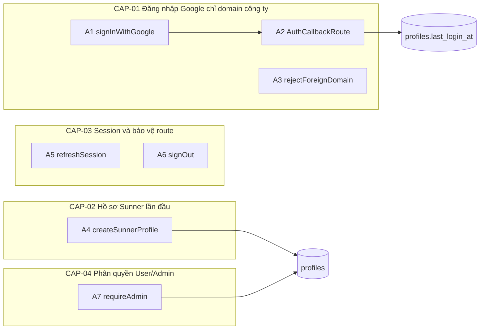
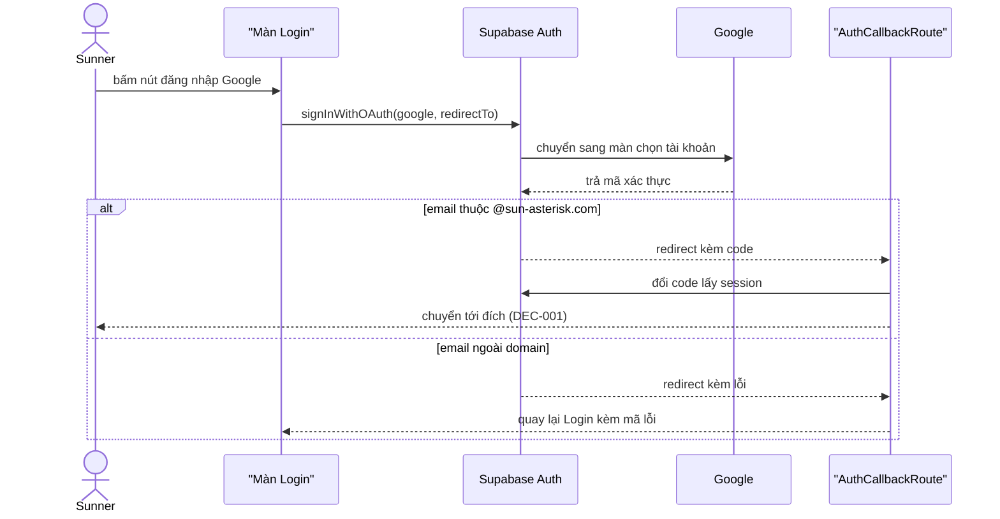
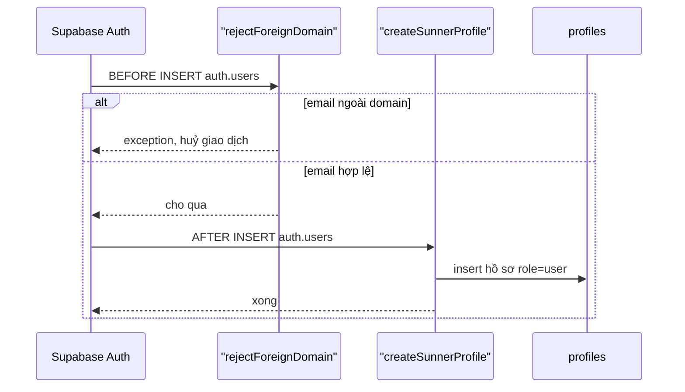
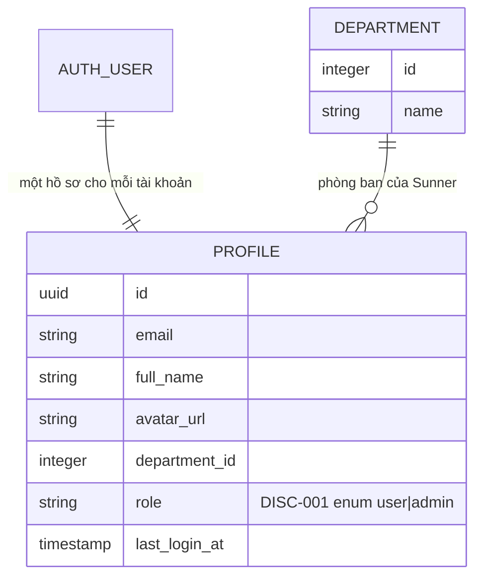

# F001_Auth — Technical Spec

**Priority**: P0
**Type**: mixed
**Generated**: 2026-11-08

**See also:** [`functional-spec.md`](./functional-spec.md) — tổng quan, quyết định còn mở, yêu cầu/quy tắc nghiệp vụ dạng một dòng, màn hình, user story, kịch bản, edge case và cấu hình cho BA/QA.

**How to read this file:** § 2 là bảng chỉ mục — chọn action cần xem rồi đọc block của nó ở § 3 một mạch từ trên xuống. § 4 là phụ lục dùng chung — chỉ nhảy vào khi một block ở § 3 trỏ tới.

## 1. Technical Overview

F001_Auth cho Sunner đăng nhập bằng Google qua Supabase Auth, chỉ nhận email `@sun-asterisk.com`. Lần đầu đăng nhập thì hệ thống tạo hồ sơ Sunner (tên, avatar, phòng ban, role mặc định User); các lần sau chỉ cập nhật thời điểm đăng nhập cuối. Session nằm trong cookie do Supabase quản lý, được làm mới ở lớp proxy của Next.js; lớp này cũng chặn khách chưa đăng nhập. Khu Admin được bảo vệ ở server bằng role đọc từ bảng hồ sơ, trái quyền thì trả 403 (trang 403 do F002_AppShell dựng).



## 2. Action Index

| # | Action (handler) | Method · Path | Codes | Writes | Detail |
|---|---|---|---|---|---|
| **A0** | *cross-cutting — belongs to no single action* | — | FR-604 | — | § 4.4 |
| **A1** | `LoginAction#signInWithGoogle` (planned) | `POST` `server action` | FR-201, FR-203, FR-204, BR-001, US001_Login | — *(không ghi DB; chỉ chuyển hướng sang Google)* | § 3.1 |
| **A2** | `AuthCallbackRoute#GET` (planned) | `GET` `/auth/callback` | FR-202, FR-402, BR-005, DEC-001, US001_Login, US002_RejectForeignDomain | `profiles` | § 3.1 |
| **A3** | `AuthUserTrigger#rejectForeignDomain` (planned) *(background, no FE)* | `trigger` · `auth.users BEFORE INSERT` | FR-601, BR-001, US002_RejectForeignDomain | — *(chặn insert)* | § 3.1 |
| **A4** | `AuthUserTrigger#createSunnerProfile` (planned) *(background, no FE)* | `trigger` · `auth.users AFTER INSERT` | FR-001, FR-002, FR-003, FR-401, BR-002, BR-004, US003_FirstLoginProfile | `profiles` | § 3.2 ▸ **diagram** |
| **A5** | `SessionProxy#refreshSession` (planned) | `ANY` `/*` | FR-101, FR-102, DEC-002, US004_GuestRedirect | — *(chỉ làm mới cookie)* | § 3.3 |
| **A6** | `LogoutAction#signOut` (planned) | `POST` `server action` | FR-403, US005_Logout | — *(xoá session)* | § 3.3 |
| **A7** | `AdminGuard#requireAdmin` (planned) | `ANY` `/admin/*` | FR-602, FR-603, BR-003, US006_AdminAreaGuard | — *(read-only)* | § 3.4 |

**Rung set** theo template: Who → FE → Request → BE → Rule → Result → State → Source. Rung vắng thì bỏ hẳn. **State** bỏ trong bản nháp vì chưa có nguồn xác nhận.

## 3. Actions

### 3.1 CAP-01 — Đăng nhập Google chỉ cho email công ty

Luồng đi qua nhiều handler: A1 đẩy người dùng sang Google, A2 nhận kết quả, A3 chặn ở tầng DB khi email ngoài domain. Không handler nào một mình giữ trọn chuỗi nên sơ đồ đặt ở cấp capability.



#### A1 · Bấm đăng nhập Google
`POST server action` → `` `LoginAction#signInWithGoogle` `` (planned)
`FR-201` `FR-203` `FR-204` `US001_Login` · màn Login (draft `SCR001_Login`)

**Who** · Khách chưa đăng nhập *(gate A5 — § 3.3)*
**FE** · Nút đăng nhập Google trên màn Login gọi action; khi đang xử lý thì khoá nút và hiện trạng thái chờ (FR-204: chặn bấm đúp). Hiện lỗi chung ở FR-203 khi action thất bại hoặc khi người dùng huỷ ở màn Google.
**Request** · không có tham số từ người dùng; tuỳ chọn `next` *(đường dẫn nội bộ cần quay lại sau đăng nhập, xem DEC-001)*
**BE** · `` `LoginAction#signInWithGoogle` `` — gọi `signInWithOAuth` của Supabase với provider `google`, `redirectTo` trỏ về A2 và kèm tham số gợi ý domain `hd=sun-asterisk.com`.
**Rule** · **BR-001 — Chỉ email `@sun-asterisk.com` được vào hệ thống.** Ở A1 tham số `hd` chỉ là gợi ý để Google lọc màn chọn tài khoản, không phải chốt chặn; chốt chặn thật ở A3. *(§ 4.4)*
**Result** · Chuyển hướng trình duyệt sang Google. Không ghi DB.
**Source:** TBD (draft)

<!-- Không có diagram: dưới ngưỡng (không ghi bảng nào, đồng bộ, một bước). Sơ đồ cấp capability ở trên đã mô tả luồng. -->

---

#### A2 · Nhận kết quả OAuth và mở session
`GET /auth/callback` → `` `AuthCallbackRoute#GET` `` (planned)
`FR-202` `FR-402` `BR-005` `DEC-001` `US001_Login` `US002_RejectForeignDomain` · màn Login (draft `SCR001_Login`)

**Who** · Khách chưa đăng nhập vừa quay về từ Google *(gate A5 — route này nằm trong danh sách đường dẫn công khai)*
**FE** · Không có giao diện riêng; route chỉ chuyển hướng. Khi lỗi, màn Login hiện thông báo theo mã lỗi (FR-202 cho email ngoài domain, FR-203 cho lỗi khác).
**Request** · query `code` *(mã OAuth)* hoặc `error` + `error_description` *(khi A3 từ chối hoặc Google huỷ)*, tuỳ chọn `next`
**BE** · `` `AuthCallbackRoute#GET` `` — đổi `code` lấy session và ghi cookie; nếu có `error` thì map sang mã lỗi nội bộ (`domain_not_allowed` | `auth_failed`) và chuyển về Login. Thành công thì cập nhật `profiles.last_login_at`.
**Rule** · **BR-005 — Mỗi lần đăng nhập thành công phải cập nhật thời điểm đăng nhập cuối.** Cột này là nguồn cho bảng Admin User của F014. Lần đầu thì hồ sơ vừa được A4 tạo nên chỉ cần gán giá trị.

| DEC | subtype | Condition | What the user sees | Source |
|---|---|---|---|---|
| **DEC-001** | flow | có `next` là đường dẫn nội bộ bắt đầu bằng `/` và không phải `//` | về đúng trang đang định vào | TBD (draft) |
| **DEC-001** | flow | không có `next` hoặc `next` không hợp lệ | về Homepage (TBD (draft): nếu chưa tới giờ mở thì Countdown, do F006 quyết) | TBD (draft) |

**Result**
- Writes `profiles.last_login_at` ← thời điểm hiện tại
- User sees: chuyển tới đích của DEC-001, hoặc về Login kèm thông báo lỗi
**Source:** TBD (draft)

<!-- Không có diagram: ghi một bảng, đồng bộ. -->

---

#### A3 · Từ chối email ngoài domain *(background, no FE)*
`trigger · auth.users BEFORE INSERT` → `` `AuthUserTrigger#rejectForeignDomain` `` (planned)
`FR-601` `BR-001` `US002_RejectForeignDomain`

**Who** · *không có người dùng trực tiếp — chạy khi Supabase Auth tạo bản ghi người dùng mới, kích hoạt từ A2*
**BE** · `` `AuthUserTrigger#rejectForeignDomain` `` — hàm DB kiểm tra email của bản ghi sắp chèn, ném exception nếu không kết thúc bằng `@sun-asterisk.com`; exception làm huỷ cả giao dịch tạo người dùng.
**Rule** · **BR-001 — Chỉ email `@sun-asterisk.com` được vào hệ thống.** Đây là chốt chặn phía server: người ngoài domain không bao giờ có bản ghi trong `auth.users` nên không thể có session. *(§ 4.4)*
**Result** · Không tạo người dùng; Supabase trả lỗi về A2 (map sang `domain_not_allowed`, xem 5.3 mục 1).
**Source:** TBD (draft)

<!-- Không có diagram: chỉ chặn, không ghi bảng. -->

### 3.2 CAP-02 — Tạo hồ sơ Sunner lần đầu

#### A4 · Tạo hồ sơ khi đăng nhập lần đầu *(background, no FE)*
`trigger · auth.users AFTER INSERT` → `` `AuthUserTrigger#createSunnerProfile` `` (planned)
`FR-001` `FR-002` `FR-003` `FR-401` `BR-002` `BR-004` `US003_FirstLoginProfile`

**Who** · *không có người dùng trực tiếp — chạy sau khi A3 cho qua và bản ghi `auth.users` đã được chèn*
**FE** · không có giao diện
**Request** · *không có HTTP request* — dữ liệu lấy từ bản ghi `auth.users` mới: email, `raw_user_meta_data` (tên, avatar từ Google)
**BE** · `` `AuthUserTrigger#createSunnerProfile` `` — chèn một dòng `profiles` cùng khoá với `auth.users.id`, điền tên và avatar từ metadata Google, `department_id` (uuid, nullable) để trống tới khi người dùng chọn ở `/onboarding/department`, `role = user`.
**Rule**
- **BR-002 — Role mặc định của hồ sơ mới là User.** Không bao giờ tạo Admin tự động; nâng Admin là thao tác riêng (F014 và cách bootstrap Admin đầu tiên — D003 ở functional-spec). *(inline, Bin 1)*
- **BR-004 — Mỗi tài khoản đăng nhập có đúng một hồ sơ.** Khoá chính của `profiles` là id người dùng nên chèn trùng bị từ chối; trigger chạy một lần trên mỗi bản ghi `auth.users` mới. *(inline, Bin 1)*
**Result**
- Writes `profiles` (`id`, `email`, `full_name`, `avatar_url`, `department_id` = null, `role` = `user`, `last_login_at` = null)
- Nếu insert hồ sơ lỗi thì cả giao dịch tạo người dùng bị huỷ, người dùng thấy lỗi chung FR-203 và có thể thử lại.
**Source:** TBD (draft)
**Shared structure:** `INT-001` — cầu nối tới Supabase Auth, nguồn của email và metadata Google, chi tiết *(§ 4.5)*



<!-- Diagram vì đây là hành động nền (background). Diagram chỉ giữ thứ tự và nhánh; sự thật nằm ở các rung. -->

### 3.3 CAP-03 — Session và bảo vệ route

#### A5 · Làm mới session và chặn khách
`ANY /*` → `` `SessionProxy#refreshSession` `` (planned)
`FR-101` `FR-102` `DEC-002` `US004_GuestRedirect` · màn Login (draft `SCR001_Login`)

**Who** · Mọi request vào ứng dụng *(gate A0 — § 4.4)*
**FE** · Không có giao diện riêng; khách bị chuyển tới màn Login, người đã đăng nhập mở Login thì bị chuyển về Homepage.
**Request** · cookie session Supabase; đường dẫn đang vào
**BE** · `` `SessionProxy#refreshSession` `` — chạy trên mọi request (trừ file tĩnh), làm mới token trong cookie, xác định có session hợp lệ hay không bằng cách hỏi Supabase Auth ở server chứ không tin cookie thô.
**Rule** · quyết định có cho request đi tiếp hay không:

| DEC | subtype | Condition | What the user sees | Source |
|---|---|---|---|---|
| **DEC-002** | flow | đường dẫn thuộc danh sách công khai (màn Login, route callback, tài nguyên tĩnh; Countdown prelaunch TBD (draft)) | request đi tiếp bình thường | TBD (draft) |
| **DEC-002** | flow | đường dẫn được bảo vệ và không có session | chuyển tới Login kèm `next` = đường dẫn đang vào (FR-101) | TBD (draft) |
| **DEC-002** | flow | đang có session và đường dẫn là màn Login | chuyển về Homepage (FR-102) | TBD (draft) |

**Result** · Cookie session được làm mới; không ghi DB.
**Source:** TBD (draft)

<!-- Không có diagram: không ghi bảng, đồng bộ; nội dung chính là bảng DEC, sơ đồ chỉ làm khó đọc. -->

---

#### A6 · Đăng xuất
`POST server action` → `` `LogoutAction#signOut` `` (planned)
`FR-403` `US005_Logout`

**Who** · Sunner hoặc Admin đã đăng nhập *(gate A5)*
**FE** · Mục "Đăng xuất" nằm trong dropdown profile do F002_AppShell dựng; F002 chỉ gọi action này, không tự xử lý session.
**Request** · không có tham số
**BE** · `` `LogoutAction#signOut` `` — gọi `signOut` của Supabase để xoá session và cookie, rồi chuyển về Login.
**Rule** · Sau đăng xuất mọi request vào trang bảo vệ phải rơi vào nhánh "không có session" của DEC-002 (A5).
**Result** · Session bị xoá khỏi cookie và phía Supabase. Không ghi bảng của ứng dụng.
**Source:** TBD (draft)

<!-- Không có diagram: một lời gọi, không ghi bảng. -->

### 3.4 CAP-04 — Phân quyền User/Admin

#### A7 · Chặn truy cập khu Admin trái quyền
`ANY /admin/*` → `` `AdminGuard#requireAdmin` `` (planned)
`FR-602` `FR-603` `BR-003` `US006_AdminAreaGuard`

**Who** · Sunner đã đăng nhập *(gate A5)*; chỉ role Admin được qua
**FE** · Người không phải Admin thấy trang 403; trang này thuộc F002_AppShell, F001 chỉ quyết định khi nào hiển thị.
**Request** · session hiện tại; đường dẫn dưới `/admin`
**BE** · `` `AdminGuard#requireAdmin` `` — một hàm dùng chung gọi ở layout của khu Admin và ở đầu mọi server action của Admin (F007, F011, F014, F015 gọi lại hàm này, không tự kiểm tra role). Đọc `profiles.role` của người dùng từ DB.
**Rule** · **BR-003 — Role luôn được đọc từ DB ở server, không tin dữ liệu từ client.** Role không nằm trong cookie hay tham số do người dùng điều khiển được. Role khác `admin` thì trả 403; chưa có session thì đã bị A5 chuyển về Login trước khi tới đây.
**Result** · read-only — **không ghi DB**. Admin đi tiếp; người khác nhận 403.
**Source:** TBD (draft)

<!-- Không có diagram: read-only, một bảng. -->

### 3.5 Edge cases

| Action | Scenario | Behavior |
|---|---|---|
| A1 · A2 | Người dùng huỷ ở màn chọn tài khoản Google | Quay về Login với mã `auth_failed`, hiện lỗi chung FR-203 |
| A2 · A3 | Email ngoài domain (kể cả khi bỏ qua gợi ý `hd`) | A3 huỷ tạo người dùng; Login hiện lỗi FR-202; không có hồ sơ, không có session |
| A2 | `next` là URL tuyệt đối hoặc dạng `//host` (open redirect) | Bỏ `next`, về Homepage (DEC-001) |
| A2 · A4 | Hai tab cùng đăng nhập lần đầu gần như đồng thời | Khoá chính của `profiles` chặn hồ sơ trùng (BR-004); tab chậm hơn đăng nhập như người đã có hồ sơ |
| A4 | Google không trả tên hoặc avatar | Hồ sơ vẫn được tạo; tên mặc định lấy phần trước `@` của email, avatar để trống (TBD (draft)) |
| A5 | Cookie session hết hạn giữa chừng | Coi như chưa có session, chuyển Login kèm `next` |
| A7 | Admin bị hạ role trong lúc đang có session | Request kế tiếp đọc lại role từ DB nên bị 403 ngay (BR-003) |
| A1-A7 | Gọi trực tiếp API/server action khi chưa đăng nhập | Từ chối theo cùng quy tắc A0 § 4.4 |

## 4. Shared Foundation

### 4.1 Components

| Component | Responsibility | Used in | File |
|---|---|---|---|
| `LoginAction` | Server action bắt đầu OAuth Google | A1 | TBD (draft) |
| `AuthCallbackRoute` | Route handler nhận kết quả OAuth, mở session | A2 | TBD (draft) |
| `SessionProxy` | Làm mới session và chặn khách ở mọi request | A5 | TBD (draft) |
| `LogoutAction` | Server action đăng xuất | A6 | TBD (draft) |
| `AdminGuard` | Hàm kiểm tra role Admin dùng chung cho khu Admin | A7 | TBD (draft) |
| `AuthUserTrigger` | Hook `before_user_created` + trigger trên `auth.users` (chặn domain khi insert và đổi email, tạo hồ sơ, đồng bộ email) | A3, A4 | TBD (draft) |
| `SupabaseServerClient` | Tạo client Supabase theo cookie ở server | A2, A5, A6, A7 | TBD (draft) |

### 4.2 Data Model



| Entity | Table | Used for | Action |
|---|---|---|---|
| `Profile` | `profiles` | Hồ sơ Sunner: định danh, phòng ban, role, lần đăng nhập cuối | A2, A4, A7 |
| `Department` | `departments` | Danh mục phòng ban để lọc ở F004, F014, F015 *(nguồn dữ liệu TBD (draft))* | A4 |

Mã `MODEL###` sẽ do bước data-model cấp sau; bản nháp không đặt mã.

#### Polymorphic Behavior

##### DISC-001 — Profile.role

| Value | Render | Validation | Persistence |
|-------|--------|------------|-------------|
| user | Chỉ thấy khu Sunner; vào khu Admin nhận 403 | Mặc định khi tạo hồ sơ (BR-002) | Đặt bởi A4 lúc tạo; đổi role là việc của F014 |
| admin | Thấy thêm khu Admin; gọi được server action của Admin | Phải qua `AdminGuard#requireAdmin` (BR-003) | Đặt thủ công / bởi F014; cách bootstrap Admin đầu tiên TBD (draft) |

**Source:** TBD (draft)

### 4.3 State Management

None.

<!-- Không có state machine: session do Supabase quản lý; vòng đời hồ sơ chỉ có "tồn tại / chưa tồn tại" nên không đáng một SM-###. -->

### 4.4 Shared Rules

#### Bin 3 — cross-cutting, belongs to no single action

**A0 · FR-604 — Dữ liệu và thao tác của ứng dụng chỉ dành cho người có session hợp lệ.**
Áp dụng cho mọi route và mọi bảng, không thuộc riêng action nào: lớp proxy (A5) chặn ở tầng route, và mỗi bảng dữ liệu nghiệp vụ phải bật Row Level Security yêu cầu người dùng đã đăng nhập, để gọi thẳng API Supabase bằng khoá công khai cũng không đọc được. Việc bật RLS cho bảng của feature nào do feature đó làm; F001 chỉ đặt hợp đồng chung. Khi vi phạm: route chuyển Login, API trả từ chối.
**Source:** TBD (draft)

#### Bin 2 — used by ≥2 named actions

**BR-001 — Chỉ email `@sun-asterisk.com` được vào hệ thống.**
Used in: **A1** · **A3**. A1 chỉ gửi gợi ý `hd` để Google thu hẹp màn chọn tài khoản (có thể bị bỏ qua), nên không được coi là kiểm tra; A3 mới là chốt chặn thật, chạy ở DB trước khi tài khoản được tạo.
**Source:** TBD (draft)
```text
allowed = email.lower() ends with "@sun-asterisk.com"
if not allowed: raise exception "domain_not_allowed"   # A3, huỷ giao dịch
# A1 chỉ thêm hd=sun-asterisk.com vào yêu cầu OAuth (gợi ý UX)
```

### 4.5 Algorithms & Integrations

### Đăng nhập Google qua Supabase Auth (INT-001)
**Linked FR:** FR-201
**Used in:** A1 → A2 → A3 → A4
**Source:** TBD (draft)
**Type:** api-call
**Target:** Supabase Auth với provider Google (OAuth 2.0, luồng authorization code)
**Payload:** `redirectTo` về route callback, `hd` gợi ý domain; không gửi bí mật. Client ID và secret của Google cấu hình ở Supabase, không nằm trong code ứng dụng.
**Failure handling:** Lỗi hoặc huỷ từ Google/Supabase quay về A2 dưới dạng `error`; ứng dụng hiện lỗi chung trên Login và cho thử lại, không retry tự động.

### 4.6 Configuration

```text
NEXT_PUBLIC_SUPABASE_URL      = <url dự án Supabase>        # A1, A2, A5, A6, A7
NEXT_PUBLIC_SUPABASE_ANON_KEY = <khoá công khai>            # chỉ dùng cùng RLS (FR-604)
ALLOWED_EMAIL_DOMAIN          = sun-asterisk.com            # A1 (gợi ý hd); A3 hard-code trong hàm DB, xem 5.3
```

Cấu hình provider Google (client ID, secret, redirect URL được phép) nằm ở dashboard Supabase, không lưu trong repo.

**Client behavior:** hiển thị trạng thái chờ của nút đăng nhập, xem [`../../screens/SCR001_Login/spec.md`](../../screens/SCR001_Login/spec.md).

## 5. Verification & Technical Notes

### 5.1 Technical Verification

- **SC-001** *(A1, A2, A3)* Email `@sun-asterisk.com` đăng nhập thành công và có session; email khác domain không có bản ghi `auth.users`, không có session (covers FR-201, FR-202, FR-601, BR-001)
- **SC-002** *(A4)* Đăng nhập lần đầu tạo đúng một dòng `profiles` với `role = user`; đăng nhập lần hai không tạo thêm (covers FR-001, FR-401, BR-002, BR-004)
- **SC-003** *(A2)* Mỗi lần đăng nhập `last_login_at` tăng (covers FR-402, BR-005)
- **SC-004** *(A5)* Khách vào trang bảo vệ bị chuyển Login kèm `next`; sau đăng nhập về đúng trang; `next` ngoại domain bị bỏ (covers FR-101, FR-102, DEC-001, DEC-002)
- **SC-005** *(A7)* User thường vào khu Admin và gọi server action Admin đều bị từ chối 403; Admin được qua (covers FR-602, FR-603, BR-003)
- **SC-006** *(A0)* Gọi API Supabase trực tiếp bằng khoá công khai khi chưa đăng nhập không đọc được dữ liệu nghiệp vụ (covers FR-604)

#### US001_Login *(A1, A2)*

**Independent Test:** Dùng tài khoản `@sun-asterisk.com`, bấm đăng nhập Google, kiểm tra đã vào ứng dụng.

**Acceptance Scenarios:**

1. **Given** khách ở màn Login, **When** chọn tài khoản `@sun-asterisk.com` ở Google, **Then** có session và tới đích theo DEC-001.
2. **Given** khách ở màn Login, **When** huỷ ở màn Google, **Then** quay về Login với lỗi chung và có thể bấm lại.

#### US002_RejectForeignDomain *(A2, A3)*

**Independent Test:** Đăng nhập bằng Gmail cá nhân và kiểm tra `auth.users`.

**Acceptance Scenarios:**

1. **Given** khách ở Login, **When** đăng nhập bằng email ngoài domain, **Then** Login hiện lỗi FR-202 và không có tài khoản nào được tạo.

#### US003_FirstLoginProfile *(A4)*

**Independent Test:** Đăng nhập lần đầu bằng email chưa từng dùng, truy vấn `profiles`.

**Acceptance Scenarios:**

1. **Given** email chưa có hồ sơ, **When** đăng nhập thành công, **Then** có đúng một hồ sơ với tên, avatar từ Google và role User.
2. **Given** email đã có hồ sơ, **When** đăng nhập lại, **Then** không tạo hồ sơ mới.

#### US004_GuestRedirect *(A5)*

**Independent Test:** Mở trang bảo vệ khi chưa đăng nhập.

**Acceptance Scenarios:**

1. **Given** chưa đăng nhập, **When** mở một trang bảo vệ, **Then** bị chuyển tới Login và sau khi đăng nhập quay lại đúng trang đó.

#### US005_Logout *(A6)*

**Independent Test:** Đăng xuất rồi mở lại trang bảo vệ.

**Acceptance Scenarios:**

1. **Given** đã đăng nhập, **When** chọn Đăng xuất, **Then** về Login và mở trang bảo vệ sẽ bị chuyển Login.

#### US006_AdminAreaGuard *(A7)*

**Independent Test:** Dùng một User và một Admin cùng mở khu Admin.

**Acceptance Scenarios:**

1. **Given** User thường đã đăng nhập, **When** mở khu Admin, **Then** thấy trang 403.
2. **Given** Admin đã đăng nhập, **When** mở khu Admin, **Then** vào được.

### 5.2 Assumptions

- *(A5)* Next.js 16 đổi tên lớp "middleware" thành "proxy"; đã implement ở `proxy.ts` (đã xác nhận ở phase 02).
- *(A3)* Trigger trên `auth.users` ném exception thì huỷ việc tạo người dùng (đã thử ở local; hosted cần bật thêm hook `before_user_created` trong dashboard).
- *(A1)* Tham số `hd` của Google chỉ là gợi ý, không thay thế kiểm tra phía server. `[INFERRED]` từ cách OAuth Google hoạt động.
- *(A4)* Trigger đọc `full_name`/`name`, `avatar_url`/`picture` từ `raw_user_meta_data`; thiếu tên thì dùng phần trước `@` của email, thiếu avatar thì để trống.

### 5.3 Resolved Questions

Các câu hỏi mở của bản nháp đã được chốt khi implement phase 02 (code là nguồn đúng).

1. **Map lỗi domain** *(A2, A3)*: exception của trigger chỉ ra "Database error saving new user" (thử trên GoTrue local v2.197), không đủ để phân biệt. Chốt dùng **hai lớp**: auth hook `before_user_created` trả message `domain_not_allowed` (tới `/auth/callback` dưới dạng `error_description`), cộng trigger `reject_foreign_domain_on_insert` / `reject_foreign_domain_on_email_change` làm chốt chặn khi hook chưa bật (khi đó chỉ ra lỗi chung `auth_failed`). Hosted phải bật hook trong dashboard. Migration: `db/migrations/0005_auth_user_triggers.sql`.
2. **Hằng số domain ở hai nơi** *(A1, A3)*: domain nằm ở một chỗ trong DB, hàm `is_sunner_email()`; biến `ALLOWED_EMAIL_DOMAIN` chỉ là gợi ý `hd`. Test khẳng định hai giá trị bằng nhau.
3. **Danh sách đường dẫn công khai của proxy** *(A5)*: `/login`, `/auth/callback`, `/countdown`, `/access-denied` (`shared/auth/public-paths.ts`). Cổng prelaunch thêm ở phase 07.
4. **Đăng nhập đồng thời** *(A2, A4)*: dựa vào khoá chính `profiles.id`; trigger `create_sunner_profile` dùng `ON CONFLICT (id) DO NOTHING`.
5. **`getUser()` hay `getClaims()`**: dùng `getUser()` ở cả proxy lẫn page, vì session bị thu hồi phải mất hiệu lực ngay; trộn hai cách làm proxy và page bất đồng, gây vòng lặp chuyển trang.
6. **Đường dẫn `/api/` khi chưa đăng nhập**: trả JSON 401 `{ "code": "unauthorized" }`, không redirect.
7. **`profiles.department_id`**: `uuid` cho phép NULL, khoá ngoại tới `departments`. Hồ sơ mới để trống; `requireSunner()` chuyển người chưa chọn tới `/onboarding/department`.
8. **403 của `/admin/*`**: do proxy trả (status 403 thật, kể cả với Cache Components); chi tiết ở `docs/system/architecture.md`.
9. **`redirectTo` của OAuth Google**: hiện lấy origin từ request. **Hoãn tới khi chọn hosting** (decision-log, 2026-11-15); go-live chọn `APP_ORIGIN` cố định hoặc allow-list origin, callback route theo cùng quyết định.
10. **Session có user nhưng không có profile**: `requireSunner()` trả 401, không redirect, để khỏi lặp qua luật `/login` → `/` của proxy.

### 5.4 Source References

| Hành động | Mã nguồn |
|-----------|----------|
| A1 `LoginAction` | `features/auth/server/sign-in-with-google-action.ts`, `app/(public)/login/page.tsx` |
| A2 `AuthCallbackRoute` | `app/auth/callback/route.ts`, `features/auth/server/complete-login.ts` |
| A3, A4 `AuthUserTrigger` | `db/migrations/0005_auth_user_triggers.sql`, bảng `shared/db/schema/profiles.ts` + `0004_profiles.sql` |
| A5 `SessionProxy` | `proxy.ts`, `shared/auth/session-proxy.ts`, `route-access-policy.ts`, `public-paths.ts`, `access-denied-response.ts` |
| A6 `LogoutAction` | `shared/auth/sign-out-action.ts` |
| A7 `AdminGuard` | `shared/auth/admin-guard.ts`, `shared/auth/current-user.ts` (`requireSunner`) |
| Chọn phòng ban lần đầu | `app/onboarding/department/page.tsx`, `features/auth/server/choose-department-action.ts` |
| Chặn open redirect (DEC-001) | `shared/auth/safe-next-path.ts` |

#### Data Flow

Derived from § 3 above:

```text
Google (email, tên, avatar) -> Supabase Auth (auth.users insert) -> A3 kiểm tra domain -> A4 insert profiles(role=user)
-> A2 đổi code lấy session, ghi last_login_at -> cookie session -> A5 làm mới mỗi request -> A7 đọc profiles.role
```

### 5.5 Artifact References

| Artifact | File | Codes Used | Reviewed |
|----------|------|------------|----------|
| System Overview | TBD (draft) | TBD (draft) | [ ] |
| Architecture | TBD (draft) | TBD (draft) | [ ] |
| Feature List | [feature-list.md](../feature-list.md) | F001 | [x] |
| API Map | TBD (draft) | TBD (draft) | [ ] |
| Entities | TBD (draft) | TBD (draft) | [ ] |
| Screens | [functional-spec.md § 6](./functional-spec.md#6-screens) | TBD (draft) | [ ] |
| Behavior Logic | TBD (draft) | TBD (draft) | [ ] |
| Permissions Matrix | TBD (draft) | TBD (draft) | [ ] |
| User Stories | TBD (draft) | US001, US002, US003, US004, US005, US006 | [ ] |

**Rule:** Mọi mã trong Codes Used phải tồn tại trong artifact nguồn. Mã `F001` là tạm (PROVISIONAL), cấp lại khi promote.
