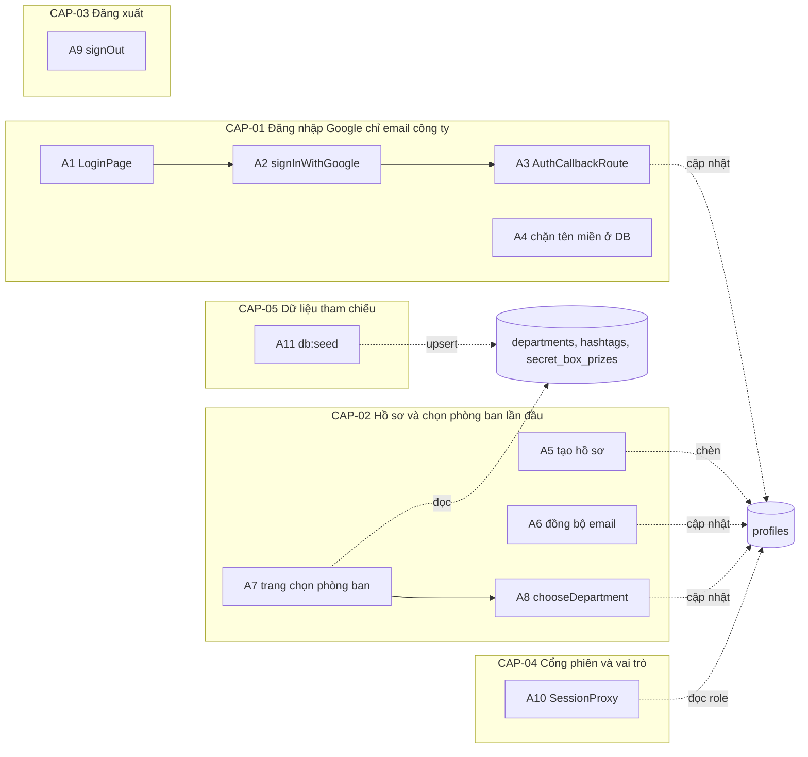
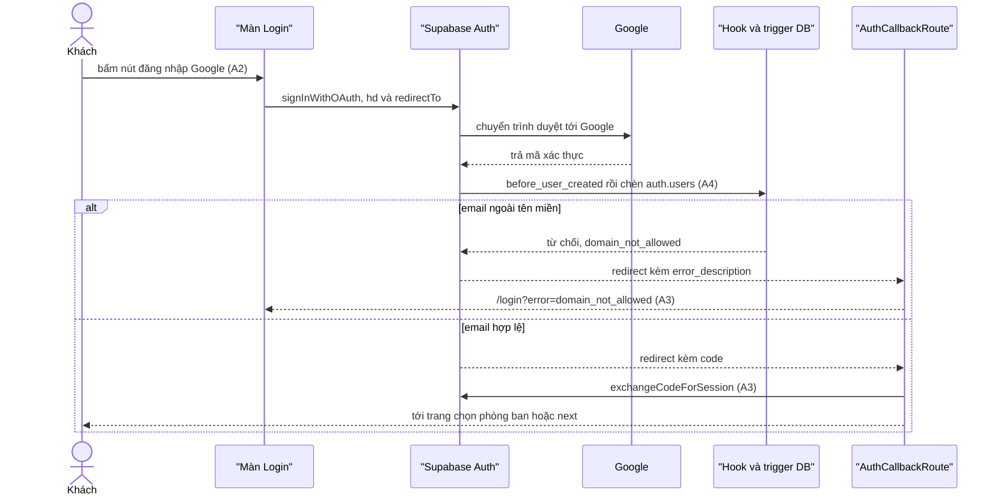
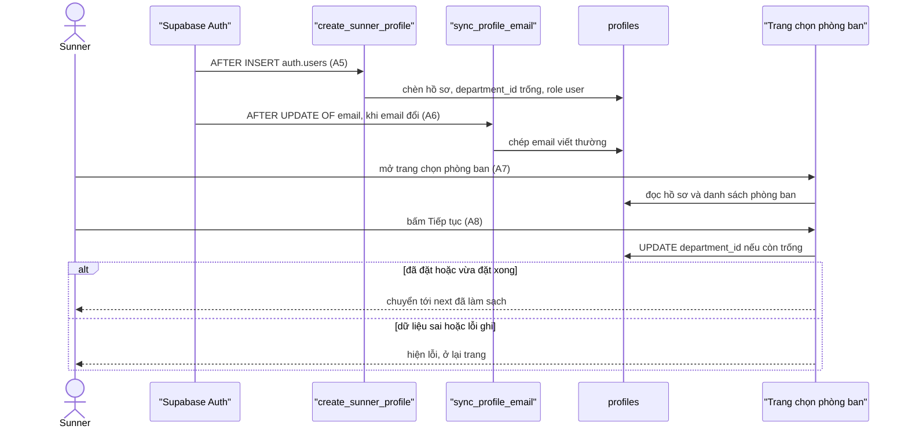
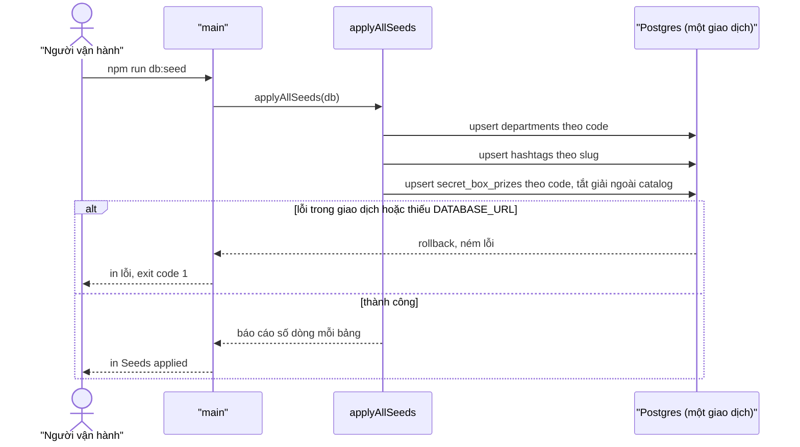
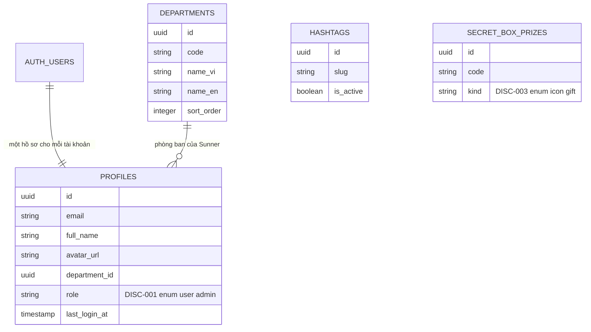
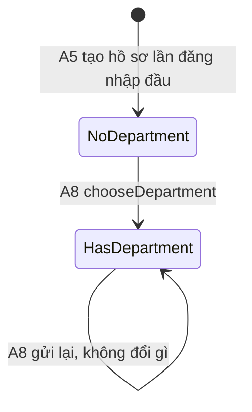
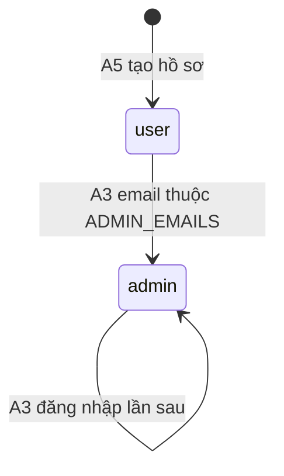

<!-- layout-exempt: rebuild-spec owns all docs/system|features|generated|flows paths — all references here are output targets or internal definitions -->
<!-- Contract: references/feature-spec-researcher-contract.md -->
<!-- Nửa Dev/QA/SA của cặp spec. Mọi mã FR/BR/SM/DEC/ALG/INT được PHÁT BIỂU một lần ở functional-spec.md và CÀI ĐẶT một lần ở đây; không lặp câu quy tắc thuần ngôn ngữ ở file này. -->

# F001_Auth — Technical Spec

**Priority**: P0
**Type**: mixed
**Generated**: 2026-11-24

**See also:** [`functional-spec.md`](./functional-spec.md) — tổng quan, quyết định còn mở, yêu cầu và quy tắc nghiệp vụ dạng một dòng, màn hình, user story, kịch bản, edge case và cấu hình cho BA/QA.

**How to read this file:** § 2 là bảng chỉ mục action; chọn action cần xem rồi đọc khối của nó ở § 3 từ đầu đến cuối, mỗi khối là một luồng hoàn chỉnh. § 4 là phụ lục dùng chung, chỉ nhảy vào khi § 3 trỏ tới.

## 1. Technical Overview

F001 cho Sunner đăng nhập bằng Google qua Supabase Auth (PKCE), chỉ nhận email đúng tên miền công ty. Tên miền bị chặn ở ba lớp (auth hook, hai trigger trên `auth.users`) cộng một lần kiểm lại ở callback `/auth/callback`; lần đăng nhập đầu trigger tạo dòng `profiles`, rồi Sunner chọn phòng ban đúng một lần ở `/onboarding/department`. Phiên nằm trong cookie Supabase, được proxy Next.js làm mới và dùng làm cổng truy cập (allowlist công khai, bắt buộc có phiên, chặn khu Admin); các page và action còn tự gọi `requireSunner()` / `requireAdmin()` lần nữa. Lệnh `npm run db:seed` nạp danh mục tham chiếu (phòng ban, hashtag, giải Secret Box) nên nằm chung feature nền này.



## 2. Action Index

| # | Action (handler) | Method · Path | Codes | Writes | Detail |
|---|---|---|---|---|---|
| **A0** | *cross-cutting — belongs to no single action* | — | FR-604, FR-605 | — | § 4.4 |
| **A1** | `LoginPage` | `GET` `/login` | FR-201, FR-202, FR-203, BR-004, US016 | — *(read-only)* | § 3.1 |
| **A2** | `LoginAction#signInWithGoogle` | `POST` `/login` *(server action)* | FR-201, FR-202, FR-203, FR-204, BR-001, BR-004, DEC-003, INT-001, US016 | — *(chỉ đặt cookie PKCE rồi chuyển hướng)* | § 3.1 |
| **A3** | `AuthCallbackRoute#GET` | `GET` `/auth/callback` | FR-401, FR-402, FR-404, FR-601, BR-001, BR-004, BR-005, DEC-001, DEC-002, SM-002, ALG-001, INT-001, US016 | `profiles` | § 3.1 |
| **A4** | `AuthUserGate#rejectForeignDomain` *(background, no FE)* | — | FR-601, BR-001, ALG-001, US016 | — *(chặn ghi vào `auth.users`)* | § 3.1 ▸ **diagram** |
| **A5** | `AuthUserTrigger#createSunnerProfile` *(background, no FE)* | — | FR-001, BR-002, BR-003, SM-001, US016, US018 | `profiles` | § 3.2 ▸ **diagram** |
| **A6** | `AuthUserTrigger#syncProfileEmail` *(background, no FE)* | — | FR-003, BR-008 | `profiles` | § 3.2 ▸ **diagram** |
| **A7** | `OnboardingDepartmentPage` | `GET` `/onboarding/department` | FR-301, BR-004, DEC-006, US018 | — *(read-only)* | § 3.2 |
| **A8** | `DepartmentAction#chooseDepartment` | `POST` `/onboarding/department` *(server action)* | FR-302, FR-303, BR-004, BR-006, DEC-007, SM-001, US018 | `profiles` | § 3.2 |
| **A9** | `LogoutAction#signOut` | `POST` `server action signOut` | FR-403, BR-007, US019 | — *(chỉ xoá phiên Supabase Auth)* | § 3.3 |
| **A10** | `SessionProxy#runSessionProxy` | `ANY` `/*` | FR-101, FR-102, FR-602, FR-603, DEC-004, DEC-005 | — *(chỉ làm mới cookie)* | § 3.4 |
| **A11** | `SeedCli#main` *(background, no FE)* | — | FR-002, BR-009 | `departments`, `hashtags`, `secret_box_prizes` | § 3.5 ▸ **diagram** |

**Rung set** theo template: Who → FE → Request → BE → Rule → Result → State → Source. Rung vắng thì bỏ hẳn. **State** chỉ có ở A3, A5, A8: các action còn lại không chạm vòng đời nào của § 4.3. Các lỗi `redirect()` của Next ném ngoại lệ điều hướng nên mọi nhánh thành công của server action kết thúc bằng chuyển hướng chứ không trả giá trị.

## 3. Actions

### 3.1 CAP-01 — Đăng nhập Google chỉ email công ty

Luồng đi qua bốn handler: A1 dựng màn, A2 đẩy trình duyệt sang Google, A4 chặn email sai tên miền ngay lúc Supabase Auth tạo user, A3 nhận kết quả. Không handler nào một mình giữ trọn chuỗi nên sơ đồ đặt ở cấp capability. Việc tạo hồ sơ sau khi chèn user thuộc CAP-02 (A5).



#### A1 · Dựng màn Login
`GET /login` → `` `LoginPage` ``
`FR-201` `FR-202` `FR-203` `US016` · `SCR001_Login`

**Who** · Khách chưa có phiên *(gate A10 — người đã có phiên bị proxy chuyển về `/`, § 3.4)*
**FE** · `app/(public)/login/page.tsx:23-69` dựng ảnh nền, wordmark làm `<h1>`, hai dòng giới thiệu và `GoogleSignInForm` (A2) nhận ba prop `next`, `initialError`, `domain`. Header logo + đổi ngôn ngữ và footer tối giản đến từ layout `app/(public)/layout.tsx:6-14` (thuộc F002, không phải F001). `instant = false` (`app/(public)/login/page.tsx:15`) nên route chặn tới khi đọc xong query.
**Request** · query `next` *(đường dẫn quay lại, tuỳ chọn)* và `error` *(`domain_not_allowed` hoặc `auth_failed`, tuỳ chọn)*; tham số lặp lấy giá trị đầu (`app/(public)/login/page.tsx:17`).
**BE** · `` `LoginPage` `` chạy `safeNextPath` lên `next` (`app/(public)/login/page.tsx:26`), `parseLoginErrorCode` lên `error` — mã lạ thành `null` nên không hiện banner (`features/auth/login-error-codes.ts:20-24`) — và truyền `domain` là `@` cộng `env.ALLOWED_EMAIL_DOMAIN` để câu lỗi chèn đúng tên miền (`app/(public)/login/page.tsx:64`).
**Rule** · **BR-004 — `next` chỉ nhận đường dẫn cùng origin, sai thì thành `/`.** Trang làm sạch `next` trước khi nhúng vào form nên mọi bước OAuth sau đó chỉ thấy giá trị đã sạch *(§ 4.4)*.
**Result** · read-only — **không ghi DB**. Trang trả HTML kèm banner khởi đầu nếu query `error` hợp lệ.
**Source:** `app/(public)/login/page.tsx:23-69` → `features/auth/login-error-codes.ts:20-24` → `shared/auth/safe-next-path.ts:15-27`

<!-- Không có diagram: read-only, không chạm bảng nào, một nhánh render. -->

---

#### A2 · Bấm "Đăng nhập bằng Google"
`POST /login` *(server action)* → `` `LoginAction#signInWithGoogle` ``
`FR-201` `FR-202` `FR-203` `FR-204` `BR-001` `BR-004` `DEC-003` `INT-001` `US016` · `SCR001_Login`

**Who** · Khách chưa có phiên *(gate A10; action không tự kiểm phiên vì đây là cửa vào — ROUTE021)*
**FE** · `features/auth/components/google-sign-in-form.tsx:22-35` gọi action bằng `useActionState` và gửi trường ẩn `next`; `features/auth/components/google-sign-in-button.tsx:22-43` khoá nút (`disabled={pending}`, `aria-busy`) và thay biểu tượng Google bằng spinner `role="status"` trong lúc chờ, nên bấm đúp không khởi động hai luồng OAuth (FR-204). `features/auth/components/login-error-banner.tsx:5-14` hiện thông báo `role="alert"`, câu chữ ở `messages/vi.json:6-18`.
**Request** · FormData `next` *(chuỗi, tuỳ chọn; mọi giá trị khác bị bỏ)*; không có tham số nào khác (`features/auth/server/sign-in-with-google-action.ts:33-34`).
**BE** · `` `LoginAction#signInWithGoogle` `` — làm sạch `next`, dựng `redirectTo = /auth/callback` kèm `?next=` khi khác `/` từ origin của request (header `Origin`, dự phòng `x-forwarded-host`/`host`, `features/auth/server/sign-in-with-google-action.ts:14-21,35-36`), rồi gọi `supabase.auth.signInWithOAuth` provider `google` với `queryParams.hd = ALLOWED_EMAIL_DOMAIN` (`features/auth/server/sign-in-with-google-action.ts:38-45`). Có `error` hoặc thiếu `data.url` thì log và trả `{ error: "auth_failed" }` (`features/auth/server/sign-in-with-google-action.ts:46-49`); ngược lại `redirect(data.url)` (`features/auth/server/sign-in-with-google-action.ts:50`).
**Rule** · quyết định ba điều: tên miền, đường quay lại, banner nào hiện:
- **BR-001 — Chỉ email đúng tên miền công ty vào được hệ thống.** Ở bước này tham số `hd` chỉ thu hẹp bộ chọn tài khoản của Google (UX), người dùng nhập tay email khác vẫn qua được Google; chốt thật nằm ở A4 và lần kiểm lại ở A3 *(§ 4.4)*.
- **BR-004 — `next` chỉ nhận đường dẫn cùng origin, sai thì thành `/`.** Action làm sạch lại `next` dù trang đã làm một lần, vì body của Server Action là đầu vào không tin được *(§ 4.4)*.

| DEC | subtype | Condition | What the user sees | Source |
|---|---|---|---|---|
| **DEC-003** | render | `pending` → không banner; ngược lại `state.error` có thì lấy nó; ngược lại `state` còn là trạng thái ban đầu thì lấy `initialError` từ query; còn lại không banner | lỗi của lần bấm mới nhất thắng lỗi cũ từ query; bắt đầu lần thử mới thì banner cũ ẩn | `features/auth/components/google-sign-in-form.tsx:26-30` |

**Result** · không ghi bảng ứng dụng. Mã xác minh PKCE được ghi vào cookie bởi client Supabase (`shared/auth/supabase-server-client.ts:12-27`) và trình duyệt chuyển sang Google; `INT-001` là cầu nối tới Supabase Auth (gửi `redirectTo` và `hd`, nhận URL của Google), Supabase đối chiếu `redirectTo` với danh sách cho phép nên Host giả không lái được mã *(§ 4.5)*. Lỗi khởi động hiện banner `auth_failed` (câu chữ ở `messages/vi.json:16`).
**Source:** `features/auth/components/google-sign-in-form.tsx:22-35` → `features/auth/server/sign-in-with-google-action.ts:29-51` → `shared/auth/supabase-server-client.ts:12-27`

<!-- Không có diagram: không ghi bảng nào, một lời gọi ra ngoài; sơ đồ cấp capability ở đầu § 3.1 đã vẽ thứ tự. -->

---

#### A3 · Nhận kết quả OAuth và mở phiên
`GET /auth/callback` → `` `AuthCallbackRoute#GET` ``
`FR-401` `FR-402` `FR-404` `FR-601` `BR-001` `BR-004` `BR-005` `DEC-001` `DEC-002` `SM-002` `ALG-001` `INT-001` `US016` · `SCR001_Login` · `SCR020_OnboardingDepartment`

**Who** · Khách vừa quay về từ Google *(route nằm trong allowlist công khai, `shared/auth/public-paths.ts:33-40`, ROUTE020)*
**FE** · không có giao diện riêng, route chỉ chuyển hướng; mọi lỗi hiện ở banner của A1/A2.
**Request** · query `code` *(mã PKCE)* hoặc `error` + `error_description`; tuỳ chọn `next` (`app/auth/callback/route.ts:15-21`).
**BE** · `` `AuthCallbackRoute#GET` `` làm sạch `next` rồi rẽ nhánh: không có `code` thì suy mã lỗi từ `error_description` (DEC-002) và về Login (`app/auth/callback/route.ts:16-21`). Có `code` thì `exchangeCodeForSession(code)`; lỗi hoặc không có user thì log và về Login với `auth_failed` (`app/auth/callback/route.ts:23-29`). Đổi được phiên thì gọi `completeLogin` (`app/auth/callback/route.ts:30`): thành công → chuyển tới đích, thất bại → `signOut({ scope: "local" })` rồi về Login (`app/auth/callback/route.ts:31-33`); ngoại lệ bất ngờ cũng đăng xuất cục bộ rồi `auth_failed` (`app/auth/callback/route.ts:34-38`) nên không ai giữ phiên chưa qua kiểm tra (FR-404). Đường về Login mang theo `next` (khác `/`) để thử lại vẫn đúng đích (`shared/auth/public-paths.ts:47-59`).
**Rule** · quyết định ba điều: lần kiểm tên miền cuối, việc nâng admin, và đích chuyển hướng:
- **BR-001 — Chỉ email đúng tên miền công ty vào được hệ thống.** Callback so lại email của phiên vừa đổi (cắt khoảng trắng, viết thường; đúng một `@`; phần sau bằng `ALLOWED_EMAIL_DOMAIN`, không nhận sub-domain, `ALG-001` *(§ 4.5)*) trước khi chạm DB; sai thì trả `domain_not_allowed` *(§ 4.4)*. `features/auth/server/complete-login.ts:38-41`.
- **BR-004 — `next` chỉ nhận đường dẫn cùng origin, sai thì thành `/`.** Làm sạch hai lần: ở đầu route và trong `completeLogin` trước khi chọn đích *(§ 4.4)*.
- **BR-005 — Email nằm trong `ADMIN_EMAILS` được đặt `role = 'admin'` ở mọi lần đăng nhập.** Một câu UPDATE duy nhất đặt `last_login_at = now()` và thêm `role` khi `env.ADMIN_EMAILS` chứa email đã chuẩn hoá, nên admin cấu hình qua env bị hạ trên UI sẽ thành admin lại ở lần đăng nhập sau (quyết định ghi 2026-11-15). `features/auth/server/complete-login.ts:43-48`.

| DEC | subtype | Condition | What the user sees | Source |
|---|---|---|---|---|
| **DEC-001** | flow | `completeLogin` ok AND `profiles.department_id` còn trống | tới `/onboarding/department` (kèm `?next=` khi `next` khác `/`) | `features/auth/server/complete-login.ts:51-52` |
| **DEC-001** | flow | `completeLogin` ok AND `department_id` đã có | tới `next` đã làm sạch (mặc định `/`) | `features/auth/server/complete-login.ts:51-52` |
| **DEC-001** | flow | `completeLogin` không ok | phiên cục bộ bị đóng, về `/login?error=` kèm mã | `app/auth/callback/route.ts:31-33` |
| **DEC-002** | flow | không có `code` AND `error_description` đúng bằng `domain_not_allowed` | về `/login?error=domain_not_allowed`, banner "chỉ tài khoản tên miền công ty được phép" | `app/auth/callback/route.ts:20-21` |
| **DEC-002** | flow | không có `code` AND mô tả khác hoặc trống (huỷ ở Google, lỗi DB, hook chưa bật) | về `/login?error=auth_failed`, banner lỗi chung | `app/auth/callback/route.ts:20-21` |

**Result**
- Writes `profiles.last_login_at` ← `now()`; thêm `profiles.role` ← `'admin'` khi email thuộc `ADMIN_EMAILS` — `features/auth/server/complete-login.ts:44-48`. Không có dòng nào cập nhật (không có hồ sơ) thì trả `auth_failed` (`features/auth/server/complete-login.ts:49`).
- Cookie phiên được ghi bởi `exchangeCodeForSession`; `INT-001` là cầu nối Supabase Auth trả phiên cho mã PKCE *(§ 4.5)*.
- User sees: chuyển hướng theo DEC-001, hoặc Login kèm banner theo DEC-002.
**State** · `SM-002`: `user` → `admin` *(§ 4.3; chỉ khi email thuộc `ADMIN_EMAILS`, nhánh khác không đổi role)*
**Source:** `app/auth/callback/route.ts:14-39` → `features/auth/server/complete-login.ts:37-53` → `features/auth/login-error-codes.ts:16-18` → `shared/auth/safe-next-path.ts:15-27` → `shared/auth/public-paths.ts:57-63`

<!-- Không có diagram riêng: A3 ghi một bảng và chuỗi gọi nằm trong sơ đồ cấp capability ở đầu § 3.1. -->

---

#### A4 · Từ chối email ngoài tên miền ở DB *(background, no FE)*
`auth hook before_user_created` + `BEFORE INSERT` và `BEFORE UPDATE` (khi email đổi) trên `auth.users` → `` `AuthUserGate#rejectForeignDomain` ``
`FR-601` `BR-001` `ALG-001` `US016` · `BL018` `BL020` `BL021`

**Who** · *không có người dùng trực tiếp — Supabase Auth chạy khi tạo hoặc đổi email của user, kích hoạt từ luồng A2/A3*
**Request** · *không có HTTP request* — hook nhận `event.user.email`, trigger đọc `NEW.email`.
**BE** · cùng một vị từ `public.is_sunner_email(email)` ở ba cửa vào: hook `public.before_user_created_hook(event jsonb)` trả `{}` khi hợp lệ hoặc `{error:{http_code:403,message:"domain_not_allowed"}}` (`db/migrations/0005_auth_user_triggers.sql:25-33`); `public.reject_foreign_domain()` ném `domain_not_allowed` ERRCODE `P0001` (`db/migrations/0005_auth_user_triggers.sql:37-45`) gắn vào trigger `reject_foreign_domain_on_insert` BEFORE INSERT (`db/migrations/0005_auth_user_triggers.sql:80-82`) và `reject_foreign_domain_on_email_change` BEFORE UPDATE có `WHEN (NEW.email IS DISTINCT FROM OLD.email)` (`db/migrations/0005_auth_user_triggers.sql:85-88`). Hook được nối ở `supabase/config.toml:296-301`; môi trường hosted phải bật cùng hook trong dashboard.
**Rule**
- **BR-001 — Chỉ email đúng tên miền công ty vào được hệ thống.** Đây là chốt chặn thật: email sai tên miền không bao giờ có dòng trong `auth.users` nên không có phiên; hook cho thông báo riêng `domain_not_allowed` tới callback, còn khi hook chưa bật thì trigger vẫn thất bại đóng và người dùng chỉ thấy lỗi chung `auth_failed` *(§ 4.4)*.
- `ALG-001` — vị từ so khớp email chạy ở SQL với `COLLATE "C"` để ký tự giống chữ (dấu Kelvin) không bị gấp thành `k`, và ở TypeScript khi callback kiểm lại *(§ 4.5)*.
**Result** · **không ghi bảng** — chặn thao tác ghi vào `auth.users`. Hook trả 403 với thông báo `domain_not_allowed`, thông báo này tới `/auth/callback` qua `error_description` (A3, DEC-002). UPDATE giữ nguyên email (GoTrue ghi lại mọi cột lúc đăng nhập) không bị kiểm lại, nhờ đó tài khoản có trước cổng này (tạo từ dashboard, user điện thoại không email) không bị khoá (`db/migrations/0005_auth_user_triggers.sql:7-11`).
**Source:** `db/migrations/0005_auth_user_triggers.sql:20-45` → `db/migrations/0005_auth_user_triggers.sql:80-88` → `supabase/config.toml:296-301`

<!-- Diagram: hành động nền; thứ tự hook → trigger nằm trong sơ đồ cấp capability ở đầu § 3.1. -->

### 3.2 CAP-02 — Hồ sơ Sunner và chọn phòng ban lần đầu

Luồng thread qua bốn handler: A5 (trigger) tạo dòng hồ sơ với `department_id` trống, A3 (CAP-01) thấy trống thì chuyển sang A7, A7 dựng picker, A8 ghi phòng ban đúng một lần. A6 là trigger phụ giữ `profiles.email` theo `auth.users`. Sơ đồ đặt ở cấp capability.



#### A5 · Tạo hồ sơ Sunner ở lần đăng nhập đầu *(background, no FE)*
`trigger AFTER INSERT ON auth.users` → `` `AuthUserTrigger#createSunnerProfile` ``
`FR-001` `BR-002` `BR-003` `SM-001` `US016` `US018` · `BL019`

**Who** · *không có người dùng trực tiếp — chạy sau khi A4 cho qua và dòng `auth.users` đã được chèn lần đầu*
**Request** · *không có HTTP request* — dữ liệu lấy từ dòng `auth.users` mới: `id`, `email`, `raw_user_meta_data` (tên, avatar từ Google).
**BE** · `` `AuthUserTrigger#createSunnerProfile` `` là hàm `SECURITY DEFINER`, `search_path` rỗng, chèn một dòng `profiles` (`db/migrations/0005_auth_user_triggers.sql:49-68`), gắn bằng trigger `create_sunner_profile` AFTER INSERT (`db/migrations/0005_auth_user_triggers.sql:90-92`). Khoá ngoại `profiles.id → auth.users.id ON DELETE CASCADE` được thêm bằng SQL tay ở cùng migration vì Drizzle không nhìn thấy schema `auth` (`db/migrations/0005_auth_user_triggers.sql:15-16`).
**Rule**
- **BR-002 — Hồ sơ mới luôn có role `user`, không bao giờ tự tạo admin.** Lệnh chèn không đặt `role` nên cột nhận mặc định `'user'` của schema (`shared/db/schema/profiles.ts:23`); nâng admin chỉ xảy ra ở A3 (env) hoặc F014 (giao diện).
- **BR-003 — Mỗi tài khoản có đúng một hồ sơ và tên, avatar chỉ lấy một lần từ Google.** `full_name` lấy lần lượt `full_name`, `name` của metadata rồi phần trước `@` của email; `avatar_url` lấy `avatar_url` hoặc `picture`; `ON CONFLICT (id) DO NOTHING` giữ lệnh chèn idempotent và metadata Google đổi về sau không cập nhật hồ sơ. `db/migrations/0005_auth_user_triggers.sql:54-65`.
**Result**
- Writes `profiles` (`id`, `email` = `lower(NEW.email)`, `full_name`, `avatar_url`); `department_id` và `last_login_at` để NULL, `role` nhận mặc định — `db/migrations/0005_auth_user_triggers.sql:54-65`.
- Chèn lỗi thì cả việc tạo user thất bại và Auth báo "Database error saving new user" (`db/migrations/0005_auth_user_triggers.sql:3-4`), người dùng thấy `auth_failed` ở Login.
**State** · `SM-001`: `[*]` → `NoDepartment` *(§ 4.3)*
**Source:** `db/migrations/0005_auth_user_triggers.sql:49-68` → `db/migrations/0005_auth_user_triggers.sql:90-92` → `shared/db/schema/profiles.ts:14-32`

---

#### A6 · Chép email đổi sang hồ sơ *(background, no FE)*
`trigger AFTER UPDATE OF email ON auth.users` → `` `AuthUserTrigger#syncProfileEmail` ``
`FR-003` `BR-008` · `BL022`

**Who** · *không có người dùng trực tiếp — chạy khi email của một user Auth đổi (qua dashboard hoặc API Admin của Supabase), không có giao diện nào trong app*
**Request** · *không có HTTP request* — đọc `NEW.id` và `NEW.email`.
**BE** · `` `AuthUserTrigger#syncProfileEmail` `` (`SECURITY DEFINER`) cập nhật `profiles.email` của cùng `id` (`db/migrations/0005_auth_user_triggers.sql:72-78`), gắn bằng trigger `sync_profile_email` AFTER UPDATE OF email với `WHEN (NEW.email IS DISTINCT FROM OLD.email)` (`db/migrations/0005_auth_user_triggers.sql:94-97`).
**Rule** · **BR-008 — `profiles.email` luôn bằng email hiện tại của Auth, viết thường.** Bản sao cũ sẽ làm lần đăng ký sau bằng địa chỉ cũ vướng ràng buộc `profiles_email_unique` ("Database error saving new user"), vì vậy trigger chép email mới ngay sau khi đổi. `db/migrations/0005_auth_user_triggers.sql:70-78`.
**Result** · Writes `profiles.email` ← `lower(NEW.email)` — `db/migrations/0005_auth_user_triggers.sql:75`. Email giữ nguyên thì trigger không chạy (điều kiện `WHEN`).
**Source:** `db/migrations/0005_auth_user_triggers.sql:72-78` → `db/migrations/0005_auth_user_triggers.sql:94-97`

---

#### A7 · Dựng trang chọn phòng ban
`GET /onboarding/department` → `` `OnboardingDepartmentPage` ``
`FR-301` `BR-004` `DEC-006` `US018` · `SCR020_OnboardingDepartment`

**Who** · Sunner vừa đăng nhập lần đầu *(proxy đòi phiên — A10; trang không dùng `requireSunner()` vì chính hàm đó chuyển người dùng tới đây, `app/onboarding/department/page.tsx:22-25`)*
**FE** · `app/onboarding/department/page.tsx:40-48` dựng thẻ giữa màn hình với `<h1>`, mô tả và `DepartmentPickerForm`; `features/auth/components/department-picker-form.tsx:31-47` hiện lưới nhóm radio `required`, mỗi ô là một phòng ban, tên theo ngôn ngữ đang chọn. `instant = false` (`app/onboarding/department/page.tsx:18`) nên route chặn tới khi biết phiên, hồ sơ và `?next`.
**Request** · query `next` *(tuỳ chọn, lấy giá trị đầu)* (`app/onboarding/department/page.tsx:20,27`).
**BE** · `` `OnboardingDepartmentPage` `` làm sạch `next`, `getSessionUser()`, `findSessionProfile` rồi quyết định theo DEC-006 (`app/onboarding/department/page.tsx:27-32`); còn trống thì đọc `getLocale` (lạ → locale mặc định) và `listDepartmentOptions(locale)` song song với bản dịch (`app/onboarding/department/page.tsx:34-38`). Truy vấn sắp theo `sort_order` rồi `code`, tên chọn `name_en` khi locale là `en`, ngược lại `name_vi` (`features/auth/server/department-options-query.ts:10-16`).
**Rule** · quyết định trang trả gì trước khi render:

| DEC | subtype | Condition | What the user sees | Source |
|---|---|---|---|---|
| **DEC-006** | flow | không có phiên | về `/login` với `next` trỏ lại trang chọn phòng ban (kèm `next` gốc) | `app/onboarding/department/page.tsx:28-29` |
| **DEC-006** | flow | có phiên AND không có dòng `profiles` | HTTP 401 qua `unauthorized()` | `app/onboarding/department/page.tsx:30-31` |
| **DEC-006** | flow | hồ sơ đã có `department_id` | chuyển thẳng tới `next` đã làm sạch | `app/onboarding/department/page.tsx:32` |
| **DEC-006** | render | hồ sơ chưa có `department_id` | hiện picker với các phòng ban đã seed | `app/onboarding/department/page.tsx:34-48` |

**BR-004** làm sạch `next` một lần ở trang trước khi đặt vào trường ẩn của form (`app/onboarding/department/page.tsx:27`) *(§ 4.4)*.
**Result** · read-only — **không ghi DB**; đọc `departments` và `profiles`.
**Source:** `app/onboarding/department/page.tsx:26-49` → `features/auth/server/department-options-query.ts:10-16` → `shared/auth/session-profile-query.ts:25-39`

<!-- Không có diagram: read-only, một bảng DEC đã nói hết nhánh; sơ đồ cấp capability ở đầu § 3.2 giữ thứ tự. -->

---

#### A8 · Gửi lựa chọn phòng ban
`POST /onboarding/department` *(server action)* → `` `DepartmentAction#chooseDepartment` ``
`FR-302` `FR-303` `BR-004` `BR-006` `DEC-007` `SM-001` `US018` · `SCR020_OnboardingDepartment`

**Who** · Sunner chưa có phòng ban *(proxy đòi phiên — A10; action tự kiểm bằng `getSessionUser()`, ROUTE022)*
**FE** · `features/auth/components/department-picker-form.tsx:17-64` gọi action bằng `useActionState`, nút "Tiếp tục" khoá và đổi nhãn khi `pending` (`features/auth/components/department-picker-form.tsx:54-61`), lỗi hiện ở `<p role="alert">` (`features/auth/components/department-picker-form.tsx:49-53`) với câu chữ ở `messages/vi.json:19-31`.
**Request** · `departmentId` *(uuid, bắt buộc)*, `next` *(tối đa 2048 ký tự, tuỳ chọn)*; trường lạ bị zod loại bỏ nên `userId` giả không có chỗ chui vào (`features/auth/schemas/choose-department-schema.ts:8-11`).
**BE** · `` `DepartmentAction#chooseDepartment` `` — không có phiên → `redirect("/login")` (`features/auth/server/choose-department-action.ts:47-48`); parse sai → `invalid_department` (`features/auth/server/choose-department-action.ts:50-54`); rồi `assignFirstDepartment(userId, departmentId)` trong try/catch, lỗi DB → `unexpected` (`features/auth/server/choose-department-action.ts:56-62`). Hàm này kiểm phòng ban có tồn tại (`features/auth/server/choose-department-action.ts:19-24`), UPDATE chỉ khi `department_id IS NULL` (`features/auth/server/choose-department-action.ts:26-31`), không cập nhật được thì tra xem hồ sơ có tồn tại để phân biệt `already_set` và `profile_missing` (`features/auth/server/choose-department-action.ts:33-35`).
**Rule** · quyết định kết quả sau khi ghi:
- **BR-006 — Phòng ban chỉ đặt được một lần, khi còn trống.** Điều kiện `isNull(profiles.department_id)` nằm trong câu UPDATE nên gửi lại sau khi đã có phòng ban (hai tab, bấm lại) không đổi gì mà vẫn chuyển tới `next`; đổi phòng ban sau đó nằm ngoài phạm vi. `features/auth/server/choose-department-action.ts:17-31`.
- **BR-004 — `next` chỉ nhận đường dẫn cùng origin, sai thì thành `/`.** Đích `redirect` luôn đi qua `safeNextPath` *(§ 4.4)*.

| DEC | subtype | Condition | What the user sees | Source |
|---|---|---|---|---|
| **DEC-007** | flow | kết quả `assigned` OR `already_set` | chuyển tới `next` đã làm sạch, phòng ban cũ giữ nguyên nếu đã có | `features/auth/server/choose-department-action.ts:69` |
| **DEC-007** | flow | `departmentId` sai định dạng OR không có trong `departments` | ở lại trang, thông báo "Vui lòng chọn một đơn vị trong danh sách." | `features/auth/server/choose-department-action.ts:63` |
| **DEC-007** | flow | `profile_missing` OR DB ném lỗi | ở lại trang, thông báo "Không lưu được lựa chọn, vui lòng thử lại." | `features/auth/server/choose-department-action.ts:64-67` |

**Result** · Writes `profiles.department_id` ← `departmentId` chỉ khi đang NULL — `features/auth/server/choose-department-action.ts:26-30`. `profile_missing` còn ghi log kèm `userId` (`features/auth/server/choose-department-action.ts:65`).
**State** · `SM-001`: `NoDepartment` → `HasDepartment` *(§ 4.3)*
**Source:** `features/auth/components/department-picker-form.tsx:17-64` → `features/auth/server/choose-department-action.ts:43-70` → `features/auth/schemas/choose-department-schema.ts:8-11` → `shared/auth/safe-next-path.ts:15-27`

<!-- Không có diagram: ghi một bảng, đồng bộ; nội dung chính là bảng DEC. Hai bước (gate trước đó, ghi sau đó) đã vẽ ở sơ đồ cấp capability. -->

### 3.3 CAP-03 — Đăng xuất

#### A9 · Đăng xuất thiết bị đang dùng
`POST server action signOut` → `` `LogoutAction#signOut` ``
`FR-403` `BR-007` `US019`

**Who** · Sunner hoặc Admin đã đăng nhập *(gate A10 chặn khách; action không tự kiểm phiên, ROUTE035)*
**FE** · nút "Logout" nằm trong menu tài khoản do F002 dựng, chỉ hiện khi layout truyền được action (`features/app-shell/components/account-menu.tsx:32-81`); layout `(app)` đưa action vào qua `getShellSignOutAction` (`features/app-shell/server/shell-session.ts:36-38`). Nút khoá trong lúc chờ; trả `{ ok: false }` hoặc ném lỗi thì menu ở lại và hiện thông báo `logoutFailed`.
**Request** · không có tham số; đọc cookie phiên Supabase của request.
**BE** · `` `LogoutAction#signOut` `` gọi `supabase.auth.signOut({ scope: "local" })`; có lỗi thì log và trả `{ ok: false }`, không lỗi thì `redirect("/login")` (`shared/auth/sign-out-action.ts:16-24`). Client Supabase xoá cookie xác thực qua `setAll` (`shared/auth/supabase-server-client.ts:15-24`).
**Rule** · **BR-007 — Đăng xuất chỉ kết thúc phiên của thiết bị này.** `scope: "local"` giữ nguyên phiên ở thiết bị khác; phiên đã hết hạn vẫn tính là đã đăng xuất vì supabase-js bỏ qua 401, 403, 404 từ `/logout`, chỉ khi Auth không với tới được mới có `error`. `shared/auth/sign-out-action.ts:10-19`.
**Result** · Không ghi bảng ứng dụng; phiên Auth cục bộ và cookie bị xoá, trình duyệt về `/login`. Mở lại trang cần phiên rơi vào nhánh khách của DEC-004 (A10).
**Source:** `features/app-shell/components/account-menu.tsx:32-81` → `shared/auth/sign-out-action.ts:16-24` → `shared/auth/supabase-server-client.ts:12-27`

<!-- Không có diagram: một lời gọi Auth, không ghi bảng ứng dụng. -->

### 3.4 CAP-04 — Cổng phiên và vai trò

#### A10 · Làm mới phiên và chặn truy cập ở proxy
`ANY /*` → `` `SessionProxy#runSessionProxy` ``
`FR-101` `FR-102` `FR-602` `FR-603` `DEC-004` `DEC-005`

**Who** · Mọi request khớp matcher, khách lẫn người đã đăng nhập *(gate A0 — § 4.4; matcher bỏ qua `_next/static`, `_next/image`, `images/`, `fonts/`, favicon, robots, sitemap — `proxy.ts:9-17`)*
**FE** · không có giao diện riêng; kết quả quan sát được là chuyển hướng, trang 403 (dựng từ view `/access-denied` của F002) hoặc JSON.
**Request** · cookie phiên Supabase; `pathname`, `search`; với nhánh admin còn cần method và header `next-action`.
**BE** · `` `SessionProxy#runSessionProxy` `` (`proxy.ts:5-7` chỉ gọi hàm này) chạy tuần tự: `refreshSession` dựng client `@supabase/ssr` với bộ chuyển cookie request/response rồi `getUser()` — hỏi Supabase Auth thay vì tin JWT trong cookie, lỗi hoặc Auth không với tới thì coi là khách (`shared/auth/session-proxy.ts:32-58`); `decideRouteAccess` (DEC-004) — nếu không "pass" thì trả redirect hoặc 401 và `carrySessionCookies` sao cookie vừa xoay sang response (`shared/auth/session-proxy.ts:64-75,98-102`); bước 4b chặn admin area (DEC-005) bằng `profileLookup` đọc `profiles` lười, nhớ kết quả, lỗi đọc tính là không phải admin (`shared/auth/session-proxy.ts:81-90,106-110`); bước 5 là cổng prelaunch của F006 (`prelaunchGateStep`) chạy cho mọi request còn lại, tốn thêm một lần đọc DB chỉ khi trước `LAUNCH_AT` hoặc ở đường admin (`shared/auth/session-proxy.ts:112-120`).
**Rule** · quyết định request đi đâu:
- **FR-603 — Vai trò luôn đọc từ DB ở server, không từ cookie hay JWT.** `profileLookup` gọi `findSessionProfile` cho từng request nên hạ quyền admin có hiệu lực ở request kế tiếp; tương tự `resolveAdminAccess` ở các guard (A0) *(§ 4.4)*. `shared/auth/session-proxy.ts:81-90`.

| DEC | subtype | Condition | What the user sees | Source |
|---|---|---|---|---|
| **DEC-004** | flow | path nằm trong allowlist (khớp chính xác) AND đã có phiên AND path là `/login` | chuyển về `/` | `shared/auth/route-access-policy.ts:30-33` |
| **DEC-004** | flow | path trong allowlist (các trường hợp còn lại) | đi tiếp; `/login-help` hay path gần giống vẫn bị bảo vệ vì chỉ khớp chính xác | `shared/auth/route-access-policy.ts:30-34` |
| **DEC-004** | flow | path ngoài allowlist AND đã có phiên | đi tiếp | `shared/auth/route-access-policy.ts:35` |
| **DEC-004** | flow | path ngoài allowlist AND khách AND path bắt đầu `/api/` | HTTP 401 JSON `{ code: "unauthorized" }`, không chuyển hướng | `shared/auth/route-access-policy.ts:36-38` |
| **DEC-004** | flow | path ngoài allowlist AND khách AND là trang | chuyển tới `/login?next=<path và query>` để quay lại đúng chỗ | `shared/auth/route-access-policy.ts:39` |
| **DEC-005** | flow | `/admin` hoặc `/admin/*` AND role khác `admin` (hoặc không có hồ sơ, đọc lỗi) AND GET/HEAD không có `next-action` | trang truy cập bị từ chối với HTTP 403 thật | `shared/auth/session-proxy.ts:93-95` |
| **DEC-005** | flow | như trên AND là Server Action hoặc method khác | JSON 403 `{ code: "forbidden" }` | `shared/auth/session-proxy.ts:95` |
| **DEC-005** | flow | role `admin` | đi tiếp; `/administrator` không khớp vì chỉ nhận `/admin` và `/admin/*` | `shared/auth/route-access-policy.ts:25-27` |

**Result** · không ghi bảng ứng dụng; cookie phiên được làm mới và gắn lại lên mọi response proxy trả (`shared/auth/session-proxy.ts:64-69`). Trang 403 được dựng bằng cách fetch view `/access-denied` từ origin cấu hình phía server (`INTERNAL_APP_ORIGIN` hoặc `127.0.0.1:PORT`, không lấy từ Host để chống SSRF) chỉ kèm cookie ngôn ngữ; nếu view lỗi thì vẫn trả 403 văn bản thuần (`shared/auth/access-denied-response.ts:18-60`).
**Source:** `proxy.ts:5-17` → `shared/auth/session-proxy.ts:98-121` → `shared/auth/route-access-policy.ts:29-40` → `shared/auth/access-denied-response.ts:40-60`

<!-- Không có diagram: không ghi bảng, đồng bộ; nội dung chính là hai bảng DEC, một sơ đồ chỉ làm khó đọc. -->

### 3.5 CAP-05 — Dữ liệu tham chiếu ban đầu

Luồng là một lệnh CLI chạy một giao dịch ba loader, nên sơ đồ đặt ở cấp capability.



#### A11 · Nạp danh mục tham chiếu bằng `db:seed` *(background, no FE)*
`npm run db:seed` → `` `SeedCli#main` ``
`FR-002` `BR-009` · `BL001`

**Who** · *không có người dùng ứng dụng — người vận hành hoặc bước cuối của `npm run db:reset` (`package.json:18-19`)*
**Request** · *không có HTTP request* — đọc `DATABASE_URL` từ môi trường, thiếu thì ném lỗi (`db/seeds/run-seeds.ts:12-15`).
**BE** · `` `SeedCli#main` `` mở một kết nối postgres-js riêng (`max: 1`, tắt prepared statement) và đóng lại ở `finally` (`db/seeds/run-seeds.ts:11-26`); `applyAllSeeds` chạy ba loader trong một `db.transaction` (`db/seeds/apply-all-seeds.ts:20-26`): `seedDepartments` upsert theo `code`, cập nhật tên và `sort_order` (`db/seeds/departments.ts:20-34`), `seedHashtags` upsert theo `slug` (`db/seeds/hashtags.ts:30-45`), `seedSecretBoxPrizes` upsert theo `code` rồi tắt `active` các giải không còn trong catalog (`db/seeds/secret-box-prize-loader.ts:30-54`). Danh sách phòng ban nằm cứng trong file seed (`db/seeds/departments.ts:10-17`).
**Rule** · **BR-009 — Seed chạy lại nhiều lần vẫn an toàn.** Cả ba loader chạy trong một giao dịch (hỏng một bảng thì hoàn tác cả ba) và upsert theo khoá tự nhiên, nên id phòng ban cũ, và do đó hồ sơ đang trỏ tới, được giữ; giải Secret Box có kho thì `stock_remaining` tính lại theo số đã phát chứ không về lại tổng, giải bị gỡ khỏi catalog chỉ bị tắt chứ không xoá vì hộp đã mở còn tham chiếu. `db/seeds/apply-all-seeds.ts:15-26` và `db/seeds/secret-box-prize-loader.ts:6-14`.
**Result**
- Writes `departments` (`code`, `name_vi`, `name_en`, `sort_order`), `hashtags` (`slug`, `label_vi`, `label_en`, `sort_order`, `is_active`), `secret_box_prizes` (`kind`, `icon_code`, `name`, `weight`, stock, `active`) — `db/seeds/apply-all-seeds.ts:20-26`.
- In `Seeds applied: <bảng>=<số dòng>`; lỗi in thông điệp và đặt `process.exitCode = 1` (`db/seeds/run-seeds.ts:19-22,28-31`).
**Source:** `db/seeds/run-seeds.ts:11-31` → `db/seeds/apply-all-seeds.ts:20-26` → `db/seeds/departments.ts:20-34` → `db/seeds/hashtags.ts:30-45` → `db/seeds/secret-box-prize-loader.ts:30-54`

### 3.6 Edge cases

| Action | Scenario | Behavior |
|---|---|---|
| A3 · A4 | Email ngoài tên miền, hook `before_user_created` đã bật | Hook trả 403 `domain_not_allowed`; callback nhận `error_description` đó và về `/login?error=domain_not_allowed` (`app/auth/callback/route.ts:20-21`) |
| A3 · A4 | Email ngoài tên miền, hook chưa bật (hosted quên cấu hình) | Trigger BEFORE INSERT vẫn chặn; chỉ lộ lỗi chung nên về `/login?error=auth_failed` |
| A3 | Người dùng huỷ ở Google hoặc Google trả lỗi (không có `code`) | `error_description` khác `domain_not_allowed` → `/login?error=auth_failed` |
| A3 | Đổi `code` lấy phiên thất bại | Log `[auth] code exchange failed`, về Login `auth_failed`; chưa có phiên nên không cần đăng xuất (`app/auth/callback/route.ts:26-29`) |
| A3 | Đã có phiên nhưng bước hoàn tất đăng nhập hỏng (tên miền kiểm lại sai, không có dòng hồ sơ, lỗi DB) | `signOut({ scope: "local" })` rồi về Login với `domain_not_allowed` hoặc `auth_failed` (`app/auth/callback/route.ts:31-38`) |
| A1 · A2 · A3 · A7 · A8 | `next` khác origin, bắt đầu `//`, có `\`, ký tự điều khiển hoặc dài hơn 2048 ký tự | Thay bằng `/` (BR-004); dot-segment như `/..//host` cũng bị bắt vì kiểm lại sau khi chuẩn hoá URL (`shared/auth/safe-next-path.ts:15-27`) |
| A2 | Bấm đúp nút đăng nhập | Nút khoá khi `pending`, chỉ một luồng OAuth bắt đầu (`features/auth/components/google-sign-in-button.tsx:29`) |
| A2 | Supabase không trả `data.url` hoặc báo lỗi khi khởi động | Banner `auth_failed`, không chuyển hướng (`features/auth/server/sign-in-with-google-action.ts:46-49`) |
| A5 | Google không trả tên hoặc avatar | Hồ sơ vẫn tạo, tên lấy phần trước `@` của email, avatar NULL (`db/migrations/0005_auth_user_triggers.sql:58-64`) |
| A5 | Hai lần đăng nhập đầu cùng lúc cho một user | `ON CONFLICT (id) DO NOTHING` và khoá chính `profiles.id` giữ đúng một hồ sơ (`db/migrations/0005_auth_user_triggers.sql:65`) |
| A4 · A6 | Email của user Auth bị đổi | Trigger BEFORE UPDATE kiểm tên miền chỉ khi email thật sự đổi; A6 chép email mới sang `profiles` |
| A8 | Gửi lại form khi đã có phòng ban (tab khác vừa chọn) | UPDATE không khớp, `already_set`; giữ phòng ban cũ, chuyển tới `next` đã làm sạch |
| A8 | `departmentId` không phải uuid hoặc không có trong `departments` | `invalid_department`, ở lại trang, không ghi gì |
| A8 | Phiên không có dòng hồ sơ | `profile_missing` → `unexpected` kèm log; trang A7 thì trả 401 |
| A7 | Khách mở thẳng `/onboarding/department` | Proxy (A10) đã chuyển về `/login?next=`; nếu lọt vào trang thì `redirect` tới Login với `next` trỏ lại trang này |
| A7 · A10 | Chưa có phòng ban mà vào trang Sunner khác | `requireSunner()` chuyển tới `/onboarding/department` (`shared/auth/current-user.ts:48-53`); proxy không tốn một lần đọc DB cho việc này |
| A9 | Đăng xuất khi phiên đã hết hạn | Vẫn về `/login`, không báo lỗi |
| A9 | Auth không với tới được khi đăng xuất | Trả `{ ok: false }`, menu ở lại và hiện "Không thể đăng xuất, vui lòng thử lại." |
| A10 | Người đã đăng nhập mở `/login` | Chuyển về `/` |
| A10 | Khách gọi `/api/*` hoặc mở trang bảo vệ | 401 JSON hoặc chuyển tới `/login?next=` (DEC-004) |
| A10 | Auth không với tới khi làm mới phiên | Coi là khách (fail closed), ghi log `[auth] session refresh failed` |
| A10 | Người không phải admin mở `/admin/*` | Trang 403 (page load) hoặc JSON 403 (action), kể cả khi hồ sơ không đọc được (DEC-005) |
| A3 | Admin cấu hình qua `ADMIN_EMAILS` bị hạ role trên UI | Lần đăng nhập sau `role` được đặt lại `admin` (BR-005) |
| A11 | Thiếu `DATABASE_URL` hoặc một loader lỗi | Không dòng nào được ghi (giao dịch), `process.exitCode = 1` |
| A1-A10 | Gọi thẳng Route Handler hoặc server action khi chưa có phiên | Từ chối theo cổng A0 § 4.4, không tin cổng của proxy một mình |

## 4. Shared Foundation

### 4.1 Components

| Component | Responsibility | Used in | File |
|---|---|---|---|
| `LoginPage` | Dựng màn Login, làm sạch `next`, đọc mã lỗi từ query | A1 | `app/(public)/login/page.tsx` |
| `GoogleSignInForm` | Form `useActionState` gọi `signInWithGoogle`, chọn banner (DEC-003) | A2 | `features/auth/components/google-sign-in-form.tsx` |
| `GoogleSignInButton` | Nút Google, khoá và spinner khi `pending` | A2 | `features/auth/components/google-sign-in-button.tsx` |
| `LoginErrorBanner` | Thông báo lỗi `role="alert"` | A1, A2 | `features/auth/components/login-error-banner.tsx` |
| `LoginErrorCodes` | Hai mã `domain_not_allowed`, `auth_failed`; suy mã từ `error_description` | A1, A3 | `features/auth/login-error-codes.ts` |
| `LoginAction` | Server action khởi động OAuth Google | A2 | `features/auth/server/sign-in-with-google-action.ts` |
| `AuthCallbackRoute` | Route Handler nhận mã OAuth, mở phiên | A3 | `app/auth/callback/route.ts` |
| `completeLogin` | Kiểm lại tên miền, UPDATE `last_login_at` và role, chọn đích | A3 | `features/auth/server/complete-login.ts` |
| `safeNextPath` | Chặn open redirect, thuần, dùng ở proxy, route, action, client | A1, A2, A3, A7, A8 | `shared/auth/safe-next-path.ts` |
| `AuthUserGate` | Hook `before_user_created` + hai trigger chặn tên miền | A4 | `db/migrations/0005_auth_user_triggers.sql` |
| `AuthUserTrigger` | Trigger tạo hồ sơ và chép email | A5, A6 | `db/migrations/0005_auth_user_triggers.sql` |
| `OnboardingDepartmentPage` | Trang chọn phòng ban lần đầu | A7 | `app/onboarding/department/page.tsx` |
| `DepartmentPickerForm` | Radio group phòng ban, gửi một lần | A7, A8 | `features/auth/components/department-picker-form.tsx` |
| `DepartmentAction` | Server action ghi phòng ban một lần | A8 | `features/auth/server/choose-department-action.ts` |
| `listDepartmentOptions` | Danh sách phòng ban theo locale | A7 | `features/auth/server/department-options-query.ts` |
| `LogoutAction` | Server action đăng xuất cục bộ | A9 | `shared/auth/sign-out-action.ts` |
| `SessionProxy` | Làm mới phiên, allowlist, chặn khách và khu Admin | A10 | `shared/auth/session-proxy.ts` |
| `RouteAccessPolicy` | Quyết định thuần pass/redirect/401, `isAdminPath` | A10 | `shared/auth/route-access-policy.ts` |
| `PublicPaths` | Hằng số path auth và allowlist, hàm dựng URL Login/onboarding | A3, A10 | `shared/auth/public-paths.ts` |
| `AccessDeniedResponse` | Dựng trang 403 cho proxy | A10 | `shared/auth/access-denied-response.ts` |
| `SupabaseServerClient` | Client Supabase theo cookie, tạo mới cho từng request | A2, A3, A9 | `shared/auth/supabase-server-client.ts` |
| `CurrentUser` | `getSessionUser`, `requireSunner` (guard page và action) | A7, A8, A0 | `shared/auth/current-user.ts` |
| `AdminGuard` | `resolveAdminAccess`, `requireAdmin` | A0 | `shared/auth/admin-guard.ts` |
| `SessionProfileQuery` | Đọc hồ sơ theo id, một lần mỗi lượt render | A7, A10, A0 | `shared/auth/session-profile-query.ts` |
| `SeedCli` | CLI nạp danh mục tham chiếu | A11 | `db/seeds/run-seeds.ts` |

### 4.2 Data Model



| Entity | Table | Used for | Action |
|---|---|---|---|
| `Profile` | `profiles` | Hồ sơ Sunner: định danh, phòng ban, role, lần đăng nhập cuối | A3, A5, A6, A7, A8, A10 |
| `Department` | `departments` | Danh mục phòng ban cho picker; nạp bằng seed | A7, A8, A11 |
| `Hashtag` | `hashtags` | Danh mục hashtag cố định; F001 chỉ nạp, F003 dùng | A11 |
| `SecretBoxPrize` | `secret_box_prizes` | Catalog giải Secret Box; F001 chỉ nạp, F010 dùng | A11 |

`auth.users` thuộc Supabase Auth, nằm ngoài schema `public` và không có mã MODEL. Cả bốn bảng `public` bật RLS và không có policy cho `anon`/`authenticated` (A0, FR-604).

#### Polymorphic Behavior

##### DISC-001 — Profile.role

| Value | Render | Validation | Persistence |
|-------|--------|------------|-------------|
| user | Chỉ thấy khu Sunner; `/admin/*` nhận 403 ở proxy (A10, DEC-005) | Giá trị mặc định của mọi hồ sơ mới (A5, BR-002) | A5 chèn bằng mặc định của cột; đổi về `user` do F014, ngoài F001 |
| admin | Vào được khu Admin; menu tài khoản hiện "Dashboard" (F002) | Proxy và guard đọc từ DB mỗi request (FR-603) | A3 đặt khi email thuộc `ADMIN_EMAILS` ở mọi lần đăng nhập (BR-005); F014 đổi tay |

**Source:** docs/generated/entities.md § Profile > Discriminator Fields

##### DISC-003 — SecretBoxPrize.kind

| Value | Render | Validation | Persistence |
|-------|--------|------------|-------------|
| icon | không render ở F001; F010 hiện giải dạng icon | `icon_code` của loader là `iconKey` viết hoa, đổi `-` thành `_`; DB CHECK từ chối mã ngoài bộ 6 (`db/seeds/secret-box-prize-loader.ts:6-15`) | A11 ghi `kind = icon`, `stock` null (không giới hạn) từ catalog (`db/seeds/secret-box-prize-catalog.ts:23-28`) |
| gift | không render ở F001; F010 hiện giải quà | `icon_code` null; có kho hữu hạn | A11 ghi `kind = gift`, `stock` 50 mỗi quà theo catalog (`db/seeds/secret-box-prize-catalog.ts:29-31`) |

**Source:** docs/generated/entities.md § SecretBoxPrize > Discriminator Fields

### 4.3 State Management

### Hồ sơ Sunner đi từ chưa có phòng ban tới đã có phòng ban (SM-001)
**kind:** entity
**Linked FR:** FR-001, FR-302
**Used in:** A5 → A8
**Source:** `shared/db/schema/profiles.ts:21-22`



**Action transitions:** guard và tác dụng phụ của từng cạnh nằm ở rung **Result** của action ghi trên cạnh (§ 3.2); trạng thái được suy ra từ `profiles.department_id` NULL hay không, không có cột trạng thái riêng. Không có cạnh nào đưa về `NoDepartment`.

### Vai trò của hồ sơ đi từ user lên admin ở lần đăng nhập (SM-002)
**kind:** entity
**Linked FR:** FR-402
**Used in:** A3
**Source:** `shared/db/schema/profiles.ts:11-12`



**Action transitions:** cạnh `user → admin` do UPDATE ở A3 (§ 3.1). Cạnh `admin → user` do F014 (giao diện đổi role) và nằm ngoài F001; email trong `ADMIN_EMAILS` được A3 đặt lại `admin` ở mọi lần đăng nhập.

### 4.4 Shared Rules

#### Bin 3 — cross-cutting, belongs to no single action

**A0 · FR-604 / FR-605 — mọi dữ liệu và thao tác của ứng dụng chỉ dành cho người có phiên hợp lệ; page, action và API tự gọi guard chứ không dựa một mình vào proxy** *(cross-cutting: áp dụng cho mọi page, Server Action và Route Handler của các feature khác, không thuộc riêng action nào).*
- **Lớp DB (FR-604):** mọi bảng `public` bật RLS và không có policy nào cho `anon` hay `authenticated`, thêm `REVOKE ALL` cho hai vai trò đó trên mọi bảng hiện có và bảng tạo sau (`ALTER DEFAULT PRIVILEGES`); mọi truy cập dữ liệu đi qua server (Drizzle). Gọi thẳng API Supabase bằng khoá công khai không đọc được dữ liệu nghiệp vụ. Migration bảng mới phải bật RLS trong cùng migration. `db/migrations/0002_rls_baseline.sql:1-12`.
- **Page và Server Action của Sunner (FR-605):** `requireSunner()` — không phiên thì `redirect("/login")`, chưa có phòng ban thì `redirect("/onboarding/department")` (`shared/auth/current-user.ts:48-53`); session có user nhưng không có hồ sơ thì `unauthorized()` (401), tránh vòng lặp qua luật `/login` → `/` của proxy (`shared/auth/current-user.ts:33-41`). `getSessionUser()` dùng `getUser()` nên phiên bị thu hồi mất hiệu lực ngay và lỗi Auth là fail closed (`shared/auth/current-user.ts:18-31`).
- **Route Handler dữ liệu Sunner (FR-605):** `requireApiSunner()` trả JSON 401 `UNAUTHENTICATED` khi thiếu phiên hoặc hồ sơ, 403 `ONBOARDING_REQUIRED` khi chưa chọn phòng ban (`features/kudos-authoring/server/require-api-sunner.ts:12-18`). Endpoint thông báo, Secret Box, Spotlight chỉ đòi phiên, không đòi phòng ban.
- **Khu Admin (FR-602, FR-603):** `requireAdmin()` chạy đầu tiên ở layout, page, query và Server Action — khách về `/login`, không phải admin `forbidden()` (`shared/auth/admin-guard.ts:30-35`); `requireAdminApi()` trả 401/403 JSON cho `/api/admin/*` (`features/admin-moderation/server/admin-api-guard.ts:19-24`). Cả hai đọc role từ DB qua `resolveAdminAccess()` (`shared/auth/admin-guard.ts:17-23`) nên hạ quyền có hiệu lực ngay.
**Source:** `db/migrations/0002_rls_baseline.sql:1-12` · `shared/auth/current-user.ts:18-53` · `shared/auth/admin-guard.ts:17-35`

#### Bin 2 — used by ≥2 named actions

**BR-001 — Chỉ email đúng tên miền công ty vào được hệ thống.**
Used in: **A2** · **A3** · **A4**. Ba lớp tên miền cộng một lần kiểm lại: tham số `hd` chỉ thu hẹp bộ chọn của Google (A2), auth hook và hai trigger chặn thật ở DB (A4), callback so lại email của phiên trước khi cập nhật hồ sơ (A3). Tên miền được ghi cứng trong `is_sunner_email()` và phải khớp `ALLOWED_EMAIL_DOMAIN` (test khẳng định hai giá trị bằng nhau).
**Source:** `db/migrations/0005_auth_user_triggers.sql:20-23` · `features/auth/server/complete-login.ts:22-26`
```text
allowed(email) = email matches ^[^@\s]+@sun-asterisk\.com$   # SQL, COLLATE "C", lower
allowed_ts(email) = exactly one "@" and part after "@" == ALLOWED_EMAIL_DOMAIN
A2: queryParams.hd = ALLOWED_EMAIL_DOMAIN          # gợi ý UX, không phải chốt chặn
A4: not allowed(email) -> hook 403 / trigger RAISE domain_not_allowed
A3: not allowed_ts(session.email) -> { ok:false, code:"domain_not_allowed" }
```

**BR-004 — `next` chỉ nhận đường dẫn cùng origin, sai thì thành `/`.**
Used in: **A1** · **A2** · **A3** · **A7** · **A8**. Hàm thuần `safeNextPath` được gọi ở mọi nơi nhận hoặc phát `next`; ngoài kiểm tiền tố, nó kiểm lại sau khi chuẩn hoá URL vì dot-segment (`/..//host`, `/%2e%2e//host`) biến thành `//host` giao thức tương đối.
**Source:** `shared/auth/safe-next-path.ts:9-27`
```ts
if (!raw || raw.length > 2048) return fallback;           // fallback mặc định "/"
if (!raw.startsWith("/") || raw.startsWith("//")) return fallback;
if (/[\u0000-\u001f\u007f\\]/.test(raw)) return fallback; // ký tự điều khiển, dấu \
const url = new URL(raw, "http://next-path.invalid");
if (url.origin !== "http://next-path.invalid") return fallback;
const normalized = url.pathname + url.search + url.hash;
return normalized.startsWith("/") && !normalized.startsWith("//") ? normalized : fallback;
```

### 4.5 Algorithms & Integrations

### So khớp email với tên miền công ty ở hai nơi bằng cùng một vị từ (ALG-001)
**Linked FR:** FR-601
**Used in:** A3, A4
**Source:** `db/migrations/0005_auth_user_triggers.sql:18-23`
**Input:** email (chuỗi, có thể NULL) · **Output:** boolean · **Complexity:** O(n) theo độ dài email
**Description:** SQL: `lower(email COLLATE "C") ~ '^[^@\s]+@sun-asterisk\.com$'`, NULL thành `false`; `COLLATE "C"` làm `lower` chỉ gấp A-Z ASCII nên ký tự giống chữ như dấu Kelvin (U+212A) không thành `k` và hàm đúng nghĩa IMMUTABLE. TypeScript (callback) chuẩn hoá `trim().toLowerCase()` rồi đòi đúng một `@` ở vị trí sau ký tự đầu và phần sau `@` bằng `ALLOWED_EMAIL_DOMAIN`, nên sub-domain như `x@mail.sun-asterisk.com` bị từ chối (`features/auth/server/complete-login.ts:22-26`). Hai bản phải khớp nhau; SQL là chốt chặn, TypeScript là kiểm lại để phòng thủ nhiều lớp.

**Pseudocode:**
```text
sql_allowed(e)  = coalesce(lower(e COLLATE "C") ~ '^[^@\s]+@sun-asterisk\.com$', false)
ts_allowed(e)   = at = indexOf("@"); at > 0 and at == lastIndexOf("@") and e[at+1:] == DOMAIN
```

### Đăng nhập Google qua Supabase Auth bằng PKCE (INT-001)
**Linked FR:** FR-201
**Used in:** A2 → A3
**Source:** `features/auth/server/sign-in-with-google-action.ts:38-50`
**Type:** api-call
**Target:** Supabase Auth với provider Google (OAuth 2.0 authorization code + PKCE); khi Supabase chuyển về, `exchangeCodeForSession` ở `app/auth/callback/route.ts:25`
**Payload:** `redirectTo` về `/auth/callback` (kèm `next` nếu khác `/`) và `queryParams.hd`; mã xác minh PKCE nằm trong cookie, không gửi bí mật. Client ID và secret của Google cấu hình ở Supabase, không ở trong repo.
**Failure handling:** không retry tự động. Lỗi khi khởi động hiện banner `auth_failed` cho người dùng thử lại; lỗi hoặc huỷ phía Google quay về A3 dưới dạng `error`, hoặc đổi mã thất bại, đều về `/login?error=auth_failed`.

### 4.6 Configuration

```text
NEXT_PUBLIC_SUPABASE_URL      = <url dự án Supabase>     # A2, A3, A9, A10 (client công khai)
NEXT_PUBLIC_SUPABASE_ANON_KEY = <khoá công khai>         # chỉ làm được những gì RLS cho phép
ALLOWED_EMAIL_DOMAIN          = sun-asterisk.com         # A2 (hd), A3 (kiểm lại); mặc định trong shared/config/env-schema.ts:63-70; SQL hard-code, phải khớp
ADMIN_EMAILS                  = <danh sách email>        # A3 nâng admin mỗi lần đăng nhập; bắt buộc ít nhất một email (shared/config/env-schema.ts:62)
INTERNAL_APP_ORIGIN           = <http(s) origin, tuỳ chọn> # A10 dựng trang 403; thiếu thì http://127.0.0.1:PORT (shared/config/env-schema.ts:78)
DATABASE_URL                  = <postgres://...>         # A11 (kết nối riêng của CLI seed), shared/config/env-schema.ts:56
LAUNCH_AT                     = <thời điểm ISO>          # bước 5 của A10 (cổng prelaunch, F006), shared/config/env-schema.ts:58
```

Provider Google (client ID, secret) và danh sách `redirectTo` được phép cấu hình ở Supabase; auth hook `before_user_created` bật trong `supabase/config.toml:296-301` cho local và phải bật tay trong dashboard cho hosted. Điểm chưa chốt: origin của `redirectTo` hiện lấy từ request (D002 ở functional-spec).

**Client behavior:** see
[`behavior-logic.md`](../../generated/behavior-logic.md) (client-side patterns — debounce, optimistic UI, polling, upload, realtime),
[`permissions.md`](../../system/permissions.md) (feature flags / experiments / env / locale gates),
[`architecture.md`](../../system/architecture.md) (guards / deep-link state restoration / unsaved-changes protection).

## 5. Verification & Technical Notes

### 5.1 Technical Verification

- **SC-001** *(A2, A3, A4)* Email đúng tên miền đăng nhập xong có phiên; email khác có hook 403 hoặc trigger chặn, không có dòng `auth.users`, không có phiên (covers FR-201, FR-202, FR-601, BR-001). Test: `tests/integration/auth/auth-user-triggers.test.ts`, `tests/integration/auth/is-sunner-email.test.ts`, `tests/unit/auth/login-error-codes.test.ts` (lỗi hook thành `domain_not_allowed`), `tests/e2e/auth/guest-redirect-and-logout.spec.ts` (banner chỉ tài khoản công ty).
- **SC-002** *(A3)* Mỗi lần đăng nhập `last_login_at` tăng; email thuộc `ADMIN_EMAILS` thành `admin` kể cả sau khi bị hạ (covers FR-401, FR-402, FR-404, BR-005). Bước hoàn tất trả `ok: false` (email ngoài tên miền, thiếu hồ sơ) thì callback `signOut({ scope: "local" })` rồi về `/login?error=` (`app/auth/callback/route.ts:31-36`). Test: `tests/integration/auth/complete-login.test.ts`.
- **SC-003** *(A1, A2, A3, A7, A8)* `next` lạ (khác origin, `//`, `\`, dài quá 2048, dot-segment) thành `/` (covers BR-004). Test: `tests/unit/auth/safe-next-path.test.ts`.
- **SC-004** *(A5)* Đăng nhập lần đầu tạo đúng một dòng `profiles`, `role = user`, `department_id` NULL; lần hai không tạo thêm (covers FR-001, BR-002, BR-003).
- **SC-005** *(A8)* Chọn phòng ban đặt `department_id` đúng một lần, gửi lại không đổi gì, id lạ báo `invalid_department` (covers FR-301, FR-302, FR-303, BR-006). Picker là một nhóm radio `required`, liệt kê theo `sort_order` rồi `code`, tên theo locale (`features/auth/server/department-options-query.ts:10-16`); thứ tự và tên theo locale chưa có test riêng, cần kiểm bằng cách mở `/onboarding/department` ở cả `vi` và `en`. Test: `tests/integration/auth/choose-department.test.ts`.
- **SC-006** *(A10)* Khách vào trang bảo vệ về `/login?next=`, vào API nhận 401, người đã đăng nhập mở `/login` về `/` (covers FR-101, FR-102, DEC-004). Test: `tests/unit/auth/route-access-policy.test.ts`, `tests/unit/auth/proxy-matcher.test.ts`, `tests/e2e/auth/guest-redirect-and-logout.spec.ts`.
- **SC-007** *(A10, A0)* Người không phải admin vào `/admin/*` nhận 403 thật; role đọc từ DB mỗi request (covers FR-602, FR-603, DEC-005). Test: `tests/integration/auth/session-proxy-admin-gate.test.ts`, `tests/integration/auth/admin-guard.test.ts`.
- **SC-008** *(A0)* Dùng khoá công khai gọi thẳng API Supabase không đọc được bảng nghiệp vụ (covers FR-604). Test: `tests/integration/auth/anon-key-cannot-read.test.ts`.
- **SC-009** *(A9)* Đăng xuất xoá phiên cục bộ rồi về `/login` (covers FR-403, BR-007). Test: `tests/e2e/auth/guest-redirect-and-logout.spec.ts`.
- **SC-010** *(A11)* Seed chạy hai lần liên tiếp cho cùng số dòng, không đổi id phòng ban (covers FR-002, BR-009).
- **SC-011** *(A6)* Đổi email của dòng `auth.users` thì `profiles.email` cùng `id` đổi theo và email cũ được giải phóng cho người đăng ký sau (covers FR-003, BR-008). Test: `tests/integration/auth/auth-user-triggers.test.ts` ("follows an auth email change into the profile and frees the old address").
- **SC-012** *(A1, A2)* Huỷ ở Google hoặc lỗi OAuth khác (không phải `domain_not_allowed`) về `/login?error=auth_failed` với banner chung và nút thử lại được; trong lúc chuyển sang Google nút bị `disabled` kèm `aria-busy` và spinner nên bấm đúp chỉ khởi động một luồng (covers FR-203, FR-204). Test: `tests/unit/auth/login-error-codes.test.ts`, `tests/e2e/auth/guest-redirect-and-logout.spec.ts` (banner chung); khoá nút chưa có test tự động, cần kiểm bằng cách bấm đôi nút ở `/login` và xác nhận chỉ có một request tới authorize endpoint (`features/auth/components/google-sign-in-button.tsx:22-43`).
- **SC-013** *(A0, A7)* Page và Server Action của Sunner gọi `requireSunner()`: khách về `/login`, chưa có phòng ban về `/onboarding/department`; Route Handler dữ liệu Sunner gọi `requireApiSunner()`: thiếu phiên nhận 401 `UNAUTHENTICATED`, chưa có phòng ban nhận 403 `ONBOARDING_REQUIRED` (covers FR-605). Test: `tests/integration/auth/current-user.test.ts` (`requireSunner`), `tests/integration/auth/choose-department.test.ts` (action không phiên về `/login`); `requireApiSunner()` chưa có test riêng, cần gọi một route dữ liệu Sunner bằng phiên chưa có phòng ban và xác nhận 403 (`features/kudos-authoring/server/require-api-sunner.ts:12-18`).

#### US016 *(A1, A2, A3, A4, A5)*

**Independent Test:** Dùng một tài khoản `@sun-asterisk.com` chưa có hồ sơ, bấm nút Google ở `/login`, kiểm tra có phiên, có một dòng `profiles` và trình duyệt tới trang chọn phòng ban.

**Acceptance Scenarios:**

1. **Given** khách ở `/login`, **When** chọn tài khoản đúng tên miền ở Google, **Then** callback đổi mã lấy phiên, cập nhật `last_login_at` và chuyển tới `/onboarding/department` (hồ sơ mới) hoặc `next` đã làm sạch.
2. **Given** khách dùng Gmail cá nhân, **When** hoàn tất ở Google, **Then** hook 403 `domain_not_allowed` đưa về `/login?error=domain_not_allowed`, không có dòng `auth.users` hay `profiles` nào.
3. **Given** bước hoàn tất đăng nhập hỏng sau khi đã đổi được phiên, **When** callback thấy `ok: false`, **Then** phiên cục bộ bị đăng xuất trước khi về `/login?error=`.

#### US018 *(A5, A7, A8)*

**Independent Test:** Đăng nhập bằng tài khoản mới rồi mở một trang Sunner bất kỳ; kiểm tra bị chuyển tới picker, chọn một phòng ban và kiểm tra `profiles.department_id` đã đặt.

**Acceptance Scenarios:**

1. **Given** Sunner chưa có phòng ban mở `/kudos`, **When** chọn một phòng ban và bấm "Tiếp tục", **Then** `department_id` được đặt và trình duyệt tới `/kudos`.
2. **Given** form gửi `departmentId` không có trong `departments`, **When** bấm "Tiếp tục", **Then** hiện "Vui lòng chọn một đơn vị trong danh sách.", không ghi gì.
3. **Given** Sunner đã có phòng ban (tab khác vừa chọn) và `next` là địa chỉ ngoài hệ thống, **When** gửi lại form, **Then** phòng ban cũ giữ nguyên và trình duyệt tới `/`.

#### US019 *(A9)*

**Independent Test:** Đăng nhập, mở menu tài khoản, chọn Logout rồi mở lại một trang cần phiên.

**Acceptance Scenarios:**

1. **Given** người dùng đã đăng nhập, **When** bấm "Logout", **Then** phiên của thiết bị này bị xoá và trình duyệt về `/login`.
2. **Given** Auth không với tới được, **When** bấm "Logout", **Then** action trả `{ ok: false }` và menu hiện "Không thể đăng xuất, vui lòng thử lại.".

### 5.2 Assumptions

- *(A3, A4)* Hosted đã bật hook `before_user_created` trong dashboard Supabase; spec này không kiểm được cấu hình hosted, chỉ biết `supabase/config.toml:296-301` bật hook ở local. Nếu thiếu, người dùng sai tên miền chỉ thấy lỗi chung `auth_failed` (vẫn bị chặn).
- *(A2)* Danh sách `redirectTo` cho phép của Supabase chứa origin thật của app; code lấy origin từ header `Origin` của request, nên đúng nhờ allow-list chứ không nhờ bản thân action (D002).
- *(A10)* Next.js 16 gọi lớp chặn là "proxy" (`proxy.ts`); ghi nhận đúng theo code, không phải middleware.
- *(A5)* Google trả metadata dạng `full_name`/`name` và `avatar_url`/`picture` như trigger đang đọc; không chạy app trong lượt này nên chưa xác nhận payload thật.

### 5.3 Unresolved Questions

1. **Phiên hết hạn bao lâu** *(A10)*: thời gian sống của phiên theo mặc định của Supabase Auth; repo không đặt giới hạn riêng nên chưa xác nhận con số từ code.
2. **Trang `/onboarding/department` trước giờ mở** *(A8)*: action vẫn chạy khi gọi thẳng trước `LAUNCH_AT` (action giải theo id, không theo path); đây là quyết định chấp nhận đã ghi, không phải lỗi chưa biết (xem D003 ở functional-spec).
3. **Cổng prelaunch ở proxy** *(A10)*: nhánh bước 5 gọi `prelaunchGateStep` của F006; hành vi chi tiết thuộc F006, F001 không kiểm lại.

### 5.4 Source References

| Action | Order | Symbol | Path | Purpose |
|---|---|---|---|---|
| — | 1 | `profiles`, `profileRole` | `shared/db/schema/profiles.ts:11-35` | Thực thể trung tâm: hồ sơ Sunner và enum role |
| A4, A5, A6 | 2 | hook và trigger trên `auth.users` | `db/migrations/0005_auth_user_triggers.sql:15-107` | Chặn tên miền, tạo hồ sơ, chép email |
| A10, A0 | 3 | `runSessionProxy` | `shared/auth/session-proxy.ts:98-121` | Làm mới phiên, allowlist, chặn khách và khu Admin |
| A10 | 4 | `decideRouteAccess` | `shared/auth/route-access-policy.ts:29-40` | Quyết định thuần pass, redirect, 401 |
| A1 | 5 | `LoginPage` | `app/(public)/login/page.tsx:23-69` | Màn Login |
| A2 | 6 | `signInWithGoogle` | `features/auth/server/sign-in-with-google-action.ts:29-51` | Khởi động OAuth Google |
| A3 | 7 | `GET` | `app/auth/callback/route.ts:14-39` | Nhận kết quả OAuth |
| A3 | 8 | `completeLogin` | `features/auth/server/complete-login.ts:37-53` | Kiểm lại tên miền, `last_login_at`, role, đích |
| A1, A2, A3, A7, A8 | 9 | `safeNextPath` | `shared/auth/safe-next-path.ts:15-27` | Chặn open redirect |
| A7 | 10 | `OnboardingDepartmentPage` | `app/onboarding/department/page.tsx:26-49` | Trang chọn phòng ban |
| A8 | 11 | `chooseDepartment` | `features/auth/server/choose-department-action.ts:43-70` | Ghi phòng ban một lần |
| A9 | 12 | `signOut` | `shared/auth/sign-out-action.ts:16-24` | Đăng xuất cục bộ |
| A0 | 13 | `requireSunner` | `shared/auth/current-user.ts:48-53` | Guard page và Server Action của Sunner |
| A0 | 14 | `requireAdmin` | `shared/auth/admin-guard.ts:30-35` | Guard khu Admin |
| A11 | 15 | `main` | `db/seeds/run-seeds.ts:11-31` | CLI nạp danh mục tham chiếu |

#### Data Flow

```text
Google (email, tên, avatar) -> Supabase Auth (before_user_created, INSERT auth.users) -> A4 từ chối hoặc cho qua
-> A5 chèn profiles(role mặc định user, department_id NULL) -> A3 exchangeCodeForSession, UPDATE last_login_at (+ role nếu ADMIN_EMAILS)
-> cookie phiên -> A10 làm mới mỗi request, đọc profiles.role ở /admin -> A7/A8 đặt department_id một lần
```

*(derived from § 3 above — mỗi hop đã có citation ở rung Source của action tương ứng)*

### 5.5 Artifact References

| Artifact | File | Codes Used | Reviewed |
|----------|------|------------|----------|
| System Overview | [overview.md](../../system/overview.md) | — | [x] |
| Architecture | [architecture.md](../../system/architecture.md) | — | [x] |
| Feature List | [feature-list.md](../../generated/feature-list.md) | F001 | [x] |
| API Map | [api-map.md](../../generated/api-map.md) | ROUTE020, ROUTE021, ROUTE022, ROUTE035 | [x] |
| Entities | [entities.md](../../generated/entities.md) | MODEL001, MODEL004 | [x] |
| Screens | [functional-spec.md § 6](./functional-spec.md#6-screens) | SCR001, SCR020 | [x] |
| Behavior Logic | [behavior-logic.md](../../generated/behavior-logic.md) | BL001, BL004, BL005, BL011, BL018, BL019, BL020, BL021, BL022 | [x] |
| Permissions Matrix | [permissions-matrix.md](../../generated/permissions-matrix.md) | PERM001, PERM002, PERM003, PERM005, PERM006, PERM007, PERM008, PERM009, PERM010, PERM011, PERM014, PERM015, PERM035 | [x] |
| User Stories | [user-stories.md](../../generated/user-stories.md) | US016, US018, US019 | [x] |

**Rule:** Mọi mã trong Codes Used phải tồn tại trong artifact nguồn. `ROUTE###` ở hàng API Map là cầu tới cột `Code` của `route-list.md`; các mã `PERM###` là cổng dùng chung do F001 sở hữu, các feature khác chỉ gọi lại.
