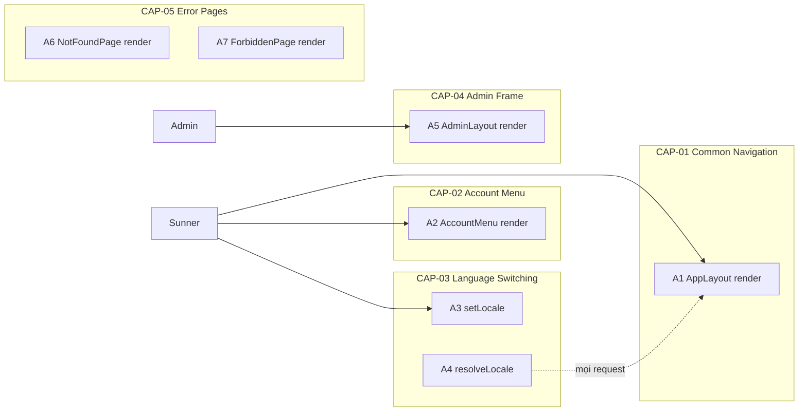

# F002_AppShell — Technical Spec

**Priority**: P0
**Type**: ui
**Generated**: 2026-11-08

**See also:** [`functional-spec.md`](./functional-spec.md) — tổng quan, quyết định còn mở, yêu cầu và quy tắc nghiệp vụ dạng một dòng, màn hình, user story, kịch bản, edge case, cấu hình cho BA/QA.

**How to read this file:** § 2 là bảng chỉ mục — chọn action cần đọc rồi đọc block của nó ở § 3 từ trên xuống. § 4 là phụ lục dùng chung, chỉ nhảy vào khi một block ở § 3 trỏ tới.

## 1. Technical Overview

Khung dùng chung gồm layout cho khu Sunner (header, footer, menu avatar, đổi ngôn ngữ), layout riêng cho khu Admin, và hai trang lỗi 404/403, dựng trên Next.js 16 App Router với next-intl (vi/en). Khung chỉ đọc phiên và role do F001_Auth cung cấp, không sở hữu bảng dữ liệu nào, không tự quyết định quyền truy cập. Chuông thông báo là một chỗ trống (slot) trong header, nội dung do F013_Notifications cấp.



## 2. Action Index

| # | Action (handler) | Method · Path | Codes | Writes | Detail |
|---|---|---|---|---|---|
| **A0** | *cross-cutting — belongs to no single action* | — | FR-602 | — | § 4.4 |
| **A1** | `AppLayout#render` (planned) | `GET` `/(mọi trang khu Sunner)` | FR-101, FR-102, FR-103, FR-104, FR-105, FR-402, US001_NavigateWithHeader | — *(read-only)* | § 3.1 |
| **A2** | `AccountMenu#render` (planned) | — | FR-201, FR-601, BR-002, DEC-001, US003_OpenAccountMenu | — *(read-only)* | § 3.2 |
| **A3** | `LanguageSwitcher#setLocale` (planned) | `POST` `server action: setLocale` | FR-202, FR-401, US002_SwitchLanguage | — *(cookie only, theo D004)* | § 3.3 |
| **A4** | `I18nRequestConfig#resolveLocale` (planned) | — | FR-001, FR-002, BR-001 | — *(read-only)* | § 3.3 |
| **A5** | `AdminLayout#render` (planned) | `GET` `/admin/**` | FR-301, FR-302, FR-303, FR-602, US004_UseAdminMenu | — *(read-only)* | § 3.4 |
| **A6** | `NotFoundPage#render` (planned) | `GET` `/(địa chỉ không khớp route nào)` | FR-351, FR-353, FR-603, US005_SeeNotFoundPage | — *(read-only)* | § 3.5 |
| **A7** | `ForbiddenPage#render` (planned) | `GET` `/(khi guard báo không đủ quyền)` | FR-352, FR-353, FR-603, DEC-002, US006_SeeForbiddenPage | — *(read-only)* | § 3.5 |

**Rung set:** Who → FE → Request → BE → Rule → Result → State → Source. Rung vắng thì bỏ hẳn, không ghi N/A.

## 3. Actions

### 3.1 CAP-01 — Common Navigation

#### A1 · Render app layout
`GET /(mọi trang khu Sunner)` → `AppLayout#render` (planned)
`FR-101` `FR-102` `FR-103` `FR-104` `FR-105` `FR-402` `US001_NavigateWithHeader` · TBD (draft) — SCR003_AppLayout

**Who** · Sunner đã đăng nhập *(gate A0 — § 4.4)*
**FE** · Header: logo, ba liên kết (About SAA 2025, Award Information, Sun* Kudos), slot chuông, nút đổi ngôn ngữ, avatar + menu; footer. Mục khớp đường dẫn hiện tại được đánh dấu đang chọn (FR-102: đánh dấu trang đang mở). Dưới breakpoint nhỏ, ba liên kết gộp vào nút menu thu gọn, bấm ra ngoài hoặc chọn mục thì đóng (FR-104).
**BE** · Server component lấy người dùng hiện tại từ F001_Auth, truyền xuống header; bản dịch lấy qua next-intl theo locale từ A4.
**Result** · read-only — không ghi dữ liệu. Slot chuông (FR-105: chỗ đặt chuông, nội dung do F013) render rỗng cho tới khi F013 gắn vào.
**Source:** TBD (draft)

<!-- Không có diagram: read-only, một request đồng bộ, không ghi bảng nào. -->

---

### 3.2 CAP-02 — Account Menu

#### A2 · Render account menu
`AccountMenu#render` (planned)
`FR-201` `FR-601` `BR-002` `DEC-001` `US003_OpenAccountMenu` · TBD (draft) — SCR003_AppLayout

**Who** · Sunner, Admin *(gate A0 — § 4.4)*
**FE** · Avatar (chữ cái đầu khi chưa có ảnh) mở menu: Profile, Admin Dashboard, Logout. Logout gọi hành động đăng xuất do F001_Auth cung cấp; lỗi thì giữ nguyên trang và hiện thông báo.
**Rule**
- **BR-002 — Role đến từ phiên của F001_Auth, ẩn mục Admin chỉ để gọn giao diện.** Ẩn nút không thay thế cho việc chặn truy cập ở phía máy chủ (FR-601: mục Admin chỉ hiện với Admin).

| DEC | subtype | Condition | What the user sees | Source |
|---|---|---|---|---|
| **DEC-001** | render | `session.role == admin` | Mục Admin Dashboard hiện trong menu; role khác thì không hiện | TBD (draft) |

**Result** · read-only — **không ghi dữ liệu**. Đăng xuất do F001_Auth thực hiện, F002 không ghi gì.
**Source:** TBD (draft)

<!-- Không có diagram: read-only, không ghi bảng. -->

---

### 3.3 CAP-03 — Language Switching

#### A3 · Set locale
`POST server action: setLocale` → `LanguageSwitcher#setLocale` (planned)
`FR-202` `FR-401` `US002_SwitchLanguage` · TBD (draft) — SCR003_AppLayout

**Who** · Sunner, Khách chưa đăng nhập (nếu D002 được chấp nhận) *(gate A0 — § 4.4)*
**FE** · Nút đổi ngôn ngữ hiện ngôn ngữ hiện tại, danh sách gồm Tiếng Việt và English (FR-202); chọn xong gọi action rồi làm mới trang, giữ nguyên trạng thái client như form đang nhập (mong muốn, chưa kiểm chứng).
**Request** · param `locale` *(Zod enum: `vi` | `en`)*
**BE** · `LanguageSwitcher#setLocale` kiểm tra bằng Zod, ghi cookie lựa chọn ngôn ngữ để nhớ cho lần sau (FR-401: nhớ lựa chọn), tên cookie TBD (draft).
**Result** · Ghi cookie phía trình duyệt, không ghi cơ sở dữ liệu (D004, mặc định đề xuất). Giá trị ngoài `vi`/`en` bị từ chối, không đổi cookie.
**Source:** TBD (draft)

<!-- Không có diagram: không ghi bảng, một bước đồng bộ. -->

---

#### A4 · Resolve locale for each request *(background-like, no FE)*
`I18nRequestConfig#resolveLocale` (planned)
`FR-001` `FR-002` `BR-001`

**Who** · *không có tác nhân — chạy ở mọi request, chuẩn bị bản dịch cho A1, A5, A6, A7*
**BE** · `I18nRequestConfig#resolveLocale` nạp bản dịch vi/en của next-intl cho locale được chọn (FR-001: đủ chữ cả hai ngôn ngữ).
**Rule** · **BR-001 — Chọn ngôn ngữ theo thứ tự: cookie đã lưu, rồi `Accept-Language` nếu là vi/en, cuối cùng `vi`.** Giá trị cookie không hợp lệ bị bỏ qua. Dùng cho FR-002 (ngôn ngữ lần đầu vào).
**Result** · read-only — trả về locale và bộ bản dịch cho request hiện tại.
**Source:** TBD (draft)

---

### 3.4 CAP-04 — Admin Frame

#### A5 · Render admin layout
`GET /admin/**` → `AdminLayout#render` (planned)
`FR-301` `FR-302` `FR-303` `FR-602` `US004_UseAdminMenu` · TBD (draft) — SCR002_AdminLayout

**Who** · Admin *(gate A0 — § 4.4)*
**FE** · Khung Admin với menu bốn mục Overview, Review content, User, Settings; mục khớp đường dẫn hiện tại được đánh dấu (FR-302); có lối quay về khu Sunner và menu avatar (FR-303). Vị trí menu (thanh bên hay thanh trên) chưa xác nhận từ thiết kế.
**BE** · Layout chỉ render khi guard của F001_Auth đã cho qua (FR-602: khung không tự quyết định quyền). Nhãn "Role" hay "User" của mục thứ ba đang mở ở câu hỏi chung của dự án.
**Result** · read-only — không ghi dữ liệu.
**Source:** TBD (draft)

---

### 3.5 CAP-05 — Error Pages

#### A6 · Render not-found page
`GET /(địa chỉ không khớp route nào)` → `NotFoundPage#render` (planned)
`FR-351` `FR-353` `FR-603` `US005_SeeNotFoundPage` · TBD (draft) — SCR005_Error404

**Who** · Mọi người dùng, kể cả khách chưa đăng nhập
**FE** · Trang 404: lời giải thích (FR-351: địa chỉ không tồn tại) và nút quay về trang chính, theo ngôn ngữ đang chọn (FR-353).
**BE** · Dùng cơ chế not-found của App Router; chỉ trả chữ đã dịch, không kèm chi tiết lỗi nội bộ (FR-603).
**Result** · read-only — trả mã trạng thái 404.
**Source:** TBD (draft)

---

#### A7 · Render forbidden page
`GET /(khi guard báo không đủ quyền)` → `ForbiddenPage#render` (planned)
`FR-352` `FR-353` `FR-603` `DEC-002` `US006_SeeForbiddenPage` · TBD (draft) — SCR004_Error403

**Who** · Sunner đã đăng nhập nhưng không đủ quyền
**FE** · Trang 403: lời giải thích (FR-352: không đủ quyền) và nút quay về trang chính, theo ngôn ngữ đang chọn (FR-353).
**BE** · Được gọi khi guard của F001_Auth báo không đủ quyền; trả chữ đã dịch, không lộ nội dung khu Admin (FR-603).
**Rule** · decides trang nào hiện khi guard từ chối:

| DEC | subtype | Condition | What the user sees | Source |
|---|---|---|---|---|
| **DEC-002** | flow | `guard == forbidden` | Trang 403 | TBD (draft) |
| **DEC-002** | flow | `route not found` | Trang 404 (A6) | TBD (draft) |
| **DEC-002** | flow | `no session` | Chuyển tới đăng nhập — F001_Auth xử lý, F002 không hiện gì | TBD (draft) |

**Result** · read-only — trả mã trạng thái 403.
**Source:** TBD (draft)

---

### 3.6 Edge cases

| Action | Scenario | Behavior |
|---|---|---|
| A3 | `locale` ngoài `vi`/`en` | Zod từ chối, cookie không đổi |
| A4 | Cookie ngôn ngữ chứa giá trị lạ | Bỏ qua, rơi về `Accept-Language` rồi `vi` (BR-001) |
| A1 · A5 | Phiên hết hạn lúc đang xem | F001_Auth chuyển tới đăng nhập (A0 — § 4.4) |
| A5 | Admin bị hạ role giữa chừng | Request kế tiếp bị guard từ chối, hiện A7 |
| A1 | Tên người dùng rất dài | Cắt bằng dấu ba chấm trong header |
| A6 · A7 | Khách chưa đăng nhập vào trang lỗi | Hiển thị nút dẫn tới đăng nhập (D005, chờ xác nhận) |

## 4. Shared Foundation

### 4.1 Components

| Component | Responsibility | Used in | File |
|---|---|---|---|
| `AppLayout` (planned) | Layout khu Sunner: header, footer | A1, A2, A3 | TBD (draft) |
| `AdminLayout` (planned) | Layout khu Admin và menu Admin | A5 | TBD (draft) |
| `LanguageSwitcher` (planned) | Nút đổi ngôn ngữ, tái dùng ở layout Sunner, Admin và trang chưa đăng nhập (D002) | A3 | TBD (draft) |
| `AccountMenu` (planned) | Menu avatar | A2, A5 | TBD (draft) |

### 4.2 Data Model

None — F002 không sở hữu bảng. Đọc hồ sơ Sunner và role của F001_Auth ở chế độ chỉ đọc. Mã `MODEL###` = TBD (draft).

N/A — no discriminator fields in Key Entities.

### 4.3 State Management

None.

### 4.4 Shared Rules

#### Bin 3 — cross-cutting, belongs to no single action

**A0 · FR-602 — Khung Admin chỉ hiện sau khi guard của F001_Auth cho qua.**
F002 không tự kiểm tra quyền; layout Admin chỉ được render khi guard đã cho qua, mọi request tới khu Admin đều đi qua guard đó. Khi guard từ chối thì hiện A7 (403).
**Source:** TBD (draft)

#### Bin 2 — used by ≥2 named actions

None — chưa có quy tắc nào dùng chung bởi từ hai action trở lên.

### 4.5 Algorithms & Integrations

None.

### 4.6 Configuration

```text
SUPPORTED_LOCALES = vi, en       # hai locale next-intl hỗ trợ (A3, A4)
DEFAULT_LOCALE = vi              # locale cuối cùng của BR-001 (A4)
LOCALE_COOKIE_NAME = TBD (draft) # tên cookie lưu lựa chọn (A3)
LOCALE_COOKIE_MAX_AGE_DAYS = 365 # đề xuất, chờ xác nhận (A3)
```

## 5. Verification & Technical Notes

### 5.1 Technical Verification

- **SC-001** *(A4)* Không có cookie, `Accept-Language: en` thì giao diện tiếng Anh; ngôn ngữ khác thì `vi` (covers FR-002, BR-001)
- **SC-002** *(A3)* Gọi `setLocale` với `en` rồi tải lại: vẫn tiếng Anh; với `fr` thì cookie không đổi (covers FR-202, FR-401)
- **SC-003** *(A2)* Tài khoản role User không thấy mục Admin Dashboard (covers FR-601, DEC-001)
- **SC-004** *(A5, A7)* Tài khoản role User vào `/admin` nhận 403, không có HTML của menu Admin (covers FR-602, FR-352)
- **SC-005** *(A6, A7)* Hai trang lỗi không chứa đường dẫn máy chủ hay stack trace (covers FR-603)

#### US002_SwitchLanguage *(A3, A4)*

**Independent Test:** Chọn English trong nút ngôn ngữ, quan sát chữ đổi và cookie được ghi.

**Acceptance Scenarios:**

1. **Given** giao diện `vi`, **When** gọi `setLocale('en')`, **Then** trang làm mới và hiện tiếng Anh.
2. **Given** cookie `en`, **When** mở trình duyệt lại, **Then** vẫn tiếng Anh.

#### US004_UseAdminMenu *(A5)*

**Independent Test:** Đăng nhập Admin, bấm lần lượt bốn mục menu.

**Acceptance Scenarios:**

1. **Given** Admin ở `/admin`, **When** bấm Review content, **Then** mục đó được đánh dấu.
2. **Given** tài khoản User, **When** vào `/admin`, **Then** nhận 403.

#### US006_SeeForbiddenPage *(A7)*

**Independent Test:** Dùng tài khoản User gõ địa chỉ khu Admin.

**Acceptance Scenarios:**

1. **Given** tài khoản User, **When** vào `/admin`, **Then** mã trạng thái 403 và nút quay về trang chính.

### 5.2 Assumptions

- *(A3, A4)* Lựa chọn ngôn ngữ chỉ lưu trong cookie, không ghi hồ sơ Sunner (D004 mặc định); URL không có tiền tố locale (D001 mặc định).
- *(A5, A7)* F001_Auth cung cấp guard cho khu Admin và gọi được trang 403 của F002; F002 không tự cài guard.
- *(A1)* Chuông thông báo là một slot, F013 gắn nội dung vào sau; F002 không chứa logic thông báo.

### 5.3 Unresolved Questions

1. **Cơ chế 403 của Next.js 16** *(A7)*: `forbidden()` / `forbidden.tsx` có thể cần cờ thử nghiệm, và AGENTS.md nói phiên bản này khác kiến thức quen thuộc. Phải đọc tài liệu trong `node_modules/next/dist/docs/` trước khi code; nếu không dùng được thì render trang 403 thủ công từ layout Admin.
2. **Cách next-intl nạp locale khi không có tiền tố** *(A3, A4)*: cần xác nhận cấu hình cookie-only của next-intl với Next.js 16.
3. **Slot chuông** *(A1)*: giao diện (props) giữa header và F013 chưa chốt.

### 5.4 Source References

Chưa có mã nguồn — xem `## 7. User Stories` trong functional-spec.md để biết hành vi dự kiến.

### 5.5 Artifact References

| Artifact | File | Codes Used | Reviewed |
|----------|------|------------|----------|
| System Overview | TBD (draft) | — | [ ] |
| Architecture | TBD (draft) | — | [ ] |
| Feature List | [feature-list.md](../feature-list.md) | F002 | [x] |
| API Map | TBD (draft) | TBD (draft) | [ ] |
| Entities | TBD (draft) | TBD (draft) | [ ] |
| Screens | [functional-spec.md § 6](./functional-spec.md#6-screens) | TBD (draft) | [ ] |
| Behavior Logic | TBD (draft) | TBD (draft) | [ ] |
| Permissions Matrix | TBD (draft) | TBD (draft) | [ ] |
| User Stories | TBD (draft) | TBD (draft) | [ ] |
