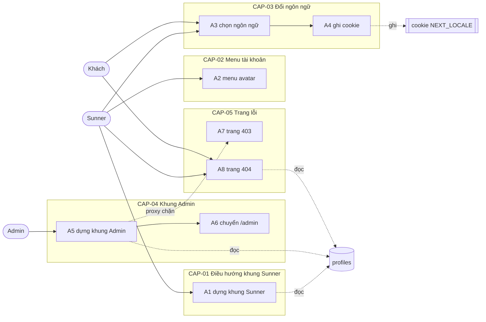
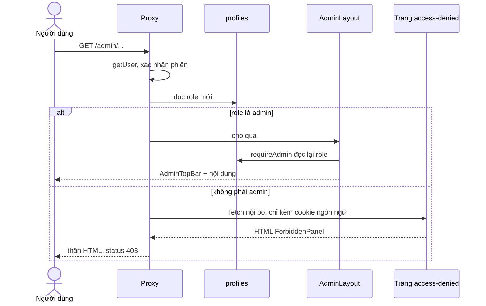
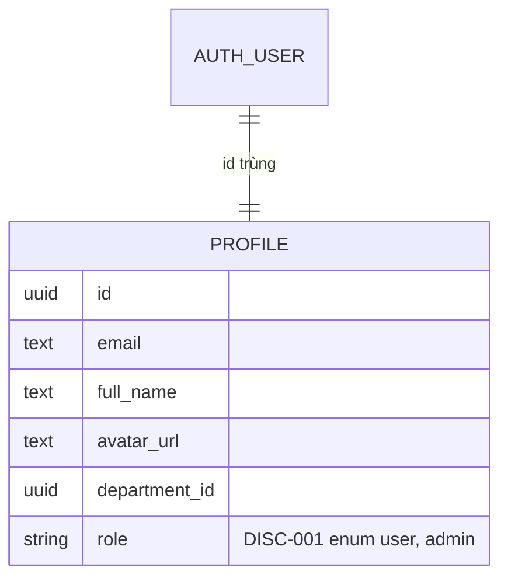

<!-- layout-exempt: rebuild-spec owns all docs/system|features|generated|flows paths — all references here are output targets or internal definitions -->
<!-- Contract: references/feature-spec-researcher-contract.md -->
<!-- Nửa Dev/QA/SA của cặp spec. Mọi mã FR/BR/SM/DEC/ALG/INT được PHÁT BIỂU một lần ở functional-spec.md và CÀI ĐẶT một lần ở đây; không lặp câu quy tắc thuần ngôn ngữ ở file này. -->

# F002_AppShell — Technical Spec

**Priority**: P0
**Type**: ui
**Generated**: 2026-11-24

**See also:** [`functional-spec.md`](./functional-spec.md) — tổng quan, quyết định còn mở, yêu cầu và quy tắc nghiệp vụ dạng một dòng, màn hình, user story, kịch bản, edge case và cấu hình cho BA/QA.

**How to read this file:** § 2 là bảng chỉ mục action; chọn action cần xem rồi đọc khối của nó ở § 3 từ đầu đến cuối, mỗi khối là một luồng hoàn chỉnh. § 4 là phụ lục dùng chung, chỉ nhảy vào khi § 3 trỏ tới.

## 1. Technical Overview

F002 là khung dùng chung của Next.js App Router: hai layout (`app/(app)/layout.tsx` cho khu Sunner, `app/admin/layout.tsx` cho khu Admin), hai trang lỗi (`app/not-found.tsx`, `app/forbidden.tsx` cùng `app/access-denied/page.tsx`), một server action đổi ngôn ngữ (`setLocaleAction`, ghi cookie `NEXT_LOCALE`) và các component client của header, menu, nút ngôn ngữ. Feature **chỉ đọc**: không ghi bảng nào, chỉ đọc `profiles` qua `findSessionProfile` và ghi một cookie. Quyền không do F002 quyết: cổng `requireSunner()` / `requireAdmin()` và bước 4b của proxy thuộc `shared/auth`, F002 gọi lại và dựng giao diện quanh kết quả.



## 2. Action Index

| # | Action (handler) | Method · Path | Codes | Writes | Detail |
|---|---|---|---|---|---|
| **A0** | *cross-cutting — belongs to no single action* | — | FR-001, FR-002, BR-001, BR-004 | — | § 4.4 |
| **A1** | `AppLayout` | `GET` `/(app)/*` | FR-101, FR-102, FR-103, FR-104, FR-105, FR-203, BR-003, DEC-001, US021 | — *(read-only)* | § 3.1 |
| **A2** | `AccountMenu` *(client)* | — | FR-201, FR-601, BR-002, DEC-006, US002 | — *(client; `signOut` thuộc F001_Auth)* | § 3.2 |
| **A3** | `LanguageSwitcher#select` *(client)* | — | FR-202, DEC-005, US020 | — *(client only)* | § 3.3 |
| **A4** | `setLocaleAction` | `POST` `server action setLocaleAction` | FR-401, BR-005, US020 | — *(cookie `NEXT_LOCALE`, không bảng)* | § 3.3 |
| **A5** | `AdminLayout` | `GET` `/admin/*` | FR-301, FR-302, FR-304, FR-602, BR-003, BR-004, DEC-002, DEC-003, INT-001, US001 | — *(read-only)* | § 3.4 ▸ **diagram** |
| **A6** | `AdminIndexPage` | `GET` `/admin` | FR-303, US001 | — *(read-only)* | § 3.4 |
| **A7** | `AccessDeniedPage` | `GET` `/access-denied` | FR-352, FR-353, FR-603, INT-001, US022 | — *(read-only)* | § 3.5 |
| **A8** | `NotFound` | `GET` `(mọi địa chỉ không khớp route)` | FR-351, FR-353, FR-603, DEC-004, US017, US022 | — *(read-only)* | § 3.5 |

**Rung set** theo template: Who → FE → Request → BE → Rule → Result → State → Source. Rung vắng thì bỏ hẳn. Không có **State**: F002 không có máy trạng thái bền (hai trạng thái mở/đóng của menu là cục bộ, dưới ngưỡng SM, nên chỉ nằm trong rung FE). Chỉ A5 có diagram vì luồng proxy → trang 403 đi qua nhiều thành phần; không action nào ghi ≥2 bảng hay chạy nền.

## 3. Actions

### 3.1 CAP-01 — Điều hướng khung Sunner

#### A1 · Dựng khung Sunner: cổng kiểm tra, header, footer, chuông và vùng toast
`GET /(app)/*` → `` `AppLayout` ``
`FR-101` `FR-102` `FR-103` `FR-104` `FR-105` `FR-203` `BR-003` `DEC-001` `US021` · `SCR003_AppLayout`

**Who** · Sunner đã có phiên và đã chọn đơn vị; admin dùng chung khung này. Route group `(app)` bọc chín trang: `/`, `/awards`, `/community-standards`, `/kudos`, `/kudos/:id`, `/notifications`, `/profile`, `/profile/:userId`, `/rules`.
**FE** · `AppLayout` (`app/(app)/layout.tsx:17-29`) dựng `AppHeader` (`features/app-shell/components/app-header.tsx:19-41`): `BrandLogo` bọc link về `/`, ba mục `About SAA 2025` / `Award Information` / `Sun* Kudos` qua `NavLinks` (`features/app-shell/components/app-header-nav-links.tsx:27-52`, `aria-current="page"` ở dòng 40), `MobileNavMenu` (`features/app-shell/components/mobile-nav-menu.tsx:17-47`) hiện dưới breakpoint `md` và đóng khi chọn mục, bấm ngoài hoặc Esc nhờ `useDismissable` (`features/app-shell/hooks/use-dismissable.ts:9-34`; Esc còn trả focus về nút mở), cụm `HeaderActions` (`features/app-shell/components/header-actions.tsx:14-22`) gồm chuông (slot do F013 cấp), `LanguageSwitcher` (A3) và `AccountMenu` (A2). Vùng nội dung bọc `KudoComposerToastHost` của F003 để toast "đã gửi / đã lưu Kudo" sống qua refresh. `AppFooter` bản đầy đủ (`features/app-shell/components/app-footer.tsx:26-55`): logo về `/`, năm link `/`, `/awards`, `/kudos`, `/rules`, `/community-standards` và dòng bản quyền.
**Request** · không tham số; phiên đọc từ cookie Supabase qua `createSupabaseServerClient` (BL011).
**BE** · `requireSunner()` (`shared/auth/current-user.ts:48-53`) chạy đầu tiên và trả `{ userId }`; `getShellUser()` (`features/app-shell/server/shell-session.ts:28-33`, bọc `cache` của React nên dùng chung một lần đọc `findSessionProfile` với guard trong cùng lượt render) đổi hồ sơ thành `ShellUser { name, avatarUrl, isAdmin }` bằng `toShellUser` (`features/app-shell/server/shell-session.ts:19-25`): tên là `fullName` đã trim, trống thì lấy phần trước `@` của email (không bao giờ đưa nguyên email xuống client). `NotificationBellSlot userId` (F013) nhận `userId`. `export const instant = false` (`app/(app)/layout.tsx:10`) đánh dấu khung này là route chặn vì guard đọc cookie và DB theo từng request.
**Rule** · quyết định ai được thấy khung và được đưa đi đâu nếu chưa đủ điều kiện (`DEC-001`, chuỗi cổng của `requireSunner`), và mục nào của header đang sáng (`BR-003`):

| DEC | subtype | Condition | What the user sees | Source |
|---|---|---|---|---|
| **DEC-001** | flow | không có phiên (`getSunnerContext` trả `null`) | chuyển tới `/login`, không dựng khung | `shared/auth/current-user.ts:48-50` |
| **DEC-001** | flow | có phiên nhưng không có hàng `profiles` | trang 401 (`unauthorized()`), không chuyển hướng vì chuyển sẽ lặp qua luật `/login` → `/` của proxy | `shared/auth/current-user.ts:37-39` |
| **DEC-001** | flow | có hồ sơ nhưng `departmentId` rỗng | chuyển tới `/onboarding/department` | `shared/auth/current-user.ts:51` |
| **DEC-001** | flow | có hồ sơ và có đơn vị | khung được dựng với header, nội dung, footer | `app/(app)/layout.tsx:17-29` |

- **BR-003 — Mục điều hướng sáng theo tiền tố đường dẫn.** `NavLinks` gọi `isRouteActive(pathname, href)`: `/` chỉ khớp đúng `/`, mọi mục khác khớp chính nó và trang con (`/kudos` sáng ở `/kudos/123`), nên About SAA 2025 không sáng khắp nơi. *(§ 4.4)*

**Result** · read-only — **không ghi DB**. Trả cây RSC: `AppHeader`, nội dung, `AppFooter`; mục đang mở mang `aria-current="page"`; chuông chưa có dữ liệu thì F013 tự xử lý (không làm hỏng header).
**Source:** `app/(app)/layout.tsx:17-29` → `shared/auth/current-user.ts:33-53` → `features/app-shell/server/shell-session.ts:19-33` → `features/app-shell/components/app-header.tsx:19-41` → `features/app-shell/components/app-footer.tsx:15-55`

<!-- Không có diagram: dưới ngưỡng (chỉ đọc một bảng, đồng bộ). Phần rẽ nhánh nằm ở bảng DEC-001, đọc tốt hơn dạng bảng. -->

---

### 3.2 CAP-02 — Menu tài khoản

#### A2 · Menu avatar: Profile, Dashboard cho admin, Logout
Client component `AccountMenu`, không có route riêng
`FR-201` `FR-601` `BR-002` `DEC-006` `US002` · `SCR003_AppLayout` · `SCR002_AdminLayout`

**Who** · Sunner hoặc admin đã đăng nhập; cùng một component được dựng trong khung Sunner (A1) và thanh trên Admin (A5).
**FE** · `AccountMenu` (`features/app-shell/components/account-menu.tsx:20-86`): nút avatar mở bảng gồm `Profile` (link `/profile`, dòng 61-64), `Dashboard` (link `/admin/overview`, chỉ khi `user.isAdmin`, dòng 65-70) và `Logout` (nút, chỉ khi có `signOutAction`, dòng 71-76); mọi link đóng menu khi bấm. Esc và bấm ngoài đóng menu nhờ `useDismissable`. `HeaderActions` chỉ dựng `AccountMenu` khi `user` khác `null` (`features/app-shell/components/header-actions.tsx:19`).
**Request** · không tham số. `ShellUser` (A1/A5) và `signOutAction` = `signOut` qua `getShellSignOutAction()` (`features/app-shell/server/shell-session.ts:36-38`).
**BE** · không có route riêng: hai link là `next/link`, đích tự guard (A1/A5, `requireAdmin` ở trang Overview). `Logout` gọi server action `signOut` của F001_Auth (`shared/auth/sign-out-action.ts:16-24`): `signOut({ scope: "local" })` rồi `redirect("/login")`; lỗi thật trả `{ ok: false }`.
**Rule** · quyết định mục Dashboard có hiện không (`BR-002`) và Logout báo gì khi thất bại (`DEC-006`):

| DEC | subtype | Condition | What the user sees | Source |
|---|---|---|---|---|
| **DEC-006** | interaction | `signOutAction()` trả `{ ok: false }` hoặc ném lỗi | menu giữ nguyên, dòng `role="alert"` "Không thể đăng xuất, vui lòng thử lại." (`shell.account.logoutFailed`) hiện dưới các mục; nút Logout khoá khi đang chờ | `features/app-shell/components/account-menu.tsx:32-43` |
| **DEC-006** | interaction | `signOut` thành công | action redirect nên trình duyệt rời trang sang `/login`; không có thông báo | `features/app-shell/components/account-menu.tsx:32-43` |

**BR-002 — Mục Dashboard chỉ là ẩn giao diện, không phải lớp bảo vệ.** `user.isAdmin` suy từ `profile.role === "admin"` (`features/app-shell/server/shell-session.ts:23`); Sunner thường không thấy mục, nhưng gõ thẳng `/admin/overview` vẫn đi qua cổng của A5 và bị chặn thật. `features/app-shell/components/account-menu.tsx:65-70`

**Result** · read-only trong F002 (menu chỉ điều hướng). Click `Dashboard` mở `/admin/overview` (F015) và đóng menu; click `Logout` đổi phiên ở F001_Auth. Giá trị `DISC-001` (role): `user` → menu chỉ Profile + Logout; `admin` → thêm Dashboard (§ 4.2).
**Source:** `features/app-shell/components/account-menu.tsx:20-86` → `features/app-shell/server/shell-session.ts:19-25` → `shared/auth/sign-out-action.ts:16-24`

<!-- Không có diagram: dưới ngưỡng (client thuần, không ghi bảng). Hai trạng thái mở/đóng và logoutFailed là state cục bộ dưới ngưỡng SM nên không tách SM-###. -->

---

### 3.3 CAP-03 — Đổi ngôn ngữ

Một luồng trải trên hai handler: `LanguageSwitcher#select` (client, A3) gọi server action `setLocaleAction` (A4), rồi `router.refresh()` cho request kế tiếp đọc cookie qua cấu hình next-intl (`BR-001`, cross-cutting § 4.4).

#### A3 · Chọn ngôn ngữ trong danh sách
Client component `LanguageSwitcher`, không có route riêng
`FR-202` `DEC-005` `US020` · `SCR003_AppLayout` · `SCR002_AdminLayout`

**Who** · mọi người dùng, kể cả khách ở `/login` và `/countdown` (header công khai `PublicHeader` của F001/F006 dùng chung, `features/app-shell/components/public-header.tsx:7-17`).
**FE** · `LanguageSwitcher` (`features/app-shell/components/language-switcher.tsx:15-103`): nút mở danh sách mang `aria-label` bắt đầu bằng mã đang hiện ("VN, Ngôn ngữ: Tiếng Việt", dòng 58) và khoá khi đang chờ (dòng 59); danh sách hai nút `VN` / `EN` (dòng 70-92) với `aria-pressed` ở mục đang dùng; lỗi hiện `role="alert"` "Không thể đổi ngôn ngữ, vui lòng thử lại." (`shell.language.switchFailed`, dòng 93-100). Ngôn ngữ hiện tại lấy từ `useLocale()`, giá trị lạ rơi về `vi` (dòng 17-18).
**Request** · `locale` ∈ {`vi`, `en`} chọn từ danh sách.
**BE** · `select` đóng danh sách rồi bọc `setLocaleAction(locale)` trong `startTransition`; thành công gọi `router.refresh()` (`features/app-shell/components/language-switcher.tsx:33-48`).
**Rule** · quyết định chọn lại / thành công / thất bại (`DEC-005`):

| DEC | subtype | Condition | What the user sees | Source |
|---|---|---|---|---|
| **DEC-005** | interaction | `locale === current` | danh sách đóng, không gọi action, không đổi gì | `features/app-shell/components/language-switcher.tsx:33-36` |
| **DEC-005** | interaction | `locale !== current` và `result.ok` | `router.refresh()`: khung và trang đổi ngôn ngữ, nút đổi mã (VN ⇄ EN) | `features/app-shell/components/language-switcher.tsx:37-40` |
| **DEC-005** | interaction | `result.ok === false` hoặc action ném lỗi | giữ ngôn ngữ cũ, alert "Không thể đổi ngôn ngữ, vui lòng thử lại." | `features/app-shell/components/language-switcher.tsx:40-46` |

**Result** · không ghi DB; kết quả thật là cookie do A4 ghi. Sau thành công trang render lại bằng ngôn ngữ mới tại cùng URL.
**Source:** `features/app-shell/components/language-switcher.tsx:15-103` → `shared/i18n/set-locale-action.ts:18-34`

---

#### A4 · Ghi cookie ngôn ngữ
`POST` server action `setLocaleAction` → `` `setLocaleAction` ``
`FR-401` `BR-005` `US020` · `SCR003_AppLayout` · `SCR002_AdminLayout`

**Who** · mọi người dùng; action không tự kiểm phiên vì `/login` và `/countdown` nằm trong allowlist công khai của proxy và mọi đường dẫn khác đã được proxy chuyển khách đi (`shared/auth/public-paths.ts:33-40`, `shared/auth/route-access-policy.ts:29-40`).
**Request** · tham số duy nhất `locale: unknown` (kiểu `unknown` có chủ ý: input của Server Action là input không tin cậy, `shared/i18n/set-locale-action.ts:18`).
**BE** · `setLocaleAction` (`shared/i18n/set-locale-action.ts:18-34`): `z.enum(locales).safeParse` rồi `cookies().set("NEXT_LOCALE", …)`; trả `{ ok: true }` hoặc `{ ok: false }`.
**Rule** · **BR-005 — Chỉ nhận `vi` / `en`, cookie httpOnly nên chỉ máy chủ đọc được.** Giá trị khác trả `{ ok: false }` trước khi chạm cookie; cookie đặt `maxAge` một năm (365 ngày), `sameSite: "lax"`, `path: "/"`, `httpOnly: true`, `secure` chỉ khi `NODE_ENV === "production"`; lỗi ghi cookie được `console.error` rồi trả `{ ok: false }`. `shared/i18n/set-locale-action.ts:19-32`
**Result** · ghi cookie `NEXT_LOCALE` — `shared/i18n/set-locale-action.ts:22-28` (không có bảng DB). Phản hồi `{ ok: true }` để A3 gọi `router.refresh()`.
**Source:** `shared/i18n/set-locale-action.ts:18-34` → `shared/i18n/locales.ts:5-15` → `shared/i18n/request.ts:12-22`

<!-- Không có diagram: dưới ngưỡng (một lần ghi cookie, đồng bộ, không bảng). -->

---

### 3.4 CAP-04 — Khung Admin

#### A5 · Dựng khung Admin sau khi cổng cho qua
`GET /admin/*` → `` `AdminLayout` ``
`FR-301` `FR-302` `FR-304` `FR-602` `BR-003` `BR-004` `DEC-002` `DEC-003` `INT-001` `US001` · `SCR002_AdminLayout`

**Who** · Admin; người không phải admin và khách không bao giờ nhận markup của khung này *(gate A0 — § 4.4)*.
**FE** · `AdminTopBar` (`features/app-shell/components/admin-top-bar.tsx:19-49`): thanh `sticky` có `MobileNavMenu` (dưới `md`), link về `/` gồm logo, vạch dọc, nhãn `ADMIN` và chữ ẩn "Về khu Sunner" để tên truy cập chứa nhãn hiển thị (WCAG 2.5.3), `NavLinks` bốn mục `Overview` / `Review content` / `User` / `Settings` (`/admin/overview`, `/admin/review`, `/admin/users`, `/admin/settings`) và `HeaderActions` — không truyền `bellSlot` nên khung Admin không có chuông. Footer là `AppFooter variant="minimal"` chỉ có dòng bản quyền (`features/app-shell/components/app-footer.tsx:22-24`).
**Request** · không tham số; cookie phiên Supabase. Ở proxy còn đọc `request.method` và header `next-action` (xem DEC-003).
**BE** · `AdminLayout` (`app/admin/layout.tsx:10-19`) gọi `requireShellAdmin()` đầu tiên (`features/app-shell/server/shell-session.ts:41-44`) → `requireAdmin()` (`shared/auth/admin-guard.ts:30-35`) → `resolveAdminAccess` đọc `getSessionUser` rồi `findSessionProfile` (`shared/auth/admin-guard.ts:17-23`), sau đó `toShellUser`. Trước cả layout, proxy bước 4b (`shared/auth/session-proxy.ts:106-110`) đã đọc hồ sơ bằng `profileLookup` (`shared/auth/session-proxy.ts:81-90`, một lần đọc nhớ trong một request, lỗi đọc coi như không phải admin) và chặn nếu `role !== "admin"`. `export const instant = false` (`app/admin/layout.tsx:7`).
**Rule** · hai tầng chặn, theo đúng thứ tự: proxy trước, layout sau (`DEC-003`, `DEC-002`); quyền admin luôn đọc lại từ DB (`BR-004`, cross-cutting § 4.4); mục sáng theo `BR-003`:

| DEC | subtype | Condition | What the user sees | Source |
|---|---|---|---|---|
| **DEC-003** | render, flow | proxy: `isAdminPath(pathname)` và hồ sơ khác `role = "admin"` (kể cả thiếu hồ sơ hay đọc lỗi), request là `GET`/`HEAD` không có header `next-action` | thân HTTP 403 là trang `/access-denied` (A7), layout không chạy, không có markup admin | `shared/auth/session-proxy.ts:92-96` |
| **DEC-003** | render, flow | cùng điều kiện nhưng là Server Action (có `next-action`) hoặc method khác | JSON `{ "code": "forbidden" }` kèm status 403, không có trang | `shared/auth/session-proxy.ts:92-96` |
| **DEC-002** | flow | layout: không có phiên (`status: "unauthenticated"`) | chuyển tới `/login` | `shared/auth/admin-guard.ts:30-35` |
| **DEC-002** | flow | layout: có phiên nhưng role khác `admin` (`status: "forbidden"`) | `forbidden()` dựng `app/forbidden.tsx` (cùng `ForbiddenPanel`); status do proxy quyết nên chỉ còn là lớp dự phòng | `shared/auth/admin-guard.ts:30-35` |
| **DEC-002** | flow | layout: role là `admin` | trả `{ userId, profile }`, khung Admin được dựng | `shared/auth/admin-guard.ts:30-35` |

**Thứ tự ca "admin bị hạ quyền giữa phiên"**: (1) `refreshSession` gọi `supabase.auth.getUser()` (phiên vẫn hợp lệ) → (2) `decideRouteAccess` cho qua vì đã đăng nhập → (3) bước 4b đọc `profiles.role` mới từ DB, thấy `user` → trả 403 ngay tại proxy; layout, `requireShellAdmin` và `AdminIndexPage` không chạy. `requireShellAdmin` chỉ chặn được khi proxy đọc ra `admin` nhưng lần đọc thứ hai của layout (DB, riêng, không dùng chung cache với proxy) ra không phải admin, tức đua giữa hai lần đọc.
- **BR-003 — Mục điều hướng sáng theo tiền tố đường dẫn.** Cùng `isRouteActive` như A1: `/admin/users/123` vẫn làm mục `User` sáng. *(§ 4.4)*
- **BR-004 — Quyền admin đọc lại từ DB ở mỗi request.** Không dựa cookie hay JWT claim nên hạ quyền có hiệu lực ngay ở request kế tiếp; proxy và `requireAdmin` đều đọc `profiles.role`. *(§ 4.4)*

**Result** · read-only — **không ghi DB**. Admin: `AdminTopBar` + nội dung trang + footer tối giản, mục khớp `aria-current="page"`. Không phải admin: không có markup admin nào trong thân phản hồi, kể cả chữ `ADMIN` hay tên mục. Proxy dựng thân 403 bằng `INT-001` (tự fetch nội bộ `/access-denied`, A7) *(§ 4.5)*.
**Source:** `proxy.ts:5-17` → `shared/auth/session-proxy.ts:98-121` → `shared/auth/route-access-policy.ts:25-27` → `shared/auth/access-denied-response.ts:40-60` → `app/admin/layout.tsx:10-19` → `shared/auth/admin-guard.ts:17-35` → `features/app-shell/components/admin-top-bar.tsx:19-49`



<!-- Diagram sở hữu THỨ TỰ và nhánh (proxy trước, layout sau); các rung ở trên sở hữu sự kiện (file, dòng). -->

---

#### A6 · Chuyển `/admin` về Overview
`GET /admin` → `` `AdminIndexPage` ``
`FR-303` `US001` · `SCR002_AdminLayout`

**Who** · Admin *(gate A0 — § 4.4)*
**BE** · `AdminIndexPage` chỉ gọi `redirect(ADMIN_ROUTES.overview)` với `ADMIN_ROUTES.overview = "/admin/overview"`; không đọc dữ liệu.
**Rule** · không tự gọi guard: `/admin` nằm trong `isAdminPath` nên proxy bước 4b đã trả 403 cho người không phải admin trước khi trang chạy, và trang đích tự guard lại *(A0 — § 4.4)*.
**Result** · điều hướng tới `/admin/overview`, không ghi DB.
**Source:** `app/admin/page.tsx:4-6` → `shared/ui/app-routes.ts:17-23` → `shared/auth/route-access-policy.ts:25-27`

<!-- Không có diagram: dưới ngưỡng (một lệnh chuyển hướng, không chạm bảng nào). -->

---

### 3.5 CAP-05 — Trang lỗi 403 và 404

#### A7 · Trang "Không có quyền truy cập" dùng chung cho hai điểm vào
`GET /access-denied` → `` `AccessDeniedPage` ``
`FR-352` `FR-353` `FR-603` `INT-001` `US022` · `SCR004_Error403`

**Who** · bất kỳ ai tới được route này: người bị proxy chặn ở `/admin/*` (qua `INT-001`) hoặc người bị `forbidden()` ở guard. Chính `/access-denied` thuộc allowlist công khai nên khách mở trực tiếp cũng thấy (status 200, trang tĩnh).
**FE** · `ForbiddenPanel` (`features/app-shell/components/forbidden-panel.tsx:9-20`) dựng `ErrorPanel` (`features/app-shell/components/error-panel.tsx:19-50`): nền mờ ROOT FURTHER, tiêu đề "Không có quyền truy cập" (`errors.forbidden.title`), minh hoạ, "Bạn không có quyền truy cập tài nguyên này." và đúng một CTA `Về trang chủ` trỏ `/`. Trang trần: không header, không footer, không chi tiết lỗi (FR-603).
**BE** · hai điểm vào cùng một view: `AccessDeniedPage` (`app/access-denied/page.tsx:16-18`, kèm `generateMetadata` `robots: noindex, nofollow` ở dòng 5-8) và `Forbidden` của `app/forbidden.tsx:4-6` (dựng khi guard gọi `forbidden()`, `authInterrupts` bật trong `next.config.ts`). Không đọc phiên.
**Rule** · **INT-001** — proxy dựng thân HTTP 403 bằng cách tự tải trang này từ chính server (`fetch`, timeout 5 giây) rồi trả với status 403, vì dưới Cache Components shell đã commit status 200 trước khi `forbidden()` trong layout kịp chạy *(§ 4.5)*. Lỗi tải thì trả chữ thuần `403 Forbidden`.
**Result** · read-only — **không ghi DB**. Mở trực tiếp: trang HTML status 200. Qua proxy: cùng HTML với status 403, `Cache-Control: private, no-store`. Bấm CTA tới `/` rồi vẫn qua cổng của khung Sunner (A1).
**Source:** `app/access-denied/page.tsx:5-18` → `app/forbidden.tsx:4-6` → `features/app-shell/components/forbidden-panel.tsx:9-20` → `features/app-shell/components/error-panel.tsx:19-50` → `shared/auth/access-denied-response.ts:40-60`

<!-- Không có diagram riêng: thứ tự proxy → fetch → trang đã vẽ ở A5 (cùng luồng, một bản duy nhất). -->

---

#### A8 · Trang 404 toàn cục, nút theo trạng thái phiên
`GET (mọi địa chỉ không khớp route)` → `` `NotFound` ``
`FR-351` `FR-353` `FR-603` `DEC-004` `US017` `US022` · `SCR005_Error404`

**Who** · bất kỳ ai; thực tế là người đã đăng nhập vì proxy chuyển khách khỏi mọi đường dẫn ngoài allowlist (xem § 5.3 mục 1).
**FE** · `NotFound` (`app/not-found.tsx:7-22`) dựng `ErrorPanel` với tiêu đề "KHÔNG TÌM THẤY" (`errors.notFound.title`), minh hoạ `/images/shell/error-404-illustration.webp`, lời giải thích "Tài nguyên bạn tìm không tồn tại hoặc đã bị xóa." và một CTA. Trang trần, không shell (quyết định ghi ở `plans/261108-0048-saa-2025-kudos-platform/spec/decision-log.md`: bỏ header/footer theo Figma).
**BE** · `getShellUser()` (`features/app-shell/server/shell-session.ts:28-33`) đọc phiên rồi hồ sơ; chọn đích từ `APP_ROUTES` (`shared/ui/app-routes.ts:5-15`). Next trả status 404 cho `app/not-found.tsx`.
**Rule** · quyết định nút duy nhất của trang (`DEC-004`):

| DEC | subtype | Condition | What the user sees | Source |
|---|---|---|---|---|
| **DEC-004** | render, flow | `getShellUser()` khác `null` (có phiên **và** có hàng `profiles`) | CTA "Về trang chủ" → `/` | `app/not-found.tsx:9-12` |
| **DEC-004** | render, flow | `getShellUser()` là `null` (khách, hoặc có phiên nhưng thiếu hồ sơ) | CTA "Đăng nhập" → `/login` sạch, không mang `next` | `app/not-found.tsx:9-12` |

**Result** · read-only — **không ghi DB**. HTTP 404, thân là `ErrorPanel`; không tên người dùng trong thân (`getShellUser` chỉ để chọn nút).
**Source:** `app/not-found.tsx:7-22` → `features/app-shell/server/shell-session.ts:28-33` → `features/app-shell/components/error-panel.tsx:19-50`

<!-- Không có diagram: dưới ngưỡng (chỉ đọc, hai nhánh nằm gọn trong bảng DEC). -->

---

### 3.6 Edge cases

| Action | Scenario | Behavior |
|---|---|---|
| A5 · A7 | Người không phải admin mở trang trong `/admin/*` | proxy bước 4b trả thân `/access-denied` status 403; layout không chạy, không có markup admin (DEC-003, A0 § 4.4) |
| A5 | Admin bị hạ quyền giữa phiên bấm sang mục khác | request kế đọc `profiles.role` mới ở proxy nên trả 403; trang cũ trên màn hình không tự đổi (BR-004) |
| A5 | Server Action gửi từ `/admin/*` bởi người không phải admin | proxy trả JSON `{ "code": "forbidden" }` status 403 trước khi action chạy; thân không phải trang (DEC-003) |
| A8 | Khách gõ địa chỉ lạ | proxy chuyển `/login?next=…` trước khi Next dựng 404; không thấy trang 404 (§ 5.3) |
| A8 | Người đã đăng nhập mở địa chỉ không tồn tại | 404 trần, CTA "Về trang chủ" (DEC-004) |
| A8 | Có phiên nhưng thiếu hàng `profiles` | `getShellUser` trả `null` → CTA "Đăng nhập" (DEC-004) |
| A1 | Sunner chưa chọn đơn vị | `requireSunner` chuyển `/onboarding/department` trước khi dựng khung (DEC-001) |
| A1 | Có phiên nhưng thiếu hồ sơ | `unauthorized()` trả trang 401 mặc định, không chuyển hướng để tránh vòng lặp (DEC-001) |
| A3 · A4 | Đổi ngôn ngữ thất bại hoặc action ném lỗi | giữ ngôn ngữ cũ, alert "Không thể đổi ngôn ngữ, vui lòng thử lại." (DEC-005) |
| A3 | Chọn lại ngôn ngữ đang dùng | chỉ đóng danh sách, không gọi action (DEC-005) |
| A4 · A0 | Cookie `NEXT_LOCALE` mang giá trị lạ hoặc gọi action với giá trị ngoài `vi`/`en` | cookie lạ bị bỏ qua khi resolve (rơi về `Accept-Language` rồi `vi`); action trả `{ ok: false }` không chạm cookie (BR-001, BR-005) |
| A2 | `signOut` lỗi thật hoặc ném lỗi | menu giữ nguyên, alert "Không thể đăng xuất, vui lòng thử lại." (DEC-006) |
| A2 | Sunner thường mở menu / admin mở menu | `role = user`: Profile + Logout; `role = admin`: thêm Dashboard giữa hai mục (BR-002, DISC-001) |
| A5 · A7 | Proxy không tải được `/access-denied` (lỗi hoặc quá 5 giây) | trả chữ thuần `403 Forbidden`, status 403, `Cache-Control: private, no-store`; lỗi được log (INT-001) |
| A7 · A8 | Phiên hết hạn trong lúc xem trang lỗi rồi bấm CTA | proxy chuyển `/login?next=…` thay vì vào `/` |

## 4. Shared Foundation

### 4.1 Components

| Component | Responsibility | Used in | File |
|---|---|---|---|
| `AppHeader` | header Sunner: logo, `NavLinks`, `MobileNavMenu`, `HeaderActions` | A1 | `features/app-shell/components/app-header.tsx` |
| `AdminTopBar` | thanh trên Admin: logo + `ADMIN`, bốn mục, `HeaderActions` (không chuông) | A5 | `features/app-shell/components/admin-top-bar.tsx` |
| `AppFooter` | footer đầy đủ (năm link) hoặc `minimal` (bản quyền) | A1, A5 | `features/app-shell/components/app-footer.tsx` |
| `NavLinks` | danh sách link, `aria-current` theo `isRouteActive` | A1, A5 | `features/app-shell/components/app-header-nav-links.tsx` |
| `MobileNavMenu` | menu thu gọn dưới `md`, đóng khi chọn / ngoài / Esc | A1, A5 | `features/app-shell/components/mobile-nav-menu.tsx` |
| `HeaderActions` | cụm phải: chuông (slot), ngôn ngữ, tài khoản | A1, A5 | `features/app-shell/components/header-actions.tsx` |
| `AccountMenu` | menu avatar: Profile, Dashboard (admin), Logout | A2 | `features/app-shell/components/account-menu.tsx` |
| `LanguageSwitcher` | nút + danh sách ngôn ngữ, gọi action | A3 | `features/app-shell/components/language-switcher.tsx` |
| `PublicHeader` | header công khai (logo + ngôn ngữ) cho trang chưa đăng nhập; do F001/F006 dùng | A3 | `features/app-shell/components/public-header.tsx` |
| `UserAvatar` | ảnh avatar hoặc chữ cái đầu của tên | A2 | `features/app-shell/components/user-avatar.tsx` |
| `ErrorPanel` | khung toàn màn hình dùng chung 403/404 | A7, A8 | `features/app-shell/components/error-panel.tsx` |
| `ForbiddenPanel` | nội dung 403, nguồn duy nhất cho hai điểm vào | A7 | `features/app-shell/components/forbidden-panel.tsx` |
| `useDismissable` | đóng popup khi bấm ngoài / Esc, Esc trả focus | A1, A2, A3, A5 | `features/app-shell/hooks/use-dismissable.ts` |
| `shell-session` (`getShellUser`, `requireShellAdmin`, `getShellSignOutAction`) | điểm nối duy nhất giữa khung và helper phiên của `shared/auth` | A1, A2, A5, A8 | `features/app-shell/server/shell-session.ts` |
| `APP_ROUTES`, `ADMIN_ROUTES`, `isRouteActive` | bảng đường dẫn có kiểu và luật mục sáng | A1, A2, A5, A6, A8 | `shared/ui/app-routes.ts` |

### 4.2 Data Model



| Entity | Table | Used for | Action |
|---|---|---|---|
| `Profile` (MODEL004) | `profiles` | đọc một hàng theo id phiên: tên, avatar, `role` (cờ admin, quyết định cổng Admin và mục Dashboard), `department_id` (cổng chọn đơn vị) | A1, A2, A5, A8 |
| `AuthUser` | `auth.users` *(Supabase Auth, chỉ qua `getUser()`, không đọc bảng trực tiếp)* | xác nhận phiên còn hiệu lực ở proxy, guard và `getShellUser` | A1, A5, A8 |

Cookie `NEXT_LOCALE` là nơi duy nhất F002 ghi, và không phải bảng DB.

#### Polymorphic Behavior

##### DISC-001 — Profile.role

| Value | Render | Validation | Persistence |
|-------|--------|------------|-------------|
| `user` | menu avatar chỉ có Profile + Logout (`features/app-shell/components/account-menu.tsx:65-70`); không bao giờ nhận khung Admin | bị proxy bước 4b chặn trên `/admin/*` (403) và `requireAdmin` gọi `forbidden()` | không ghi: F002 chỉ đọc; giá trị đặt ở F014 (đổi role) |
| `admin` | menu thêm mục Dashboard; được dựng `AdminTopBar` + khung Admin | qua proxy bước 4b và `requireAdmin` | không ghi: F002 chỉ đọc |

**Source:** docs/generated/entities.md § MODEL004_Profile > Discriminator Fields

### 4.3 State Management

None.

<!-- Không có SM-###: trạng thái mở/đóng của ba popup, `failed` của nút ngôn ngữ và `logoutFailed` là state cục bộ (`useState`), mỗi cái dưới ngưỡng ≥3 trạng thái hoặc ≥2 chuyển tiếp để thành SM kind ui. -->

### 4.4 Shared Rules

#### Bin 3 — cross-cutting, belongs to no single action

**A0 · FR-001 / FR-002 / BR-001 — Ngôn ngữ của mọi lượt render được chọn: cookie hợp lệ, rồi `Accept-Language` (chỉ `vi`/`en`, theo q-value), rồi `vi`.**
Quy tắc cross-cutting, áp cho mọi request (cả trang công khai), không thuộc riêng action nào; **không phải rule của một màn hình**. `getRequestConfig` đọc cookie `NEXT_LOCALE` và `accept-language`, `resolveLocale` bỏ cookie lạ, sắp ứng viên theo q rồi theo thứ tự xuất hiện, bỏ q ≤ 0; kết quả quyết định `<html lang>` (`app/layout.tsx:27-30`) và gói thông điệp `messages/vi.json` hoặc `messages/en.json` (FR-001: mỗi chuỗi của khung có đủ hai bản).
**Source:** `shared/i18n/resolve-locale.ts:10-38` · `shared/i18n/request.ts:12-22` · `shared/i18n/locales.ts:5-15`
```text
locale = cookie IF cookie in {vi, en}
         ELSE best of Accept-Language entries WITH q > 0 AND primary-tag in {vi, en}
              (sort by q desc, then header order)
         ELSE "vi"
```

**A0 · FR-602 / BR-004 — Quyền admin được đọc lại từ `profiles.role` ở mỗi request, không dựa cookie hay JWT.**
Quy tắc cross-cutting cho toàn khu `/admin/*`, không thuộc riêng action nào: proxy bước 4b và `requireAdmin` (layout, page, query, action admin) đều đọc DB; hạ quyền có hiệu lực ở request kế tiếp. Lỗi đọc DB ở proxy coi như không phải admin (fail closed). `findSessionProfile` bọc `cache` nên trong một lượt render guard và `getShellUser` chỉ đọc một lần; request mới đọc lại.
**Source:** `shared/auth/session-profile-query.ts:17-39` · `shared/auth/admin-guard.ts:17-23` · `shared/auth/session-proxy.ts:81-90`
```text
isAdmin(request) = (SELECT role FROM profiles WHERE id = session.userId) == "admin"
                   # đọc mới mỗi request; lỗi hoặc không có hàng => false
```

#### Bin 2 — used by ≥2 named actions

**BR-003 — Mục điều hướng sáng theo tiền tố đường dẫn.**
Used in: **A1** · **A5**. `isRouteActive(pathname, href)`: `href === "/"` chỉ khớp đúng `/`; mọi `href` khác khớp chính nó và `${href}/…` theo ranh giới đoạn nên `/kudos` sáng ở `/kudos/123` còn `/administrator` không làm `/admin` sáng; `NavLinks` đặt `aria-current="page"` và kiểu sáng theo kết quả (hàng ngang hoặc dạng chồng ở menu di động).
**Source:** `shared/ui/app-routes.ts:25-32` · `features/app-shell/components/app-header-nav-links.tsx:33-45`
```text
isRouteActive(path, href):
  if href == "/": return path == "/"
  return path == href OR path startswith href + "/"
```

### 4.5 Algorithms & Integrations

### Proxy dựng thân HTTP 403 bằng cách tự tải trang `/access-denied` từ chính server (INT-001)
**Linked FR:** FR-602
**Used in:** A5 → A7
**Source:** `shared/auth/access-denied-response.ts:18-60`
**Type:** api-call
**Target:** `GET /access-denied` tại `INTERNAL_APP_ORIGIN`, hoặc `http://127.0.0.1:$PORT` khi không đặt (lấy từ cấu hình server, không từ header `Host`, để chặn SSRF)
**Payload:** header `accept: text/html`; cookie chỉ gồm `NEXT_LOCALE` (nếu có) và `accept-language` của request gốc; **không** chuyển cookie phiên; `redirect: "manual"`, `cache: "no-store"`, timeout 5 giây
**Failure handling:** `view.ok` và có body thì trả `NextResponse` status 403 với `content-type` của view và `Cache-Control: private, no-store`; khác `ok`, lỗi mạng hoặc quá 5 giây thì `console.error` rồi trả chữ thuần `403 Forbidden` status 403. Không retry.

### 4.6 Configuration

```text
INTERNAL_APP_ORIGIN = (không đặt) -> http://127.0.0.1:$PORT   # nơi proxy tự tải /access-denied (INT-001, A5); env-schema: httpOrigin tuỳ chọn
VIEW_TIMEOUT_MS = 5000          # hằng, hết hạn thì trả chữ thuần 403 (A5/A7)
LOCALE_COOKIE = NEXT_LOCALE, maxAge 365 ngày, sameSite lax, path /, httpOnly, secure chỉ ở production   # A4
SUPPORTED_LOCALES = vi, en; DEFAULT_LOCALE = vi   # hằng, shared/i18n/locales.ts (BR-001)
instant = false                 # app/layout.tsx, app/(app)/layout.tsx, app/admin/layout.tsx: layout đọc cookie/DB mỗi request nên không prerender shell
```

`INTERNAL_APP_ORIGIN` khai báo ở `shared/config/env-schema.ts:77-78`. Hằng `VIEW_TIMEOUT_MS` ở `shared/auth/access-denied-response.ts:18`; cookie ở `shared/i18n/set-locale-action.ts:7-28`.

**Client behavior:** see
[`behavior-logic.md`](../../generated/behavior-logic.md) (client-side patterns — debounce, optimistic UI, polling, upload, realtime),
[`permissions.md`](../../system/permissions.md) (feature flags / experiments / env / locale gates),
[`architecture.md`](../../system/architecture.md) (guards / deep-link state restoration / unsaved-changes protection).

## 5. Verification & Technical Notes

### 5.1 Technical Verification

- **SC-001** *(A1)* Header có logo và đúng ba link, footer đầy đủ có đúng năm link và dòng bản quyền; ở `/kudos/{id}` mục Sun* Kudos có `aria-current="page"`, ở `/` chỉ About SAA 2025 sáng (covers FR-101, FR-102, FR-103, BR-003)
- **SC-002** *(A1)* Ở 375 px nút menu mở danh sách ba mục; chọn mục, bấm ngoài hoặc Esc đều đóng, Esc trả focus về nút (covers FR-104)
- **SC-003** *(A1)* Khách vào trang Sunner về `/login?next=…`; Sunner chưa có `department_id` về `/onboarding/department`; phiên không có hàng `profiles` nhận 401 (covers FR-203, DEC-001)
- **SC-004** *(A2)* Sunner thường thấy Profile + Logout, admin thấy thêm Dashboard mở `/admin/overview`; Logout xong phiên mất và đường dẫn bảo vệ chuyển `/login` (covers FR-201, FR-601, BR-002)
- **SC-005** *(A3, A4)* Chọn English: cookie `NEXT_LOCALE=en` httpOnly được ghi, trang làm mới bằng tiếng Anh, nút hiện EN và bền sau khi tải lại; giá trị ngoài `vi`/`en` không đổi cookie và action trả `{ ok: false }`; action lỗi hiện alert (covers FR-202, FR-401, BR-005, DEC-005)
- **SC-006** *(A0)* Trình duyệt `Accept-Language: en-US,en;q=0.9` chưa có cookie ra English; cookie hợp lệ thắng header; cookie lạ rơi về header rồi `vi`; q-value được tôn trọng (covers FR-001, FR-002, BR-001)
- **SC-007** *(A5, A6)* Admin thấy đúng bốn mục theo thứ tự, Overview sáng, nhãn ADMIN cạnh logo, không chuông, footer chỉ bản quyền; `/admin` chuyển `/admin/overview`; logo ADMIN về `/` (covers FR-301, FR-302, FR-303, FR-304, BR-003)
- **SC-008** *(A5, A7)* Sunner thường `GET /admin` hoặc `/admin/users` nhận status 403, thân có tiêu đề "Không có quyền truy cập" và không chứa "ADMIN", "Overview", "Review content"; Server Action tới trang admin nhận JSON `{ code: "forbidden" }` 403; admin bị hạ role nhận 403 ở request kế (covers FR-602, BR-004, DEC-002, DEC-003)
- **SC-009** *(A7, A8)* 404 cho người đã đăng nhập: status 404, không `banner` và không `navigation`, CTA "Về trang chủ" → `/`; 403 có đúng một CTA; hai trang không lộ chi tiết lỗi (covers FR-351, FR-352, FR-353, FR-603, DEC-004)
- **SC-010** *(A1, A5)* Mọi trang khung Sunner (`app/(app)/layout.tsx`) có nút chuông "Thông báo…" ở header (khe `bellSlot` nhận `NotificationBellSlot`) và vùng `KudoComposerToastHost` bọc nội dung trang, nên gửi Kudo xong thấy `status` "Đã gửi Kudo thành công!"; khung Admin (`app/admin/layout.tsx`) không truyền `bellSlot` nên không có chuông. Đã có test: `tests/e2e/notifications.spec.ts` (chuông ở `/kudos`), `tests/e2e/kudos-authoring/compose-kudo.spec.ts` (toast); phía Admin "không chuông" cần thêm kiểm tra chưa có chuông trên `/admin/overview` (covers FR-105)

#### US001_NavigateAdminSections *(A5, A6)*

**Independent Test:** đăng nhập admin, mở `/admin`, đổi qua từng mục, thu cửa sổ xuống dưới `md`; rồi đăng nhập Sunner thường và gọi từng trang `/admin/*`.

**Acceptance Scenarios:**

1. **Given** admin ở `/admin/overview`, **When** bấm "Review content", **Then** `/admin/review` mở, mục này có `aria-current="page"` và Overview thì không.
2. **Given** màn hình dưới `md`, **When** mở menu rồi chọn "User", **Then** menu đóng và `/admin/users` mở.
3. **Given** Sunner thường, **When** gõ `/admin/users`, **Then** status 403, thân là trang access-denied và không có thanh Admin nào.
4. **Given** admin ở trang Admin bất kỳ, **When** bấm logo ADMIN, **Then** `/` mở và không còn thanh Admin.

#### US002_OpenAdminDashboard *(A2)*

**Independent Test:** mở menu avatar bằng admin và bằng Sunner thường ở cả khung Sunner lẫn khung Admin.

**Acceptance Scenarios:**

1. **Given** admin ở trang chủ Sunner, **When** mở menu avatar và bấm "Dashboard", **Then** `/admin/overview` mở và menu đóng.
2. **Given** Sunner thường, **When** mở menu, **Then** chỉ có Profile và Logout.
3. **Given** Sunner thường, **When** gõ `/admin/overview`, **Then** status 403 do proxy.

#### US017_ReturnToLoginFromNotFound *(A8)*

**Independent Test:** mở đường dẫn lạ với phiên có hồ sơ, phiên thiếu hồ sơ và không phiên.

**Acceptance Scenarios:**

1. **Given** có phiên nhưng không có hàng `profiles`, **When** mở địa chỉ không tồn tại, **Then** 404 trần, CTA "Đăng nhập" → `/login` không mang `next`.
2. **Given** Sunner có hồ sơ, **When** mở địa chỉ không tồn tại, **Then** 404, CTA "Về trang chủ" → `/`, không có "Đăng nhập".
3. **Given** khách mở đường dẫn ngoài allowlist, **When** proxy xử lý, **Then** chuyển `/login?next=…` nên không thấy 404.

#### US020_SwitchLanguage *(A3, A4)*

**Independent Test:** đổi ngôn ngữ ở `/login`, ở trang Sunner và ở trang Admin; gọi trực tiếp action với giá trị lạ.

**Acceptance Scenarios:**

1. **Given** giao diện tiếng Việt, **When** chọn English, **Then** cookie `NEXT_LOCALE=en` được ghi, trang làm mới bằng tiếng Anh, nút hiện EN.
2. **Given** `setLocaleAction` trả `{ ok: false }`, **When** chọn English, **Then** giữ ngôn ngữ, hiện "Không thể đổi ngôn ngữ, vui lòng thử lại.".
3. **Given** khách ở `/login`, **When** đổi sang English, **Then** cookie được ghi mà không cần phiên.

#### US021_NavigateSunnerPages *(A1)*

**Independent Test:** bấm từng link header, footer, menu avatar ở màn rộng và hẹp.

**Acceptance Scenarios:**

1. **Given** Sunner ở `/kudos/{id}`, **When** bấm "Award Information", **Then** `/awards` mở và link đó có `aria-current="page"`.
2. **Given** màn dưới `md`, **When** mở menu di động rồi chọn Sun* Kudos, **Then** `/kudos` mở và menu đóng.
3. **Given** phiên hết hạn, **When** bấm "Profile", **Then** guard đưa về `/login`.

#### US022_ReturnHomeFromErrorPage *(A7, A8)*

**Independent Test:** mở 403 (Sunner thường vào `/admin`) và 404 (địa chỉ lạ) rồi bấm CTA.

**Acceptance Scenarios:**

1. **Given** Sunner thường thấy 403, **When** bấm "Về trang chủ", **Then** `/` mở với header và footer.
2. **Given** phiên hết hạn trên trang lỗi, **When** bấm "Về trang chủ", **Then** proxy chuyển `/login`.
3. **Given** Sunner chưa chọn đơn vị, **When** bấm "Về trang chủ", **Then** `requireSunner` đưa tiếp về `/onboarding/department`.

### 5.2 Assumptions

- *(A1, A5)* Lượt nghiên cứu này không chạy ứng dụng, DB hay test; hành vi mô tả suy ra từ mã nguồn và các test sẵn có (`tests/e2e/app-shell/*`, `tests/unit/app-shell/*`, `tests/integration/app-shell/shell-session.test.ts`), không phải từ lần chạy thật.
- *(A5, A7)* `forbidden()` cần `authInterrupts` bật: `next.config.ts:20` đặt `authInterrupts: true` (quyết định ghi ở `plans/261108-0048-saa-2025-kudos-platform/spec/decision-log.md`).
- *(A4)* Cookie `NEXT_LOCALE` chỉ lưu trên trình duyệt, không ghi vào hồ sơ Sunner: đổi thiết bị phải chọn lại.
- *(A1)* Footer đọc nhãn từ `messages/*.json`; nhãn link cuối là "Tiêu chuẩn chung" / "Community Standards" (xem RISK-02 của functional-spec).

### 5.3 Unresolved Questions

1. **Nhánh khách của 404** *(A8)*: `decideRouteAccess` chuyển khách khỏi mọi đường dẫn ngoài `PUBLIC_PATHS` sang `/login?next=…` (API → 401) trước khi Next dựng 404, và matcher chỉ bỏ qua `_next/static/`, `_next/image`, `images/`, `fonts/`, `favicon.ico`, `robots.txt`, `sitemap.xml` (`proxy.ts:9-17`, `shared/auth/route-access-policy.ts:29-40`). Nhánh CTA "Đăng nhập" chỉ tới được khi có phiên thiếu hồ sơ hoặc đường dẫn ngoài matcher; ca thứ hai suy từ matcher, chưa chạy thực.
2. **Cách form quản trị xử lý JSON 403 của proxy** *(A5)*: proxy trả `{ code: "forbidden" }` cho Server Action của admin bị hạ quyền; mỗi form của F007/F011/F014 hiển thị kết quả này ra sao nằm ngoài F002 và chưa được kiểm.
3. **Comment cũ trong mã** *(A1, A5)*: `features/app-shell/components/app-footer.tsx:14` ghi "four links" trong khi code có năm link (`:26-32`); `tests/e2e/app-shell/admin-frame-and-errors.spec.ts:60` ghi "the layout guard answers before the page runs" trong khi 403 thực tế do proxy bước 4b trả trước layout. Chưa rõ có sửa comment hay không; không ảnh hưởng hành vi.
4. **Ảnh avatar hỏng** *(A2)*: `UserAvatar` dùng thẻ `` thường (host CDN của nhà cung cấp danh tính không cố định, `features/app-shell/components/user-avatar.tsx:9-20`) và không có `onError` quay về chữ cái đầu; chưa chạy thực để xác nhận người dùng thấy gì khi URL ảnh hỏng.

### 5.4 Source References

| Action | Order | Symbol | Path | Purpose |
|---|---|---|---|---|
| — | 1 | `profiles`, `profileRole` | `shared/db/schema/profiles.ts:12-35` | bảng hồ sơ và enum `role` (user, admin) |
| A0 | 2 | `resolveLocale`, `getRequestConfig`, `locales` | `shared/i18n/resolve-locale.ts:10-38` · `shared/i18n/request.ts:12-22` · `shared/i18n/locales.ts:5-15` | chọn ngôn ngữ mỗi lượt render |
| A0, A5 | 3 | `resolveAdminAccess`, `requireAdmin` | `shared/auth/admin-guard.ts:17-35` | guard Admin ở layout/page/action |
| A0, A5, A7 | 4 | `runSessionProxy` (bước 4b), `profileLookup`, `forbiddenResponse` | `shared/auth/session-proxy.ts:81-121` | cổng Admin ở proxy, chia trang 403 và JSON 403 |
| A5, A6 | 5 | `isAdminPath`, `decideRouteAccess` | `shared/auth/route-access-policy.ts:25-40` | luật đường dẫn của proxy |
| A5, A7 | 6 | `accessDeniedPage` | `shared/auth/access-denied-response.ts:18-60` | dựng thân 403 bằng fetch nội bộ |
| A1 | 7 | `AppLayout` | `app/(app)/layout.tsx:17-29` | khung Sunner |
| A1 | 8 | `requireSunner`, `getSunnerContext` | `shared/auth/current-user.ts:33-53` | chuỗi cổng guest → onboarding → 401 |
| A1, A2, A5, A8 | 9 | `getShellUser`, `toShellUser`, `requireShellAdmin` | `features/app-shell/server/shell-session.ts:19-44` | `ShellUser` và guard admin của khung |
| A1, A5 | 10 | `AppHeader`, `AdminTopBar`, `AppFooter` | `features/app-shell/components/app-header.tsx:19-41` · `features/app-shell/components/admin-top-bar.tsx:19-49` · `features/app-shell/components/app-footer.tsx:15-55` | header, thanh Admin, footer |
| A1, A5 | 11 | `NavLinks`, `MobileNavMenu` | `features/app-shell/components/app-header-nav-links.tsx:27-52` · `features/app-shell/components/mobile-nav-menu.tsx:17-47` | điều hướng, mục sáng, menu di động |
| A2 | 12 | `AccountMenu` | `features/app-shell/components/account-menu.tsx:20-86` | menu avatar, Dashboard, Logout |
| A3 | 13 | `LanguageSwitcher` | `features/app-shell/components/language-switcher.tsx:15-103` | nút và danh sách ngôn ngữ |
| A4 | 14 | `setLocaleAction` | `shared/i18n/set-locale-action.ts:18-34` | ghi cookie ngôn ngữ |
| A5 | 15 | `AdminLayout` | `app/admin/layout.tsx:10-19` | khung Admin |
| A6 | 16 | `AdminIndexPage` | `app/admin/page.tsx:4-6` | chuyển `/admin` về Overview |
| A7 | 17 | `AccessDeniedPage`, `Forbidden`, `ForbiddenPanel` | `app/access-denied/page.tsx:5-18` · `app/forbidden.tsx:4-6` · `features/app-shell/components/forbidden-panel.tsx:9-20` | trang 403 hai điểm vào |
| A7, A8 | 18 | `ErrorPanel` | `features/app-shell/components/error-panel.tsx:19-50` | khung chung 403/404 |
| A8 | 19 | `NotFound` | `app/not-found.tsx:7-22` | trang 404 toàn cục |

Test sẵn có (không trích dòng): `tests/unit/app-shell/` (`app-routes`, `resolve-locale`, `set-locale-action`), `tests/integration/app-shell/shell-session.test.ts`, `tests/e2e/app-shell/` (`admin-frame-and-errors`, `navigation-and-language`, `signed-in-header-and-menus`).

#### Data Flow

Derived from § 3 above:

```text
cookie phiên -> getUser (proxy) -> findSessionProfile.role (bước 4b) -> admin: layout + requireAdmin (đọc lại) -> AdminTopBar | không phải admin: fetch /access-denied -> thân HTML status 403
locale (chọn trong danh sách) -> setLocaleAction (z.enum vi|en) -> cookie NEXT_LOCALE httpOnly -> router.refresh -> request kế: resolveLocale -> gói messages
```

### 5.5 Artifact References

| Artifact | File | Codes Used | Reviewed |
|----------|------|------------|----------|
| System Overview | [overview.md](../../system/overview.md) | — | [x] |
| Architecture | [architecture.md](../../system/architecture.md) | — | [x] |
| Feature List | [feature-list.md](../../generated/feature-list.md) | F002 | [x] |
| API Map | [api-map.md](../../generated/api-map.md) | ROUTE036 | [x] |
| Entities | [entities.md](../../generated/entities.md) | MODEL004 | [x] |
| Screens | [functional-spec.md § 6](./functional-spec.md#6-screens) | SCR002, SCR003, SCR004, SCR005 | [x] |
| Behavior Logic | [behavior-logic.md](../../generated/behavior-logic.md) | BL011 | [x] |
| Permissions Matrix | [permissions-matrix.md](../../generated/permissions-matrix.md) | PERM003, PERM008, PERM012, PERM013, PERM014, PERM016 | [x] |
| User Stories | [user-stories.md](../../generated/user-stories.md) | US001, US002, US017, US020, US021, US022 | [x] |

**Rule:** Mọi mã trong Codes Used phải tồn tại trong artifact nguồn. `ROUTE036` ở hàng API Map là cầu tới cột `Code` của `route-list.md` (action `setLocaleAction`, chủ F002); các mã `PERM###` là cổng dùng chung, trong đó `PERM003` và `PERM014` do F002 gọi lại còn `PERM012`/`PERM013` mô tả chính `setLocaleAction`.
