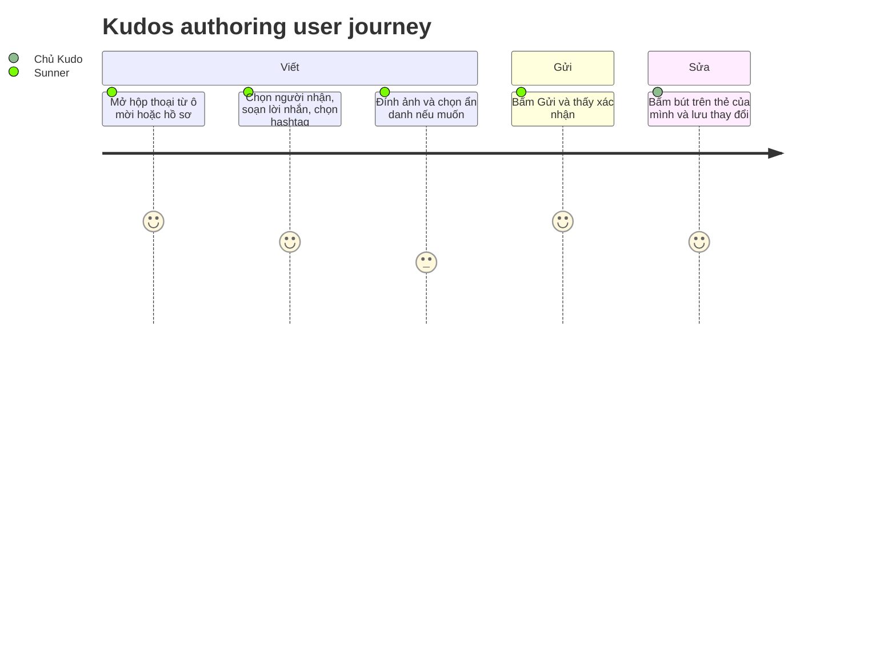

<!-- layout-exempt: rebuild-spec owns all docs/system|features|generated|flows paths — all references here are output targets or internal definitions -->
<!-- Contract: references/feature-spec-researcher-contract.md -->
<!-- Nửa BA/QA của cặp spec: đọc file này là trả lời được "làm gì, ứng xử ra sao, màn hình hiện gì" mà không phải mở file khác. Chi tiết kỹ thuật (đường dẫn, trích nguồn, ghi dữ liệu) nằm ở technical-spec.md. -->

# Functional Spec — F003_KudosAuthoring

**Priority**: P0
**Type**: mixed
**Generated**: 2026-11-24

**See also:** [`technical-spec.md`](./technical-spec.md) — luồng viết và sửa Kudo ở phía máy chủ, giao dịch ghi dữ liệu, vé tải ảnh, trích nguồn, thiết kế dữ liệu cho Dev/QA/SA.

**Traceability:** F003_KudosAuthoring → SCR007_KudosLiveBoardFeed/REG001_KudoComposer → US026_CreateKudo, US027_AttachKudoImage, US028_EditKudo, US029_SendKudoToSunner → BL006, BL007, BL008, BL012 → ROUTE009, ROUTE010, ROUTE013, ROUTE018, ROUTE023, ROUTE024

## 1. Overview

**Problem:** Sunner cần một chỗ để viết lời cảm ơn công khai cho đồng đội trong sự kiện SAA 2025. Nếu form khó dùng thì không ai viết; nếu cho nhét link lạ, ảnh sai loại hoặc để lộ người gửi ẩn danh thì Kudos mất an toàn và mất lòng tin; và nhiều feature khác (bảng tin, tim, thông báo, huy hiệu) đều cần Kudo làm dữ liệu gốc.
**Solution:** Một hộp thoại dùng chung để viết và sửa Kudo: chọn người nhận, đặt danh hiệu tuỳ chọn, soạn lời nhắn có thanh định dạng và gợi ý tên khi gõ "@", chọn hashtag, đính ảnh, tuỳ chọn gửi ẩn danh kèm biệt danh. Hộp thoại mở từ ô mời viết trên Live board, từ hồ sơ hoặc thẻ đồng nghiệp (người nhận điền sẵn và khoá), và từ bút sửa trên thẻ Kudo của chính mình. Máy chủ kiểm lại mọi luật, lấy người gửi từ phiên đăng nhập và ghi Kudo cùng hashtag, ảnh và một sự việc "Kudo mới" trong cùng một lần ghi.
**Scope:** Viết Kudo mới; gửi thẳng cho một đồng nghiệp với người nhận đã khoá; sửa Kudo của chính mình (mọi trường trừ người nhận); tìm Sunner làm người nhận hoặc người được nhắc tên; danh sách hashtag để chọn; đính tối đa 5 ảnh qua vé tải lên ký sẵn; kiểm tra, báo lỗi và xác nhận khi bỏ dở; cửa sổ ghi từ ngày mở đến hết sự kiện.
**Non-Scope:** Không dựng bảng tin, thẻ Kudo, trang chi tiết (feature xem Kudo), không thả tim, không đánh dấu spam hay mở lại Kudo spam, không gửi thông báo (feature thông báo tự đọc sự việc "Kudo mới"), không xoá Kudo, không tạo thông báo riêng cho người được nhắc tên bằng "@", không dọn ảnh mồ côi trong kho lưu ảnh, không có nút nổi viết Kudo ngoài Live board.

**Actors**

| Actor | Description | Primary goal |
|-------|--------------|---------------|
| Sunner (người gửi) | Sunner đã đăng nhập và đã chọn phòng ban, trong thời gian sự kiện còn cho ghi | Gửi lời cảm ơn công khai hoặc ẩn danh cho đồng đội, kèm ảnh và hashtag |
| Chủ Kudo | Sunner là người gửi của một Kudo còn công khai | Sửa lại lời nhắn, danh hiệu, hashtag, ảnh hoặc cách gửi của Kudo mình đã đăng |
| Admin (khi viết hoặc sửa) | Quản trị viên của BTC, trong feature này không có đặc quyền riêng | Viết và sửa Kudo của mình như một Sunner, chịu cùng cửa sổ ghi |

Feature này chưa tham gia luồng liên-feature nào được ghi trong thư mục luồng của tài liệu (hiện chưa có luồng nào); các feature khác chỉ đọc Kudo và sự việc "Kudo mới" mà feature này ghi lại.

## 2. Functional Capabilities

| ID | Capability | What the user can do | User Stories | Requirements | Business Rules | Screens |
|----|------------|------------------------|-----------------|---------------|-------------------|---------|
| CAP-01 | Compose and send a Kudo | Mở hộp thoại từ Live board, hồ sơ hoặc thẻ đồng nghiệp; chọn người nhận, soạn lời nhắn, chọn hashtag, đặt danh hiệu, tuỳ chọn ẩn danh rồi gửi; bỏ dở thì được hỏi xác nhận | US026_CreateKudo, US029_SendKudoToSunner | FR-001, FR-002, FR-003, FR-005, FR-101, FR-102, FR-201, FR-202, FR-203, FR-204, FR-205, FR-206, FR-208, FR-209, FR-401, FR-402, FR-403, FR-404, FR-407, FR-601, FR-602 | BR-001, BR-002, BR-003, BR-004, BR-005, BR-006, BR-007, BR-009, BR-010, BR-011, DEC-001, DEC-002, DEC-003, DEC-004, DEC-005, DEC-006, SM-002 | SCR007_KudosLiveBoardFeed/REG001_KudoComposer |
| CAP-02 | Attach images to a Kudo | Chọn tới 5 ảnh jpeg, png hoặc webp, thấy từng ảnh đang tải, xong hoặc lỗi, thử lại ảnh lỗi mạng, gỡ từng ảnh; chỉ gửi được khi mọi ảnh đã tải xong | US027_AttachKudoImage | FR-004, FR-207, FR-405, FR-406, FR-604 | BR-008, BR-012, BR-013, BR-014, DEC-007, SM-001, SM-003 | N/A — dùng chung hộp thoại với CAP-01 |
| CAP-03 | Edit your own Kudo | Bấm bút trên thẻ Kudo của mình để mở lại hộp thoại với dữ liệu hiện tại, sửa mọi trường trừ người nhận rồi lưu; Kudo bị spam chỉ xem | US028_EditKudo | FR-103, FR-301, FR-302, FR-303, FR-603 | BR-015, BR-016, BR-017, BR-018, BR-019, DEC-008 | N/A — dùng chung hộp thoại với CAP-01 |

## 3. Open Decisions

| D### | Decision | Default proposal | Rationale | Blocks work |
|------|----------|-------------------|-----------|--------------|
| D001 | Trước ngày mở, người viết bị từ chối (Admin hoặc người gọi thẳng) nên thấy câu riêng hay tiếp tục dùng câu "Sự kiện đã kết thúc…"? | Dùng chung câu "Sự kiện đã kết thúc, không thể gửi hoặc sửa Kudo nữa." cho cả trước giờ mở và sau giờ đóng | Người dùng thường không tới được ô viết trước giờ mở nên chưa ai thấy; đổi câu cần sửa mã chứ không chỉ bản dịch | no |
| D002 | Có thêm nút nổi (bút hoặc logo Kudos) ở trang chủ để mở hộp thoại viết Kudo không? | Chưa làm: chỉ có ô mời viết trên Live board, nút ở hồ sơ và ở thẻ đồng nghiệp | BTC hoãn quyết định từ 17/11/2026; thêm nút là việc mới, không ảnh hưởng luật viết | no |
| D003 | Danh sách hashtag và danh sách phòng ban lấy nguyên văn từ thiết kế đã được BTC xác nhận chưa? | Giữ danh sách hashtag lấy từ thiết kế và nạp bằng dữ liệu mẫu; BTC sửa tệp dữ liệu rồi nạp lại là xong | Danh sách là dữ liệu tham chiếu, đổi không đụng tới luật viết Kudo | no |
| D004 | Chủ Kudo có được đổi Kudo ẩn danh thành có tên (và ngược lại) sau khi gửi, và có cần hỏi xác nhận trước khi lộ tên không? | Giữ như hiện nay: cho đổi cả hai chiều bằng ô tick ẩn danh, không hỏi xác nhận | Quyết định "sửa mọi trường trừ người nhận" đã gồm cờ ẩn danh; thêm bước xác nhận là thay đổi giao diện, chưa có yêu cầu | no |

## 4. Requirements

### Foundation (0xx)

- **FR-001** Mỗi Kudo lưu người gửi, người nhận, danh hiệu (có thể trống), lời nhắn, hashtag, ảnh, cờ ẩn danh kèm biệt danh và thời điểm tạo; Kudo mới luôn bắt đầu ở trạng thái công khai.
- **FR-002** Người gửi luôn là Sunner đang đăng nhập; trạng thái và người gửi do máy chủ đặt, không nhận từ form.
- **FR-003** Hashtag chỉ chọn từ danh sách có sẵn đang hoạt động, mỗi Kudo từ 1 đến 5 hashtag, không trùng; không tự gõ hashtag mới.
- **FR-004** Ảnh nằm trong kho lưu riêng, tên tệp ngẫu nhiên không chứa mã người gửi, và chỉ gắn được vào Kudo khi chính người gửi đã xin phép tải ảnh đó.
- **FR-005** Viết và sửa Kudo chỉ mở trong cửa sổ ghi từ ngày giờ mở đến trước ngày giờ kết thúc sự kiện; ngoài khoảng đó mọi lần ghi bị từ chối, Admin cũng vậy.

### Navigation (1xx)

- **FR-101** Sunner mở hộp thoại viết Kudo từ ô "Hôm nay, bạn muốn gửi lời cảm ơn và ghi nhận đến ai?" trên Live board; hết cửa sổ ghi thì ô bị khoá kèm câu thông báo.
- **FR-102** Sunner mở hộp thoại viết Kudo từ hồ sơ hoặc thẻ tóm tắt của một đồng nghiệp với người nhận đã điền sẵn và khoá, chỉ hiện tên.
- **FR-103** Chủ Kudo mở hộp thoại ở chế độ sửa bằng nút bút trên thẻ Kudo của chính mình.

### Form viết và sửa Kudo (2xx)

- **FR-201** Người nhận được chọn bằng cách gõ tìm theo tên (không phân biệt dấu và hoa thường) hoặc đầu địa chỉ email trong danh sách Sunner; mỗi Kudo đúng một người nhận và ô tìm không liệt kê chính mình.
- **FR-202** Danh hiệu là tuỳ chọn, tối đa 50 ký tự; để trống nghĩa là Kudo không có danh hiệu.
- **FR-203** Lời nhắn là bắt buộc, từ 1 đến 1.000 ký tự tính theo ký tự Unicode, có thanh định dạng (in đậm, in nghiêng, gạch ngang, danh sách đánh số, chèn đường dẫn, trích dẫn) và bộ đếm ký tự.
- **FR-204** Gõ "@" kèm vài chữ thì hiện danh sách gợi ý đồng nghiệp (có thể gồm chính mình); chọn một người chèn tên đầy đủ vào lời nhắn dưới dạng chữ thường, không tạo liên kết hay thông báo riêng.
- **FR-205** Đường dẫn trong lời nhắn chỉ nhận địa chỉ bắt đầu bằng http hoặc https; không được nhúng ảnh vào lời nhắn, ảnh phải đính ở mục Image.
- **FR-206** Hashtag chọn từ danh sách thả xuống nhiều lựa chọn; khi đã đủ 5 thì các hashtag chưa chọn bị khoá, bỏ một chip thì chọn lại được.
- **FR-207** Có thể đính tối đa 5 ảnh jpeg, png hoặc webp, mỗi ảnh từ 1 byte đến 5 MB, xem thumbnail theo thứ tự đã chọn và gỡ từng ảnh trước khi gửi.
- **FR-208** Gửi ẩn danh bằng ô tick; khi tick bắt buộc nhập biệt danh từ 1 đến 30 ký tự, khi không tick thì không được có biệt danh.
- **FR-209** Thanh công cụ của lời nhắn có liên kết "Tiêu chuẩn cộng đồng" mở ở tab mới để không mất bản nháp.

### Sửa Kudo (3xx)

- **FR-301** Hộp thoại sửa mở với dữ liệu hiện tại điền sẵn: người nhận khoá, danh hiệu, lời nhắn, các hashtag còn hoạt động, ảnh đang gắn kèm ảnh xem trước, cờ ẩn danh và biệt danh.
- **FR-302** Lưu bản sửa cập nhật đúng Kudo đó và thay trọn bộ hashtag và ảnh; thời điểm tạo, số tim, trạng thái và người nhận giữ nguyên.
- **FR-303** Kudo đã bị đánh dấu spam vẫn mở được cho chủ nhưng ở chế độ chỉ đọc kèm thông báo khoá, mọi ô bị vô hiệu và không có nút Lưu.

### Interaction (4xx)

- **FR-401** Thiếu Người nhận, Lời nhắn hoặc Hashtag thì không gửi hoặc lưu, hiện một câu nêu đủ ba trường kèm lỗi ở từng trường, ngay trong trình duyệt và được máy chủ kiểm lại.
- **FR-402** Bấm Gửi hoặc Lưu chỉ gửi đúng một lần; trong lúc gửi nút bị khoá và đổi nhãn thành "Đang gửi…" hoặc "Đang lưu…".
- **FR-403** Hủy hoặc Esc khi đã nhập dở thì hỏi xác nhận bỏ nội dung với "Tiếp tục soạn" là lựa chọn mặc định; bấm lớp phủ phía sau không đóng hộp thoại và đang gửi thì không đóng được.
- **FR-404** Gửi hoặc lưu thành công thì hộp thoại đóng, hiện thông báo ngắn ("Đã gửi Kudo thành công!" hoặc "Đã lưu thay đổi.") và bảng tin được làm mới.
- **FR-405** Mỗi ảnh có trạng thái đang tải, xong hoặc lỗi; tệp sai loại hoặc quá cỡ báo lỗi và không thử lại, lỗi mạng, hết lượt xin phép hoặc hết cửa sổ ghi cho thử lại; chọn nhiều hơn số chỗ còn lại thì phần thừa bị bỏ và có báo.
- **FR-406** Không gửi hoặc lưu được khi còn ảnh đang tải hoặc còn ảnh lỗi chưa gỡ; form nói rõ cần chờ hoặc gỡ ảnh.
- **FR-407** Mỗi Kudo mới gửi thành công ghi thêm một sự việc "Kudo mới" cùng lúc với Kudo để các feature khác xử lý; sửa Kudo không phát sự việc nào.

### Security (6xx)

- **FR-601** Chỉ Sunner đã đăng nhập và đã chọn phòng ban mới viết, sửa, tìm người nhận, tải danh sách hashtag và xin phép tải ảnh; khách bị chuyển về trang đăng nhập hoặc nhận lỗi chưa đăng nhập.
- **FR-602** Máy chủ kiểm lại mọi luật nhập liệu thay vì tin form, và từ chối gửi Kudo cho chính người gửi.
- **FR-603** Chỉ chủ Kudo mới mở và sửa được Kudo; người khác nhận từ chối và id lạ nhận không tìm thấy, cả hai không lộ nội dung Kudo.
- **FR-604** Mỗi Sunner chỉ giữ tối đa 20 phép tải ảnh chưa gắn vào Kudo nào trong 24 giờ gần nhất.

## 5. Business Rules

- Cửa sổ ghi mở từ mốc mở (gồm mốc) đến mốc kết thúc sự kiện (không gồm); viết, sửa và xin phép tải ảnh ngoài khoảng đó đều bị từ chối với câu "Sự kiện đã kết thúc…" (BR-001)
- Tìm Sunner dùng từ khoá 1 đến 50 ký tự, khớp tên không dấu hoặc đầu email, tối đa 20 kết quả mỗi lần (mặc định 10) xếp theo tên; hộp thoại viết Kudo loại chính mình khỏi ô Người nhận nhưng không loại khỏi gợi ý "@" (BR-002)
- Danh sách hashtag chỉ gồm hashtag đang hoạt động, xếp theo thứ tự cố định và có nhãn theo ngôn ngữ đang chọn; hashtag tắt không hiện lại trong lựa chọn (BR-003)
- Người gửi và trạng thái không bao giờ lấy từ form; Kudo mới luôn công khai và việc sửa không đổi trạng thái (BR-004)
- Lời nhắn sau khi bỏ khoảng trắng hai đầu dài 1 đến 1.000 ký tự, xuống dòng kiểu Windows tính là một ký tự; đường dẫn chỉ http hoặc https, không có ảnh nhúng và không có dòng khai báo liên kết kiểu tham chiếu (BR-005)
- Danh hiệu không bắt buộc, tối đa 50 ký tự; danh hiệu chỉ có khoảng trắng được lưu thành "không có danh hiệu" (BR-006)
- Mỗi Kudo có từ 1 đến 5 hashtag không trùng, tất cả phải còn tồn tại và còn hoạt động tại thời điểm ghi (BR-007)
- Mỗi Kudo đính tối đa 5 ảnh không trùng, mỗi ảnh phải là phép tải do chính người gửi xin và đã có thật trong kho (hoặc đã gắn vào chính Kudo đó khi sửa); phép tải đã dùng không dùng lại được (BR-008)
- Biệt danh bắt buộc từ 1 đến 30 ký tự khi gửi ẩn danh và phải để trống khi không ẩn danh (BR-009)
- Người nhận phải còn tồn tại và khác người gửi; gửi cho chính mình bị từ chối cả ở form lẫn máy chủ và cơ sở dữ liệu (BR-010)
- Kudo, hashtag, ảnh và sự việc "Kudo mới" được ghi trong một lần ghi duy nhất: hoặc có đủ cả bốn hoặc không có gì (BR-011)
- Yêu cầu xin phép tải ảnh chỉ nhận dữ liệu nhỏ (tối đa 4 KB, đúng dạng JSON) với loại ảnh jpeg, png hoặc webp và dung lượng 1 byte đến 5 MB (BR-012)
- Mỗi Sunner chỉ giữ tối đa 20 phép tải ảnh chưa gắn trong 24 giờ; các yêu cầu cùng người được xếp hàng nên gửi dồn dập cũng không vượt trần (BR-013)
- Tên tệp ảnh trong kho là một mã ngẫu nhiên kèm đuôi tệp, không chứa mã người gửi, nên Kudo ẩn danh không lộ tác giả qua địa chỉ ảnh (BR-014)
- Chỉ chủ Kudo mới mở dữ liệu sửa và lưu bản sửa; người khác nhận từ chối, id không có nhận không tìm thấy, cả hai chỉ trả mã lỗi không kèm nội dung (BR-015)
- Người nhận không đổi được sau khi tạo: bản sửa mang theo người nhận bị từ chối thay vì bị lờ đi (BR-016)
- Bản sửa chỉ ghi khi Kudo là của người sửa và còn công khai trong cùng một lệnh cập nhật, nên nếu Admin vừa đánh dấu spam thì bản sửa bị từ chối là Kudo bị khoá (BR-017)
- Sửa giữ nguyên người gửi, người nhận, thời điểm tạo, số tim và trạng thái, thay trọn bộ hashtag và ảnh, đặt lại thời điểm sửa và không phát sự việc nào (BR-018)
- Đổi ô ẩn danh hoặc biệt danh khi sửa có hiệu lực ngay trên thẻ và trang chi tiết; bỏ ẩn danh thì tên thật của người gửi hiện công khai ở đó (BR-019)
- Ô Người nhận chỉ đọc và hiện tên khi người nhận đã được khoá (mở từ hồ sơ, thẻ đồng nghiệp hoặc ở chế độ sửa); các trường hợp khác là ô tìm kiếm (DEC-001)
- Khi đã chọn đủ 5 hashtag, các hashtag chưa chọn bị khoá còn hashtag đã chọn vẫn bỏ được (DEC-002)
- Ô mời viết trên Live board bị khoá kèm câu thông báo kết thúc sự kiện khi cửa sổ ghi đóng, và mở được hộp thoại khi cửa sổ còn mở (DEC-003)
- Tick ẩn danh mới hiện ô biệt danh bắt buộc; không tick thì biệt danh không được gửi đi dù đã gõ trước đó (DEC-004)
- Bấm Gửi hoặc Lưu bị chặn trước hết khi còn ảnh đang tải, rồi khi còn ảnh lỗi, rồi khi thiếu trường hoặc sai trường; chỉ khi qua cả ba mới gọi máy chủ (DEC-005)
- Hủy hoặc Esc: đang gửi thì không làm gì, đã có thay đổi thì hỏi xác nhận bỏ nội dung, chưa đổi gì thì đóng ngay (DEC-006)
- Chọn nhiều tệp: tệp vượt quá số chỗ còn lại bị bỏ và báo vượt số ảnh; tệp sai loại hoặc quá cỡ thành ô lỗi không thử lại; tệp hợp lệ được tải ngay (DEC-007)
- Mở sửa cho kết quả theo ba nhánh: người khác hoặc id lạ chỉ thấy câu từ chối, Kudo spam của chủ mở chỉ đọc kèm thông báo khoá, Kudo công khai của chủ mở sửa được (DEC-008)
- Mỗi phép tải ảnh được cấp (đã cấp), rồi hoặc được gắn vào Kudo và bị xoá khỏi sổ (đã dùng), hoặc bị thu hồi ngay khi việc ký địa chỉ tải lỗi (SM-001)
- Hộp thoại viết hoặc sửa đi từ đóng, qua nạp dữ liệu (chỉ khi sửa), đang soạn, đang gửi, có thể qua hỏi xác nhận bỏ nội dung, rồi quay về đóng (SM-002)
- Mỗi ảnh trong form đi từ đang tải sang xong hoặc lỗi; ảnh lỗi do mạng thử lại được, ảnh sai loại hoặc quá cỡ thì không (SM-003)

## 6. Screens

| Screen Name | SCR### | What User Sees | What User Can Do |
|-------------|--------|-----------------|-------------------|
| Ô viết Kudo và hộp thoại viết/sửa Kudo trên Live board | SCR007_KudosLiveBoardFeed/REG001_KudoComposer | Ô mời "Hôm nay, bạn muốn gửi lời cảm ơn và ghi nhận đến ai?" (khoá kèm câu kết thúc sự kiện khi hết cửa sổ ghi); hộp thoại giữa màn hình nền tối với tiêu đề "Gửi lời cám ơn và ghi nhận đến đồng đội" hoặc "Chỉnh sửa bài viết của bạn", các hàng Người nhận, Danh hiệu, Lời nhắn có thanh định dạng và bộ đếm "n/1.000", Hashtag, Image, ô tick ẩn danh kèm biệt danh, dải báo lỗi, nút Hủy và Gửi (hoặc Lưu) | Mở hộp thoại; tìm và chọn người nhận; gõ danh hiệu và lời nhắn, định dạng, gõ "@" để nhắc tên, chèn đường dẫn, mở Tiêu chuẩn cộng đồng ở tab mới; chọn và bỏ hashtag; chọn, thử lại và gỡ ảnh; bật ẩn danh và đặt biệt danh; gửi hoặc lưu; hủy và xác nhận bỏ nội dung |

Hộp thoại này còn được mở từ hồ sơ của đồng nghiệp, thẻ tóm tắt khi rê chuột vào avatar và nút bút trên thẻ Kudo; các màn đó do feature khác sở hữu, feature này chỉ sở hữu ô mời và chính hộp thoại.

### User Journey

1. Sunner thấy ô "Hôm nay, bạn muốn gửi lời cảm ơn và ghi nhận đến ai?" trên Live board và bấm vào (hoặc bấm "Gửi lời cảm ơn và ghi nhận tới" ở hồ sơ đồng nghiệp, khi đó người nhận đã điền và khoá).
2. Hộp thoại hiện ra; Sunner gõ tên để chọn người nhận, viết lời nhắn (định dạng, "@" nhắc tên, chèn đường dẫn), chọn 1 đến 5 hashtag, tuỳ chọn thêm danh hiệu, ảnh và bật ẩn danh kèm biệt danh.
3. Sunner bấm Gửi; thiếu Người nhận, Lời nhắn hoặc Hashtag thì thấy câu nêu đủ ba trường kèm lỗi ở từng ô và vẫn ở trong hộp thoại; còn ảnh đang tải hoặc ảnh lỗi thì được nhắc chờ hoặc gỡ.
4. Gửi thành công: hộp thoại đóng, hiện "Đã gửi Kudo thành công!" và Kudo mới xuất hiện trên bảng tin.
5. Sau đó, trên thẻ Kudo của mình, Sunner bấm bút, hộp thoại mở với dữ liệu hiện tại và người nhận bị khoá, Sunner sửa rồi bấm Lưu và thấy "Đã lưu thay đổi.".



## 7. User Stories

### US026_CreateKudo — Create Kudo

**Actor:** Sunner (người gửi)
**Goal:** Viết và gửi một Kudo cảm ơn đồng đội để lời nhắn hiện trên Live board.
**Business value:** Mỗi lời cảm ơn gửi đi là dữ liệu gốc cho bảng tin, tim, huy hiệu và thông báo, nên chiến dịch ghi nhận có nội dung để vận hành.

**Acceptance Criteria:**
- [ ] Bấm ô "Hôm nay, bạn muốn gửi lời cảm ơn và ghi nhận đến ai?" mở hộp thoại; từ mốc kết thúc sự kiện ô bị khoá và hiện "Sự kiện đã kết thúc, không thể gửi hoặc sửa Kudo nữa.".
- [ ] Form có Người nhận (chọn từ ô tìm, không chọn được chính mình), Danh hiệu (tuỳ chọn, tối đa 50 ký tự), Lời nhắn (1 đến 1.000 ký tự, thanh định dạng, gợi ý khi gõ "@"), Hashtag (1 đến 5) và tuỳ chọn ẩn danh kèm biệt danh 1 đến 30 ký tự.
- [ ] Đường dẫn trong lời nhắn chỉ nhận http hoặc https, chèn ảnh vào lời nhắn bị báo lỗi, liên kết "Tiêu chuẩn cộng đồng" mở ở tab mới.
- [ ] Thiếu Người nhận, Lời nhắn hoặc Hashtag thì hiện "Bạn cần điền đủ Người nhận, Lời nhắn gửi và Hashtag để gửi Kudos!" kèm lỗi theo trường; bấm đúp chỉ gửi một lần.
- [ ] Gửi thành công thì hộp thoại đóng, hiện "Đã gửi Kudo thành công!" và bảng tin làm mới; Kudo mới ở trạng thái công khai.
- [ ] Hủy hoặc Esc khi đã nhập dở thì hỏi xác nhận ("Tiếp tục soạn" là lựa chọn mặc định); bấm lớp phủ không đóng; đang gửi thì không đóng được.

### US027_AttachKudoImage — Attach Kudo Image

**Actor:** Sunner (người gửi)
**Goal:** Đính kèm ảnh vào Kudo khi viết hoặc sửa để lời cảm ơn có hình minh hoạ.
**Business value:** Ảnh làm lời ghi nhận sinh động hơn mà vẫn nằm trong kho riêng, không lộ người gửi ẩn danh và không bị dùng sai.

**Acceptance Criteria:**
- [ ] Hàng "Image" có nút "Image — Tối đa 5" chọn được nhiều tệp một lần, chỉ nhận jpeg, png, webp từ 1 byte đến 5 MB; nút khoá khi đủ 5 ảnh và tệp thừa bị bỏ kèm lỗi "Đính tối đa 5 ảnh.".
- [ ] Mỗi tệp hợp lệ hiện thumbnail 80×80 với vòng chờ rồi chuyển sang xong; thứ tự thumbnail là thứ tự ảnh trên Kudo.
- [ ] Tệp sai loại hoặc quá cỡ hiện ô lỗi "Ảnh không hợp lệ" không có nút thử lại; lỗi mạng, hết lượt xin phép hoặc hết cửa sổ ghi hiện lỗi kèm nút "Thử lại"; mỗi ảnh gỡ được bằng nút gỡ.
- [ ] Bấm Gửi hoặc Lưu khi còn ảnh đang tải hiện "Vui lòng chờ ảnh tải lên xong."; khi còn ảnh lỗi hiện "Có ảnh chưa tải lên được. Hãy thử lại hoặc gỡ ảnh đó.".
- [ ] Mỗi Sunner tối đa 20 phép tải chưa gắn trong 24 giờ, quá thì hiện "Bạn đã tải lên quá nhiều ảnh trong thời gian ngắn. Vui lòng thử lại sau.".

### US028_EditKudo — Edit Kudo

**Actor:** Chủ Kudo
**Goal:** Sửa nội dung Kudo đã gửi để chỉnh lại lời nhắn hoặc thông tin sau khi đăng.
**Business value:** Người gửi sửa được lỗi chính tả hoặc bổ sung ý mà không phải gửi Kudo mới, nên số Kudo và số tim không bị lệch.

**Acceptance Criteria:**
- [ ] Hộp thoại sửa mở với người nhận bị khoá và danh hiệu, lời nhắn, hashtag, ảnh, ô ẩn danh và biệt danh đã điền sẵn; trong lúc nạp hiện "Đang tải bài viết…".
- [ ] Sửa được mọi trường trừ người nhận; Lưu cập nhật đúng Kudo đó, giữ nguyên thời điểm tạo, số tim và trạng thái, rồi đóng hộp thoại và hiện "Đã lưu thay đổi.".
- [ ] Người khác mở sửa nhận "Bạn không có quyền sửa Kudo này."; id không có nhận "Không tìm thấy Kudo này."; cả hai không thấy nội dung Kudo.
- [ ] Kudo đã bị đánh dấu spam mở ở chế độ chỉ đọc kèm "Kudo này đã bị đánh dấu spam nên không thể sửa." và không có nút Lưu; nếu Admin đánh dấu spam khi hộp thoại đang mở thì Lưu bị từ chối với cùng câu đó.
- [ ] Sau mốc kết thúc sự kiện Lưu bị từ chối với "Sự kiện đã kết thúc, không thể gửi hoặc sửa Kudo nữa."; Hủy khi có thay đổi hỏi xác nhận như lúc viết.

### US029_SendKudoToSunner — Send Kudo To Sunner

**Actor:** Sunner (người gửi)
**Goal:** Gửi Kudo thẳng cho một đồng nghiệp từ hồ sơ hoặc thẻ của họ để khỏi tìm lại người nhận trong form.
**Business value:** Rút ngắn đường tới lời cảm ơn đúng lúc đang xem một người, nên có thêm nhiều Kudo được gửi đi.

**Acceptance Criteria:**
- [ ] Hộp thoại mở ở chế độ viết với người nhận đã điền và khoá (chỉ hiện tên và câu gợi ý "Người nhận đã được chọn sẵn, không thể đổi."); các trường còn lại và luật gửi giống US026.
- [ ] Gửi thành công thì hiện "Đã gửi Kudo thành công!", hộp thoại đóng và nơi bấm mở được thông báo để cập nhật; Hủy thì trang đang xem giữ nguyên.
- [ ] Máy chủ vẫn từ chối gửi cho chính mình với "Bạn không thể gửi Kudo cho chính mình." và từ chối ngoài cửa sổ ghi dù giao diện đã ẩn nút.
- [ ] Người nhận bị xoá hoặc không còn tồn tại khi gửi thì hiện "Người nhận không hợp lệ, vui lòng chọn lại." và không ghi gì.

## 8. Scenarios

### US026_CreateKudo — Happy Path

**Given** cửa sổ ghi còn mở và Sunner A đã chọn Sunner B, nhập lời nhắn và một hashtag, **When** A bấm Gửi, **Then** Kudo công khai cùng hashtag và sự việc "Kudo mới" được ghi trong một lần, hộp thoại đóng, hiện "Đã gửi Kudo thành công!" và bảng tin làm mới.

### US026_CreateKudo — Error: thiếu trường bắt buộc

**Given** form chưa chọn hashtag, **When** Sunner bấm Gửi, **Then** hiện "Bạn cần điền đủ Người nhận, Lời nhắn gửi và Hashtag để gửi Kudos!" kèm lỗi ở trường Hashtag và không có gì được gửi đi.

### US026_CreateKudo — Error: cửa sổ ghi đã đóng

**Given** hộp thoại mở từ trước nhưng đã qua mốc kết thúc sự kiện, **When** Sunner bấm Gửi, **Then** máy chủ từ chối, không ghi gì, hộp thoại ở lại với "Sự kiện đã kết thúc, không thể gửi hoặc sửa Kudo nữa.".

### US026_CreateKudo — Error: ẩn danh thiếu biệt danh

**Given** Sunner tick ẩn danh nhưng để trống biệt danh, **When** bấm Gửi, **Then** hiện "Vui lòng nhập nickname ẩn danh." ở ô biệt danh và không gửi.

### US027_AttachKudoImage — Happy Path

**Given** hộp thoại đang mở và chưa có ảnh, **When** Sunner chọn hai ảnh png dưới 5 MB, **Then** hai thumbnail chuyển từ vòng chờ sang xong và cả hai đi cùng Kudo khi gửi theo đúng thứ tự.

### US027_AttachKudoImage — Error: tệp sai loại

**Given** Sunner chọn một tệp gif, **When** tệp được nhận, **Then** thumbnail hiện lỗi "Ảnh không hợp lệ" không có nút thử lại và Gửi bị chặn tới khi gỡ tệp đó.

### US027_AttachKudoImage — Error: hết lượt xin phép

**Given** Sunner đang giữ 20 phép tải chưa gắn trong 24 giờ, **When** chọn thêm một ảnh, **Then** thumbnail lỗi có nút "Thử lại" và hiện câu "Bạn đã tải lên quá nhiều ảnh trong thời gian ngắn. Vui lòng thử lại sau.".

### US028_EditKudo — Happy Path

**Given** Sunner A xem Kudo công khai của mình và cửa sổ ghi còn mở, **When** A bấm bút, đổi lời nhắn rồi Lưu, **Then** nội dung cập nhật, thời điểm tạo và số tim giữ nguyên và hiện "Đã lưu thay đổi.".

### US028_EditKudo — Error: Kudo vừa bị đánh dấu spam

**Given** Admin đánh dấu Kudo là spam trong lúc hộp thoại sửa đang mở, **When** A bấm Lưu, **Then** máy chủ từ chối với "Kudo này đã bị đánh dấu spam nên không thể sửa." và không ghi gì.

### US028_EditKudo — Error: Kudo của người khác

**Given** Sunner B biết id Kudo của A, **When** B mở dữ liệu sửa của Kudo đó, **Then** B nhận "Bạn không có quyền sửa Kudo này." và không thấy nội dung.

### US028_EditKudo — Edge: bỏ ẩn danh khi sửa

**Given** Kudo của A đang ẩn danh với biệt danh, **When** A bỏ tick ẩn danh rồi Lưu, **Then** Kudo trở thành có tên và thẻ cùng trang chi tiết hiện tên thật của A, biệt danh bị xoá.

### US029_SendKudoToSunner — Happy Path

**Given** Sunner A đang xem hồ sơ của B và cửa sổ ghi còn mở, **When** A bấm "Gửi lời cảm ơn và ghi nhận tới B", viết lời nhắn, chọn hashtag rồi Gửi, **Then** hộp thoại đóng, hiện "Đã gửi Kudo thành công!" và Kudo gửi cho đúng B.

### US029_SendKudoToSunner — Error: gửi cho chính mình

**Given** một yêu cầu gửi Kudo có người nhận trùng người gửi (gọi thẳng, không qua giao diện), **When** máy chủ xử lý, **Then** bị từ chối với "Bạn không thể gửi Kudo cho chính mình." và không ghi gì.

## 9. Edge Cases

| Scenario | What Happens | User-Facing Message |
|----------|--------------|----------------------|
| Hai lần bấm Gửi liên tiếp rất nhanh | Chỉ lần đầu được gửi, nút khoá ngay và lần bấm thứ hai bị bỏ qua | "Đang gửi…" trên nút |
| Mạng đứt sau khi máy chủ đã ghi xong | Form nhận lỗi chung, hộp thoại ở lại, bấm Gửi lần nữa sẽ tạo Kudo thứ hai (không có khoá chống gửi trùng) | "Đã có lỗi xảy ra, vui lòng thử lại." |
| Lời nhắn chỉ có khoảng trắng | Bị coi là trống, báo thiếu trường bắt buộc | "Bạn cần điền đủ Người nhận, Lời nhắn gửi và Hashtag để gửi Kudos!" |
| Lời nhắn dài quá 1.000 ký tự (dán vào hoặc gọi thẳng) | Ô nhập tự cắt ở 1.000 ký tự; máy chủ từ chối nếu vẫn quá | "Lời nhắn tối đa 1.000 ký tự." |
| Lời nhắn có đường dẫn không phải http hoặc https | Từ chối, kể cả dạng viết liền không có dấu hai chấm hai gạch | "Liên kết chỉ được bắt đầu bằng http:// hoặc https://." |
| Lời nhắn nhúng ảnh bằng cú pháp Markdown | Từ chối, ảnh chỉ đính ở mục Image | "Không chèn ảnh vào lời nhắn. Hãy đính kèm ảnh ở mục Image." |
| Chèn đường dẫn làm lời nhắn vượt 1.000 ký tự | Không chèn, nội dung giữ nguyên | "Không chèn được đường dẫn vì lời nhắn sẽ vượt 1.000 ký tự." |
| Hashtag bị tắt giữa lúc đang soạn | Máy chủ từ chối, không ghi gì | "Hashtag không còn được sử dụng, vui lòng chọn lại." |
| Người nhận bị xoá giữa lúc đang soạn | Máy chủ từ chối, không ghi gì | "Người nhận không hợp lệ, vui lòng chọn lại." |
| Không tick ẩn danh nhưng có biệt danh (gọi thẳng) | Từ chối; form không bao giờ gửi tổ hợp này | "Chỉ điền nickname khi gửi ẩn danh." |
| Ảnh gắn kèm không phải phép tải của mình hoặc tệp chưa thực sự lên kho | Máy chủ từ chối cả lần ghi, không có Kudo nào được tạo | "Ảnh không hợp lệ, vui lòng tải lại." |
| Hai lần ghi cùng giành một ảnh | Một bên thắng, bên còn lại bị từ chối và không ghi gì | "Ảnh không hợp lệ, vui lòng tải lại." |
| Gửi tổng cộng quá 5 ảnh | Phần thừa bị bỏ ngay lúc chọn; nếu gọi thẳng thì bị từ chối | "Đính tối đa 5 ảnh." |
| Tải ảnh gặp lỗi mạng | Thumbnail lỗi có nút thử lại, Gửi bị chặn tới khi thử lại xong hoặc gỡ | "Tải ảnh lên thất bại, vui lòng thử lại." |
| Mở sửa Kudo mà danh sách hashtag cũ có hashtag đã tắt | Hashtag đã tắt không được điền sẵn, chủ phải chọn lại đủ 1 đến 5 hashtag trước khi lưu | "Bạn cần điền đủ Người nhận, Lời nhắn gửi và Hashtag để gửi Kudos!" |
| Dịch vụ ký ảnh xem trước lỗi khi mở sửa | Hộp thoại vẫn mở, ảnh hiện khung trống thay vì ảnh | None — xử lý im lặng, ảnh không có bản xem trước |
| Mở sửa Kudo ở trạng thái spam (chủ Kudo) | Hộp thoại mở chỉ đọc, mọi ô bị vô hiệu, không có nút Lưu | "Kudo này đã bị đánh dấu spam nên không thể sửa." |
| Mở sửa Kudo ở trạng thái công khai (chủ Kudo) | Hộp thoại sửa được mọi trường trừ người nhận | None — luồng bình thường |
| Gửi bản sửa mang theo người nhận | Từ chối vì người nhận không đổi được | "Không thể đổi người nhận khi sửa Kudo." |
| Admin viết Kudo trước mốc mở | Bị từ chối như Sunner thường, Admin không có ngoại lệ | "Sự kiện đã kết thúc, không thể gửi hoặc sửa Kudo nữa." |
| Sunner chưa chọn phòng ban gọi tìm người nhận, tải hashtag hoặc xin tải ảnh | Nhận từ chối, không có dữ liệu | "Vui lòng chọn phòng ban trước khi tiếp tục." |
| Phiên đăng nhập hết hạn khi đang soạn | Ô tìm, danh sách hashtag hoặc ảnh báo hết phiên; gửi chuyển về đăng nhập | "Phiên đăng nhập đã hết hạn, vui lòng đăng nhập lại." |
| Bấm Hủy hoặc Esc khi đã nhập dở | Hiện hộp xác nhận, Esc trong hộp xác nhận là tiếp tục soạn | "Bỏ nội dung đang soạn?" |
| Bấm lớp phủ phía sau hộp thoại | Không đóng, tránh mất bản nháp | None — không có phản hồi |
| Sửa Kudo đang ẩn danh thành có tên | Thẻ và trang chi tiết hiện tên thật ngay sau khi lưu, biệt danh bị xoá | "Đã lưu thay đổi." |

## 10. Edge Behaviours to Verify

- **FR-001** → Sau khi gửi, Kudo ở trạng thái công khai, người gửi đúng là tài khoản đang đăng nhập dù form có cố gửi người gửi khác.
- **FR-002** → Gọi thẳng máy chủ với người gửi hoặc trạng thái tuỳ ý thì hai giá trị đó bị bỏ qua.
- **FR-003** → Không thể gửi với 0 hashtag, 6 hashtag, hashtag trùng hoặc hashtag đã tắt.
- **FR-004** → Không ảnh nào có tên tệp chứa mã người gửi, và ảnh của phép tải do người khác xin bị từ chối.
- **FR-005** → Ngay trước mốc mở và từ mốc kết thúc, viết, sửa và xin tải ảnh đều bị từ chối, kể cả Admin; đúng tại mốc mở thì được.
- **FR-101** → Từ mốc kết thúc ô mời viết trên Live board bị khoá kèm câu thông báo.
- **FR-102** → Mở từ hồ sơ hoặc thẻ đồng nghiệp thì người nhận hiện chỉ đọc và Kudo gửi đúng người đó.
- **FR-103** → Nút bút chỉ do thẻ của chủ hiển thị; mở hộp thoại sửa qua nút này luôn nạp dữ liệu mới nhất.
- **FR-201** → Gõ tên không dấu vẫn tìm ra người có dấu; ký tự đặc biệt như phần trăm hoặc gạch dưới được hiểu là chữ thường, không phải ký tự đại diện.
- **FR-202** → Danh hiệu 50 ký tự được, 51 ký tự bị cắt hoặc từ chối; chỉ khoảng trắng thì lưu thành không có danh hiệu.
- **FR-203** → Bộ đếm đếm biểu tượng cảm xúc là một ký tự và ô nhập dừng cứng ở 1.000.
- **FR-204** → Chọn một gợi ý chèn đúng "@Tên đầy đủ" kèm một dấu cách và không gợi ý lại khi gõ tiếp ngay sau tên đó.
- **FR-205** → Đường dẫn javascript, data, file hay dạng viết hoa chữ lẫn dấu cách đều bị từ chối; đường dẫn https hợp lệ được chèn dạng liên kết.
- **FR-206** → Chọn đủ 5 hashtag thì dòng chưa chọn mờ đi và không bấm được, bấm dòng đã chọn hoặc chip để bỏ.
- **FR-207** → Chọn 3 ảnh khi đã có 4 chỉ nhận 1 và báo vượt số ảnh; nút thêm ảnh khoá khi đủ 5.
- **FR-208** → Tick ẩn danh rồi bỏ tick thì biệt danh không đi theo; tick ẩn danh mà biệt danh trống bị báo lỗi ở ô biệt danh.
- **FR-209** → Bấm Tiêu chuẩn cộng đồng mở tab mới và nội dung đang soạn còn nguyên.
- **FR-301** → Mở sửa Kudo ẩn danh thấy ô tick bật sẵn kèm biệt danh; hashtag tắt không có sẵn.
- **FR-302** → Sau khi sửa, thời điểm tạo và số tim không đổi, thứ tự ảnh theo thumbnail mới, thời điểm sửa được cập nhật.
- **FR-303** → Kudo spam mở chỉ đọc, hiện thông báo khoá, không có nút Lưu.
- **FR-401** → Thiếu một trong ba trường hiện đúng câu gom ba trường; sai định dạng trường khác hiện "Vui lòng kiểm tra lại các trường được đánh dấu.".
- **FR-402** → Nhấp đúp hoặc nhấn Enter liên tục chỉ tạo một Kudo và nút hiện "Đang gửi…" trong lúc chờ.
- **FR-403** → Đang gửi thì Esc và Hủy không có tác dụng; bấm lớp phủ không bao giờ đóng hộp thoại.
- **FR-404** → Thông báo thành công không biến mất sớm dù bảng tin vừa làm mới và hộp thoại đã đóng.
- **FR-405** → Tệp gif hay trên 5 MB báo lỗi không có nút thử lại; ngắt mạng giữa chừng báo lỗi có nút thử lại.
- **FR-406** → Còn ảnh đang tải thì hiện "Vui lòng chờ ảnh tải lên xong."; còn ảnh lỗi thì hiện câu nhắc gỡ hoặc thử lại.
- **FR-407** → Gửi một Kudo tạo đúng một sự việc "Kudo mới"; gửi thất bại hoặc sửa không để lại sự việc nào.
- **FR-601** → Khách gọi các điểm vào của feature nhận chuyển hướng đăng nhập hoặc lỗi chưa đăng nhập, không có dữ liệu nào rò ra.
- **FR-602** → Gọi thẳng máy chủ với dữ liệu vi phạm bất kỳ luật nào ở BR-005 đến BR-010 đều bị từ chối và không ghi gì.
- **FR-603** → Người khác và id lạ đều chỉ nhận mã lỗi không kèm nội dung Kudo, biệt danh hay ảnh.
- **FR-604** → Xin phép tải lần thứ 21 trong 24 giờ bị từ chối, và gửi dồn dập song song cũng không qua 20.

## 11. Risks & Known Issues

| ID | Type | Description | Impact | Status |
|----|------|--------------|--------|--------|
| RISK-01 | known-issue | Ảnh bị gỡ khỏi form sau khi đã tải lên, ảnh bị thay khi sửa Kudo và phép tải bỏ dở đều để lại tệp mồ côi trong kho lưu ảnh và dòng chờ trong sổ phép tải; chưa có công việc dọn. Phép tải bỏ dở còn tính vào trần 20 trong 24 giờ | Tốn dung lượng kho theo thời gian; Sunner bỏ dở 20 ảnh sẽ không tải được ảnh mới tới khi các phép cũ quá 24 giờ | confirmed (đã chấp nhận trong mã) |
| RISK-02 | risk | Sửa Kudo ẩn danh thành có tên làm thẻ và trang chi tiết lập tức hiện tên thật của người gửi, không có bước xác nhận; những ai đã thấy bản ẩn danh có thể đã nhớ. Thông báo "nhận Kudo" đã gửi cho người nhận thì không hiện tên (lưu người gửi rỗng lúc tạo) nên thông báo và thẻ nói hai điều khác nhau | Lộ danh tính ngoài ý muốn nếu bấm nhầm; người nhận thấy thông báo "Sunner ẩn danh" nhưng mở thẻ lại thấy tên | confirmed |
| RISK-03 | risk | Gửi Kudo không có khoá chống gửi trùng: nếu mạng đứt sau khi máy chủ đã ghi xong thì form báo lỗi chung và bấm Gửi lại sẽ tạo thêm một Kudo giống hệt | Kudo trùng trên bảng tin và gửi trùng thông báo cho người nhận | confirmed |
| RISK-04 | known-issue | Mở dữ liệu sửa không kiểm cửa sổ ghi nên sau mốc kết thúc vẫn nạp được dữ liệu của Kudo (nút bút đã ẩn và Lưu bị từ chối) | Chủ Kudo vẫn đọc lại được Kudo của chính mình qua đường gọi thẳng; không lộ cho người khác | confirmed |
| RISK-05 | risk | Kết quả tìm Sunner có cả email, khớp theo đầu email và mọi Sunner đăng nhập đều dùng được ô tìm | Sunner nào cũng dò được email đồng nghiệp trong thư mục công ty | [INFERRED] |
| RISK-06 | known-issue | Trước mốc mở, người bị từ chối thấy câu "Sự kiện đã kết thúc…" dù sự kiện chưa bắt đầu (xem D001) | Câu sai ngữ cảnh nhưng chỉ Admin hoặc người gọi thẳng mới thấy | confirmed |

## 12. Dependencies

| Dependency | Type | Why this feature needs it | Evidence |
|------------|------|-----------------------------|----------|
| F001_Auth | feature | Phiên đăng nhập, hồ sơ Sunner (người nhận phải tồn tại, phải chọn phòng ban), vai trò Admin không có đặc quyền | FR-002, FR-601, BR-010 |
| F002_AppShell | feature | Khung trang chứa vùng hiện thông báo thành công sau khi hộp thoại đóng, nên thông báo không mất khi bảng tin làm mới | FR-404 |
| F004_KudosFeed | feature | Trang Live board chứa ô mời viết và dựng bảng tin; nút bút trên thẻ Kudo mở hộp thoại sửa; thẻ hiển thị Kudo theo cờ ẩn danh | FR-101, FR-103, BR-019 |
| F006_AwardsPortal | feature | Trang Tiêu chuẩn cộng đồng là đích của liên kết trong thanh công cụ; cổng trước ngày mở chặn người dùng thường | FR-209, FR-005 |
| F007_AdminModeration | feature | Admin đánh dấu spam làm Kudo bị khoá sửa | FR-303, BR-017 |
| F008_SpotlightBoard | feature | Bảng Spotlight nhận tín hiệu thời gian thực mỗi khi có Kudo mới | FR-407 |
| F012_Profile | feature | Nút "Gửi lời cảm ơn và ghi nhận tới" ở hồ sơ và nút "Gửi KUDO" ở thẻ tóm tắt mở hộp thoại với người nhận đã khoá | FR-102 |
| F013_Notifications | feature | Đọc sự việc "Kudo mới" để báo cho người nhận; quyết định hiện tên hay biệt danh theo cờ ẩn danh | FR-407, BR-019 |
| Danh sách hashtag có sẵn | data | Nguồn duy nhất của các hashtag được chọn | FR-003, BR-003, D003 |
| Kho lưu ảnh riêng | external-service | Nơi giữ ảnh đính kèm, cấp địa chỉ tải lên ký sẵn và địa chỉ xem trước tạm thời | FR-004, FR-207, BR-014 |
| Cơ sở dữ liệu quan hệ | infrastructure | Ghi Kudo, hashtag, ảnh, sổ phép tải và sự việc "Kudo mới" trong một lần ghi | BR-011, FR-407 |
| Mốc mở và mốc kết thúc sự kiện | config | Quyết định cửa sổ ghi cho viết, sửa và xin tải ảnh | FR-005, BR-001 |

## 13. Configuration

```text
KUDO_BODY_MAX = 1000                  # số ký tự tối đa của lời nhắn (tính theo ký tự Unicode)
KUDO_TITLE_MAX = 50                   # số ký tự tối đa của danh hiệu
KUDO_NICKNAME_MAX = 30                # số ký tự tối đa của biệt danh ẩn danh (tối thiểu 1 khi ẩn danh)
KUDO_HASHTAGS_MIN = 1                 # số hashtag tối thiểu mỗi Kudo
KUDO_HASHTAGS_MAX = 5                 # số hashtag tối đa mỗi Kudo
KUDO_IMAGES_MAX = 5                   # số ảnh tối đa mỗi Kudo
KUDO_IMAGE_MAX_BYTES = 5 MB           # dung lượng tối đa mỗi ảnh; chỉ nhận jpeg, png, webp
PENDING_UPLOADS_MAX = 20              # số phép tải ảnh chưa gắn tối đa mỗi Sunner
PENDING_UPLOADS_WINDOW_HOURS = 24     # khoảng trượt tính phép tải chưa gắn
SUNNER_SEARCH_LIMIT_DEFAULT = 10      # số kết quả mặc định mỗi lần tìm Sunner (tối đa 20)
TOAST_DURATION_MS = 4000              # thông báo thành công tự biến mất sau chừng này mili giây
LAUNCH_AT                             # mốc mở cửa sổ ghi (gồm mốc), đặt theo môi trường
EVENT_END_AT                          # mốc kết thúc cửa sổ ghi (không gồm mốc), đặt theo môi trường
```
