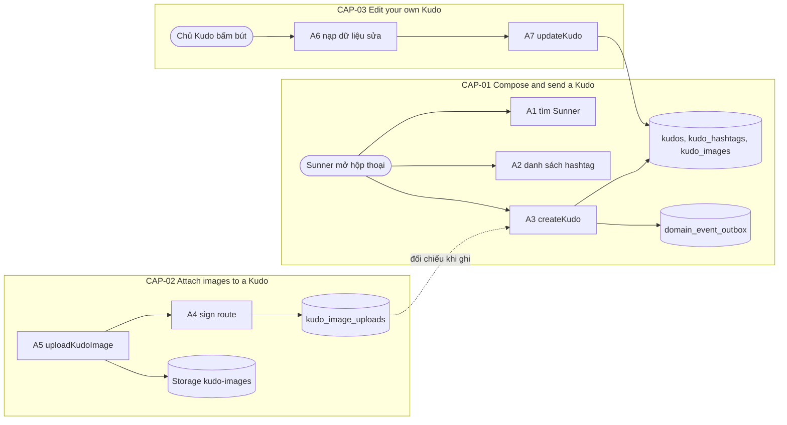
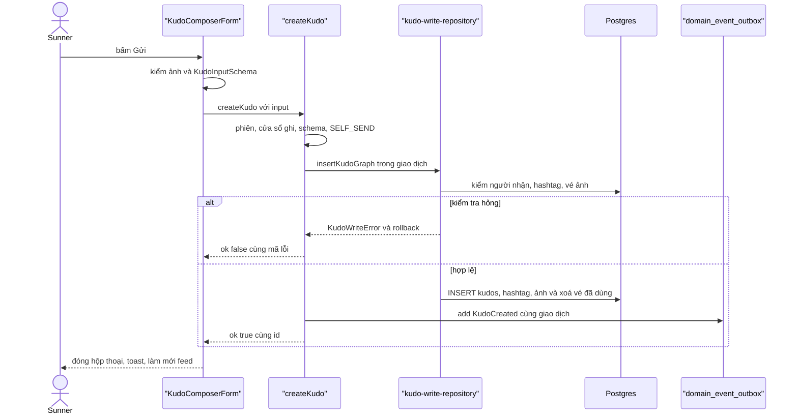
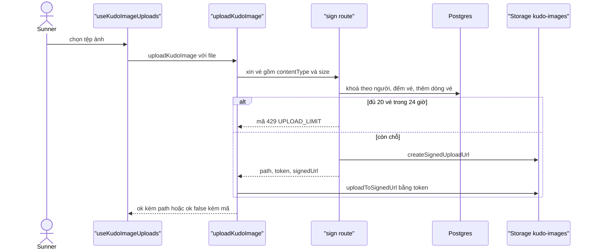
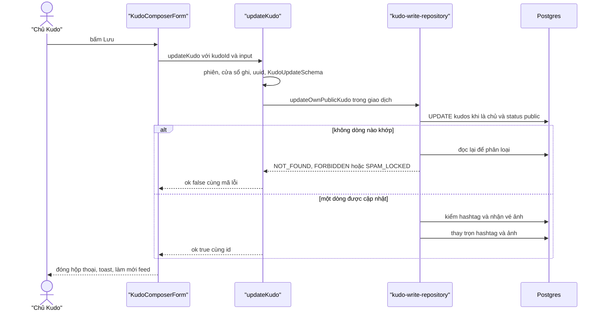
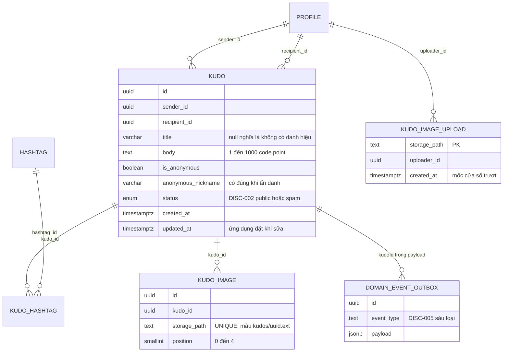
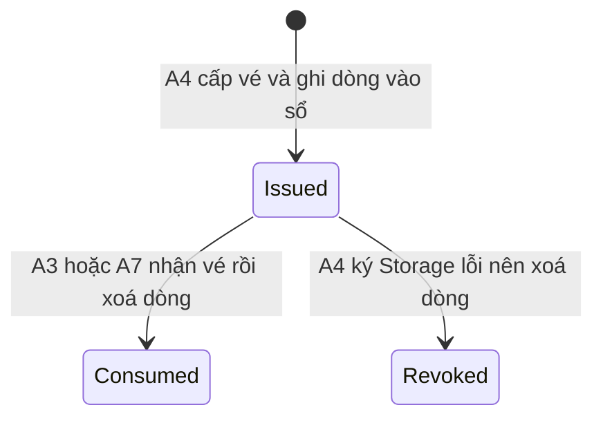
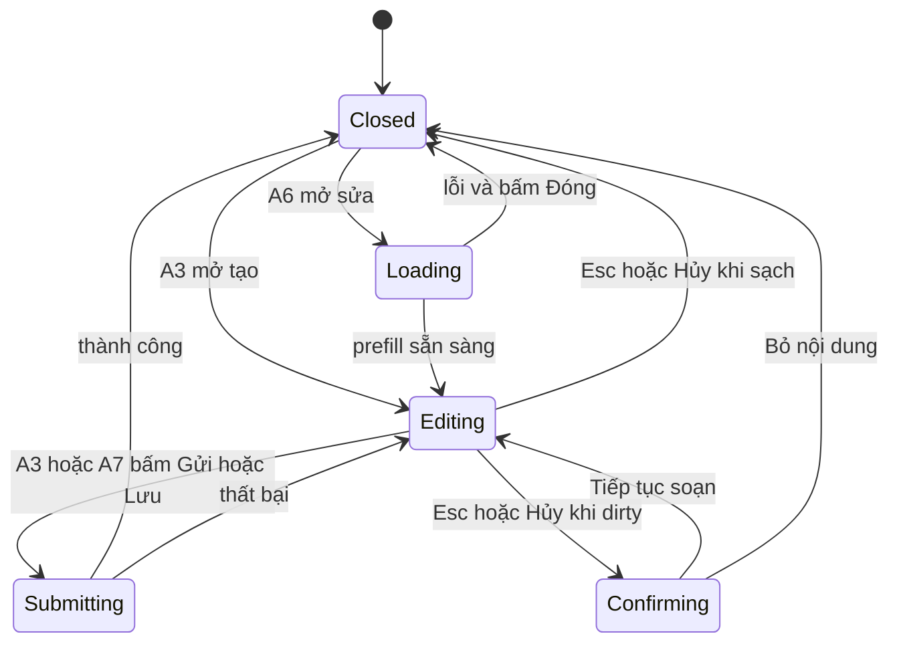
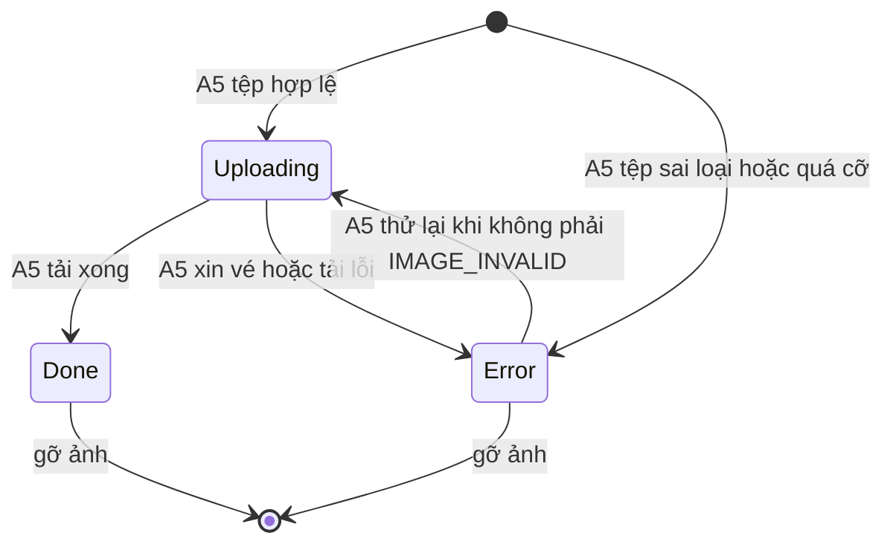

<!-- layout-exempt: rebuild-spec owns all docs/system|features|generated|flows paths — all references here are output targets or internal definitions -->
<!-- Contract: references/feature-spec-researcher-contract.md -->
<!-- Nửa Dev/QA/SA của cặp spec. Mọi mã FR/BR/SM/DEC/ALG/INT được PHÁT BIỂU một lần ở functional-spec.md và CÀI ĐẶT một lần ở đây; không lặp câu quy tắc thuần ngôn ngữ ở file này. -->

# F003_KudosAuthoring — Technical Spec

**Priority**: P0
**Type**: mixed
**Generated**: 2026-11-24

**See also:** [`functional-spec.md`](./functional-spec.md) — tổng quan, quyết định còn mở, yêu cầu và quy tắc nghiệp vụ dạng một dòng, màn hình, user story, kịch bản, edge case và cấu hình cho BA/QA.

**How to read this file:** § 2 là bảng chỉ mục action; chọn action cần xem rồi đọc khối của nó ở § 3 từ đầu đến cuối, mỗi khối là một luồng hoàn chỉnh. § 4 là phụ lục dùng chung, chỉ nhảy vào khi § 3 trỏ tới.

## 1. Technical Overview

F003 là phía ghi của Kudo: một hộp thoại React dùng chung (chế độ tạo và chế độ sửa, mount từ ô mời trên Live board, nút ở hồ sơ, thẻ tóm tắt và bút trên thẻ Kudo) gọi hai Server Action `createKudo` và `updateKudo` cùng bốn route handler phụ trợ (tìm Sunner, danh sách hashtag, xin vé tải ảnh, nạp dữ liệu sửa). Server chạy lại đúng schema Zod mà trình duyệt đã chạy, lấy người gửi từ phiên, rồi ghi `kudos`, `kudo_hashtags`, `kudo_images` và dòng outbox `KudoCreated` trong một giao dịch Drizzle trên Postgres (Supabase). Ảnh đi qua vé ký sẵn vào bucket private `kudo-images`: trình duyệt xin vé, tải thẳng lên Storage, rồi giao đường dẫn cho action ghi; action chỉ nhận đường dẫn do chính người gửi xin và object đã có thật.



## 2. Action Index

| # | Action (handler) | Method · Path | Codes | Writes | Detail |
|---|---|---|---|---|---|
| **A0** | *cross-cutting — belongs to no single action* | — | FR-601 | — | § 4.4 |
| **A1** | `sunners/search/route#GET` | `GET` `/api/sunners/search` | FR-201, FR-204, BR-002, DEC-001, ALG-004, US026 | — *(read-only)* | § 3.1 |
| **A2** | `hashtags/route#GET` | `GET` `/api/hashtags` | FR-003, FR-206, BR-003, DEC-002, US026 | — *(read-only)* | § 3.1 |
| **A3** | `createKudo` | `POST` `(Server Action)` | FR-001, FR-002, FR-005, FR-101, FR-102, FR-202, FR-203, FR-205, FR-208, FR-209, FR-401, FR-402, FR-403, FR-404, FR-407, FR-602, BR-001, BR-004, BR-005, BR-006, BR-007, BR-008, BR-009, BR-010, BR-011, DEC-003, DEC-004, DEC-005, DEC-006, SM-001, SM-002, ALG-001, ALG-002, INT-002, US026, US029 | `kudos`, `kudo_hashtags`, `kudo_images`, `kudo_image_uploads`, `domain_event_outbox` | § 3.1 ▸ **diagram** |
| **A4** | `kudos/images/sign/route#POST` | `POST` `/api/kudos/images/sign` | FR-004, FR-005, FR-604, BR-001, BR-012, BR-013, BR-014, SM-001, ALG-003, INT-001, US027 | `kudo_image_uploads` | § 3.2 ▸ **diagram** |
| **A5** | `uploadKudoImage` *(client, no BE of its own)* | — | FR-207, FR-405, FR-406, BR-008, DEC-007, SM-003, INT-001, US027 | — *(client only; ghi Storage bằng vé của A4)* | § 3.2 ▸ **diagram** |
| **A6** | `kudos/[id]/edit/route#GET` | `GET` `/api/kudos/[id]/edit` | FR-301, FR-303, FR-603, BR-015, DEC-008, INT-003, US028 | — *(read-only)* | § 3.3 |
| **A7** | `updateKudo` | `POST` `(Server Action)` | FR-005, FR-103, FR-302, FR-401, FR-402, FR-602, FR-603, BR-001, BR-004, BR-005, BR-006, BR-007, BR-008, BR-009, BR-015, BR-016, BR-017, BR-018, BR-019, DEC-006, SM-001, ALG-001, ALG-002, US028 | `kudos`, `kudo_hashtags`, `kudo_images`, `kudo_image_uploads` | § 3.3 ▸ **diagram** |

**Rung set** theo template: Who → FE → Request → BE → Rule → Result → State → Source. Rung vắng thì bỏ hẳn, không ghi `N/A`.

## 3. Actions

### 3.1 CAP-01 — Compose and send a Kudo

#### A1 · Search Sunners for the recipient and for "@" mentions
`GET /api/sunners/search` → `` `sunners/search/route#GET` ``
`FR-201` `FR-204` `BR-002` `DEC-001` `ALG-004` `US026` · ROUTE018 · `SCR007_KudosLiveBoardFeed/REG001_KudoComposer`

**Who** · Sunner đã đăng nhập và đã chọn phòng ban *(gate A0 — § 4.4)*
**FE** · hai nơi gọi cùng một hook `useSunnerSearch` (debounce 250 ms, huỷ yêu cầu của truy vấn cũ, 401 coi là hết phiên): ô Người nhận (`RecipientPicker` bọc combobox dùng chung, `excludeSelf` bật) và ô lời nhắn khi gõ `@` (`KudoMessageEditor`, `excludeSelf` tắt, `limit` 5, danh sách `KudoMentionPopover` với ↑/↓, Enter hoặc Tab chọn, Esc đóng). Chọn người từ gợi ý chèn token chữ `@Tên đầy đủ ` (không có bảng mention). Khi người nhận bị khoá, ô Người nhận thành ô chỉ đọc — `DEC-001`. `features/kudos-authoring/components/recipient-picker.tsx:23-58`; `features/kudos-authoring/components/kudo-message-editor.tsx:37-115`; `features/kudos-authoring/components/kudo-mention-popover.tsx:22-41`; `features/sunner-search/components/use-sunner-search.ts:23-54`
**Request** · query `q` *(chuỗi, 1–50 ký tự sau trim)*, `limit` *(1–20, mặc định 10)*, `excludeSelf` *(true, false, 1 hoặc 0, mặc định false)*; cookie ngôn ngữ chọn nhãn phòng ban.
**BE** · `GET` gọi `requireApiSunner()` rồi `parseSunnerSearchParams` rồi `searchSunners(q, { viewerId, limit, excludeSelf, locale })`: khớp `public.f_unaccent(full_name) ILIKE '%q%'` (thoát `%`, `_`, `\`) hoặc `email ILIKE 'q%'`, `LEFT JOIN departments`, `ORDER BY full_name, id LIMIT n`, thêm `id <> viewerId` khi `excludeSelf`; trả mảng `SunnerOption` gồm `id`, `fullName`, `email`, `avatarUrl`, `department {id, name}`. `app/api/sunners/search/route.ts:12-26`; `features/sunner-search/schemas/sunner-search-params-schema.ts:9-49`; `features/sunner-search/server/sunner-search-query.ts:16-67`
**Rule** · các quy tắc của việc tìm người:
- **BR-002 — Từ khoá 1–50 ký tự, khớp tên không dấu hoặc đầu email, tối đa 20 kết quả xếp theo tên; hộp thoại loại chính mình khỏi ô Người nhận nhưng không loại khỏi gợi ý `@`.** `q` thiếu hoặc rỗng, `limit` không phải số nguyên 1–20 và `excludeSelf` ngoài bốn giá trị đều trả 400 `VALIDATION` kèm `fieldErrors` (`required` hoặc `invalid`); `excludeSelf` do trình duyệt chọn nên chỉ là tiện ích giao diện, chặn thật nằm ở `SELF_SEND` của A3. `features/sunner-search/schemas/sunner-search-params-schema.ts:13-26`; `features/sunner-search/server/sunner-search-query.ts:57-67`
- **ALG-004 — Nhận ra truy vấn `@` đang gõ để gọi tìm và chèn token chữ.** `findMentionQuery` chỉ coi là truy vấn khi `@` đứng đầu văn bản hoặc ngay sau khoảng trắng, phần sau `@` không bắt đầu bằng khoảng trắng, không chứa xuống dòng hay `@` và dài tối đa 50; `insertMention` thay truy vấn bằng `@Tên đầy đủ ` và hook `picked` không mở lại danh sách khi gõ tiếp ngay sau token vừa chọn. *(§ 4.5)*

| DEC | subtype | Condition | What the user sees | Source |
|---|---|---|---|---|
| **DEC-001** | render | `locked && value` (khoá bằng `lockRecipient` kèm người nhận có sẵn, hoặc chế độ sửa) | ô chỉ đọc hiện tên người nhận, kèm gợi ý ẩn cho trình đọc màn hình "Người nhận đã được chọn sẵn, không thể đổi."; không khoá thì là combobox tìm kiếm loại chính mình | `features/kudos-authoring/components/recipient-picker.tsx:26-43` |

**Result** · chỉ đọc, không ghi DB. Trả 200 `SunnerOption[]`; lỗi: 401 `UNAUTHENTICATED`, 403 `ONBOARDING_REQUIRED`, 400 `VALIDATION`, 500 `UNEXPECTED` (ghi `console.error`). Kết quả mang cả `email` của Sunner (xem `RISK-05` ở functional-spec).
**Source:** `app/api/sunners/search/route.ts:12-26` → `features/sunner-search/schemas/sunner-search-params-schema.ts:35-49` → `features/sunner-search/server/sunner-search-query.ts:57-67` → `features/kudos-authoring/components/recipient-picker.tsx:23-58` → `features/kudos-authoring/components/kudo-markdown-format.ts:97-121`

<!-- No diagram: chỉ đọc một bảng (kèm join phòng ban), đồng bộ. -->

---

#### A2 · List the active hashtags
`GET /api/hashtags` → `` `hashtags/route#GET` ``
`FR-003` `FR-206` `BR-003` `DEC-002` `US026` · ROUTE013 · `SCR007_KudosLiveBoardFeed/REG001_KudoComposer`

**Who** · Sunner đã đăng nhập và đã chọn phòng ban *(gate A0 — § 4.4)*
**FE** · `HashtagPicker` đọc danh sách qua `useHashtagOptions` một lần mỗi lần mở hộp thoại (trạng thái `loading`, `ready`, `error` có nút Thử lại, `unauthorized` khi 401); các chip đã chọn có nút bỏ, nút "Hashtag — Tối đa 5" mở listbox chọn nhiều có ↑/↓, Esc chỉ đóng danh sách, và cuộn panel vào tầm nhìn sau mỗi lần chọn. `features/kudos-authoring/components/hashtag-picker.tsx:27-145`; `features/kudos-authoring/components/use-hashtag-options.ts:15-39`
**Request** · không tham số; cookie `NEXT_LOCALE` rồi `Accept-Language` rồi `vi` chọn nhãn.
**BE** · `GET` gọi `requireApiSunner()` rồi `listActiveHashtags(locale)`: `SELECT id, label_vi, label_en FROM hashtags WHERE is_active ORDER BY sort_order, slug`, nhãn theo ngôn ngữ; trả `[{ id, label }]`. `app/api/hashtags/route.ts:11-21`; `features/kudos-authoring/server/hashtag-list-query.ts:12-28`; `features/kudos-authoring/server/request-locale.ts:7-12`
**Rule** · các quy tắc của danh sách:
- **BR-003 — Chỉ hashtag đang hoạt động, theo thứ tự seed và nhãn theo ngôn ngữ; không có đường nào tạo hashtag từ chữ gõ.** Bản ghi `is_active = false` không bao giờ vào danh sách; việc kiểm lại lúc ghi nằm ở `BR-007` (A3, A7). `features/kudos-authoring/server/hashtag-list-query.ts:12-24`

| DEC | subtype | Condition | What the user sees | Source |
|---|---|---|---|---|
| **DEC-002** | render, interaction | `!selected && value.length >= 5` | dòng chưa chọn mờ 50%, `aria-disabled` và bấm không thêm gì; dòng đã chọn và nút bỏ trên chip vẫn dùng được, bỏ một cái thì mở lại các dòng còn lại | `features/kudos-authoring/components/hashtag-picker.tsx:51-54` |

**Result** · chỉ đọc, không ghi DB. Trả 200 `[{ id, label }]`; lỗi: 401, 403 `ONBOARDING_REQUIRED`, 500 `UNEXPECTED`. Ở trang Live board cùng truy vấn còn được gọi trực tiếp trên server để dựng bộ lọc hashtag của F004.
**Source:** `app/api/hashtags/route.ts:11-21` → `features/kudos-authoring/server/hashtag-list-query.ts:12-28` → `features/kudos-authoring/components/use-hashtag-options.ts:15-39` → `features/kudos-authoring/components/hashtag-picker.tsx:27-145`

<!-- No diagram: chỉ đọc một bảng, đồng bộ. -->

---

#### A3 · Send a new Kudo
`POST (Server Action)` → `` `createKudo` ``
`FR-001` `FR-002` `FR-005` `FR-101` `FR-102` `FR-202` `FR-203` `FR-205` `FR-208` `FR-209` `FR-401` `FR-402` `FR-403` `FR-404` `FR-407` `FR-602` `BR-001` `BR-004` `BR-005` `BR-006` `BR-007` `BR-008` `BR-009` `BR-010` `BR-011` `DEC-003` `DEC-004` `DEC-005` `DEC-006` `SM-001` `SM-002` `ALG-001` `ALG-002` `INT-002` `US026` `US029` · ROUTE023 · `SCR007_KudosLiveBoardFeed/REG001_KudoComposer`

**Who** · Sunner đã đăng nhập và đã chọn phòng ban; người gửi lấy từ phiên *(gate A0 — § 4.4)*
**FE** · ba lối vào cùng mount `KudoComposerModal mode="create"`: ô mời trên Live board (`KudoComposerLauncher`, nhận `writingOpen` từ trang) — `DEC-003`; nút "Gửi lời cảm ơn và ghi nhận tới {tên}" ở hồ sơ và nút "Gửi KUDO" ở thẻ tóm tắt, cả hai qua `LockedRecipientComposer` truyền `recipient` kèm `lockRecipient` (contract C-07) rồi `onSaved` xoá bộ nhớ đệm thẻ tóm tắt của người nhận (do F012 sở hữu, F003 chỉ cung cấp API của modal). Khung `KudoComposerDialog` (lớp phủ `bg-background/80`, panel 752 px, bẫy focus, khoá cuộn trang, bấm lớp phủ không đóng) giữ vòng đời hộp thoại `SM-002`: đóng → đang soạn → đang gửi → đóng, với nhánh hỏi xác nhận (`DiscardChangesConfirm`) — `DEC-006`. `KudoComposerForm` dựng các hàng theo thứ tự Figma: Người nhận (A1, `DEC-001`), Danh hiệu (`KudoTitleField`, ≤ 50, ô tự cắt), Lời nhắn (`KudoMessageEditor`: thanh 6 nút in đậm, nghiêng, gạch ngang, danh sách đánh số, chèn link qua `AddLinkPopover` chỉ nhận http(s), trích dẫn, cộng liên kết "Tiêu chuẩn cộng đồng" mở tab mới `target="_blank"`; bộ đếm `n/1.000` theo code point, dán quá 1.000 thì cắt), Hashtag (A2), Image (A5), ô tick ẩn danh — `DEC-004`. Nút Gửi chạy `handleSubmit` — `DEC-005`; hook `useKudoComposerSubmit` dùng cờ `inFlight` cộng nút `disabled` để một cú bấm đúp chỉ gọi action một lần (action không có khoá chống gửi trùng), chạy `parseKudoInput` phía trình duyệt rồi `startTransition` gọi `createKudo`; thành công thì `onSaved(id)` (toast "Đã gửi Kudo thành công!" hiện 4 giây trong `KudoComposerToastHost` ở layout để sống sót qua lần `router.refresh()` làm remount feed), rồi `router.refresh()`; thất bại thì `failure` hiện banner `errors.<CODE>` và lỗi theo trường; ném lỗi mạng thì thành `UNEXPECTED`. `app/(app)/kudos/page.tsx:42-61`; `features/kudos-authoring/components/kudo-composer-launcher.tsx:23-48`; `features/kudos-authoring/components/kudo-composer-modal.tsx:28-63`; `features/kudos-authoring/components/kudo-composer-dialog.tsx:32-82`; `features/kudos-authoring/components/kudo-composer-form.tsx:37-144`; `features/kudos-authoring/components/use-kudo-composer-form-state.ts:19-87`; `features/kudos-authoring/components/use-kudo-composer-submit.ts:25-65`; `features/kudos-authoring/components/kudo-composer-toast-host.tsx:15-33`; `app/(app)/layout.tsx:17-29`; `features/profile/components/locked-recipient-composer.tsx:22-35`
**Request** · tham số `input` *(KudoCreateInput)*: `recipientId` *(chuỗi uuid)*, `title?`, `body`, `hashtagIds[]`, `imagePaths[]` *(mặc định [])*, `isAnonymous` *(mặc định false)*, `anonymousNickname?`; mọi khoá lạ (người gửi, trạng thái) bị Zod bỏ. Server Action luôn về HTTP 200 và mang `code` trong thân kết quả. `features/kudos-authoring/schemas/kudo-input-schema.ts:21-66`; `features/kudos-authoring/schemas/kudo-write-result.ts:4-9`
**BE** · `createKudo` làm lần lượt: `requireSunner()` (khách về `/login`, chưa chọn phòng ban về trang chọn phòng ban) → `isEventWritingOpen(new Date())` (`WRITING_CLOSED`) → `parseKudoInput(KudoInputSchema, input)` (`MISSING_REQUIRED` hoặc `VALIDATION`) → so `recipientId` với `userId` (`SELF_SEND`) → `db.transaction`: `insertKudoGraph` (`assertRecipientExists`, `assertHashtagsActive`, `claimKudoImageUploads`, `INSERT kudos`, `replaceChildren`) rồi `DomainEventOutbox.add(tx, "KudoCreated", { kudoId })`; mọi `KudoWriteError` làm giao dịch rollback và `kudoWriteFailureOf` đổi thành kết quả in-band, lỗi khác ghi `console.error` rồi `UNEXPECTED`. `features/kudos-authoring/server/create-kudo-action.ts:19-39`; `features/kudos-authoring/server/kudo-write-repository.ts:18-66`; `features/kudos-authoring/server/kudo-write-error.ts:9-25`; `shared/auth/current-user.ts:48-53`
**Rule** · các quy tắc của lần gửi; `DEC` dùng bảng ở cuối rung:
- **BR-001 — Chỉ ghi khi `LAUNCH_AT` ≤ now < `EVENT_END_AT`.** `createKudo` kiểm ngay sau phiên và trước khi đọc dữ liệu; ngoài khoảng trả `{ ok: false, code: "WRITING_CLOSED" }`, admin cũng bị. *(§ 4.4)*
- **BR-004 — Người gửi lấy từ phiên và `status` không bao giờ do client ghi.** `userId` của `requireSunner()` đi vào `insertKudoGraph`; cột `status` không có trong `INSERT` nên lấy mặc định DB `public`. *(§ 4.4)*
- **BR-005 — Lời nhắn 1–1.000 code point sau trim, CRLF thành LF, link http(s), không ảnh nhúng.** Vượt trần thì `bodyTooLong` và dừng sớm trước khi quét link; phần quét link và ảnh là `ALG-001`. *(§ 4.4)*
- **BR-006 — Danh hiệu tuỳ chọn ≤ 50 ký tự, chuỗi rỗng thành NULL.** *(§ 4.4)*
- **BR-007 — 1–5 hashtag uuid không trùng, mỗi cái phải tồn tại và `is_active`.** *(§ 4.4)*
- **BR-008 — ≤ 5 ảnh không trùng, đúng mẫu đường dẫn, chỉ nhận vé do chính người gửi xin và có object thật.** Việc đối chiếu vé là `ALG-002`; vé đã dùng bị xoá khỏi sổ. *(§ 4.4)*
- **BR-009 — Biệt danh 1–30 ký tự bắt buộc khi `isAnonymous`, phải null khi không.** *(§ 4.4)*
- **BR-010 — Người nhận khác người gửi và còn tồn tại.** `parsed.data.recipientId === userId` trả `{ ok: false, code: "SELF_SEND", fieldErrors: { recipientId: ["selfSend"] } }` (422) trước mọi truy vấn DB; `assertRecipientExists` đọc `profiles` và ném `RECIPIENT_INVALID` (`recipientInvalid`) nếu không có dòng; DB còn CHECK `kudos_no_self_send` làm lớp cuối. `features/kudos-authoring/server/create-kudo-action.ts:25-27`; `features/kudos-authoring/server/kudo-write-repository.ts:18-21`; `db/migrations/0007_kudos_constraints.sql:5-6`
- **BR-011 — Kudo, hashtag, ảnh và sự việc `KudoCreated` ghi trong một giao dịch: hoặc đủ bốn hoặc không gì.** `DomainEventOutbox.add` nhận chính `tx` của lần ghi, validate payload bằng `domainEventSchema` và ném `ZodError` làm rollback nếu sai hợp đồng; cách ghi sự việc là `INT-002`. `features/kudos-authoring/server/create-kudo-action.ts:30-34`; `shared/events/domain-event-outbox.ts:18-29`
- **ALG-001 — Quét link và ảnh nhúng của lời nhắn.** Mọi đích `](…)` phải là URL tuyệt đối http(s); scheme lạ viết liền (`scheme://`, `javascript:` …) và dòng khai báo liên kết kiểu tham chiếu bị từ chối; `` luôn bị từ chối. *(§ 4.5)*
- **ALG-002 — Đối chiếu vé ảnh trong giao dịch ghi.** Khoá `FOR UPDATE` các dòng vé theo thứ tự `storage_path`, đòi vé đúng người gửi và object có thật trong `storage.objects`, thiếu thì `IMAGE_INVALID`. *(§ 4.5)*
- **SM-002 — Vòng đời hộp thoại (UI).** Trong lúc `createKudo` chạy hộp thoại ở trạng thái đang gửi: Esc và Hủy không có tác dụng. *(§ 4.3)*

| DEC | subtype | Condition | What the user sees | Source |
|---|---|---|---|---|
| **DEC-003** | render | `!writingOpen` (từ `isKudoWritingOpen()` của trang) | nút ô mời `disabled`, mờ 60%, trỏ vào câu "Sự kiện đã kết thúc, không thể gửi hoặc sửa Kudo nữa." hiện dưới ô; cửa sổ còn mở thì bấm là mở hộp thoại | `features/kudos-authoring/components/kudo-composer-launcher.tsx:30-44` |
| **DEC-004** | interaction | tick `isAnonymous` | hiện hàng "Nickname ẩn danh" bắt buộc (ô tự cắt ở 30); bỏ tick ẩn hàng đó và `anonymousNickname` đi ra là `null` dù đã gõ trước đó | `features/kudos-authoring/components/anonymous-sender-field.tsx:44-57` |
| **DEC-005** | interaction, flow | bấm Gửi hoặc Lưu | theo thứ tự: có ảnh `uploading` thì banner "Vui lòng chờ ảnh tải lên xong."; có ảnh `error` thì banner "Có ảnh chưa tải lên được…"; qua cả hai thì chạy schema, thiếu `recipientId`, `body` hoặc `hashtagIds` thì banner `MISSING_REQUIRED`, lỗi khác thì banner `VALIDATION`, cùng lỗi theo trường; chỉ khi hợp lệ mới gọi server | `features/kudos-authoring/components/kudo-composer-form.tsx:62-68` |
| **DEC-005** | interaction, flow | kết quả của schema phía trình duyệt | `parseKudoInput` đặt `MISSING_REQUIRED` khi có lỗi `required` trên `recipientId`, `body` hoặc `hashtagIds` (cùng phân loại ở server) | `features/kudos-authoring/schemas/kudo-input-schema.ts:97-118` |
| **DEC-006** | flow, interaction | Esc, nút Hủy hoặc đóng sau khi sửa | đang gửi: bỏ qua; có thay đổi so với lúc mở: hiện hộp xác nhận "Bỏ nội dung đang soạn?" (focus ở "Tiếp tục soạn", Esc trong hộp là tiếp tục soạn); không đổi gì: đóng ngay | `features/kudos-authoring/components/kudo-composer-dialog.tsx:49-59` |

**Result** · ghi `kudos` ← `sender_id` từ phiên, `recipient_id`, `title`, `body`, `is_anonymous`, `anonymous_nickname`, `status` = mặc định `public`; ghi `kudo_hashtags` (một dòng mỗi hashtag) và `kudo_images` (`position` = chỉ số trong `imagePaths`); xoá khỏi `kudo_image_uploads` các vé vừa dùng; ghi `domain_event_outbox` ← `KudoCreated { kudoId }` (`INT-002`: giao việc báo người nhận và các feature khác cho bộ xử lý nền đọc sau, nên Kudo và việc báo luôn đi cùng nhau) *(§ 4.5)*. Trigger `spotlight_publish_kudo_event` (F008) tự phát tín hiệu Realtime khi dòng `kudos` được chèn. Trả `{ ok: true, id }` hoặc `{ ok: false, code, fieldErrors? }` với `MISSING_REQUIRED` 400, `VALIDATION` 400, `SELF_SEND` 422, `RECIPIENT_INVALID` 422, `HASHTAG_INVALID` 422, `IMAGE_INVALID` 422, `WRITING_CLOSED` 403, `UNEXPECTED` 500 (mã trạng thái chỉ là ý nghĩa vì action luôn về 200). Người dùng thấy hộp thoại đóng, toast "Đã gửi Kudo thành công!" và feed làm mới bằng `router.refresh()`.
**State** · `SM-001`: `Issued` → `Consumed` *(§ 4.3)*
**Source:** `app/(app)/kudos/page.tsx:42-61` → `features/kudos-authoring/components/kudo-composer-launcher.tsx:23-48` → `features/kudos-authoring/components/kudo-composer-modal.tsx:28-63` → `features/kudos-authoring/components/kudo-composer-dialog.tsx:32-82` → `features/kudos-authoring/components/kudo-composer-form.tsx:37-144` → `features/kudos-authoring/components/use-kudo-composer-submit.ts:25-65` → `features/kudos-authoring/server/create-kudo-action.ts:19-39` → `features/kudos-authoring/server/kudo-write-repository.ts:56-66` → `shared/events/domain-event-outbox.ts:18-29`



---

### 3.2 CAP-02 — Attach images to a Kudo

Một luồng hai handler: A5 (trình duyệt, không có BE riêng) gọi A4 xin vé rồi tự tải ảnh thẳng lên Storage bằng vé; ghi vào Kudo là việc của A3 và A7, nơi vé được đối chiếu và dùng hết. Không handler nào một mình giữ trọn thứ tự nên sơ đồ đặt ở cấp capability.



#### A4 · Issue a signed image-upload ticket
`POST /api/kudos/images/sign` → `` `kudos/images/sign/route#POST` ``
`FR-004` `FR-005` `FR-604` `BR-001` `BR-012` `BR-013` `BR-014` `SM-001` `ALG-003` `INT-001` `US027` · ROUTE010 · `SCR007_KudosLiveBoardFeed/REG001_KudoComposer`

**Who** · Sunner đã đăng nhập và đã chọn phòng ban *(gate A0 — § 4.4)*
**FE** · không có giao diện riêng; do `uploadKudoImage` (A5) gọi bằng `fetch` JSON cho từng tệp hợp lệ. `features/kudos-authoring/components/kudo-image-upload-client.ts:34-46`
**Request** · thân JSON `{ contentType, size }` với `Content-Type` đúng `application/json` (có thể kèm tham số), tối đa 4 KB; `contentType` ∈ `image/jpeg`, `image/png`, `image/webp`; `size` số nguyên 1 … 5 MB. `features/kudos-authoring/schemas/kudo-image-sign-schema.ts:9-21`
**BE** · `POST` làm lần lượt: `requireApiSunner()` → `isEventWritingOpen` (403 `WRITING_CLOSED`) → `readCappedJsonBody(request, 4096)` (413 `PAYLOAD_TOO_LARGE`, không parse khi vượt) → `KudoImageSignSchema.safeParse` (400 `VALIDATION`) → `signKudoImageUpload(userId, contentType)`: sinh `kudos/{uuid}.{ext}`, `recordUploadWithinCap`, rồi `getSupabaseServiceClient().storage.from("kudo-images").createSignedUploadUrl(path)`; ký lỗi thì xoá dòng vừa ghi rồi ném lỗi (500). `app/api/kudos/images/sign/route.ts:18-37`; `features/kudos-authoring/server/kudo-image-upload-service.ts:19-32`; `features/kudos-authoring/server/read-capped-json-body.ts:15-49`; `shared/db/supabase-service-client.ts:1-17`
**Rule** · các quy tắc của việc cấp vé:
- **BR-001 — Chỉ cấp vé khi `LAUNCH_AT` ≤ now < `EVENT_END_AT`.** Kiểm sau phiên và trước khi đọc thân yêu cầu; ngoài khoảng trả 403 `WRITING_CLOSED`. *(§ 4.4)*
- **BR-012 — Yêu cầu chỉ nhận JSON nhỏ, đúng loại ảnh, đúng cỡ.** Media type khác `application/json` không bị đọc thân và rơi vào `VALIDATION` 400; thân quá 4 KB (Content-Length khai báo hoặc đếm theo luồng) trả 413 trước khi parse; `contentType` ngoài ba loại hoặc `size` ngoài 1 … 5 MB trả 400 `VALIDATION` kèm `fieldErrors`. Chặn form chéo trang gửi kiểu "simple". `features/kudos-authoring/server/read-capped-json-body.ts:15-31`; `app/api/kudos/images/sign/route.ts:23-28`
- **BR-013 — Mỗi người giữ tối đa 20 vé chưa gắn trong 24 giờ.** Vé thứ 21 trong cửa sổ trượt bị 429 `UPLOAD_LIMIT`; cách đếm tuần tự là `ALG-003`. `features/kudos-authoring/kudo-authoring-limits.ts:15-20`
- **BR-014 — Đường dẫn là mã ngẫu nhiên, không chứa id người gửi.** Dạng `kudos/{uuid}.{jpg|png|webp}` khớp `KUDO_IMAGE_PATH_PATTERN` và CHECK DB, nên URL ảnh của Kudo ẩn danh không lộ tác giả; việc ai xin vé nằm ở `kudo_image_uploads`, không ở tên tệp. `features/kudos-authoring/kudo-authoring-limits.ts:42-47`; `db/migrations/0007_kudos_constraints.sql:19-23`
- **ALG-003 — Đếm và thêm vé tuần tự theo từng người.** Một giao dịch lấy `pg_advisory_xact_lock(hashtext('kudo_image_uploads'), hashtext(uploaderId))`, đếm vé của người đó trong 24 giờ gần nhất, từ chối nếu ≥ 20, nếu không `INSERT` vé; nên một loạt yêu cầu song song của cùng một người không vượt trần còn người khác không phải chờ. *(§ 4.5)*
- **INT-001 — Storage cấp URL ký sẵn để trình duyệt tải ảnh thẳng lên bucket private.** Server chỉ ký `createSignedUploadUrl(path)` bằng client service-role dựng từ URL Supabase cấu hình (không bao giờ từ Host của request). *(§ 4.5)*

**Result** · ghi `kudo_image_uploads` ← (`storage_path`, `uploader_id`, `created_at` mặc định `now()`); trả 200 `{ path, token, signedUrl }`; lỗi: 401 `UNAUTHENTICATED`, 403 `ONBOARDING_REQUIRED` hoặc `WRITING_CLOSED`, 400 `VALIDATION`, 413 `PAYLOAD_TOO_LARGE`, 429 `UPLOAD_LIMIT`, 500 `UNEXPECTED` (ghi `console.error`); khi ký Storage lỗi dòng vé vừa ghi bị xoá nên không để lại vé treo. Vé nằm trong sổ đến khi A3 hoặc A7 dùng nó hoặc bị bỏ dở.
**State** · `SM-001`: `[*]` → `Issued` *(§ 4.3)*
**Source:** `app/api/kudos/images/sign/route.ts:18-37` → `features/kudos-authoring/server/read-capped-json-body.ts:20-49` → `features/kudos-authoring/schemas/kudo-image-sign-schema.ts:9-21` → `features/kudos-authoring/server/kudo-image-upload-service.ts:19-51`

---

#### A5 · Pick, upload and track image files in the browser *(client only)*
`uploadKudoImage` *(client, no BE of its own)*
`FR-207` `FR-405` `FR-406` `BR-008` `DEC-007` `SM-003` `INT-001` `US027` · ROUTE010 · `SCR007_KudosLiveBoardFeed/REG001_KudoComposer`

**Who** · Sunner trong hộp thoại viết hoặc sửa *(gate A0 — § 4.4)*
**FE** · `KudoImagePicker` hiện thumbnail theo thứ tự và nút "Image — Tối đa 5" (khoá khi đủ 5) mở `<input type="file" multiple accept="image/jpeg,image/png,image/webp">`; `KudoImageThumbnail` 80×80 hiện vòng chờ khi `uploading`, khung đỏ kèm "Ảnh không hợp lệ" hoặc "Tải lỗi" khi `error` (nút Thử lại chỉ có khi lỗi khác `IMAGE_INVALID`) và nút gỡ ở góc; lỗi gộp theo loại hiện dưới hàng. `useKudoImageUploads` giữ danh sách có thứ tự (cũng là `position` 0–4 khi ghi), dựng xem trước `blob:` cho tệp đúng loại và thu hồi khi gỡ hoặc khi hộp thoại huỷ, chạy các lần tải song song. Ở chế độ sửa danh sách khởi tạo từ ảnh đã gắn (đường dẫn thật, `previewUrl` ký 10 phút, trạng thái `done`). `features/kudos-authoring/components/kudo-image-picker.tsx:23-74`; `features/kudos-authoring/components/kudo-image-thumbnail.tsx:21-58`; `features/kudos-authoring/components/use-kudo-image-uploads.ts:36-92`
**Request** · `uploadKudoImage(file)`: kiểm `isAcceptedKudoImage` (loại jpeg, png, webp và 1 byte ≤ size ≤ 5 MB, cùng luật với endpoint và bucket), `POST /api/kudos/images/sign` với `{ contentType: file.type, size: file.size }`, rồi `storage().uploadToSignedUrl(ticket.path, ticket.token, file, { contentType })` bằng client Supabase dựng từ `NEXT_PUBLIC_SUPABASE_URL` và `NEXT_PUBLIC_SUPABASE_ANON_KEY`, `persistSession: false` nên không chạm cookie phiên của ứng dụng. `features/kudos-authoring/components/kudo-image-upload-client.ts:16-58`
**Rule** · các quy tắc của việc chọn và tải ảnh:
- **BR-008 — ≤ 5 ảnh, đúng loại và cỡ; chỉ ảnh do chính người gửi xin vé mới được gắn.** Phía trình duyệt: `room = 5 − số ảnh hiện có`, chỉ nhận `room` tệp đầu và nâng cờ `overLimit` nếu chọn nhiều hơn; kiểm loại và cỡ từng tệp trước khi xin vé; phần đối chiếu sở hữu nằm ở A3 và A7 (`ALG-002`). *(§ 4.4)*
- **SM-003 — Mỗi thumbnail đi từ `Uploading` sang `Done` hoặc `Error`; `Error` do mạng thử lại được.** `retry` chỉ chạy khi còn giữ `file` và lỗi khác `IMAGE_INVALID`. *(§ 4.3)*

| DEC | subtype | Condition | What the user sees | Source |
|---|---|---|---|---|
| **DEC-007** | interaction | chọn các tệp khi đã có `n` ảnh: `files.length > 5 − n`, hoặc tệp không `isAcceptedKudoImage` | tệp vượt chỗ trống bị bỏ và hiện "Đính tối đa 5 ảnh."; tệp sai loại hoặc quá cỡ thành ô lỗi `IMAGE_INVALID` không thử lại; tệp hợp lệ bắt đầu tải ngay | `features/kudos-authoring/components/use-kudo-image-uploads.ts:65-76` |

**Result** · không ghi DB; `uploadKudoImage` không bao giờ ném lỗi, trả `{ ok: true, path }` hoặc `{ ok: false, code }` với `IMAGE_INVALID` (400 `VALIDATION` của A4 hoặc tệp sai), `UNAUTHENTICATED` (401), `WRITING_CLOSED`, `UPLOAD_LIMIT` (cả hai cho thử lại), `UNEXPECTED` (413 hoặc lỗi khác, lỗi tải lên Storage, lỗi mạng); object được ghi bởi trình duyệt vào bucket (bucket tự chặn MIME ngoài danh sách và tệp quá 5 MiB). Ảnh bị gỡ sau khi đã tải lên để lại object mồ côi (rủi ro đã chấp nhận, `RISK-01`). Bấm Gửi hoặc Lưu bị chặn khi còn thumbnail `uploading` hoặc `error` (`DEC-005`, A3).
**State** · `SM-003`: `Uploading` → `Done` *(§ 4.3)*
**Source:** `features/kudos-authoring/components/kudo-image-picker.tsx:23-74` → `features/kudos-authoring/components/use-kudo-image-uploads.ts:56-92` → `features/kudos-authoring/components/kudo-image-upload-client.ts:49-58`

---

### 3.3 CAP-03 — Edit your own Kudo

#### A6 · Load a Kudo into the composer for editing
`GET /api/kudos/[id]/edit` → `` `kudos/[id]/edit/route#GET` ``
`FR-301` `FR-303` `FR-603` `BR-015` `DEC-008` `INT-003` `US028` · ROUTE009 · `SCR007_KudosLiveBoardFeed/REG001_KudoComposer`

**Who** · chủ Kudo (người gửi) *(gate A0 — § 4.4)*
**FE** · bút trên thẻ (`KudoOwnerEditButton`, chỉ hiện khi `kudoCardCanEdit`: là chủ, không spam và cửa sổ ghi còn mở; chủ của Kudo ẩn danh vẫn thấy bút vì `isOwner` do server tính) mount `KudoComposerModal mode="edit"`; `KudoComposerEditLoader` dùng `useKudoEditPrefill` (`fetch` `cache: "no-store"`, 401 thành `UNAUTHENTICATED`, mã lỗi lạ thành `UNEXPECTED`) và hiện "Đang tải bài viết…" rồi hoặc banner lỗi kèm nút Đóng hoặc form với người nhận khoá, ô Danh hiệu được focus; Kudo `locked` mở với `lockedNotice` và `fieldset disabled`. `features/kudos-feed/components/kudo-owner-edit-button.tsx:18-43`; `features/kudos-feed/components/kudo-card-can-edit.ts:6-8`; `features/kudos-authoring/components/kudo-composer-edit-loader.tsx:21-61`; `features/kudos-authoring/components/use-kudo-edit-prefill.ts:18-42`
**Request** · tham số đường dẫn `id` *(uuid)*; cookie ngôn ngữ chọn nhãn hashtag và phòng ban.
**BE** · `GET` gọi `requireApiSunner()` rồi `z.uuid()` (sai dạng thì 404 `NOT_FOUND`) rồi `getKudoForEdit(id, userId, locale)`: đọc `kudos` theo id (`LIMIT 1`), không có dòng thì `not_found`, `sender_id` khác người xem thì `forbidden`; còn lại `Promise.all` đọc người nhận (`findSunnerOptionsByIds`), hashtag còn hoạt động của Kudo (`listActiveHashtagsOfKudo`) và `kudo_images ORDER BY position`, rồi ký URL xem trước; mọi phản hồi gắn `Cache-Control: private, no-store`. `app/api/kudos/[id]/edit/route.ts:16-38`; `features/kudos-authoring/server/kudo-edit-query.ts:33-76`; `features/kudos-authoring/server/hashtag-list-query.ts:30-33`
**Rule** · các quy tắc của việc mở sửa:
- **BR-015 — Chỉ chủ Kudo mới mở và lưu được; người khác hoặc id lạ chỉ nhận mã lỗi.** `getKudoForEdit` đối chiếu `sender_id` với người xem trước khi đọc quan hệ nào khác, nên `forbidden` không kèm nội dung; A7 áp cùng luật bằng điều kiện `sender_id` trong lệnh UPDATE. *(§ 4.4)*
- **INT-003 — Storage ký URL xem trước sống 10 phút cho ảnh đã gắn vì bucket là private.** `createSignedUrls(paths, 600)` bằng client service-role; lỗi hoặc thiếu dữ liệu chỉ ghi log và trả map rỗng, form vẫn mở và thumbnail không có `previewUrl`. *(§ 4.5)*

| DEC | subtype | Condition | What the user sees | Source |
|---|---|---|---|---|
| **DEC-008** | render, flow | kết quả nạp: lỗi (`FORBIDDEN`, `NOT_FOUND`, …) / `prefill.locked` / còn `public` | lỗi: chỉ thấy câu `errors.<CODE>` và nút Đóng, không có nội dung Kudo; `locked`: form chỉ đọc kèm "Kudo này đã bị đánh dấu spam nên không thể sửa." và không có nút Lưu; còn `public`: form sửa với người nhận khoá | `features/kudos-authoring/components/kudo-composer-edit-loader.tsx:33-60` |

**Result** · chỉ đọc, không ghi DB. Trả 200 `KudoEditPrefill` gồm `id`, `recipient` (`SunnerOption`), `title`, `body`, `hashtags` (chỉ hashtag còn `is_active`; hashtag đã tắt phải chọn lại), `images` (`path`, `position`, `previewUrl` hoặc `null`), `isAnonymous`, `anonymousNickname`, `locked` (`status` khác `public`); lỗi chỉ `{ code }`: 401 `UNAUTHENTICATED`, 403 `ONBOARDING_REQUIRED` hoặc `FORBIDDEN`, 404 `NOT_FOUND`, 500 `UNEXPECTED`. Route không kiểm cửa sổ ghi nên sau `EVENT_END_AT` vẫn nạp được (xem `RISK-04` ở functional-spec).
**Source:** `app/api/kudos/[id]/edit/route.ts:16-38` → `features/kudos-authoring/server/kudo-edit-query.ts:21-76` → `features/kudos-authoring/components/use-kudo-edit-prefill.ts:18-42` → `features/kudos-authoring/components/kudo-composer-edit-loader.tsx:21-61`

<!-- No diagram: chỉ đọc, đồng bộ; nhánh phân quyết là bảng DEC ở trên. -->

---

#### A7 · Save an edit to your own Kudo
`POST (Server Action)` → `` `updateKudo` ``
`FR-005` `FR-103` `FR-302` `FR-401` `FR-402` `FR-602` `FR-603` `BR-001` `BR-004` `BR-005` `BR-006` `BR-007` `BR-008` `BR-009` `BR-015` `BR-016` `BR-017` `BR-018` `BR-019` `DEC-006` `SM-001` `ALG-001` `ALG-002` `US028` · ROUTE024 · `SCR007_KudosLiveBoardFeed/REG001_KudoComposer`

**Who** · chủ Kudo (người gửi) *(gate A0 — § 4.4)*
**FE** · cùng `KudoComposerForm` ở chế độ sửa: nút Lưu (biểu tượng lưu, nhãn "Đang lưu…" khi chờ) thay Gửi, ô Danh hiệu được focus, `toUpdateInput` bỏ `recipientId`; cùng hook `useKudoComposerSubmit` (schema `KudoUpdateSchema` phía trình duyệt, cờ `inFlight`), toast "Đã lưu thay đổi.", đóng rồi `router.refresh()`. Đóng bằng Esc hoặc Hủy theo `DEC-006` (đang lưu thì bỏ qua; có thay đổi thì hỏi xác nhận bỏ nội dung; không đổi thì đóng) — cùng bảng với A3. `features/kudos-authoring/components/kudo-composer-form.tsx:62-68`; `features/kudos-authoring/components/use-kudo-composer-form-state.ts:51-69`; `features/kudos-authoring/components/use-kudo-composer-submit.ts:25-65`
**Request** · tham số `kudoId` *(chuỗi uuid)* và `input` *(KudoUpdateInput)*: `title?`, `body`, `hashtagIds[]`, `imagePaths[]`, `isAnonymous`, `anonymousNickname?`; `recipientId` phải vắng mặt (có giá trị, kể cả `null`, là lỗi `recipientImmutable`). `features/kudos-authoring/schemas/kudo-input-schema.ts:85-88`
**BE** · `updateKudo` làm lần lượt: `requireSunner()` → `isEventWritingOpen` (`WRITING_CLOSED`) → `z.uuid()` (sai dạng thì `NOT_FOUND`) → `parseKudoInput(KudoUpdateSchema, input)` → `db.transaction(updateOwnPublicKudo)`: một `UPDATE kudos SET title, body, is_anonymous, anonymous_nickname, updated_at = now() WHERE id AND sender_id = userId AND status = 'public' RETURNING id`; không dòng nào thì đọc lại để phân loại `NOT_FOUND` / `SPAM_LOCKED` (người sửa là chủ) / `FORBIDDEN`; có dòng thì `assertHashtagsActive`, `claimKudoImageUploads(tx, userId, imagePaths, kudoId)`, `replaceChildren`. Không `DomainEventOutbox.add` nào. `features/kudos-authoring/server/update-kudo-action.ts:18-32`; `features/kudos-authoring/server/kudo-write-repository.ts:74-88`
**Rule** · các quy tắc của bản sửa; `DEC-006` ở bảng cuối rung:
- **BR-001 — Chỉ ghi khi `LAUNCH_AT` ≤ now < `EVENT_END_AT`.** Cùng cổng với A3, kiểm trước uuid và trước schema; ngoài khoảng trả `WRITING_CLOSED`. *(§ 4.4)*
- **BR-004 — Người gửi lấy từ phiên và `status` không do client đổi.** `userId` của phiên là điều kiện lệnh UPDATE; `status` không nằm trong `SET`. *(§ 4.4)*
- **BR-005 — Lời nhắn 1–1.000 code point sau trim, link http(s), không ảnh nhúng.** Cùng schema với A3; quét link là `ALG-001`. *(§ 4.4)*
- **BR-006 — Danh hiệu tuỳ chọn ≤ 50, rỗng thành NULL.** Sửa được và xoá được danh hiệu. *(§ 4.4)*
- **BR-007 — 1–5 hashtag uuid không trùng, còn tồn tại và `is_active`.** Kiểm sau UPDATE trong cùng giao dịch, sai thì rollback cả UPDATE. *(§ 4.4)*
- **BR-008 — ≤ 5 ảnh không trùng; ảnh đã gắn vào chính Kudo này được giữ, ảnh mới phải là vé của chính chủ.** `claimKudoImageUploads` nhận thêm `kudoId` nên đường dẫn đã gắn không bị đòi vé lại (`ALG-002`). *(§ 4.4)*
- **BR-009 — Biệt danh 1–30 bắt buộc khi `isAnonymous`, phải null khi không.** *(§ 4.4)*
- **BR-015 — Chỉ chủ Kudo mới lưu được.** Điều kiện `sender_id` nằm ngay trong UPDATE nên không có khoảng hở giữa kiểm quyền và ghi. *(§ 4.4)*
- **BR-016 — Người nhận bất biến: bản sửa mang `recipientId` bị từ chối chứ không bị lờ đi.** `KudoUpdateSchema` khai `recipientId` là `z.undefined({ error: "recipientImmutable" }).optional()`, nên bất kỳ giá trị nào trả `VALIDATION` kèm `fieldErrors.recipientId = ["recipientImmutable"]`; DB cũng không cho đổi vì UPDATE không đụng `recipient_id`. `features/kudos-authoring/schemas/kudo-input-schema.ts:85-88`; `features/kudos-authoring/server/kudo-write-repository.ts:75-79`
- **BR-017 — Một UPDATE có điều kiện (chủ và `public`) để đua với Admin đánh dấu spam là an toàn.** Nếu Admin vừa đổi `status` thành `spam`, UPDATE không khớp dòng nào và lần đọc lại phân loại `SPAM_LOCKED` (423) cho chủ, `FORBIDDEN` (403) cho người khác, `NOT_FOUND` (404) khi không có dòng; không mã nào kèm nội dung Kudo. `features/kudos-authoring/server/kudo-write-repository.ts:68-84`
- **BR-018 — Sửa giữ nguyên người gửi, người nhận, `created_at`, tim, `status` và không phát sự việc; thay trọn bộ hashtag và ảnh; đặt `updated_at = now()`.** Không có bảng sự việc sửa nên không có thông báo "đã sửa" (YAGNI theo comment mã). `features/kudos-authoring/server/update-kudo-action.ts:12-17`; `features/kudos-authoring/server/kudo-write-repository.ts:33-46`
- **BR-019 — Đổi cờ ẩn danh hoặc biệt danh có hiệu lực ngay trên thẻ và trang chi tiết.** UPDATE ghi thẳng `is_anonymous` và `anonymous_nickname` từ form; bỏ tick thì lưu `is_anonymous = false`, `anonymous_nickname = NULL` và `maskKudoRow` dựng `sender` đầy đủ (id, tên, avatar, phòng ban) thay vì `{ anonymous: true, nickname }`. Thông báo `kudo_received` đã tạo trước đó không đổi theo hướng này: dòng lưu `actor_id` rỗng lúc tạo (người gửi ẩn danh), truy vấn danh sách chỉ lấy tên khi `actor_id` có giá trị và chỉ lấy biệt danh khi Kudo đang ẩn danh, nên người nhận thấy câu "Một Sunner ẩn danh vừa gửi đến bạn lời ghi nhận đầy yêu thương!" mà không thấy tên (xem `RISK-02` ở functional-spec). Chiều ngược lại (có tên thành ẩn danh) có kiểm thử ở phía thông báo, chiều này chưa có. `features/kudos-authoring/server/kudo-write-repository.ts:48-53`; `features/kudos-feed/server/kudo-row-mask.ts:25-38`; `features/notifications/server/map-event-to-notifications.ts:32-41`; `features/notifications/server/notification-query.ts:42-49`; `features/notifications/lib/notification-message.ts:14-18`
- **ALG-001 — Quét link và ảnh nhúng của lời nhắn.** Cùng hàm với A3: đích `](…)` phải là URL http(s) tuyệt đối, scheme lạ viết liền và dòng khai báo tham chiếu bị từ chối, `` luôn bị từ chối. *(§ 4.5)*
- **ALG-002 — Đối chiếu vé ảnh trong giao dịch ghi.** Ảnh đã gắn vào chính Kudo được giữ, ảnh mới phải có vé đúng người gửi và object có thật, khoá theo thứ tự `storage_path`. *(§ 4.5)*

| DEC | subtype | Condition | What the user sees | Source |
|---|---|---|---|---|
| **DEC-006** | flow, interaction | Esc, nút Hủy hoặc đóng khi sửa | đang lưu: bỏ qua; có thay đổi (so với dữ liệu nạp vào): hộp xác nhận "Bỏ nội dung đang soạn?"; không đổi: đóng ngay; riêng Kudo `locked` coi như không có thay đổi vì `onDirtyChange(dirty && !lockedNotice)` | `features/kudos-authoring/components/kudo-composer-form.tsx:47-48` |

**Result** · ghi `kudos` ← `title`, `body`, `is_anonymous`, `anonymous_nickname`, `updated_at = now()` (giữ nguyên `sender_id`, `recipient_id`, `status`, `created_at`); thay `kudo_hashtags` (xoá hết rồi chèn lại) và `kudo_images` (xoá hết rồi chèn lại theo thứ tự mới, đường dẫn đã gắn được chèn lại cùng `position` mới); xoá khỏi `kudo_image_uploads` các vé của ảnh mới. Trả `{ ok: true, id: kudoId }` hoặc `{ ok: false, code, fieldErrors? }` với `MISSING_REQUIRED`, `VALIDATION`, `NOT_FOUND`, `FORBIDDEN`, `SPAM_LOCKED`, `HASHTAG_INVALID`, `IMAGE_INVALID`, `WRITING_CLOSED`, `UNEXPECTED`. Không đụng trigger Spotlight vì UPDATE không có cột `status`. Người dùng thấy hộp thoại đóng, toast "Đã lưu thay đổi." và feed làm mới. Object Storage của ảnh bị thay hoặc gỡ vẫn nằm trong bucket (`RISK-01`).
**State** · `SM-001`: `Issued` → `Consumed` *(§ 4.3)*
**Source:** `features/kudos-authoring/components/kudo-composer-form.tsx:62-68` → `features/kudos-authoring/components/use-kudo-composer-submit.ts:25-65` → `features/kudos-authoring/server/update-kudo-action.ts:18-32` → `features/kudos-authoring/server/kudo-write-repository.ts:74-88` → `features/kudos-authoring/server/kudo-image-upload-service.ts:60-92`



---

### 3.4 Edge cases

| Action | Scenario | Behavior |
|---|---|---|
| A3 | Bấm Gửi hai lần liên tiếp | Cờ `inFlight` cộng nút `disabled`: chỉ một lần gọi `createKudo`; Next xếp hàng chứ không bỏ lần hai nên cờ là chốt chặn duy nhất (`features/kudos-authoring/components/use-kudo-composer-submit.ts:28-32`) |
| A3 | Mạng đứt sau khi giao dịch đã commit | `startTransition` bắt lỗi ném, `failure = UNEXPECTED`, hộp thoại ở lại; bấm Gửi lần nữa tạo Kudo thứ hai vì không có khoá chống gửi trùng (`RISK-03`) |
| A3 | Hộp thoại mở trước `EVENT_END_AT` và gửi sau mốc đó | `isEventWritingOpen` trả false, kết quả `WRITING_CLOSED`, không ghi gì, banner giữ nguyên trong hộp thoại |
| A3 | `recipientId` trùng người gửi (gọi tay) | `SELF_SEND` 422 với `fieldErrors.recipientId = ["selfSend"]`, không mở giao dịch |
| A3 | Người nhận bị xoá giữa lúc mở form và gửi | `assertRecipientExists` ném `RECIPIENT_INVALID`, rollback; nếu bị xoá đúng giữa kiểm tra và `INSERT` thì FK `kudos_recipient_id_profiles_id_fk` làm giao dịch lỗi và kết quả là `UNEXPECTED` *[INFERRED]* |
| A3 · A7 | Lời nhắn chỉ có khoảng trắng hoặc rỗng | `trim` rồi `min(1)` cho `required` trên `body`, thành `MISSING_REQUIRED`; DB còn CHECK `kudos_body_not_blank` làm lớp cuối |
| A3 · A7 | Lời nhắn trên 1.000 code point (gọi tay, một body ~1 MB) | `bodyTooLong` với `abort: true` nên không quét link trên chuỗi dài; `VALIDATION` |
| A3 · A7 | Lời nhắn có `javascript:alert(1)`, `[x](ftp://…)`, `[ref]: …` hoặc `` | `linkScheme` hoặc `imageNotAllowed`, `VALIDATION`, không ghi |
| A3 · A7 | `hashtagIds` rỗng, trên 5, trùng, hoặc chứa hashtag `is_active = false` | rỗng: `required` (`MISSING_REQUIRED`); trên 5: `hashtagsTooMany`; trùng: `hashtagsDuplicate`; tắt hoặc không tồn tại: `HASHTAG_INVALID` với `hashtagInactive`, rollback |
| A3 · A7 | `isAnonymous` bật mà biệt danh trống, hoặc tắt mà có biệt danh | `nicknameRequired` hoặc `nicknameWithoutAnonymous` (`VALIDATION`); form không bao giờ gửi tổ hợp thứ hai vì ghép `anonymousNickname: null` khi tắt (`features/kudos-authoring/components/use-kudo-composer-form-state.ts:52-61`) |
| A3 · A7 | `imagePaths` chứa đường dẫn không phải vé của mình, vé có nhưng object chưa lên Storage, hoặc trùng | vé sai hoặc object thiếu: `IMAGE_INVALID` với `imageNotOwned`, rollback toàn bộ (không Kudo nào được tạo); trùng: `imagesDuplicate`; trên 5: `imagesTooMany` |
| A3 · A7 | Hai lần ghi cùng giành một đường dẫn | `FOR UPDATE` theo thứ tự `storage_path`: bên sau chờ, đọc lại dòng đã xoá và nhận `IMAGE_INVALID`; không deadlock vì cùng thứ tự khoá |
| A3 · A7 | `outbox` ghi hỏng (payload sai hợp đồng) | `ZodError` ném trong giao dịch, rollback cả Kudo, `UNEXPECTED` (chỉ với `createKudo`) |
| A4 | Thân quá 4 KB, `Content-Type` khác JSON, `size` > 5 MB hoặc loại ngoài danh sách | 413 trước khi parse; hai trường hợp sau 400 `VALIDATION`; không ghi vé |
| A4 | Vé thứ 21 trong 24 giờ, gửi song song | advisory lock theo người tuần tự hoá đếm và thêm; vé quá trần nhận 429 `UPLOAD_LIMIT`; người khác không bị chặn |
| A4 | Storage ký lỗi | dòng vé vừa ghi bị xoá, route trả 500 `UNEXPECTED` kèm `console.error` |
| A4 · A5 | Hết cửa sổ ghi giữa lúc đang chọn ảnh | 403 `WRITING_CLOSED`; thumbnail lỗi có nút Thử lại (vô ích tới khi cửa sổ mở lại) |
| A5 | Chọn gif hoặc tệp 0 byte hoặc trên 5 MB | ô lỗi `IMAGE_INVALID`, không gọi A4, không có nút Thử lại, Gửi bị chặn tới khi gỡ |
| A5 | Đã có 4 ảnh, chọn 3 tệp | nhận 1, bỏ 2, `overLimit` hiện "Đính tối đa 5 ảnh.", nút Image khoá |
| A5 | Gỡ ảnh đã tải lên | bỏ khỏi `imagePaths`, thu hồi `blob:`; object và vé vẫn còn (`RISK-01`) |
| A6 | `id` không phải uuid, không tồn tại, hoặc Kudo của người khác | 404 `NOT_FOUND` hoặc 403 `FORBIDDEN`, thân chỉ `{ code }`, không có tên người gửi, biệt danh hay ảnh |
| A6 | Kudo spam của chính chủ | 200 với `locked: true`; hộp thoại chỉ đọc kèm thông báo |
| A6 | Storage ký xem trước lỗi | map rỗng, `previewUrl: null`, form vẫn mở |
| A6 | Sau `EVENT_END_AT` gọi thẳng | vẫn trả prefill vì route không kiểm cửa sổ ghi; bút đã ẩn và Lưu bị `WRITING_CLOSED` (`RISK-04`) |
| A7 | Admin đánh dấu spam khi hộp thoại sửa đang mở | UPDATE không khớp, đọc lại thấy chủ khớp: `SPAM_LOCKED` 423, không ghi gì |
| A7 | Bản sửa mang `recipientId` | `VALIDATION` với `recipientImmutable`, không ghi |
| A7 | Kudo ẩn danh, bỏ tick rồi Lưu | `is_anonymous = false`, `anonymous_nickname = NULL`; thẻ và trang chi tiết hiện tên thật; thông báo đã gửi vẫn không có tên (`BR-019`, `RISK-02`) |
| A7 | Hashtag đã gắn nay bị tắt | prefill bỏ nó; nếu bản sửa vẫn gửi id đó thì `HASHTAG_INVALID` và rollback cả UPDATE |
| A1 | `q` rỗng hoặc trên 50, `limit` = 0 hoặc 21, `excludeSelf` = "yes" | 400 `VALIDATION` kèm `fieldErrors`; `q` chứa `%` hoặc `_` được hiểu là chữ |
| A1 · A2 · A4 · A6 | Khách hoặc Sunner chưa chọn phòng ban | 401 `UNAUTHENTICATED` hoặc 403 `ONBOARDING_REQUIRED`; Server Action thì `redirect` về `/login` hoặc trang chọn phòng ban (A0, § 4.4) |
| A3 · A7 | Phiên hết hạn khi đang soạn | `requireSunner()` chuyển hướng; hành vi của hộp thoại sau chuyển hướng chưa kiểm chứng (§ 5.3) |

## 4. Shared Foundation

### 4.1 Components

| Component | Responsibility | Used in | File |
|---|---|---|---|
| `KudoComposerLauncher`, `KudoComposerLauncherPlaceholder` | Ô mời trên Live board (khoá khi hết cửa sổ ghi) và khung giữ chỗ cùng cỡ | A3 | `features/kudos-authoring/components/kudo-composer-launcher.tsx` |
| `KudoComposerModal` | API modal dùng chung (C-07): `mode` tạo hoặc sửa, `recipient`, `lockRecipient`, `onSaved`; mount form mới mỗi lần mở | A3, A6, A7 | `features/kudos-authoring/components/kudo-composer-modal.tsx` |
| `KudoComposerDialog`, `DiscardChangesConfirm`, `useFocusTrap` | Khung hộp thoại: lớp phủ, bẫy focus, khoá cuộn, Esc, hộp xác nhận bỏ nội dung | A3, A7 | `features/kudos-authoring/components/kudo-composer-dialog.tsx`, `discard-changes-confirm.tsx`, `use-focus-trap.ts` |
| `KudoComposerForm`, `ComposerFieldRow`, `composer-styles` | Thân form theo thứ tự Figma, banner lỗi, nút Gửi hoặc Lưu | A3, A7 | `features/kudos-authoring/components/kudo-composer-form.tsx`, `composer-field-row.tsx`, `composer-styles.ts` |
| `useKudoComposerFormState`, `toCreateInput`, `toUpdateInput` | Giá trị form, phát hiện thay đổi (`dirty`), đổi giá trị thành input gửi đi | A3, A7 | `features/kudos-authoring/components/use-kudo-composer-form-state.ts` |
| `useKudoComposerSubmit` | Gửi một lần, schema phía trình duyệt, `router.refresh()`, ánh xạ lỗi | A3, A7 | `features/kudos-authoring/components/use-kudo-composer-submit.ts` |
| `KudoComposerEditLoader`, `useKudoEditPrefill` | Nạp dữ liệu sửa, trạng thái lỗi, khoá cho Kudo spam | A6 | `features/kudos-authoring/components/kudo-composer-edit-loader.tsx`, `use-kudo-edit-prefill.ts` |
| `RecipientPicker`, `SunnerSearchCombobox`, `useSunnerSearch` | Ô Người nhận (tìm hoặc chỉ đọc) và hook tìm có debounce | A1 | `features/kudos-authoring/components/recipient-picker.tsx`, `features/sunner-search/components/sunner-search-combobox.tsx`, `features/sunner-search/components/use-sunner-search.ts` |
| `KudoTitleField`, `AnonymousSenderField` | Ô Danh hiệu và ô tick ẩn danh kèm biệt danh | A3, A7 | `features/kudos-authoring/components/kudo-title-field.tsx`, `anonymous-sender-field.tsx` |
| `KudoMessageEditor`, `KudoMessageToolbar`, `KudoMentionPopover`, `AddLinkPopover`, `kudo-markdown-format` | Soạn lời nhắn: thanh định dạng, đếm, `@`, chèn link, các phép biến đổi văn bản thuần | A1, A3, A7 | `features/kudos-authoring/components/kudo-message-editor.tsx`, `kudo-message-toolbar.tsx`, `kudo-mention-popover.tsx`, `add-link-popover.tsx`, `kudo-markdown-format.ts` |
| `HashtagPicker`, `useHashtagOptions` | Chip và listbox chọn nhiều hashtag | A2 | `features/kudos-authoring/components/hashtag-picker.tsx`, `use-hashtag-options.ts` |
| `KudoImagePicker`, `KudoImageThumbnail`, `useKudoImageUploads`, `uploadKudoImage` | Chọn, tải, thử lại, gỡ ảnh và gọi Storage bằng vé | A4, A5 | `features/kudos-authoring/components/kudo-image-picker.tsx`, `kudo-image-thumbnail.tsx`, `use-kudo-image-uploads.ts`, `kudo-image-upload-client.ts` |
| `KudoComposerToastHost`, `KudoComposerToast` | Toast thành công đặt ở layout Sunner để sống sót qua refresh | A3, A7 | `features/kudos-authoring/components/kudo-composer-toast-host.tsx`, `kudo-composer-toast.tsx` |
| `createKudo`, `updateKudo`, `kudoWriteFailureOf`, `KudoWriteError` | Hai Server Action và ánh xạ lỗi dự kiến thành kết quả in-band | A3, A7 | `features/kudos-authoring/server/create-kudo-action.ts`, `update-kudo-action.ts`, `kudo-write-error.ts` |
| `insertKudoGraph`, `updateOwnPublicKudo`, `replaceChildren` | Các bước trong giao dịch ghi: kiểm người nhận, hashtag, vé; ghi Kudo và bảng con | A3, A7 | `features/kudos-authoring/server/kudo-write-repository.ts` |
| `signKudoImageUpload`, `claimKudoImageUploads` | Cấp vé có trần và đối chiếu vé khi ghi | A4, A3, A7 | `features/kudos-authoring/server/kudo-image-upload-service.ts` |
| `requireApiSunner`, `kudoErrorResponse`, `readCappedJsonBody`, `requestLocale` | Cổng phiên cho route handler, thân lỗi `{ code }`, đọc JSON có trần, chọn ngôn ngữ | A1, A2, A4, A6 | `features/kudos-authoring/server/require-api-sunner.ts`, `read-capped-json-body.ts`, `request-locale.ts` |
| `getKudoForEdit`, `listActiveHashtags`, `listActiveHashtagsOfKudo`, `isKudoWritingOpen` | Truy vấn nạp sửa, danh sách hashtag, đọc cửa sổ ghi cho trang | A2, A3, A6 | `features/kudos-authoring/server/kudo-edit-query.ts`, `hashtag-list-query.ts`, `kudo-write-window.ts` |
| `searchSunners`, `findSunnerOptionsByIds`, `parseSunnerSearchParams` | Tìm Sunner không dấu, tra theo id, phân tích query | A1, A6 | `features/sunner-search/server/sunner-search-query.ts`, `features/sunner-search/schemas/sunner-search-params-schema.ts` |
| `KudoInputSchema`, `KudoUpdateSchema`, `parseKudoInput`, `findDisallowedLinks`, `findMarkdownImages`, `KudoImageSignSchema`, `KUDO_LIMITS` | Schema dùng chung hai phía, chính sách link, hằng số giới hạn | A3, A4, A7 | `features/kudos-authoring/schemas/kudo-input-schema.ts`, `kudo-body-link-policy.ts`, `kudo-image-sign-schema.ts`, `features/kudos-authoring/kudo-authoring-limits.ts` |
| `isEventWritingOpen`, `DomainEventOutbox` | Hàm cửa sổ ghi duy nhất và ghi sự việc trong giao dịch của bên phát | A3, A4, A7 | `shared/config/event-window.ts`, `shared/events/domain-event-outbox.ts` |
| Route handlers | Bốn điểm vào HTTP của feature | A1, A2, A4, A6 | `app/api/sunners/search/route.ts`, `app/api/hashtags/route.ts`, `app/api/kudos/images/sign/route.ts`, `app/api/kudos/[id]/edit/route.ts` |

### 4.2 Data Model



<!-- Chỉ liệt kê cột liên quan tới F003; danh sách đầy đủ ở docs/generated/entities.md. -->

| Entity | Table | Used for | Action |
|---|---|---|---|
| `Kudo` | `kudos` | Ghi Kudo mới (`status` lấy mặc định `public`), cập nhật có điều kiện khi sửa, đọc để nạp dữ liệu sửa; CHECK `kudos_no_self_send`, `kudos_body_length`, `kudos_body_not_blank`, `kudos_title_not_blank`, `kudos_anonymous_nickname`; RLS bật, không policy | A3, A6, A7 |
| `KudoHashtag` | `kudo_hashtags` | Bảng nối 1–5 hashtag mỗi Kudo, thay trọn bộ khi sửa; khoá chính ghép (`kudo_id`, `hashtag_id`) | A3, A6, A7 |
| `KudoImage` | `kudo_images` | Tối đa 5 ảnh theo `position` 0–4; `storage_path` UNIQUE, CHECK mẫu đường dẫn; thay trọn bộ khi sửa | A3, A6, A7 |
| `KudoImageUpload` | `kudo_image_uploads` | Sổ vé tải ảnh: ghi khi cấp, xoá khi dùng hoặc khi ký lỗi; chỉ mục (`uploader_id`, `created_at`) phục vụ đếm trần | A3, A4, A7 |
| `Hashtag` | `hashtags` | Chỉ đọc: danh sách chọn và kiểm `is_active` lúc ghi | A2, A3, A6, A7 |
| `Profile` | `profiles` | Chỉ đọc: người nhận phải tồn tại, tìm Sunner, hồ sơ phiên | A1, A3, A6 |
| `Department` | `departments` | Chỉ đọc: tên phòng ban trong `SunnerOption` | A1, A6 |
| `DomainEventOutbox` | `domain_event_outbox` | Ghi một dòng `KudoCreated` mỗi Kudo mới trong cùng giao dịch; F013 là bên đọc | A3 |
| `StorageObject` | `storage.objects` | Chỉ đọc qua `EXISTS` khi đối chiếu vé: object phải có thật trong bucket `kudo-images` | A3, A7 |

#### Polymorphic Behavior

##### DISC-001 — Profile.role

| Value | Render | Validation | Persistence |
|-------|--------|------------|-------------|
| user | không đổi gì: F003 không rẽ nhánh theo role ở bất kỳ component nào | cổng phiên chỉ đòi có hồ sơ và đã chọn phòng ban, cửa sổ ghi áp dụng đầy đủ | không ghi `profiles` |
| admin | giống `user`: không có nút hay ô riêng | giống `user`: cùng cửa sổ ghi (BR-001), cùng chủ sở hữu (BR-015), không sửa hộ Kudo người khác | không ghi `profiles` |

**Source:** docs/generated/entities.md § Profile > Discriminator Fields

##### DISC-002 — Kudo.status

| Value | Render | Validation | Persistence |
|-------|--------|------------|-------------|
| public | chủ mở sửa được: prefill `locked: false`, form có nút Lưu | `updateOwnPublicKudo` chỉ khớp dòng `status = 'public'` | A3 tạo Kudo với giá trị này nhờ mặc định DB; A7 không đổi `status` |
| spam | prefill `locked: true`: form chỉ đọc kèm "Kudo này đã bị đánh dấu spam nên không thể sửa.", không có nút Lưu | A7 trả `SPAM_LOCKED` 423 cho chủ (lần đọc lại phân loại), `FORBIDDEN` cho người khác | không ghi từ F003; F007 là nơi đổi `status` |

**Source:** docs/generated/entities.md § Kudo > Discriminator Fields

##### DISC-005 — DomainEventOutbox.event_type

| Value | Render | Validation | Persistence |
|-------|--------|------------|-------------|
| KudoCreated | không hiện ra UI | payload `{ kudoId }` qua `domainEventSchema`, sai dạng thì `ZodError` rollback cả Kudo | A3 ghi một dòng cùng giao dịch với Kudo |
| HeartAdded | không liên quan F003 | unverified (F003 không gọi) | không do F003 ghi; F005 ghi |
| KudoMarkedSpam | không liên quan F003 | unverified (F003 không gọi) | không do F003 ghi; F007 ghi |
| BoxGranted | không liên quan F003 | unverified (F003 không gọi) | không do F003 ghi; F010 ghi |
| SetCompleted | không liên quan F003 | unverified (F003 không gọi) | không do F003 ghi; F010 ghi |
| NationalKudosFinalized | không liên quan F003 | unverified (F003 không gọi) | không do F003 ghi; F010 ghi |

**Source:** docs/generated/entities.md § DomainEventOutbox > Discriminator Fields

### 4.3 State Management

### Một vé tải ảnh được cấp rồi được dùng hết hoặc bị thu hồi (SM-001)
**kind:** entity
**Linked FR:** FR-004
**Used in:** A4 → A3, A7
**Source:** `features/kudos-authoring/server/kudo-image-upload-service.ts:19-51`



**Action transitions:** dòng sổ tồn tại nghĩa là `Issued`; `Consumed` và `Revoked` đều là xoá dòng (`replaceChildren` cho nhánh đầu, `signKudoImageUpload` cho nhánh sau). Vé bỏ dở không đổi trạng thái: chỉ ra khỏi phép đếm 20 vé sau 24 giờ, dòng vẫn nằm trong bảng vì chưa có job dọn. Chi tiết guard và tác dụng phụ nằm ở rung **Result** của action ghi tên trên cạnh (§ 3.2, § 3.1, § 3.3).

### Hộp thoại viết hoặc sửa Kudo đi từ đóng, nạp, soạn, gửi, hỏi xác nhận rồi đóng (SM-002)
**kind:** ui
**Linked FR:** FR-403
**Used in:** A3, A6, A7
**Source:** `features/kudos-authoring/components/kudo-composer-dialog.tsx:32-82`



**Action transitions:** `Submitting` chặn mọi cách đóng (`busy`); `Confirming` là hộp con có bẫy focus riêng; guard của từng cạnh nằm ở bảng `DEC-006` trong § 3.1 và rung **FE** của A3, A6.

### Một ảnh trong form đi từ đang tải sang xong hoặc lỗi và có thể thử lại (SM-003)
**kind:** ui
**Linked FR:** FR-405
**Used in:** A5
**Source:** `features/kudos-authoring/components/use-kudo-image-uploads.ts:36-92`



**Action transitions:** lỗi `IMAGE_INVALID` là trạng thái cuối cho tới khi gỡ; các lỗi khác (`UNAUTHENTICATED`, `WRITING_CLOSED`, `UPLOAD_LIMIT`, `UNEXPECTED`) cho thử lại; chi tiết ở rung **Result** của A5 (§ 3.2).

### 4.4 Shared Rules

#### Bin 3 — cross-cutting, belongs to no single action

**A0 · FR-601 — mọi điểm vào của feature đòi một phiên Sunner đã chọn phòng ban.**
Phạm vi **cross-cutting**: hai Server Action và trang chứa launcher dùng `requireSunner()` (khách `redirect` về `/login`, chưa chọn phòng ban `redirect` về trang chọn phòng ban), còn bốn route handler dùng `requireApiSunner()` (401 `UNAUTHENTICATED` khi thiếu phiên hoặc hồ sơ, 403 `ONBOARDING_REQUIRED` khi chưa chọn phòng ban). Cổng `proxy` phía trước chỉ là lớp tối ưu: khách bị 401 JSON cho route và `/login` cho trang, người không phải admin trước `LAUNCH_AT` nhận 403 `prelaunch` hoặc bị chuyển tới `/countdown`; mỗi handler vẫn tự gọi cổng riêng. Không phân biệt `role`: admin đi cùng đường như Sunner. Không phải quy tắc của riêng action nào; hành vi khi gate hỏng là chuyển hướng (action) hoặc `{ code }` không kèm nội dung (route).
**Source:** `shared/auth/current-user.ts:48-53` · `features/kudos-authoring/server/require-api-sunner.ts:12-23` · docs/generated/permissions-matrix.md § PERM010_ApiSunnerGate

#### Bin 2 — used by ≥2 named actions

**BR-001 — Viết, sửa và xin vé ảnh chỉ mở khi `LAUNCH_AT` ≤ now < `EVENT_END_AT`.**
Used in: **A3** · **A4** · **A7**. `isEventWritingOpen(now)` là hàm duy nhất quyết định; ba điểm gọi nó ngay sau cổng phiên và trước mọi đọc dữ liệu; trình duyệt chỉ nhận cờ `writingOpen` do `isKudoWritingOpen()` (gọi `connection()` trước để việc đọc đồng hồ thuộc request, không vào shell prerender) để khoá ô mời và bút; cận `LAUNCH_AT` bổ sung cho cổng prelaunch vì cổng đó chỉ chặn tải trang; env kiểm `LAUNCH_AT < EVENT_END_AT` lúc khởi động.
**Source:** `shared/config/event-window.ts:11-14` · `features/kudos-authoring/server/kudo-write-window.ts:11-14` · `shared/config/env-schema.ts:95-99`
```text
open = LAUNCH_AT <= now and now < EVENT_END_AT
createKudo, updateKudo, sign: session -> if not open: WRITING_CLOSED (action in-band, route 403)
```

**BR-004 — Người gửi lấy từ phiên và `status` không bao giờ do client ghi.**
Used in: **A3** · **A7**. Schema là `z.object` nên khoá lạ (`senderId`, `status`) bị bỏ; `createKudo` truyền `userId` của `requireSunner()` vào `insertKudoGraph` và `INSERT` không có cột `status`; `updateKudo` dùng `userId` làm điều kiện UPDATE và `SET` không có `status`.
**Source:** `features/kudos-authoring/schemas/kudo-input-schema.ts:6-11` · `features/kudos-authoring/server/kudo-write-repository.ts:56-66` · `features/kudos-authoring/server/kudo-write-repository.ts:74-79`
```text
sender  = session.userId           # never read from input
status  = DB default 'public'      # never in INSERT or in SET
```

**BR-005 — Lời nhắn dài 1–1.000 code point sau trim, link chỉ http(s), không ảnh nhúng.**
Used in: **A3** · **A7**. `body` được đổi CRLF thành LF, `trim`, đòi tối thiểu 1 ký tự (`required`), đếm bằng `kudoTextLength` (code point, cùng đơn vị với `char_length` của Postgres); quá 1.000 thì `bodyTooLong` với `abort: true`; rồi `findDisallowedLinks` (`linkScheme`) và `findMarkdownImages` (`imageNotAllowed`). DB giữ hai CHECK `kudos_body_length` và `kudos_body_not_blank` làm lớp cuối.
**Source:** `features/kudos-authoring/schemas/kudo-input-schema.ts:35-44` · `features/kudos-authoring/kudo-authoring-limits.ts:53-55` · `db/migrations/0007_kudos_constraints.sql:7-8` · `db/migrations/0008_kudos_review_fixes.sql:4-6`
```text
body = normalizeNewlines(body).trim()
require length >= 1                       -> "required"
require codePoints(body) <= 1000          -> "bodyTooLong" (abort)
require findDisallowedLinks(body) == []   -> "linkScheme"
require findMarkdownImages(body) == []    -> "imageNotAllowed"
```

**BR-006 — Danh hiệu tuỳ chọn, tối đa 50 code point, chuỗi rỗng thành NULL.**
Used in: **A3** · **A7**. `title` được `trim`, kiểm `withinChars(50)` (`titleTooLong`), `nullish` rồi `value || null`; DB có CHECK `kudos_title_not_blank` nên "không có danh hiệu" luôn là NULL chứ không phải chuỗi trắng.
**Source:** `features/kudos-authoring/schemas/kudo-input-schema.ts:27-34` · `db/migrations/0007_kudos_constraints.sql:9-10`
```text
title = trim(title) ; if codePoints(title) > 50: "titleTooLong"
title = title or NULL
```

**BR-007 — 1–5 hashtag uuid không trùng, mỗi cái phải tồn tại và còn hoạt động.**
Used in: **A3** · **A7**. Schema đòi mảng uuid 1–5 phần tử không trùng (`required`, `hashtagsTooMany`, `hashtagsDuplicate`); trong giao dịch `assertHashtagsActive` đếm `hashtags` khớp id và `is_active`, thiếu một cái thì `HASHTAG_INVALID` (`hashtagInactive`). Ở A7 việc kiểm chạy sau UPDATE trong cùng giao dịch nên sai thì rollback cả UPDATE.
**Source:** `features/kudos-authoring/schemas/kudo-input-schema.ts:45-49` · `features/kudos-authoring/server/kudo-write-repository.ts:23-30`
```text
ids = unique uuid[1..5]
rows = select id from hashtags where id in ids and is_active
if rows.length != ids.length: HASHTAG_INVALID
```

**BR-008 — Tối đa 5 ảnh không trùng, đúng mẫu đường dẫn, chỉ nhận vé do chính người gửi xin và có object thật.**
Used in: **A3** · **A5** · **A7**. Schema đòi mảng đường dẫn khớp `KUDO_IMAGE_PATH_PATTERN` (≤ 5, không trùng, mặc định rỗng); trình duyệt chỉ nhận số tệp còn chỗ (A5); lúc ghi `claimKudoImageUploads` đối chiếu vé (`ALG-002`); `replaceChildren` chèn `kudo_images` theo chỉ số làm `position` rồi xoá các vé vừa dùng. DB giữ UNIQUE `storage_path`, CHECK mẫu và `position` 0–4.
**Source:** `features/kudos-authoring/schemas/kudo-input-schema.ts:50-57` · `features/kudos-authoring/server/kudo-write-repository.ts:32-46` · `features/kudos-authoring/components/use-kudo-image-uploads.ts:65-76`
```text
paths = unique[0..5] matching kudos/{uuid}.{jpg|png|webp}
fresh = claimKudoImageUploads(tx, sender, paths, kudoId?)   # ALG-002
insert kudo_images (position = index) ; delete kudo_image_uploads where path in fresh
```

**BR-009 — Biệt danh 1–30 ký tự bắt buộc khi ẩn danh, phải để trống khi không ẩn danh.**
Used in: **A3** · **A7**. `anonymousNickname` được `trim`, kiểm `withinChars(30)` (`nicknameTooLong`); `checkAnonymity` thêm lỗi `nicknameRequired` khi ẩn danh mà trống và `nicknameWithoutAnonymous` khi không ẩn danh mà có biệt danh; không `abort` ở trường con nên form nhận mọi lỗi một lượt; DB có CHECK `kudos_anonymous_nickname`.
**Source:** `features/kudos-authoring/schemas/kudo-input-schema.ts:58-81` · `db/migrations/0007_kudos_constraints.sql:11-15`
```text
if isAnonymous and nickname is empty:         "nicknameRequired"
if not isAnonymous and nickname is not empty: "nicknameWithoutAnonymous"
nickname = trim(nickname) or NULL ; codePoints(nickname) <= 30
```

**BR-015 — Chỉ chủ Kudo mới mở và lưu được; người khác hoặc id lạ chỉ nhận mã lỗi, không kèm nội dung.**
Used in: **A6** · **A7**. `getKudoForEdit` so `sender_id` với người xem ngay sau khi đọc dòng và trả `forbidden` trước mọi đọc quan hệ; `updateOwnPublicKudo` đưa `sender_id = userId` vào điều kiện UPDATE rồi chỉ đọc lại `sender_id` để phân loại; mọi lỗi đi ra là `{ code }` (route) hoặc `{ ok: false, code }` (action) và không có Kudo nào kèm theo. Admin không có quyền sửa hộ.
**Source:** `features/kudos-authoring/server/kudo-edit-query.ts:33-49` · `features/kudos-authoring/server/kudo-write-repository.ts:74-84`
```text
read kudos by id           -> none: NOT_FOUND
if kudo.sender_id != me    -> FORBIDDEN (no content)
update ... where id and sender_id = me and status = 'public'
  0 rows -> NOT_FOUND | SPAM_LOCKED (owner) | FORBIDDEN (other)
```

### 4.5 Algorithms & Integrations

### Quét link và ảnh nhúng của lời nhắn theo chính sách http(s) (ALG-001)
**Linked FR:** FR-205
**Used in:** A3, A7
**Source:** `features/kudos-authoring/schemas/kudo-body-link-policy.ts:10-108`
**Input:** lời nhắn đã trim (≤ 1.000 code point nhờ `abort`) · **Output:** danh sách đích bị cấm và danh sách ảnh nhúng; rỗng nghĩa là chấp nhận · **Complexity:** tuyến tính cho quét link (nhãn tham chiếu giới hạn 999 ký tự), tối đa bậc hai cho tìm ảnh trên thân ≤ 1.000 ký tự
**Description:** `findDisallowedLinks` gom mọi đích `](…)` (đếm ngoặc cân bằng như CommonMark, đích không đóng chạy tới hết chuỗi nên vẫn bị kiểm) và bắt buộc `new URL(...)` có protocol http hoặc https (WHATWG gỡ tab và xuống dòng nên `java\tscript:` không lọt); cộng mọi `scheme://` ngoài http(s), mọi `javascript:`, `vbscript:`, `data:`, `file:`, `blob:` viết liền và mọi dòng khai báo liên kết kiểu tham chiếu `[nhãn]: đích` (kể cả trong trích dẫn hay mục danh sách) vì đích của nó không qua `isHttpUrl`. `findMarkdownImages` tìm `` là dấu `!` thoát cộng một link nên qua.

**Pseudocode:**
```text
bad  = [d for d in linkDestinations(body) if protocol(href(d)) not in {http, https}]
bad += bare "scheme://" with scheme not in {http, https}
bad += bare javascript|vbscript|data|file|blob followed by ":" and a non-space
bad += reference definitions "[label]: target" (also inside quotes and list items)
images = [alt for each "
**Linked FR:** FR-004
**Used in:** A3, A7
**Source:** `features/kudos-authoring/server/kudo-image-upload-service.ts:53-92`
**Input:** `senderId`, danh sách `paths`, `kudoId?` · **Output:** danh sách đường dẫn mới cần xoá vé sau khi gắn · **Complexity:** O(n) truy vấn với n ≤ 5
**Description:** trả rỗng khi không có đường dẫn; khi sửa (`kudoId`) loại các đường dẫn đã gắn vào chính Kudo đó, phần còn lại là `fresh`; chọn các dòng `kudo_image_uploads` có `storage_path` thuộc `fresh`, `uploader_id` bằng người gửi và `EXISTS` object cùng tên trong `storage.objects` của bucket `kudo-images`, khoá `FOR UPDATE` và sắp theo `storage_path` để hai lần ghi tranh một đường dẫn xếp hàng thay vì deadlock; thiếu bất kỳ dòng nào thì `IMAGE_INVALID` với `imageNotOwned`. Bên thua cuộc đọc lại dòng đã bị xoá nên cũng nhận `IMAGE_INVALID`.

**Pseudocode:**
```text
if paths is empty: return []
attached = paths already in kudo_images of kudoId   (edit only)
fresh = paths - attached ; if fresh is empty: return []
usable = select path from kudo_image_uploads
         where path in fresh and uploader_id = sender
           and exists (storage.objects with bucket kudo-images and name = path)
         order by path for update
if usable.length != fresh.length: IMAGE_INVALID (imageNotOwned)
return fresh
```

### Đếm và thêm vé tải ảnh tuần tự theo từng người với trần 20 trong 24 giờ (ALG-003)
**Linked FR:** FR-604
**Used in:** A4
**Source:** `features/kudos-authoring/server/kudo-image-upload-service.ts:34-51`
**Input:** `uploaderId`, `path` mới · **Output:** dòng vé mới hoặc `UPLOAD_LIMIT` · **Complexity:** O(1) truy vấn theo chỉ mục (`uploader_id`, `created_at`)
**Description:** giao dịch lấy `pg_advisory_xact_lock(hashtext('kudo_image_uploads'), hashtext(uploaderId))` nên mọi yêu cầu của cùng một người xếp hàng còn người khác không phải chờ; đếm vé có `created_at` mới hơn `now() − 24 giờ`, đủ 20 thì ném `UPLOAD_LIMIT`, không thì `INSERT`. Cửa sổ trượt khiến vé bỏ dở tự thôi bị tính sau 24 giờ trong lúc việc dọn dòng cũ đang hoãn.

**Pseudocode:**
```text
begin
  advisory_lock(hash("kudo_image_uploads"), hash(uploaderId))
  pending = count(kudo_image_uploads where uploader = me and created_at > now - 24h)
  if pending >= 20: throw UPLOAD_LIMIT
  insert kudo_image_uploads (storage_path = path, uploader_id = me)
commit
```

### Nhận ra truy vấn "@" đang gõ để gợi ý đồng nghiệp (ALG-004)
**Linked FR:** FR-204
**Used in:** A1
**Source:** `features/kudos-authoring/components/kudo-markdown-format.ts:97-121`
**Input:** văn bản lời nhắn và vị trí con trỏ · **Output:** `{ start, query }` hoặc `null` · **Complexity:** O(n) theo độ dài phần trước con trỏ
**Description:** lấy phần trước con trỏ, tìm `@` cuối cùng; chỉ hợp lệ khi `@` ở đầu văn bản hoặc ngay sau khoảng trắng, truy vấn không rỗng, không bắt đầu bằng khoảng trắng, không chứa xuống dòng hoặc `@`, dài tối đa 50 ký tự. Khi người dùng chọn một gợi ý, `insertMention` thay `@truy vấn` bằng `@Tên đầy đủ ` (D011: không có bảng mention nên đây chỉ là chữ trong `body`) và từ chối nếu kết quả vượt 1.000 code point.

**Pseudocode:**
```text
at = lastIndexOf("@") in text[:caret]
if at < 0 or (at > 0 and text[at-1] is not whitespace): return null
q = text[at+1 : caret]
if q is empty or starts with whitespace or contains "\n" or "@" or len(q) > 50: return null
return { start: at, query: q }
```

### Storage cấp URL ký sẵn để trình duyệt tải ảnh thẳng lên bucket private (INT-001)
**Linked FR:** FR-004
**Used in:** A4 → A5
**Source:** `features/kudos-authoring/server/kudo-image-upload-service.ts:19-32`
**Type:** api-call
**Target:** Supabase Storage, bucket `kudo-images` (private, tối đa 5 MiB mỗi tệp, MIME jpeg, png, webp — `db/migrations/0003_storage_kudo_images_bucket.sql:7-17`); server gọi `createSignedUploadUrl(path)` (BL008), trình duyệt gọi `uploadToSignedUrl(path, token, file, { contentType })` (BL006)
**Payload:** server gửi `path` dạng `kudos/{uuid}.{ext}`; nhận `token` và `signedUrl`; trình duyệt gửi nội dung tệp và `contentType`; khoá service-role chỉ ở server (BL012), trình duyệt dùng khoá anon công khai và không giữ phiên
**Failure handling:** ký lỗi: xoá dòng vé vừa ghi rồi ném (route trả 500 `UNEXPECTED`, không retry); tải lên lỗi: `uploadKudoImage` trả `UNEXPECTED` và thumbnail cho thử lại bằng cách xin vé mới; không có dọn object mồ côi.

### Ghi sự việc Kudo mới vào hộp thư giao dịch cùng lúc với Kudo (INT-002)
**Linked FR:** FR-407
**Used in:** A3
**Source:** `shared/events/domain-event-outbox.ts:18-31`
**Type:** event-publish
**Target:** bảng `domain_event_outbox`, `event_type = 'KudoCreated'`; bên đọc là bộ xử lý thông báo của F013 (và từ đó chuỗi huy hiệu, secret box tuỳ cấu hình các feature khác)
**Payload:** `{ kudoId }` — chỉ id, không có nội dung Kudo, tên hay biệt danh; hình dạng do `domainEventSchema` (strictObject theo `type`) ép
**Failure handling:** `DomainEventOutbox.add` dùng đúng `tx` của lần ghi Kudo và ném `ZodError` nếu payload sai hợp đồng, làm rollback cả Kudo; không có thử lại phía F003 vì sự việc và Kudo cùng sống hoặc cùng chết, việc thử lại và dừng thử nằm ở bên đọc.

### Storage ký URL xem trước sống 10 phút cho ảnh đã gắn khi mở form sửa (INT-003)
**Linked FR:** FR-301
**Used in:** A6
**Source:** `features/kudos-authoring/server/kudo-edit-query.ts:18-31`
**Type:** api-call
**Target:** Supabase Storage `createSignedUrls(paths, 600)` trên bucket `kudo-images` bằng client service-role (BL007, BL012)
**Payload:** danh sách `storage_path` của ảnh đã gắn; nhận `signedUrl` theo đường dẫn; hiệu lực 600 giây (khác 30 phút của URL xem ảnh trên feed do F004 ký)
**Failure handling:** lỗi hoặc thiếu dữ liệu chỉ `console.error` rồi trả map rỗng: form vẫn mở, thumbnail không có `previewUrl`; không retry.

### 4.6 Configuration

```text
KUDO_LIMITS.BODY_MAX = 1000                 # code point tối đa của lời nhắn (A3, A7)
KUDO_LIMITS.TITLE_MAX = 50                  # code point tối đa của danh hiệu (A3, A7)
KUDO_LIMITS.NICKNAME_MAX = 30               # code point tối đa của biệt danh (A3, A7)
KUDO_LIMITS.HASHTAGS_MIN = 1                # hashtag tối thiểu mỗi Kudo (A3, A7)
KUDO_LIMITS.HASHTAGS_MAX = 5                # hashtag tối đa mỗi Kudo (A3, A7)
KUDO_LIMITS.IMAGES_MAX = 5                  # ảnh tối đa mỗi Kudo (A3, A5, A7)
KUDO_LIMITS.IMAGE_MAX_BYTES = 5 * 1024 * 1024   # dung lượng tối đa mỗi ảnh (A4, A5)
KUDO_LIMITS.PENDING_UPLOADS_MAX = 20        # vé chưa gắn tối đa mỗi người (A4)
KUDO_LIMITS.PENDING_UPLOADS_WINDOW_HOURS = 24   # cửa sổ trượt đếm vé (A4)
KUDO_LIMITS.SIGN_BODY_MAX_BYTES = 4 * 1024  # trần thân yêu cầu xin vé (A4)
KUDO_IMAGE_BUCKET = "kudo-images"           # bucket private (A4, A6)
PREVIEW_URL_SECONDS = 10 * 60               # hiệu lực URL xem trước khi sửa (A6)
SUNNER_SEARCH_LIMITS = { Q_MAX: 50, LIMIT_MAX: 20, LIMIT_DEFAULT: 10 }   # tham số tìm Sunner (A1)
debounceMs = 250                            # độ trễ ô tìm Sunner và gợi ý "@" (A1)
durationMs = 4000                           # thời gian toast thành công (A3, A7)
LAUNCH_AT, EVENT_END_AT = <env, ISO instant, LAUNCH_AT < EVENT_END_AT>   # cửa sổ ghi; khai báo ở shared/config/env-schema.ts:58-60 (BR-001)
SUPABASE_SERVICE_ROLE_KEY = <env, chỉ server>   # client service-role ký URL Storage (A4, A6); giá trị không nằm trong repo
NEXT_PUBLIC_SUPABASE_URL, NEXT_PUBLIC_SUPABASE_ANON_KEY = <env, công khai>   # client Storage của trình duyệt (A5)
```

**Client behavior:** see
[`behavior-logic.md`](../../generated/behavior-logic.md) (client-side patterns — debounce, optimistic UI, polling, upload, realtime),
[`permissions.md`](../../system/permissions.md) (feature flags / experiments / env / locale gates),
[`architecture.md`](../../system/architecture.md) (guards / deep-link state restoration / unsaved-changes protection).

## 5. Verification & Technical Notes

### 5.1 Technical Verification

- **SC-001** *(A3)* Gửi hợp lệ để lại đúng một dòng `kudos` `status = public`, các dòng `kudo_hashtags` và `kudo_images` đúng thứ tự, một dòng outbox `KudoCreated` và không còn vé của ảnh đã dùng; `sender_id` luôn là người đăng nhập dù input mang khoá `senderId` hay `status` (covers FR-001, FR-002, FR-407, BR-004, BR-011)
- **SC-002** *(A3, A7)* Vi phạm bất kỳ luật nào của lời nhắn, danh hiệu, hashtag, ảnh, biệt danh trả mã đúng (`MISSING_REQUIRED`, `VALIDATION`, `HASHTAG_INVALID`, `IMAGE_INVALID`) kèm `fieldErrors` đúng khoá và không để lại dòng nào ; thiếu Người nhận, Lời nhắn hoặc Hashtag bị chặn ngay phía trình duyệt bằng cùng `KudoInputSchema` rồi máy chủ kiểm lại (`tests/unit/kudos-authoring/kudo-input-schema.test.ts`, `tests/e2e/kudos-authoring/compose-kudo.spec.ts`) (covers FR-202, FR-203, FR-205, FR-208, FR-401, FR-602, BR-005, BR-006, BR-007, BR-008, BR-009)
- **SC-003** *(A3)* `recipientId` bằng người gửi trả `SELF_SEND` 422 và không mở giao dịch; người nhận không tồn tại trả `RECIPIENT_INVALID` (covers FR-602, BR-010)
- **SC-004** *(A3, A4, A7)* Trước `LAUNCH_AT` và từ `EVENT_END_AT` ba điểm ghi đều trả `WRITING_CLOSED` kể cả admin; đúng tại `LAUNCH_AT` thì được (covers FR-005, BR-001)
- **SC-005** *(A3)* Bấm Gửi hai lần liên tiếp tạo đúng một Kudo; hai tab gọi song song tạo hai Kudo vì không có khoá chống gửi trùng (covers FR-402)
- **SC-006** *(A4)* Vé thứ 21 trong 24 giờ trả 429 `UPLOAD_LIMIT` kể cả khi gửi song song; thân trên 4 KB trả 413 không parse; `Content-Type` khác JSON hoặc loại, cỡ sai trả 400; đường dẫn không chứa id người gửi (covers FR-004, FR-604, BR-012, BR-013, BR-014)
- **SC-007** *(A3, A7)* Đường dẫn của vé người khác, vé chưa có object hoặc trùng bị `IMAGE_INVALID` và rollback; hai lần ghi tranh một đường dẫn chỉ một bên thắng, không deadlock (covers FR-004, BR-008)
- **SC-008** *(A5)* Tệp sai loại hoặc quá cỡ thành ô lỗi không thử lại và không gọi A4; chọn quá số chỗ còn lại chỉ nhận phần vừa đủ; Gửi bị chặn khi còn ảnh `uploading` hoặc `error` (covers FR-207, FR-405, FR-406, DEC-005, DEC-007)
- **SC-009** *(A6)* Chủ mở được prefill đầy đủ; người khác nhận 403 và id lạ nhận 404 chỉ với `{ code }`; Kudo spam của chủ trả `locked: true`; phản hồi mang `Cache-Control: private, no-store` ; nút bút chỉ hiện trên thẻ của chủ và mở hộp thoại ở chế độ sửa với người nhận chỉ đọc (`tests/e2e/kudos-authoring/edit-kudo.spec.ts`) (covers FR-103, FR-301, FR-303, FR-603, BR-015, DEC-008)
- **SC-010** *(A7)* Sửa giữ nguyên `created_at`, `status`, `recipient_id`, tim, không thêm dòng outbox; gửi kèm `recipientId` bị `recipientImmutable`; bản sửa sau khi Admin đánh dấu spam trả `SPAM_LOCKED` không ghi gì (covers FR-302, BR-016, BR-017, BR-018)
- **SC-011** *(A7)* Sửa Kudo ẩn danh với `isAnonymous = false` lưu `is_anonymous = false`, `anonymous_nickname = NULL`; thẻ hiện người gửi đầy đủ; thông báo `kudo_received` cũ vẫn không có tên (covers FR-302, BR-019)
- **SC-012** *(A1, A2)* Tìm không dấu ra người có dấu, `%` và `_` là chữ, `limit` và `q` ngoài khoảng trả 400; danh sách hashtag chỉ gồm hashtag `is_active` theo thứ tự seed và ngôn ngữ cookie ; `@` kèm chữ trước con trỏ được nhận là truy vấn gợi ý (ALG-004), chọn một người chèn `@Tên đầy đủ` kèm dấu cách và không vượt 1.000 ký tự (`tests/unit/kudos-authoring/kudo-markdown-format.test.ts`) (covers FR-003, FR-201, FR-204, BR-002, BR-003)
- **SC-013** *(A0)* Khách gọi bốn route nhận 401 và hai action chuyển về `/login`; Sunner chưa chọn phòng ban nhận 403 `ONBOARDING_REQUIRED` hoặc chuyển hướng; không dữ liệu nào rò ra (covers FR-601)
- **SC-014** *(A3)* Ô mời trên Live board mở hộp thoại tạo; từ `EVENT_END_AT` ô bị `disabled` kèm câu `WRITING_CLOSED`; mở từ hồ sơ hoặc thẻ tóm tắt ("Gửi lời cảm ơn và ghi nhận tới …", "Gửi KUDO") thì ô Người nhận điền sẵn, `readonly` và Kudo gửi đúng người đó (`tests/e2e/kudos-feed/live-board.spec.ts`, `tests/e2e/profile.spec.ts`, `tests/e2e/profile-hover-card.spec.ts`); phần nút mời bị khoá từ `EVENT_END_AT` chưa có test tự động, cần kiểm thủ công (covers FR-101, FR-102, DEC-001, DEC-003)
- **SC-015** *(A2, A3)* Chọn đủ 5 hashtag thì mọi dòng chưa chọn mang `aria-disabled` và không chọn được; bỏ một chip thì chọn lại được (covers FR-206, DEC-002)
- **SC-016** *(A3, A7)* Hủy hoặc Esc trên form đã nhập dở mở hộp xác nhận "Bỏ nội dung đang soạn?" với "Tiếp tục soạn" giữ focus; form sạch thì đóng ngay; bấm lớp phủ không đóng và khi đang gửi Esc, Hủy không có tác dụng (`tests/e2e/kudos-authoring/compose-kudo.spec.ts`, `tests/e2e/kudos-authoring/compose-kudo-guards.spec.ts`) (covers FR-403, DEC-006)
- **SC-017** *(A3, A7)* Gửi hoặc lưu thành công đóng hộp thoại, hiện "Đã gửi Kudo thành công!" hoặc "Đã lưu thay đổi." trong `KudoComposerToastHost` và gọi `router.refresh()`, toast còn nguyên sau khi bảng tin làm mới; liên kết "Tiêu chuẩn cộng đồng" trên thanh công cụ mở `target="_blank"` nên bản nháp không mất (`tests/e2e/kudos-authoring/compose-kudo.spec.ts`, `tests/e2e/kudos-authoring/edit-kudo.spec.ts`); phần liên kết tiêu chuẩn mở tab mới chưa có test tự động, cần kiểm thủ công (covers FR-209, FR-404)

#### US026_CreateKudo *(A1, A2, A3)*

**Independent Test:** Với một Sunner đăng nhập trong cửa sổ ghi, mở hộp thoại từ Live board, chọn người nhận và một hashtag, nhập lời nhắn, bấm Gửi, rồi đọc `kudos` và `domain_event_outbox`.

**Acceptance Scenarios:**

1. **Given** cửa sổ ghi mở và đầu vào hợp lệ, **When** gọi `createKudo`, **Then** nhận `{ ok: true, id }`, có một Kudo `public`, hashtag và dòng outbox `KudoCreated` trong cùng giao dịch.
2. **Given** form chưa chọn hashtag, **When** bấm Gửi, **Then** banner `MISSING_REQUIRED` hiện ngay phía trình duyệt kèm lỗi ở trường hashtag và không gọi action.
3. **Given** modal mở trước `EVENT_END_AT`, **When** bấm Gửi sau mốc đó, **Then** nhận `WRITING_CLOSED`, không ghi gì và hộp thoại ở lại.
4. **Given** `recipientId` trùng người gửi, **When** gọi `createKudo`, **Then** nhận `SELF_SEND` kèm `fieldErrors.recipientId = ["selfSend"]` và không có Kudo.

#### US027_AttachKudoImage *(A4, A5)*

**Independent Test:** Trong hộp thoại, chọn hai ảnh png dưới 5 MB, đợi cả hai xong rồi gửi; chọn thêm một gif và một ảnh khi đủ 5; đếm dòng `kudo_image_uploads`.

**Acceptance Scenarios:**

1. **Given** hộp thoại chưa có ảnh, **When** chọn hai ảnh png hợp lệ, **Then** hai lần xin vé trả 200, hai thumbnail sang `Done` và `imagePaths` có hai đường dẫn đúng thứ tự.
2. **Given** chọn một tệp gif, **When** tệp được nhận, **Then** thumbnail ở `Error` với `IMAGE_INVALID`, không có lần gọi A4 nào và Gửi bị chặn.
3. **Given** người dùng giữ 20 vé chưa gắn trong 24 giờ, **When** xin vé thứ 21, **Then** A4 trả 429 `UPLOAD_LIMIT` và thumbnail lỗi có nút Thử lại.
4. **Given** đã có 4 ảnh, **When** chọn 3 tệp, **Then** chỉ 1 tệp được nhận, 2 tệp bị bỏ và `overLimit` được bật.

#### US028_EditKudo *(A6, A7)*

**Independent Test:** Chủ Kudo bấm bút, đổi lời nhắn, lưu; sau đó dùng tài khoản khác gọi A6 và A7 với cùng id; rồi đánh dấu spam và lưu lại.

**Acceptance Scenarios:**

1. **Given** Kudo `public` của A và cửa sổ ghi mở, **When** A mở sửa và lưu lời nhắn mới, **Then** `body` và `updated_at` đổi, `created_at`, `status`, `recipient_id` và tim giữ nguyên, không có dòng outbox mới.
2. **Given** Kudo của A, **When** B gọi A6 hoặc A7 với id đó, **Then** nhận `FORBIDDEN` chỉ với mã, không có nội dung.
3. **Given** Admin vừa đánh dấu Kudo của A là spam trong lúc hộp thoại đang mở, **When** A lưu, **Then** nhận `SPAM_LOCKED` và không ghi gì.
4. **Given** Kudo ẩn danh của A, **When** A bỏ tick ẩn danh rồi lưu, **Then** `is_anonymous = false`, `anonymous_nickname = NULL` và thẻ hiện tên A.

#### US029_SendKudoToSunner *(A3)*

**Independent Test:** Mở hộp thoại với `recipient` và `lockRecipient`, kiểm ô Người nhận chỉ đọc, gửi, rồi kiểm Kudo có đúng `recipient_id`.

**Acceptance Scenarios:**

1. **Given** hộp thoại mở với người nhận B đã khoá, **When** A viết lời nhắn, chọn hashtag và Gửi, **Then** Kudo có `recipient_id` là B và `onSaved(id)` được gọi để nơi mở xoá bộ nhớ đệm thẻ của B.
2. **Given** `recipientId` bằng id của chính A (gọi thẳng), **When** gọi `createKudo`, **Then** nhận `SELF_SEND` 422 dù giao diện không hiện nút.
3. **Given** B không còn tồn tại, **When** gửi, **Then** nhận `RECIPIENT_INVALID` 422 và không ghi gì.

### 5.2 Assumptions

- *(A3, A7)* Giao dịch Drizzle chạy ở mức cô lập mặc định của Postgres (READ COMMITTED); các kiểm tra tồn tại (người nhận, hashtag, vé) và lệnh ghi nằm cùng giao dịch nên điều kiện đua còn lại chỉ là xoá hồ sơ hoặc tắt hashtag đúng giữa hai câu lệnh, được chặn bằng FK và CHECK ở DB *[INFERRED — chưa chạy thử đua tải]*.
- *(A4, A5)* Bucket `kudo-images` do migration 0003 tạo `private` với giới hạn 5 MiB và danh sách MIME nên lớp kiểm của trình duyệt và của A4 chỉ là phản hồi sớm; ranh giới thật là bucket *[INFERRED — đã đọc migration, chưa chạy thật lên môi trường hosted]*.
- *(A3, A7)* Hai Server Action luôn trả HTTP 200 và mang mã trong thân kết quả; cột trạng thái ở `KUDO_ERROR_STATUS` mô tả ý nghĩa, không phải mã thật của action (đối với route handler thì là mã thật).
- *(A5)* `NEXT_PUBLIC_SUPABASE_ANON_KEY` công khai đủ cho `uploadToSignedUrl` vì token ký mới là thứ cho phép ghi; client Storage tạo riêng, không giữ phiên.
- *(A3)* Việc báo người nhận do F013 đảm nhiệm bằng cách đọc dòng outbox `KudoCreated`; F003 không gọi trực tiếp thông báo và không chờ kết quả.

### 5.3 Unresolved Questions

1. **Hành vi của hộp thoại khi `requireSunner()` chuyển hướng giữa lúc soạn** *(A3, A7)*: chưa tìm thấy kiểm thử nào mô tả trình duyệt xử lý `redirect` từ Server Action thế nào khi hộp thoại đang `Submitting`; có thể hộp thoại bị bỏ cùng trang đăng nhập và mất bản nháp *[UNVERIFIED]*.
2. **Hướng "ẩn danh thành có tên" ở phía thông báo chưa có kiểm thử** *(A7)*: `tests/integration/notifications/notification-anonymous-privacy.test.ts:69-80` chỉ phủ hướng ngược lại (đổi sang ẩn danh), còn `tests/integration/kudos-authoring/update-kudo.test.ts:66-87` chỉ khẳng định cột DB; hành vi "thông báo cũ không lộ tên" suy ra từ `notification-query.ts:42-49` và `map-event-to-notifications.ts:36`.
3. **Không có job dọn vé bỏ dở và object mồ côi** *(A4, A5, A7)*: comment ở `features/kudos-authoring/kudo-authoring-limits.ts:15-18` ghi việc dọn đã hoãn; chưa rõ ngưỡng tuổi hoặc cách xoá object khi sẽ làm.
4. **Người nhận bị xoá đúng giữa kiểm tra và `INSERT`** *(A3)*: FK `RESTRICT` làm giao dịch lỗi và `kudoWriteFailureOf` trả `UNEXPECTED` thay vì `RECIPIENT_INVALID`; chưa có kiểm thử *[INFERRED từ `kudo-write-repository.ts:18-21`, `kudo-write-error.ts:19-25`]*.
5. **Route nạp dữ liệu sửa không kiểm cửa sổ ghi** *(A6)*: không thấy `isEventWritingOpen` trong `app/api/kudos/[id]/edit/route.ts` hay `kudo-edit-query.ts`; chưa rõ đây là chủ ý (đọc lại Kudo của mình luôn được) hay thiếu sót.
6. **Kết quả tìm Sunner kèm `email` cho mọi Sunner** *(A1)*: `SunnerOption` có `email` và route không lọc trường theo người gọi; `LockedRecipientComposer` tự đặt `email: ""` nên hồ sơ không cần nó; chưa rõ ý định (thư mục công ty) hay cần rút gọn.

### 5.4 Source References

| Action | Order | Symbol | Path | Purpose |
|---|---|---|---|---|
| A3, A6, A7 | 1 | `kudos` (bảng) | `shared/db/schema/kudos.ts:26-74` | enum `kudo_status` và bảng Kudo trung tâm |
| A3, A6, A7 | 2 | `kudoHashtags`, `kudoImages`, `kudoImageUploads` | `shared/db/schema/kudos.ts:75-124` | bảng nối hashtag, ảnh và sổ vé |
| A3, A4, A7 | 3 | CHECK ràng buộc | `db/migrations/0007_kudos_constraints.sql:5-23` | tự gửi, độ dài, danh hiệu, biệt danh, mẫu đường dẫn |
| A4, A5 | 4 | bucket `kudo-images` | `db/migrations/0003_storage_kudo_images_bucket.sql:7-17` | bucket private, 5 MiB, ba loại MIME |
| A3, A7 | 5 | `KudoInputSchema`, `KudoUpdateSchema`, `parseKudoInput` | `features/kudos-authoring/schemas/kudo-input-schema.ts:21-118` | schema dùng chung hai phía và phân loại `MISSING_REQUIRED` |
| A3, A7 | 6 | `findDisallowedLinks`, `findMarkdownImages` | `features/kudos-authoring/schemas/kudo-body-link-policy.ts:10-108` | ALG-001 |
| A3, A4, A6, A7 | 7 | `KUDO_ERROR_STATUS`, `KudoWriteResult` | `features/kudos-authoring/schemas/kudo-write-result.ts:11-87` | hợp đồng mã lỗi và khoá lỗi theo trường |
| A3 | 8 | `createKudo` | `features/kudos-authoring/server/create-kudo-action.ts:19-39` | Server Action tạo |
| A7 | 9 | `updateKudo` | `features/kudos-authoring/server/update-kudo-action.ts:18-32` | Server Action sửa |
| A3, A7 | 10 | `insertKudoGraph`, `updateOwnPublicKudo`, `replaceChildren` | `features/kudos-authoring/server/kudo-write-repository.ts:18-88` | các bước trong giao dịch ghi |
| A3, A4, A7 | 11 | `signKudoImageUpload`, `claimKudoImageUploads` | `features/kudos-authoring/server/kudo-image-upload-service.ts:19-92` | ALG-002, ALG-003, INT-001 |
| A3, A7 | 12 | `kudoWriteFailureOf`, `KudoWriteError` | `features/kudos-authoring/server/kudo-write-error.ts:9-25` | lỗi dự kiến thành kết quả in-band |
| A6 | 13 | `getKudoForEdit` | `features/kudos-authoring/server/kudo-edit-query.ts:12-76` | nạp dữ liệu sửa, INT-003 |
| A2 | 14 | `listActiveHashtags` | `features/kudos-authoring/server/hashtag-list-query.ts:12-33` | danh sách hashtag đang hoạt động |
| A1 | 15 | `searchSunners` | `features/sunner-search/server/sunner-search-query.ts:57-74` | tìm không dấu, tra theo id |
| A1 | 16 | `GET` | `app/api/sunners/search/route.ts:12-26` | route tìm Sunner |
| A2 | 17 | `GET` | `app/api/hashtags/route.ts:11-21` | route danh sách hashtag |
| A4 | 18 | `POST` | `app/api/kudos/images/sign/route.ts:18-37` | route xin vé ảnh |
| A6 | 19 | `GET` | `app/api/kudos/[id]/edit/route.ts:16-38` | route nạp dữ liệu sửa |
| A1-A7 | 20 | `requireApiSunner`, `requireSunner` | `features/kudos-authoring/server/require-api-sunner.ts:12-23`, `shared/auth/current-user.ts:48-53` | cổng phiên |
| A3, A4, A7 | 21 | `isEventWritingOpen` | `shared/config/event-window.ts:11-14` | BR-001 |
| A3 | 22 | `DomainEventOutbox.add` | `shared/events/domain-event-outbox.ts:18-31` | INT-002 |
| A3, A6, A7 | 23 | `KudoComposerModal`, `KudoComposerDialog`, `KudoComposerForm` | `features/kudos-authoring/components/kudo-composer-modal.tsx:28-63`, `features/kudos-authoring/components/kudo-composer-dialog.tsx:32-82`, `features/kudos-authoring/components/kudo-composer-form.tsx:37-144` | vỏ và thân hộp thoại |
| A3, A7 | 24 | `useKudoComposerSubmit` | `features/kudos-authoring/components/use-kudo-composer-submit.ts:25-65` | gửi một lần, schema phía trình duyệt |
| A5 | 25 | `useKudoImageUploads`, `uploadKudoImage` | `features/kudos-authoring/components/use-kudo-image-uploads.ts:36-92`, `features/kudos-authoring/components/kudo-image-upload-client.ts:16-58` | trạng thái ảnh và tải lên Storage |
| A3 | 26 | `KudoComposerLauncher` | `features/kudos-authoring/components/kudo-composer-launcher.tsx:23-48` | ô mời trên Live board |
| A3 | 27 | `LockedRecipientComposer` | `features/profile/components/locked-recipient-composer.tsx:22-35` | lối vào có người nhận khoá (F012) |
| A6 | 28 | `KudoOwnerEditButton` | `features/kudos-feed/components/kudo-owner-edit-button.tsx:18-43` | lối vào sửa (F004) |

#### Data Flow

```text
chọn ảnh -> A5 isAcceptedKudoImage -> A4 sign: advisory lock + đếm + INSERT vé -> createSignedUploadUrl -> uploadToSignedUrl -> Storage; path vào imagePaths
form -> toCreateInput -> KudoInputSchema (trình duyệt) -> createKudo: phiên -> cửa sổ ghi -> KudoInputSchema (server) -> SELF_SEND -> tx: kiểm người nhận, hashtag, vé -> INSERT kudos -> kudo_hashtags, kudo_images, DELETE vé -> outbox KudoCreated -> { ok, id }
prefill (A6) -> composerValuesFromPrefill -> toUpdateInput -> updateKudo: UPDATE có điều kiện chủ và public -> hashtag, vé -> thay bảng con -> { ok, id }
```

Kiểm thử: `tests/unit/kudos-authoring/`, `tests/integration/kudos-authoring/`, `tests/e2e/kudos-authoring/`.

### 5.5 Artifact References

| Artifact | File | Codes Used | Reviewed |
|----------|------|------------|----------|
| System Overview | [overview.md](../../system/overview.md) | — | [x] |
| Architecture | [architecture.md](../../system/architecture.md) | — | [x] |
| Feature List | [feature-list.md](../../generated/feature-list.md) | F003 | [x] |
| API Map | [api-map.md](../../generated/api-map.md) | ROUTE009, ROUTE010, ROUTE013, ROUTE018, ROUTE023, ROUTE024 | [x] |
| Entities | [entities.md](../../generated/entities.md) | MODEL001, MODEL002, MODEL003, MODEL004, MODEL005, MODEL006, MODEL007, MODEL015 | [x] |
| Screens | [functional-spec.md § 6](./functional-spec.md#6-screens) | SCR007_KudosLiveBoardFeed/REG001_KudoComposer | [x] |
| Behavior Logic | [behavior-logic.md](../../generated/behavior-logic.md) | BL006, BL007, BL008, BL012 | [x] |
| Permissions Matrix | [permissions-matrix.md](../../generated/permissions-matrix.md) | PERM010, PERM022, PERM023, PERM024, PERM025, PERM026, PERM036 | [x] |
| User Stories | [user-stories.md](../../generated/user-stories.md) | US026, US027, US028, US029 | [x] |

**Rule:** Mọi mã trong Codes Used phải tồn tại trong artifact nguồn. `ROUTE###` ở hàng API Map là cầu tới cột `Code` của `route-list.md`; PERM026 (hiển thị nút sửa) và PERM010 (cổng API) do F003 chỉ tham chiếu, việc dựng nút bút thuộc F004.
