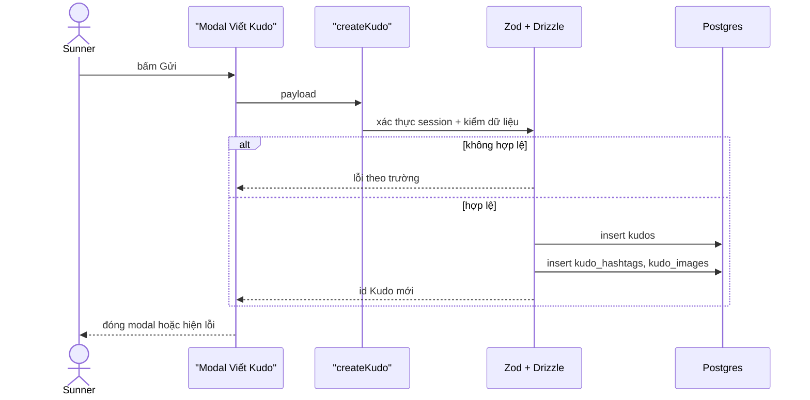
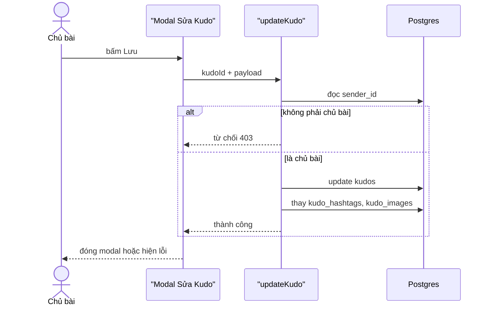
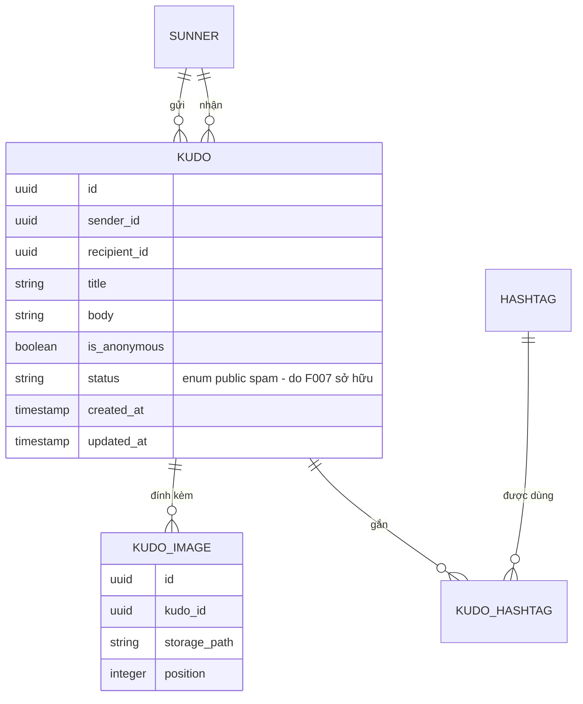

# F003_KudosAuthoring — Technical Spec

**Priority**: P0
**Type**: ui
**Generated**: 2026-11-08

**See also:** [`functional-spec.md`](./functional-spec.md) — tổng quan, quyết định còn mở, yêu cầu/quy tắc nghiệp vụ một dòng, màn hình, user story, kịch bản, edge case, cấu hình cho BA/QA.

**How to read this file:** § 2 là bảng chỉ mục — chọn action rồi đọc khối của nó ở § 3 từ đầu đến cuối; mỗi khối là một luồng trọn vẹn. § 4 là phụ lục dùng chung — chỉ nhảy vào khi một khối § 3 trỏ tới.

## 1. Technical Overview

F003 cho Sunner đăng nhập viết và sửa Kudo qua một modal dùng chung (chế độ tạo / chế độ sửa): tìm người nhận, soạn lời nhắn có `@` nhắc tên, chọn hashtag, đặt danh hiệu, đính ảnh (Supabase Storage), chèn link, gửi ẩn danh. Server (Next.js App Router, server action + route handler) kiểm tra lại bằng Zod rồi ghi `kudos` cùng bảng con trong một giao dịch Drizzle/Postgres. F003 chỉ sở hữu phía ghi; hiển thị, tim, spam do F004/F005/F007 đảm nhiệm và đọc cùng bản ghi `kudos`.

## 2. Action Index

| # | Action (handler) | Method · Path | Codes | Writes | Detail |
|---|---|---|---|---|---|
| **A0** | *cross-cutting — belongs to no single action* | — | FR-601 | — | § 4.4 |
| **A1** | `SunnerSearch#search` (planned) | `GET` `/api/sunners/search` | FR-201, FR-203, US001 | — *(read-only)* | § 3.1 |
| **A2** | `HashtagList#list` (planned) | `GET` `/api/hashtags` | FR-002, FR-204, US001 | — *(read-only)* | § 3.1 |
| **A3** | `KudoImageUpload#createSignedUpload` (planned) | `POST` `/api/kudos/images/sign` | FR-206, INT-001, US002 | — *(không ghi bảng; chỉ tạo URL upload Storage)* | § 3.1 |
| **A4** | `KudoActions#createKudo` (planned) | `server action` | FR-001, FR-101, FR-202, FR-205, FR-207, FR-208, FR-209, FR-210, FR-403, FR-603, BR-001, BR-002, BR-003, BR-005, DEC-001, US001, US002, US003 | `kudos`, `kudo_hashtags`, `kudo_images` | § 3.1 ▸ **diagram** |
| **A5** | `KudoActions#updateKudo` (planned) | `server action` | FR-402, FR-603, BR-001, BR-002, BR-003, BR-004, US004 | `kudos`, `kudo_hashtags`, `kudo_images` | § 3.2 ▸ **diagram** |
| **A6** | `KudoEdit#getForEdit` (planned) | `GET` `/api/kudos/:id/edit` | FR-102, FR-401, FR-602, BR-004, US004 | — *(read-only)* | § 3.2 |

## 3. Actions

### 3.1 CAP-01 — Viết và gửi Kudo

#### A1 · Tìm Sunner làm người nhận / người được nhắc
`GET /api/sunners/search?q=` → `` `SunnerSearch#search` ``
`FR-201` `FR-203` `US001` · `SCR006_WriteKudoModal` (draft)

**Who** · Sunner đã đăng nhập *(gate A0 — § 4.4)*
**FE** · ô Người nhận (FR-201: chọn đúng một người bằng cách gõ tên) và ô lời nhắn khi gõ `@` (FR-203: nhắc tên đồng nghiệp) cùng gọi dropdown kết quả; debounce phía client.
**Request** · param `q` *(chuỗi tên, tối thiểu 1 ký tự — TBD (draft))*
**BE** · tìm theo tên trong hồ sơ Sunner (do F001 tạo), giới hạn số kết quả; trả `id`, tên, avatar, phòng ban.
**Rule** · loại bỏ chính người đang đăng nhập khỏi kết quả hay không — TBD (draft), chờ quyết định "tự gửi cho mình" ở functional-spec § 3.
**Result** · chỉ đọc, không ghi DB.
**Source:** TBD (draft)

<!-- Không có diagram: dưới ngưỡng (chỉ đọc, một bảng, đồng bộ). -->

---

#### A2 · Lấy danh sách hashtag
`GET /api/hashtags` → `` `HashtagList#list` ``
`FR-002` `FR-204` `US001` · `SCR006_WriteKudoModal` (draft)

**Who** · Sunner đã đăng nhập *(gate A0 — § 4.4)*
**FE** · dropdown Hashtag (FR-204: chọn ít nhất một hashtag) đọc danh sách này.
**BE** · trả danh sách hashtag có sẵn (FR-002: chỉ chọn từ danh sách, không tạo tự do). Nguồn danh sách — TBD (draft), xem functional-spec § 3.
**Result** · chỉ đọc, không ghi DB.
**Source:** TBD (draft)

---

#### A3 · Xin URL upload ảnh đính kèm
`POST /api/kudos/images/sign` → `` `KudoImageUpload#createSignedUpload` ``
`FR-206` `INT-001` `US002` · `SCR006_WriteKudoModal` (draft)

**Who** · Sunner đã đăng nhập *(gate A0 — § 4.4)*
**FE** · nút thêm ảnh (FR-206: tối đa 5 ảnh) xin URL ký sẵn rồi tải ảnh thẳng lên Storage, hiện thumbnail.
**Request** · `fileName`, `contentType`, `size` của từng ảnh
**BE** · kiểm tra loại và dung lượng, rồi xin Supabase Storage một signed upload URL vào thư mục riêng của người gửi (INT-001: Storage cấp URL ký sẵn để trình duyệt tải ảnh lên không qua server). *(§ 4.5)*
**Rule** · từ chối khi loại/dung lượng không hợp lệ; trần số ảnh được kiểm lại ở A4/A5 (BR-003) vì A3 không biết các ảnh còn lại của bài.
**Result** · không ghi bảng; chỉ sinh đường dẫn Storage tạm, chưa gắn vào Kudo nào.
**Source:** TBD (draft)

<!-- Không có diagram: không ghi bảng, không bất đồng bộ phía server. -->

---

#### A4 · Gửi Kudo mới
`server action` → `` `KudoActions#createKudo` ``
`FR-001` `FR-101` `FR-202` `FR-205` `FR-207` `FR-208` `FR-209` `FR-210` `FR-403` `FR-603` `BR-001` `BR-002` `BR-003` `BR-005` `DEC-001` `US001` `US002` `US003` · `SCR006_WriteKudoModal` (draft)

**Who** · Sunner đã đăng nhập *(gate A0 — § 4.4)*
**FE** · modal mở từ ô "gửi lời cảm ơn" trên Live board (FR-101: lối vào form viết). Form có lời nhắn (FR-202), danh hiệu tuỳ chọn (FR-205), chèn link (FR-207), tuỳ chọn ẩn danh (FR-208). Nút Gửi bị khoá khi đang gửi (FR-403: chống bấm đúp). Thiếu trường bắt buộc thì hiện lỗi, không gọi server (FR-209). Gửi xong đóng modal và báo thành công (FR-210). Lối vào, dropdown, upload gọi A1–A3.
**Request** · `recipientId`, `body`, `title?`, `hashtagIds[]`, `imagePaths[]`, `isAnonymous`
**BE** · `` `KudoActions#createKudo` `` lấy `sender_id` từ session (không nhận từ client), kiểm lại toàn bộ bằng Zod (FR-603: server kiểm lại mọi quy tắc, không tin client), ghi trong một giao dịch.
**Rule** · quyết định phản hồi khi gửi:

| DEC | subtype | Condition | What the user sees | Source |
|---|---|---|---|---|
| **DEC-001** | interaction | thiếu Người nhận, Lời nhắn hoặc Hashtag | không gửi; hiện lỗi "Bạn cần điền đủ Người nhận, Lời nhắn gửi và Hashtag để gửi Kudos!" | TBD (draft) |

- **BR-001 — Lời nhắn tối đa 1.000 ký tự.** Kiểm lại ở server theo cùng cách đếm với client. *(§ 4.4)*
- **BR-002 — Bắt buộc có Người nhận, Lời nhắn, ít nhất một Hashtag.** Danh hiệu, ảnh, link là tuỳ chọn. *(§ 4.4)*
- **BR-003 — Tối đa 5 ảnh mỗi Kudo, mỗi `imagePath` phải thuộc thư mục của chính người gửi.** *(§ 4.4)*
- **BR-005 — Kudo mới luôn bắt đầu ở trạng thái Public.** Đổi sang Spam là việc của F007; F003 không nhận trạng thái từ client.

**Result**
- Ghi `kudos` ← sender từ session, các trường đã kiểm; `status = public`; `is_anonymous` theo form.
- Ghi `kudo_hashtags`, `kudo_images` (kèm thứ tự ảnh).
- User sees: modal đóng, thông báo gửi thành công; Kudo mới có mặt ở feed do F004 hiển thị.
**Source:** TBD (draft)



---

### 3.2 CAP-02 — Sửa Kudo của mình

#### A5 · Lưu chỉnh sửa Kudo
`server action` → `` `KudoActions#updateKudo` ``
`FR-402` `FR-603` `BR-001` `BR-002` `BR-003` `BR-004` `US004` · `SCR006_WriteKudoModal` (draft)

**Who** · chủ bài (người gửi) *(gate A0 — § 4.4)*
**FE** · cùng modal ở chế độ sửa; Lưu thay cho Gửi. Lưu xong cập nhật chính Kudo đó, không tạo bài mới (FR-402).
**Request** · `kudoId` + các trường như A4 (tập trường được sửa — TBD (draft), xem functional-spec § 3)
**BE** · `` `KudoActions#updateKudo` `` đọc bài, so `sender_id` với session, kiểm lại bằng Zod (FR-603: server kiểm lại mọi quy tắc), ghi trong một giao dịch, đặt `updated_at`.
**Rule**
- **BR-004 — Chỉ chủ bài được sửa.** Server so `sender_id` với session, không dựa vào việc client có hiện nút sửa hay không. *(§ 4.4)*
- **BR-001 / BR-002 / BR-003** — cùng giới hạn như khi gửi: lời nhắn ≤ 1.000 ký tự; bắt buộc Người nhận, Lời nhắn, ≥ 1 Hashtag; tối đa 5 ảnh thuộc người gửi. *(§ 4.4)*

**Result**
- Cập nhật `kudos`; thay thế tập `kudo_hashtags` và `kudo_images` theo bản mới.
- Giữ nguyên `created_at` và tim; hiển thị dấu "đã sửa" — TBD (draft).
**Source:** TBD (draft)



---

#### A6 · Nạp dữ liệu để sửa
`GET /api/kudos/:id/edit` → `` `KudoEdit#getForEdit` ``
`FR-102` `FR-401` `FR-602` `BR-004` `US004` · `SCR006_WriteKudoModal` (draft)

**Who** · chủ bài *(gate A0 — § 4.4)*
**FE** · nút sửa trên thẻ Kudo của chính mình (FR-102: lối vào chế độ sửa; thẻ do F004 hiển thị) mở modal và điền sẵn nội dung hiện tại (FR-401).
**Request** · param `id`
**BE** · đọc Kudo kèm hashtag, ảnh; so chủ bài với session.
**Rule** · **BR-004** áp dụng: người khác nhận 403 (FR-602: chỉ chủ bài được sửa), không lộ nội dung.
**Result** · chỉ đọc, không ghi DB.
**Source:** TBD (draft)

<!-- Không có diagram: chỉ đọc, đồng bộ. -->

### 3.3 Edge cases

| Action | Scenario | Behavior |
|---|---|---|
| A4 | lời nhắn 1.001 ký tự (qua API trực tiếp) | server từ chối, trả lỗi theo trường (BR-001) |
| A4 · A5 | `imagePaths` chứa đường dẫn của người khác hoặc quá 5 ảnh | từ chối toàn bộ yêu cầu (BR-003) |
| A4 | bấm Gửi hai lần nhanh | client khoá nút; server không dùng idempotency key ở bản đầu — có thể ra hai bài, ghi ở § 5.3 |
| A4 | `recipientId` không tồn tại hoặc tài khoản bị vô hiệu | từ chối "người nhận không hợp lệ" |
| A4 | người nhận là chính mình | TBD (draft) — chờ quyết định tự gửi |
| A5 | người khác gọi sửa Kudo không phải của mình | 403, không ghi gì (BR-004) |
| A5 | hai lần sửa đồng thời | last-write-wins ở bản đầu |
| A3 | ảnh sai loại hoặc quá dung lượng | không cấp URL; client báo lỗi từng ảnh |
| A1-A6 | chưa đăng nhập | 401 qua cổng A0 (§ 4.4) |

## 4. Shared Foundation

### 4.1 Components

| Component | Responsibility | Used in | File |
|---|---|---|---|
| `KudoComposerModal` (planned) | modal dùng chung cho chế độ tạo / sửa | A1-A6 | TBD (draft) |
| `KudoInputSchema` (planned) | schema Zod dùng chung client + server | A4, A5 | TBD (draft) |
| `KudoActions` (planned) | server action tạo / sửa | A4, A5 | TBD (draft) |
| `KudoRepository` (planned) | truy vấn Drizzle cho `kudos` và bảng con | A4, A5, A6 | TBD (draft) |

### 4.2 Data Model



| Entity | Table | Used for | Action |
|---|---|---|---|
| `Kudo` | `kudos` | bản ghi lời cảm ơn; F003 sở hữu phía ghi | A4, A5, A6 |
| `KudoHashtag` | `kudo_hashtags` | nối nhiều-nhiều Kudo – hashtag | A4, A5, A6 |
| `KudoImage` | `kudo_images` | đường dẫn ảnh trên Storage + thứ tự | A4, A5, A6 |
| `Hashtag` | `hashtags` | danh mục hashtag (chỉ đọc ở F003; cách nạp dữ liệu TBD (draft)) | A2 |

#### Polymorphic Behavior

`kudos.status` (public | spam) là trường phân loại nhưng do F007 sở hữu; mã `DISC-###` cấp ở bước reconcile — TBD (draft). F003 chỉ ghi giá trị khởi tạo `public` (BR-005).

### 4.3 State Management

None.

### 4.4 Shared Rules

#### Bin 3 — cross-cutting, belongs to no single action

**A0 · FR-601 — mọi action đều yêu cầu phiên đăng nhập hợp lệ của email `@sun-asterisk.com`.**
Kiểm session Supabase ở đầu mỗi route handler / server action; chưa đăng nhập trả 401. Cùng cổng với F001 Auth, **không phải quy tắc riêng của F003**.
**Source:** TBD (draft)

#### Bin 2 — used by ≥2 named actions

**BR-001 — Lời nhắn tối đa 1.000 ký tự.**
Used in: **A4** · **A5**. Client chặn gõ quá giới hạn, server kiểm lại theo cùng cách đếm (đếm sau khi trim; token `@` và link đếm theo độ dài văn bản lưu).
**Linked FR:** FR-202
**Source:** TBD (draft)
```text
body = trim(input.body)
assert 1 <= length(body) <= KUDO_BODY_MAX_LENGTH
```

**BR-002 — Bắt buộc Người nhận, Lời nhắn, ít nhất một Hashtag.**
Used in: **A4** · **A5**. Cùng schema Zod dùng cho client và server.
**Linked FR:** FR-209
**Source:** TBD (draft)
```text
assert recipientId exists and active
assert body valid (BR-001)
assert hashtagIds.length >= 1 and all in hashtags
```

**BR-003 — Tối đa 5 ảnh; mỗi ảnh phải nằm trong thư mục Storage của người gửi.**
Used in: **A4** · **A5**. Ngăn tham chiếu ảnh của người khác.
**Linked FR:** FR-206
**Source:** TBD (draft)
```text
assert imagePaths.length <= KUDO_IMAGES_MAX
assert every path startsWith(prefix(senderId))
```

**BR-004 — Chỉ chủ bài được sửa.**
Used in: **A5** · **A6**. So `sender_id` của bản ghi với user trong session; Admin có được sửa hay không — TBD (draft).
**Linked FR:** FR-602
**Source:** TBD (draft)
```text
kudo = read(kudoId)
assert kudo.sender_id == session.userId   # else 403
```

### 4.5 Algorithms & Integrations

### Tải ảnh Kudo lên Supabase Storage bằng signed upload URL (INT-001)
**Linked FR:** FR-206
**Used in:** A3 → A4
**Source:** TBD (draft)
**Type:** api-call
**Target:** Supabase Storage (bucket ảnh Kudo — tên TBD (draft))
**Payload:** tên file, content type, kích thước; không có secret trong payload
**Failure handling:** URL hết hạn hoặc upload lỗi thì client báo lỗi từng ảnh và cho thử lại; ảnh đã upload nhưng không gắn vào Kudo nào (người dùng huỷ form) để lại tệp mồ côi — chưa có cơ chế dọn, xem § 5.3.

### 4.6 Configuration

```text
KUDO_BODY_MAX_LENGTH = 1000      # BR-001 (A4, A5)
KUDO_IMAGES_MAX = 5              # BR-003 (A3, A4, A5)
KUDO_IMAGE_MAX_BYTES = TBD       # TBD (draft) — dung lượng tối đa mỗi ảnh (A3)
KUDO_IMAGE_ALLOWED_TYPES = TBD   # TBD (draft) — định dạng ảnh cho phép (A3)
```

## 5. Verification & Technical Notes

### 5.1 Technical Verification

- **SC-001** *(A4)* Gửi đủ Người nhận, Lời nhắn, ≥ 1 Hashtag thì có một dòng `kudos` mới, `status = public`, `sender_id` = user đăng nhập (covers FR-001, BR-002, BR-005)
- **SC-002** *(A4, A5)* Lời nhắn > 1.000 ký tự hoặc > 5 ảnh bị server từ chối dù client bị bỏ qua (covers FR-603, BR-001, BR-003)
- **SC-003** *(A5, A6)* Người không phải chủ bài nhận 403 ở cả đọc và ghi (covers FR-602, BR-004)

#### US001_SendKudo *(A1, A2, A4)*

**Independent Test:** mở modal, chọn người nhận và hashtag, nhập lời nhắn, bấm Gửi; kiểm tra bản ghi mới.

**Acceptance Scenarios:**

1. **Given** form đủ ba trường bắt buộc, **When** bấm Gửi, **Then** Kudo được tạo và modal đóng.
2. **Given** form thiếu Hashtag, **When** bấm Gửi, **Then** hiện lỗi DEC-001 và không có bản ghi mới.

#### US002_AttachMediaAndLinks *(A3, A4)*

**Independent Test:** đính 5 ảnh và một link rồi gửi; thử ảnh thứ 6.

**Acceptance Scenarios:**

1. **Given** đã có 5 ảnh, **When** thêm ảnh thứ 6, **Then** bị chặn.

#### US003_SendAnonymousKudo *(A4)*

**Independent Test:** bật ẩn danh rồi gửi; kiểm tra `is_anonymous = true`.

**Acceptance Scenarios:**

1. **Given** bật ẩn danh, **When** gửi, **Then** bản ghi lưu cờ ẩn danh; việc ẩn người gửi khi hiển thị thuộc F004.

#### US004_EditOwnKudo *(A5, A6)*

**Independent Test:** chủ bài sửa lời nhắn; người khác thử sửa cùng bài.

**Acceptance Scenarios:**

1. **Given** là chủ bài, **When** lưu bản sửa, **Then** cùng Kudo được cập nhật.
2. **Given** không phải chủ bài, **When** gọi sửa, **Then** nhận 403.

### 5.2 Assumptions

- *(A4)* Lời nhắn lưu dạng văn bản thuần, mention và link mã hoá bằng token trong chuỗi (`@[Tên](sunnerId)`); chưa chốt, chờ quyết định định dạng ở functional-spec § 3.
- *(A4)* Các feature khác (F008 Spotlight, F013 thông báo, F009 huy hiệu) tự lắng nghe thay đổi bảng `kudos` (Supabase Realtime / truy vấn); F003 không tự đẩy sự kiện.
- *(A5)* Sửa bài giữ nguyên người nhận; việc cho đổi người nhận chờ quyết định.

### 5.3 Unresolved Questions

1. **Tệp mồ côi trên Storage** *(A3, A4)*: cần job dọn ảnh đã upload nhưng không gắn Kudo sau N giờ không, hay chấp nhận ở bản đầu?
2. **Chống gửi đúp** *(A4)*: có cần idempotency key phía server, hay khoá nút phía client là đủ?
3. **Cách đếm ký tự** *(A4, A5)*: đếm theo code point hay theo UTF-16 để client và server cùng kết quả với tiếng Việt có dấu và emoji?

### 5.4 Source References

Chưa có mã nguồn — xem `## 7. User Stories` trong functional-spec.md để biết hành vi dự kiến.

### 5.5 Artifact References

| Artifact | File | Codes Used | Reviewed |
|----------|------|------------|----------|
| System Overview | [system-overview.md](../../docs/system/system-overview.md) | TBD (draft) | [ ] |
| Architecture | [architecture.md](../../docs/system/architecture.md) | TBD (draft) | [ ] |
| Feature List | [feature-list.md](../feature-list.md) | F003 | [x] |
| API Map | [api-map.md](../../docs/generated/api-map.md) | TBD (draft) | [ ] |
| Entities | [entities.md](../../docs/generated/entities.md) | TBD (draft) | [ ] |
| Screens | [functional-spec.md § 6](./functional-spec.md#6-screens) | TBD (draft) | [ ] |
| Behavior Logic | [behavior-logic.md](../../docs/generated/behavior-logic.md) | TBD (draft) | [ ] |
| Permissions Matrix | [permissions-matrix.md](../../docs/generated/permissions-matrix.md) | TBD (draft) | [ ] |
| User Stories | [user-stories.md](../../docs/generated/user-stories.md) | TBD (draft) | [ ] |
