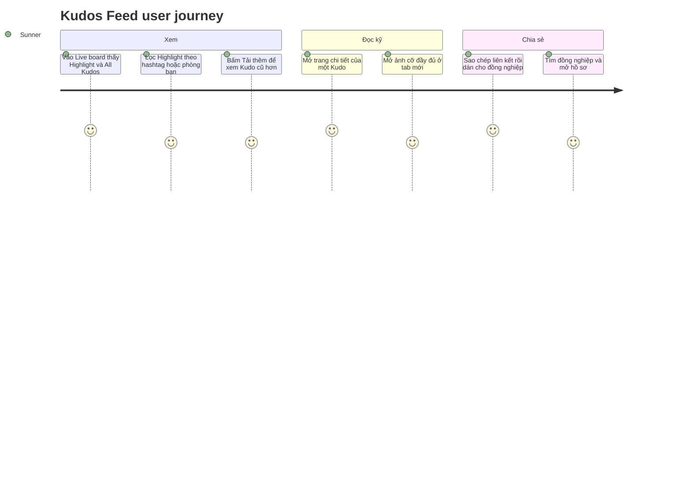

<!-- layout-exempt: rebuild-spec owns all docs/system|features|generated|flows paths — all references here are output targets or internal definitions -->
<!-- Contract: references/feature-spec-researcher-contract.md -->
<!-- Nửa BA/QA của cặp spec: đọc file này là trả lời được "làm gì, ứng xử ra sao, màn hình hiện gì" mà không phải mở file khác. Chi tiết kỹ thuật (đường dẫn, trích nguồn, ghi dữ liệu) nằm ở technical-spec.md. -->

# Functional Spec — F004_KudosFeed

**Priority**: P1
**Type**: mixed
**Generated**: 2026-11-24

**See also:** [`technical-spec.md`](./technical-spec.md) — đường đọc Kudo công khai, che người gửi ẩn danh, phân trang theo mốc thời gian, ký URL ảnh, trích nguồn và thiết kế dữ liệu cho Dev/QA/SA.

**Traceability:** F004_KudosFeed → SCR006_KudoDetail, SCR007_KudosLiveBoardFeed, SCR007_KudosLiveBoardFeed/REG002_SunnerProfileSearch, SCR007_KudosLiveBoardFeed/REG003_HighlightKudos, SCR007_KudosLiveBoardFeed/REG005_AllKudosFeed → US030_SearchSunnerProfile, US031_BrowseHighlightKudos, US032_LoadMoreKudos, US033_OpenKudoDetail, US036_ViewKudoImage, US039_CopyKudoLink → BL009 → ROUTE007, ROUTE008

## 1. Overview

**Problem:** Lời cảm ơn giữa các Sunner chỉ có ý nghĩa khi được nhìn thấy. Nếu không có một nơi chung để xem Kudo công khai thì lời ghi nhận không lan toả, không ai biết ai đang được cảm ơn, và người nhận không có đường dẫn để chia sẻ lại. Đồng thời người gửi ẩn danh phải được bảo vệ danh tính ở mọi nơi Kudo xuất hiện.
**Solution:** Live board cho Sunner xem Kudo công khai theo hai cách: HIGHLIGHT KUDOS (tối đa 5 Kudo nhiều tim nhất, lọc theo hashtag và phòng ban của người nhận, xem dạng carousel) và ALL KUDOS (mới nhất trước, "Tải thêm" nối trang cũ hơn). Mỗi thẻ có biến thể ẩn danh, nút "Xem chi tiết" tới trang riêng của Kudo, "Copy Link" để chia sẻ; ô tìm cho phép mở nhanh hồ sơ đồng nghiệp.
**Scope:** Xem Kudo công khai trên Live board và trang chi tiết; lọc Highlight; nạp thêm feed; thẻ Kudo (có biến thể ẩn danh); xem ảnh đính kèm cỡ đầy đủ; sao chép liên kết; tìm Sunner trên Live board. Feature này sở hữu khung màn hình Live board và ba vùng đọc của nó (ô tìm, Highlight, feed).
**Non-Scope:** Không viết hay sửa Kudo (Kudos Authoring); không xử lý thả tim và đếm tim (Kudos Hearts); không dựng Spotlight Board, cột phần thưởng Secret Box hay huy hiệu Hero (chỉ chừa chỗ cắm); không kiểm duyệt spam (Admin Moderation); không dựng trang hồ sơ (Profile); feed không tự cập nhật khi có Kudo mới, chỉ đổi khi tải lại trang.

**Actors**

| Actor | Description | Primary goal |
|-------|--------------|---------------|
| Sunner | Nhân viên đã đăng nhập bằng email công ty và đã chọn phòng ban | Xem lời cảm ơn công khai, lọc theo chủ đề và phòng ban, mở chi tiết, chia sẻ liên kết, tìm đồng nghiệp |
| Chủ Kudo | Sunner là người gửi của chính Kudo đang xem (kể cả Kudo ẩn danh hay Kudo đã bị đánh dấu spam) | Thấy lối sửa bài của mình trên thẻ và đọc lại Kudo đã bị ẩn của chính mình |

## 2. Functional Capabilities

| ID | Capability | What the user can do | User Stories | Requirements | Business Rules | Screens |
|----|------------|------------------------|-----------------|---------------|-------------------|---------|
| CAP-01 | Dựng Live board và duyệt HIGHLIGHT KUDOS | Vào Live board, lướt carousel Kudo nổi bật, lọc theo hashtag và phòng ban người nhận | US031 | FR-101, FR-201, FR-202, FR-203, FR-204, FR-205, FR-401 | BR-002, BR-004, BR-011, DEC-002 | SCR007_KudosLiveBoardFeed, SCR007_KudosLiveBoardFeed/REG003_HighlightKudos |
| CAP-02 | Duyệt feed ALL KUDOS | Đọc feed Kudo công khai mới nhất trước, nạp thêm trang cũ hơn, đọc thẻ (cả biến thể ẩn danh), thấy bút sửa trên Kudo của mình | US032 | FR-001, FR-002, FR-301, FR-302, FR-303, FR-304, FR-305, FR-402, FR-405, FR-601, FR-602, FR-603 | BR-001, BR-003, BR-005, BR-006, BR-008, BR-010, DEC-001, DEC-003 | SCR007_KudosLiveBoardFeed/REG005_AllKudosFeed |
| CAP-03 | Xem chi tiết một Kudo và mở ảnh đầy đủ | Mở trang riêng của Kudo, đọc trọn lời nhắn, xem mọi ảnh và hashtag, mở ảnh cỡ đầy đủ ở tab mới | US033, US036 | FR-102, FR-311, FR-312, FR-313, FR-403, FR-604 | BR-007, DEC-004, DEC-005 | SCR006_KudoDetail |
| CAP-04 | Sao chép liên kết Kudo | Đưa liên kết cố định của một Kudo vào bộ nhớ tạm để dán chia sẻ | US039 | FR-404 | BR-009, DEC-006 | N/A — nút nằm trên thẻ và trên trang chi tiết, hai màn hình đã thuộc các capability khác |
| CAP-05 | Tìm profile Sunner | Gõ tên hoặc email trên Live board và mở hồ sơ đồng nghiệp | US030 | FR-321 | DEC-007 | SCR007_KudosLiveBoardFeed/REG002_SunnerProfileSearch |

## 3. Open Decisions

None — no unresolved domain confirmations.

<!-- Các mặc định cũ của bản nháp (tiêu chí Highlight là nhiều tim nhất, phòng ban tính theo người nhận, "Tải thêm" 10 Kudo mỗi lần, chi tiết là trang riêng, feed không tự cập nhật, thẻ ẩn danh chỉ hiện biệt danh) đã được xác nhận và nằm ở decision-log; ở đây chúng là quy tắc thường (BR-002, BR-004, BR-005, FR-102, BR-003), không còn là câu hỏi mở. -->

## 4. Requirements

### Foundation (0xx)

- **FR-001** Highlight, ALL KUDOS và các thẻ trên Live board chỉ hiện Kudo công khai; Kudo bị đánh dấu spam của người khác không bao giờ xuất hiện, còn Kudo spam của chính người gửi chỉ mở được ở trang chi tiết.
- **FR-002** Feature chỉ đọc: không tạo, sửa hay xoá Kudo, hashtag hay ảnh.

### Navigation (1xx)

- **FR-101** Sunner vào Live board và thấy ngay ô tìm, HIGHLIGHT KUDOS và ALL KUDOS (phần Spotlight và cột phần thưởng do feature khác dựng).
- **FR-102** Sunner mở trang chi tiết bằng nút "Xem chi tiết" trên mọi thẻ hoặc bằng liên kết đã sao chép; nút "Đóng" đưa về Live board.

### Highlight (2xx)

- **FR-201** HIGHLIGHT KUDOS là carousel: một thẻ ở giữa rõ nét và dùng được, các thẻ bên cạnh mờ và không tương tác.
- **FR-202** Sunner chuyển thẻ bằng mũi tên, nút trang trước/sau hoặc phím trái/phải và luôn thấy chỉ số "số hiện tại/tổng"; nút ở hai đầu báo vô hiệu.
- **FR-203** Sunner lọc Highlight theo một Hashtag chọn từ danh sách; mục "Tất cả" bỏ lọc.
- **FR-204** Sunner lọc Highlight theo một Phòng ban chọn từ danh sách; mục "Tất cả" bỏ lọc.
- **FR-205** Highlight hiện tối đa 5 Kudo, xếp nhiều tim nhất trước, bằng tim thì bài mới hơn trước.

### All Kudos (3xx)

- **FR-301** ALL KUDOS hiện trang đầu 10 Kudo mới nhất trước, đã dựng sẵn khi vào trang.
- **FR-302** "Tải thêm" nối 10 Kudo cũ hơn, biến mất khi hết, không hiện thẻ trùng, chuyển tiêu điểm tới thẻ mới đầu tiên và đọc to số thẻ vừa nạp.
- **FR-303** Thẻ Kudo gồm người gửi, người nhận (ảnh, tên, mã phòng ban, huy hiệu Hero), thời gian theo giờ Việt Nam, danh hiệu, lời nhắn cắt gọn, ảnh (chỉ ở feed), hashtag, tim, "Copy Link" và "Xem chi tiết".
- **FR-304** Kudo ẩn danh dùng biến thể thẻ riêng: ảnh đại diện mặc định và biệt danh thay cho người gửi, không liên kết hồ sơ, không phòng ban, không huy hiệu.
- **FR-305** Chủ Kudo thấy bút sửa trên Kudo của mình khi Kudo không bị spam và vẫn còn thời gian viết Kudo; Sunner khác không thấy.
- **FR-311** Trang chi tiết hiện lời nhắn không cắt, mọi ảnh, mọi hashtag, tim, "Copy Link" và "Đóng".
- **FR-312** Trên trang chi tiết mỗi ảnh mở tệp đầy đủ ở tab mới; ảnh không tải được hiện khung trống; ở feed và Highlight ảnh chỉ để xem.
- **FR-313** Kudo spam của chính người gửi mở ở chế độ chỉ đọc: thẻ Spam và lớp phủ mờ, không tim, không "Copy Link", ảnh không mở được; chỉ "Đóng" dùng được.
- **FR-321** Ô tìm profile Sunner gợi ý theo tên hoặc email sau khi dừng gõ 250 ms, tối đa 50 ký tự và 10 kết quả; chọn kết quả mở hồ sơ người đó; ô không loại chính mình khỏi kết quả.

### Interaction (4xx)

- **FR-401** Hai bộ lọc Highlight áp đồng thời; mỗi lần đổi lọc gọi lại, bỏ yêu cầu cũ và đưa carousel về thẻ đầu khi kết quả mới về.
- **FR-402** Không có Kudo phù hợp thì hiện "Chưa có Kudo nào phù hợp." thay cho vùng trắng; ở Highlight hai bộ lọc vẫn dùng được.
- **FR-403** Mở id sai định dạng, không tồn tại hoặc là Kudo spam của người khác đều cho cùng một trang "không tồn tại", không để dò được Kudo có tồn tại.
- **FR-404** "Copy Link" ghi liên kết cố định của Kudo vào bộ nhớ tạm và báo "Đã sao chép liên kết" (tự tắt sau 4 giây); bị chặn thì báo lỗi kèm ô liên kết để sao chép tay.
- **FR-405** Lỗi đọc của một vùng chỉ hiện lỗi của vùng đó kèm "Thử lại", không làm hỏng cả trang; hết phiên thì mời đăng nhập lại; cursor bị từ chối thì danh sách quay về trang đầu.

### Security (6xx)

- **FR-601** Chỉ Sunner đã đăng nhập và đã chọn phòng ban mới xem được Live board, chi tiết Kudo và dữ liệu của chúng.
- **FR-602** Danh tính người gửi của Kudo ẩn danh không bao giờ đến được trình duyệt của người xem, kể cả quản trị viên trên các màn hình công khai.
- **FR-603** Dữ liệu Kudo trả về theo từng người xem, nên trình duyệt và proxy không được lưu lại để dùng cho người khác.
- **FR-604** Ảnh Kudo chỉ xem được qua liên kết có hạn 30 phút; lỗi tạo liên kết chỉ làm ảnh thành khung trống, trang vẫn hiện.

## 5. Business Rules

- Chỉ Kudo công khai được đưa lên feed và Highlight; trang chi tiết nhận thêm Kudo spam của chính người gửi, chỉ đọc (BR-001)
- Highlight lấy 5 Kudo nhiều tim nhất sau lọc; bằng tim thì bài mới hơn, bằng thời điểm thì id lớn hơn; hệ số chiến dịch không đổi thứ tự (BR-002)
- Người gửi Kudo ẩn danh chỉ lộ biệt danh ở mọi nơi; chủ Kudo vẫn được nhận biết là chủ để có bút sửa (BR-003)
- Hashtag và phòng ban của NGƯỜI NHẬN là hai điều kiện cùng phải đúng; "Tất cả" nghĩa là không lọc điều kiện đó (BR-004)
- ALL KUDOS xếp mới nhất trước, 10 Kudo mỗi trang; cùng thời điểm thì xếp theo id giảm dần để không lặp và không sót khi nối trang (BR-005)
- Mốc nối trang là chuỗi mờ chỉ chấp nhận đúng loại hệ thống đã phát; mốc lạ bị từ chối ngay (BR-006)
- Id sai, id không tồn tại và Kudo spam của người khác cho cùng một kết quả, nên không ai dò được Kudo có tồn tại hay không (BR-007)
- Phản hồi dữ liệu Kudo luôn ở dạng riêng tư, không lưu đệm, vì chứa dấu hiệu chủ Kudo và liên kết ảnh của riêng người xem (BR-008)
- Liên kết sao chép luôn là địa chỉ ứng dụng cộng `/kudos/` và id Kudo, không kèm tham số nào (BR-009)
- Mỗi lúc chỉ có một yêu cầu "Tải thêm" đang chạy; bấm tiếp trong lúc nạp bị bỏ qua (BR-010)
- Chuyển thẻ trong carousel chỉ diễn ra ở trình duyệt giữa các thẻ đã nạp và không bao giờ vượt hai đầu (BR-011)
- Bút sửa chỉ hiện khi người xem là chủ Kudo, Kudo không bị spam và còn thời gian viết Kudo; ngược lại thẻ không có bút (DEC-001)
- Phần thân vùng Highlight là một trong năm trạng thái: đang tải, lỗi, hết phiên, rỗng, hoặc carousel (DEC-002)
- Cuối feed là nút "Tải thêm", trạng thái lỗi, trạng thái rỗng hoặc trạng thái đang tải, tuỳ còn mốc nối trang, lỗi và trang đầu (DEC-003)
- Trang chi tiết dẫn tới một trong bốn kết cục: không tồn tại, lỗi tải, bản chỉ đọc của Kudo spam, hoặc bản đầy đủ (DEC-004)
- Mỗi khung ảnh là khung trống (ký lỗi), liên kết mở tab mới (ở trang chi tiết) hoặc ảnh chỉ để xem (ở feed, Highlight, Kudo spam) (DEC-005)
- Sao chép thành công hiện thông báo tự tắt; thiếu hoặc bị chặn bộ nhớ tạm thì hiện lỗi kèm liên kết để sao chép tay (DEC-006)
- Chọn một kết quả tìm Sunner thì mở hồ sơ người đó; chọn chính mình thì được đưa về hồ sơ của mình; gõ tiếp thì bỏ lựa chọn (DEC-007)

## 6. Screens

| Screen Name | SCR### | What User Sees | What User Can Do |
|-------------|--------|-----------------|-------------------|
| Live board (khung màn hình) | SCR007_KudosLiveBoardFeed | Hình nền keyvisual, tiêu đề, hàng hành động (ô viết Kudo và ô tìm Sunner), HIGHLIGHT KUDOS, Spotlight Board, ALL KUDOS cạnh cột phần thưởng; khung chờ lúc dữ liệu đang về | Cuộn qua các vùng; mỗi vùng tự hiện lỗi riêng nếu đọc hỏng; mở Secret Box theo liên kết đặc biệt (do feature khác lo) |
| Ô tìm profile Sunner | SCR007_KudosLiveBoardFeed/REG002_SunnerProfileSearch | Ô "Tìm kiếm profile Sunner" cạnh ô viết Kudo; danh sách gợi ý có tên, ảnh, phòng ban; các trạng thái "Đang tìm…", "Không tìm thấy Sunner phù hợp.", lỗi, hết phiên | Gõ tên hoặc email, di chuyển bằng mũi tên, chọn bằng chuột hoặc Enter để mở hồ sơ, Esc để đóng danh sách |
| HIGHLIGHT KUDOS | SCR007_KudosLiveBoardFeed/REG003_HighlightKudos | Tiêu đề, hai dropdown Hashtag và Phòng ban, carousel một thẻ giữa rõ nét hai thẻ bên mờ, nút trước/sau, chỉ số "n/N"; trạng thái rỗng, đang tải, lỗi | Chọn bộ lọc, chuyển thẻ bằng mũi tên, nút trang hoặc phím trái/phải, "Copy Link", "Xem chi tiết", sửa Kudo của mình, "Thử lại" |
| ALL KUDOS | SCR007_KudosLiveBoardFeed/REG005_AllKudosFeed | Danh sách thẻ Kudo mới nhất trước (người gửi, người nhận, thời gian, danh hiệu, lời nhắn cắt gọn, ảnh, hashtag, tim), nút "Tải thêm", trạng thái rỗng, đang tải, lỗi | "Tải thêm", "Copy Link", "Xem chi tiết", thả tim (do feature khác lo), sửa Kudo của mình, mở hồ sơ qua tên hoặc ảnh, "Thử lại" |
| Chi tiết Kudo | SCR006_KudoDetail | Khung giữa trang trên nền keyvisual tối: người gửi, người nhận, thời gian, danh hiệu, lời nhắn đầy đủ, mọi ảnh, mọi hashtag, tim, "Copy Link", "Đóng"; hoặc trang "không tồn tại"; hoặc khối lỗi; hoặc bản chỉ đọc có thẻ Spam và lớp phủ mờ | Đọc, mở từng ảnh ở tab mới, "Copy Link", "Đóng" về Live board, "Thử lại" khi lỗi, "Quay lại Live board" khi không tồn tại |

### User Journey

1. Sunner vào Live board và thấy HIGHLIGHT KUDOS cùng ALL KUDOS đã có sẵn dữ liệu đợt đầu.
2. Sunner chọn một Hashtag hoặc Phòng ban ở Highlight; carousel nạp lại và về thẻ đầu.
3. Sunner lướt các thẻ Highlight bằng mũi tên hoặc phím, rồi cuộn xuống ALL KUDOS đọc các thẻ mới nhất.
4. Sunner bấm "Tải thêm" khi muốn xem Kudo cũ hơn; tiêu điểm nhảy tới thẻ mới đầu tiên.
5. Sunner bấm "Xem chi tiết" ở một thẻ và đọc trọn lời nhắn, mở ảnh cỡ đầy đủ ở tab mới.
6. Sunner bấm "Copy Link" và dán cho đồng nghiệp; người nhận liên kết đăng nhập rồi mở thẳng đúng Kudo.
7. Sunner gõ tên một đồng nghiệp vào ô tìm, chọn kết quả và được đưa tới hồ sơ người đó.



## 7. User Stories

### US030_SearchSunnerProfile — Search Sunner Profile

**Actor:** Sunner
**Goal:** Tìm một đồng nghiệp theo tên hoặc email ngay trên Live board để mở nhanh hồ sơ của người đó.
**Business value:** Rút ngắn đường từ lời cảm ơn tới con người được cảm ơn, khuyến khích Sunner đi xem hồ sơ và gửi thêm Kudo.

**Acceptance Criteria:**
- [ ] Ô "Tìm kiếm profile Sunner" cạnh ô viết Kudo gợi ý sau khi dừng gõ 250 ms, từ khoá tối đa 50 ký tự, tối đa 10 kết quả xếp theo tên.
- [ ] Tên khớp không phân biệt hoa thường và dấu (chứa chuỗi gõ), email khớp theo phần đầu; các ký tự `%`, `_`, `\` được hiểu là chữ thường.
- [ ] Chọn kết quả bằng chuột hoặc ↑, ↓, Enter mở hồ sơ người đó; chọn chính mình thì được đưa về hồ sơ của mình; Esc đóng danh sách và Enter không gửi biểu mẫu nào.
- [ ] Ô này không loại chính mình khỏi kết quả, khác với ô chọn người nhận khi viết Kudo.
- [ ] Có đủ trạng thái "Đang tìm…", "Không tìm thấy Sunner phù hợp.", "Không tìm được, vui lòng thử lại." và "Phiên đăng nhập đã hết hạn, vui lòng đăng nhập lại.".

### US031_BrowseHighlightKudos — Browse Highlight Kudos

**Actor:** Sunner
**Goal:** Lọc và lướt các Kudo nổi bật trong khối HIGHLIGHT KUDOS để xem những lời cảm ơn được thả tim nhiều nhất theo hashtag và phòng ban.
**Business value:** Lời cảm ơn đáng nhớ được nhiều người thấy hơn, và Sunner tìm nhanh lời cảm ơn gắn với giá trị cốt lõi hoặc đơn vị của mình.

**Acceptance Criteria:**
- [ ] Khối hiện tối đa 5 Kudo công khai xếp theo số tim giảm dần rồi mới nhất; kết quả "Tất cả" đã dựng sẵn khi vào trang.
- [ ] Hai dropdown Hashtag và Phòng ban chọn một giá trị, "Tất cả" bỏ lọc; hai bộ lọc kết hợp bằng AND và phòng ban là phòng ban của người nhận.
- [ ] Mỗi lần đổi bộ lọc gọi lại, bỏ yêu cầu cũ nếu còn chạy và đưa carousel về thẻ đầu khi kết quả mới về.
- [ ] Carousel chuyển thẻ bằng mũi tên trái phải (từ màn hình vừa trở lên), nút trang, phím ← →; chỉ thẻ giữa tương tác được; nút ở hai đầu báo vô hiệu; chỉ số "n/N" cập nhật; việc chuyển thẻ chỉ ở trình duyệt.
- [ ] Không có Kudo phù hợp hiện "Chưa có Kudo nào phù hợp." mà bộ lọc vẫn dùng được; nạp lỗi hiện thông báo riêng của khối kèm "Thử lại".

### US032_LoadMoreKudos — Load More Kudos

**Actor:** Sunner
**Goal:** Tải thêm các Kudo cũ hơn trong danh sách ALL KUDOS để xem lại những lời cảm ơn đã đăng trước đó.
**Business value:** Giữ trang đầu nhẹ và nhanh nhưng không giấu lịch sử ghi nhận của cả công ty.

**Acceptance Criteria:**
- [ ] Trang đầu có 10 Kudo công khai mới nhất trước, dựng sẵn khi vào trang; "Tải thêm" nối 10 Kudo kế tiếp và biến mất khi hết.
- [ ] Trong lúc nạp nút báo vô hiệu và bận, có vòng chờ; bấm tiếp lúc đang nạp không gửi thêm yêu cầu.
- [ ] Sau khi nối, tiêu điểm chuyển tới thẻ mới đầu tiên và vùng trạng thái đọc "Đã tải thêm {count} Kudo"; thẻ trùng id giữa các trang chỉ giữ một.
- [ ] Nạp lỗi hiện "Không tải được Kudos. Vui lòng thử lại." kèm "Thử lại"; mốc nối trang bị từ chối thì danh sách quay về trang đầu; hết phiên thì hiện thông báo kèm liên kết đăng nhập.
- [ ] Người gửi ẩn danh luôn bị che ở mọi trang; Kudo spam không bao giờ có trong danh sách.

### US033_OpenKudoDetail — Open Kudo Detail

**Actor:** Sunner
**Goal:** Mở trang chi tiết của một Kudo để đọc trọn lời nhắn, xem hết ảnh và hashtag của Kudo đó.
**Business value:** Lời nhắn dài và ảnh đính kèm được đọc đầy đủ, và mỗi Kudo có một địa chỉ riêng để chia sẻ.

**Acceptance Criteria:**
- [ ] Nút "Xem chi tiết" trên mọi thẻ Kudo (Highlight, ALL KUDOS và danh sách trên hồ sơ) mở trang của Kudo đó.
- [ ] Trang chi tiết hiện lời nhắn không cắt dòng, mọi ảnh, mọi hashtag, tim, "Copy Link" và nút "Đóng" về Live board; người gửi ẩn danh vẫn bị che.
- [ ] Id sai định dạng, id không tồn tại và Kudo spam của người khác cùng cho kết quả "Kudo này không tồn tại hoặc đã bị gỡ." kèm nút "Quay lại Live board".
- [ ] Kudo spam của chính người xem mở được ở chế độ chỉ đọc: thẻ Spam và lớp phủ mờ, không tim, không "Copy Link", ảnh không mở được; chỉ "Đóng" còn dùng được.
- [ ] Đọc lỗi hiện "Không tải được Kudo. Vui lòng thử lại." kèm liên kết "Thử lại" mở lại đúng địa chỉ đó.

### US036_ViewKudoImage — View Kudo Image

**Actor:** Sunner
**Goal:** Mở ảnh đính kèm của một Kudo ở kích thước đầy đủ trong tab mới, để xem rõ nội dung mà trang chỉ hiện dưới dạng ảnh nhỏ.
**Business value:** Ảnh kỷ niệm trong lời cảm ơn xem được rõ mà không rời trang đang đọc.

**Acceptance Criteria:**
- [ ] Trên trang chi tiết mỗi ảnh (tối đa 5, theo thứ tự đã đính) là liên kết mở tab mới, nhãn "Mở ảnh đính kèm {n} trong thẻ mới".
- [ ] Ảnh nào không tạo được liên kết hiện khung trống kèm chữ ẩn "Ảnh đính kèm {n} không tải được" và không phải liên kết.
- [ ] Với Kudo spam của chính mình (dưới lớp mờ) ảnh không phải liên kết.
- [ ] Ở feed và Highlight ảnh chỉ để xem; muốn mở phải vào trang chi tiết.

### US039_CopyKudoLink — Copy Kudo Link

**Actor:** Sunner
**Goal:** Sao chép đường dẫn của một Kudo vào bộ nhớ tạm để dán chia sẻ cho đồng nghiệp ở chỗ khác.
**Business value:** Lời cảm ơn lan sang các kênh chat và email khác, giúp người nhận và đồng đội thấy ngay.

**Acceptance Criteria:**
- [ ] Bấm "Copy Link" ghi địa chỉ của Kudo vào bộ nhớ tạm và hiện "Đã sao chép liên kết", tự tắt sau 4 giây.
- [ ] Bộ nhớ tạm bị chặn hoặc không có: hiện cảnh báo "Không sao chép được liên kết, vui lòng thử lại." kèm ô chỉ đọc chứa liên kết (tự chọn hết khi tới) và nút "Đóng"; thông báo nằm tới khi bấm "Đóng".
- [ ] Nút không có trên Kudo spam của chính mình.
- [ ] Đường dẫn cố định, không kèm tham số khác.

## 8. Scenarios

### US030_SearchSunnerProfile — Happy Path

**Given** có Sunner tên "Nguyễn Văn An", **When** Sunner gõ "van an" rồi chọn kết quả, **Then** danh sách hiện sau 250 ms và trình duyệt tới hồ sơ của người đó.

### US030_SearchSunnerProfile — Error: tìm lỗi

**Given** dịch vụ tìm trả lỗi, **When** Sunner gõ một từ khoá, **Then** ô hiện "Không tìm được, vui lòng thử lại."; nếu phiên đã hết hạn thì hiện "Phiên đăng nhập đã hết hạn, vui lòng đăng nhập lại.".

### US030_SearchSunnerProfile — Edge: tìm chính mình

**Given** Sunner gõ tên của chính mình, **When** chọn kết quả, **Then** hồ sơ của người đó mở rồi được chuyển về hồ sơ của mình.

### US031_BrowseHighlightKudos — Happy Path

**Given** có hơn 5 Kudo công khai trong hashtag X, **When** Sunner chọn hashtag X ở dropdown, **Then** carousel hiện 5 Kudo nhiều tim nhất của X và về thẻ 1/5.

### US031_BrowseHighlightKudos — Happy Path: chuyển thẻ

**Given** carousel đang ở thẻ 2/5, **When** Sunner bấm phím →, **Then** chuyển sang thẻ 3/5 mà không tải lại dữ liệu.

### US031_BrowseHighlightKudos — Error: nạp lỗi

**Given** việc nạp Highlight trả lỗi, **When** Sunner đổi bộ lọc, **Then** vùng hiện "Không tải được Kudos. Vui lòng thử lại." kèm "Thử lại"; bấm nút nạp lại với bộ lọc đang chọn.

### US031_BrowseHighlightKudos — Edge: không có Kudo phù hợp

**Given** hashtag và phòng ban đã chọn không có Kudo nào, **When** Sunner áp bộ lọc, **Then** hiện "Chưa có Kudo nào phù hợp." và hai dropdown vẫn dùng được.

### US032_LoadMoreKudos — Happy Path

**Given** có 25 Kudo công khai và trang đầu hiện 10, **When** Sunner bấm "Tải thêm" hai lần, **Then** hiện 20 rồi 25 Kudo, nút biến mất và tiêu điểm nằm ở thẻ mới đầu tiên.

### US032_LoadMoreKudos — Error: nạp lỗi

**Given** việc nạp thêm trả lỗi, **When** Sunner bấm "Tải thêm", **Then** hiện "Không tải được Kudos. Vui lòng thử lại." kèm "Thử lại"; bấm nút nạp lại cùng mốc.

### US032_LoadMoreKudos — Edge: mốc nối trang hết hiệu lực

**Given** mốc nối trang bị hệ thống từ chối, **When** Sunner bấm "Tải thêm", **Then** danh sách quay về trang đầu và hiện thông báo lỗi.

### US033_OpenKudoDetail — Happy Path

**Given** Sunner thấy một Kudo công khai trong ALL KUDOS, **When** bấm "Xem chi tiết", **Then** trang chi tiết hiện đủ lời nhắn, ảnh, hashtag và tim.

### US033_OpenKudoDetail — Error: Kudo không mở được

**Given** id không tồn tại hoặc là Kudo spam của người khác, **When** Sunner mở địa chỉ đó, **Then** thấy "Kudo này không tồn tại hoặc đã bị gỡ." kèm "Quay lại Live board", giống hệt trong cả hai trường hợp.

### US033_OpenKudoDetail — Edge: Kudo spam của chính mình

**Given** Kudo của Sunner bị đánh dấu spam, **When** Sunner mở trang chi tiết, **Then** thấy bản chỉ đọc có thẻ Spam và lớp phủ mờ, không có tim hay "Copy Link", chỉ "Đóng" dùng được.

### US036_ViewKudoImage — Happy Path

**Given** Kudo có 3 ảnh, **When** Sunner bấm ảnh thứ 2 ở trang chi tiết, **Then** tab mới mở tệp đầy đủ và trang hiện tại giữ nguyên.

### US036_ViewKudoImage — Error: tạo liên kết ảnh lỗi

**Given** việc tạo liên kết ảnh lỗi, **When** Sunner mở trang chi tiết, **Then** trang vẫn hiện, mỗi ảnh là khung trống có chữ ẩn "không tải được" và không bấm được.

### US036_ViewKudoImage — Edge: trang mở quá lâu

**Given** ảnh nằm trên trang quá 30 phút, **When** Sunner bấm ảnh, **Then** ảnh không mở được cho tới khi tải lại trang.

### US039_CopyKudoLink — Happy Path

**Given** trình duyệt cho phép ghi bộ nhớ tạm, **When** Sunner bấm "Copy Link", **Then** liên kết của Kudo nằm trong bộ nhớ tạm và hiện "Đã sao chép liên kết".

### US039_CopyKudoLink — Error: bộ nhớ tạm bị chặn

**Given** trình duyệt chặn bộ nhớ tạm, **When** Sunner bấm "Copy Link", **Then** hiện cảnh báo kèm ô chứa liên kết để sao chép tay và nút "Đóng".

## 9. Edge Cases

| Scenario | What Happens | User-Facing Message |
|----------|--------------|----------------------|
| Không Kudo nào khớp hai bộ lọc Highlight | Danh sách rỗng, không phải lỗi; hai bộ lọc vẫn dùng được | "Chưa có Kudo nào phù hợp." |
| Ít hơn 5 Kudo đủ điều kiện, hoặc một Kudo bị đánh spam đúng lúc đang nạp | Carousel hiện đúng số thẻ thực có, chỉ số theo số thật | None — silent handling |
| ALL KUDOS chưa có Kudo công khai nào | Vùng feed hiện trạng thái rỗng, không có nút "Tải thêm" | "Chưa có Kudo nào phù hợp." |
| Nhiều Kudo cùng một thời điểm gửi | Xếp theo id giảm dần; nối trang không lặp, không sót | None — silent handling |
| Kudo `public` | Hiện ở Highlight, ALL KUDOS và chi tiết với mọi Sunner, đủ tim, "Copy Link" và ảnh mở được | None — hiển thị bình thường |
| Kudo `spam` của chính người xem (giá trị spam của trạng thái Kudo) | Không có trên Live board; trang chi tiết là bản chỉ đọc, mờ, thẻ Spam, không tim, không "Copy Link", ảnh không mở được | "Kudo này không tồn tại hoặc đã bị gỡ." chỉ hiện với người khác; chủ Kudo thấy bản chỉ đọc |
| Kudo `spam` của người khác | Không hiện ở Live board; mở thẳng địa chỉ thì ra cùng trang như id không tồn tại | "Kudo này không tồn tại hoặc đã bị gỡ." |
| Quản trị viên xem Kudo ẩn danh trên màn hình công khai (giá trị admin của vai trò) | Cũng chỉ thấy biệt danh, không có ngoại lệ; Kudo spam của người khác vẫn bị ẩn | None — hiển thị như mọi Sunner |
| Kudo ẩn danh của chính người xem | Thẻ vẫn chỉ hiện biệt danh nhưng có bút sửa nếu còn thời gian viết Kudo | None — silent handling |
| Hết thời gian viết Kudo | Bút sửa trên thẻ biến mất ở lần tải sau | None — silent handling |
| Phiên đăng nhập hết hạn khi đang dùng một vùng | Vùng đó hiện lời mời đăng nhập lại kèm liên kết, không có "Thử lại" | "Phiên đăng nhập đã hết hạn, vui lòng đăng nhập lại." |
| Bấm "Tải thêm" nhiều lần liên tiếp | Chỉ một yêu cầu chạy, các lần bấm sau bị bỏ qua | None — silent handling |
| Mốc nối trang bị từ chối | Danh sách quay về trang đầu và hiện lỗi kèm "Thử lại" | "Không tải được Kudos. Vui lòng thử lại." |
| Nạp một vùng bị lỗi | Chỉ vùng đó hiện lỗi, các vùng khác vẫn dùng bình thường | "Không tải được Kudos. Vui lòng thử lại." |
| Trang chi tiết đọc dữ liệu lỗi | Khối cảnh báo kèm liên kết "Thử lại" mở lại đúng địa chỉ | "Không tải được Kudo. Vui lòng thử lại." |
| Id sai định dạng hoặc không tồn tại | Cùng một trang "không tồn tại" | "Kudo này không tồn tại hoặc đã bị gỡ." |
| Không tạo được liên kết cho một ảnh | Khung trống kèm chữ ẩn, các ảnh khác vẫn mở bình thường | "Ảnh đính kèm {n} không tải được" (chữ ẩn dành cho trình đọc màn hình) |
| Trình duyệt chặn bộ nhớ tạm | Cảnh báo kèm ô liên kết để sao chép tay, nằm tới khi bấm "Đóng" | "Không sao chép được liên kết, vui lòng thử lại." |
| Chưa đăng nhập, hoặc chưa chọn phòng ban | Trang chuyển về đăng nhập hoặc chọn phòng ban; dữ liệu bị từ chối | None — chuyển trang |
| Chọn chính mình ở ô tìm | Mở hồ sơ rồi được chuyển về hồ sơ của mình | None — silent handling |

## 10. Edge Behaviours to Verify

- **FR-001** → Tạo một Kudo rồi đánh dấu spam: Kudo biến khỏi Highlight và ALL KUDOS của mọi người; với chính người gửi chỉ mở được ở trang chi tiết bản chỉ đọc.
- **FR-002** → Dùng mọi chức năng của Live board và trang chi tiết xong, dữ liệu Kudo không thay đổi.
- **FR-101** → Vào Live board lúc dữ liệu chậm: khung chờ hiện trước, sau đó mỗi vùng tự hiện dữ liệu hoặc lỗi của mình.
- **FR-102** → Bấm "Xem chi tiết" ở thẻ Highlight và thẻ ALL KUDOS đều tới đúng trang của Kudo đó; "Đóng" về Live board.
- **FR-201** → Chỉ thẻ giữa của carousel nhận tiêu điểm và bấm được; hai thẻ bên không vào được bằng phím Tab.
- **FR-202** → Ở thẻ đầu và thẻ cuối, nút trước/sau tương ứng báo vô hiệu nhưng vẫn giữ tiêu điểm; chỉ số "n/N" luôn đúng.
- **FR-203** → Chọn một hashtag chỉ còn các Kudo gắn hashtag đó; "Tất cả" trả về danh sách ban đầu.
- **FR-204** → Chọn một phòng ban chỉ còn các Kudo có người nhận thuộc phòng ban đó, không phải người gửi.
- **FR-205** → Với 8 Kudo công khai có số tim khác nhau, Highlight hiện đúng 5 Kudo nhiều tim nhất; bằng tim thì bài mới hơn đứng trước.
- **FR-301** → Với 25 Kudo, trang đầu hiện đúng 10 Kudo mới nhất.
- **FR-302** → Sau hai lần "Tải thêm" hiện đủ 25 Kudo, không thẻ nào lặp, nút biến mất, tiêu điểm ở thẻ mới đầu tiên và có thông báo số thẻ vừa nạp.
- **FR-303** → Thời gian trên thẻ theo giờ Việt Nam dạng "10:00 - 10/30/2025"; lời nhắn dài bị cắt gọn trên thẻ và đủ trên trang chi tiết.
- **FR-304** → Thẻ ẩn danh chỉ có biệt danh và ảnh mặc định; tên người gửi không có trong trang, kể cả khi xem mã nguồn của trang.
- **FR-305** → Bút sửa chỉ xuất hiện trên Kudo của chính mình, không xuất hiện trên Kudo spam hay sau khi hết thời gian viết Kudo.
- **FR-311** → Trang chi tiết hiện lời nhắn đủ dòng, mọi ảnh và mọi hashtag, không bị cắt.
- **FR-312** → Bấm ảnh ở trang chi tiết mở tab mới; ở feed và Highlight bấm ảnh không làm gì.
- **FR-313** → Kudo spam của chính mình: có lớp mờ, thẻ Spam, không tim, không "Copy Link", ảnh không bấm được, chỉ "Đóng" nhận tiêu điểm.
- **FR-321** → Gõ "van an" tìm được "Nguyễn Văn An"; gõ ký tự `%` không khớp mọi người; danh sách không quá 10 kết quả.
- **FR-401** → Đổi bộ lọc hai lần liên tiếp thật nhanh: chỉ kết quả của lần chọn cuối được dùng và carousel về thẻ 1.
- **FR-402** → Bộ lọc không có kết quả hiện thông báo rỗng thay vì vùng trắng và vẫn đổi được bộ lọc.
- **FR-403** → Id sai định dạng, id lạ và Kudo spam của người khác cho cùng một trang, cùng nội dung.
- **FR-404** → Bấm "Copy Link" rồi dán: ra đúng địa chỉ của Kudo; chặn bộ nhớ tạm thì có ô liên kết để sao chép tay.
- **FR-405** → Làm một vùng lỗi (ví dụ Highlight): chỉ vùng đó báo lỗi, ALL KUDOS vẫn dùng được; hết phiên thì có liên kết đăng nhập.
- **FR-601** → Chưa đăng nhập thì bị đưa về đăng nhập; chưa chọn phòng ban thì bị đưa tới trang chọn phòng ban.
- **FR-602** → Với Kudo ẩn danh, mở mã nguồn trang và dữ liệu nhận về: không có tên, ảnh, phòng ban hay hạng của người gửi.
- **FR-603** → Hai Sunner khác nhau xem cùng một Kudo nhận dữ liệu riêng của mình; dữ liệu không bị lưu dùng chung.
- **FR-604** → Ảnh hiện được ngay sau khi tải trang; sau 30 phút liên kết ảnh cũ không còn dùng được cho tới khi tải lại.

## 11. Risks & Known Issues

| ID | Type | Description | Impact | Status |
|----|------|--------------|--------|--------|
| RISK-01 | known-issue | Lỗi khi đọc số tim của một trang thẻ làm cả trang thẻ đó lỗi (không có thẻ nào hiện, chỉ có lỗi vùng), trong khi lỗi khi đọc huy hiệu Hero chỉ làm thẻ mất huy hiệu; thẻ chưa có cách báo lỗi tim nhẹ | Một sự cố ở phần đọc tim làm trống cả Highlight hoặc cả một lần "Tải thêm" | confirmed |
| RISK-02 | known-issue | Highlight chọn 5 Kudo rồi mới dựng thẻ ở câu lệnh thứ hai; một Kudo bị đánh spam giữa hai câu lệnh bị loại và không có Kudo nào thay vào | Carousel thỉnh thoảng có ít hơn 5 thẻ dù còn ứng viên, chỉ số vẫn khớp số thẻ thật | confirmed |
| RISK-03 | known-issue | Trang "không tồn tại" của chi tiết Kudo là soft 404: trên môi trường chạy thật trạng thái phản hồi có thể vẫn là thành công vì trang đã bắt đầu gửi | Công cụ thu thập có thể coi trang là hợp lệ; người dùng vẫn thấy đúng thông báo | confirmed |
| RISK-04 | risk | Liên kết ảnh chỉ sống 30 phút; tab Live board hoặc trang chi tiết mở quá lâu thì ảnh mới tải hoặc ảnh mở bằng bấm bị từ chối cho tới khi tải lại trang | Ảnh thành khung trống hoặc không mở được trên tab để lâu | confirmed |
| RISK-05 | risk | Feed và Highlight không tự cập nhật: Kudo mới, tim mới hoặc Kudo bị ẩn chỉ thể hiện khi tải lại trang hoặc nạp lại vùng; chỉ Spotlight (feature khác) cập nhật tức thì | Sunner có thể thấy Kudo vừa bị ẩn cho tới lần tải kế tiếp | [EXPECTED] |
| RISK-06 | risk | Danh sách "Tải thêm" chưa có kiểm thử đơn vị hay tích hợp riêng (chỉ có kiểm thử đầu cuối), nên nhánh khôi phục khi mốc nối trang bị từ chối ít được bảo vệ khi sửa mã | Một thay đổi sau này có thể làm hỏng nhánh lỗi mà không bị phát hiện sớm | confirmed |

## 12. Dependencies

| Dependency | Type | Why this feature needs it | Evidence |
|------------|------|-----------------------------|----------|
| F001_Auth | feature | Phiên đăng nhập, hồ sơ Sunner và việc đã chọn phòng ban; phòng ban người nhận dùng cho bộ lọc Highlight | FR-601, FR-204 |
| F002_AppShell | feature | Khung trang của khu Sunner (header trong suốt, ngôn ngữ đang chọn) mà Live board và chi tiết nằm trong | FR-101, SCR007_KudosLiveBoardFeed |
| F003_KudosAuthoring | feature | Dữ liệu Kudo, danh sách hashtag, ô viết Kudo và hộp thoại sửa Kudo của bút, ô chọn Sunner dùng chung cho ô tìm | FR-203, FR-305, FR-321 |
| F005_KudosHearts | feature | Số tim và nút tim trên thẻ; xếp hạng Highlight theo tim | FR-205, FR-303 |
| F007_AdminModeration | feature | Quyết định Kudo công khai hay spam; thẻ Spam và lớp phủ mờ ở bản chỉ đọc | FR-001, FR-313 |
| F008_SpotlightBoard | feature | Vùng Spotlight Board nằm giữa Highlight và ALL KUDOS | SCR007_KudosLiveBoardFeed |
| F009_HeroBadges | feature | Huy hiệu Hero cạnh mã phòng ban của người nhận và người gửi có tên | FR-303 |
| F010_SecretBoxRewards | feature | Cột phần thưởng cạnh ALL KUDOS | SCR007_KudosLiveBoardFeed |
| F012_Profile | feature | Trang hồ sơ là đích khi chọn kết quả tìm hoặc bấm tên người trên thẻ | FR-321 |
| Dữ liệu Kudo công khai | data | Kudo, hashtag, ảnh đính kèm, hồ sơ và phòng ban được đọc, không ghi | FR-001, FR-002 |
| Kho ảnh Supabase Storage | external-service | Tạo liên kết có hạn để xem ảnh Kudo riêng tư | FR-604, FR-312 |
| Thời gian kết thúc sự kiện | config | Quyết định còn thời gian viết Kudo để hiện bút sửa trên thẻ | FR-305 |

## 13. Configuration

```text
HIGHLIGHT_COUNT = 5             # số Kudo tối đa trong carousel HIGHLIGHT KUDOS
FEED_PAGE_SIZE = 10             # số Kudo mỗi trang ALL KUDOS và mỗi lần "Tải thêm"
KUDO_IMAGE_LINK_MINUTES = 30    # liên kết xem ảnh Kudo hết hạn sau khoảng này
MAX_IMAGES_PER_KUDO = 5         # số ảnh đính kèm tối đa trên một Kudo (do Kudos Authoring quy định)
SEARCH_DEBOUNCE_MS = 250        # chờ sau lần gõ cuối rồi mới tìm Sunner
SEARCH_RESULTS_MAX = 10         # số kết quả gợi ý tối đa ở ô tìm
SEARCH_QUERY_MAX_CHARS = 50     # độ dài từ khoá tìm tối đa
COPY_LINK_TOAST_SECONDS = 4     # thông báo sao chép thành công tự tắt sau khoảng này
```
