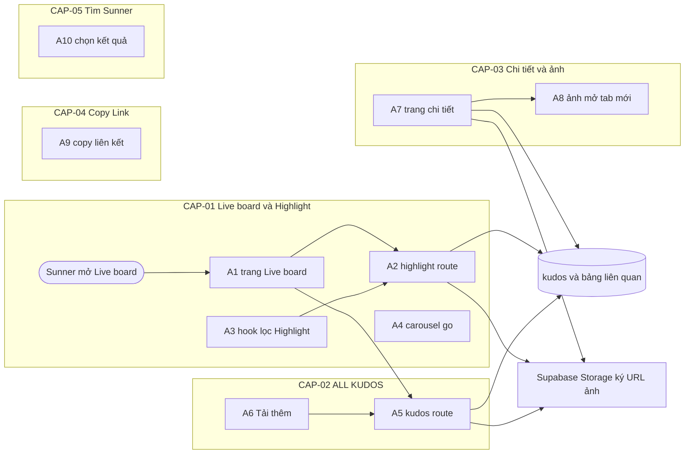
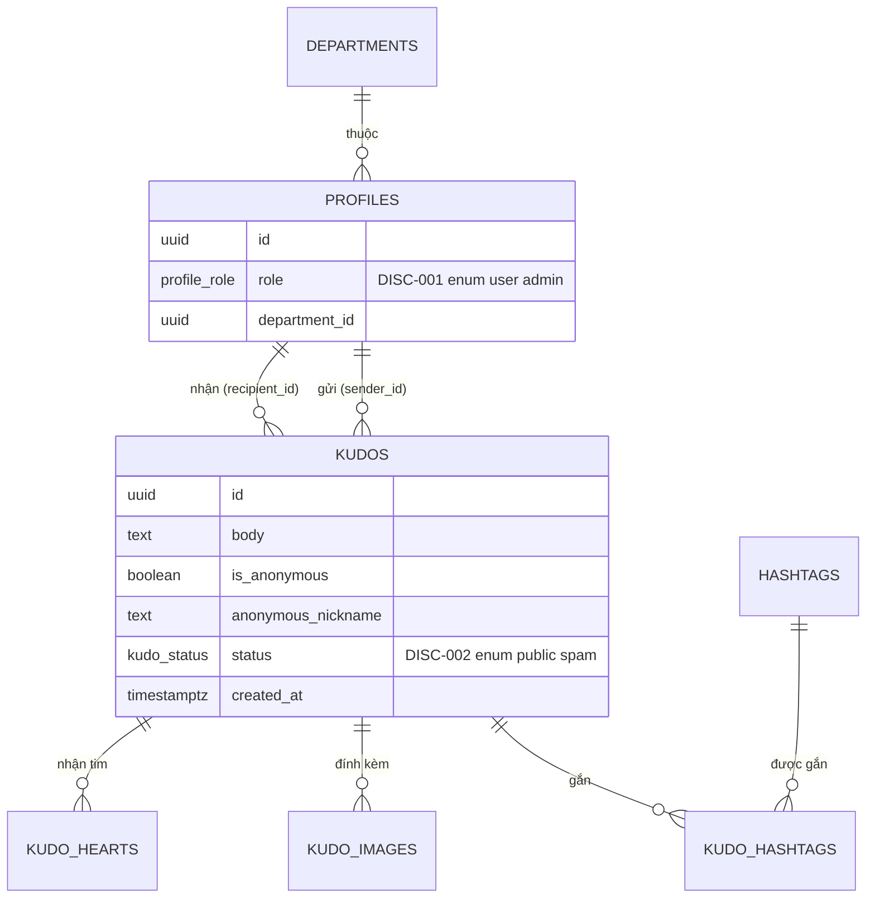

<!-- layout-exempt: rebuild-spec owns all docs/system|features|generated|flows paths — all references here are output targets or internal definitions -->
<!-- Contract: references/feature-spec-researcher-contract.md -->
<!-- Nửa Dev/QA/SA của cặp spec. Mọi mã FR/BR/DEC/ALG/INT được PHÁT BIỂU một lần ở functional-spec.md và CÀI ĐẶT một lần ở đây; không lặp câu quy tắc thuần ngôn ngữ ở file này. -->

# F004_KudosFeed — Technical Spec

**Priority**: P1
**Type**: mixed
**Generated**: 2026-11-24

**See also:** [`functional-spec.md`](./functional-spec.md) — tổng quan, quyết định còn mở, yêu cầu và quy tắc nghiệp vụ dạng một dòng, màn hình, user story, kịch bản, edge case và cấu hình cho BA/QA.

**How to read this file:** § 2 là bảng chỉ mục action; chọn action cần xem rồi đọc khối của nó ở § 3 từ đầu đến cuối, mỗi khối là một luồng hoàn chỉnh. § 4 là phụ lục dùng chung, chỉ nhảy vào khi § 3 chỉ sang.

## 1. Technical Overview

F004 là đường đọc duy nhất của Kudo công khai: trang Live board `/kudos` (RSC dựng khung, HIGHLIGHT KUDOS, ALL KUDOS), trang chi tiết `/kudos/{id}` và hai Route Handler JSON cho phần nạp thêm phía trình duyệt. Mọi lần đọc đi qua `KudoPublicQuery` / `listHighlightKudos` → `buildKudoCardViews` → `maskKudoRow`, nên điều kiện `status = 'public'` và whitelist che người gửi ẩn danh nằm đúng một chỗ; Drizzle chạy bằng vai trò server và bỏ qua RLS, vì vậy mapper này là ranh giới bảo mật. Feature chỉ đọc (Postgres + một lần ký URL ảnh trên Supabase Storage mỗi trang), không ghi bảng nào; số tim, huy hiệu Hero, ô viết Kudo, Spotlight và cột phần thưởng là các "slot" do feature khác sở hữu, F004 chỉ giữ khung trang và ba vùng đọc.



## 2. Action Index

| # | Action (handler) | Method · Path | Codes | Writes | Detail |
|---|---|---|---|---|---|
| **A0** | *cross-cutting — belongs to no single action* | — | FR-002, FR-601 | — | § 4.4 |
| **A1** | `KudosLiveBoardPage` | `GET` `/kudos` | FR-001, FR-101, FR-301, FR-405, BR-001, BR-003, INT-001, US031, US032 | — *(read-only)* | § 3.1 |
| **A2** | `highlight/route#GET` | `GET` `/api/kudos/highlight` | FR-001, FR-203, FR-204, FR-205, FR-401, FR-402, FR-602, FR-603, FR-604, BR-001, BR-002, BR-003, BR-004, BR-008, ALG-002, INT-001, US031 | — *(read-only)* | § 3.1 |
| **A3** | `useHighlightKudos` *(client hook)* | — | FR-203, FR-204, FR-401, FR-402, FR-405, DEC-002, US031 | — *(client only)* | § 3.1 |
| **A4** | `HighlightCarousel#go` *(client, no BE of its own)* | — | FR-201, FR-202, BR-011, US031 | — *(client only)* | § 3.1 |
| **A5** | `kudos/route#GET` | `GET` `/api/kudos` | FR-001, FR-301, FR-303, FR-304, FR-305, FR-602, FR-603, FR-604, BR-001, BR-003, BR-005, BR-006, BR-008, DEC-001, ALG-001, INT-001, US032 | — *(read-only)* | § 3.2 |
| **A6** | `AllKudosFeed#load` *(client)* | — | FR-302, FR-402, FR-405, BR-010, DEC-003, US032 | — *(client only)* | § 3.2 |
| **A7** | `KudoDetailPage` | `GET` `/kudos/{id}` | FR-001, FR-102, FR-311, FR-313, FR-403, FR-604, BR-001, BR-003, BR-007, DEC-004, INT-001, US033 | — *(read-only)* | § 3.3 |
| **A8** | `KudoCardImages` *(client render, no BE of its own)* | — | FR-312, DEC-005, US036 | — *(client only)* | § 3.3 |
| **A9** | `KudoCopyLinkButton#copy` *(client)* | — | FR-404, BR-009, DEC-006, US039 | — *(client only)* | § 3.4 |
| **A10** | `SunnerProfileSearch#handleChange` *(client)* | `GET` `/api/sunners/search` (ROUTE018) | FR-321, DEC-007, US030 | — *(read-only; endpoint dùng chung F003, F004, F007)* | § 3.5 |

**Rung set** theo template: Who → FE → Request → BE → Rule → Result → State → Source. Rung vắng thì bỏ hẳn, không ghi `N/A`. Feature không có action ghi dữ liệu và không có action nền, nên không có `sequenceDiagram` nào vượt ngưỡng (ghi ≥2 bảng hoặc chạy nền); mỗi khối nói lý do ở chú thích cuối khối. `SM-###` không lập: trạng thái nạp của carousel và feed là state UI cục bộ, được mô tả bằng bảng DEC thay vì sơ đồ.

## 3. Actions

### 3.1 CAP-01 — Dựng Live board và duyệt HIGHLIGHT KUDOS

#### A1 · Dựng khung Live board và dữ liệu đợt đầu
`GET /kudos` → `` `KudosLiveBoardPage` ``
`FR-001` `FR-101` `FR-301` `FR-405` `BR-001` `BR-003` `INT-001` `US031` `US032` · `SCR007_KudosLiveBoardFeed` · `SCR007_KudosLiveBoardFeed/REG003_HighlightKudos` · `SCR007_KudosLiveBoardFeed/REG005_AllKudosFeed`

**Who** · Sunner đã đăng nhập và đã chọn phòng ban *(gate A0 — § 4.4)*
**FE** · `KudosLiveBoardPage` dựng ngay `LiveBoardKeyvisualBackground` + `LiveBoardHeading`, phần theo request nằm trong `<Suspense fallback={<LiveBoardSkeleton />}>`. `LiveBoardContent` xếp: hàng hành động (`KudoComposerLauncher` của F003 + `SunnerProfileSearch`, A10), `HighlightSection` (A3, A4), `LiveBoardSpotlightSlot` (F008), rồi `<section>` ALL KUDOS gồm `AllKudosFeed` (A6) và `LiveBoardRewardsColumnSlot` (F010). `AllKudosFeed` có `key` = id thẻ đầu + `nextCursor`, nên khi trang đầu đổi (ví dụ sau khi sửa Kudo) thì danh sách bắt đầu lại. `generateMetadata` đặt tiêu đề `kudosFeed.metaTitle`. `app/(app)/kudos/page.tsx:22-25, 42-100`
**Request** · không tham số tìm kiếm của F004; viewer lấy từ phiên, locale lấy từ `getLocale()` (không phải locale hợp lệ thì dùng `defaultLocale`). `app/(app)/kudos/page.tsx:43-45`
**BE** · `requireSunner()` rồi `Promise.all` năm lần đọc: `isKudoWritingOpen()`, `KudoPublicQuery.list({ viewerId, locale })` (trang đầu 10 thẻ), `listHighlightKudos({ viewerId, locale })` (Highlight "Tất cả"), `listActiveHashtags(locale)`, `listDepartmentOptions(locale)`. Bốn lần đọc dữ liệu đi qua `settle()`: lỗi chỉ ghi log và trả `null`, nên mỗi vùng tự hiện lỗi riêng thay vì làm hỏng cả trang (FR-405); `isKudoWritingOpen()` không bọc. Chỉ `KudoCardView` (đã che) đi vào component client. `app/(app)/kudos/page.tsx:28-35, 47-53`; `shared/auth/current-user.ts:48-53`
**Rule** · hai quy tắc dùng chung quyết định thứ page này đưa xuống trình duyệt:
- **BR-001 — Chỉ Kudo `public` được đưa lên feed và Highlight; chi tiết thêm Kudo spam của chính người gửi.** Cả `list` lẫn `listHighlightKudos` bắt đầu từ `status = 'public'`. *(§ 4.4)*
- **BR-003 — Người gửi ẩn danh chỉ lộ `{ anonymous: true, nickname }`.** Thẻ dựng từ whitelist trong `maskKudoRow`, kể cả khi dữ liệu đi qua payload RSC. *(§ 4.4)*
**Result** · read-only. Trả khung trang kèm `feed` (trang đầu + `nextCursor`), `highlight` (`{ items, total }`), danh sách hashtag, danh sách phòng ban (`{ id, label }`) và `writingOpen`. Ảnh của mọi thẻ trong trang đầu được ký một lần qua `INT-001` — ký URL đọc ảnh có hạn 30 phút trên Supabase Storage (§ 4.5); lỗi ký chỉ làm ảnh thành khung trống. `app/(app)/kudos/page.tsx:54-79`
**Source:** `app/(app)/kudos/page.tsx:42-80` → `features/kudos-feed/server/kudo-public-query.ts:68-82` → `features/kudos-feed/server/kudo-highlight-query.ts:22-30` → `features/kudos-feed/server/build-kudo-card-views.ts:16-24`

<!-- Không có diagram: dưới ngưỡng (chỉ đọc, không ghi bảng nào, đồng bộ trong một request). -->

---

#### A2 · Lấy HIGHLIGHT KUDOS theo bộ lọc
`GET /api/kudos/highlight` → `` `highlight/route#GET` ``
`FR-001` `FR-203` `FR-204` `FR-205` `FR-401` `FR-402` `FR-602` `FR-603` `FR-604` `BR-001` `BR-002` `BR-003` `BR-004` `BR-008` `ALG-002` `INT-001` `US031` · ROUTE008 · `SCR007_KudosLiveBoardFeed/REG003_HighlightKudos`

**Who** · Sunner đã đăng nhập, đã chọn phòng ban *(gate A0 — § 4.4)*
**FE** · gọi từ `useHighlightKudos` (A3) mỗi khi đổi bộ lọc hoặc bấm "Thử lại". `features/kudos-feed/components/use-highlight-kudos.ts:28-58`
**Request** · query `hashtag` *(uuid, tuỳ chọn)*, `department` *(uuid, tuỳ chọn)*; vắng = "Tất cả"; khoá không biết bị bỏ qua; khoá có mặt nhưng rỗng hoặc sai dạng là `invalid`. `features/kudos-feed/schemas/kudo-feed-params-schema.ts:15-18, 24-39`
**BE** · `requireApiSunner()` → `parseKudoFeedParams(KudoHighlightParamsSchema, …)` (400 `VALIDATION` `{ fieldErrors: { hashtag | department: ["invalid"] } }`) → `listHighlightKudos` chạy `ALG-002` — dựng tập ứng viên Kudo `public` rồi xếp hạng và dựng thẻ (§ 4.5). Lỗi bất ngờ: log `[kudos-feed] loading the highlight failed`, 500 `UNEXPECTED`. `app/api/kudos/highlight/route.ts:20-39`; `features/kudos-authoring/server/require-api-sunner.ts:12-23`
**Rule** · các quyết định chọn Highlight:
- **BR-002 — Highlight lấy tối đa 5 Kudo nhiều tim nhất; bằng tim thì mới hơn trước, bằng thời điểm thì id lớn hơn trước.** `rankKudoIdsForHighlight` ủy cho `HeartRankingQuery.rankKudoIds` của F005 với `limit = HIGHLIGHT_COUNT (5)`, xếp theo số tim thô (hệ số chiến dịch không đổi thứ tự). `features/kudos-feed/server/kudo-highlight-query.ts:17-23`; `features/kudos-hearts/server/heart-ranking-query.ts:49-59`
- **BR-004 — Hashtag và phòng ban của NGƯỜI NHẬN cùng phải khớp (AND); tham số vắng nghĩa là không lọc.** Mỗi bộ lọc là một điều kiện `IN (subquery)` trên cột có chỉ mục (`kudo_hashtags.hashtag_id`, `profiles.department_id`), ghép bằng `and()`. `features/kudos-feed/server/kudo-public-filters.ts:13-24`
- **BR-001 — Chỉ Kudo `public`; Kudo bị đánh spam giữa hai câu lệnh tự rơi khỏi kết quả.** *(§ 4.4)*
- **BR-003 — Người gửi ẩn danh chỉ còn biệt danh.** Tập ứng viên không có cột người gửi nên khâu xếp hạng không thể làm lộ. *(§ 4.4)*
- **BR-008 — Phản hồi mang `Cache-Control: private, no-store`.** *(§ 4.4)*
**Result** · read-only. 200 `{ items: KudoCardView[], total }` với `total = items.length ≤ 5`; không khớp thì `{ items: [], total: 0 }` (không phải lỗi). Lỗi: 401 `UNAUTHENTICATED`, 403 `ONBOARDING_REQUIRED`, 400 `VALIDATION`, 500 `UNEXPECTED`, body chỉ `{ code, … }`. Ảnh các thẻ ký một lần qua `INT-001` — ký URL đọc ảnh 30 phút (§ 4.5). Số tim và `heartedByMe` do F005 (`KudoHeartQuery.summaryForKudos`, một truy vấn gộp mỗi trang), `tier` Hero do F009 (`HeroTierQuery`, một lần mỗi trang) gắn vào sau khi che. `app/api/kudos/highlight/route.ts:14-18, 28-33`
**Source:** `app/api/kudos/highlight/route.ts:14-39` → `features/kudos-feed/schemas/kudo-feed-params-schema.ts:24-39` → `features/kudos-feed/server/kudo-highlight-query.ts:22-30` → `features/kudos-feed/server/kudo-public-filters.ts:13-37` → `features/kudos-feed/server/enrich-heart-summary.ts:21-30` → `features/kudos-feed/server/kudo-card-enrichment.ts:12-15`

<!-- Không có diagram: dưới ngưỡng (chỉ đọc, đồng bộ); phần phân nhánh thật là ALG-002 ở § 4.5. -->

---

#### A3 · Lọc Highlight và nạp lại phía trình duyệt *(client)*
`—` → `` `useHighlightKudos` ``
`FR-203` `FR-204` `FR-401` `FR-402` `FR-405` `DEC-002` `US031` · `SCR007_KudosLiveBoardFeed/REG003_HighlightKudos`

**Who** · Sunner đã đăng nhập, đang ở Live board *(gate A0 — § 4.4)*
**FE** · `HighlightSection` vẽ header `HIGHLIGHT KUDOS` với hai `HighlightFilterDropdown` (Hashtag, Phòng ban), mỗi dropdown là một `listbox`: mục đầu "Tất cả" xoá lọc, ↑/↓/Home/End di chuyển, Enter/Space chọn, Tab đóng và đi tiếp, Esc đóng và trả focus về nút. Hook giữ `filters`, `fetched`, `failure`, `pending`, `active`. `features/kudos-feed/components/highlight-section.tsx:25-69`; `features/kudos-feed/components/highlight-filter-dropdown.tsx:32-131`
**Request** · `GET /api/kudos/highlight` (A2) với `hashtag`/`department` chỉ khi đã chọn; header `accept: application/json`; mỗi `load` huỷ `AbortController` của lần trước. `features/kudos-feed/components/use-highlight-kudos.ts:28-43`
**BE** · không có BE riêng; kết quả hợp lệ ghi vào `fetched` và đặt `active = 0`, nên thẻ cũ không trượt về trong lúc chờ. Yêu cầu bị huỷ thì bỏ qua (không báo lỗi); lỗi khác ghi log `[kudos-feed] loading the highlight failed`. `active` hiệu dụng luôn bị kẹp `≤ items.length - 1`. `features/kudos-feed/components/use-highlight-kudos.ts:44-72`
**Rule** · quyết định phần thân của vùng Highlight:

| DEC | subtype | Condition | What the user sees | Source |
|---|---|---|---|---|
| **DEC-002** | render | `failure` khác null hoặc `result.items.length === 0`, và `pending` đúng | dòng "Đang tải Kudos…" (polite), bộ lọc vẫn dùng được | `features/kudos-feed/components/highlight-section.tsx:54-57` |
| **DEC-002** | render | `failure === "error"` (hoặc nạp đầu của server thất bại), `pending` sai | cảnh báo "Không tải được Kudos. Vui lòng thử lại." kèm nút "Thử lại" gọi lại với bộ lọc đang chọn | `features/kudos-feed/components/kudo-feed-status-message.tsx:32-46` |
| **DEC-002** | render | `failure === "unauthorized"` (mọi phản hồi 401) | "Phiên đăng nhập đã hết hạn, vui lòng đăng nhập lại." kèm liên kết "Đăng nhập lại" tới `/login?next=/kudos` (điều hướng đầy đủ, không client-side) | `features/kudos-feed/components/kudo-feed-status-message.tsx:22-52` |
| **DEC-002** | render | không lỗi, `items.length === 0` | "Chưa có Kudo nào phù hợp.", hai dropdown vẫn dùng được | `features/kudos-feed/components/highlight-section.tsx:54-57` |
| **DEC-002** | render | không lỗi, `items.length > 0` | `HighlightCarousel` (A4) | `features/kudos-feed/components/highlight-section.tsx:58-66` |

**Result** · client only, không gọi server ngoài A2, không ghi dữ liệu. Chọn bộ lọc → `setFilter` → `load` (huỷ yêu cầu cũ, `pending` bật, carousel mờ 60%, về thẻ 1 khi kết quả mới về). "Thử lại" gọi `load` với bộ lọc hiện tại. `features/kudos-feed/components/use-highlight-kudos.ts:61-71`
**Source:** `features/kudos-feed/components/highlight-section.tsx:25-69` → `features/kudos-feed/components/use-highlight-kudos.ts:18-72` → `features/kudos-feed/components/highlight-filter-dropdown.tsx:32-131` → `features/kudos-feed/components/kudo-feed-status-message.tsx:22-52`

<!-- Không có diagram: thuần client, không ghi bảng nào; phần phân nhánh thật là bảng DEC-002. -->

---

#### A4 · Chuyển thẻ trong carousel *(client)*
`—` → `` `HighlightCarousel#go` ``
`FR-201` `FR-202` `BR-011` `US031` · `SCR007_KudosLiveBoardFeed/REG003_HighlightKudos`

**Who** · Sunner đã đăng nhập *(gate A0 — § 4.4)*
**FE** · `HighlightCarousel` là vùng `role="region"` `aria-roledescription="carousel"`; mỗi thẻ là `role="group"` `aria-roledescription="slide"` với nhãn "{index} / {total}". Thẻ giữa tương tác được; các thẻ bên là `inert` + `aria-hidden`. Điều khiển: hai mũi tên lớn (`hidden` dưới `md`), hai nút pager và chỉ số `{active+1}/{total}` (`role="status"`), phím ←/→ khi focus nằm trong vùng. Hai đầu dùng `aria-disabled` thay vì `disabled` để nút vừa chạm đầu vẫn giữ focus. Thẻ dùng `KudoCard variant="highlight"` (viền vàng 4 px, không ảnh, một dòng hashtag). `features/kudos-feed/components/highlight-carousel.tsx:36-113`
**Rule** · **BR-011 — Chuyển thẻ chỉ ở phía trình duyệt giữa các thẻ đã nạp và luôn bị kẹp trong `[0, total-1]`.** `go(index)` kẹp bằng `Math.min(Math.max(index, 0), total - 1)`; phím chỉ xử lý khi `event.target` nằm trong vùng (phím gõ trong modal portal nổi bọt qua React không làm trượt carousel); hoạt động với 1 hoặc 2 thẻ. `features/kudos-feed/components/highlight-carousel.tsx:41-49`
**Result** · client only, không gọi server, không ghi dữ liệu; `active` do `useHighlightKudos` (A3) giữ. `features/kudos-feed/components/highlight-carousel.tsx:67-112`
**Source:** `features/kudos-feed/components/highlight-carousel.tsx:36-113` → `features/kudos-feed/components/kudo-card.tsx:33-84`

<!-- Không có diagram: thuần client, không ghi bảng nào. -->

---

### 3.2 CAP-02 — Duyệt feed ALL KUDOS

#### A5 · Lấy một trang feed ALL KUDOS
`GET /api/kudos` → `` `kudos/route#GET` ``
`FR-001` `FR-301` `FR-303` `FR-304` `FR-305` `FR-602` `FR-603` `FR-604` `BR-001` `BR-003` `BR-005` `BR-006` `BR-008` `DEC-001` `ALG-001` `INT-001` `US032` · ROUTE007 · `SCR007_KudosLiveBoardFeed/REG005_AllKudosFeed`

**Who** · Sunner đã đăng nhập, đã chọn phòng ban; chủ Kudo thấy thêm cây bút sửa trên Kudo của mình *(gate A0 — § 4.4)*
**FE** · gọi từ `AllKudosFeed#load` (A6). Mỗi thẻ là `KudoCard variant="post"` (rộng 680): người gửi | mũi tên | người nhận (ảnh 64 px, tên là liên kết `/profile/{id}` và mở `AvatarHoverCard`, mã phòng ban, slot huy hiệu Hero của F009), thời gian `HH:mm - MM/DD/YYYY` giờ Việt Nam, danh hiệu in hoa, lời nhắn Markdown rút gọn cắt 4 dòng trong khung cao 160, ảnh 88×88, hashtag cắt 2 dòng, slot tim của F005, "Copy Link" (A9) và "Xem chi tiết" tới `/kudos/{id}`. `features/kudos-feed/components/kudo-card.tsx:33-84`; `features/kudos-feed/components/kudo-card-sender.tsx:27-84`; `features/kudos-feed/components/format-kudo-card-time.ts:5-18`
**Request** · query `cursor` *(chuỗi mờ ≤ 200 ký tự, tuỳ chọn; vắng = trang đầu)*; cỡ trang cố định `FEED_PAGE_SIZE = 10`. `features/kudos-feed/schemas/kudo-feed-params-schema.ts:11-17`; `features/kudos-feed/server/kudo-public-query.ts:19-20`
**BE** · `requireApiSunner()` → `parseKudoFeedParams(KudoFeedListParamsSchema, …)` (cursor không giải mã được → 400 `VALIDATION` `{ fieldErrors: { cursor: ["invalid"] } }`) → `KudoPublicQuery.list`: kiểm `ListOptionsSchema`, giải mã cursor (`ALG-001` — mã hoá và giải mã cursor khoá `(created_at, id)`, § 4.5), `selectKudoPublicRows(listConditions(...)).orderBy(created_at DESC, id DESC).limit(limit + 1)`, cắt còn `limit`, `buildKudoCardViews`, và `nextCursor` chỉ khi có dòng thừa. Lỗi: log `[kudos-feed] listing kudos failed`, 500 `UNEXPECTED`. `app/api/kudos/route.ts:19-37`; `features/kudos-feed/server/kudo-public-query.ts:51-82`
**Rule** · các quyết định của một trang feed:
- **BR-005 — Feed xếp mới nhất trước theo `(created_at DESC, id DESC)`, cỡ trang 10, và chỉ phát `nextCursor` khi còn dòng.** Truy vấn lấy `limit + 1` dòng làm cờ "còn nữa"; điều kiện trang kế là `(created_at, id) < (cursor.createdAt, cursor.id)` nên 25 Kudo cùng một timestamp vẫn ra 10/10/5 không lặp không sót; chỉ mục `kudos_status_created_at_id_idx` phục vụ đúng thứ tự này. `features/kudos-feed/server/kudo-public-query.ts:60, 72-81`; `db/migrations/0009_kudos_feed_indexes.sql:9`
- **BR-006 — Cursor là chuỗi mờ chỉ chấp nhận đúng thứ bộ mã hoá đã phát; cursor lạ bị từ chối trước khi chạm DB.** Route trả 400 và FE quay danh sách về trang đầu (A6). `features/kudos-feed/schemas/kudo-feed-params-schema.ts:11-14`
- **BR-001 — Chỉ Kudo `public`.** *(§ 4.4)*
- **BR-003 — Người gửi ẩn danh chỉ còn biệt danh; `isOwner` vẫn đúng với chính chủ.** *(§ 4.4)*
- **BR-008 — Phản hồi mang `Cache-Control: private, no-store` vì chứa `isOwner` và URL ảnh ký riêng.** *(§ 4.4)*

| DEC | subtype | Condition | What the user sees | Source |
|---|---|---|---|---|
| **DEC-001** | render | `isOwner` đúng VÀ `isSpam` sai VÀ `writingOpen` đúng | hiện cây bút sửa ở cuối hàng danh hiệu, mở `KudoComposerModal` chế độ sửa (F003) | `features/kudos-feed/components/kudo-card-can-edit.ts:6-8` |
| **DEC-001** | render | `isOwner` sai, hoặc `isSpam` đúng, hoặc `writingOpen` sai (từ `EVENT_END_AT`) | không có bút; hàng danh hiệu ẩn nếu cũng không có danh hiệu | `features/kudos-feed/components/kudo-card.tsx:36-53` |

**Result** · read-only. 200 `{ items: KudoCardView[], nextCursor?: string }`; `KudoCardView` gồm `id`, `sender` (`{ anonymous: true, nickname }` hoặc người có tên kèm `department.code` và `tier`), `recipient`, `title`, `body` (Markdown thô, vẽ bằng `parseKudoBody`), `hashtags` (nhãn đã theo locale, thứ tự seed), `images` (`{ position, url | null }`), `createdAt` ISO, `isOwner`, `isSpam`, `heartCount`, `heartedByMe`. Hashtag và ảnh của cả trang nạp bằng 2 câu lệnh theo danh sách id (không N+1), ảnh ký một lần cho cả trang qua `INT-001` — ký URL đọc ảnh 30 phút (§ 4.5). Lỗi 401/403/400/500 chỉ `{ code }`. Trang rỗng trả `{ items: [] }` (một câu lệnh). `features/kudos-feed/server/kudo-card-relations.ts:25-57`; `features/kudos-feed/server/kudo-row-mask.ts:40-59`; `features/kudos-feed/schemas/kudo-card-view.ts:35-58`
**Source:** `app/api/kudos/route.ts:13-37` → `features/kudos-feed/schemas/kudo-feed-params-schema.ts:11-39` → `features/kudos-feed/server/kudo-public-query.ts:51-82` → `features/kudos-feed/server/kudo-public-select.ts:43-52` → `features/kudos-feed/server/build-kudo-card-views.ts:16-24` → `features/kudos-feed/server/kudo-row-mask.ts:25-59` → `features/kudos-feed/components/kudo-card.tsx:33-84`

<!-- Không có diagram: dưới ngưỡng (chỉ đọc, đồng bộ); phần phân nhánh thật là bảng DEC-001 và ALG-001 ở § 4.5. -->

---

#### A6 · Nối thêm trang cũ hơn bằng "Tải thêm" *(client)*
`—` → `` `AllKudosFeed#load` ``
`FR-302` `FR-402` `FR-405` `BR-010` `DEC-003` `US032` · `SCR007_KudosLiveBoardFeed/REG005_AllKudosFeed`

**Who** · Sunner đã đăng nhập, đang ở Live board *(gate A0 — § 4.4)*
**FE** · `AllKudosFeed` nhận `initialPage` từ A1, giữ `clientFirstPage`, `older`, `cursor`, `pending`, `failure`, `focusRequest`, `announcement`. Nút "Tải thêm" hiện khi còn `cursor`: lúc nạp `aria-disabled` + `aria-busy` + vòng xoay nhưng vẫn focus được. Sau mỗi lần nối, focus nhảy tới thẻ mới đầu tiên (hoặc thẻ cuối nếu không có thẻ mới) và vùng `role="status" aria-live="polite"` đọc "Đã tải thêm {count} Kudo". Danh sách khử trùng theo id khi vẽ. Huỷ fetch khi unmount. `features/kudos-feed/components/all-kudos-feed.tsx:33-122`
**Request** · `GET /api/kudos?cursor=<encodeURIComponent(cursor)>` (A5); nếu chưa có trang đầu (trang đầu của server hỏng) thì gọi không cursor. `features/kudos-feed/components/all-kudos-feed.tsx:62-64`
**BE** · không có BE riêng; thành công thì `older` nối thêm, `cursor ← page.nextCursor`, thông báo số thẻ thật sự mới (đã loại id đã có). Response 400 → xoá `older`, `cursor` về `initialPage?.nextCursor`, `clientFirstPage` về null rồi hiện lỗi; response không ok khác hoặc ngoại lệ mạng → `failure = "error"` (401 → `"unauthorized"`); yêu cầu bị huỷ thì im lặng. `features/kudos-feed/components/all-kudos-feed.tsx:65-94`
**Rule** · **BR-010 — Mỗi lúc chỉ một yêu cầu nạp thêm: bấm "Tải thêm" khi đang nạp bị bỏ qua.** `aria-disabled` không chặn click nên hàm `load` tự thoát nếu `inFlight.current` đã có. `features/kudos-feed/components/all-kudos-feed.tsx:53-57`

| DEC | subtype | Condition | What the user sees | Source |
|---|---|---|---|---|
| **DEC-003** | render | `cursor` có VÀ đã có trang đầu VÀ (không lỗi HOẶC đang nạp) | nút "Tải thêm" | `features/kudos-feed/components/all-kudos-feed.tsx:105-116` |
| **DEC-003** | render | `failure` có VÀ không `pending` | "Không tải được Kudos. Vui lòng thử lại." + "Thử lại" (cùng `load`), hoặc "Phiên đăng nhập đã hết hạn…" + "Đăng nhập lại" nếu 401 | `features/kudos-feed/components/all-kudos-feed.tsx:102` |
| **DEC-003** | render | không lỗi VÀ trang đầu rỗng | "Chưa có Kudo nào phù hợp." | `features/kudos-feed/components/all-kudos-feed.tsx:104` |
| **DEC-003** | render | `pending` VÀ chưa có trang đầu | "Đang tải Kudos…" | `features/kudos-feed/components/all-kudos-feed.tsx:103` |

**Result** · client only, không ghi dữ liệu. Thẻ nối thêm hiển thị theo thứ tự trang; nút biến mất khi không còn `nextCursor`. `features/kudos-feed/components/all-kudos-feed.tsx:97-121`
**Source:** `features/kudos-feed/components/all-kudos-feed.tsx:33-122` → `features/kudos-feed/components/kudo-feed-status-message.tsx:22-52` → `features/kudos-feed/components/kudo-card.tsx:33-84`

<!-- Không có diagram: thuần client, một fetch mỗi lần, không ghi bảng nào. -->

---

### 3.3 CAP-03 — Xem chi tiết một Kudo và mở ảnh đầy đủ

#### A7 · Mở trang chi tiết Kudo
`GET /kudos/{id}` → `` `KudoDetailPage` ``
`FR-001` `FR-102` `FR-311` `FR-313` `FR-403` `FR-604` `BR-001` `BR-003` `BR-007` `DEC-004` `INT-001` `US033` · `SCR006_KudoDetail`

**Who** · Sunner đã đăng nhập, đã chọn phòng ban; chủ Kudo spam đọc được bản chỉ đọc của chính mình *(gate A0 — § 4.4)*
**FE** · panel `KudoDetailView` rộng 680 giữa trang trên nền keyvisual làm tối: người gửi/người nhận, thời gian, tiêu đề, lời nhắn không cắt (`h2` cho danh hiệu dưới `h1` ẩn "Chi tiết Kudo"), mọi ảnh (A8), mọi hashtag, slot tim (F005), "Copy Link" (A9) và "Đóng" về `/kudos`. Route "blocking" (`export const instant = false`): trên production shell có thể đã stream nên 404 là soft 404. `app/(app)/kudos/[id]/page.tsx:14-17, 24, 43-66`; `features/kudos-feed/components/kudo-detail-view.tsx:26-68`
**Request** · path `id` *(chuỗi, kiểm uuid trong truy vấn)*; viewer từ phiên. `app/(app)/kudos/[id]/page.tsx:43-47`
**BE** · `requireSunner()` rồi `Promise.all([findKudo(id, userId), isKudoWritingOpen()])`; `findKudo` gọi `KudoPublicQuery.findForViewer(id, viewerId, locale)` trong `try/catch`: lỗi trả `"failed"`. `findForViewer` trả `null` nếu `id` hoặc `viewerId` không phải uuid; ngược lại chọn một dòng `status = 'public'` hoặc (`status = 'spam'` và `sender_id = viewerId`), dựng thẻ qua `buildKudoCardViews`. `kudo === null` → `notFound()` gọi ngoài `try/catch`. `app/(app)/kudos/[id]/page.tsx:27-35, 47-48`; `features/kudos-feed/server/kudo-public-query.ts:89-95`
**Rule** · các quyết định của trang chi tiết:
- **BR-007 — Id sai định dạng, id không tồn tại và Kudo spam của người khác cho cùng một kết quả `null` rồi cùng một trang "Kudo này không tồn tại hoặc đã bị gỡ.", để không dò được Kudo có tồn tại hay không.** `notFound()` gọi một lần, nội dung `not-found.tsx` giống hệt ở mọi trường hợp; trang này kèm nút "Quay lại Live board". `features/kudos-feed/server/kudo-public-query.ts:84-95`; `app/(app)/kudos/[id]/not-found.tsx:11-25`
- **BR-001 — Kudo `public` cho mọi Sunner; Kudo `spam` chỉ cho chính người gửi, đánh dấu `isSpam: true`.** *(§ 4.4)*
- **BR-003 — Người gửi ẩn danh vẫn chỉ còn biệt danh trên trang chi tiết, kể cả với Kudo spam của chính chủ.** *(§ 4.4)*

| DEC | subtype | Condition | What the user sees | Source |
|---|---|---|---|---|
| **DEC-004** | flow | `findKudo` trả `null` (id sai/không có/spam của người khác) | `notFound()` → "Kudo này không tồn tại hoặc đã bị gỡ." + "Quay lại Live board" | `app/(app)/kudos/[id]/page.tsx:47-48` |
| **DEC-004** | flow | `findKudo` trả `"failed"` | `role="alert"` "Không tải được Kudo. Vui lòng thử lại." + liên kết "Thử lại" mở lại đúng URL bằng tải trang mới | `app/(app)/kudos/[id]/page.tsx:54-60` |
| **DEC-004** | render | có Kudo và `isSpam` đúng (chỉ chủ Kudo tới được) | thẻ "Spam" cam + lớp phủ mờ không đóng được; không tim, không Copy Link, ảnh không phải liên kết, liên kết hồ sơ và thân bài rời thứ tự Tab; chỉ "Đóng" còn dùng được | `features/kudos-feed/components/kudo-detail-view.tsx:28-65` |
| **DEC-004** | render | có Kudo và `isSpam` sai | panel đầy đủ: tim, Copy Link, "Đóng", ảnh mở được | `features/kudos-feed/components/kudo-detail-view.tsx:43-64` |

**Result** · read-only. Trang chi tiết đã che, hoặc trang "không tồn tại", hoặc khối lỗi. Ảnh ký một lần cho cả Kudo qua `INT-001` — ký URL đọc ảnh 30 phút (§ 4.5). `app/(app)/kudos/[id]/page.tsx:50-65`
**Source:** `app/(app)/kudos/[id]/page.tsx:24-66` → `features/kudos-feed/server/kudo-public-query.ts:89-95` → `features/kudos-feed/server/build-kudo-card-views.ts:16-24` → `features/kudos-feed/components/kudo-detail-view.tsx:26-68` → `app/(app)/kudos/[id]/not-found.tsx:11-25`

<!-- Không có diagram: dưới ngưỡng (chỉ đọc, đồng bộ); phần phân nhánh thật là bảng DEC-004. -->

---

#### A8 · Mở ảnh đính kèm cỡ đầy đủ ở tab mới *(client render)*
`—` → `` `KudoCardImages` ``
`FR-312` `DEC-005` `US036` · `SCR006_KudoDetail`

**Who** · Sunner đã đăng nhập, đang ở trang chi tiết *(gate A0 — § 4.4)*
**FE** · `KudoCardImages` vẽ `<ul>` tối đa 5 khung 88×88 theo thứ tự `position`; ảnh là `` thường (URL ký ngắn hạn, không nằm trong `images.remotePatterns`). Ở trang chi tiết `openable = !isSpam` nên mỗi ảnh bọc trong `<a href={url} target="_blank" rel="noopener noreferrer">` với nhãn "Mở ảnh đính kèm {n} trong thẻ mới" và `alt=""`; ở feed/Highlight `openable` mặc định sai, ảnh chỉ để xem với `alt="Ảnh đính kèm {n}"`. `features/kudos-feed/components/kudo-card-images.tsx:19-49`; `features/kudos-feed/components/kudo-detail-view.tsx:43`
**Rule** · quyết định cách vẽ từng khung ảnh:

| DEC | subtype | Condition | What the user sees | Source |
|---|---|---|---|---|
| **DEC-005** | render | `image.url` là null (ký URL lỗi) | khung trống kèm chữ ẩn "Ảnh đính kèm {n} không tải được", không phải liên kết | `features/kudos-feed/components/kudo-card-images.tsx:26-32` |
| **DEC-005** | render | có `url` VÀ `openable` đúng | ảnh là liên kết mở tệp đầy đủ ở tab mới, trang hiện tại giữ nguyên | `features/kudos-feed/components/kudo-card-images.tsx:37-40` |
| **DEC-005** | render | có `url` VÀ `openable` sai (feed, Highlight, hoặc Kudo spam của chính mình dưới lớp phủ) | ảnh chỉ để xem, không phải liên kết | `features/kudos-feed/components/kudo-card-images.tsx:41-43` |

**Result** · client only, không gọi server, không ghi dữ liệu. URL ký sống 30 phút kể từ lúc dựng trang (`KUDO_IMAGE_READ_URL_SECONDS`); để trang mở quá hạn thì Storage từ chối URL cũ cho tới khi tải lại trang. `features/kudos-feed/server/kudo-image-read-urls.ts:11`
**Source:** `features/kudos-feed/components/kudo-card-images.tsx:19-49` → `features/kudos-feed/components/kudo-detail-view.tsx:43-43` → `features/kudos-feed/server/kudo-image-read-urls.ts:11-26`

<!-- Không có diagram: thuần client, không ghi bảng nào; phân nhánh thật là bảng DEC-005. -->

---

### 3.4 CAP-04 — Sao chép liên kết Kudo

#### A9 · Sao chép liên kết `/kudos/{id}` *(client)*
`—` → `` `KudoCopyLinkButton#copy` ``
`FR-404` `BR-009` `DEC-006` `US039` · `SCR006_KudoDetail` · `SCR007_KudosLiveBoardFeed/REG005_AllKudosFeed`

**Who** · Sunner đã đăng nhập, đang xem một thẻ hoặc trang chi tiết Kudo *(gate A0 — § 4.4)*
**FE** · nút "Copy Link" có trên mọi thẻ không phải Kudo spam của chính mình và trên trang chi tiết. Toast gắn vào `document.body` qua `DocumentBodyPortal` chỉ sau khi hydrate (`useSyncExternalStore`), để vùng `role="status"` luôn có sẵn trước thông báo đầu tiên. `features/kudos-feed/components/kudo-copy-link-button.tsx:14-20, 29-61`
**BE** · không có BE; `copy` dựng URL tuyệt đối rồi ghi vào clipboard. `features/kudos-feed/components/kudo-copy-link-button.tsx:35-46`
**Rule** · hành vi sao chép:
- **BR-009 — Liên kết cố định là `{origin}/kudos/{id}`, không kèm tham số nào.** `window.location.origin` + `APP_ROUTES.kudos` + id. `features/kudos-feed/components/kudo-copy-link-button.tsx:37`

| DEC | subtype | Condition | What the user sees | Source |
|---|---|---|---|---|
| **DEC-006** | interaction | `navigator.clipboard` có VÀ `writeText` thành công | toast `role="status"` "Đã sao chép liên kết", tự tắt sau 4 giây (`durationMs = 4000`) | `features/kudos-feed/components/kudo-copy-link-toast.tsx:24-36` |
| **DEC-006** | interaction | `navigator.clipboard` thiếu HOẶC `writeText` bị chặn | toast `role="alert"` "Không sao chép được liên kết, vui lòng thử lại." kèm ô chỉ đọc chứa liên kết (chọn hết khi focus) và nút "Đóng"; nằm tới khi bấm "Đóng" | `features/kudos-feed/components/kudo-copy-link-toast.tsx:38-55` |

**Result** · client only, không gọi server, không ghi dữ liệu; lỗi chỉ `console.warn` `[kudos-feed] copying the link failed`. Người mở liên kết đi qua A0 rồi A7. `features/kudos-feed/components/kudo-copy-link-button.tsx:42-45`
**Source:** `features/kudos-feed/components/kudo-copy-link-button.tsx:29-61` → `features/kudos-feed/components/kudo-copy-link-toast.tsx:24-58`

<!-- Không có diagram: thuần client, không ghi bảng nào. -->

---

### 3.5 CAP-05 — Tìm profile Sunner trên Live board

#### A10 · Tìm Sunner và mở hồ sơ *(client)*
`—` → `` `SunnerProfileSearch#handleChange` ``
`FR-321` `DEC-007` `US030` · `SCR007_KudosLiveBoardFeed/REG002_SunnerProfileSearch`

**Who** · Sunner đã đăng nhập, đang ở Live board *(gate A0 — § 4.4)*
**FE** · `SunnerProfileSearch` bọc `SunnerSearchCombobox` dùng chung (do F003 sở hữu) với `excludeSelf={false}`: ô "Tìm kiếm profile Sunner" cạnh ô viết Kudo, nhãn `sr-only`, biểu tượng kính lúp. Combobox ARIA 1.2: gõ thì đợi 250 ms (`useSunnerSearch`, huỷ yêu cầu cũ, từ khoá cắt trắng và tối đa 50 ký tự), ↑/↓ di chuyển, Enter chọn (không bao giờ submit form), Esc chỉ đóng danh sách. Trạng thái: "Đang tìm…", "Không tìm thấy Sunner phù hợp.", "Không tìm được, vui lòng thử lại.", "Phiên đăng nhập đã hết hạn, vui lòng đăng nhập lại." (mọi 401). `features/kudos-feed/components/sunner-profile-search.tsx:17-46`; `features/sunner-search/components/sunner-search-combobox.tsx:34-137`; `features/sunner-search/components/use-sunner-search.ts:23-54`
**Request** · `GET /api/sunners/search?q&excludeSelf=false` (ROUTE018) — endpoint dùng chung (route-list ghi chủ F003, F004, F007); schema và truy vấn nằm ở (`features/sunner-search/*`, đường dùng chung của composer), F004 không có route tìm kiếm của riêng mình: `q` 1-50 ký tự sau trim, `limit` 1-20 (mặc định 10), tên khớp không phân biệt hoa thường và dấu theo `f_unaccent`, email khớp tiền tố, ký tự `%`, `_`, `\` là chữ thường. `app/api/sunners/search/route.ts:12-26`; `features/sunner-search/server/sunner-search-query.ts:57-67`; `features/sunner-search/schemas/sunner-search-params-schema.ts:9-26`
**Rule** · hành vi sau khi chọn:

| DEC | subtype | Condition | What the user sees | Source |
|---|---|---|---|---|
| **DEC-007** | flow | người dùng chọn một kết quả (chuột hoặc Enter) | `router.push("/profile/{id}")`; ô nhập giữ tên đã chọn | `features/kudos-feed/components/sunner-profile-search.tsx:23-26` |
| **DEC-007** | flow | kết quả được chọn chính là người xem | trang `/profile/{id}` chuyển tiếp về `/profile` (F012) | `app/(app)/profile/[userId]/page.tsx:30-35` |
| **DEC-007** | interaction | người dùng gõ tiếp sau khi đã chọn | lựa chọn bị xoá (`onChange(null)`), không điều hướng | `features/sunner-search/components/sunner-search-combobox.tsx:97-102` |

**Result** · client only phía F004; không ghi dữ liệu. Điều hướng tới hồ sơ thuộc F012. `features/kudos-feed/components/sunner-profile-search.tsx:23-26`
**Source:** `features/kudos-feed/components/sunner-profile-search.tsx:17-46` → `features/sunner-search/components/sunner-search-combobox.tsx:34-137` → `features/sunner-search/components/use-sunner-search.ts:23-54` → `app/(app)/profile/[userId]/page.tsx:30-35`

<!-- Không có diagram: thuần client, không ghi bảng nào; endpoint tìm kiếm không thuộc F004. -->

---

### 3.6 Edge cases

| Action | Scenario | Behavior |
|---|---|---|
| A2 | Không Kudo nào khớp hai bộ lọc, hoặc ít hơn 5 Kudo đủ điều kiện | `{ items: [], total: 0 }` hoặc `total` bằng số thẻ thật; FE hiện "Chưa có Kudo nào phù hợp." hoặc chỉ số theo số thật |
| A2 | `hashtag` hoặc `department` có mặt nhưng rỗng hoặc không phải uuid | 400 `VALIDATION` `{ fieldErrors: { <khoá>: ["invalid"] } }`; FE hiện lỗi "Thử lại" |
| A2 | Một Kudo bị đánh spam giữa câu xếp hạng và câu dựng thẻ | câu dựng thẻ lọc lại `public` nên thẻ đó rơi khỏi kết quả; có thể trả ít hơn 5 thẻ dù còn ứng viên |
| A3 | Đổi lọc liên tục khi yêu cầu cũ chưa về | yêu cầu cũ bị huỷ, kết quả chậm không ghi đè bộ lọc hiện tại; carousel về thẻ 1 chỉ khi kết quả mới về |
| A3 · A6 | Phiên hết hạn (mọi phản hồi 401) | vùng đó hiện "Phiên đăng nhập đã hết hạn…" kèm liên kết đăng nhập quay lại `/kudos`, không có nút thử lại |
| A4 | Highlight có 1 hoặc 2 thẻ; bấm mũi tên ở đầu | thẻ đang xem vẫn ở giữa; nút ở đầu `aria-disabled`, click kẹp thành no-op và giữ focus |
| A5 | 25 Kudo có cùng một `created_at` | trang 10/10/5, `id DESC` làm khoá phụ, không lặp không sót; trang cuối không có `nextCursor` |
| A5 | `cursor` hỏng, sai canonical, quá 200 ký tự hoặc năm 0000 | 400 `VALIDATION` `{ fieldErrors: { cursor: ["invalid"] } }`, không chạm DB |
| A5 | Kudo ẩn danh của chính người xem | thẻ vẫn chỉ biệt danh nhưng `isOwner` đúng nên có cây bút (nếu còn cửa sổ ghi) |
| A5 · A1 | Kudo spam | không bao giờ có trên Live board, kể cả của chính người gửi |
| A6 | Bấm "Tải thêm" liên tiếp | chỉ một yêu cầu; các lần bấm sau trong lúc nạp bị bỏ qua |
| A6 | Cursor bị từ chối (400) | danh sách quay về trang đầu của server, `older` bị xoá, hiện lỗi kèm "Thử lại" |
| A6 | Hai trang chồng nhau vì có Kudo mới | thẻ trùng id chỉ giữ một, thông báo chỉ đếm thẻ thật sự mới |
| A7 | Id không phải uuid, không tồn tại, hoặc spam của người khác | cùng `null` → cùng trang không tồn tại; status có thể là 200 (soft 404) trên production |
| A7 | Đọc dữ liệu lỗi | khối `role="alert"` "Không tải được Kudo…" với liên kết tải lại đúng URL |
| A8 | Một ảnh không ký được URL | khung trống kèm chữ ẩn, các ảnh khác vẫn mở bình thường |
| A8 | Trang chi tiết mở quá 30 phút | Storage từ chối URL ký cũ khi bấm ảnh; tải lại trang thì mở được |
| A9 | Clipboard bị chặn hoặc thiếu | toast lỗi kèm ô liên kết để sao chép tay, nằm tới khi bấm "Đóng" |
| A10 | Chọn chính mình | mở `/profile/{id của mình}` rồi chuyển tiếp về `/profile` |
| A10 | Tìm kiếm trả 500 hoặc mất mạng | "Không tìm được, vui lòng thử lại." trong combobox |
| A1-A10 | Chưa đăng nhập, chưa chọn phòng ban | trang: chuyển `/login` hoặc `/onboarding/department`; dữ liệu: 401 `UNAUTHENTICATED` / 403 `ONBOARDING_REQUIRED` — xem A0 § 4.4 |

## 4. Shared Foundation

### 4.1 Components

| Component | Responsibility | Used in | File |
|---|---|---|---|
| `KudosLiveBoardPage` / `LiveBoardContent` | khung Live board, đọc đợt đầu, `settle` theo vùng | A1 | `app/(app)/kudos/page.tsx` |
| `KudoPublicQuery` (`list`, `findForViewer`, `count`) | đường đọc Kudo `public` duy nhất, keyset cursor *(`count` do F012 dùng)* | A1, A5, A7 | `features/kudos-feed/server/kudo-public-query.ts` |
| `listHighlightKudos` | lọc → xếp hạng qua seam tim → dựng thẻ, tối đa 5 | A1, A2 | `features/kudos-feed/server/kudo-highlight-query.ts` |
| `kudoContentConditions` / `publicKudoIdsSubquery` | bộ lọc hashtag + phòng ban người nhận; tập ứng viên `(id, createdAt)` không có cột người gửi | A1, A2, A5 | `features/kudos-feed/server/kudo-public-filters.ts` |
| `selectKudoPublicRows` | câu SELECT thô: Kudo + người gửi + người nhận + phòng ban (không bao giờ ra khỏi server) | A1, A2, A5, A7 | `features/kudos-feed/server/kudo-public-select.ts` |
| `maskKudoRow` | ranh giới bảo mật: whitelist thẻ, che người gửi ẩn danh, `isOwner`, `isSpam` | A1, A2, A5, A7 | `features/kudos-feed/server/kudo-row-mask.ts` |
| `buildKudoCardViews` | hàng thô → thẻ: quan hệ theo lô → mask → hai seam | A1, A2, A5, A7 | `features/kudos-feed/server/build-kudo-card-views.ts` |
| `loadKudoCardRelations` / `signKudoImageReadUrls` | hashtag + ảnh của cả trang trong 2 câu lệnh, một lần ký ảnh | A1, A2, A5, A7 | `features/kudos-feed/server/kudo-card-relations.ts`, `features/kudos-feed/server/kudo-image-read-urls.ts` |
| `enrichHeartSummary` / `rankKudoIdsForHighlight` *(seam, ruột của F005)* | `heartCount`, `heartedByMe`; xếp hạng Highlight | A1, A2, A5, A7 | `features/kudos-feed/server/enrich-heart-summary.ts` |
| `enrichHeroTier` *(seam, ruột của F009)* | `tier` cho người nhận và người gửi có tên | A1, A2, A5, A7 | `features/kudos-feed/server/enrich-hero-tier.ts` |
| `encodeKudoFeedCursor` / `decodeKudoFeedCursor` | cursor chặt `(created_at µs, id)` | A5 | `features/kudos-feed/server/kudo-feed-cursor.ts` |
| `KudoFeedListParamsSchema` / `KudoHighlightParamsSchema` | Zod cho query của hai route | A2, A5 | `features/kudos-feed/schemas/kudo-feed-params-schema.ts` |
| `KudoCardView` (DTO) | thẻ duy nhất rời server, chỉ kiểu | A1-A7 | `features/kudos-feed/schemas/kudo-card-view.ts` |
| `HighlightSection`, `HighlightFilterDropdown`, `useHighlightKudos` | vùng Highlight và bộ lọc | A3 | `features/kudos-feed/components/highlight-section.tsx`, `features/kudos-feed/components/highlight-filter-dropdown.tsx`, `features/kudos-feed/components/use-highlight-kudos.ts` |
| `HighlightCarousel` | carousel một thẻ giữa, pager | A4 | `features/kudos-feed/components/highlight-carousel.tsx` |
| `AllKudosFeed` | danh sách + "Tải thêm" | A6 | `features/kudos-feed/components/all-kudos-feed.tsx` |
| `KudoCard`, `KudoCardPeople`, `KudoCardTime`, `KudoCardTitleRow`, `KudoCardHashtags`, `KudoBodyMarkdown` | thẻ post/highlight; renderer Markdown whitelist | A1, A4, A5, A7 | `features/kudos-feed/components/kudo-card.tsx`, `features/kudos-feed/components/kudo-card-sender.tsx`, `features/kudos-feed/components/kudo-card-parts.tsx`, `features/kudos-feed/components/kudo-body-markdown.tsx` |
| `kudoCardCanEdit`, `KudoOwnerEditButton` | quyết định và nút bút sửa (modal của F003) | A5 | `features/kudos-feed/components/kudo-card-can-edit.ts`, `features/kudos-feed/components/kudo-owner-edit-button.tsx` |
| `KudoDetailView`, `KudoNotFound` | panel chi tiết; trang không tồn tại | A7 | `features/kudos-feed/components/kudo-detail-view.tsx`, `app/(app)/kudos/[id]/not-found.tsx` |
| `KudoCardImages` | khung ảnh 88×88, link mở tab mới | A8 | `features/kudos-feed/components/kudo-card-images.tsx` |
| `KudoCopyLinkButton`, `KudoCopyLinkToast` | sao chép và toast | A9 | `features/kudos-feed/components/kudo-copy-link-button.tsx`, `features/kudos-feed/components/kudo-copy-link-toast.tsx` |
| `SunnerProfileSearch` | ô tìm profile, bọc combobox dùng chung của F003 | A10 | `features/kudos-feed/components/sunner-profile-search.tsx` |
| `KudoFeedStatusMessage` | trạng thái rỗng / đang tải / lỗi / hết phiên của một vùng | A3, A6 | `features/kudos-feed/components/kudo-feed-status-message.tsx` |
| `KudoCardHeartSlot`, `KudoCardHeroBadgeSlot`, `LiveBoardSpotlightSlot`, `LiveBoardRewardsColumnSlot` *(slot của feature khác)* | chỗ cắm của F005, F009, F008, F010; F004 chỉ giữ vị trí | A1, A5, A7 | `features/kudos-feed/components/kudo-card-heart-slot.tsx`, `features/kudos-feed/components/kudo-card-hero-badge-slot.tsx`, `features/kudos-feed/components/live-board-spotlight-slot.tsx`, `features/kudos-feed/components/live-board-rewards-column-slot.tsx` |
| `requireApiSunner`, `requireSunner` *(F001/F003 dùng chung)* | cổng phiên cho route JSON và page | A0 | `features/kudos-authoring/server/require-api-sunner.ts`, `shared/auth/current-user.ts` |

### 4.2 Data Model

F004 chỉ ĐỌC; không có bảng mới và không có migration riêng ngoài ba chỉ mục feed trên `kudos`.



| Entity | Table | Used for | Action |
|---|---|---|---|
| `Kudo` *(MODEL003, F003 sở hữu)* | `kudos` | nội dung, người gửi/nhận, danh hiệu, cờ ẩn danh, trạng thái, `created_at` làm khoá cursor | A1, A2, A5, A7 |
| `KudoHashtag` / `Hashtag` | `kudo_hashtags`, `hashtags` | lọc Highlight theo hashtag; nhãn hashtag theo locale, thứ tự `sort_order` | A1, A2, A5, A7 |
| `KudoImage` | `kudo_images` | `storage_path` và `position` để ký URL và sắp ảnh | A1, A2, A5, A7, A8 |
| `KudoHeart` *(F005)* | `kudo_hearts` | số tim thô để xếp Highlight và hiển thị `heartCount`/`heartedByMe` | A1, A2, A5, A7 |
| `Profile` / `Department` | `profiles`, `departments` | tên, ảnh, mã phòng ban của người gửi/nhận; lọc theo phòng ban người nhận; không chọn cột email | A1, A2, A5, A7, A10 |

#### Polymorphic Behavior

##### DISC-002 — Kudo.status

| Value | Render | Validation | Persistence |
|-------|--------|------------|-------------|
| `public` | xuất hiện ở Highlight, ALL KUDOS và chi tiết với mọi Sunner, đủ tim/Copy Link/ảnh mở được | là điều kiện nền của mọi truy vấn feed (`status = 'public'`); chi tiết cho phép với mọi người xem | không ghi: F004 chỉ đọc; giá trị do F003 đặt lúc tạo và F007 đổi |
| `spam` | không bao giờ có trên Live board hay Highlight; chỉ chủ Kudo mở được trang chi tiết bản chỉ đọc: thẻ "Spam" + lớp phủ mờ, không tim/Copy Link/ảnh link/Tab; người khác nhận trang "không tồn tại" | `findForViewer` chỉ nhận `spam` khi `sender_id = viewerId`; `list` chỉ nhận `spam` khi `senderId === viewerId` và `includeOwnSpam` (F012, không dùng ở F004) | không ghi; F007 đặt/khôi phục |

**Source:** docs/generated/entities.md § MODEL003_Kudo > Discriminator Fields

##### DISC-001 — Profile.role

| Value | Render | Validation | Persistence |
|-------|--------|------------|-------------|
| `user` | thấy mọi bề mặt F004 theo quy tắc chung | không có kiểm tra riêng theo vai trò ở F004 | không ghi |
| `admin` | như `user` trên bề mặt công khai: cũng chỉ thấy biệt danh của Kudo ẩn danh, cũng không thấy Kudo spam của người khác (chỉ truy vấn riêng của F007 mới thấy người gửi thật) | `requireApiSunner`/`requireSunner` không phân biệt vai trò, admin vẫn cần phòng ban | không ghi |

**Source:** docs/generated/entities.md § MODEL004_Profile > Discriminator Fields

### 4.3 State Management

None.

<!-- Trạng thái nạp của Highlight (idle, đang nạp, lỗi, rỗng, có thẻ) và của feed (có trang đầu, đang nạp thêm, lỗi, hết cursor) là state UI cục bộ không bền vững; hành vi quan sát được đã nằm ở bảng DEC-002 và DEC-003 nên không lập thêm SM-### trùng lặp. -->

### 4.4 Shared Rules

#### Bin 3 — cross-cutting, belongs to no single action

**A0 · FR-002 / FR-601 — mọi action cần phiên hợp lệ + hồ sơ đã chọn phòng ban, và feature này không bao giờ ghi dữ liệu.** *Áp dụng cho mọi route và trang của feature (cross-cutting), không phải rule của riêng một action.* Trang `(app)` gọi `requireSunner()`: không phiên → chuyển `/login`; không có dòng profile → `unauthorized()` (401); chưa chọn phòng ban → chuyển `/onboarding/department`. Route JSON gọi `requireApiSunner()` đầu tiên: không phiên/không profile → 401 `UNAUTHENTICATED`, chưa có phòng ban → 403 `ONBOARDING_REQUIRED`, body chỉ `{ code }`; lớp 401 của proxy chỉ là lớp lạc quan. Role không đổi kết quả (PERM008, PERM010). Mọi truy vấn của feature là SELECT; cơ chế phiên thuộc F001.
**Source:** `shared/auth/current-user.ts:33-53` · `features/kudos-authoring/server/require-api-sunner.ts:6-23` · `features/kudos-authoring/schemas/kudo-write-result.ts:11-32` · `shared/auth/session-proxy.ts:98-121`

#### Bin 2 — used by ≥2 named actions

**BR-001 — Chỉ Kudo `public` được đưa lên feed và Highlight; trang chi tiết thêm Kudo spam của chính người gửi.**
Used in: **A1** · **A2** · **A5** · **A7**. `listConditions` mặc định `eq(kudos.status, "public")` (chỉ khi lọc theo người gửi là chính viewer và `includeOwnSpam` mới thêm `spam`, và F004 không bật cờ đó); `publicKudoIdsSubquery` lọc `public` cho Highlight; câu dựng thẻ của Highlight lọc lại `public`; `findForViewer` nhận `public` hoặc (`spam` và `sender_id = viewerId`). Một lối đọc duy nhất nên điều kiện không thể bị quên ở nơi khác.
**Source:** `features/kudos-feed/server/kudo-public-query.ts:51-62, 89-95` · `features/kudos-feed/server/kudo-public-filters.ts:31-37` · `features/kudos-feed/server/kudo-highlight-query.ts:25-26`
```text
feed/highlight rows = kudos WHERE status = 'public' AND content filters AND cursor
detail row          = kudos WHERE id = :id AND (status = 'public' OR (status = 'spam' AND sender_id = :viewer))
```

**BR-003 — Người gửi của Kudo ẩn danh chỉ lộ `{ anonymous: true, nickname }` ở mọi dữ liệu tới trình duyệt.**
Used in: **A1** · **A2** · **A5** · **A7**. `maskKudoRow` dựng thẻ từ whitelist tường minh, không spread dòng; ẩn danh thì bỏ id, tên, avatar, phòng ban và hạng; `isOwner = senderId === viewerId` là tín hiệu sở hữu duy nhất (chủ vẫn có bút trên Kudo ẩn danh). `enrichHeroTier` chỉ tra các id đã hiện trên trang (người gửi ẩn danh không còn id nên không bị tra, thẻ của họ không có trường `tier`). `selectKudoPublicRows` không chọn cột email. Drizzle bỏ qua RLS nên mapper này, không phải UI hay RLS, là ranh giới bảo mật (PERM028).
**Source:** `features/kudos-feed/server/kudo-row-mask.ts:11-59` · `features/kudos-feed/server/enrich-hero-tier.ts:14-29` · `features/kudos-feed/server/kudo-public-select.ts:21-52`
```text
sender = row.isAnonymous ? { anonymous: true, nickname }
                         : { anonymous: false, id, name, avatarUrl, department, tier: null }
isOwner = (row.senderId == viewerId)
tier    = visible ids only (anonymous sender never looked up)
```

**BR-008 — Phản hồi dữ liệu của route mang `Cache-Control: private, no-store`.**
Used in: **A2** · **A5**. Bọc `GET` ngoài một hàm nội bộ rồi đặt header lên mọi phản hồi, kể cả lỗi, vì thẻ chứa dữ liệu theo người xem (`isOwner`, `heartedByMe`, URL ảnh ký).
**Source:** `app/api/kudos/route.ts:13-17` · `app/api/kudos/highlight/route.ts:14-18`
```text
response = await handle(request)
response.headers.set("Cache-Control", "private, no-store")
```

### 4.5 Algorithms & Integrations

### Cursor feed là mã mờ chặt khoá (created_at theo micro giây, id) (ALG-001)
**Linked FR:** FR-302
**Used in:** A5
**Source:** `features/kudos-feed/server/kudo-feed-cursor.ts:11-62`
**Input:** hàng cuối của trang `{ cursorAt, id }` (`cursorAt` do SQL `to_char(... 'YYYY-MM-DD"T"HH24:MI:SS.US"Z"')` giữ micro giây) · **Output:** chuỗi base64url, hoặc `null` khi giải mã · **Complexity:** O(1)
**Description:** `encodeKudoFeedCursor` ghi `{"c": createdAt, "i": id}` thành base64url; `decodeKudoFeedCursor` từ chối chuỗi rỗng, dài quá 200 ký tự, sai bảng chữ base64url, JSON hỏng, khoá thừa (`z.strictObject`), `c` không đúng 6 chữ số thập phân micro giây, không phải thời điểm lịch thật (tiền tố mili giây phải đi vòng `Date` không đổi), năm trước 0001 (Postgres không có năm 0000 và sẽ báo 500), `i` không phải uuid; cuối cùng bắt buộc `encode(decode(raw)) === raw` nên một cursor chỉ có một cách viết (chặn đảo khoá, khoảng trắng, bit base64 thừa). Giữ micro giây là bắt buộc: `Date` của JS làm tròn mili giây sẽ phát lại dòng cùng mili giây. Trang kế: `(created_at, id) < (c::timestamptz, i::uuid)`.

**Pseudocode:**
```text
encode(c, i) = base64url(JSON {"c": c, "i": i})
decode(raw):
  if empty or len > 200 or not base64url: null
  p = JSON.parse(base64url_decode(raw)) else null
  require p == {c: microsecond ISO, real instant, year >= 0001; i: uuid}  # strict keys
  cursor = {createdAt: p.c, id: p.i}
  return encode(cursor) == raw ? cursor : null
next page: WHERE (created_at, id) < (c, i) ORDER BY created_at DESC, id DESC LIMIT n+1
```

### Highlight là lọc ứng viên, xếp hạng theo tim, rồi dựng thẻ theo thứ tự hạng (ALG-002)
**Linked FR:** FR-205
**Used in:** A2
**Source:** `features/kudos-feed/server/kudo-highlight-query.ts:17-30`
**Input:** `{ hashtagId?, departmentId?, viewerId, locale }` · **Output:** `{ items: KudoCardView[] ≤ 5, total }` · **Complexity:** 3 câu lệnh chính (xếp hạng; dựng thẻ; quan hệ) cộng seam tim và Hero
**Description:** (1) `publicKudoIdsSubquery(filters)` cho tập `(id, createdAt)` của Kudo `public` khớp bộ lọc, không có cột người gửi; (2) `rankKudoIdsForHighlight(candidates, 5)` (F005) join số tim thô theo `kudo_id`, sắp `coalesce(count, 0) DESC, created_at DESC, id DESC`, `LIMIT 5`; (3) rỗng thì trả `{ items: [], total: 0 }`; (4) `selectKudoPublicRows(status = 'public' AND id IN ranked)` lọc lại `public` để Kudo vừa bị spam rơi ra; (5) `buildKudoCardViews` rồi sắp lại đúng thứ tự `rankedIds` bằng `Map` (câu SELECT không đảm bảo thứ tự); `total = items.length`.

**Pseudocode:**
```text
ranked = HeartRankingQuery.rankKudoIds(publicCandidates(filters), 5)
if ranked is empty: return { items: [], total: 0 }
rows   = SELECT ... WHERE status = 'public' AND id IN ranked   # re-check
views  = buildKudoCardViews(rows)                              # mask + hearts + tiers
items  = ranked.flatMap(id => views[id] ?? [])                 # restore rank order
return { items, total: items.length }
```

### Ký URL đọc ảnh Kudo trên Supabase Storage, một lần cho mỗi trang (INT-001)
**Linked FR:** FR-604
**Used in:** A1, A2, A5, A7
**Source:** `features/kudos-feed/server/kudo-image-read-urls.ts:11-26`
**Type:** api-call
**Target:** Supabase Storage, bucket private `kudo-images`, `createSignedUrls(paths, 1800)` bằng service client (BL009)
**Payload:** danh sách `storage_path` của mọi ảnh trong trang; hạn `KUDO_IMAGE_READ_URL_SECONDS = 30 × 60` giây; không có khoá hay token nào đi vào response ngoài URL đã ký
**Failure handling:** lỗi hoặc thiếu dữ liệu chỉ log `[kudos-feed] signing image read URLs failed` và trả `Map` rỗng; thẻ vẫn dựng, mỗi ảnh có `url: null` nên FE vẽ khung trống (DEC-005); không retry. Danh sách path rỗng thì không gọi Storage.

### 4.6 Configuration

```text
HIGHLIGHT_COUNT = 5                     # số thẻ tối đa của Highlight (A2) — features/kudos-feed/server/kudo-highlight-query.ts:17
FEED_PAGE_SIZE = 10                     # số Kudo mỗi trang ALL KUDOS (A5) — features/kudos-feed/server/kudo-public-query.ts:19
FEED_PAGE_SIZE_MAX = 50                 # trần tham số limit của KudoPublicQuery.list; hai route không nhận limit (A5)
KUDO_FEED_CURSOR_MAX_LENGTH = 200       # trần độ dài cursor (A5) — features/kudos-feed/server/kudo-feed-cursor.ts:13
KUDO_IMAGE_READ_URL_SECONDS = 1800      # hạn URL ký đọc ảnh (INT-001) — features/kudos-feed/server/kudo-image-read-urls.ts:11
SUNNER_SEARCH debounce = 250 ms         # trễ gõ trước khi tìm (A10) — features/sunner-search/components/use-sunner-search.ts:23
COPY_LINK_TOAST_MS = 4000               # thời gian toast thành công tồn tại (A9) — features/kudos-feed/components/kudo-copy-link-toast.tsx:24
LAUNCH_AT / EVENT_END_AT = <env>        # cửa sổ ghi Kudo quyết định `writingOpen` (cây bút, A1/A5/A7) — shared/config/event-window.ts:11-14
# Bucket Storage private `kudo-images` (không policy cho client); chỉ mục kudos_status_created_at_id_idx (db/migrations/0009_kudos_feed_indexes.sql)
# Không có feature flag, không có biến môi trường riêng của F004.
```

**Client behavior:** see
[`behavior-logic.md`](../../generated/behavior-logic.md) (client-side patterns — debounce, optimistic UI, polling, upload, realtime),
[`permissions.md`](../../system/permissions.md) (feature flags / experiments / env / locale gates),
[`architecture.md`](../../system/architecture.md) (guards / deep-link state restoration / unsaved-changes protection).

## 5. Verification & Technical Notes

### 5.1 Technical Verification

- **SC-001** *(A1, A2, A5, A7)* Kudo `spam` không có trên Highlight, ALL KUDOS và chi tiết của người khác; chỉ chủ Kudo mở được chi tiết bản chỉ đọc (`isSpam`: thẻ Spam, lớp phủ mờ, không tim, không "Copy Link", ảnh không mở, chỉ "Đóng") — `kudo-detail-access.test.ts`, e2e `kudo-card-and-detail.spec.ts` (covers FR-001, FR-313, BR-001, BR-007)
- **SC-002** *(A1, A2, A5, A7)* JSON và HTML RSC của Kudo ẩn danh không chứa id, tên, avatar, phòng ban, hạng, email của người gửi; `isOwner` đúng với chính chủ; thẻ ẩn danh chỉ có biệt danh và ảnh mặc định, không liên kết hồ sơ, không phòng ban, không huy hiệu — `kudo-row-mask.test.ts`, e2e `live-board.spec.ts` (covers FR-304, FR-602, BR-003)
- **SC-003** *(A2)* Highlight trả đúng tối đa 5 bài, nhiều tim nhất, bằng tim thì mới hơn; hashtag AND phòng ban người nhận; không khớp thì `{ items: [], total: 0 }` (covers FR-203, FR-204, FR-205, BR-002, BR-004, ALG-002)
- **SC-004** *(A5, A6)* 25 Kudo cùng timestamp phân thành 10/10/5, `id DESC`, không lặp không sót, trang cuối không có `nextCursor`; cursor lạ trả 400 và không chạm DB (covers FR-301, FR-302, BR-005, BR-006, ALG-001)
- **SC-005** *(A7)* Id sai, id lạ, spam của người khác đều trả cùng trang không tồn tại; "Xem chi tiết" trên thẻ Highlight/ALL KUDOS hoặc liên kết đã sao chép tới `/kudos/{id}`, "Đóng" về `/kudos` — e2e `kudo-card-and-detail.spec.ts` (covers FR-102, FR-403, BR-007, DEC-004)
- **SC-006** *(A0)* Không phiên: page chuyển `/login`, route JSON 401; chưa chọn phòng ban: 403 `ONBOARDING_REQUIRED` (covers FR-601)
- **SC-007** *(A2, A5)* Mọi phản hồi (kể cả lỗi) mang `Cache-Control: private, no-store` (covers FR-603, BR-008)
- **SC-008** *(A1, A7, A8)* Ký ảnh lỗi thì trang vẫn dựng với khung trống; ký đúng một lần cho mỗi trang (covers FR-604, FR-312, INT-001, DEC-005)
- **SC-009** *(A4)* Chuyển thẻ chỉ ở client, kẹp ở hai đầu, phím ←/→ và `aria-disabled` đúng (covers FR-201, FR-202, BR-011)
- **SC-010** *(A9)* Clipboard ghi `{origin}/kudos/{id}`; bị chặn thì toast lỗi kèm ô liên kết (covers FR-404, BR-009, DEC-006)
- **SC-011** *(A5)* Cây bút chỉ khi `isOwner && !isSpam && writingOpen` (covers FR-305, DEC-001)
- **SC-012** *(A1, A5, A7)* Thẻ có người gửi, người nhận (ảnh, tên, mã phòng ban, huy hiệu Hero), giờ Việt Nam `HH:mm - MM/DD/YYYY`, danh hiệu, lời nhắn cắt gọn, hashtag, tim, "Copy Link", "Xem chi tiết"; trang chi tiết hiện lời nhắn không cắt, mọi ảnh, mọi hashtag, tim, "Copy Link", "Đóng" — e2e `kudo-card-and-detail.spec.ts` (covers FR-303, FR-311)
- **SC-013** *(A1, A3, A6)* Đổi bộ lọc huỷ request cũ (`AbortController`) và đưa carousel về thẻ đầu khi kết quả mới về; không khớp hiện "Chưa có Kudo nào phù hợp." và hai dropdown vẫn dùng được; lỗi của một vùng (`settle` theo vùng) chỉ hiện "Không tải được Kudos. Vui lòng thử lại." + "Thử lại" ở vùng đó, 401 mời đăng nhập lại, cursor 400 đưa feed về trang đầu — e2e `live-board.spec.ts`, `live-board-keyboard-and-states.spec.ts`; phần empty-state, lỗi theo vùng, huỷ request và quay về trang 1 khi cursor 400 chưa có test tự động, cần kiểm thủ công (covers FR-401, FR-402, FR-405)
- **SC-014** *(A10)* Ô tìm `SCR007_KudosLiveBoardFeed/REG002_SunnerProfileSearch` gọi `GET /api/sunners/search` (ROUTE018) sau 250 ms, không phân biệt dấu/hoa thường, ký tự LIKE là chữ thường, tối đa 10 kết quả, `excludeSelf=false`; chọn mở `/profile/{id}` — `tests/integration/kudos-authoring/sunner-search.test.ts` (covers FR-321)
- **SC-015** *(A0, A1)* F004 chỉ khai báo handler `GET` (ROUTE007, ROUTE008) và chỉ đọc qua `KudoPublicQuery`; vào `/kudos` thì `LiveBoardSkeleton` hiện trước, sau đó ô tìm, HIGHLIGHT KUDOS và ALL KUDOS cùng dựng từ một lượt `Promise.all` đọc server — `kudos-feed-routes.test.ts`, e2e `live-board.spec.ts` (covers FR-002, FR-101)

Kiểm thử hiện có: `tests/integration/kudos-feed/kudo-public-query.test.ts`, `kudo-feed-cursor-pagination.test.ts`, `kudo-highlight-query.test.ts`, `kudo-detail-access.test.ts`, `kudos-feed-routes.test.ts`, `kudos-feed-indexes-migration.test.ts`; `tests/unit/kudos-feed/kudo-feed-cursor.test.ts`, `kudo-row-mask.test.ts`, `kudo-card-can-edit.test.ts`; `tests/e2e/kudos-feed/live-board.spec.ts`, `kudo-card-and-detail.spec.ts`, `live-board-keyboard-and-states.spec.ts`.

#### US030_SearchSunnerProfile *(A10)*

**Independent Test:** Gõ một phần tên có dấu vào ô tìm trên Live board, chọn kết quả, rồi lặp lại với tên chính mình.

**Acceptance Scenarios:**

1. **Given** có Sunner "Nguyễn Văn An", **When** gõ "van an" và đợi 250 ms, **Then** `GET /api/sunners/search?q=van an&excludeSelf=false` trả danh sách có Sunner đó và chọn mở `/profile/{id}`.
2. **Given** API trả 500, **When** gõ một từ khoá, **Then** combobox hiện "Không tìm được, vui lòng thử lại."; 401 thì hiện "Phiên đăng nhập đã hết hạn, vui lòng đăng nhập lại.".
3. **Given** người xem chọn chính mình, **When** chọn kết quả, **Then** `/profile/{id}` chuyển tiếp về `/profile`.

#### US031_BrowseHighlightKudos *(A1, A2, A3, A4)*

**Independent Test:** Dựng ≥ 6 Kudo `public` với số tim và hashtag khác nhau, mở `/kudos`, đổi bộ lọc và bấm qua các thẻ.

**Acceptance Scenarios:**

1. **Given** hơn 5 Kudo `public` trong hashtag X, **When** chọn hashtag X, **Then** `GET /api/kudos/highlight?hashtag=X` trả đúng 5 bài nhiều tim nhất của X và carousel về thẻ 1/5.
2. **Given** carousel ở thẻ 2/5, **When** bấm phím →, **Then** sang 3/5 mà không gọi server.
3. **Given** `GET /api/kudos/highlight` trả 500, **When** đổi bộ lọc, **Then** vùng hiện "Không tải được Kudos. Vui lòng thử lại." kèm "Thử lại"; bấm nút gọi lại với bộ lọc đang chọn.
4. **Given** hashtag và phòng ban đã chọn không có Kudo, **When** áp bộ lọc, **Then** hiện "Chưa có Kudo nào phù hợp." và hai dropdown vẫn dùng được.

#### US032_LoadMoreKudos *(A1, A5, A6)*

**Independent Test:** Dựng 25 Kudo `public` (có 1 Kudo ẩn danh), mở `/kudos` và bấm "Tải thêm" hai lần.

**Acceptance Scenarios:**

1. **Given** 25 Kudo `public`, **When** bấm "Tải thêm" hai lần, **Then** hiện 10, 20 rồi 25 Kudo mới nhất trước, nút biến mất và focus ở thẻ mới đầu tiên.
2. **Given** `GET /api/kudos` trả 500, **When** bấm "Tải thêm", **Then** hiện "Không tải được Kudos. Vui lòng thử lại." với "Thử lại"; bấm nạp lại cùng cursor.
3. **Given** cursor hết hiệu lực nên API trả 400, **When** bấm "Tải thêm", **Then** danh sách quay về trang đầu và hiện lỗi.
4. **Given** Kudo ẩn danh trong trang, **When** nạp, **Then** thẻ của nó chỉ có biệt danh và JSON không có định danh người gửi.

#### US033_OpenKudoDetail *(A7)*

**Independent Test:** Mở `/kudos/{id}` với id `public`, id spam của chính mình, id spam của người khác và id lạ.

**Acceptance Scenarios:**

1. **Given** Kudo `public` trong ALL KUDOS, **When** bấm "Xem chi tiết", **Then** tới `/kudos/{id}` hiện đủ lời nhắn, ảnh, hashtag, tim.
2. **Given** id sai định dạng, id không tồn tại hoặc spam của người khác, **When** mở, **Then** cùng một trang "Kudo này không tồn tại hoặc đã bị gỡ." kèm "Quay lại Live board".
3. **Given** Kudo spam của chính người xem, **When** mở, **Then** trang chỉ đọc có thẻ Spam và lớp phủ mờ, không tim/Copy Link, chỉ "Đóng" dùng được.
4. **Given** đọc dữ liệu lỗi, **When** mở, **Then** hiện "Không tải được Kudo. Vui lòng thử lại." kèm liên kết "Thử lại" tải lại đúng URL.

#### US036_ViewKudoImage *(A7, A8)*

**Independent Test:** Mở chi tiết của Kudo có 3 ảnh, bấm ảnh thứ 2; lặp lại với Kudo mà việc ký URL lỗi.

**Acceptance Scenarios:**

1. **Given** Kudo có 3 ảnh, **When** bấm ảnh thứ 2 ở trang chi tiết, **Then** tab mới mở tệp đầy đủ và trang hiện tại giữ nguyên.
2. **Given** `createSignedUrls` lỗi, **When** mở trang, **Then** trang vẫn dựng, mỗi ảnh là khung trống kèm chữ ẩn "không tải được", không có liên kết.
3. **Given** Kudo spam của chính mình, **When** mở trang chi tiết, **Then** ảnh nằm dưới lớp mờ và không bấm được.
4. **Given** ảnh nằm trên trang quá 30 phút, **When** bấm ảnh, **Then** Storage từ chối URL cũ; tải lại trang thì mở được.

#### US039_CopyKudoLink *(A9)*

**Independent Test:** Bấm "Copy Link" trên một thẻ rồi đọc clipboard; chặn quyền clipboard và lặp lại.

**Acceptance Scenarios:**

1. **Given** có quyền ghi clipboard, **When** bấm "Copy Link", **Then** clipboard chứa `{origin}/kudos/{id}` và toast "Đã sao chép liên kết" tự tắt sau 4 giây.
2. **Given** clipboard bị chặn, **When** bấm "Copy Link", **Then** hiện toast lỗi kèm ô liên kết (chọn hết khi focus) và nút "Đóng"; toast nằm tới khi bấm "Đóng".
3. **Given** Kudo spam của chính mình, **When** mở chi tiết, **Then** không có nút "Copy Link".

### 5.2 Assumptions

- *(A1, A2, A5, A7)* F003, F005, F007 và F009 cung cấp đủ cột và truy vấn (cờ ẩn danh, trạng thái, `kudo_hearts`, bậc Hero); F004 không thêm bảng. Hai seam tim và Hero là hợp đồng chữ ký của F004, ruột do F005/F009 viết.
- *(A2, A5)* Không cache kết quả (`private, no-store`) nên Mark Spam của F007 có hiệu lực ngay ở lần đọc kế tiếp, không cần cơ chế huỷ cache.
- *(A1, A7)* Trang RSC đọc dữ liệu theo request (không prerender), bằng chứng là `connection()` trong `isKudoWritingOpen` và `export const instant = false` ở trang chi tiết; không chạy ứng dụng ở lượt đọc này nên đây là hành vi đọc từ mã, chưa kiểm chứng ở runtime.
- *(A10)* Endpoint `/api/sunners/search` (ROUTE018) là route dùng chung: route-list ghi chủ F003, F004, F007 (composer, ô tìm REG002, bộ lọc người của trang Admin); ô tìm REG002 thuộc F004 theo feature-list và screen-list.

### 5.3 Unresolved Questions

1. **Điều gì xảy ra khi truy vấn tim lỗi** *(A1, A2, A5)*: `enrichHeartSummary` không có `try/catch` nên lỗi `KudoHeartQuery.summaryForKudos` làm cả trang thẻ lỗi (route trả 500, RSC `settle` ra vùng lỗi), khác với `enrichHeroTier` nuốt lỗi và giữ trang; xem RISK-01.
2. **Coverage của `AllKudosFeed`** *(A6)*: `all-kudos-feed.tsx` chưa có test unit/integration (chỉ có e2e `live-board.spec.ts`); không xác định được từ mã nhánh khôi phục khi 400 đã được chạy trong test nào.
3. **Thứ tự `Promise.all` khi `isKudoWritingOpen` ném lỗi** *(A1)*: lần đọc này không bọc `settle`; chưa xác nhận từ mã việc `connection()` có thể ném trong điều kiện nào nên chưa rõ trang có thể hỏng toàn bộ hay không.

### 5.4 Source References

| Action | Order | Symbol | Path | Purpose |
|---|---|---|---|---|
| A1, A2, A5, A7 | 1 | `kudos` (bảng) | `shared/db/schema/kudos.ts:26-60` | thực thể trung tâm và enum `kudo_status` |
| A1, A5, A7 | 2 | `KudoPublicQuery` | `features/kudos-feed/server/kudo-public-query.ts:19-109` | đường đọc public duy nhất, keyset cursor |
| A2, A1 | 3 | `listHighlightKudos` | `features/kudos-feed/server/kudo-highlight-query.ts:17-30` | ALG-002, tối đa 5 thẻ |
| A2, A5, A1 | 4 | `kudoContentConditions`, `publicKudoIdsSubquery` | `features/kudos-feed/server/kudo-public-filters.ts:13-39` | BR-004, tập ứng viên Highlight |
| A1, A2, A5, A7 | 5 | `selectKudoPublicRows` | `features/kudos-feed/server/kudo-public-select.ts:13-54` | câu SELECT thô, cột người gửi |
| A1, A2, A5, A7 | 6 | `maskKudoRow` | `features/kudos-feed/server/kudo-row-mask.ts:25-59` | BR-003, ranh giới bảo mật |
| A1, A2, A5, A7 | 7 | `buildKudoCardViews`, `enrichKudoCards` | `features/kudos-feed/server/build-kudo-card-views.ts:16-24` | lô quan hệ → mask → seam |
| A1, A2, A5, A7 | 8 | `loadKudoCardRelations` | `features/kudos-feed/server/kudo-card-relations.ts:25-57` | hashtag, ảnh theo lô |
| A1, A2, A5, A7 | 9 | `signKudoImageReadUrls` | `features/kudos-feed/server/kudo-image-read-urls.ts:11-26` | INT-001 |
| A5 | 10 | `encodeKudoFeedCursor`, `decodeKudoFeedCursor` | `features/kudos-feed/server/kudo-feed-cursor.ts:11-62` | ALG-001 |
| A2, A5 | 11 | `parseKudoFeedParams` | `features/kudos-feed/schemas/kudo-feed-params-schema.ts:11-39` | Zod cho query |
| A2 | 12 | `GET` | `app/api/kudos/highlight/route.ts:14-39` | route Highlight (ROUTE008) |
| A5 | 13 | `GET` | `app/api/kudos/route.ts:13-37` | route feed (ROUTE007) |
| A1 | 14 | `KudosLiveBoardPage` | `app/(app)/kudos/page.tsx:22-100` | khung Live board |
| A7 | 15 | `KudoDetailPage` | `app/(app)/kudos/[id]/page.tsx:24-66` | trang chi tiết |
| A3, A4 | 16 | `useHighlightKudos`, `HighlightCarousel` | `features/kudos-feed/components/use-highlight-kudos.ts:18-72`, `features/kudos-feed/components/highlight-carousel.tsx:36-113` | lọc và carousel |
| A6 | 17 | `AllKudosFeed` | `features/kudos-feed/components/all-kudos-feed.tsx:33-122` | "Tải thêm" |

#### Data Flow

```text
?hashtag&department -> Zod (uuid) -> publicKudoIdsSubquery (public + AND filters) -> HeartRankingQuery (top 5 ids) -> selectKudoPublicRows (re-check public) -> buildKudoCardViews (relations, sign images, maskKudoRow, hearts, tiers) -> { items, total } JSON -> HighlightCarousel
?cursor -> Zod + decode -> selectKudoPublicRows ORDER BY created_at DESC, id DESC LIMIT 11 -> slice 10 + encode nextCursor -> buildKudoCardViews -> { items, nextCursor } JSON -> AllKudosFeed
```

### 5.5 Artifact References

| Artifact | File | Codes Used | Reviewed |
|----------|------|------------|----------|
| System Overview | [overview.md](../../system/overview.md) | — | [x] |
| Architecture | [architecture.md](../../system/architecture.md) | — | [x] |
| Feature List | [feature-list.md](../../generated/feature-list.md) | F004 | [x] |
| API Map | [api-map.md](../../generated/api-map.md) | ROUTE007, ROUTE008, ROUTE018 | [x] |
| Entities | [entities.md](../../generated/entities.md) | MODEL003 | [x] |
| Screens | [functional-spec.md § 6](./functional-spec.md#6-screens) | SCR006, SCR007, SCR007_KudosLiveBoardFeed/REG002, SCR007_KudosLiveBoardFeed/REG003, SCR007_KudosLiveBoardFeed/REG005 | [x] |
| Behavior Logic | [behavior-logic.md](../../generated/behavior-logic.md) | BL009 | [x] |
| Permissions Matrix | [permissions-matrix.md](../../generated/permissions-matrix.md) | PERM028, PERM029 | [x] |
| User Stories | [user-stories.md](../../generated/user-stories.md) | US030, US031, US032, US033, US036, US039 | [x] |
