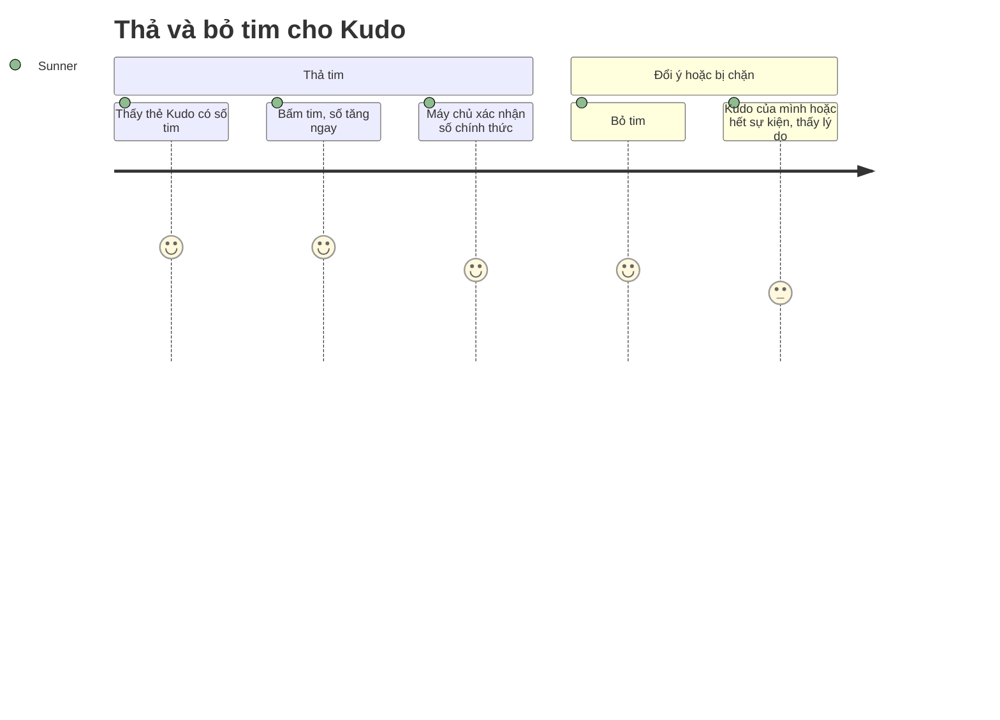

<!-- layout-exempt: rebuild-spec owns all docs/system|features|generated|flows paths — all references here are output targets or internal definitions -->
<!-- Contract: references/feature-spec-researcher-contract.md -->
<!-- Nửa BA/QA của cặp spec: đọc file này là trả lời được "làm gì, ứng xử ra sao, màn hình hiện gì" mà không phải mở file khác. Chi tiết kỹ thuật (đường dẫn, trích nguồn, ghi dữ liệu) nằm ở technical-spec.md. -->

# Functional Spec — F005_KudosHearts

**Priority**: P1
**Type**: ui
**Generated**: 2026-11-24

**See also:** [`technical-spec.md`](./technical-spec.md) — điểm vào, trích nguồn, pseudocode, thực thể dữ liệu và các lần ghi cho Dev/QA/SA.

**Traceability:** F005_KudosHearts → SCR006_KudoDetail, SCR007_KudosLiveBoardFeed/REG003_HighlightKudos, SCR007_KudosLiveBoardFeed/REG005_AllKudosFeed, SCR015_OtherProfile, SCR016_OwnProfile → US037_GiveHeartToKudo, US038_WithdrawHeartFromKudo → ROUTE025, ROUTE026

## 1. Overview

**Problem:** Sunner muốn ghi nhận Kudo của đồng nghiệp bằng một cú bấm, và ban tổ chức cần con số tim đáng tin để làm nền cho Secret Box và Kudos Quốc Dân; nếu đếm không chặt thì bấm đúp, nhiều tab hay bấm tự khen sẽ làm số tim sai và làm lệch phần thưởng.
**Solution:** Mỗi Sunner thả hoặc bỏ tim cho Kudo công khai của người khác ngay trên thẻ Kudo; số tim đổi tức thì rồi lấy kết quả của máy chủ làm con số chính thức. Trong chiến dịch "Ngày x2 tim", mỗi tim thả ra được tính gấp đôi vào tiến độ Secret Box của người gửi Kudo, còn số hiện trên thẻ vẫn là số người thật đã thả tim.
**Scope:** Thả tim và bỏ tim trên thẻ Kudo ở Live board, trang chi tiết và hồ sơ; hiện số tim thô cùng trạng thái đã thả của người xem; khoá nút khi là Kudo của chính mình hoặc khi sự kiện đã kết thúc; chốt hệ số tim lúc thả; cung cấp số tim thô cho xếp hạng và tổng tim nhận được cho phần thưởng.
**Non-Scope:** Không dựng thẻ Kudo hay danh sách Kudo (F004_KudosFeed); không đổi tim thành Secret Box (F010_SecretBoxRewards); không tạo hay sửa chiến dịch x2 (F011_AdminCampaigns); không đánh dấu Kudo là spam (F007_AdminModeration); không phát thông báo (F013_Notifications); không có danh sách "ai đã thả tim"; không có màn hình riêng.

**Actors**

| Actor | Description | Primary goal |
|-------|--------------|---------------|
| Sunner thả tim | Sunner đã đăng nhập đang xem một Kudo công khai của người khác | Ghi nhận Kudo bằng một tim, và bỏ tim nếu lỡ tay hoặc đổi ý |
| Sunner gửi Kudo | Sunner là người đã viết Kudo nhận tim | Có tim được tính đúng để tích tiến độ Secret Box |

Feature này chưa tham gia luồng liên-feature nào được ghi trong thư mục luồng của tài liệu (hiện chưa có luồng nào); nó cung cấp số tim cho Highlight, Kudos Quốc Dân, Secret Box, hồ sơ và bảng Admin.

## 2. Functional Capabilities

| ID | Capability | What the user can do | User Stories | Requirements | Business Rules | Screens |
|----|------------|------------------------|-----------------|---------------|-------------------|---------|
| CAP-01 | Thả và bỏ tim | Thả tim cho Kudo công khai của người khác, bấm lại để bỏ tim; mỗi người một tim mỗi Kudo, bấm lặp không tạo thêm; lý do từ chối được nêu rõ | US037_GiveHeartToKudo, US038_WithdrawHeartFromKudo | FR-001, FR-002, FR-003, FR-402, FR-404, FR-406, FR-601, FR-602 | BR-001, BR-003, BR-004, BR-005, BR-007, BR-010, DEC-002, SM-001 | N/A — nút nằm trong thẻ Kudo, màn hình nêu ở CAP-02 |
| CAP-02 | Nút tim trên thẻ Kudo | Thấy số tim thô và trạng thái đã thả; bấm tim thấy số đổi ngay; nút khoá kèm lý do khi là Kudo của mình hoặc sự kiện đã kết thúc | N/A — hai câu chuyện đã thuộc CAP-01 | FR-101, FR-201, FR-202, FR-401, FR-403, FR-405 | BR-002, BR-006, DEC-001, DEC-003 | SCR006_KudoDetail, SCR007_KudosLiveBoardFeed/REG003_HighlightKudos, SCR007_KudosLiveBoardFeed/REG005_AllKudosFeed, SCR015_OtherProfile, SCR016_OwnProfile |
| CAP-03 | Số liệu tim cho xếp hạng và phần thưởng | Không có thao tác trực tiếp: người dùng thấy kết quả là thứ tự Highlight, Kudos Quốc Dân và tiến độ Secret Box tính từ tim | N/A — phục vụ các feature khác | FR-407, FR-408 | BR-008, BR-009 | N/A — kết quả hiện ở màn hình của feature khác |

## 3. Open Decisions

| D### | Decision | Default proposal | Rationale | Blocks work |
|------|----------|-------------------|-----------|--------------|
| D001 | Khi Sunner (hoặc Admin) bấm tim trước giờ mở sự kiện, có cần câu thông báo riêng, trung tính, thay cho câu "Sự kiện đã kết thúc, không thể thả tim nữa" không? | Giữ câu hiện tại cho mọi trường hợp ngoài cửa sổ ghi | Trước giờ mở không có Kudo nào để tim, nên tình huống hiếm; thêm câu riêng cần thêm mã lỗi và thử nghiệm | no |

## 4. Requirements

### Foundation (0xx)

- **FR-001** Mỗi cặp (Kudo, Sunner) chỉ có tối đa một tim, và tim lưu kèm hệ số tại lúc thả.
- **FR-002** Thả tim và việc báo cho các feature khác biết có tim mới xảy ra cùng một lúc, và chỉ khi tim thật sự được ghi.
- **FR-003** Hệ số của tim là 2 khi có chiến dịch "Ngày x2 tim" đang hiệu lực lúc thả, ngược lại là 1; tra chiến dịch lỗi thì dùng 1.

### Navigation (1xx)

- **FR-101** Nút tim có mặt trên mọi thẻ Kudo ở Live board (Highlight và All Kudos), trang chi tiết Kudo và hồ sơ; thẻ spam của chính mình không có nút.

### Thẻ Kudo (2xx)

- **FR-201** Thẻ hiện số tim thô (số Sunner đã tim, không nhân hệ số, định dạng theo ngôn ngữ) và trạng thái đã thả của người xem.
- **FR-202** Mọi bản thẻ của cùng một Kudo trên một trang hiện chung câu trả đã xác nhận, trừ khi dữ liệu trang mới hơn.

### Interaction (4xx)

- **FR-401** Bấm tim đổi tim và số ngay; nếu bị từ chối hoặc lỗi thì hoàn lại và nêu lý do.
- **FR-402** Bỏ tim giảm số đi 1, an toàn khi bỏ lặp, và vẫn làm được trên Kudo vừa bị đánh dấu spam.
- **FR-403** Nút khoá cho tới khi máy chủ trả lời nên không bấm đúp được; bấm lặp chỉ tạo đúng một tim.
- **FR-404** Kudo không còn khả dụng (id sai, không tồn tại, không còn công khai) thì việc thả tim bị từ chối.
- **FR-405** Kudo của chính mình, kể cả Kudo ẩn danh, không thả tim được: nút khoá, số tim vẫn hiện, bấm chỉ hiện lý do và không gửi gì.
- **FR-406** Ngoài cửa sổ ghi (từ khi sự kiện kết thúc, và trước giờ mở) cả thả lẫn bỏ tim đều bị chặn với lý do hiện rõ.
- **FR-407** Highlight và Kudos Quốc Dân xếp Kudo theo số tim thô, hoà thì theo tuổi Kudo.
- **FR-408** Tổng tim nhận được của một người là tim trên các Kudo công khai họ đã gửi, tính cả thô và có trọng số, đến một mốc thời gian cho trước.

### Security (6xx)

- **FR-601** Chỉ Sunner đã đăng nhập mới thả hay bỏ tim; khách được chuyển về trang đăng nhập.
- **FR-602** Người thả luôn lấy từ phiên đăng nhập, không do trình duyệt gửi; câu trả không lộ ai đã thả tim hay người gửi ẩn danh.

## 5. Business Rules

- Một Sunner chỉ có một tim cho một Kudo; thả lại là không làm gì, không báo lỗi (BR-001)
- Không ai thả tim cho Kudo của mình, kể cả Kudo ẩn danh; hệ thống so với người gửi thật nên không lộ danh tính (BR-002)
- Chỉ Kudo công khai nhận tim; Kudo vừa bị đánh dấu spam thì từ chối thả tim mới (BR-003)
- Hệ số của tim được chốt một lần lúc thả và không đổi dù chiến dịch sau đó bị sửa hay xoá (BR-004)
- Hệ số là 2 khi một chiến dịch đang hiệu lực, còn lại là 1; lỗi khi tra chiến dịch không làm hỏng việc thả tim (BR-005)
- Thẻ và xếp hạng dùng số tim thô; hệ số chỉ nhân trong tiến độ Secret Box (BR-006)
- Thả và bỏ tim chỉ trong cửa sổ ghi, từ giờ mở đến hết sự kiện (BR-007)
- Tim nhận được là tim trên Kudo công khai mình đã gửi; Kudo spam thôi tính, khôi phục thì tính lại, không thu hồi (BR-008)
- Số tim hoà nhau: Highlight cho Kudo mới hơn đứng trước, Kudos Quốc Dân cho Kudo cũ hơn đứng trước (BR-009)
- Bỏ tim luôn an toàn khi lặp và không phát sự kiện riêng; phần thưởng tự đối soát lại từ tổng tim (BR-010)
- Nút tim bị khoá cho Kudo của mình hoặc khi sự kiện kết thúc: số tim vẫn hiện, rê chuột hay focus thấy lý do, bấm hiện lý do và không gửi gì (DEC-001)
- Thả tim bị từ chối thì lý do cụ thể được nêu: Kudo không còn khả dụng, Kudo của mình, hay sự kiện đã kết thúc; đã tim rồi thì thành công im lặng (DEC-002)
- Thẻ Kudo spam của chính mình không có nút tim (DEC-003)
- Một dòng tim chỉ có hai trạng thái: chưa tim và đã tim, thả chuyển sang đã tim, bỏ chuyển về chưa tim (SM-001)

## 6. Screens

| Screen Name | SCR### | What User Sees | What User Can Do |
|-------------|--------|-----------------|-------------------|
| Chi tiết Kudo | SCR006_KudoDetail | Panel đọc đầy đủ một Kudo; hàng cuối có số tim cùng icon tim bên trái, cạnh Copy Link và nút Đóng | Thả hoặc bỏ tim; đọc lý do khi nút khoá; Kudo spam của chính mình thì không có tim |
| Live board — Highlight Kudos | SCR007_KudosLiveBoardFeed/REG003_HighlightKudos | Các thẻ Highlight xếp theo số tim, mỗi thẻ có số tim và icon tim | Thả hoặc bỏ tim ngay trên thẻ; cùng Kudo ở All Kudos cập nhật theo |
| Live board — All Kudos | SCR007_KudosLiveBoardFeed/REG005_AllKudosFeed | Danh sách thẻ Kudo mới nhất, mỗi thẻ có số tim và trạng thái đã thả | Thả hoặc bỏ tim; xem chi tiết; Kudo của mình hiện nút tim mờ kèm lý do |
| Hồ sơ đồng nghiệp | SCR015_OtherProfile | Danh sách Kudo người đó đã nhận, mỗi thẻ có nút tim | Thả hoặc bỏ tim trên thẻ |
| Hồ sơ của tôi | SCR016_OwnProfile | Danh sách Kudo mình đã gửi hoặc đã nhận, thẻ có nút tim; Kudo spam của mình hiện kèm tag Spam, không có tim | Bỏ hoặc thả tim trên Kudo của người khác; Kudo mình gửi hiện tim mờ |

### User Journey

1. Sunner mở Live board và thấy thẻ Kudo ở Highlight Kudos và All Kudos, mỗi thẻ có số tim cùng icon tim.
2. Sunner bấm tim rỗng trên Kudo của đồng nghiệp — tim đặc và số tăng 1 ngay; nút tạm khoá tới khi máy chủ xác nhận, rồi mở lại.
3. Cùng Kudo đang hiện ở cả Highlight Kudos và All Kudos — cả hai bản thẻ cùng đổi.
4. Sunner đổi ý, bấm lại tim đặc — tim rỗng và số giảm 1.
5. Sunner mở Chi tiết Kudo hoặc Hồ sơ và thả tim ở đó theo cùng cách.
6. Trên Kudo do chính mình gửi, Sunner thấy tim mờ; rê chuột thấy "Bạn không thể thả tim cho Kudo của mình", bấm chỉ hiện lại câu đó.
7. Khi sự kiện kết thúc, mọi nút tim mờ đi, số tim vẫn hiện và thấy "Sự kiện đã kết thúc, không thể thả tim nữa".



## 7. User Stories

### US037_GiveHeartToKudo — Give Heart To Kudo

**Actor:** Sunner thả tim
**Goal:** Thả tim cho Kudo của đồng nghiệp để bày tỏ sự ghi nhận.
**Business value:** Ghi nhận được lan toả và giúp người gửi Kudo tích đủ tim đổi Secret Box, tạo vòng khuyến khích gửi Kudo chất lượng.

**Acceptance Criteria:**
- [ ] Bấm nút tim khi chưa tim thì số tăng 1 và tim đặc ngay; nút khoá cho tới khi máy chủ trả lời nên không bấm đúp được.
- [ ] Số hiển thị là số Sunner đã tim (định dạng "1.000" ở tiếng Việt), không nhân với hệ số chiến dịch.
- [ ] Kudo của chính mình (kể cả ẩn danh) và mọi Kudo từ khi sự kiện kết thúc: nút khoá, số vẫn hiện, rê hoặc focus thấy lý do, bấm chỉ hiện lý do và không gửi gì.
- [ ] Kudo bị đánh dấu spam giữa chừng hoặc bị từ chối vì lý do khác: số về như cũ và hiện "Kudo này không còn khả dụng" hoặc "Không thể cập nhật, vui lòng thử lại".
- [ ] Thả tim lần thứ hai cho cùng Kudo không làm gì; 20 lần bấm song song chỉ tạo đúng 1 tim.
- [ ] Thẻ Kudo spam của chính mình không có nút tim.

### US038_WithdrawHeartFromKudo — Withdraw Heart From Kudo

**Actor:** Sunner thả tim
**Goal:** Bỏ tim đã thả khi lỡ tay hoặc đổi ý.
**Business value:** Cho người dùng sửa sai nên số tim phản ánh đúng ý họ và không ai bị kẹt với một tim đã lỡ thả.

**Acceptance Criteria:**
- [ ] Bấm nút tim đang đặc thì số giảm 1 và tim rỗng ngay; nút khoá cho tới khi máy chủ trả lời.
- [ ] Bỏ tim khi chưa tim không báo lỗi, máy chủ trả lại trạng thái hiện tại.
- [ ] Bỏ tim vẫn được trên Kudo vừa bị đánh dấu spam; từ khi sự kiện kết thúc nút bị khoá và hiện "Sự kiện đã kết thúc, không thể thả tim nữa".
- [ ] Lỗi mạng hoặc lỗi máy chủ: số hoàn lại và hiện "Không thể cập nhật, vui lòng thử lại".

## 8. Scenarios

### US037_GiveHeartToKudo — Happy Path

**Given** Kudo công khai của người khác, mình chưa tim, cửa sổ ghi đang mở, **When** mình bấm tim, **Then** số tăng 1 và tim đặc ngay, rồi máy chủ xác nhận số chính thức; người gửi Kudo sau đó nhận thông báo có tim mới.

### US037_GiveHeartToKudo — Error: Kudo của chính mình

**Given** mình là người gửi Kudo (ẩn danh hay không), **When** mình rê hoặc bấm nút tim, **Then** nút khoá, hiện "Bạn không thể thả tim cho Kudo của mình" và không gửi gì đến máy chủ.

### US037_GiveHeartToKudo — Error: Kudo bị spam giữa chừng

**Given** Admin vừa đánh dấu Kudo là spam, **When** mình bấm tim, **Then** số về như cũ và hiện "Kudo này không còn khả dụng".

### US037_GiveHeartToKudo — Error: Sự kiện đã kết thúc

**Given** đã qua thời điểm kết thúc sự kiện, **When** mình bấm tim, **Then** nút khoá, hiện "Sự kiện đã kết thúc, không thể thả tim nữa" và tim giữ nguyên.

### US037_GiveHeartToKudo — Variant: chiến dịch x2 đang chạy

**Given** có chiến dịch "Ngày x2 tim" đang chạy, **When** mình thả tim, **Then** số hiển thị vẫn chỉ tăng 1 còn tiến độ Secret Box của người gửi được tính 2 cho tim này.

### US038_WithdrawHeartFromKudo — Happy Path

**Given** mình đã tim một Kudo, cửa sổ ghi đang mở, **When** mình bấm lại nút tim, **Then** số giảm 1, tim rỗng ngay và tim của mình bị xoá khỏi máy chủ.

### US038_WithdrawHeartFromKudo — Error: Máy chủ lỗi

**Given** máy chủ lỗi hoặc mất mạng, **When** mình bấm bỏ tim, **Then** tim và số hoàn về như trước và hiện "Không thể cập nhật, vui lòng thử lại".

## 9. Edge Cases

| Scenario | What Happens | User-Facing Message |
|----------|--------------|----------------------|
| Bấm tim nhiều lần liên tiếp hoặc ở nhiều tab | Chỉ một tim được ghi, các lần sau thành công im lặng | None — silent handling |
| Kudo bị đánh dấu spam ngay lúc bấm tim | Tim không được ghi, số về như cũ | "Kudo này không còn khả dụng" |
| Bấm tim trên Kudo của chính mình, kể cả ẩn danh | Nút đã khoá, không có yêu cầu nào gửi đi | "Bạn không thể thả tim cho Kudo của mình" |
| Thả hoặc bỏ tim khi sự kiện đã kết thúc | Bị chặn, tim giữ nguyên | "Sự kiện đã kết thúc, không thể thả tim nữa" |
| Mạng đứt hoặc máy chủ lỗi lúc bấm | Số và tim hoàn lại, nút mở lại | "Không thể cập nhật, vui lòng thử lại" |
| Bỏ tim khi mình chưa tim (tab cũ) | Không lỗi, hiện số hiện tại | None — silent handling |
| Bỏ tim trên Kudo vừa bị spam | Vẫn bỏ được | None — silent handling |
| Cùng Kudo hiện ở Highlight và All Kudos | Một lần bấm cập nhật cả hai bản thẻ | None — silent handling |
| Phiên đăng nhập hết hạn lúc bấm | Chuyển về trang đăng nhập | None — chuyển thẳng về trang đăng nhập |
| Tra chiến dịch x2 bị lỗi lúc thả tim | Tim vẫn được thả với hệ số 1 | None — silent handling |
| Thẻ Kudo spam của chính mình | Không có nút tim | None — silent handling |

## 10. Edge Behaviours to Verify

- **FR-001** → Bấm tim 20 lần song song chỉ để lại đúng một tim của mình trên Kudo.
- **FR-002** → Chỉ lần thả thật sự tạo ra tim mới mới làm người gửi nhận thông báo; thả lặp không tạo thông báo thứ hai.
- **FR-003** → Trong chiến dịch x2 tim thả ra mang hệ số 2 và hệ số này giữ nguyên sau khi chiến dịch kết thúc hoặc bị xoá.
- **FR-201** → Số trên thẻ là số người đã tim, không đổi khi có chiến dịch x2.
- **FR-401** → Khi bị từ chối hoặc lỗi, số và icon tim về đúng như trước khi bấm và có thông báo lý do.
- **FR-402** → Bỏ tim không lỗi dù chưa tim, và vẫn làm được trên Kudo vừa bị spam.
- **FR-405** → Rê hoặc bấm tim ở Kudo ẩn danh do chính mình gửi chỉ hiện lý do, không thay đổi số.
- **FR-406** → Từ lúc sự kiện kết thúc mọi nút tim khoá, số tim vẫn hiện.
- **FR-407** → Hai tim hệ số 1 xếp trên một tim hệ số 2; hoà thì Highlight lấy Kudo mới hơn.
- **FR-408** → Kudo bị spam thôi tính vào tim nhận được, khôi phục thì tính lại.
- **FR-601** → Khách không đăng nhập thả tim bị chuyển về trang đăng nhập và không ghi gì.

## 11. Risks & Known Issues

| ID | Type | Description | Impact | Status |
|----|------|--------------|--------|--------|
| RISK-01 | known-issue | Trước giờ mở sự kiện, bấm tim báo "Sự kiện đã kết thúc, không thể thả tim nữa" (cùng một lý do dùng cho cả hai phía của cửa sổ ghi) | Câu sai nghĩa nhưng hiếm gặp vì trước giờ mở chưa có Kudo nào; xem D001 | confirmed |
| RISK-02 | risk | Một tim chèn sát trước lúc Admin đánh dấu spam vẫn nằm lại trong dữ liệu; vô hại vì tim của Kudo spam bị lọc khi đọc và tính lại khi khôi phục | Số tim nội bộ có thể gồm một tim "mồ côi" tạm thời, người dùng không thấy | confirmed |
| RISK-03 | risk | Số tim chỉ cập nhật cho người khác ở lần tải trang sau, không đẩy theo thời gian thực | Hai người xem cùng lúc có thể thấy hai số khác nhau cho tới khi tải lại | confirmed |
| RISK-04 | risk | Bảng Admin User gộp tim của mọi Kudo công khai mỗi trang nên chi phí tăng tuyến tính theo số Kudo (đo 233 ms ở 100 nghìn Kudo) | Trang Admin có thể chậm khi dữ liệu gấp khoảng 10 lần hiện nay | confirmed |

## 12. Dependencies

| Dependency | Type | Why this feature needs it | Evidence |
|------------|------|-----------------------------|----------|
| F004_KudosFeed | feature | Dựng thẻ Kudo và panel chi tiết chứa nút tim, truyền số tim, trạng thái chủ Kudo và cửa sổ ghi | FR-101, SCR007_KudosLiveBoardFeed/REG005_AllKudosFeed |
| F011_AdminCampaigns | feature | Cho biết chiến dịch "Ngày x2 tim" nào đang hiệu lực để chọn hệ số | FR-003, BR-005 |
| F013_Notifications | feature | Biến sự kiện có tim mới thành thông báo cho người gửi Kudo | FR-002 |
| F010_SecretBoxRewards | feature | Dùng tổng tim nhận được có trọng số để cấp Secret Box và chốt Kudos Quốc Dân | FR-407, FR-408 |
| F007_AdminModeration | feature | Đánh dấu Kudo spam, quyết định Kudo còn nhận tim và còn được tính hay không | BR-003, BR-008 |
| F001_Auth | feature | Phiên Sunner và việc chuyển khách về trang đăng nhập | FR-601 |
| Cửa sổ ghi của sự kiện | config | Thời điểm mở và kết thúc quyết định khi nào được thả, bỏ tim | BR-007 |

## 13. Configuration

```text
HEART_CAMPAIGN_MULTIPLIER = 2      # hệ số của một tim khi chiến dịch "Ngày x2 tim" đang hiệu lực (tối thiểu 2)
DEFAULT_HEART_MULTIPLIER = 1       # hệ số ngoài chiến dịch hoặc khi tra chiến dịch lỗi
SECRET_BOX_HEARTS_PER_BOX = 5      # số tim (có trọng số) để đủ một Secret Box; do Secret Box dùng
WRITING_WINDOW = LAUNCH_AT .. EVENT_END_AT   # chỉ trong khoảng này được thả hoặc bỏ tim
HEART_ERROR_TOAST_SECONDS = 5      # thông báo lý do tự tắt sau 5 giây
```
