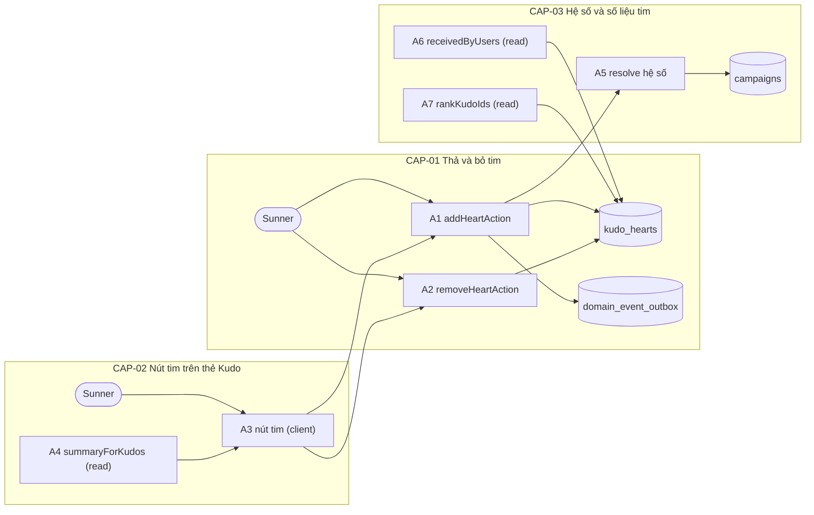
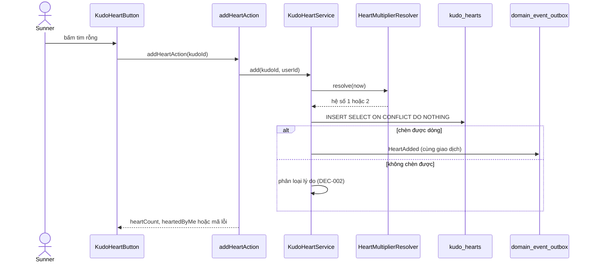
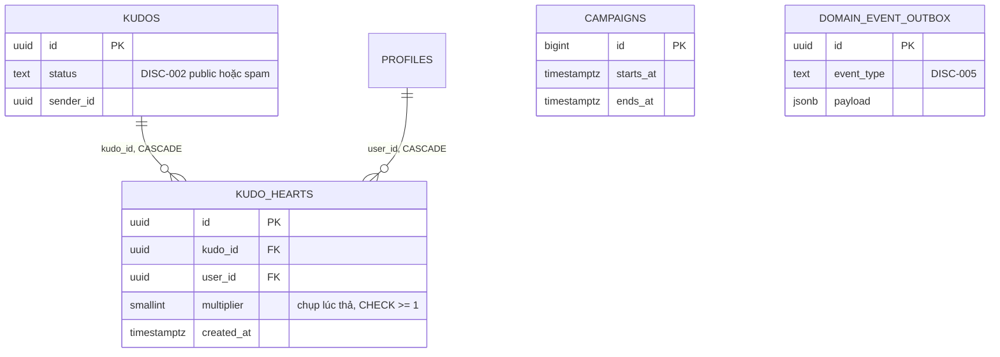
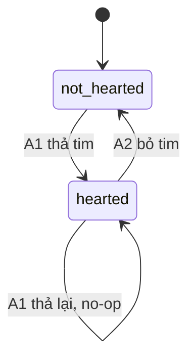

<!-- layout-exempt: rebuild-spec owns all docs/system|features|generated|flows paths — all references here are output targets or internal definitions -->
<!-- Contract: references/feature-spec-researcher-contract.md -->
<!-- Nửa Dev/QA/SA của cặp spec. Mọi mã FR/BR/SM/DEC/ALG/INT được PHÁT BIỂU một lần ở functional-spec.md và CÀI ĐẶT một lần ở đây; không lặp câu quy tắc thuần ngôn ngữ ở file này. -->

# F005_KudosHearts — Technical Spec

**Priority**: P1
**Type**: ui
**Generated**: 2026-11-24

**See also:** [`functional-spec.md`](./functional-spec.md) — tổng quan, quyết định còn mở, yêu cầu và quy tắc nghiệp vụ dạng một dòng, màn hình, user story, kịch bản, edge case và cấu hình cho BA/QA.

**How to read this file:** § 2 là bảng chỉ mục action; chọn action cần xem rồi đọc khối của nó ở § 3 từ đầu đến cuối, mỗi khối là một luồng hoàn chỉnh. § 4 là phụ lục dùng chung, chỉ nhảy vào khi một khối ở § 3 trỏ tới.

## 1. Technical Overview

F005 là nút tim trên thẻ Kudo cùng lớp server phía sau. Hai Server Action `addHeartAction` và `removeHeartAction` (cùng gọi `toggleHeart`) chạy sau `requireSunner()`, kiểm uuid rồi giao cho `KudoHeartService`: thả tim là **một câu `INSERT … SELECT … ON CONFLICT DO NOTHING`** giữ đủ điều kiện (Kudo `public`, người thả khác người gửi, trước `EVENT_END_AT`), kèm một dòng outbox `HeartAdded` ghi cùng giao dịch và chỉ khi chèn thật; bỏ tim là một `DELETE` idempotent. Nút `KudoHeartButton` (client) cập nhật lạc quan bằng `useOptimistic`, khoá tới khi server trả lời rồi lấy `{ heartCount, heartedByMe }` của server làm trạng thái chính thức. Ba truy vấn đọc phục vụ feature khác: số tim thô trên thẻ (`KudoHeartQuery`), xếp hạng theo tim thô (`HeartRankingQuery`) và tổng tim nhận được có trọng số (`HeartStatsQuery`), cộng bộ chọn hệ số `HeartMultiplierResolver` đọc chiến dịch của F011 khi thả.



## 2. Action Index

| # | Action (handler) | Method · Path | Codes | Writes | Detail |
|---|---|---|---|---|---|
| **A0** | *cross-cutting — belongs to no single action* | — | FR-601, FR-602 | — | § 4.4 |
| **A1** | `addHeartAction` | `POST` `/kudos` *(server action; ROUTE025)* | FR-001, FR-002, FR-003, FR-404, FR-405, FR-406, BR-001, BR-002, BR-003, BR-004, BR-007, DEC-002, SM-001, INT-001, US037 | `kudo_hearts`, `domain_event_outbox` | § 3.1 ▸ **diagram** |
| **A2** | `removeHeartAction` | `POST` `/kudos` *(server action; ROUTE026)* | FR-402, FR-406, BR-007, BR-010, SM-001, US038 | `kudo_hearts` | § 3.1 |
| **A3** | `KudoHeartButton#toggle` *(client, no BE of its own)* | — | FR-101, FR-202, FR-401, FR-403, FR-405, FR-406, BR-002, BR-007, DEC-001, DEC-003, US037, US038 | — *(client only)* | § 3.2 |
| **A4** | `KudoHeartQuery#summaryForKudos` | — | FR-201, BR-006 | — *(read-only)* | § 3.2 |
| **A5** | `HeartMultiplierResolver#resolve` | — | FR-003, BR-004, BR-005, INT-002 | — *(read-only)* | § 3.3 |
| **A6** | `HeartStatsQuery#receivedByUsers` | — | FR-408, BR-006, BR-008 | — *(read-only)* | § 3.3 |
| **A7** | `HeartRankingQuery#rankKudoIds` | — | FR-407, BR-006, BR-009, ALG-001 | — *(read-only)* | § 3.3 |

## 3. Actions

### 3.1 CAP-01 — Thả và bỏ tim

#### A1 · Add a heart to a Kudo
`POST /kudos` *(server action; cùng một action được gọi từ `/kudos`, `/kudos/:id`, `/profile`, `/profile/:userId`)* → `` `addHeartAction` `` → `` `KudoHeartService#add` ``
`FR-001` `FR-002` `FR-003` `FR-404` `FR-405` `FR-406` `BR-001` `BR-002` `BR-003` `BR-004` `BR-007` `DEC-002` `SM-001` `INT-001` `US037` · ROUTE025 · `SCR006_KudoDetail` · `SCR007_KudosLiveBoardFeed/REG003_HighlightKudos` · `SCR007_KudosLiveBoardFeed/REG005_AllKudosFeed` · `SCR015_OtherProfile` · `SCR016_OwnProfile`

**Who** · Sunner đã đăng nhập (Admin cũng đi cùng đường, cùng điều kiện) thả tim dưới danh nghĩa chính mình *(gate A0 — § 4.4)*
**FE** · bấm nút tim đang rỗng gọi `addHeartAction` qua A3 — `features/kudos-hearts/components/kudo-heart-button.tsx:26-34`; nút được dựng trong thẻ Kudo và panel chi tiết, trừ thẻ spam của chính mình — `features/kudos-feed/components/kudo-card.tsx:62-73`.
**Request** · tham số duy nhất `kudoId` *(chuỗi, phải là uuid)*; không có body nào khác, người thả lấy từ phiên. Sai uuid trả `KUDO_UNAVAILABLE` ngay, chưa chạm DB — `features/kudos-hearts/server/kudo-heart-actions.ts:18-21`.
**BE** · `toggleHeart` gọi `requireSunner()` rồi parse uuid, chạy `KudoHeartService.add`, sau đó đọc lại `KudoHeartQuery.summaryForKudos([kudoId], userId)` và trả `{ ok: true, heartCount, heartedByMe }`; lỗi nghiệp vụ `KudoHeartError` đi ra thành `{ ok: false, error }`, lỗi lạ ghi log `[hearts] add failed` và thành `UNEXPECTED` — `features/kudos-hearts/server/kudo-heart-actions.ts:18-36`. `add` kiểm cửa sổ ghi, nhờ A5 lấy hệ số rồi mở một giao dịch — `features/kudos-hearts/server/kudo-heart-service.ts:61-69`.
**Rule** · quyết định thả tim có thành công hay phải báo lý do nào:

| DEC | subtype | Condition | What the user sees | Source |
|---|---|---|---|---|
| **DEC-002** | flow | câu INSERT không chèn dòng nào và Kudo không tồn tại hoặc `status` khác `public` | `KUDO_UNAVAILABLE`: số tim về như cũ, toast "Kudo này không còn khả dụng" | `features/kudos-hearts/server/kudo-heart-service.ts:50-55` |
| **DEC-002** | flow | không chèn được, Kudo `public` và `sender_id` bằng người thả (kể cả ẩn danh) | `SELF_HEART`: toast "Bạn không thể thả tim cho Kudo của mình" | `features/kudos-hearts/server/kudo-heart-service.ts:56` |
| **DEC-002** | flow | không chèn được, Kudo `public`, không phải của mình, nhưng `now()` đã tới `EVENT_END_AT` | `EVENT_ENDED`: toast "Sự kiện đã kết thúc, không thể thả tim nữa" | `features/kudos-hearts/server/kudo-heart-service.ts:57` |
| **DEC-002** | flow | không chèn được vì mọi điều kiện đều đạt (đã có tim của người này) | thành công im lặng (`unchanged`): trả số hiện tại, không có toast | `features/kudos-hearts/server/kudo-heart-service.ts:58` |

- **BR-001 — Mỗi Sunner chỉ có một tim trên một Kudo; thả lại là no-op im lặng.** `UNIQUE (kudo_id, user_id)` cộng `ON CONFLICT DO NOTHING` nên bấm đồng thời 20 lần vẫn chỉ một dòng tim và một dòng outbox; dòng outbox chỉ được thêm khi `RETURNING` có dòng. `features/kudos-hearts/server/kudo-heart-service.ts:32-42,65-67`
- **BR-002 — Không ai tự thả tim cho Kudo của mình, kể cả Kudo ẩn danh.** Điều kiện `k.sender_id <> userId` nằm ngay trong câu INSERT (sender thật, bất kể cờ ẩn danh); UI khoá nút từ trước ở A3. *(§ 4.4)*
- **BR-003 — Chỉ Kudo `public` nhận tim.** Điều kiện `k.status = 'public'` nằm trong cùng câu INSERT nên kiểm tra và ghi là nguyên tử với Mark Spam; Kudo bị spam giữa chừng trả `KUDO_UNAVAILABLE`. Một tim chèn ngay trước Mark Spam (lần đọc phân loại là câu lệnh thứ hai, READ COMMITTED) vẫn nằm trên dòng, vô hại vì spam bị lọc lúc đọc; khoá `FOR SHARE` trên dòng Kudo nóng bị bỏ vì không đáng. `features/kudos-hearts/server/kudo-heart-service.ts:32-49`
- **BR-004 — Hệ số chụp vào dòng tim lúc thả và không cập nhật về sau.** `add` truyền `multiplier` do A5 chọn vào cột `multiplier`; đổi hay xoá chiến dịch sau đó không đổi dòng đã ghi. *(§ 4.4)*
- **BR-007 — Thả tim chỉ trong cửa sổ ghi `[LAUNCH_AT, EVENT_END_AT)`.** `isEventWritingOpen` chặn trước giao dịch (ném `EVENT_ENDED`), và `now() < EVENT_END_AT` còn nằm trong câu INSERT. *(§ 4.4)*

**Result** · ghi một dòng `kudo_hearts` `(kudo_id, user_id, multiplier)` rồi, trong cùng giao dịch, một dòng `domain_event_outbox` loại `HeartAdded` với payload `{ kudoId, heartUserId }` (INT-001: báo cho consumer thông báo và Secret Box biết có tim mới; `DomainEventOutbox.add` validate payload bằng zod và nếu sai thì ném lỗi làm rollback cả dòng tim) *(§ 4.5)* — `features/kudos-hearts/server/kudo-heart-service.ts:61-69`, `shared/events/domain-event-outbox.ts:18-29`. Dòng tim nối với vòng đời SM-001 (một dòng tim: chưa tim → đã tim). `DISC-002` (`kudos.status`): chỉ giá trị `public` được nhận tim, giá trị `spam` bị từ chối bằng `KUDO_UNAVAILABLE`; `DISC-005` (`domain_event_outbox.event_type`): F005 chỉ ghi giá trị `HeartAdded`. Câu trả cho trình duyệt chỉ có số tim thô và `heartedByMe`, không lộ ai đã thả tim hay người gửi ẩn danh (D009) — `features/kudos-hearts/schemas/kudo-heart-result.ts:1-27`. Không có `revalidatePath`: người xem khác thấy số mới ở lần tải sau (D008).
**State** · `SM-001`: `not_hearted` → `hearted` *(§ 4.3)*
**Source:** `features/kudos-hearts/components/kudo-heart-button.tsx:26-34` → `features/kudos-hearts/server/kudo-heart-actions.ts:18-36` → `features/kudos-hearts/server/kudo-heart-service.ts:30-69` → `features/kudos-hearts/server/kudo-heart-query.ts:13-27` → `shared/events/domain-event-outbox.ts:18-29`



---

#### A2 · Remove the viewer's heart
`POST /kudos` *(server action; cùng bốn trang chủ như A1)* → `` `removeHeartAction` `` → `` `KudoHeartService#remove` ``
`FR-402` `FR-406` `BR-007` `BR-010` `SM-001` `US038` · ROUTE026 · `SCR006_KudoDetail` · `SCR007_KudosLiveBoardFeed/REG003_HighlightKudos` · `SCR007_KudosLiveBoardFeed/REG005_AllKudosFeed` · `SCR015_OtherProfile` · `SCR016_OwnProfile`

**Who** · Sunner đã đăng nhập bỏ tim mà chính mình đã thả *(gate A0 — § 4.4)*
**FE** · bấm nút tim đang đặc: cùng `KudoHeartButton`, khác `heartedByMe` nên gọi `removeHeartAction` — `features/kudos-hearts/components/kudo-heart-button.tsx:72-90`.
**Request** · tham số duy nhất `kudoId` *(uuid)*; uuid sai trả `KUDO_UNAVAILABLE` — `features/kudos-hearts/server/kudo-heart-actions.ts:18-21`.
**BE** · cùng `toggleHeart` như A1 nhưng gọi `KudoHeartService.remove`: kiểm cửa sổ ghi rồi `DELETE FROM kudo_hearts WHERE kudo_id = … AND user_id = …` — `features/kudos-hearts/server/kudo-heart-service.ts:71-74`. Không kiểm `status` của Kudo nên bỏ tim vẫn được trên Kudo vừa bị đánh dấu spam, và không kiểm quyền sở hữu vì điều kiện `user_id` đã giới hạn trong tim của chính người gọi.
**Rule** · bỏ tim idempotent, chỉ chặn ngoài cửa sổ ghi:
- **BR-007 — Bỏ tim cũng chỉ trong cửa sổ ghi `[LAUNCH_AT, EVENT_END_AT)`.** Ngoài cửa sổ `remove` ném `EVENT_ENDED` và tim giữ nguyên. *(§ 4.4)*
- **BR-010 — Bỏ tim là DELETE thuần, idempotent, không phát sự kiện.** Bỏ khi chưa tim không lỗi (số dòng xoá = 0 vẫn trả trạng thái hiện tại); không có sự kiện `HeartRemoved` vì consumer đối soát lại từ tổng tim (YAGNI). `features/kudos-hearts/server/kudo-heart-service.ts:18-19,71-74`

**Result** · xoá tối đa một dòng `kudo_hearts` của người gọi (SM-001 — vòng đời một dòng tim: đã tim → chưa tim), không ghi outbox; trả `{ ok: true, heartCount, heartedByMe }` đọc lại sau khi xoá — `features/kudos-hearts/server/kudo-heart-actions.ts:22-31`. Tổng tim của người gửi Kudo giảm nên lần đối soát Secret Box kế tiếp tính lại số hộp được cấp (đường đọc của F010).
**State** · `SM-001`: `hearted` → `not_hearted` *(§ 4.3)*
**Source:** `features/kudos-hearts/components/kudo-heart-button.tsx:72-90` → `features/kudos-hearts/server/kudo-heart-actions.ts:18-31,38-41` → `features/kudos-hearts/server/kudo-heart-service.ts:71-74`

<!-- No diagram: dưới ngưỡng — một bảng ghi, một câu DELETE đồng bộ, không có nhánh nối tiếp. -->

### 3.2 CAP-02 — Nút tim trên thẻ Kudo

#### A3 · Toggle the heart button on a card
`—` → `` `KudoHeartButton#toggle` `` *(client, không có BE riêng — gọi A1/A2)*
`FR-101` `FR-202` `FR-401` `FR-403` `FR-405` `FR-406` `BR-002` `BR-007` `DEC-001` `DEC-003` `US037` `US038` · `SCR006_KudoDetail` · `SCR007_KudosLiveBoardFeed/REG003_HighlightKudos` · `SCR007_KudosLiveBoardFeed/REG005_AllKudosFeed` · `SCR015_OtherProfile` · `SCR016_OwnProfile`

**Who** · Sunner đã đăng nhập đang xem thẻ Kudo *(gate A0 — § 4.4; mutation do A1/A2 gác ở server)*
**FE** · `KudoCard` (Live board, Highlight, hồ sơ — `features/profile/components/profile-kudos-section.tsx:63`) và `KudoDetailView` đều dựng `KudoCardHeartSlot`, vỏ một dòng bọc `KudoHeartButton` — `features/kudos-feed/components/kudo-card-heart-slot.tsx:20-22`. Nút là một `<button aria-pressed>` gồm số tim (`format.number`, "1.000" ở vi), icon tim 32 px (đặc khi đã tim, rỗng viền đỏ khi chưa) và nhãn `sr-only` — `features/kudos-hearts/components/kudo-heart-button.tsx:92-109`, `features/kudos-hearts/components/kudo-heart-icon.tsx:10-22`. `variant` `card` dùng khoảng cách 4, `detail` dùng 8. Thông báo lỗi là toast `role="alert"` dựng ở cuối `<body>`, tự tắt sau 5 giây — `features/kudos-hearts/components/kudo-heart-error-toast.tsx:32-54`.
**Request** · props `kudoId`, `heartCount`, `heartedByMe` *(từ server, cặp `KudoHeartSummary`)*, `isOwner`, `writingOpen` *(`isKudoWritingOpen()` của trang)*, `variant`; khi bấm, gọi `addHeartAction` hoặc `removeHeartAction` với `kudoId` — `features/kudos-hearts/components/kudo-heart-button.tsx:15-23,26-34`.
**BE** · không có BE riêng; kết quả `ok: true` được đẩy vào kho dùng chung `publishHeartSummary(kudoId, serverBase, answer)`, mọi bản thẻ của cùng Kudo trên trang đọc qua `useSharedHeartSummary` (`useSyncExternalStore`), chỉ áp dụng khi props server của thẻ vẫn bằng `base` — props mới hơn (tải lại, Highlight tải lại, điều hướng mềm) luôn thắng — `features/kudos-hearts/components/heart-summary-store.ts:10-37`, `features/kudos-hearts/components/use-shared-heart-summary.ts:12-19`. Lỗi mạng hoặc action ném lỗi thành `UNEXPECTED`; `unstable_rethrow` cho redirect (khách về `/login`) đi qua — `features/kudos-hearts/components/kudo-heart-button.tsx:26-34`.
**Rule** · quyết định nút tim có hoạt động hay bị khoá, và khi nào không hiện:

| DEC | subtype | Condition | What the user sees | Source |
|---|---|---|---|---|
| **DEC-001** | render, interaction | `isOwner` | nút `aria-disabled`, mờ 50%, vẫn thấy số tim; tooltip "Bạn không thể thả tim cho Kudo của mình" (hover hoặc focus, Esc ẩn); bấm chỉ hiện toast cùng câu, không gửi request | `features/kudos-hearts/components/kudo-heart-button.tsx:61-76` |
| **DEC-001** | render, interaction | không phải `isOwner` và `writingOpen` là false | cùng kiểu khoá, tooltip và toast "Sự kiện đã kết thúc, không thể thả tim nữa" | `features/kudos-hearts/components/kudo-heart-button.tsx:61-76` |
| **DEC-001** | render, interaction | không phải `isOwner` và `writingOpen` là true | nút hoạt động; bấm đổi tim và số ngay, khoá tới khi server trả lời | `features/kudos-hearts/components/kudo-heart-button.tsx:72-90` |
| **DEC-003** | render | `kudo.isSpam` (Kudo spam của chính mình) | không dựng nút tim (cũng không có Copy Link) | `features/kudos-feed/components/kudo-card.tsx:62-73` |
| **DEC-003** | render | `kudo.isSpam` ở panel chi tiết | cùng: chỉ còn nút Đóng | `features/kudos-feed/components/kudo-detail-view.tsx:47-58` |

- **BR-002 — Không tự thả tim cho Kudo của mình, kể cả Kudo ẩn danh.** `isOwner` (`row.senderId === viewerId`, đúng cả với Kudo ẩn danh) làm nút khoá và chặn gọi server; server vẫn kiểm lại bằng `sender_id <> userId` ở A1. *(§ 4.4)*
- **BR-007 — Nút khoá khi cửa sổ ghi đóng.** `writingOpen` đến từ `isKudoWritingOpen()` của trang; khoá cả thả lẫn bỏ tim, thông báo `EVENT_ENDED`. *(§ 4.4)*

**Result** · không ghi DB ở lớp này. Bấm khi hoạt động: tính `next` (đảo `heartedByMe`, `heartCount` ±1 kẹp ≥ 0), `useOptimistic` hiện ngay, khoá bằng `locked` (ref) và `pending` (transition) nên không bấm đúp, rồi áp câu trả của server làm trạng thái chính thức; lỗi thì tự về trạng thái xác nhận (optimistic của React tự trả) và đặt toast theo mã lỗi — `features/kudos-hearts/components/kudo-heart-button.tsx:72-90`. Đây là mẫu optimistic UI BL-C06 của behavior-logic.
**Source:** `features/kudos-hearts/components/kudo-heart-button.tsx:49-124` → `features/kudos-hearts/components/heart-summary-store.ts:10-37` → `features/kudos-feed/components/kudo-card-heart-slot.tsx:20-22` → `features/kudos-feed/components/kudo-card.tsx:62-73`

<!-- No diagram: client-local, không ghi bảng. Phần phân nhánh thật là bảng DEC ở trên; vẽ thành trình tự chỉ ép các điều kiện song song thành chuỗi giả. -->

---

#### A4 · Read the raw heart count and the viewer's heart for a page of cards
`—` → `` `KudoHeartQuery#summaryForKudos` `` *(gọi trong server component/handler của feed, và đọc lại ở cuối A1/A2)*
`FR-201` `BR-006` · `SCR006_KudoDetail` · `SCR007_KudosLiveBoardFeed/REG005_AllKudosFeed`

**Who** · Sunner đang tải một trang thẻ Kudo *(gate A0 — § 4.4; người gọi đã qua `requireSunner()` hoặc `requireApiSunner()`)*
**FE** · số tim hiển thị trên thẻ là `heartCount` thô, không nhân hệ số — `features/kudos-hearts/components/kudo-heart-button.tsx:92-109`.
**Request** · tham số `kudoIds` *(mảng uuid của cả trang)* và `viewerId` *(từ phiên)*; không có tham số từ client.
**BE** · `enrichHeartSummary` (seam của F004) gọi `KudoHeartQuery.summaryForKudos` một lần cho cả trang sau khi che người gửi ẩn danh, rồi trộn `{ heartCount, heartedByMe }` vào từng thẻ — `features/kudos-feed/server/enrich-heart-summary.ts:21-27`. Truy vấn là **một** `SELECT kudo_id, count(*), bool_or(user_id = viewer) … GROUP BY kudo_id`; mọi id yêu cầu đều có mặt trong kết quả (0/false khi chưa ai tim) — `features/kudos-hearts/server/kudo-heart-query.ts:13-27`.
**Rule** · số hiển thị là số Sunner đã tim, không phải tổng hệ số:
- **BR-006 — Thẻ hiển thị và xếp hạng dùng số tim thô; hệ số chỉ dùng cho tiến độ Secret Box.** `count(*)` mỗi Sunner một tim, không nhân `multiplier`; hai tim x1 xếp trên một tim x2. Chỉ `heartedByMe` nhắc tới người xem, ai khác đã tim không rời server (D009). *(§ 4.4)*

**Result** · read-only — **không ghi DB**. Trả `Map<kudoId, KudoHeartSummary>`; truy vấn không lọc `status` vì thẻ spam của chủ không dựng nút tim còn thẻ spam của người khác không bao giờ vào feed (DEC-003 ở A3).
**Source:** `features/kudos-feed/server/enrich-heart-summary.ts:21-27` → `features/kudos-hearts/server/kudo-heart-query.ts:13-27`

<!-- No diagram: dưới ngưỡng — chỉ đọc, một bảng, một câu SELECT đồng bộ. -->

### 3.3 CAP-03 — Hệ số và số liệu tim

#### A5 · Pick the heart multiplier at heart time
`—` → `` `HeartMultiplierResolver#resolve` `` *(gọi từ A1 và `HeartStatsQuery`)*
`FR-003` `BR-004` `BR-005` `INT-002`

**Who** · *không có người dùng — in-process, người gọi là A1 (khi thả) và A6 (cờ `campaignActive`)*
**FE** · không có giao diện riêng; hệ số không bao giờ hiện trên thẻ (BR-006), chỉ ảnh hưởng tiến độ Secret Box.
**BE** · `HeartMultiplierResolver#resolve(at)` gọi `campaignActiveReader.findActive(at)` — chiến dịch có `starts_at <= at < ends_at` — rồi trả `HEART_CAMPAIGN_MULTIPLIER` (mặc định 2, tối thiểu 2) nếu có chiến dịch, ngược lại `DEFAULT_HEART_MULTIPLIER` = 1 — `features/kudos-hearts/server/heart-multiplier-resolver.ts:13-21`. Bộ đọc là phần việc của F011, F005 chỉ khai kiểu `ActiveCampaignReader` — `features/kudos-hearts/server/active-campaign-reader.ts:8-12`, `features/admin-campaigns/server/campaign-active-reader.ts:15-26`.
**Rule** · hệ số chỉ hai giá trị và không bao giờ làm hỏng việc thả tim:
- **BR-005 — Hệ số bằng `HEART_CAMPAIGN_MULTIPLIER` (2) khi một chiến dịch đang hiệu lực, còn lại bằng 1; tra chiến dịch lỗi cũng rơi về 1.** `resolve` không ném lỗi và không bao giờ trả dưới 1: lỗi đọc được `console.warn` rồi coi như không có chiến dịch, nên thả tim không phụ thuộc F011. `features/kudos-hearts/server/heart-multiplier-resolver.ts:13-21`
- **BR-004 — Hệ số được chụp một lần lúc thả.** Giá trị `resolve` trả về được A1 ghi vào `kudo_hearts.multiplier` và không đổi nữa dù chiến dịch bị sửa hay xoá. *(§ 4.4)*

**Result** · read-only — **không ghi DB**. Gọi bộ đọc chiến dịch (INT-002: tra bảng `campaigns` trong cùng tiến trình để biết có chiến dịch đang chạy không) *(§ 4.5)*; trả số nguyên 1 hoặc 2. Nhiều chiến dịch chồng nhau (chèn tay) thì F011 lấy chiến dịch bắt đầu muộn nhất và ghi cảnh báo.
**Source:** `features/kudos-hearts/server/heart-multiplier-resolver.ts:13-21` → `features/kudos-hearts/server/active-campaign-reader.ts:8-12` → `features/admin-campaigns/server/campaign-active-reader.ts:15-26`

<!-- No diagram: dưới ngưỡng — chỉ đọc, đồng bộ, một bảng. -->

---

#### A6 · Read the hearts a user received (weighted and raw totals)
`—` → `` `HeartStatsQuery#receivedByUsers` `` *(và `receivedByUser` cho một người)*
`FR-408` `BR-006` `BR-008`

**Who** · *không có người dùng — in-process; người gọi là F010 (`SecretBoxGrantService`), F012 (hồ sơ), F014 (cột Total Heart)*
**FE** · không có giao diện riêng; kết quả hiện ở panel Secret Box, bảng thống kê hồ sơ và cột Total Heart của Admin › User.
**Request** · `userIds` *(mảng uuid)* và `asOf` *(mặc định `new Date()`; F010 truyền `SECRET_BOX_LOCK_AT`)*.
**BE** · một `SELECT sender_id, coalesce(sum(multiplier),0), count(*) FROM kudo_hearts JOIN kudos … WHERE kudos.sender_id IN (…) AND kudos.status = 'public' AND kudo_hearts.created_at <= asOf GROUP BY sender_id`, chạy song song với A5 để biết `campaignActive`; người không có tim được điền 0/0 — `features/kudos-hearts/server/heart-stats-query.ts:19-48`. Người gọi chính: `features/secret-box-rewards/server/secret-box-grant-service.ts:70,83`.
**Rule** · tim nhận được là tim trên Kudo mình đã gửi:
- **BR-008 — Tim nhận được là tim trên Kudo công khai mình đã gửi, ẩn danh vẫn tính; spam không tính lúc đọc và Un Spam khôi phục, không thu hồi.** Lọc `status = 'public'` nằm trong truy vấn đọc (dòng tim không bị xoá khi Mark Spam), tim tạo sau `asOf` bị bỏ qua; `weightedTotal` (Σ `multiplier`) là đầu vào tiến độ Secret Box, `rawTotal` là "Total Heart", `campaignActive` là nhãn x2. `features/kudos-hearts/server/heart-stats-query.ts:7-17,28-34`
- **BR-006 — `rawTotal` là số tim thô, không nhân hệ số.** Cùng định nghĩa "thô" với thẻ và xếp hạng; chỉ `weightedTotal` nhân hệ số. *(§ 4.4)*

**Result** · read-only — **không ghi DB**. Trả `Map<userId, { weightedTotal, rawTotal, campaignActive }>`; không bao giờ lộ ai đã thả tim (D009).
**Source:** `features/kudos-hearts/server/heart-stats-query.ts:19-48` → `features/kudos-hearts/server/heart-multiplier-resolver.ts:13-21` → `features/secret-box-rewards/server/secret-box-grant-service.ts:70,83`

<!-- No diagram: dưới ngưỡng — chỉ đọc; hai truy vấn song song không có nhánh. -->

---

#### A7 · Rank Kudos by raw heart count
`—` → `` `HeartRankingQuery#rankKudoIds` `` *(và `heartCountsSubquery`)*
`FR-407` `BR-006` `BR-009` `ALG-001`

**Who** · *không có người dùng — in-process; người gọi là F004 (Highlight), F010 (Kudos Quốc Dân), F007 và F014 (mảnh đếm tim)*
**FE** · không có giao diện riêng; kết quả là thứ tự thẻ ở Highlight carousel và năm thẻ Kudos Quốc Dân.
**Request** · `candidates` *(subquery Kudo công khai có `id`, `createdAt`)*, `limit`, tuỳ chọn `asOf` và `tieBreak` (`newest` mặc định, `oldest`) — `features/kudos-hearts/server/heart-ranking-query.ts:34-49`.
**BE** · `rankKudoIds` dựng subquery đếm tim `heartCountsSubquery`, `LEFT JOIN` vào ứng viên rồi `ORDER BY coalesce(rawCount,0) DESC` + tuổi + `id` và `LIMIT` — `features/kudos-hearts/server/heart-ranking-query.ts:25-32,49-59`. Highlight gọi qua `rankKudoIdsForHighlight` — `features/kudos-feed/server/enrich-heart-summary.ts:29-30`; Kudos Quốc Dân gọi với `asOf` và `tieBreak: "oldest"` — `features/secret-box-rewards/server/national-kudos-finalize-job.ts:30-32`.
**Rule** · thứ tự toàn phần để trang và hạng đồng điểm ổn định:
- **BR-009 — Hòa số tim thì Kudo mới hơn đứng trước ở Highlight, cũ hơn đứng trước ở Kudos Quốc Dân.** Cả hai kết thúc bằng `id` nên là thứ tự toàn phần; ứng viên không có tim đếm 0. `features/kudos-hearts/server/heart-ranking-query.ts:36-41,49-59`
- **BR-006 — Xếp hạng dùng số tim thô.** Hệ số không đổi thứ tự (hai tim x1 xếp trên một tim x2); `heartCountsSubquery` là đoạn đếm duy nhất, các truy vấn khác join lại thay vì đếm lần hai. *(§ 4.4)*

**Result** · read-only — **không ghi DB**. Trả mảng id tốt nhất trước (ALG-001: xếp hạng Kudo theo số tim thô rồi theo tuổi, không bao giờ mang cột người gửi nên không lộ người gửi ẩn danh) *(§ 4.5)*.
**Shared structure:** `ALG-001` — xếp Kudo theo số tim thô giảm dần, rồi theo `created_at` và `id`, full detail *(§ 4.5)*
**Source:** `features/kudos-hearts/server/heart-ranking-query.ts:25-59` → `features/kudos-feed/server/enrich-heart-summary.ts:29-30` → `features/secret-box-rewards/server/national-kudos-finalize-job.ts:30-32`

<!-- No diagram: dưới ngưỡng — chỉ đọc, một câu SELECT đồng bộ. -->

### 3.4 Edge cases

| Action | Scenario | Behavior |
|---|---|---|
| A1 · A2 | `kudoId` không phải uuid | `KUDO_UNAVAILABLE` ngay ở bước parse, không chạm DB — `features/kudos-hearts/server/kudo-heart-actions.ts:18-21` |
| A1 | 20 lần bấm song song của cùng một Sunner | tất cả trả thành công; đúng 1 dòng `kudo_hearts` và 1 dòng `HeartAdded` nhờ `ON CONFLICT DO NOTHING` — `features/kudos-hearts/server/kudo-heart-service.ts:32-42` |
| A1 | Kudo bị Mark Spam trong lúc bấm | không chèn được → `KUDO_UNAVAILABLE`; một tim chèn sát trước Mark Spam giữ nguyên, bị lọc lúc đọc — `features/kudos-hearts/server/kudo-heart-service.ts:44-49` |
| A1 | tự thả tim cho Kudo ẩn danh của mình | `SELF_HEART` (so với `sender_id` thật, không với cờ ẩn danh) — `features/kudos-hearts/server/kudo-heart-service.ts:56` |
| A1 · A2 | gọi từ `EVENT_END_AT` trở đi, hoặc trước `LAUNCH_AT` | `EVENT_ENDED`, không ghi gì (trước giờ mở cũng dùng mã này, RISK-01) — `features/kudos-hearts/server/kudo-heart-service.ts:62,72` |
| A1 | dòng outbox sai schema | ném lỗi, rollback cả dòng tim — `shared/events/domain-event-outbox.ts:18-29` |
| A1 | tra chiến dịch lỗi | hệ số 1, `console.warn`, vẫn thả được — `features/kudos-hearts/server/heart-multiplier-resolver.ts:17-20` |
| A2 | bỏ tim khi chưa tim (tab cũ) | không lỗi, trả số hiện tại — `features/kudos-hearts/server/kudo-heart-service.ts:71-74` |
| A2 | bỏ tim trên Kudo vừa bị spam | vẫn bỏ được — `features/kudos-hearts/server/kudo-heart-service.ts:71-74` |
| A1 · A2 | thả và bỏ xen kẽ của một Sunner | không lỗi, không bao giờ quá một dòng — `features/kudos-hearts/server/kudo-heart-service.ts:32-42,71-74` |
| A3 | Kudo của mình, hoặc cửa sổ ghi đóng | nút khoá, bấm chỉ hiện toast lý do, không gửi request — `features/kudos-hearts/components/kudo-heart-button.tsx:72-76` |
| A3 | mạng đứt hoặc action ném lỗi | số tim về giá trị xác nhận, toast `UNEXPECTED` "Không thể cập nhật, vui lòng thử lại", nút mở lại — `features/kudos-hearts/components/kudo-heart-button.tsx:26-34,81-89` |
| A3 | cùng Kudo xuất hiện ở Highlight và All Kudos | một câu trả xác nhận cập nhật cả hai bản qua kho dùng chung — `features/kudos-hearts/components/heart-summary-store.ts:26-37` |
| A3 | khách (phiên hết hạn) bấm tim | `requireSunner()` chuyển `/login`, `unstable_rethrow` cho redirect đi tiếp — `features/kudos-hearts/components/kudo-heart-button.tsx:26-34` |
| A6 | Kudo bị spam | thôi tính vào tim nhận được; Un Spam tính lại, không thu hồi — `features/kudos-hearts/server/heart-stats-query.ts:28-34` |
| A7 | hai Kudo hoà số tim | Highlight: mới hơn trước; Quốc Dân: cũ hơn trước — `features/kudos-hearts/server/heart-ranking-query.ts:36-41` |
| A0 · A1-A2 | gọi action khi chưa đăng nhập | chuyển `/login` — cổng A0, § 4.4 |

## 4. Shared Foundation

### 4.1 Components

| Component | Responsibility | Used in | File |
|---|---|---|---|
| `addHeartAction`, `removeHeartAction`, `toggleHeart` | Server Action: `requireSunner`, parse uuid, gọi service, trả `HeartActionResult` | A1, A2 | `features/kudos-hearts/server/kudo-heart-actions.ts` |
| `KudoHeartService` | `add` (INSERT SELECT + outbox) và `remove` (DELETE), `KudoHeartError` | A1, A2 | `features/kudos-hearts/server/kudo-heart-service.ts` |
| `KudoHeartButton` | nút tim: optimistic, khoá, tooltip lý do, toast | A3 | `features/kudos-hearts/components/kudo-heart-button.tsx` |
| `KudoHeartIcon` | icon tim 32 px, đặc/rỗng | A3 | `features/kudos-hearts/components/kudo-heart-icon.tsx` |
| `KudoHeartErrorToast` | toast lỗi `kudosHearts.errors.<CODE>` ở cuối `<body>`, tự tắt sau 5 giây | A3 | `features/kudos-hearts/components/kudo-heart-error-toast.tsx` |
| `heart-summary-store`, `useSharedHeartSummary` | kho dùng chung câu trả đã xác nhận, mọi bản thẻ của một Kudo đọc chung | A3 | `features/kudos-hearts/components/heart-summary-store.ts`, `features/kudos-hearts/components/use-shared-heart-summary.ts` |
| `HeartActionResult`, `HEART_ERROR_STATUS` | hợp đồng kết quả client-safe và bảng mã lỗi | A1, A2, A3 | `features/kudos-hearts/schemas/kudo-heart-result.ts` |
| `KudoHeartQuery` | số tim thô và `heartedByMe` cho một trang thẻ | A4 | `features/kudos-hearts/server/kudo-heart-query.ts` |
| `HeartMultiplierResolver`, `ActiveCampaignReader` | chọn hệ số 1 hoặc 2; kiểu bộ đọc chiến dịch (F011 cài) | A5 | `features/kudos-hearts/server/heart-multiplier-resolver.ts`, `features/kudos-hearts/server/active-campaign-reader.ts` |
| `HeartStatsQuery` | tổng tim nhận được có trọng số và thô | A6 | `features/kudos-hearts/server/heart-stats-query.ts` |
| `HeartRankingQuery`, `heartCountsSubquery` | xếp hạng theo tim thô; đoạn đếm tim duy nhất | A7 | `features/kudos-hearts/server/heart-ranking-query.ts` |
| `KudoCardHeartSlot` *(F004)* | vỏ gắn nút tim vào thẻ và panel chi tiết | A3 | `features/kudos-feed/components/kudo-card-heart-slot.tsx` |

### 4.2 Data Model



| Entity | Table | Used for | Action |
|---|---|---|---|
| `KudoHeart` (MODEL008) | `kudo_hearts` | một dòng một lượt tim `(kudo_id, user_id)` kèm `multiplier`; UNIQUE chặn thả đôi | A1, A2, A3, A4, A6, A7 |
| `Kudo` (MODEL003) | `kudos` | điều kiện trong câu INSERT (`status`, `sender_id`); lọc spam và gom theo người gửi khi tính tim nhận được | A1, A6, A7 |
| `Campaign` (MODEL009) | `campaigns` | chỉ đọc: có chiến dịch hiệu lực lúc thả không (F011 sở hữu) | A5, A6 |
| `DomainEventOutbox` (MODEL015) | `domain_event_outbox` | ghi một dòng `HeartAdded` cùng giao dịch thả tim | A1 |

`kudo_hearts` bật RLS, không có policy cho client, `anon`/`authenticated` bị REVOKE ALL; Drizzle chạy bằng server role nên ranh giới bảo mật là các Server Action và truy vấn server, không phải RLS — `shared/db/schema/kudo-hearts.ts:13-31`, `db/migrations/0010_kudo_hearts.sql:5-18`.

#### Polymorphic Behavior

##### DISC-002 — Kudo.status

| Value | Render | Validation | Persistence |
|-------|--------|------------|-------------|
| public | thẻ có nút tim và số tim | A1 chỉ chèn khi `status = 'public'`; A6 và A7 chỉ tính Kudo `public` | tim được ghi (A1); tim của Kudo `public` được tính vào tim nhận được |
| spam | thẻ spam của chủ không dựng nút tim (DEC-003); thẻ spam của người khác không vào feed | A1 từ chối bằng `KUDO_UNAVAILABLE` (DEC-002); A2 vẫn cho bỏ tim | dòng tim đã có được giữ nguyên, chỉ bị lọc lúc đọc; A6 thôi tính, Un Spam tính lại |

**Source:** docs/generated/entities.md § Kudo > Discriminator Fields

##### DISC-005 — DomainEventOutbox.event_type

| Value | Render | Validation | Persistence |
|-------|--------|------------|-------------|
| HeartAdded | không hiện trực tiếp; consumer thông báo biến thành `heart_received` cho người gửi | payload `{ kudoId, heartUserId }` validate bằng zod strict trước khi ghi | A1 ghi trong cùng giao dịch với dòng tim, chỉ khi chèn thật |
| KudoCreated | ngoài phạm vi F005 | ngoài phạm vi F005 | không do F005 ghi (F003) |
| KudoMarkedSpam | ngoài phạm vi F005 | ngoài phạm vi F005 | không do F005 ghi (F007) |
| BoxGranted | ngoài phạm vi F005 | ngoài phạm vi F005 | không do F005 ghi (F010) |
| SetCompleted | ngoài phạm vi F005 | ngoài phạm vi F005 | không do F005 ghi (F010) |
| NationalKudosFinalized | ngoài phạm vi F005 | ngoài phạm vi F005 | không do F005 ghi (F010) |

**Source:** docs/generated/entities.md § DomainEventOutbox > Discriminator Fields

### 4.3 State Management

### Vòng đời một dòng tim của một cặp (Kudo, Sunner) (SM-001)
**kind:** entity
**Linked FR:** FR-001
**Source:** `features/kudos-hearts/server/kudo-heart-service.ts:32-74`



**Action transitions:** guard và tác dụng phụ của từng cạnh nằm ở rung **Result** của action ghi trên cạnh (§ 3.1) — không nhắc lại ở đây. "Có dòng" là trạng thái bền vững duy nhất; trạng thái nút (chờ, khoá) là trạng thái cục bộ của trình duyệt, không đủ ngưỡng `kind: ui` nên nằm ở DEC-001.

### 4.4 Shared Rules

#### Bin 3 — cross-cutting, belongs to no single action

**A0 · FR-601 / FR-602 — Mọi Server Action của F005 yêu cầu phiên Sunner; người thả luôn lấy từ phiên, đầu vào duy nhất là `kudoId`.** *(cross-cutting: áp dụng cho cả A1 và A2, không phải rule của riêng một action)* `toggleHeart` gọi `requireSunner()` đầu tiên: khách về `/login`, chưa chọn phòng ban về `/onboarding/department`; ngoài ra proxy chặn tải trang và Server Action của khách và, trước `LAUNCH_AT`, của người không phải Admin (JSON 403 `prelaunch`). Câu trả chỉ có số tim thô và `heartedByMe`, không có danh tính người đã tim hay người gửi ẩn danh (D009). Các truy vấn đọc A4-A7 chạy trong tiến trình sau khi người gọi đã xác thực.
**Source:** `features/kudos-hearts/server/kudo-heart-actions.ts:18-21` · `shared/auth/current-user.ts:48-53` · `features/kudos-hearts/schemas/kudo-heart-result.ts:1-11` · PERM027_KudoHeartToggle (permissions-matrix.md), PERM008_SunnerAreaGate

#### Bin 2 — used by ≥2 named actions

**BR-002 — Không ai tự thả tim cho Kudo của mình, kể cả Kudo ẩn danh.**
Used in: **A1** · **A3**. UI: `isOwner` từ mapper (`row.senderId === viewerId`) làm nút `aria-disabled` kèm tooltip và toast `SELF_HEART`, không gửi request; server: điều kiện `k.sender_id <> userId` trong câu INSERT là chốt thật, và `classifyNoInsert` phân biệt `SELF_HEART` khi không chèn được. Dùng sender thật nên Kudo ẩn danh cũng bị chặn mà không lộ người gửi.
**Source:** `features/kudos-hearts/components/kudo-heart-button.tsx:61-76` · `features/kudos-hearts/server/kudo-heart-service.ts:32-42,56` · `features/kudos-feed/server/kudo-row-mask.ts:56`
```text
ui:     blockedBy = isOwner ? SELF_HEART : (writingOpen ? none : EVENT_ENDED)
server: INSERT … SELECT … WHERE kudo.status = 'public' AND kudo.sender_id <> :viewer
        no row → classify: not public → KUDO_UNAVAILABLE
                           own          → SELF_HEART
```

**BR-004 — Hệ số chụp vào dòng tim lúc thả và không cập nhật về sau.**
Used in: **A1** · **A5**. A5 chọn hệ số tại `now`; A1 chèn nó vào cột `multiplier` cùng dòng tim và không có đường nào UPDATE cột này. Xoá hay sửa chiến dịch sau đó không đổi dòng đã ghi; tổng `multiplier` của dòng tim là đầu vào tiến độ Secret Box.
**Source:** `features/kudos-hearts/server/kudo-heart-service.ts:32-42,61-69` · `features/kudos-hearts/server/heart-multiplier-resolver.ts:13-21` · `shared/db/schema/kudo-hearts.ts:23`
```text
multiplier = campaign active at now ? HEART_CAMPAIGN_MULTIPLIER : 1
INSERT kudo_hearts(kudo_id, user_id, multiplier) … ON CONFLICT DO NOTHING
-- no UPDATE of multiplier anywhere
```

**BR-006 — Thẻ hiển thị và xếp hạng dùng số tim thô; hệ số chỉ nhân trong tiến độ Secret Box.**
Used in: **A4** · **A6** · **A7**. Số tim thô là số Sunner đã tim (`count(*)`, mỗi Sunner một tim), không nhân `multiplier`: A4 trả cho thẻ, A7 xếp theo số này (hai tim x1 xếp trên một tim x2), A6 trả `rawTotal` cạnh `weightedTotal`. Đoạn đếm tim `heartCountsSubquery` là nguồn duy nhất, F007 và F014 join lại nó.
**Source:** `features/kudos-hearts/server/kudo-heart-query.ts:13-27` · `features/kudos-hearts/server/heart-ranking-query.ts:25-32,49-59` · `features/kudos-hearts/server/heart-stats-query.ts:19-42`
```text
display / ranking  = count(hearts)          -- raw, one per Sunner
secret box weight  = sum(hearts.multiplier) -- weighted, A6 only
```

**BR-007 — Thả và bỏ tim chỉ trong cửa sổ ghi `[LAUNCH_AT, EVENT_END_AT)`.**
Used in: **A1** · **A2** · **A3**. `isEventWritingOpen(now)` được kiểm trước giao dịch ở cả `add` lẫn `remove` (ném `EVENT_ENDED`), và `now() < EVENT_END_AT` còn nằm trong câu INSERT; UI nhận `writingOpen` từ `isKudoWritingOpen()` của trang và khoá nút. Mốc dưới `LAUNCH_AT` cũng dùng mã `EVENT_ENDED` (RISK-01).
**Source:** `shared/config/event-window.ts:11-14` · `features/kudos-hearts/server/kudo-heart-service.ts:30,61-74` · `features/kudos-authoring/server/kudo-write-window.ts:11-14`
```text
open = LAUNCH_AT <= now < EVENT_END_AT
add/remove: if !open → throw EVENT_ENDED
add SQL:    … AND now() < EVENT_END_AT
```

### 4.5 Algorithms & Integrations

### Xếp Kudo theo số tim thô giảm dần, hoà thì theo tuổi rồi id (ALG-001)
**Linked FR:** FR-407
**Used in:** A7
**Source:** `features/kudos-hearts/server/heart-ranking-query.ts:25-59`
**Input:** subquery ứng viên Kudo công khai, `limit`, `asOf`, `tieBreak` · **Output:** mảng id Kudo, tốt nhất trước · **Complexity:** O(n log n) trên tập ứng viên (GROUP BY + ORDER BY trong Postgres)
**Description:** đếm tim của đúng các ứng viên (`kudo_id IN (…)`, đi qua UNIQUE `(kudo_id, user_id)`), `LEFT JOIN` để Kudo chưa có tim đếm 0, sắp theo số tim thô giảm dần rồi `created_at` và `id` cùng chiều `tieBreak`, cắt `limit`. Ứng viên không mang cột người gửi nên xếp hạng không thể lộ người gửi ẩn danh.

**Pseudocode:**
```text
counts = SELECT kudo_id, count(*) FROM kudo_hearts
         WHERE kudo_id IN candidates [AND created_at <= asOf] GROUP BY kudo_id
rows   = candidates LEFT JOIN counts
         ORDER BY coalesce(count, 0) DESC, created_at <dir>, id <dir>
         LIMIT limit
-- dir = DESC (Highlight)  |  ASC (Kudos Quoc Dan)
```

### Báo cho consumer biết có tim mới bằng một dòng outbox cùng giao dịch (INT-001)
**Linked FR:** FR-002
**Used in:** A1
**Source:** `features/kudos-hearts/server/kudo-heart-service.ts:61-69` · `shared/events/domain-event-outbox.ts:18-29` · `shared/events/domain-event-types.ts:17-20`
**Type:** event-publish
**Target:** bảng `domain_event_outbox`, consumer duy nhất là `NotificationEventProcessor` (F013); F010 đối soát Secret Box qua đường đọc và sweep
**Payload:** `{ kudoId, heartUserId }` (không có `multiplier`, YAGNI)
**Failure handling:** payload sai schema thì zod ném lỗi và rollback cả dòng tim; chèn tim không thành thì không ghi dòng outbox; consumer lỗi được thử lại theo luỹ thừa (60 giây × 2^(lần-1)) tối đa `OUTBOX_MAX_ATTEMPTS`, việc đó thuộc F013 và không làm hỏng thao tác thả tim đã commit.

### Tra chiến dịch x2 đang hiệu lực trong tiến trình (INT-002)
**Linked FR:** FR-003
**Used in:** A5
**Source:** `features/kudos-hearts/server/heart-multiplier-resolver.ts:13-21` · `features/admin-campaigns/server/campaign-active-reader.ts:15-26`
**Type:** api-call
**Target:** `campaignActiveReader.findActive(at)` của F011, đọc bảng `campaigns` (`starts_at <= at < ends_at`)
**Payload:** `at` (thời điểm thả tim), không có dữ liệu người dùng
**Failure handling:** lỗi DB bị bắt, `console.warn("[hearts] active campaign lookup failed; using multiplier 1")` rồi dùng hệ số 1 — thả tim không bao giờ hỏng vì F011; lỗi đọc nghĩa là tim đó chỉ được tính x1 và không có đường tự bù về sau.

### 4.6 Configuration

```text
HEART_CAMPAIGN_MULTIPLIER = 2      # hệ số khi chiến dịch hiệu lực (A5); biến môi trường, mặc định 2, tối thiểu 2
LAUNCH_AT = (ISO)                  # đầu cửa sổ ghi, tính cả (A1, A2, A3); biến môi trường bắt buộc
EVENT_END_AT = (ISO)               # cuối cửa sổ ghi, không tính (A1, A2, A3); biến môi trường bắt buộc, cũng nằm trong câu INSERT
SECRET_BOX_HEARTS_PER_BOX = 5      # tim có trọng số mỗi Secret Box (người dùng A6 là F010); biến môi trường, mặc định 5
toast durationMs = 5000            # thời gian toast lỗi tim hiện (A3); hằng trong mã
DEFAULT_HEART_MULTIPLIER = 1       # hệ số khi không có chiến dịch hoặc tra lỗi (A5); hằng trong mã
```

Các khoá `shared/config/env-schema.ts:57-60,71-72` kiểm schema môi trường; `EVENT_END_AT` phải sau `LAUNCH_AT` (refine ở `shared/config/env-schema.ts:95-98`). Giá trị nhìn thấy được cũng ghi ở functional-spec § 13.

**Client behavior:** see
[`behavior-logic.md`](../../generated/behavior-logic.md) (client-side patterns — debounce, optimistic UI, polling, upload, realtime),
[`permissions.md`](../../system/permissions.md) (feature flags / experiments / env / locale gates),
[`screen-flow.md`](../../generated/screen-flow.md) (guards / deep-link state restoration / unsaved-changes protection).

## 5. Verification & Technical Notes

### 5.1 Technical Verification

- **SC-001** *(A1, A3)* gọi `addHeartAction` 20 lần song song cho cùng Kudo: đúng một dòng `kudo_hearts` và một dòng outbox `HeartAdded`, mọi lời gọi trả `ok: true`; ở UI nút khoá (`locked` + `pending`) từ lúc bấm tới khi server trả lời nên không bấm đúp được — `tests/integration/kudos-hearts/kudo-heart-concurrency.test.ts` (covers FR-001, FR-002, FR-403, BR-001)
- **SC-002** *(A1, A3)* nút tim hiện trên thẻ ở Highlight, All Kudos, panel chi tiết và hồ sơ (thẻ spam của chính mình không có nút); Kudo của chính mình (kể cả ẩn danh) và mọi lời gọi từ `EVENT_END_AT`: server trả `SELF_HEART`/`EVENT_ENDED`, nút khoá và không có request — `tests/e2e/kudos-hearts/heart-toggle.spec.ts` (covers FR-101, FR-405, FR-406, BR-002, BR-007)
- **SC-003** *(A1, A5)* trong chiến dịch hiệu lực dòng tim có `multiplier = 2` và giữ nguyên sau khi chiến dịch bị xoá; số hiển thị vẫn +1 (covers FR-003, BR-004, BR-005, BR-006)
- **SC-004** *(A2)* bỏ tim idempotent, không outbox, vẫn được trên Kudo spam, bị chặn từ `EVENT_END_AT` (covers FR-402, BR-007, BR-010)
- **SC-005** *(A4, A6, A7)* số hiển thị và thứ tự dùng số thô: hai tim x1 xếp trên một tim x2; spam thôi tính, Un Spam tính lại (covers FR-201, FR-407, FR-408, BR-006, BR-008)
- **SC-006** *(A1, A2)* `addHeartAction` với Kudo spam, id không tồn tại hoặc id không phải uuid trả `{ ok: false, error: "KUDO_UNAVAILABLE" }` và không ghi dòng tim hay outbox; `removeHeartAction` với id sai cũng trả `KUDO_UNAVAILABLE` — `tests/integration/kudos-hearts/kudo-heart-actions.test.ts` (covers FR-404, DEC-002)
- **SC-007** *(A3)* bấm tim trên Kudo vừa bị Mark Spam hoặc khi mạng đứt: tim và số về giá trị đã xác nhận, toast nêu lý do (`KUDO_UNAVAILABLE` / `UNEXPECTED`); câu trả xác nhận của một bản thẻ được mọi bản thẻ cùng Kudo trên trang dùng chung, props server mới hơn luôn thắng — `tests/e2e/kudos-hearts/heart-toggle.spec.ts`, `tests/e2e/kudos-hearts/heart-highlight-ranking-and-sync.spec.ts`, `tests/unit/kudos-hearts/heart-summary-store.test.ts` (covers FR-401, FR-202, DEC-001)
- **SC-008** *(A0, A1)* khách gọi `addHeartAction` bị chuyển `/login` và không ghi gì; câu trả cho Sunner chỉ có `heartCount` thô và `heartedByMe` của chính người xem, người thả lấy từ phiên chứ không từ tham số — `tests/integration/kudos-hearts/kudo-heart-actions.test.ts` (covers FR-601, FR-602)

#### US037_GiveHeartToKudo *(A1, A3)*

**Independent Test:** đăng nhập là Sunner khác người gửi, bấm tim trên một Kudo `public` ở Live board trong cửa sổ ghi; so số tim trên thẻ với dòng `kudo_hearts` và `domain_event_outbox`.

**Acceptance Scenarios:**

1. **Given** Kudo `public` của người khác, mình chưa tim, cửa sổ ghi mở, **When** bấm tim, **Then** số +1 và tim đặc ngay, server ghi 1 dòng tim (`multiplier` 1) và 1 dòng `HeartAdded`, trả `{ ok: true, heartCount, heartedByMe: true }`.
2. **Given** chiến dịch x2 đang chạy, **When** bấm tim, **Then** dòng tim có `multiplier = 2`, số hiển thị vẫn chỉ tăng 1.
3. **Given** Kudo vừa bị Mark Spam, **When** bấm tim, **Then** `KUDO_UNAVAILABLE`, số về như cũ, toast "Kudo này không còn khả dụng".
4. **Given** mình là người gửi (ẩn danh hoặc không), **When** rê hoặc bấm nút, **Then** nút `aria-disabled`, tooltip và toast `SELF_HEART`, không có request.
5. **Given** mạng đứt hoặc action ném lỗi, **When** bấm tim, **Then** số hoàn tác, toast `UNEXPECTED`, nút mở lại.

#### US038_WithdrawHeartFromKudo *(A2, A3)*

**Independent Test:** thả tim rồi bấm lại trên cùng thẻ; thử cả trên Kudo vừa bị spam và sau `EVENT_END_AT`.

**Acceptance Scenarios:**

1. **Given** mình đã tim, cửa sổ ghi mở, **When** bấm tim đặc, **Then** số −1 và tim rỗng ngay, server xoá dòng của mình, không có outbox.
2. **Given** mình chưa tim (trạng thái cũ ở tab khác), **When** gửi bỏ tim, **Then** không lỗi, trả số hiện tại.
3. **Given** Kudo vừa bị Mark Spam, **When** bỏ tim, **Then** vẫn bỏ được.
4. **Given** từ `EVENT_END_AT`, **When** bấm tim đang đặc, **Then** nút khoá, toast `EVENT_ENDED`, tim giữ nguyên.

### 5.2 Assumptions

- *(A1-A7)* Spec này đọc từ mã nguồn, không chạy ứng dụng, test hay DB trong lượt này; hành vi ghi ở đây là mã đã quan sát chứ chưa xác nhận lúc chạy thật. Bộ test tương ứng nằm ở `tests/integration/kudos-hearts/*`, `tests/unit/kudos-hearts/*` và `tests/e2e/kudos-hearts/*`.
- *(A1, A4)* Mọi thẻ có nút tim đều được dựng từ truy vấn trả Kudo `public` (hoặc spam của chính chủ, đã ẩn nút) nên `KudoHeartQuery` không cần tự lọc `status`.
- *(A1)* Server Action đi qua HTTP 200 với mã lỗi nằm trong thân; cột `HEART_ERROR_STATUS` (403/404/409/500) chỉ là tài liệu ý nghĩa, không phải mã HTTP thật.
- *(A6)* Hai tiến trình đọc tổng tim và cấp hộp (F010) chạy trên cùng nguồn `HeartStatsQuery`, nên không có số đếm tim thứ hai ở bất kỳ nơi nào khác.

### 5.3 Unresolved Questions

1. **Mốc dưới trong câu INSERT** *(A1)*: câu INSERT và `classifyNoInsert` chỉ so `now() < EVENT_END_AT`, còn mốc `LAUNCH_AT` chỉ nằm ở `isEventWritingOpen` trước giao dịch; chưa xác nhận có đường nào vào `KudoHeartService.add` mà bỏ qua kiểm tra này (hiện cả hai action đều đi qua nó).
2. **Hiệu năng `heartCountsSubquery` ở bảng Admin** *(A7)*: F014 gộp tim của mọi Kudo công khai mỗi trang, tăng tuyến tính; handover đo 233 ms ở 100 nghìn Kudo; chưa đo vượt mức đó.

### 5.4 Source References

| Action | Order | Symbol | Path | Purpose |
|---|---|---|---|---|
| — | 1 | `kudoHearts` | `shared/db/schema/kudo-hearts.ts:13-31` | Bảng nguồn; UNIQUE, CHECK `multiplier >= 1`, RLS bật |
| — | 2 | migration 0010 | `db/migrations/0010_kudo_hearts.sql:5-18` | CREATE TABLE, FK CASCADE, chỉ mục `user_id` |
| A1, A2 | 3 | `toggleHeart`, `addHeartAction`, `removeHeartAction` | `features/kudos-hearts/server/kudo-heart-actions.ts:1-41` | Server Action: guard, parse uuid, đọc lại tóm tắt |
| A1, A2 | 4 | `KudoHeartService`, `KudoHeartError` | `features/kudos-hearts/server/kudo-heart-service.ts:1-76` | INSERT SELECT, phân loại lý do, DELETE, outbox |
| A1, A2, A3 | 5 | `HeartActionResult`, `HEART_ERROR_STATUS` | `features/kudos-hearts/schemas/kudo-heart-result.ts:1-27` | Hợp đồng kết quả client-safe |
| A3 | 6 | `KudoHeartButton` | `features/kudos-hearts/components/kudo-heart-button.tsx:1-124` | Nút tim: optimistic, khoá, tooltip, toast |
| A3 | 7 | kho tóm tắt tim | `features/kudos-hearts/components/heart-summary-store.ts:1-37` | Câu trả xác nhận dùng chung giữa các bản thẻ |
| A3 | 8 | `useSharedHeartSummary` | `features/kudos-hearts/components/use-shared-heart-summary.ts:1-19` | Hook đọc kho qua `useSyncExternalStore` |
| A3 | 9 | `KudoHeartErrorToast` | `features/kudos-hearts/components/kudo-heart-error-toast.tsx:1-54` | Toast lỗi ở cuối `<body>` |
| A3 | 10 | `KudoCardHeartSlot` | `features/kudos-feed/components/kudo-card-heart-slot.tsx:1-22` | Chỗ gắn nút trong thẻ và panel chi tiết |
| A4 | 11 | `KudoHeartQuery` | `features/kudos-hearts/server/kudo-heart-query.ts:1-29` | Số tim thô và `heartedByMe` cho một trang |
| A4, A7 | 12 | `enrichHeartSummary`, `rankKudoIdsForHighlight` | `features/kudos-feed/server/enrich-heart-summary.ts:1-30` | Seam F004 gọi hai truy vấn của F005 |
| A5 | 13 | `HeartMultiplierResolver` | `features/kudos-hearts/server/heart-multiplier-resolver.ts:1-23` | Hệ số 1 hoặc 2, không ném lỗi |
| A5 | 14 | `ActiveCampaignReader`, `campaignActiveReader` | `features/kudos-hearts/server/active-campaign-reader.ts:1-12` | Kiểu bộ đọc; F011 cài ở `features/admin-campaigns/server/campaign-active-reader.ts:15-26` |
| A6 | 15 | `HeartStatsQuery` | `features/kudos-hearts/server/heart-stats-query.ts:1-50` | Tim nhận được có trọng số và thô |
| A7 | 16 | `HeartRankingQuery`, `heartCountsSubquery` | `features/kudos-hearts/server/heart-ranking-query.ts:1-61` | Xếp hạng và đoạn đếm tim duy nhất |
| A0, A1, A2 | 17 | `requireSunner` | `shared/auth/current-user.ts:48-53` | Cổng phiên Sunner |
| A1, A2, A3 | 18 | `isEventWritingOpen` | `shared/config/event-window.ts:11-14` | Cửa sổ ghi `[LAUNCH_AT, EVENT_END_AT)` |

#### Data Flow

```text
bấm tim -> optimistic {heartedByMe, heartCount±1} -> addHeartAction(kudoId) -> requireSunner + uuid
        -> add: isEventWritingOpen -> resolve multiplier -> INSERT SELECT ON CONFLICT -> [HeartAdded outbox]
        -> summaryForKudos([kudoId], userId) -> { ok, heartCount, heartedByMe } -> publishHeartSummary -> mọi bản thẻ
```

(Mọi mũi tên đã có trích nguồn ở rung Source của A1 và A3, mục này chỉ gộp chúng lại.)

### 5.5 Artifact References

| Artifact | File | Codes Used | Reviewed |
|----------|------|------------|----------|
| System Overview | [overview.md](../../system/overview.md) | — | [x] |
| Architecture | [architecture.md](../../system/architecture.md) | — | [x] |
| Feature List | [feature-list.md](../../generated/feature-list.md) | F005 | [x] |
| API Map | [api-map.md](../../generated/api-map.md) | ROUTE025, ROUTE026 | [x] |
| Entities | [entities.md](../../generated/entities.md) | MODEL003, MODEL008, MODEL009, MODEL015 | [x] |
| Screens | [functional-spec.md § 6](./functional-spec.md#6-screens) | SCR006, SCR007/REG003, SCR007/REG005, SCR015, SCR016 | [x] |
| Behavior Logic | [behavior-logic.md](../../generated/behavior-logic.md) | BL015, BL016, BL017, BL026, BL033 | [x] |
| Permissions Matrix | [permissions-matrix.md](../../generated/permissions-matrix.md) | PERM008, PERM022, PERM027 | [x] |
| User Stories | [user-stories.md](../../generated/user-stories.md) | US037, US038 | [x] |

**Rule:** Mọi mã trong Codes Used phải tồn tại trong artifact nguồn. `ROUTE###` ở hàng API Map là cầu tới cột `Code` của `route-list.md` (cả hai route có Owner F005). Năm mã BL là các consumer phía sau của sự kiện tim và của đối soát Secret Box (F013 và F010 sở hữu), F005 không sở hữu BL nào.
