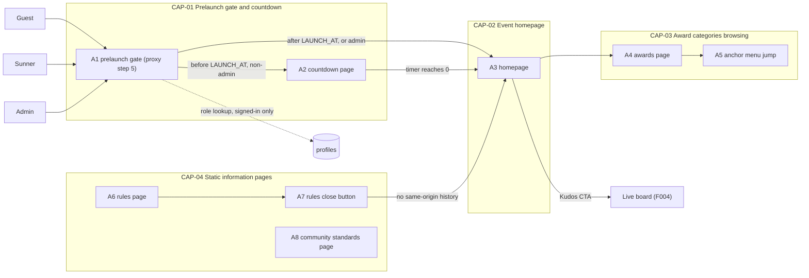
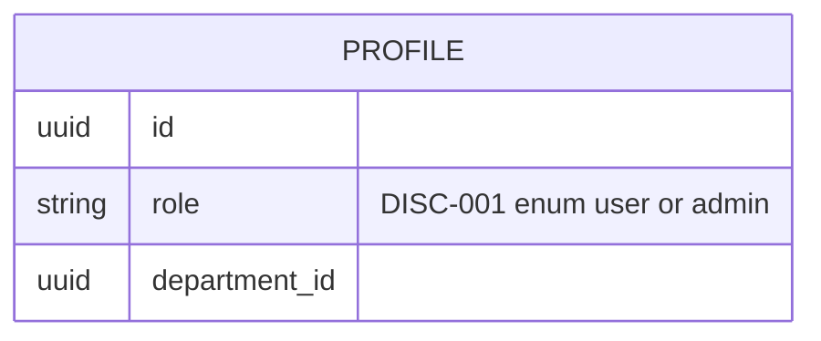

<!-- layout-exempt: rebuild-spec owns all docs/system|features|generated|flows paths — all references here are output targets or internal definitions -->
<!-- Contract: references/feature-spec-researcher-contract.md -->

# F006_AwardsPortal — Technical Spec

**Priority**: P1
**Type**: mixed
**Generated**: 2026-11-24

**See also:** [`functional-spec.md`](./functional-spec.md) — tổng quan, quyết định còn mở, yêu cầu và quy tắc nghiệp vụ dạng một dòng, màn hình, user story, kịch bản, edge case và cấu hình cho BA/QA.

**How to read this file:** § 2 là bảng chỉ mục — chọn action cần đọc rồi đọc block của nó ở § 3 từ trên xuống. § 4 là phụ lục dùng chung, chỉ nhảy vào khi một block ở § 3 trỏ tới.

## 1. Technical Overview

F006 gồm hai phần: cổng prelaunch chạy trong proxy của Next.js 16 (bước 5 của `runSessionProxy`, so giờ máy chủ với `LAUNCH_AT` ở mọi request) và năm trang server component dùng next-intl vi/en (Countdown công khai, Homepage, Hệ thống giải, Thể lệ, Tiêu chuẩn cộng đồng). Nội dung là hằng số `AWARDS` cùng khóa dịch `awardsPortal.*`; feature không ghi bảng nào, chỉ đọc `profiles.role` để cho admin qua cổng, và hai biến cấu hình `LAUNCH_AT`, `EVENT_AT`. Hai tương tác chỉ có phía client là đồng hồ đếm ngược theo giờ máy chủ và menu neo của trang Hệ thống giải. Cổng prelaunch không có user story riêng; lý do tồn tại của nó nằm ở `functional-spec.md` § 1.



## 2. Action Index

| # | Action (handler) | Method · Path | Codes | Writes | Detail |
|---|---|---|---|---|---|
| **A0** | *cross-cutting — belongs to no single action* | — | FR-001, FR-402, FR-602, FR-603 | — | § 4.4 |
| **A1** | `decidePrelaunchRoute` | `ANY` `/*` | FR-002, FR-601, FR-604, FR-605, BR-002, BR-004, DEC-001 | — *(read-only)* | § 3.1 |
| **A2** | `CountdownPage` | `GET` `/countdown` | FR-201, FR-202, FR-203, FR-401, FR-403, BR-001, DEC-002, ALG-001 | — *(read-only)* | § 3.1 |
| **A3** | `HomePage` | `GET` `/` | FR-101, FR-102, FR-103, FR-104, FR-211, FR-212, FR-213, FR-214, FR-215, FR-216, BR-001, BR-003, BR-006, ALG-001, US045, US046 | — *(read-only)* | § 3.2 |
| **A4** | `AwardsPage` | `GET` `/awards` | FR-301, FR-302, FR-303, FR-304, FR-305, FR-306, FR-309, BR-003, DEC-003, US045, US046 | — *(read-only)* | § 3.3 |
| **A5** | `AwardsAnchorMenu#onSelect` *(client event, no HTTP)* | — | FR-307, FR-308, BR-005, DEC-004, US047 | — *(client-only)* | § 3.3 |
| **A6** | `RulesPage` | `GET` `/rules` | FR-311, FR-312, FR-314, BR-007, US046 | — *(read-only)* | § 3.4 |
| **A7** | `RulesCloseButton#close` *(client event, no HTTP)* | — | FR-313, DEC-005, US048 | — *(client-only)* | § 3.4 |
| **A8** | `CommunityStandardsPage` | `GET` `/community-standards` | FR-321, BR-008 | — *(read-only)* | § 3.4 |

**Rung set:** Who → FE → Request → BE → Rule → Result → State → Source. Rung vắng thì bỏ hẳn, không ghi N/A. Feature không có state machine (§ 4.3) nên không block nào có rung State, và không action nào ghi bảng nên không action nào chạm ngưỡng vẽ diagram.

## 3. Actions

### 3.1 CAP-01 — Prelaunch gate and countdown

#### A1 · Evaluate prelaunch gate
`ANY /*` → `decidePrelaunchRoute`
`FR-002` `FR-601` `FR-604` `FR-605` `BR-002` `BR-004` `DEC-001` · `SCR010_CountdownPrelaunch`

**Who** · mọi request đi qua proxy, kể cả khách; bước này chạy sau bước 4 nên khách không có phiên trên path không công khai đã bị chuyển `/login` trước khi tới đây *(gate A0 — § 4.4)*
**Request** · `pathname`, `method`, cờ `isServerAction` (có header `next-action`), `nowMs = Date.now()`, `launchAtMs = env.LAUNCH_AT`, `isSignedIn` và `getRole` (tra vai trò lười) — gom ở `features/awards-portal/server/prelaunch-gate-step.ts:18-26`
**BE** · `prelaunchGateStep` dựng input rồi đổi quyết định thành `NextResponse`: `pass` → `null` (request đi tiếp), `redirect` → `NextResponse.redirect` tới URL tuyệt đối cùng host, `forbidden` → JSON 403. `decidePrelaunchRoute` là hàm thuần, không đọc env, cookie hay DB. `getRole` là `getProfile()` của proxy, memoize nên tối đa một lần đọc `profiles` mỗi request. `features/awards-portal/server/prelaunch-gate-step.ts:14-31`, `shared/auth/session-proxy.ts:77-90`
**Rule** · quyết định request đi tiếp, bị chuyển hướng hay bị từ chối, theo hai quy tắc và bảng DEC-001 bên dưới:
- **BR-002 — "Trước giờ mở" chỉ là `now < LAUNCH_AT`, tính lại ở mọi request, không lưu cờ nào.** Đúng mili giây `LAUNCH_AT` đã tính là mở vì phép so là `<` chặt; đổi `LAUNCH_AT` là đổi hành vi ngay, không cần migrate. `features/awards-portal/server/prelaunch-gate.ts:34-37`
- **BR-004 — Vai trò admin đọc từ DB ở mỗi request; lỗi đọc hoặc thiếu hồ sơ coi như không phải admin.** `getRole` chỉ được gọi khi đang prelaunch, path không công khai và đã đăng nhập; `isAdmin` bắt mọi lỗi và trả `false` (fail closed). `features/awards-portal/server/prelaunch-gate.ts:48-54,68`

| DEC | subtype | Condition | What the user sees | Source |
|---|---|---|---|---|
| **DEC-001** | flow | `now < LAUNCH_AT` AND `isPublicPath(pathname)` | Mọi người, kể cả khách, đi tiếp bình thường trên `/login`, `/auth/callback`, `/countdown`, `/access-denied` và hai endpoint job nội bộ | `features/awards-portal/server/prelaunch-gate.ts:65-67` |
| **DEC-001** | flow | `now < LAUNCH_AT` AND đã đăng nhập AND `role == 'admin'` | Admin đi tiếp mọi trang, kể cả `/admin/*`; ghi dữ liệu vẫn đóng tới `LAUNCH_AT` nhờ cửa sổ ghi dùng chung | `features/awards-portal/server/prelaunch-gate.ts:68` |
| **DEC-001** | flow | `now < LAUNCH_AT` AND path không công khai AND không phải admin AND tải trang (`GET` hoặc `HEAD`, không có `next-action`, path không bắt đầu `/api/`) | Chuyển hướng 307 tới `/countdown` | `features/awards-portal/server/prelaunch-gate.ts:44-46` · `features/awards-portal/server/prelaunch-gate.ts:69` |
| **DEC-001** | flow | `now < LAUNCH_AT` AND path không công khai AND không phải admin AND KHÔNG phải tải trang (Server Action, `/api/*`, method khác) | JSON 403 `{ "code": "prelaunch" }`, không chuyển hướng vì 307 làm `fetch` gửi lại POST tới `/countdown` và Server Action (tra theo id) vẫn chạy | `features/awards-portal/server/prelaunch-gate-step.ts:27-30` |
| **DEC-001** | flow | `now >= LAUNCH_AT` AND `pathname == '/countdown'` AND tải trang | Chuyển hướng tới `/`, kể cả khách | `features/awards-portal/server/prelaunch-gate.ts:59-62` |
| **DEC-001** | flow | `now >= LAUNCH_AT` AND các trường hợp còn lại | Đi tiếp, không đọc vai trò; Server Action gửi từ tab Countdown còn mở lúc mở cửa (đăng xuất) vẫn chạy, không bị chuyển hướng | `features/awards-portal/server/prelaunch-gate.ts:62-63` |

**Result** · read-only — **không ghi DB**. Trả `null`, redirect hoặc JSON 403; chỉ đọc `profiles.role`. Khi `DISC-001` có `role` bằng `admin` thì cổng cho qua; `role` bằng `user` (hoặc không đọc được, hoặc không có hồ sơ) thì chịu cổng ở mọi path ngoài danh sách công khai.
**Source:** `features/awards-portal/server/prelaunch-gate.ts:56-70` → `features/awards-portal/server/prelaunch-gate-step.ts:14-31` → `shared/auth/session-proxy.ts:112-120`

<!-- Không có diagram: read-only, một bước đồng bộ, không ghi bảng. Phần phân nhánh là bảng DEC-001 nên đọc dưới dạng bảng dễ hơn dạng sequence. -->

---

#### A2 · Render countdown page
`GET /countdown` → `CountdownPage`
`FR-201` `FR-202` `FR-203` `FR-401` `FR-403` `BR-001` `DEC-002` `ALG-001` · `SCR010_CountdownPrelaunch`

**Who** · khách, Sunner, Admin — `/countdown` là path công khai nên trang không gọi `requireSunner()` *(gate A1)*
**FE** · `app/(public)/countdown/page.tsx:23-47` dựng `<h1>` và `CountdownTimer` cỡ `page` giữa màn hình trên keyvisual mờ, dưới layout `(public)` (header chỉ logo và đổi ngôn ngữ, footer tối giản); trang không có liên kết tới thông tin giải. Timer là client component: ba cột DAYS, HOURS, MINUTES, mỗi cột tối thiểu hai ô số (`padStart(2, "0")`), phông DSEG7; vùng `aria-live="polite" aria-atomic="true"` mang nhãn đọc "5 ngày 3 giờ 7 phút" và chỉ đổi chữ khi phút đổi; không có hiệu ứng chuyển động. `features/awards-portal/components/countdown-timer.tsx:30-64`, `features/awards-portal/components/countdown-digit-tile.tsx:4-9,44-54`
**Request** · không có tham số; server đọc `readRequestTimeMs()` (`await connection()` rồi `Date.now()`) và `env.LAUNCH_AT`, truyền xuống thành chuỗi ISO `serverNowIso` và `targetIso` nên giá trị env không lộ ra client.
**BE** · `readRequestTimeMs` là giờ máy chủ duy nhất mà đồng hồ tin; `getTranslations("awardsPortal.countdown")` lấy tiêu đề. Không gọi API, không đọc DB. `features/awards-portal/request-time.ts:9-12`
**Rule** · quyết định timer làm gì mỗi nhịp và khi chạm mốc:
- **BR-001 — Số còn lại bằng mốc trừ giờ máy chủ, làm tròn xuống ngày/giờ/phút, không bao giờ âm.** Từ mốc trở đi hiện 00 00 00 và `done = true`; ở A2 mốc là `LAUNCH_AT`. *(§ 4.4)*

| DEC | subtype | Condition | What the user sees | Source |
|---|---|---|---|---|
| **DEC-002** | flow | `redirectOnZero` được truyền AND `parts.done` | Trang tự `router.replace("/")` khi đồng hồ theo giờ máy chủ chạm mốc; việc `/` hiện gì do proxy quyết định, nên client không bao giờ rời đi trước khi proxy đồng ý | `features/awards-portal/components/countdown-timer.tsx:38-42` |
| **DEC-002** | render | `pendingLabel` có giá trị AND NOT `parts.done` | Hiện dòng nhãn phía trên các ô số; hết đếm thì ẩn nhãn (dùng ở Homepage, không dùng ở Countdown) | `features/awards-portal/components/countdown-timer.tsx:46` |
| **DEC-002** | render | `parts.done` AND không có `redirectOnZero` (Homepage) | Dừng ở 00 00 00, không chuyển trang | `features/awards-portal/components/countdown-timer.tsx:35-41` |

**Result** · read-only — **không ghi DB**. Trước khi JS chạy, trang hiển thị giá trị tính ở server (`useState(serverNowMs)`); sau mount timer chỉ render lại khi phút hiển thị đổi hoặc khi tab hiện lại.
**Source:** `app/(public)/countdown/page.tsx:23-47` → `features/awards-portal/components/countdown-timer.tsx:30-64` → `features/awards-portal/request-time.ts:9-12`
**Shared structure:** `ALG-001` — tính độ lệch giờ máy chủ một lần lúc mount rồi hẹn timer theo phút còn lại tới mốc, full detail *(§ 4.5)*

<!-- Không có diagram: read-only, không ghi bảng, một request; luồng client của timer đã nằm trọn trong ALG-001. -->

---

### 3.2 CAP-02 — Event homepage

#### A3 · Render homepage
`GET /` → `HomePage`
`FR-101` `FR-102` `FR-103` `FR-104` `FR-211` `FR-212` `FR-213` `FR-214` `FR-215` `FR-216` `BR-001` `BR-003` `BR-006` `ALG-001` `US045` `US046` · `SCR011_Homepage`

**Who** · Sunner đã đăng nhập và đã chọn phòng ban, Admin; khách bị proxy chuyển `/login`, người chưa chọn phòng ban bị `requireSunner()` chuyển `/onboarding/department` *(gate A1, A0)*
**FE** · các vùng theo thứ tự: `PortalKeyvisualBackground` (`homepage-keyvisual.webp`) ; `HomepageHero` (logo ROOT FURTHER là `<h1>`, `CountdownTimer` cỡ `hero` với `pendingLabel` "Sắp diễn ra", `HomepageEventInfo`, nút chính "ABOUT AWARDS" → `/awards`, nút phụ "ABOUT KUDOS" → `/kudos`); `HomepageThemeArticle` (logo `<h2>`, đoạn 1, câu trích, đoạn 2); `HomepageAwardsSection` (6 `AwardCard`, mỗi thẻ có link "Chi tiết" → `/awards#<slug>` kèm chữ ẩn "Chi tiết về giải {tên}" cho trình đọc màn hình); `KudosBanner` (nút "Chi tiết" → `/kudos`). Lưới thẻ: 1 cột điện thoại, 2 cột tablet, 3 cột từ `lg`. `app/(app)/page.tsx:26-47`, `features/awards-portal/components/homepage-hero.tsx:20-56`, `features/awards-portal/components/award-card.tsx:13-33`
**Request** · không có tham số; `requireSunner()`, `readRequestTimeMs()`, `env.EVENT_AT`.
**BE** · `HomepageHero` truyền `eventAtMs` và `nowMs` dưới dạng ISO cho timer; `HomepageEventInfo` định dạng ngày lễ bằng `toAdminZone`; địa điểm, dòng livestream và bài chủ đề là khóa `awardsPortal.home.*`; thẻ giải đọc tên và mô tả ngắn từ khóa `awardsPortal.awards.<slug>.*` theo slug của `AWARDS`. `features/awards-portal/components/homepage-event-info.tsx:6-38`, `shared/admin/timezone.ts:40-56`
**Rule** · quyết định số liệu hiển thị và nguồn của nó:
- **BR-001 — Số còn lại bằng mốc trừ giờ máy chủ, làm tròn xuống, không âm.** Ở A3 mốc là `EVENT_AT`; sau mốc timer dừng ở 00 00 00 và ẩn nhãn "Sắp diễn ra" (nhánh thứ hai và thứ ba của `DEC-002`). *(§ 4.4)*
- **BR-003 — Thông tin 6 giải chỉ có một nguồn.** Thẻ ở Homepage chỉ lấy slug và ảnh từ `AWARDS`, còn tên và mô tả ngắn theo khóa dịch của slug đó; không có bản sao riêng. *(§ 4.4)*
- **BR-006 — Ngày lễ hiển thị dạng `dd/MM/yyyy` theo múi giờ sự kiện (`ADMIN_TIMEZONE`, mặc định `Asia/Ho_Chi_Minh`), không theo múi giờ của máy chủ hay trình duyệt.** `toAdminZone` đổi `EVENT_AT` sang năm/tháng/ngày của múi giờ đó; thẻ `<time dateTime>` giữ chuỗi ISO gốc. `features/awards-portal/components/homepage-event-info.tsx:6-10,26-28`

**Result** · read-only — **không ghi DB**. Điều hướng đi ra: "ABOUT AWARDS" mở trang Hệ thống giải ở đầu trang, "Chi tiết" của thẻ mở `/awards#<slug>` (một trong `top-talent`, `top-project`, `top-project-leader`, `best-manager`, `signature-2025-creator`, `mvp`), "ABOUT KUDOS" và nút banner mở `/kudos`.
**Source:** `app/(app)/page.tsx:26-47` → `features/awards-portal/components/homepage-hero.tsx:20-56` → `features/awards-portal/components/homepage-event-info.tsx:17-38` → `features/awards-portal/components/homepage-awards-section.tsx:11-25` → `features/awards-portal/components/kudos-banner.tsx:13-52`
**Shared structure:** `ALG-001` — đồng hồ hero cũng tính độ lệch giờ máy chủ một lần rồi hẹn timer theo phút còn lại, full detail *(§ 4.5)*

<!-- Không có diagram: read-only, một request, không ghi bảng. -->

---

### 3.3 CAP-03 — Award categories browsing

#### A4 · Render awards system page
`GET /awards` → `AwardsPage`
`FR-301` `FR-302` `FR-303` `FR-304` `FR-305` `FR-306` `FR-309` `BR-003` `DEC-003` `US045` `US046` · `SCR008_AwardsSystem`

**Who** · Sunner sau giờ mở và Admin cả trước giờ mở; trước giờ mở người không phải admin bị chuyển `/countdown` vì `/awards` không nằm trong danh sách công khai (nhật ký quyết định ngày 2026-11-17) *(gate A1, A0)*
**FE** · `app/(app)/awards/page.tsx:27-70`: keyvisual (`awards-keyvisual.webp`), logo, `PortalSectionHeader` là `<h1>` "Hệ thống giải thưởng SAA 2025", lưới hai cột `178px` cho `AwardsAnchorMenu` và cột 6 `AwardDetailBlock` (từ `xl` cột phải rộng 853 px), rồi `KudosBanner`. Mỗi khối là `<section id="<slug>" tabIndex={-1}>` với `scroll-mt-40 md:scroll-mt-28` để chừa chỗ cho header dính và thanh chip; ảnh xen kẽ trái/phải theo chẵn lẻ của index. `AwardThumbnail` đặt ảnh trong khung vuông cố định nên bố cục không sập khi ảnh lỗi. `AwardPrizeFacts` hiện số lượng hai chữ số kèm đơn vị và giá trị. `features/awards-portal/components/award-detail-block.tsx:21-49`, `features/awards-portal/components/award-prize-facts.tsx:15-54`, `features/awards-portal/components/award-thumbnail.tsx:8-14`
**Request** · không có tham số phía server; hash `#<slug>` chỉ ở trình duyệt, không bao giờ gửi lên server nên hash lạ không khớp `id` nào thì trình duyệt không cuộn đi đâu và trang đứng ở đầu.
**BE** · đọc 6 giải từ `AWARDS`; `formatAwardQuantity` đệm đủ hai chữ số, `formatAwardAmount` dùng `Intl.NumberFormat("vi-VN")` cộng hậu tố " VNĐ" ở mọi ngôn ngữ; tên, mô tả dài, đơn vị và chú thích giá trị là khóa dịch. `features/awards-portal/data/awards-data.ts:42-64`
**Rule** · quyết định nội dung giải và cách hiển thị giá trị:
- **BR-003 — Thông tin 6 giải chỉ có một nguồn.** Trang này hiện đủ tên, mô tả, số lượng, đơn vị người nhận và giá trị từ `AWARDS`, nên sửa một giải ở một nơi thì Homepage và trang này cùng đổi. *(§ 4.4)*

| DEC | subtype | Condition | What the user sees | Source |
|---|---|---|---|---|
| **DEC-003** | render | `index > 0` trong `award.values` | Hiện dòng "Hoặc" kèm đường kẻ trước giá trị thứ hai; chỉ Signature 2025 - Creator có hai mức (5.000.000 VNĐ cho giải cá nhân, 8.000.000 VNĐ cho giải tập thể) | `features/awards-portal/components/award-prize-facts.tsx:31-38` |
| **DEC-003** | render | `value.noteKey != null` | Hiện dòng chú nhỏ dưới số tiền ("cho mỗi giải thưởng", "cho giải cá nhân" hoặc "cho giải tập thể"); Best Manager và MVP không có chú | `features/awards-portal/components/award-prize-facts.tsx:46`, `features/awards-portal/data/awards-data.ts:46,51` |

**Result** · read-only — **không ghi DB**. Bảng số liệu hiển thị đúng `awards-data.ts:43-51`: Top Talent 10 giải cá nhân 7.000.000 VNĐ mỗi giải; Top Project 2 giải tập thể 15.000.000 VNĐ mỗi giải; Top Project Leader 3 giải cá nhân 7.000.000 VNĐ mỗi giải; Best Manager 1 giải cá nhân 10.000.000 VNĐ; Signature 2025 - Creator 1 giải cá nhân hoặc tập thể (5.000.000 hoặc 8.000.000 VNĐ); MVP 1 giải cá nhân 15.000.000 VNĐ.
**Source:** `app/(app)/awards/page.tsx:27-70` → `features/awards-portal/components/award-detail-block.tsx:21-49` → `features/awards-portal/components/award-prize-facts.tsx:15-54` → `features/awards-portal/data/awards-data.ts:42-64`

<!-- Không có diagram: read-only, một request; phần phân nhánh là bảng DEC-003 nên đọc dưới dạng bảng. -->

---

#### A5 · Jump to an award block from the anchor menu
`click #<slug>` → `AwardsAnchorMenu#onSelect`
`FR-307` `FR-308` `BR-005` `DEC-004` `US047` · `SCR008_AwardsSystem`

**Who** · Sunner hoặc Admin đang ở trang Hệ thống giải *(gate A1, A0)*
**FE** · `AwardsAnchorMenu` là `<nav aria-label>` chứa `<ul>` các link `<a href="#<slug>">`. Desktop: cột dính `top-24`. Điện thoại: thanh chip ngang dính dưới header (`top-20`), chip đang chọn tự cuộn vào tầm nhìn bên trong thanh (không cuộn trang). Mục đang chọn mang `aria-current="true"` và đổi biểu tượng sang `target-active`. Khi chưa có JavaScript các link vẫn là neo thật. `features/awards-portal/components/awards-anchor-menu.tsx:37-114`
**Request** · sự kiện click: `button`, `metaKey`, `ctrlKey`, `shiftKey`, `altKey`; phần tử đích `document.getElementById(slug)`; `matchMedia("(prefers-reduced-motion: reduce)")`. Phía theo dõi cuộn lắng nghe `scroll` (passive) và `resize`, mỗi frame đọc một lần bằng `requestAnimationFrame`. `features/awards-portal/components/awards-anchor-menu.tsx:44-61,71-80`
**Rule** · quyết định mục nào được đánh dấu và click có bị chặn hay không:
- **BR-005 — Mục được đánh dấu là khối cuối cùng có đỉnh đã vượt "đường đọc" ở 25% chiều cao khung nhìn; phía trên mọi khối thì là mục đầu tiên.** Vị trí được đọc trực tiếp (không dùng `IntersectionObserver`) để một cú nhảy xa như Home hay "về đầu trang", không đi qua khối trung gian nào, vẫn đánh dấu đúng. `features/awards-portal/components/awards-anchor-menu.tsx:10-21,44-61`

| DEC | subtype | Condition | What the user sees | Source |
|---|---|---|---|---|
| **DEC-004** | interaction | `event.button != 0` OR `metaKey` OR `ctrlKey` OR `shiftKey` OR `altKey` | Giữ hành vi mặc định của link `#slug` (mở tab hoặc cửa sổ mới, trang hiện tại không cuộn) | `features/awards-portal/components/awards-anchor-menu.tsx:72` |
| **DEC-004** | interaction | click trái thường AND không tìm thấy phần tử `id == slug` | Bỏ qua việc chặn sự kiện, link mặc định chạy: hash đổi, không cuộn mượt | `features/awards-portal/components/awards-anchor-menu.tsx:73-74` |
| **DEC-004** | interaction | click trái thường AND khối tồn tại | `preventDefault`; cuộn tới đầu khối (`smooth`, hoặc `auto` khi hệ điều hành bật giảm chuyển động); đặt focus vào khối (`preventScroll`); `history.replaceState` thành `#slug` nên không thêm mục lịch sử; mục vừa bấm được đánh dấu ngay | `features/awards-portal/components/awards-anchor-menu.tsx:75-79` |

**Result** · client-only — **không ghi DB**, không gọi server. Hash trên thanh địa chỉ bị thay chứ không thêm; đích nhận focus để trình đọc màn hình đọc đúng khối (`tabIndex={-1}`, `outline-none`).
**Source:** `features/awards-portal/components/awards-anchor-menu.tsx:37-114` → `features/awards-portal/components/award-detail-block.tsx:26-31`

<!-- Không có diagram: client-only, không ghi bảng; phần phân nhánh là bảng DEC-004. -->

---

### 3.4 CAP-04 — Static information pages

#### A6 · Render rules page
`GET /rules` → `RulesPage`
`FR-311` `FR-312` `FR-314` `BR-007` `US046` · `SCR012_Rules`

**Who** · Sunner, Admin *(gate A1, A0)*
**FE** · `app/(app)/rules/page.tsx:19-29` đặt `LiveBoardKeyvisualBackground dimmed` (mượn từ F004) rồi `RulesPanel` bên phải (rộng 553 px, tràn ngang trên điện thoại). `<h1>` "Thể lệ" và ba `<section>`: người nhận Kudos với bốn bậc Hero (`RulesHeroTierList`, mỗi bậc là `HeroBadge size="rules"` cùng tiêu đề và mô tả); người gửi Kudos với luật "cứ 5 lượt ❤️ mở 1 Secret Box", lưới 6 biểu tượng 2×3 (`RulesSecretBoxBadges`, `alt` là tên biểu tượng) và dòng thu thập đủ bộ; Kudos Quốc Dân. Cuối panel có `RulesCloseButton` và link "Viết KUDOS" → `/kudos` (trang chỉ điều hướng, ô soạn Kudo không tự mở). `features/awards-portal/components/rules-panel.tsx:16-50`, `features/awards-portal/components/rules-kudos-rewards.tsx:8-57`
**Request** · không có tham số.
**BE** · chỉ render chữ từ `getTranslations`; không đọc dữ liệu người dùng, không tính toán. Các số "5 lượt ❤️" và "5 Kudos" là chữ trong bản dịch `awardsPortal.rules`, không đọc từ cấu hình. `messages/vi.json:391-545`
**Rule** · quyết định nguồn của chữ bậc Hero:
- **BR-007 — Bậc Hero trên Thể lệ dùng đúng bản dịch `hero.*` và cùng `HeroBadge` với tooltip huy hiệu của F009.** Nhờ vậy Thể lệ và tooltip không lệch chữ; ngưỡng "1–4, 5–9, 10–20, hơn 20" là chữ trong bản dịch, không đọc từ hằng số `HERO_*_MIN` của F009. `features/awards-portal/components/rules-kudos-rewards.tsx:17-38`

**Result** · read-only — **không ghi DB**; không có `<form>` hay `<input>` (FR-603).
**Source:** `app/(app)/rules/page.tsx:19-29` → `features/awards-portal/components/rules-panel.tsx:16-50` → `features/awards-portal/components/rules-kudos-rewards.tsx:23-57`

---

#### A7 · Close the rules page
`click "Đóng"` → `RulesCloseButton#close`
`FR-313` `DEC-005` `US048` · `SCR012_Rules`

**Who** · Sunner hoặc Admin đang ở Thể lệ *(gate A1, A0)*
**FE** · nút `type="button"` nhãn "Đóng" kèm biểu tượng đóng, nằm cạnh "Viết KUDOS" ở cuối panel. `features/awards-portal/components/rules-close-button.tsx:26-38`
**Request** · không có; đọc lịch sử trình duyệt: `window.navigation.currentEntry.index` (Navigation API chỉ liệt kê mục cùng origin), nếu không có thì `history.length`, `document.referrer`, `window.location.origin`. `features/awards-portal/components/rules-close-button.tsx:15-23`
**Rule** · quyết định "Đóng" đưa người dùng về đâu:

| DEC | subtype | Condition | What the user sees | Source |
|---|---|---|---|---|
| **DEC-005** | flow | `window.navigation.currentEntry` có AND `index > 0` | Quay lại trang trước cùng origin bằng `router.back()` | `features/awards-portal/components/rules-close-button.tsx:16-17` · `features/awards-portal/components/rules-close-button.tsx:29` |
| **DEC-005** | flow | không có Navigation API AND `history.length > 1` AND origin của `document.referrer` bằng origin hiện tại | Quay lại bằng `router.back()` | `features/awards-portal/components/rules-close-button.tsx:18-19` · `features/awards-portal/components/rules-close-button.tsx:29` |
| **DEC-005** | flow | các trường hợp còn lại (không có lịch sử cùng origin, referrer rỗng hoặc khác origin, `new URL` ném lỗi) | Mở trang chủ bằng `router.push("/")` — thêm mục vào lịch sử, không thay thế | `features/awards-portal/components/rules-close-button.tsx:20-22` · `features/awards-portal/components/rules-close-button.tsx:30` |

**Result** · client-only — **không ghi DB**, không gọi server; chỉ điều hướng.
**Source:** `features/awards-portal/components/rules-close-button.tsx:15-38` → `features/awards-portal/components/rules-panel.tsx:41-47`

<!-- Không có diagram: client-only, không ghi bảng; phần phân nhánh là bảng DEC-005. -->

---

#### A8 · Render community standards page
`GET /community-standards` → `CommunityStandardsPage`
`FR-321` `BR-008` · `SCR009_CommunityStandards`

**Who** · Sunner, Admin *(gate A1, A0)*
**FE** · `app/(app)/community-standards/page.tsx:21-41` đặt `LiveBoardKeyvisualBackground` (không làm tối) dưới header trong suốt, logo ROOT FURTHER 451×200, rồi `CommunityStandardsContent`: `<h1>` tiêu đề, dòng dẫn và dòng giới thiệu, danh sách đánh số 10 tiêu chí vi phạm, đường kẻ, mục `<h2>` "Tiêu chuẩn bảo mật" (đoạn dẫn, danh sách gạch đầu dòng 2 mục) và dòng liên hệ. Liên kết tới trang này đến từ thanh công cụ composer (F003) và dòng thông báo Kudo bị ẩn (F013). `features/awards-portal/components/community-standards-content.tsx:19-56`
**Request** · không có tham số.
**BE** · chỉ render chữ `awardsPortal.standards.*`; hai danh sách đọc bằng `t.raw`. `messages/vi.json:519-545`
**Rule** · quyết định cách đọc danh sách trong bản dịch:
- **BR-008 — Danh sách vi phạm và danh sách bảo mật là mảng trong bản dịch; phần tử không phải chuỗi bị bỏ, mảng thiếu hoặc sai kiểu cho danh sách rỗng.** BTC thêm hay bớt mục chỉ bằng cách sửa JSON; đọc bằng `t.raw` nên ký tự như `<` hiển thị nguyên chứ không bị hiểu thành cú pháp thông điệp. `features/awards-portal/components/community-standards-content.tsx:4-6,30,45`

**Result** · read-only — **không ghi DB**; không có `<form>` hay `<input>` (FR-603).
**Source:** `app/(app)/community-standards/page.tsx:21-41` → `features/awards-portal/components/community-standards-content.tsx:19-56`

---

### 3.5 Edge cases

| Action | Scenario | Behavior |
|---|---|---|
| A1 | Người không phải admin mở trang ngoài danh sách công khai trước `LAUNCH_AT` | Tải trang bị 307 tới `/countdown` (trang đích trả 200); `/awards` cũng bị chặn vì không nằm trong danh sách |
| A1 | Admin mở trang trước `LAUNCH_AT` | Cổng cho qua mọi path kể cả `/admin/*`; ghi Kudo hoặc tim vẫn bị `isEventWritingOpen` (`shared/config/event-window.ts:11-14`) từ chối tới `LAUNCH_AT` |
| A1 | Không đọc được vai trò (lỗi DB hoặc không có hồ sơ) | `isAdmin` trả `false`, người dùng bị coi là không phải admin và chịu cổng; lỗi tra profile được ghi log ở proxy (`shared/auth/session-proxy.ts:85-88`) |
| A1 · A0 | Khách chưa đăng nhập mở `/` trước `LAUNCH_AT` | Bước 4 của proxy chuyển `/login` trước khi cổng chạy nên khách không tới Countdown; `/countdown` và `/login` mở thẳng được (200) |
| A1 | Lời gọi trực tiếp tới `/api/*` hoặc Server Action của người không phải admin trước `LAUNCH_AT` | JSON 403 `{ "code": "prelaunch" }`, không chuyển hướng; giao diện thường không bao giờ gây ra vì người dùng đã bị đưa về Countdown |
| A1 · A2 | Mở `/countdown` sau `LAUNCH_AT`, kể cả khách | 307 về `/` (khách tiếp tục bị chuyển `/login` bởi bước 4) |
| A1 · A2 | Đồng hồ theo giờ máy chủ chạm mốc nhưng proxy vẫn thấy trước `LAUNCH_AT` | Timer `router.replace("/")`, proxy đưa người dùng không phải admin trở lại `/countdown` (e2e `prelaunch-gate.spec.ts:54-78` kết thúc ở `/countdown`) |
| A2 · A3 | Đồng hồ thiết bị lệch hoặc tab ẩn lâu rồi hiện lại | Số còn lại theo giờ máy chủ cộng độ lệch đã lưu; `visibilitychange` tính lại ngay, không cộng dồn từng tick |
| A3 | Sau `EVENT_AT` | Timer dừng ở 00 00 00, nhãn "Sắp diễn ra" ẩn; ngày và địa điểm vẫn hiện |
| A4 | Hash `#<slug>` không khớp `id` nào | Trình duyệt không cuộn, trang đứng ở đầu, không báo lỗi |
| A5 | Bấm menu kèm Ctrl, Cmd, Shift, Alt, chuột không phải trái, bật giảm chuyển động, hoặc chưa có JavaScript | Phím bổ trợ hoặc chuột khác: hành vi link mặc định; giảm chuyển động: nhảy tức thì (`auto`); chưa có JS: link neo thật |
| A7 | Mở `/rules` trực tiếp ở tab mới hoặc đến từ site khác | `router.push("/")` mở trang chủ, thêm một mục lịch sử nên nút Back của trình duyệt quay lại Thể lệ |
| A3 · A4 · A6 | Ảnh không tải được | Khung ảnh cố định giữ bố cục, chữ vẫn đọc được |
| A0 | Đổi ngôn ngữ khi đang xem trang | Mọi chữ lấy lại từ bản dịch của ngôn ngữ mới (đổi locale do F002) |
| A0 · A1 | `LAUNCH_AT` hoặc `EVENT_AT` thiếu, sai định dạng, hoặc `EVENT_END_AT` không sau `LAUNCH_AT` | Ứng dụng không khởi động: `next.config.ts` gọi `parseServerEnv` và in danh sách lỗi (`next.config.ts:9-11`, `shared/config/env-schema.ts:93-104`) |

## 4. Shared Foundation

### 4.1 Components

| Component | Responsibility | Used in | File |
|---|---|---|---|
| `decidePrelaunchRoute`, `isPrelaunch` | Hàm thuần: quyết định pass, redirect hoặc forbidden theo giờ, path, vai trò | A1 | `features/awards-portal/server/prelaunch-gate.ts` |
| `prelaunchGateStep` | Nối hàm thuần vào proxy: dựng input từ request, đổi quyết định thành `NextResponse` | A1 | `features/awards-portal/server/prelaunch-gate-step.ts` |
| `readRequestTimeMs` | Giờ máy chủ của request, tách khỏi shell prerender bằng `connection()` | A2, A3 | `features/awards-portal/request-time.ts` |
| `remainingParts`, `msUntilNextMinuteChange` | Phép tính thuần ngày/giờ/phút còn lại và độ trễ tới lần đổi phút kế tiếp | A2, A3 | `features/awards-portal/countdown-parts.ts` |
| `useServerClockNow` | Hook client: độ lệch giờ máy chủ, hẹn timer theo phút, tính lại khi tab hiện | A2, A3 | `features/awards-portal/components/use-server-clock-now.ts` |
| `CountdownTimer`, `CountdownDigitTile` | Hiển thị ba cột đếm ngược, vùng đọc `aria-live`, chuyển trang khi về 0 | A2, A3 | `features/awards-portal/components/countdown-timer.tsx`, `features/awards-portal/components/countdown-digit-tile.tsx` |
| `HomepageHero`, `HomepageEventInfo`, `HomepageThemeArticle`, `HomepageAwardsSection`, `AwardCard` | Các vùng của Homepage | A3 | `features/awards-portal/components/homepage-hero.tsx`, `homepage-event-info.tsx`, `homepage-theme-article.tsx`, `homepage-awards-section.tsx`, `award-card.tsx` |
| `AWARDS`, `formatAwardQuantity`, `formatAwardAmount` | Nguồn duy nhất của 6 giải và định dạng số | A3, A4 | `features/awards-portal/data/awards-data.ts` |
| `AwardDetailBlock`, `AwardPrizeFacts`, `AwardThumbnail` | Khối giải trên trang Hệ thống giải | A4 | `features/awards-portal/components/award-detail-block.tsx`, `award-prize-facts.tsx`, `award-thumbnail.tsx` |
| `AwardsAnchorMenu` | Menu neo, đánh dấu khối ở đường đọc | A5 | `features/awards-portal/components/awards-anchor-menu.tsx` |
| `KudosBanner` | Banner Sun* Kudos dùng ở Homepage và cuối trang Hệ thống giải | A3, A4 | `features/awards-portal/components/kudos-banner.tsx` |
| `RulesPanel`, `RulesHeroTierList`, `RulesSecretBoxBadges` | Panel Thể lệ và hai danh sách hiển thị | A6 | `features/awards-portal/components/rules-panel.tsx`, `rules-kudos-rewards.tsx` |
| `RulesCloseButton` | Nút "Đóng" chọn đích theo lịch sử | A7 | `features/awards-portal/components/rules-close-button.tsx` |
| `CommunityStandardsContent` | Nội dung Tiêu chuẩn cộng đồng từ bản dịch | A8 | `features/awards-portal/components/community-standards-content.tsx` |
| `PortalKeyvisualBackground`, `PortalSectionHeader`, `PortalIcon`, `portal-styles` | Phần trình bày dùng chung của các trang cổng | A2-A8 | `features/awards-portal/components/portal-keyvisual-background.tsx`, `portal-section-header.tsx`, `portal-icon.tsx`, `portal-styles.ts` |
| `CountdownPage`, `HomePage`, `AwardsPage`, `RulesPage`, `CommunityStandardsPage` | Năm page server component | A2, A3, A4, A6, A8 | `app/(public)/countdown/page.tsx`, `app/(app)/page.tsx`, `app/(app)/awards/page.tsx`, `app/(app)/rules/page.tsx`, `app/(app)/community-standards/page.tsx` |

### 4.2 Data Model



<!-- Chỉ có một thực thể, đọc một cột: cổng prelaunch tra `profiles.role` để biết ai là admin. Dữ liệu 6 giải không nằm trong DB mà là hằng số `AWARDS` ở `features/awards-portal/data/awards-data.ts`; chữ nằm trong `messages/*.json`. -->

| Entity | Table | Used for | Action |
|---|---|---|---|
| `Profile` (MODEL004) | `profiles` | Chỉ đọc cột `role` qua `findSessionProfile` (`shared/auth/session-profile-query.ts:25-39`) để quyết định admin có qua cổng không; F006 không ghi bảng này | A1 |

#### Polymorphic Behavior

##### DISC-001 — Profile.role

| Value | Render | Validation | Persistence |
|-------|--------|------------|-------------|
| user | Trước `LAUNCH_AT`: tải trang ngoài danh sách công khai bị chuyển `/countdown`; sau `LAUNCH_AT` thấy trang bình thường | Request không phải tải trang trên path bị chặn nhận JSON 403 `prelaunch`; ghi Kudo/tim bị cửa sổ ghi chặn tới `LAUNCH_AT` | F006 không ghi; giá trị mặc định `user` do hồ sơ mới mang (F001) |
| admin | Trước `LAUNCH_AT` vào được mọi trang kể cả `/admin/*`; giao diện không khác Sunner | Cổng không chặn gì; ghi dữ liệu vẫn đóng tới `LAUNCH_AT` nhờ cửa sổ ghi dùng chung | F006 không ghi; role đổi ở quản lý người dùng (F014) và đặt lại theo `ADMIN_EMAILS` ở lần đăng nhập (F001) |

**Source:** docs/generated/entities.md § MODEL004_Profile > Discriminator Fields

### 4.3 State Management

None.

### 4.4 Shared Rules

#### Bin 3 — cross-cutting, belongs to no single action

**A0 · FR-001 / FR-402 / FR-602 / FR-603 — Cả năm trang đi sau cổng phiên của khu Sunner (trừ Countdown), dùng chung bản dịch vi/en và không có ô nhập chữ.**
*Cross-cutting — áp dụng cho cả năm trang, không phải quy tắc của riêng action nào.* Bốn trang trong nhóm `(app)` tự gọi `requireSunner()` (không phiên → `/login`, chưa có phòng ban → `/onboarding/department`; cùng gate `PERM008_SunnerAreaGate` của F001) còn `/countdown` thì công khai. Chữ của mọi trang lấy từ `messages/vi.json` và `messages/en.json` qua next-intl, không nhúng chữ cứng; bố cục dùng breakpoint của dự án (kiểm ở 375 px) và không trang nào có `<form>` hay `<input>`. Header và footer do F002 cấp, F006 không dựng lại.
**Source:** `app/(app)/layout.tsx:17-18` · `shared/auth/current-user.ts:48-53` · `messages/vi.json:391-545`

#### Bin 2 — used by ≥2 named actions

**BR-001 — Số còn lại bằng mốc trừ giờ máy chủ, làm tròn xuống ngày/giờ/phút, không bao giờ âm.**
Used in: **A2** · **A3**. Mốc là `LAUNCH_AT` ở A2 và `EVENT_AT` ở A3; cả hai dùng chung một hàm nên hai màn không lệch nhau. Đầu vào là mili giây epoch nên múi giờ và DST không ảnh hưởng.
**Source:** `features/awards-portal/countdown-parts.ts:12-21`
```text
left = target_ms - now_ms                  # now_ms = giờ máy chủ (ALG-001)
if not (left > 0): return {days: 0, hours: 0, minutes: 0, done: true}
days    = floor(left / 86_400_000)
hours   = floor((left % 86_400_000) / 3_600_000)
minutes = floor((left % 3_600_000) / 60_000)
return {days, hours, minutes, done: false}
```

**BR-003 — Thông tin 6 giải chỉ có một nguồn (`AWARDS`).**
Used in: **A3** · **A4**. Homepage lấy slug và ảnh để dựng thẻ, trang Hệ thống giải lấy toàn bộ trường; tên, mô tả, đơn vị và chú thích giá trị là khóa dịch theo slug. Sửa giải ở một nơi thì cả hai trang đổi.
**Source:** `features/awards-portal/data/awards-data.ts:23-52`
```text
AWARDS: Award[6] = [{ slug, imageSrc, quantity, unitKey, values: [{ amountVnd, noteKey | null }] }]
slug in: top-talent, top-project, top-project-leader, best-manager, signature-2025-creator, mvp
```

### 4.5 Algorithms & Integrations

### Đồng hồ theo giờ máy chủ: độ lệch tính một lần lúc mount, timer hẹn theo phút còn lại tới mốc (ALG-001)
**Linked FR:** FR-401
**Used in:** A2, A3
**Source:** `features/awards-portal/components/use-server-clock-now.ts:17-46`
**Input:** `targetMs`, `serverNowMs` (giờ máy chủ lúc render) · **Output:** `nowMs` theo giờ máy chủ để `remainingParts` tính · **Complexity:** O(1) mỗi nhịp
**Description:** lần render đầu dùng nguyên `serverNowMs`. Lúc mount, client lưu `offset = serverNowMs - Date.now()` đúng một lần rồi mọi lần sau lấy `Date.now() + offset`, nên đồng hồ thiết bị lệch bao nhiêu cũng không đổi kết quả. Timer hẹn tới lần đổi phút kế tiếp của thời gian CÒN LẠI (không phải phút của đồng hồ treo tường, vì mốc không nhất thiết tròn phút) cộng 50 ms đệm để phút chắc chắn đã đổi; không bao giờ hẹn 0 ms. Khi tab hiện lại (`visibilitychange`) tính lại ngay vì tab nền bị trình duyệt làm chậm timer. Dừng hẹn khi `now >= targetMs`. Offset hơi thấp hơn giờ máy chủ thật một khoảng bằng độ trễ mạng nên client chỉ có thể rời Countdown muộn hơn máy chủ, không bao giờ sớm hơn.

**Pseudocode:**
```text
on mount: offset = serverNowMs - Date.now(); schedule(serverNowMs)
schedule(now): clear timer; if now < target: set timer(msUntilNextMinuteChange(target, now) + 50, tick)
msUntilNextMinuteChange(target, now): left = target - now; if not (left > 0) return 60000; return (left % 60000) or 60000
tick: now = Date.now() + offset; setNowMs(now); schedule(now)
on visibilitychange to visible: tick()
on unmount: clear timer; remove listener
```

Không có `INT-###`: feature không gọi dịch vụ ngoài; việc đọc `profiles.role` đi qua truy vấn dùng chung của F001 và đã được mô tả ở A1.

### 4.6 Configuration

```text
LAUNCH_AT = <ISO-8601 có offset>        # bắt buộc; now < LAUNCH_AT là prelaunch (A1, A2); thiếu hoặc sai thì app không khởi động (shared/config/env-schema.ts:58)
EVENT_AT = <ISO-8601 có offset>         # bắt buộc; mốc đếm ngược và ngày lễ hiển thị ở Homepage (A3) (shared/config/env-schema.ts:59)
ADMIN_TIMEZONE = Asia/Ho_Chi_Minh       # mặc định; múi giờ định dạng ngày lễ (A3) (shared/config/env-schema.ts:73-75)
EVENT_END_AT = <ISO-8601 có offset>     # không thuộc F006; schema ràng buộc LAUNCH_AT < EVENT_END_AT (shared/config/env-schema.ts:95-99)
BOUNDARY_SLACK_MS = 50                  # đệm sau ranh giới phút trước khi tính lại (A2, A3) (use-server-clock-now.ts:7)
MINUTE_MS = 60000                       # nhịp tối thiểu khi đã quá mốc (countdown-parts.ts:7)
READING_LINE = 0.25                     # đường đọc: 25% chiều cao khung nhìn (A5) (awards-anchor-menu.tsx:10)
```

**Client behavior:** see
[`behavior-logic.md`](../../generated/behavior-logic.md) (client-side patterns — debounce, optimistic UI, polling, upload, realtime),
[`permissions.md`](../../system/permissions.md) (feature flags / experiments / env / locale gates),
[`architecture.md`](../../system/architecture.md) (guards / deep-link state restoration / unsaved-changes protection),
[`screen-flow.md`](../../generated/screen-flow.md) (GUARD-004 cổng prelaunch, deep-link `/awards#<slug>`).

## 5. Verification & Technical Notes

### 5.1 Technical Verification

- **SC-001** *(A1)* `LAUNCH_AT` ở tương lai: người không phải admin vào `/`, `/kudos`, `/awards` đều nhận 307 tới `/countdown`; admin vào được `/` và `/admin/overview`; đúng mili giây `LAUNCH_AT` cổng đã mở (covers FR-601, FR-605, BR-002, BR-004, DEC-001)
- **SC-002** *(A1)* Server Action (header `next-action`), `/api/*` hoặc method khác `GET`/`HEAD` của người không phải admin trước `LAUNCH_AT` nhận JSON 403 `{ "code": "prelaunch" }`, không có `Location` (covers FR-604, DEC-001)
- **SC-003** *(A1, A2)* Sau `LAUNCH_AT`, `GET /countdown` nhận 307 về `/` cho cả khách và Sunner; Server Action gửi tới `/countdown` không bị chuyển hướng và không tra vai trò (covers FR-203, DEC-001)
- **SC-004** *(A2, A3)* Đồng hồ thiết bị lệch ±400 ngày: số phút còn lại chênh không quá 1 so với giá trị theo giờ máy chủ (covers FR-401, BR-001, ALG-001)
- **SC-005** *(A2)* Mọi cột có ít nhất hai chữ số; từ mốc trở đi hiện 00 00 00; timer gọi `router.replace("/")` đúng khi `parts.done` (covers FR-201, FR-203, FR-403, DEC-002)
- **SC-006** *(A3, A4)* Đổi một giá trị trong `AWARDS`: Homepage và `/awards` cùng đổi; bảng số lượng và giá trị khớp `awards-data.ts:43-51` (covers BR-003, FR-305)
- **SC-007** *(A5)* Bấm mục menu: hash thành `#<slug>`, focus vào khối, đúng một mục `aria-current="true"`; bấm kèm phím bổ trợ không chặn mặc định (covers FR-307, FR-308, BR-005, DEC-004)
- **SC-008** *(A6, A8)* Hai trang tĩnh không có `<input>` hay `<form>` (covers FR-312, FR-603)
- **SC-009** *(A7)* "Đóng" quay lại khi có lịch sử cùng origin, mở `/` khi mở trực tiếp (covers FR-313, DEC-005)
- **SC-010** *(A0, A1)* Thiếu hoặc sai `LAUNCH_AT` hay `EVENT_AT`: `parseServerEnv` ném lỗi và app không khởi động (covers FR-002)

#### US045 *(A3, A4)*

**Independent Test:** Sau `LAUNCH_AT`, vào `/`, bấm "ABOUT AWARDS" rồi quay lại bấm "Chi tiết" ở thẻ MVP.

**Acceptance Scenarios:**

1. **Given** Sunner ở `/` sau `LAUNCH_AT`, **When** bấm "ABOUT AWARDS", **Then** URL là `/awards`, trang ở đầu, `<h1>` "Hệ thống giải thưởng SAA 2025".
2. **Given** thẻ MVP trên `/`, **When** bấm "Chi tiết về giải MVP (Most Valuable Person)", **Then** URL là `/awards#mvp` và khối `#mvp` nằm trong khung nhìn.
3. **Given** mở `/awards#khong-co`, **When** trang tải xong, **Then** không có phần tử khớp, trang đứng ở đầu, không lỗi.
4. **Given** trước `LAUNCH_AT` và là Sunner thường, **When** mở `/`, **Then** nhận 307 tới `/countdown` và không thấy các nút.

#### US046 *(A3, A4, A6)*

**Independent Test:** Bấm lần lượt "ABOUT KUDOS" ở Homepage, nút banner ở `/awards` và "Viết KUDOS" ở `/rules`.

**Acceptance Scenarios:**

1. **Given** Sunner ở `/`, **When** bấm "ABOUT KUDOS", **Then** URL là `/kudos` (link `href="/kudos"`).
2. **Given** Sunner ở `/awards`, **When** bấm nút "Chi tiết về Sun* Kudos" của banner, **Then** URL là `/kudos`.
3. **Given** Sunner ở `/rules`, **When** bấm "Viết KUDOS", **Then** URL là `/kudos` và ô soạn Kudo chưa mở.
4. Điểm vào ở trang chi tiết Kudo và hai trang "không tìm thấy" nằm ngoài F006 và được kiểm ở F004 và F012.

#### US047 *(A5)*

**Independent Test:** Mở `/awards`, bấm lần lượt từng mục menu rồi cuộn tay qua các khối.

**Acceptance Scenarios:**

1. **Given** `/awards` ở đầu trang, **When** bấm mục "MVP", **Then** trang cuộn mượt tới khối MVP, focus vào khối, URL thành `#mvp`, mục MVP có `aria-current="true"`.
2. **Given** hệ điều hành bật giảm chuyển động, **When** bấm một mục, **Then** nhảy tức thì (`behavior: "auto"`).
3. **Given** bất kỳ mục nào, **When** Ctrl+bấm, **Then** trình duyệt mở `/awards#<slug>` ở tab mới và trang hiện tại không cuộn.
4. **Given** đang ở khối thứ 3, **When** cuộn xuống khối thứ 5, **Then** `aria-current` chuyển sang mục thứ 5 ở frame kế tiếp.

#### US048 *(A7)*

**Independent Test:** Mở `/rules` từ footer của `/kudos` rồi bấm "Đóng"; lặp lại với `/rules` dán vào tab mới.

**Acceptance Scenarios:**

1. **Given** Sunner mở `/rules` từ footer của `/kudos`, **When** bấm "Đóng", **Then** quay lại `/kudos` bằng `router.back()`.
2. **Given** dán `/rules` vào tab mới, **When** bấm "Đóng", **Then** `router.push("/")` mở trang chủ.
3. **Given** vào `/rules` từ link ngoài (referrer khác origin), **When** bấm "Đóng", **Then** mở `/`.
4. **Given** trình duyệt không có Navigation API và `document.referrer` rỗng, **When** bấm "Đóng", **Then** nhánh dự phòng cho kết quả vẫn là mở `/`.

### 5.2 Assumptions

- *(A1)* Cổng chạy trong `proxy.ts` của Next.js 16 ở bước 5 của `runSessionProxy`, sau làm mới phiên, danh sách công khai, chuyển khách và chặn admin; danh sách công khai nằm ở `shared/auth/public-paths.ts:33-40` (`/login`, `/auth/callback`, `/countdown`, `/access-denied` và hai endpoint `/api/internal/*`). Hai endpoint job tự bảo vệ bằng secret header nên đi qua cổng trước giờ mở, đúng ý của chúng. Đây là code quan sát được, chưa chạy app trong lượt này.
- *(A2, A3)* Giờ máy chủ là chuẩn; độ lệch với thiết bị chỉ tính một lần lúc mount và độ trễ mạng làm offset thấp hơn thực tế một chút (xem ALG-001), nên sai số luôn nghiêng về phía rời Countdown muộn.
- *(A3, A4)* Sáu ảnh `award-<slug>.webp`, ba keyvisual và logo tồn tại trong `public/images/awards-portal/` (đã đối chiếu danh sách file); ảnh lỗi không làm sập bố cục nhờ khung vuông cố định.
- *(A6)* Chữ Thể lệ trong `messages/vi.json` và `messages/en.json` là bản BTC đã duyệt; lượt này không có nguồn thứ hai để đối chiếu (xem `functional-spec.md` § 3).

### 5.3 Unresolved Questions

1. **Giá trị thật của `LAUNCH_AT` và `EVENT_AT`** *(A1, A3)*: lượt này không đọc file `.env*` nên không xác nhận được mốc đang cấu hình; chỉ biết schema bắt buộc cả hai và ràng buộc `LAUNCH_AT < EVENT_END_AT`.
2. **Vòng `/countdown` ↔ `/` khi máy chủ còn trước giờ mở** *(A2)*: e2e khẳng định trang kết thúc ở `/countdown` sau khi timer gọi `router.replace("/")`, nhưng từ code không xác nhận được timer có gọi lại lần nữa sau khi trang được render lại hay không (effect phụ thuộc `parts.done`).
3. **Hỗ trợ Navigation API** *(A7)*: code ép kiểu `window.navigation` thủ công (`NavigationLike`) và dự phòng bằng `document.referrer`; chưa xác nhận trình duyệt đích nào đi nhánh dự phòng.

### 5.4 Source References

| Action | Order | Symbol | Path | Purpose |
|---|---|---|---|---|
| A3, A4 | 1 | `AWARDS` | `features/awards-portal/data/awards-data.ts:7-64` | Nguồn duy nhất của 6 giải, hàm định dạng số lượng và giá trị |
| A1 | 2 | `decidePrelaunchRoute` | `features/awards-portal/server/prelaunch-gate.ts:10-70` | Quyết định pass, redirect hoặc forbidden |
| A1 | 3 | `prelaunchGateStep` | `features/awards-portal/server/prelaunch-gate-step.ts:14-31` | Dựng input từ request, đổi quyết định thành phản hồi |
| A1 | 4 | `runSessionProxy` (bước 5) | `shared/auth/session-proxy.ts:98-121` | Chuỗi bước proxy, tra vai trò lười và memoize |
| A1 | 5 | `PUBLIC_PATHS`, `isPublicPath` | `shared/auth/public-paths.ts:33-44` | Danh sách path công khai, so khớp chính xác |
| A0, A1 | 6 | `serverEnvSchema` | `shared/config/env-schema.ts:54-104` | `LAUNCH_AT`, `EVENT_AT`, `ADMIN_TIMEZONE` và ràng buộc thứ tự mốc |
| A2 | 7 | `CountdownPage` | `app/(public)/countdown/page.tsx:23-47` | Trang đếm ngược công khai |
| A2, A3 | 8 | `readRequestTimeMs` | `features/awards-portal/request-time.ts:9-12` | Giờ máy chủ của request |
| A2, A3 | 9 | `remainingParts`, `msUntilNextMinuteChange` | `features/awards-portal/countdown-parts.ts:12-31` | Phép tính còn lại và nhịp phút |
| A2, A3 | 10 | `useServerClockNow` | `features/awards-portal/components/use-server-clock-now.ts:17-46` | Độ lệch giờ máy chủ và timer |
| A2, A3 | 11 | `CountdownTimer` | `features/awards-portal/components/countdown-timer.tsx:30-64` | Ba cột đếm ngược, vùng `aria-live`, chuyển trang khi về 0 |
| A3 | 12 | `HomePage` | `app/(app)/page.tsx:26-47` | Trang chủ |
| A3 | 13 | `HomepageHero`, `HomepageEventInfo` | `features/awards-portal/components/homepage-hero.tsx:20-56` | Hero, đếm ngược tới lễ, hai nút điều hướng |
| A3 | 14 | `AwardCard`, `HomepageAwardsSection` | `features/awards-portal/components/award-card.tsx:13-33` | Thẻ giải và link `/awards#<slug>` |
| A3, A4 | 15 | `KudosBanner` | `features/awards-portal/components/kudos-banner.tsx:13-52` | Banner Sun* Kudos |
| A4 | 16 | `AwardsPage` | `app/(app)/awards/page.tsx:27-70` | Trang Hệ thống giải |
| A4 | 17 | `AwardDetailBlock`, `AwardPrizeFacts` | `features/awards-portal/components/award-detail-block.tsx:21-49` | Khối giải với `id` neo, số lượng và giá trị |
| A5 | 18 | `AwardsAnchorMenu` | `features/awards-portal/components/awards-anchor-menu.tsx:37-114` | Menu neo, đường đọc, xử lý click |
| A6 | 19 | `RulesPage`, `RulesPanel` | `app/(app)/rules/page.tsx:19-29` | Trang Thể lệ và panel |
| A6 | 20 | `RulesHeroTierList`, `RulesSecretBoxBadges` | `features/awards-portal/components/rules-kudos-rewards.tsx:8-57` | Bậc Hero và 6 biểu tượng Secret Box |
| A7 | 21 | `RulesCloseButton` | `features/awards-portal/components/rules-close-button.tsx:15-38` | Chọn đích của nút "Đóng" |
| A8 | 22 | `CommunityStandardsPage`, `CommunityStandardsContent` | `app/(app)/community-standards/page.tsx:21-41` | Trang Tiêu chuẩn cộng đồng |
| A0 | 23 | bản dịch `awardsPortal.*` | `messages/vi.json:391-545` | Toàn bộ chữ của năm trang |

#### Data Flow

```text
Request(pathname, method, next-action?) + Date.now() + env.LAUNCH_AT
  -> decidePrelaunchRoute (hàm thuần; getRole lười -> profiles.role, chỉ khi prelaunch, path bị chặn, đã đăng nhập)
  -> PrelaunchDecision { pass | redirect(location) | forbidden }
  -> prelaunchGateStep -> null (đi tiếp) | 307 Location /countdown hoặc / | 403 JSON { code: "prelaunch" }
```

Nguồn các bước: derived from § 3 A1 (đã trích ở rung Source của A1).

### 5.5 Artifact References

| Artifact | File | Codes Used | Reviewed |
|----------|------|------------|----------|
| System Overview | [overview.md](../../system/overview.md) | — | [x] |
| Architecture | [architecture.md](../../system/architecture.md) | — | [x] |
| Feature List | [feature-list.md](../../generated/feature-list.md) | F006 | [x] |
| API Map | [api-map.md](../../generated/api-map.md) | — | [x] |
| Entities | [entities.md](../../generated/entities.md) | MODEL004 | [x] |
| Screens | [functional-spec.md § 6](./functional-spec.md#6-screens) | SCR008, SCR009, SCR010, SCR011, SCR012 | [x] |
| Behavior Logic | [behavior-logic.md](../../generated/behavior-logic.md) | BL013 | [x] |
| Permissions Matrix | [permissions-matrix.md](../../generated/permissions-matrix.md) | PERM004 | [x] |
| User Stories | [user-stories.md](../../generated/user-stories.md) | US045, US046, US047, US048 | [x] |
