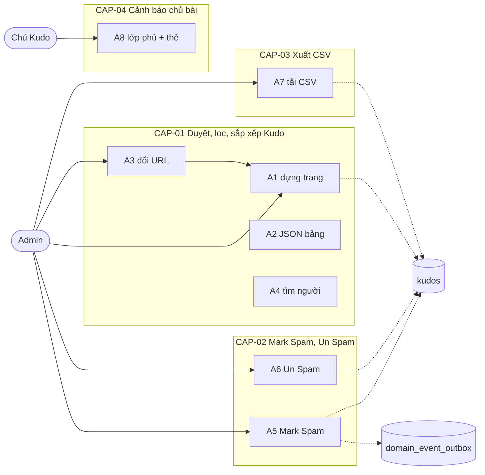
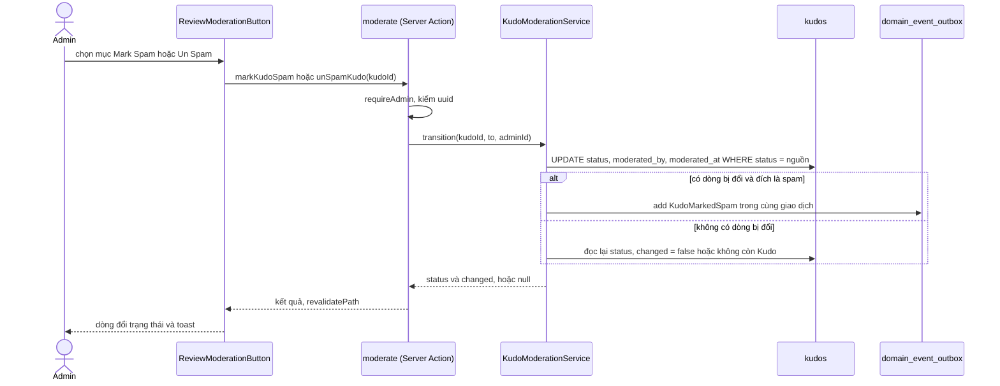
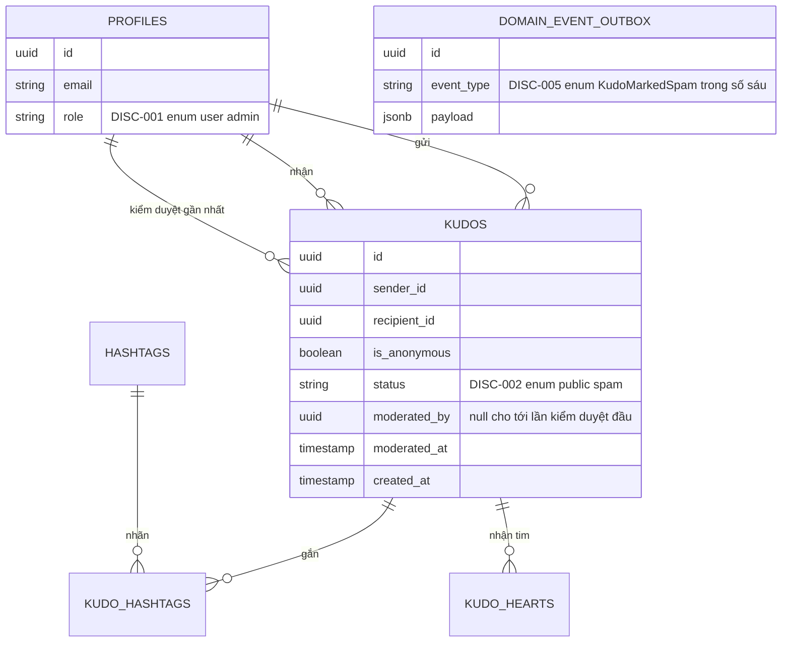
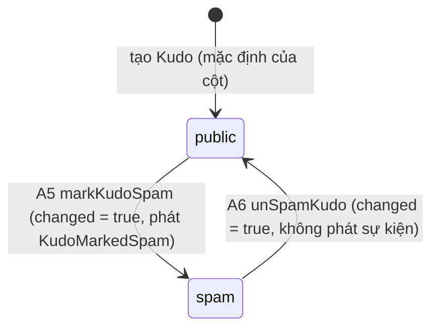

<!-- layout-exempt: rebuild-spec owns all docs/system|features|generated|flows paths — all references here are output targets or internal definitions -->
<!-- Contract: references/feature-spec-researcher-contract.md -->
<!-- Nửa Dev/QA/SA của cặp spec. Mọi mã FR/BR/SM/DEC/ALG/INT được PHÁT BIỂU một lần ở functional-spec.md và CÀI ĐẶT một lần ở đây; không lặp câu quy tắc thuần ngôn ngữ ở file này. -->

# F007_AdminModeration — Technical Spec

**Priority**: P1
**Type**: ui
**Generated**: 2026-11-24

**See also:** [`functional-spec.md`](./functional-spec.md) — tổng quan, quyết định còn mở, yêu cầu và quy tắc nghiệp vụ dạng một dòng, màn hình, user story, kịch bản, edge case và cấu hình cho BA/QA.

**How to read this file:** § 2 là bảng chỉ mục action; chọn action cần xem rồi đọc khối của nó ở § 3 từ đầu đến cuối, mỗi khối là một luồng hoàn chỉnh. § 4 là phụ lục dùng chung, chỉ nhảy vào khi § 3 trỏ tới.

## 1. Technical Overview

F007 cho Admin rà soát mọi Kudo tại `/admin/review`: bảng 10 dòng mỗi trang có lọc, tìm, sắp theo tim, Mark Spam / Un Spam từng dòng và xuất CSV theo bộ lọc đang chọn; slice còn chứa `SpamAlertOverlay` và `KudoSpamTag` để thẻ Kudo của feature khác phủ cảnh báo lên Kudo spam của chính chủ. Trang là server component (Next.js App Router, Drizzle trên Supabase Postgres) đọc `kudos` kèm `profiles`, `kudo_hashtags`, `kudo_hearts`; hai thao tác kiểm duyệt là Server Action ghi `kudos` và (chỉ khi public sang spam) `domain_event_outbox` trong cùng một giao dịch; CSV đi qua route handler dùng đúng bộ lọc và thứ tự của bảng. Drizzle chạy bằng vai trò server nên bỏ qua RLS: trang, action và route đều tự gọi guard Admin của F001 trước khi đụng dữ liệu.



## 2. Action Index

| # | Action (handler) | Method · Path | Codes | Writes | Detail |
|---|---|---|---|---|---|
| **A0** | *cross-cutting — belongs to no single action* | — | FR-601 | — | § 4.4 |
| **A1** | `AdminReviewPage` | `GET` `/admin/review` | FR-101, FR-201, FR-202, FR-203, FR-204, FR-205, FR-206, FR-208, FR-209, FR-210, FR-211, FR-212, FR-604, BR-002, BR-004, BR-005, DEC-001, DEC-002, ALG-001, US005 | — *(read-only)* | § 3.1 |
| **A2** | `kudos/route#GET` | `GET` `/api/admin/kudos` | FR-201, FR-204, FR-603, FR-604, BR-002, BR-004, BR-005, ALG-001, US005 | — *(read-only)* | § 3.1 |
| **A3** | `ReviewContentScreen#navigate` *(client, no BE of its own)* | — | FR-205, FR-206, FR-207, FR-208, FR-209, DEC-003, DEC-004, DEC-005, DEC-006, US005 | — *(client only)* | § 3.1 |
| **A4** | `ReviewPersonFilter#onPick` *(client)* | `GET` `/api/sunners/search` | FR-204, US005 | — *(read-only)* | § 3.1 |
| **A5** | `markKudoSpam` | `POST` `/admin/review` | FR-001, FR-002, FR-401, FR-402, FR-403, FR-404, FR-405, FR-602, BR-001, BR-003, BR-006, DEC-007, SM-001, INT-001, US006 | `kudos`, `domain_event_outbox` | § 3.2 ▸ **diagram** |
| **A6** | `unSpamKudo` | `POST` `/admin/review` | FR-401, FR-402, FR-403, FR-404, FR-602, BR-001, BR-003, BR-006, SM-001, US007 | `kudos` | § 3.2 |
| **A7** | `kudos/export/route#GET` | `GET` `/api/admin/kudos/export` | FR-406, FR-407, FR-603, FR-604, BR-002, BR-004, BR-005, BR-008, BR-009, DEC-008, ALG-001, US008 | — *(read-only)* | § 3.3 |
| **A8** | `SpamAlertOverlay`, `KudoSpamTag` *(client render, host là thẻ Kudo của F004/F012)* | — | FR-301, FR-302, BR-007 | — *(client only)* | § 3.4 |

**Rung set** theo template: Who → FE → Request → BE → Rule → Result → State → Source. Rung vắng thì bỏ hẳn. Chỉ A5 và A6 có **State** (SM-001, § 4.3); các action đọc và action client không đổi trạng thái nào. Chỉ A5 chạm ngưỡng diagram (ghi hai bảng): một `sequenceDiagram` ở mức capability CAP-02 phủ cả A5 lẫn A6 (§ 3.2).

## 3. Actions

### 3.1 CAP-01 — Duyệt, lọc và sắp xếp Kudo

#### A1 · Dựng trang Review content
`GET /admin/review?page&sort&status&sender&receiver&from&to&q` → `` `AdminReviewPage` ``
`FR-101` `FR-201` `FR-202` `FR-203` `FR-204` `FR-205` `FR-206` `FR-208` `FR-209` `FR-210` `FR-211` `FR-212` `FR-604` `BR-002` `BR-004` `BR-005` `DEC-001` `DEC-002` `ALG-001` `US005` · `SCR013_AdminReviewContent`

**Who** · Admin *(gate A0 — § 4.4)*
**FE** · `app/admin/review/page.tsx` dựng `ReviewContentScreen` (`features/admin-moderation/components/review-content-screen.tsx:28-105`): tiêu đề, ô khoảng ngày (A3), nút Export (A7), thanh bộ lọc `ReviewFilters` (`features/admin-moderation/components/review-filters.tsx:28-69`: Người gửi, Người nhận, Trạng thái bên trái, ô tìm bên phải), dòng `role="alert"` khi có `filterError` (`features/admin-moderation/components/review-content-screen.tsx:78-82`), rồi `ReviewTable` hoặc `AdminLoadErrorPanel` khi `loadError` (`features/admin-moderation/components/review-content-screen.tsx:83-101`) và `ReviewPagination` (`features/admin-moderation/components/review-pagination.tsx:13-54`). Bảng tám cột ID, Người gửi, Người nhận, Nội dung, Hashtag, Tim, Trạng thái, Thao tác (`features/admin-moderation/components/review-table.tsx:60-87`), cuộn ngang trong khung riêng (`features/admin-moderation/components/review-table.tsx:47-48`). Mỗi dòng (`features/admin-moderation/components/review-table-row.tsx:39-86`): ID là 8 ký tự đầu; người gửi thật kèm chip "Ẩn danh" (tooltip biệt danh) khi `isAnonymous`, email người gửi và người nhận nằm ở tooltip; tiêu đề đậm viết hoa trên lời nhắn là text thuần cắt 4 dòng (`features/admin-moderation/components/kudo-message-plain-text.ts:20-23` — cùng bộ phân tích whitelist của Live board, chỉ giữ chữ, không bao giờ render HTML); hashtag mỗi thẻ một dòng cắt bằng dấu ba chấm; số tim định dạng theo locale; ô rỗng hiện "—". Trạng thái chờ là `app/admin/review/loading.tsx:4-10` dùng `ReviewContentSkeleton` (`features/admin-moderation/components/review-content-skeleton.tsx:9-28`); lối vào (FR-101) là mục menu "Review content" của khung Admin thuộc F002.
**Request** · `searchParams` (Promise, `app/admin/review/page.tsx:36-41`) `page`, `sort`, `status`, `sender`, `receiver`, `from`, `to`, `q` (tên khoá ở `features/admin-moderation/schemas/admin-kudo-row.ts:45-54`). `parseAdminKudoFilter` (`features/admin-moderation/schemas/admin-kudo-filter-schema.ts:74-88`): khoá lặp → `invalid_params`; chuỗi rỗng coi như vắng; `page` khớp `^\d{1,15}$` và ≥ 1; `sort` ∈ `newest` \| `hearts_desc` \| `hearts_asc`; `status` ∈ `public` \| `spam`; `sender`, `receiver` là uuid; `from`, `to` là ngày ISO; `q` cắt khoảng trắng hai đầu, tối đa 200 ký tự Unicode; `from` sau `to` → `invalid_date_range` (`features/admin-moderation/schemas/admin-kudo-filter-schema.ts:42-61, 84-86`). Lỗi không ném ra: trang rơi về bộ lọc mặc định (DEC-001).
**BE** · `AdminReviewPage` gọi `requireAdmin()` đầu tiên (`app/admin/review/page.tsx:41`), `parseAdminKudoFilter`, đọc `getLocale` (rơi về `defaultLocale` nếu lạ, `app/admin/review/page.tsx:44-45`) rồi `loadReview` chạy song song `KudoAdminQuery.list` (ALG-001) và `resolveSelectedPeople` (`features/admin-moderation/server/admin-kudo-selected-people.ts:13-22` — đổi id người gửi/nhận trên URL thành tên và email qua `findSunnerOptionsByIds`, `features/sunner-search/server/sunner-search-query.ts:70-74`; id không có hồ sơ cho `null`). `loadReview` bắt lỗi đọc, ghi log và trả `null` để trang truyền `loadError` thay vì hỏng cả trang (`app/admin/review/page.tsx:19-26`). Không cache: session, `searchParams` và DB đọc trên mỗi request (`app/admin/review/page.tsx:28-35`).
**Rule** · quyết định hai điều của trang — URL sai thì hiện gì, và khi nào bảng hiện trạng thái rỗng kèm nút xoá bộ lọc:

| DEC | subtype | Condition | What the user sees | Source |
|---|---|---|---|---|
| **DEC-001** | render, flow | `parsed.ok` đúng | bảng của bộ lọc trên địa chỉ, không có dòng cảnh báo | `app/admin/review/page.tsx:43-55` |
| **DEC-001** | render, flow | `parsed.ok` sai (`invalid_date_range` hoặc `invalid_params`) | bảng chưa lọc trang 1 kèm dòng "Khoảng ngày không hợp lệ, đang hiện tất cả Kudo." hoặc "Bộ lọc không hợp lệ, đang hiện tất cả Kudo." | `app/admin/review/page.tsx:43-55` |
| **DEC-001** | render, flow | `loadReview` trả `null` (đọc DB lỗi) | thay bảng và bộ phân trang bằng khung lỗi "Không tải được danh sách Kudo. Vui lòng thử lại." kèm nút "Thử lại"; bộ lọc vẫn dùng được | `app/admin/review/page.tsx:50-55` |
| **DEC-002** | render | `rows.length === 0` và đang có ít nhất một bộ lọc (`senderId`, `receiverId`, `status`, `from`, `to` hoặc `query`) | dòng "Không có Kudo nào phù hợp bộ lọc." kèm nút "Xoá bộ lọc" | `features/admin-moderation/components/review-content-screen.tsx:58-94` |
| **DEC-002** | render | `rows.length === 0` và không có bộ lọc nào | chỉ dòng "Không có Kudo nào phù hợp bộ lọc.", không có nút | `features/admin-moderation/components/review-table.tsx:89-101` |

- **BR-002 — Admin luôn thấy người gửi thật của Kudo ẩn danh.** Bảng hiện người gửi thật kèm chip "Ẩn danh" (tooltip biệt danh), bộ lọc người gửi khớp người gửi thật; DTO `AdminKudoRow` chỉ do `KudoAdminQuery` dựng sau guard Admin. *(§ 4.4)*
- **BR-004 — Một bộ lọc duy nhất cho bảng, bộ đếm và CSV.** Mọi điều kiện ghép bằng AND, vắng = "Tất cả"; ngày cắt theo giờ `ADMIN_TIMEZONE` trọn ngày; tìm nội dung không phân biệt hoa thường và dấu trên tiêu đề cộng lời nhắn. *(§ 4.4)*
- **BR-005 — Thứ tự là một thứ tự toàn phần.** Mặc định `created_at DESC, id DESC`; sắp theo tim cũng kết thúc bằng `id DESC` nên các trang không lặp hay bỏ sót dòng. *(§ 4.4)*

**Result** · read-only — **không ghi DB**. Trả `AdminKudoPage { rows, total, page, pageCount }`: `page` đã kẹp vào `[1, pageCount]` nên `?page=99` hiện trang cuối, và `ReviewPagination` dùng `Math.min(view.page, data.pageCount)` để khớp (`features/admin-moderation/components/review-content-screen.tsx:96-99`). Mười dòng mỗi trang (`ADMIN_KUDO_PAGE_SIZE`); `total = 0` thì bỏ qua câu truy vấn dòng (ALG-001, § 4.5). Phân trang hiện tối đa năm số quanh trang hiện tại (`features/admin-moderation/components/review-page-window.ts:6-11`) và ẩn khi chỉ có một trang (`features/admin-moderation/components/review-pagination.tsx:15`). Trang không bao giờ trả 400: mọi lỗi tham số đi qua DEC-001 với HTTP 200.
**Source:** `features/admin-moderation/components/review-content-screen.tsx:28-105` → `app/admin/review/page.tsx:11-58` → `features/admin-moderation/schemas/admin-kudo-filter-schema.ts:74-88` → `features/admin-moderation/server/kudo-admin-query.ts:17-38` → `features/admin-moderation/server/admin-kudo-row-select.ts:50-111` → `features/admin-moderation/components/review-table-row.tsx:39-86`

<!-- Không có diagram: dưới ngưỡng (chỉ đọc, hai câu truy vấn đồng bộ, không ghi bảng). Bảng DEC ở trên là nội dung rẽ nhánh nên đọc tốt hơn dạng bảng. -->

---

#### A2 · Trả bảng Kudo dạng JSON
`GET /api/admin/kudos?page&sort&status&sender&receiver&from&to&q` → `` `kudos/route#GET` ``
`FR-201` `FR-204` `FR-603` `FR-604` `BR-002` `BR-004` `BR-005` `ALG-001` `US005` · `ROUTE001` · `SCR013_AdminReviewContent`

**Who** · Admin *(gate A0 — § 4.4)*
**FE** · *no entry point found* — grepped `features/`, `app/` và `shared/` tìm `api/admin/kudos`; chỉ có test gọi tới (`tests/integration/admin-moderation/admin-access.test.ts`). Nút "Thử lại" của `AdminLoadErrorPanel` dùng `router.refresh()` (`features/admin-moderation/components/admin-load-error-panel.tsx:21`) nên chạy lại A1, không gọi route này; ghi ở § 5.3.
**Request** · query cùng tên với A1, qua cùng `parseAdminKudoFilter` (`app/api/admin/kudos/route.ts:23`); lỗi → `adminApiError(400, error)`.
**BE** · `GET` bọc `listAdminKudos` và luôn gắn `Cache-Control: private, no-store` lên mọi câu trả lời (`app/api/admin/kudos/route.ts:13-17`). `listAdminKudos` (`app/api/admin/kudos/route.ts:19-32`): `requireAdminApi()` đầu tiên, trước khi đọc tham số (A0 — 401/403 JSON), `parseAdminKudoFilter`, rồi `KudoAdminQuery.list(filter.value, requestLocale(request))` — cùng truy vấn với A1. Truy vấn lỗi → ghi log và `adminApiError(500, "unexpected")`.
**Rule** · dùng lại nguyên quy tắc của A1 (cùng một truy vấn), nêu lại ngắn từng điều:
- **BR-002 — Admin thấy người gửi thật của Kudo ẩn danh.** JSON mang `sender` thật, `isAnonymous`, `anonymousNickname`; chỉ trả sau guard Admin. *(§ 4.4)*
- **BR-004 — Một bộ lọc duy nhất.** Cùng `buildAdminKudoWhere` với A1 và A7 nên JSON, bảng và tệp không lệch nhau. *(§ 4.4)*
- **BR-005 — Thứ tự toàn phần.** Cùng `ORDER BY` với A1, kết thúc bằng `id DESC`. *(§ 4.4)*
- FR-603 (không để trình duyệt hay proxy giữ dữ liệu): mọi câu trả lời, kể cả lỗi, mang `Cache-Control: private, no-store`; lỗi chỉ là `{ code }`, không kèm dữ liệu Kudo (`features/admin-moderation/server/admin-api-guard.ts:14-17`).

**Result** · read-only — **không ghi DB**. 200 `AdminKudoPage` (ALG-001); lỗi JSON `{ code }`: 401 `unauthorized`, 403 `forbidden` (trước khi đọc tham số), 400 `invalid_params` \| `invalid_date_range`, 500 `unexpected` (`features/admin-moderation/server/admin-api-guard.ts:12-24`).
**Source:** `app/api/admin/kudos/route.ts:13-32` → `features/admin-moderation/server/admin-api-guard.ts:12-24` → `features/admin-moderation/schemas/admin-kudo-filter-schema.ts:74-88` → `features/admin-moderation/server/kudo-admin-query.ts:25-38`

<!-- Không có diagram: dưới ngưỡng (chỉ đọc, đồng bộ, không ghi bảng). -->

---

#### A3 · Đổi bộ lọc, tìm, sắp xếp hoặc trang trên URL
`router.replace /admin/review?…` → `` `ReviewContentScreen#navigate` ``
`FR-205` `FR-206` `FR-207` `FR-208` `FR-209` `DEC-003` `DEC-004` `DEC-005` `DEC-006` `US005` · `SCR013_AdminReviewContent`

**Who** · Admin *(gate A0 — § 4.4)*
**FE** · mọi điều khiển gọi chung `navigate(patch)` (`features/admin-moderation/components/review-content-screen.tsx:40-46`): `applyFilterPatch` ra view mới, rồi trong một transition `useOptimistic` đổi `view` ngay (điều khiển hiện giá trị mới) và `router.replace(reviewHref(next), { scroll: false })` ghi URL; bảng mờ 60% và đặt `aria-busy` tới khi máy chủ trả lời (`features/admin-moderation/components/review-table.tsx:47-48`). Các điều khiển: ô khoảng ngày `ReviewDateRangeFilter` (`features/admin-moderation/components/review-date-range-filter.tsx:57-99`, hai ô `<input type="date">` đặt `min`/`max` theo ô kia, dùng chung với F015); ô tìm `ReviewSearchInput` (`features/admin-moderation/components/review-search-input.tsx:19-71`, `type="search"`, nhãn ẩn "Tìm theo nội dung"); chọn trạng thái `ReviewStatusFilter` (`features/admin-moderation/components/review-status-filter.tsx:15-30`, listbox ba mục "Tất cả" / "Public" / "Spam", bàn phím theo `features/admin-moderation/components/admin-filter-select.tsx:27-34`); tiêu đề cột Tim (`features/admin-moderation/components/review-table.tsx:26-34`); phân trang. Ô giữ chữ tự gõ riêng và chỉ dựng lại khi URL đổi từ ngoài (nút back, "Xoá bộ lọc") nhờ `useExternalResetKey` (`features/admin-moderation/components/use-external-reset-key.ts:13-21`).
**Request** · `reviewHref(view)` (`features/admin-moderation/components/review-url-params.ts:34-36`) chỉ ghi tham số khác mặc định (`page` > 1, `sort` khác `newest`, `q` sau khi cắt khoảng trắng, các bộ lọc khác rỗng) nên bảng mặc định là `/admin/review` trơn (`features/admin-moderation/components/review-url-params.ts:12-26`). Không có lời gọi dữ liệu riêng: đổi URL khiến router yêu cầu lại RSC của trang, tức chạy lại A1.
**Rule** · phía giao diện quyết định bốn điều — khi nào gửi khoảng ngày, khi nào gửi từ khoá, đổi trang hay về trang 1, và vòng sắp xếp tim:

| DEC | subtype | Condition | What the user sees | Source |
|---|---|---|---|---|
| **DEC-003** | interaction | cả `start` và `end` có giá trị và `start > end` | không gọi `onChange`: bảng và URL giữ nguyên, nhóm ô viền lỗi và dòng `role="alert"` "Ngày bắt đầu phải trước hoặc bằng ngày kết thúc" | `features/admin-moderation/components/review-date-range-filter.tsx:62-69` |
| **DEC-003** | interaction | một đầu trống, hoặc `start <= end` | gọi `onChange({ from, to })`, đầu trống thành `null` nên vắng khỏi URL | `features/admin-moderation/components/review-date-range-filter.tsx:64-69` |
| **DEC-004** | interaction | gõ trong ô tìm | sau 300 ms không gõ thêm, hoặc ngay khi nhấn Enter, gửi chuỗi đã cắt khoảng trắng; chuỗi trùng với lần gửi trước thì bỏ qua; ô nhận tối đa 100 ký tự | `features/admin-moderation/components/review-search-input.tsx:33-63` |
| **DEC-005** | flow | `patch.page` có giá trị | đổi sang đúng trang đó, giữ nguyên các bộ lọc | `features/admin-moderation/components/review-url-params.ts:44-46` |
| **DEC-005** | flow | `patch` không mang `page` (đổi bộ lọc, từ khoá, sắp xếp, xoá bộ lọc) | luôn về trang 1 | `features/admin-moderation/components/review-url-params.ts:44-46` |
| **DEC-006** | interaction | bấm tiêu đề cột Tim | vòng `newest` → `hearts_desc` → `hearts_asc` → `newest`; `aria-sort` là `none` / `descending` / `ascending` và caret đang dùng sáng lên | `features/admin-moderation/components/review-url-params.ts:48-62` |

**Result** · không ghi DB. URL mang toàn bộ trạng thái (FR-209) nên tải lại hoặc chia sẻ link ra cùng kết quả; điều khiển hiện giá trị mới ngay (optimistic), bảng mờ cho tới khi RSC mới về; đọc lỗi ở máy chủ hiện `AdminLoadErrorPanel` của A1 — không cần hoàn tác riêng vì URL là nguồn sự thật (mục Optimistic UI và Debounce của behavior-logic). "Xoá bộ lọc" đặt `senderId`, `receiverId`, `status`, `from`, `to` về rỗng và `query` về chuỗi rỗng, không đụng `sort` (`features/admin-moderation/components/review-content-screen.tsx:19`).
**Source:** `features/admin-moderation/components/review-content-screen.tsx:19-46` → `features/admin-moderation/components/review-url-params.ts:12-62` → `features/admin-moderation/components/review-search-input.tsx:19-71` → `features/admin-moderation/components/review-date-range-filter.tsx:57-99` → `features/admin-moderation/components/use-external-reset-key.ts:13-21`

<!-- Không có diagram: hành động thuần phía client, không có BE của riêng nó; nội dung chính là bảng DEC. -->

---

#### A4 · Tìm người gửi hoặc người nhận trong bộ lọc
`GET /api/sunners/search?q&excludeSelf&limit` → `` `ReviewPersonFilter#onPick` ``
`FR-204` `US005` · `ROUTE018` · `SCR013_AdminReviewContent`

**Who** · Admin *(gate A0 — § 4.4)*
**FE** · `ReviewPersonFilter` (`features/admin-moderation/components/review-person-filter.tsx:28-45`) bọc `SunnerSearchCombobox` của F003 (nhãn "Người gửi" hoặc "Người nhận", rộng 259 px): gõ để tìm, chọn một người thì `onPick(option.id)`, gõ lại sau khi chọn thì combobox báo `null` và bộ lọc về rỗng (`features/admin-moderation/components/review-person-filter.tsx:35-43`). Khi URL đã có id, nhãn hiện tên lấy từ `resolveSelectedPeople` của A1 qua `personFor` (`features/admin-moderation/components/review-filters.tsx:19-21`). Mỗi điều khiển chạy `useExternalResetKey` riêng và `markSent` trước khi báo lên (`features/admin-moderation/components/review-filters.tsx:30-56`). `onPick` đi lên `navigate` của A3 để ghi `sender` hoặc `receiver` lên URL.
**Request** · `useSunnerSearch` gọi `GET /api/sunners/search?q=<1..50>&excludeSelf=<bool>` sau 250 ms không gõ thêm, huỷ request cũ bằng `AbortController` (`features/sunner-search/components/use-sunner-search.ts:23-54`); 401 thành trạng thái `unauthorized`, lỗi khác thành `error`.
**BE** · endpoint thuộc F003 (`sunners/search/route#GET`, `app/api/sunners/search/route.ts:12-26`; F007 là một trong ba chủ sở hữu ghi ở route-list): `requireApiSunner()` rồi `searchSunners` theo tên, mặc định gồm cả chính người gọi. F007 không có BE riêng cho action này.
**Rule** · cổng của endpoint là `requireApiSunner` (khách 401, chưa onboarding 403 `ONBOARDING_REQUIRED`), **không phải** guard Admin; danh sách trả về là danh bạ Sunner mà mọi Sunner đã onboarding đều tìm được, nên bộ lọc không mở thêm dữ liệu nào ngoài tên và email đã có ở bảng.
**Result** · read-only — **không ghi DB**. Danh sách `SunnerOption` làm đầy listbox; chọn xong A3 điều hướng. Lỗi tìm hiện trạng thái lỗi của combobox, bảng không đổi.
**Source:** `features/admin-moderation/components/review-person-filter.tsx:28-45` → `features/sunner-search/components/use-sunner-search.ts:23-54` → `app/api/sunners/search/route.ts:12-26` → `features/admin-moderation/components/review-filters.tsx:28-69`

<!-- Không có diagram: dưới ngưỡng (một lời gọi đọc, không ghi bảng). -->

### 3.2 CAP-02 — Mark Spam và Un Spam

Hai action cùng một luồng `ReviewModerationButton` → Server Action `moderate` → `KudoModerationService.transition`, chỉ khác chiều chuyển; một `sequenceDiagram` ở mức capability phủ cả hai (A5 ghi hai bảng, A6 ghi một bảng và đi cùng đường).



#### A5 · Mark Spam một Kudo
`POST /admin/review` → `` `markKudoSpam` ``
`FR-001` `FR-002` `FR-401` `FR-402` `FR-403` `FR-404` `FR-405` `FR-602` `BR-001` `BR-003` `BR-006` `DEC-007` `SM-001` `INT-001` `US006` · `ROUTE027` · `SCR013_AdminReviewContent`

**Who** · Admin *(gate A0 — § 4.4)*
**FE** · `ReviewModerationButton` (`features/admin-moderation/components/review-moderation-button.tsx:29-109`) trên dòng `public` hiện nút "Mark Spam" (`aria-haspopup="menu"`, `aria-label` "Mark Spam Kudo {id}"). Bấm mở popover một mục `role="menu"` ở bên trái nút để bảng cuộn ngang không cắt mất; mục được focus ngay khi mở (`features/admin-moderation/components/review-moderation-button.tsx:43-45, 87-106`); chọn mục là xác nhận (`confirm`, không có bước nhập lý do); Esc, bấm ra ngoài hoặc Tab thì đóng và trả focus về nút (`features/admin-moderation/components/review-moderation-button.tsx:38, 62-67`). `confirm` đóng popover rồi chạy `markKudoSpam(kudoId)` trong `useTransition`: nút `aria-disabled` kèm spinner tới khi có kết quả (chặn bấm đôi, `features/admin-moderation/components/review-moderation-button.tsx:47-60, 79-86`). Kết quả đi lên `handleModerated` của màn hình (`features/admin-moderation/components/review-content-screen.tsx:48-56`).
**Request** · gọi trực tiếp hàm Server Action `markKudoSpam(kudoId: string)` — Next gửi `POST` tới chính `/admin/review` với header `next-action`; tham số kiểu `unknown` ở `moderate`, vì mọi đầu vào của Server Action đều là input không tin cậy (`features/admin-moderation/server/kudo-moderation-actions.ts:19, 36-38`).
**BE** · `moderate(kudoId, "spam")` (`features/admin-moderation/server/kudo-moderation-actions.ts:19-33`): `requireAdmin()` chạy **đầu tiên** và là nơi duy nhất lấy `adminId` (từ phiên, không nhận từ client); `z.uuid().safeParse` — sai thì trả `{ ok: false, code: "invalid" }` không đụng DB; `KudoModerationService.transition(kudoId, "spam", adminId)` trong try/catch (lỗi → log và `{ ok: false, code: "unexpected" }`, **không** `revalidatePath`); sau khi đã đọc DB (đổi được, đã ở đích, hoặc không còn) gọi `revalidatePath("/admin/review")` rồi trả `{ ok: true, status, changed }` hoặc `{ ok: false, code: "not_found" }` khi `transition` trả `null`.
**Rule**
- **BR-001 — Chuyển trạng thái là một câu UPDATE có điều kiện nên idempotent và an toàn khi hai Admin cùng bấm.** `WHERE id = :kudoId AND status = 'public'` trong một giao dịch; người đến sau xếp hàng trên khoá dòng, kiểm lại điều kiện, không khớp thì không ghi gì và nhận `changed: false` — `moderated_by` và `moderated_at` của người đến trước giữ nguyên. *(§ 4.4)*
- **BR-003 — Spam chỉ là đổi `status`; không ghi bộ đếm, không thu hồi hộp.** Kudo spam bị các truy vấn công khai loại ở thời điểm đọc; Un Spam tính lại tự nhiên, Secret Box đã cấp hoặc đã mở giữ nguyên. *(§ 4.4)*
- **BR-006 — Chỉ lần chuyển `public` sang `spam` thật sự mới phát `KudoMarkedSpam`.** Nhánh `changed: false` không phát; Un Spam không bao giờ phát nên chủ Kudo không nhận thông báo mới. *(§ 4.4)*
- **FR-602 (không tin client):** ngoài `adminId` lấy từ phiên và kiểm uuid ở trên, `kudoId` là biến duy nhất do client quyết định và chỉ đi vào câu `WHERE`; không có tham số nào chọn trạng thái đích — `to` do hàm bọc cố định theo action (`features/admin-moderation/server/kudo-moderation-actions.ts:36-43`).

Bốn nhánh kết quả được màn hình ánh xạ thành thông báo — cả A6 dùng đúng bảng này:

| DEC | subtype | Condition | What the user sees | Source |
|---|---|---|---|---|
| **DEC-007** | flow, interaction | `result.ok` sai và `code === "not_found"` | toast lỗi "Kudo không còn tồn tại."; dòng giữ nguyên | `features/admin-moderation/components/review-content-screen.tsx:48-52` |
| **DEC-007** | flow, interaction | `result.ok` sai với `invalid` hoặc `unexpected` (kể cả khi hàm action ném lỗi) | toast lỗi "Không cập nhật được trạng thái. Vui lòng thử lại."; dòng giữ nguyên | `features/admin-moderation/components/review-content-screen.tsx:48-52` |
| **DEC-007** | flow, interaction | `result.ok` đúng và `changed` sai | dòng đổi sang `result.status` (đã ở đích), toast thành công "Kudo đã được cập nhật bởi Admin khác." | `features/admin-moderation/components/review-content-screen.tsx:53-55` |
| **DEC-007** | flow, interaction | `result.ok` đúng, `changed` đúng, `status === "spam"` | dòng đổi sang `spam` ngay, toast "Đã đánh dấu Spam." | `features/admin-moderation/components/review-content-screen.tsx:53-55` |
| **DEC-007** | flow, interaction | `result.ok` đúng, `changed` đúng, `status === "public"` | dòng đổi sang `public` ngay, toast "Đã chuyển Kudo về Public." (nhánh của A6) | `features/admin-moderation/components/review-content-screen.tsx:53-55` |

**Result**
- Ghi `kudos.status` ← `spam`, `kudos.moderated_by` ← `adminId` của phiên, `kudos.moderated_at` ← `now()` của chính câu UPDATE — `features/admin-moderation/server/kudo-moderation-service.ts:23-27`. Cột `moderated_*` chỉ giữ lần kiểm duyệt gần nhất, không có bảng lịch sử (migration `db/migrations/0013_kudos_moderation_columns.sql:8-12`).
- Phát `KudoMarkedSpam` qua `INT-001` — ghi một dòng vào hộp thư sự kiện giao dịch để F013 sau đó đổi thành thông báo "Kudo của bạn bị ẩn" cho chủ Kudo (payload chỉ gồm id và `moderatedAt`, `features/admin-moderation/server/kudo-moderation-service.ts:28-36`) *(§ 4.5)*.
- Trigger `spotlight_publish_kudo_event` của F008 chạy trong cùng giao dịch trên `UPDATE OF status` và đẩy tín hiệu `removed` lên kênh Spotlight; lỗi trigger bị nuốt nên không làm hỏng thao tác này (`db/migrations/0017_spotlight_realtime.sql:29-60`).
- User sees: dòng đổi sang `spam` tại chỗ từ `result.status` (`features/admin-moderation/components/review-content-screen.tsx:36-37, 53`) cùng toast 5 giây; `revalidatePath` làm RSC của trang về lại trong cùng round trip nên `data` đổi và bản vá cục bộ được bỏ (dòng sẽ biến mất nếu bộ lọc trạng thái đang là `public`).
**State** · `SM-001`: `public` → `spam` *(§ 4.3)* — vòng đời kiểm duyệt của một Kudo (public ↔ spam), chỉ Admin đổi.
**Source:** `features/admin-moderation/components/review-moderation-button.tsx:29-109` → `features/admin-moderation/server/kudo-moderation-actions.ts:19-43` → `features/admin-moderation/server/kudo-moderation-service.ts:21-44` → `shared/events/domain-event-outbox.ts:19-29` → `features/admin-moderation/components/review-content-screen.tsx:48-56`

---

#### A6 · Un Spam một Kudo
`POST /admin/review` → `` `unSpamKudo` ``
`FR-401` `FR-402` `FR-403` `FR-404` `FR-602` `BR-001` `BR-003` `BR-006` `SM-001` `US007` · `ROUTE028` · `SCR013_AdminReviewContent`

**Who** · Admin *(gate A0 — § 4.4)*
**FE** · cùng `ReviewModerationButton` với A5, trên dòng `spam` nhãn là "Un Spam" (biểu tượng `un-spam`); popover một mục, chọn là xác nhận, huỷ bằng Esc, bấm ra ngoài hoặc Tab (`features/admin-moderation/components/review-moderation-button.tsx:40-41, 95-104`). Kết quả đi vào cùng `handleModerated` của A5: thành công thì dòng sang `public` và toast "Đã chuyển Kudo về Public.", `changed: false` thì "Kudo đã được cập nhật bởi Admin khác.", lỗi thì toast lỗi (bảng kết quả ở A5).
**Request** · Server Action `unSpamKudo(kudoId: string)`, cùng cách gọi và cùng cách coi `kudoId` là input không tin cậy như A5 (`features/admin-moderation/server/kudo-moderation-actions.ts:40-43`).
**BE** · `moderate(kudoId, "public")` — cùng hàm bọc với A5: `requireAdmin()` đầu tiên, kiểm uuid, `transition(kudoId, "public", adminId)`, `revalidatePath` khi đã đọc DB (`features/admin-moderation/server/kudo-moderation-actions.ts:19-33`).
**Rule**
- **BR-001 — Câu UPDATE có điều kiện `status = 'spam'`, một giao dịch.** Hai Admin cùng Un Spam thì chỉ một người đổi, người kia nhận `changed: false` mà `moderated_*` không bị ghi đè. *(§ 4.4)*
- **BR-003 — Chỉ đổi `status`, không đụng bộ đếm hay hộp đã cấp.** Kudo hiện lại ở các bề mặt công khai từ lần đọc sau. *(§ 4.4)*
- **BR-006 — Un Spam không phát sự kiện nào.** Chủ Kudo không nhận thông báo mới; thông báo "Kudo bị ẩn" đã gửi trước đó vẫn còn nguyên. *(§ 4.4)*

**Result**
- Ghi `kudos.status` ← `public`, `kudos.moderated_by` ← `adminId`, `kudos.moderated_at` ← `now()` (`features/admin-moderation/server/kudo-moderation-service.ts:23-27`); **không** ghi `domain_event_outbox` (nhánh `to === "spam"` ở `features/admin-moderation/server/kudo-moderation-service.ts:29-36` không chạy).
- Trigger của F008 chạy trên `UPDATE OF status` và đẩy tín hiệu `restored` (chỉ chỉnh bộ đếm, client không thêm dòng ticker) — `db/migrations/0017_spotlight_realtime.sql:40-41`.
- User sees: dòng sang `public` tại chỗ cùng toast; `changed: false` thì dòng hiện đúng trạng thái đang có.
**State** · `SM-001`: `spam` → `public` *(§ 4.3)* — vòng đời kiểm duyệt của Kudo, chiều khôi phục.
**Source:** `features/admin-moderation/components/review-moderation-button.tsx:29-109` → `features/admin-moderation/server/kudo-moderation-actions.ts:19-43` → `features/admin-moderation/server/kudo-moderation-service.ts:21-44`

<!-- Không có diagram riêng: A6 ghi một bảng và đi chung đường với A5, đã được diagram mức capability ở đầu § 3.2 phủ. -->

### 3.3 CAP-03 — Xuất CSV

#### A7 · Tải tệp CSV của bảng đang xem
`GET /api/admin/kudos/export?<cùng tham số với bảng, bỏ page>` → `` `kudos/export/route#GET` ``
`FR-406` `FR-407` `FR-603` `FR-604` `BR-002` `BR-004` `BR-005` `BR-008` `BR-009` `DEC-008` `ALG-001` `US008` · `ROUTE002` · `SCR013_AdminReviewContent`

**Who** · Admin *(gate A0 — § 4.4)*
**FE** · `ReviewExportButton` (`features/admin-moderation/components/review-export-button.tsx:36-61`, dùng chung với F014 và F015) nhận `href = reviewExportHref(filter)` — `filter` là bộ lọc server đã xác nhận, không phải `view` đang chờ cập nhật, và bỏ `page` (`features/admin-moderation/components/review-content-screen.tsx:74`, `features/admin-moderation/components/review-url-params.ts:38-41`). Bấm thì `fetch(href)` với `accept: text/csv`, `cache: "no-store"`; trong lúc chờ nút `aria-disabled`, bấm lần hai bị bỏ qua, kèm spinner và chữ "Đang xuất…" (`features/admin-moderation/components/review-export-button.tsx:40-60`). Thành công thì lưu blob dưới tên lấy từ `Content-Disposition` (`attachmentFilename`, `features/admin-moderation/components/review-export-filename.ts:15-27`; không có thì `kudos.csv`). Lỗi hiện qua `CampaignSettingsToast` (`features/admin-moderation/components/review-content-screen.tsx:102`).
**Request** · query cùng tên với A1 nhưng không có `page` (bị bỏ qua nếu có); qua cùng `parseAdminKudoFilter` (`app/api/admin/kudos/export/route.ts:27`); header `Accept` không được route đọc.
**BE** · `GET` bọc `exportAdminKudos` và gắn `Cache-Control: private, no-store` lên mọi câu trả lời (`app/api/admin/kudos/export/route.ts:17-21`). `exportAdminKudos` (`app/api/admin/kudos/export/route.ts:23-44`): `requireAdminApi()` đầu tiên (A0 — 401/403 JSON trước khi đọc tham số), `parseAdminKudoFilter` sai thì `adminApiError(400, error)`, rồi `KudoAdminQuery.listForExport(filter.value, "vi", env.EXPORT_MAX_ROWS + 1)` — một lần đọc có chặn trên, cùng `buildAdminKudoWhere` và cùng thứ tự với A1 (`features/admin-moderation/server/kudo-admin-query.ts:45-51`) — `assertWithinExportLimit(rows.length)` (`shared/admin/export-limit.ts:19-26`) và `serializeAdminKudoCsv`. `ExportLimitExceededError` → `adminApiError(422, "export_too_large")`; lỗi khác → log và `adminApiError(500, "unexpected")`.
**Rule** · dùng lại các quy tắc đọc của A1 và thêm hai quy tắc riêng của tệp:
- **BR-002 — Tệp mang người gửi thật của Kudo ẩn danh.** Cột `Người gửi` và `Email người gửi` là người gửi thật, cột `Ẩn danh` là "Có"; chỉ Admin tải được tệp. *(§ 4.4)*
- **BR-004 — Một bộ lọc duy nhất.** Cùng `buildAdminKudoWhere` với bảng nên tệp khớp bảng cùng tham số. *(§ 4.4)*
- **BR-005 — Thứ tự toàn phần.** Tệp theo đúng thứ tự bảng, kết thúc bằng `id DESC`. *(§ 4.4)*
- **BR-008 — Giới hạn dòng được kiểm trong cùng một lần đọc.** Route đọc tối đa `EXPORT_MAX_ROWS + 1` dòng; có dòng thừa nghĩa là quá giới hạn nên từ chối cả tệp, không cắt bớt; Kudo chèn thêm giữa chừng không thể đẩy tệp vượt giới hạn vì cùng một lần đọc quyết định cả hai. `features/admin-moderation/server/kudo-admin-query.ts:40-51`, `shared/admin/export-limit.ts:19-26`
- **BR-009 — Khuôn tệp cố định.** Mười ba cột tiếng Việt theo `ADMIN_KUDO_CSV_HEADER` (`ID` là uuid đầy đủ; `Ngày gửi` và `Kiểm duyệt lúc` dạng `yyyy-MM-dd HH:mm:ss` theo `ADMIN_TIMEZONE`; `Hashtag` nối bằng ", "; `Trạng thái` là "Public" hoặc "Spam"; `Kiểm duyệt bởi` và `Kiểm duyệt lúc` rỗng khi chưa từng kiểm duyệt); tên tệp `kudos-yyyyMMdd-HHmm.csv` theo giờ lúc xuất, không phải khoảng ngày; luôn dùng nhãn hashtag tiếng Việt vì route truyền cố định `"vi"`. `features/admin-moderation/server/admin-kudo-export.ts:13-56`, `shared/admin/admin-csv-filename.ts:5-9`
- FR-603 (tệp an toàn khi mở bằng Excel): `serializeCsv` thêm BOM UTF-8, dòng kết thúc CRLF, bọc nháy kép ô chứa `"`, `,`, xuống dòng và thêm `'` đứng đầu ô bắt đầu bằng `=`, `+`, `-`, `@`, TAB hoặc CR — áp cho cả tiêu đề, lời nhắn và tên người do người dùng nhập (`shared/admin/csv-serializer.ts:9-53`).

Hai nhánh quyết định của nút Export:

| DEC | subtype | Condition | What the user sees | Source |
|---|---|---|---|---|
| **DEC-008** | interaction | `response.status === 422` | toast lỗi "Có quá nhiều dòng để xuất. Hãy thu hẹp bộ lọc."; không có tệp, nút mở khoá lại | `features/admin-moderation/components/review-export-button.tsx:45` |
| **DEC-008** | interaction | `!response.ok` khác 422, hoặc `fetch` ném lỗi mạng | toast lỗi "Không xuất được tệp. Vui lòng thử lại."; không có tệp | `features/admin-moderation/components/review-export-button.tsx:46-50` |
| **DEC-008** | interaction | `response.ok` | trình duyệt lưu tệp, không có toast | `features/admin-moderation/components/review-export-button.tsx:47` |

**Result** · read-only — **không ghi DB**. 200 `text/csv; charset=utf-8` với `Content-Disposition: attachment; filename="kudos-yyyyMMdd-HHmm.csv"`, UTF-8 BOM, CRLF, mười ba cột, mọi dòng khớp bộ lọc (không chỉ trang hiện tại) theo thứ tự bảng. Lỗi trả JSON `{ code }` không kèm dữ liệu: 401 `unauthorized`, 403 `forbidden`, 400 `invalid_params` \| `invalid_date_range`, 422 `export_too_large`, 500 `unexpected`.
**Source:** `features/admin-moderation/components/review-export-button.tsx:36-61` → `app/api/admin/kudos/export/route.ts:17-44` → `features/admin-moderation/server/kudo-admin-query.ts:45-51` → `features/admin-moderation/server/admin-kudo-row-select.ts:50-111` → `features/admin-moderation/server/admin-kudo-export.ts:13-56` → `shared/admin/csv-serializer.ts:9-53`

<!-- Không có diagram: dưới ngưỡng (chỉ đọc, một lần đọc đồng bộ, không ghi bảng). -->

### 3.4 CAP-04 — Cảnh báo cho chủ bài

#### A8 · Phủ cảnh báo lên Kudo spam của chính chủ
`render` → `` `SpamAlertOverlay` ``, `` `KudoSpamTag` `` *(client render, không có entry point riêng)*
`FR-301` `FR-302` `BR-007`

**Who** · Chủ Kudo — Sunner là người gửi của một Kudo đang ở trạng thái `spam`
**FE** · hai component trình bày không tự nhận dữ liệu, do thẻ Kudo của F004 dựng khi `kudo.isSpam` đúng: `KudoCard` (`features/kudos-feed/components/kudo-card.tsx:47-48`) và `KudoDetailView` (`features/kudos-feed/components/kudo-detail-view.tsx:34-35`). `SpamAlertOverlay` phủ kín thẻ chủ (`absolute inset-0`, `role="note"`): nền mờ `backdrop-blur` cùng lớp phủ xám, tam giác cảnh báo và chữ "Cảnh báo vi phạm tiêu chuẩn cộng đồng", cộng một dòng `sr-only` "Kudo này đang bị tạm ẩn khỏi các trang công khai." (`features/admin-moderation/components/spam-alert-overlay.tsx:15-37`). `KudoSpamTag` là thẻ cam "Spam" ở góc phải, xếp trên lớp phủ (`z-20` so với `z-10`) nên vẫn đọc được qua lớp mờ (`features/admin-moderation/components/kudo-spam-tag.tsx:9-16`). Thẻ chủ ẩn tim, Copy Link và nút bút sửa, và đưa mọi liên kết ra khỏi thứ tự Tab (`tabbable = !kudo.isSpam`, `features/kudos-feed/components/kudo-card.tsx:37, 75`).
**BE** · F007 không có BE cho action này; việc Kudo spam của chủ vẫn đọc được là của F004: chi tiết trả Kudo spam chỉ cho người gửi với `isSpam: true`, mọi người khác (kể cả Admin) nhận `null` và trang "không tìm thấy" (`features/kudos-feed/server/kudo-public-query.ts:85-94`).
**Rule** · **BR-007 — Lớp phủ không đóng được và không chặn trình đọc màn hình.** Không có nút đóng; lớp phủ nhận con trỏ nên không bấm xuyên được; nội dung bên dưới vẫn nằm trong DOM (không dùng `inert`) để trình đọc màn hình đọc được chữ và đọc dòng `role="note"` trước; thẻ chủ không còn phần tử nào nhận focus bàn phím, chỉ "Đóng" của trang chi tiết nằm trên lớp phủ. `features/admin-moderation/components/spam-alert-overlay.tsx:4-37`
**Result** · không ghi DB. Chủ Kudo thấy bài của mình mờ kèm thẻ "Spam" và cảnh báo; bề mặt công khai không có Kudo này (Live board không liệt kê spam, thẻ chỉ xuất hiện ở trang chi tiết của chủ và danh sách "Đã gửi" của F012).
**Source:** `features/admin-moderation/components/spam-alert-overlay.tsx:15-37` → `features/admin-moderation/components/kudo-spam-tag.tsx:9-16` → `features/kudos-feed/components/kudo-card.tsx:33-48` → `features/kudos-feed/components/kudo-detail-view.tsx:26-35`

<!-- Không có diagram: dưới ngưỡng (hai component trình bày, không ghi bảng). Không có FE trong khuôn rung chuẩn vì thẻ chủ thuộc F004; rung FE ở trên mô tả đúng chỗ hai component được gắn vào. -->

### 3.5 Edge cases

| Action | Scenario | Behavior |
|---|---|---|
| A1 · A2 · A7 | Khách chưa đăng nhập, hoặc Sunner thường | Cổng A0: trang bị proxy trả 403 (khách chuyển `/login`); route trả 401 hoặc 403 JSON trước mọi truy vấn và trước khi đọc tham số |
| A1 | Tham số lặp (`status=a&status=b`), uuid sai, ngày không có thật (`2026-02-30`), `status` hoặc `sort` lạ, `page` < 1 hoặc không phải số, `q` dài hơn 200 ký tự | `invalid_params` (DEC-001): bảng chưa lọc trang 1 kèm `filterError`, HTTP 200 |
| A1 | `from` sau `to` nằm sẵn trên URL | `invalid_date_range` (DEC-001): như dòng trên với câu "Khoảng ngày không hợp lệ…" |
| A1 | `?page=99` khi chỉ có 3 trang | `page` kẹp về 3; bộ phân trang cũng hiện trang 3 (`features/admin-moderation/server/kudo-admin-query.ts:28-29`) |
| A1 | Không có Kudo nào, hoặc bộ lọc không khớp | `total = 0` bỏ qua truy vấn dòng; thông báo rỗng, thêm "Xoá bộ lọc" khi đang lọc (DEC-002); bộ phân trang ẩn vì `pageCount = 1` |
| A1 · A2 · A7 | `q` chứa `%`, `_` hoặc `\` | Được thoát nên khớp đúng ký tự đó, không thành ký tự đại diện (`features/admin-moderation/server/admin-kudo-where-builder.ts:17-22`) |
| A1 · A2 · A7 | Tìm "nguyen" hoặc "NGUYỄN" | Khớp cả hai nhờ `public.f_unaccent` và `ilike` trên tiêu đề cộng lời nhắn (BR-004) |
| A1 · A2 · A7 | Từ khoá trùng ký hiệu Markdown (`**`, `](`) hoặc URL của liên kết | Khớp vì `ilike` chạy trên nguồn Markdown `body` của lời nhắn (`features/admin-moderation/server/admin-kudo-where-builder.ts:19-22`), không phải chữ đã bỏ định dạng hiện trong bảng; dòng có thể hiện mà không thấy từ khoá (BR-004) |
| A1 · A2 · A7 | Kudo gửi 23:59:59 ngày `to` giờ Việt Nam; Kudo 00:00:00 ngày kế tiếp | Kudo đầu có mặt, Kudo sau không: biên trên là `< 00:00` ngày kế tiếp (`shared/admin/date-range-filter.ts:22-31`) |
| A1 | Kudo ẩn danh | Hiện người gửi thật kèm chip "Ẩn danh"; tooltip chip có biệt danh khi có (BR-002) |
| A1 | Người nhận hoặc người gửi đã bị xoá hồ sơ | `innerJoin` với `profiles` nên Kudo đó không có trong bảng và không có trong `total` (`features/admin-moderation/server/admin-kudo-row-select.ts:81-82`); `kudos.sender_id` và `recipient_id` là `ON DELETE RESTRICT` nên trường hợp này không xảy ra qua đường xoá thông thường |
| A1 | Hai Kudo cùng số tim, hoặc cùng `created_at` | `id DESC` làm khoá phụ nên thứ tự ổn định giữa các trang (BR-005) |
| A1 | Kudo chưa có tim | `coalesce(…, 0)` nên hiện 0 và xếp cuối khi sắp giảm dần (`features/admin-moderation/server/admin-kudo-row-select.ts:57`) |
| A1 | Đọc DB lỗi | `loadError`: khung lỗi kèm "Thử lại" gọi `router.refresh()` trong transition, khoá tới khi trả lời (`features/admin-moderation/components/admin-load-error-panel.tsx:12-28`); bộ lọc vẫn dùng được |
| A3 | Gõ khoảng ngày ngược trong ô | Không điều hướng, không gọi máy chủ; cảnh báo inline (DEC-003) |
| A3 | Gõ rồi xoá hết chữ trong ô tìm | Gửi chuỗi rỗng sau 300 ms nếu khác lần gửi trước, URL bỏ `q` (DEC-004) |
| A3 | Đổi bộ lọc khi đang ở trang 4 | Về trang 1 (DEC-005); chỉ bấm số trang mới giữ bộ lọc và đổi trang |
| A3 | Bấm "Xoá bộ lọc" hoặc nút back | Ô tìm, ô ngày, combobox dựng lại theo URL mới nhờ `useExternalResetKey`; chữ người dùng đang gõ không bị reset bởi chính lần gửi của nó |
| A4 | Id người gửi trên URL không còn hồ sơ | `resolveSelectedPeople` trả `null`; ô combobox rỗng nhưng URL vẫn lọc theo id đó nên bảng có thể rỗng |
| A5 · A6 | Hai Admin cùng chuyển một Kudo | Chỉ một người đổi; người kia nhận `changed: false`, toast "Kudo đã được cập nhật bởi Admin khác.", `moderated_*` không bị ghi đè, không có sự kiện thứ hai (BR-001, BR-006) |
| A5 · A6 | Kudo đã bị xoá khỏi DB | `transition` trả `null` → `{ ok: false, code: "not_found" }` → toast "Kudo không còn tồn tại." (DEC-007) |
| A5 · A6 | `kudoId` không phải uuid (gọi tay action) | `{ ok: false, code: "invalid" }`, không đụng DB, không `revalidatePath` (FR-602) |
| A5 · A6 | Lỗi DB bất ngờ trong giao dịch | Log, `{ ok: false, code: "unexpected" }`, toast lỗi chung, dòng giữ trạng thái; giao dịch rollback nên không có sự kiện mồ côi |
| A5 · A6 | Admin bị hạ role giữa chừng rồi bấm Mark Spam hoặc Un Spam | Proxy bước 4b trả JSON 403 cho yêu cầu có header `next-action` (`shared/auth/session-proxy.ts:92-110`) trước khi `requireAdmin()` chạy; Next ném lỗi "unexpected response" vì không phải RSC (`node_modules/next/dist/client/components/router-reducer/reducers/server-action-reducer.js:130-141`), nút bắt lỗi và đổi thành `unexpected` (`features/admin-moderation/components/review-moderation-button.tsx:52-56`) nên hiện toast lỗi chung; không đổi gì |
| A5 | Kudo bị Mark Spam khi bộ lọc trạng thái đang là `public` | Dòng đổi `spam` tại chỗ rồi biến mất khi RSC `revalidatePath` về (theo mã; không chạy thật) |
| A5 · A6 | Bấm nút lúc hành động trước chưa xong | `aria-disabled` nên bỏ qua (`features/admin-moderation/components/review-moderation-button.tsx:80`) |
| A5 · A6 | Esc, bấm ra ngoài hoặc Tab khi popover đang mở | Đóng, trả focus về nút, không gọi server |
| A7 | Số dòng khớp lớn hơn `EXPORT_MAX_ROWS` | Đọc `EXPORT_MAX_ROWS + 1` dòng nên 422 `export_too_large`, toast "quá nhiều dòng", không có tệp (BR-008, DEC-008) |
| A7 | Kudo ẩn danh trong kết quả | Dòng có người gửi thật và cột `Ẩn danh` là "Có" (BR-002) |
| A7 | Lời nhắn hoặc tên bắt đầu bằng `=`, `+`, `-`, `@`, TAB hoặc CR | Thêm `'` đứng đầu ô (FR-603, `shared/admin/csv-serializer.ts:11-17`) |
| A7 | Lời nhắn chứa dấu phẩy, nháy kép hoặc xuống dòng | Bọc nháy kép, nháy kép nhân đôi (`shared/admin/csv-serializer.ts:13, 19-21`) |
| A7 | Bấm Export hai lần liên tiếp | Lần sau bị bỏ qua khi `exporting` còn đúng (`features/admin-moderation/components/review-export-button.tsx:40-42`) |
| A7 | Phiên hết hạn, hoặc Admin bị hạ role giữa chừng | `/api/admin/*` không nằm trong `isAdminPath` nên proxy không chặn; `requireAdminApi` trong route trả 401 hoặc 403 JSON, FE hiện toast "Không xuất được tệp…", không có tệp (DEC-008) |
| A7 | Truy vấn lỗi | 500 `unexpected` kèm log phía server; toast lỗi chung |
| A8 | Kudo spam của người khác | Không có Kudo trong truy vấn của người xem nên không có thẻ; chi tiết trả trang "không tìm thấy" (`features/kudos-feed/server/kudo-public-query.ts:85-94`) |

## 4. Shared Foundation

### 4.1 Components

| Component | Responsibility | Used in | File |
|---|---|---|---|
| `AdminReviewPage` | Server component: guard, đọc tham số, gọi truy vấn, dựng màn hình | A1 | `app/admin/review/page.tsx` |
| `AdminReviewLoading`, `ReviewContentSkeleton`, `AdminTableSkeletonRows` | Trạng thái chờ của route | A1 | `app/admin/review/loading.tsx`, `features/admin-moderation/components/review-content-skeleton.tsx`, `features/admin-moderation/components/admin-table-skeleton-rows.tsx` |
| `ReviewContentScreen` | Màn hình client: tiêu đề, ô ngày, Export, bộ lọc, cảnh báo, bảng, phân trang, toast, trạng thái optimistic | A1, A3, A5, A6, A7 | `features/admin-moderation/components/review-content-screen.tsx` |
| `ReviewFilters` | Thanh Người gửi, Người nhận, Trạng thái, ô tìm | A3, A4 | `features/admin-moderation/components/review-filters.tsx` |
| `ReviewPersonFilter` | Bộ lọc người gửi hoặc người nhận bọc `SunnerSearchCombobox` | A4 | `features/admin-moderation/components/review-person-filter.tsx` |
| `ReviewStatusFilter`, `AdminFilterSelect` | Listbox "Tất cả / Public / Spam" và cơ chế bàn phím dùng chung khu Admin | A3 | `features/admin-moderation/components/review-status-filter.tsx`, `features/admin-moderation/components/admin-filter-select.tsx` |
| `ReviewSearchInput` | Ô tìm theo nội dung, debounce 300 ms, Enter gửi ngay | A3 | `features/admin-moderation/components/review-search-input.tsx` |
| `ReviewDateRangeFilter` | Hai ô ngày và chặn khoảng ngược; dùng chung với F015 | A3 | `features/admin-moderation/components/review-date-range-filter.tsx` |
| `ReviewTable`, `ReviewTableRow`, `ReviewStatusBadge`, `AdminSortCarets` | Bảng tám cột, dòng, huy hiệu trạng thái, caret sắp xếp; hàng rỗng và nút xoá bộ lọc | A1, A3 | `features/admin-moderation/components/review-table.tsx`, `features/admin-moderation/components/review-table-row.tsx`, `features/admin-moderation/components/admin-sort-carets.tsx` |
| `ReviewPagination`, `pageWindow` | Phân trang tối đa năm số, ẩn khi một trang | A1, A3 | `features/admin-moderation/components/review-pagination.tsx`, `features/admin-moderation/components/review-page-window.ts` |
| `ReviewModerationButton` | Nút Mark Spam hoặc Un Spam, popover xác nhận một mục, khoá khi đang xử lý | A5, A6 | `features/admin-moderation/components/review-moderation-button.tsx` |
| `ReviewExportButton`, `attachmentFilename` | Tải CSV bằng `fetch`, khoá nút, đọc tên tệp từ `Content-Disposition`; dùng chung với F014 và F015 | A7 | `features/admin-moderation/components/review-export-button.tsx`, `features/admin-moderation/components/review-export-filename.ts` |
| `AdminLoadErrorPanel` | Thông báo lỗi đọc và "Thử lại"; dùng chung với F014 và F015 | A1 | `features/admin-moderation/components/admin-load-error-panel.tsx` |
| `reviewHref`, `reviewExportHref`, `applyFilterPatch`, `nextHeartSort`, `heartAriaSort` | Dựng URL trang và URL xuất, áp bản vá bộ lọc, vòng sắp xếp tim (thuần, không React) | A3, A7 | `features/admin-moderation/components/review-url-params.ts` |
| `useExternalResetKey` | Khoá dựng lại ô khi URL đổi từ ngoài | A3, A4 | `features/admin-moderation/components/use-external-reset-key.ts` |
| `kudoMessagePlainText` | Lời nhắn thành một dòng text thuần cho cột Nội dung | A1 | `features/admin-moderation/components/kudo-message-plain-text.ts` |
| `SpamAlertOverlay`, `KudoSpamTag` | Lớp phủ cảnh báo và thẻ "Spam" trên Kudo spam của chủ; host là F004 và F012 | A8 | `features/admin-moderation/components/spam-alert-overlay.tsx`, `features/admin-moderation/components/kudo-spam-tag.tsx` |
| `parseAdminKudoFilter`, `DEFAULT_ADMIN_KUDO_FILTER` | URL → `AdminKudoFilterValues`, một nguồn cho trang, JSON và CSV | A1, A2, A7 | `features/admin-moderation/schemas/admin-kudo-filter-schema.ts` |
| `AdminKudoRow`, `AdminKudoPage`, `ADMIN_KUDO_PARAMS` | DTO admin-only và tên tham số URL dùng chung | A1, A2, A7 | `features/admin-moderation/schemas/admin-kudo-row.ts` |
| `KudoAdminQuery`, `selectAdminKudoRows`, `buildAdminKudoWhere` | Đọc trang, đọc cho xuất, một bộ lọc dùng chung (ALG-001) | A1, A2, A7 | `features/admin-moderation/server/kudo-admin-query.ts`, `features/admin-moderation/server/admin-kudo-row-select.ts`, `features/admin-moderation/server/admin-kudo-where-builder.ts` |
| `resolveSelectedPeople` | Id người gửi và người nhận trên URL thành tên và email | A1 | `features/admin-moderation/server/admin-kudo-selected-people.ts` |
| `kudos/route#GET`, `kudos/export/route#GET` | Hai route JSON và CSV của khu Admin | A2, A7 | `app/api/admin/kudos/route.ts`, `app/api/admin/kudos/export/route.ts` |
| `requireAdminApi`, `adminApiError` | Guard Admin trả JSON 401 hoặc 403 cho route dữ liệu | A0 | `features/admin-moderation/server/admin-api-guard.ts` |
| `markKudoSpam`, `unSpamKudo` | Server Action kiểm duyệt (hàm bọc `moderate`) | A5, A6 | `features/admin-moderation/server/kudo-moderation-actions.ts` |
| `KudoModerationService` | Giao dịch chuyển trạng thái và ghi hộp thư sự kiện | A5, A6 | `features/admin-moderation/server/kudo-moderation-service.ts` |
| `KudoModerationResult` | Kiểu kết quả của hai action | A5, A6 | `features/admin-moderation/schemas/kudo-moderation-result.ts` |
| `serializeAdminKudoCsv`, `adminKudoExportFilename`, `serializeCsv`, `adminCsvFilename`, `assertWithinExportLimit` | Mười ba cột, BOM, nháy kép, vô hiệu công thức, tên tệp, trần dòng | A7 | `features/admin-moderation/server/admin-kudo-export.ts`, `shared/admin/csv-serializer.ts`, `shared/admin/admin-csv-filename.ts`, `shared/admin/export-limit.ts` |
| `adminDateRangeSchema` | Khoảng nửa mở UTC theo `ADMIN_TIMEZONE`, dùng chung khu Admin | A1, A2, A7 | `shared/admin/date-range-filter.ts` |
| `requireAdmin`, `resolveAdminAccess` *(F001)* | Guard Admin cho trang và Server Action | A0 | `shared/auth/admin-guard.ts` |

### 4.2 Data Model



| Entity | Table | Used for | Action |
|---|---|---|---|
| `Kudo` *(MODEL003, F003)* | `kudos` | Đọc mọi Kudo public và spam; ghi `status`, `moderated_by`, `moderated_at` khi kiểm duyệt | A1, A2, A5, A6, A7 |
| `Profile` *(MODEL004, F001)* | `profiles` | Ba bí danh `sender`, `receiver`, `moderator` để lấy tên và email; đọc `role` ở guard | A0, A1, A2, A7 |
| `KudoHashtag` *(MODEL005, F003)* | `kudo_hashtags` | Hashtag của các Kudo trong trang, đọc một câu cho cả trang | A1, A2, A7 |
| `Hashtag` *(MODEL002, F003)* | `hashtags` | Nhãn `label_vi` hoặc `label_en`, thứ tự `sort_order` | A1, A2, A7 |
| `KudoHeart` *(MODEL008, F005)* | `kudo_hearts` | Số tim thô qua `heartCountsSubquery` (không nhân hệ số x2) | A1, A2, A7 |
| `DomainEventOutbox` *(MODEL015, F013)* | `domain_event_outbox` | Ghi sự kiện `KudoMarkedSpam` khi chuyển public sang spam | A5 |

Cột `moderated_by` và `moderated_at` do migration `db/migrations/0013_kudos_moderation_columns.sql:8-12` thêm: `moderated_by` là FK tới `profiles` `ON DELETE set null`, ràng buộc `kudos_moderated_by_needs_moderated_at` buộc `moderated_at` phải có khi `moderated_by` có (chiều ngược lại không bắt buộc nên `moderated_at` còn khi Admin bị xoá). Chỉ mục sẵn có mà truy vấn dựa vào: `kudos_status_created_at_id_idx`, `kudos_recipient_id_created_at_id_idx`, `kudos_sender_id_created_at_id_idx` (`shared/db/schema/kudos.ts:64-66`); không thêm chỉ mục nào cho tìm nội dung (ghi chú migration: quét tuần tự khoảng 95 ms ở 10 nghìn Kudo, `db/migrations/0013_kudos_moderation_columns.sql:4-6`). Hàm `public.f_unaccent` do migration `db/migrations/0007_kudos_constraints.sql:34-38` tạo.

#### Polymorphic Behavior

##### DISC-001 — Profile.role

| Value | Render | Validation | Persistence |
|-------|--------|------------|-------------|
| user | Không vào được trang, route hay action của F007 | `resolveAdminAccess` trả `forbidden` (A0); với người đang mở trang khi bị hạ, proxy bước 4b trả 403 | Không ghi |
| admin | Là role duy nhất qua guard; thấy người gửi thật của Kudo ẩn danh (BR-002) | `resolveAdminAccess` đọc `profiles.role` từ DB ở mỗi lần gọi (`shared/auth/admin-guard.ts:17-23`) nên hạ quyền có hiệu lực ở request kế | Không ghi (F014 là bên đổi role) |

**Source:** docs/generated/entities.md § Profile > Discriminator Fields

##### DISC-002 — Kudo.status

| Value | Render | Validation | Persistence |
|-------|--------|------------|-------------|
| public | Huy hiệu "Public"; nút dòng là "Mark Spam" (`features/admin-moderation/components/review-moderation-button.tsx:40-41`); xuất ra tệp là "Public" | A5 chỉ đổi dòng đang `public` (`SOURCE_STATUS[spam] = public`, `features/admin-moderation/server/kudo-moderation-service.ts:19`); bộ lọc trạng thái nhận `public` | A6 đặt giá trị này; Kudo mới luôn mang giá trị này (mặc định, `shared/db/schema/kudos.ts:46`) |
| spam | Huy hiệu "Spam"; nút dòng là "Un Spam"; xuất ra tệp là "Spam"; chủ Kudo thấy lớp phủ cảnh báo và thẻ "Spam" (A8) | A6 chỉ đổi dòng đang `spam`; dòng đã `spam` mà A5 chạy thì `changed: false` | A5 đặt giá trị này, kèm `moderated_by`, `moderated_at` và sự kiện `KudoMarkedSpam` |

**Source:** docs/generated/entities.md § Kudo > Discriminator Fields

##### DISC-005 — DomainEventOutbox.event_type

| Value | Render | Validation | Persistence |
|-------|--------|------------|-------------|
| KudoCreated | unverified (F007 không đọc hay ghi) | unverified | unverified — không do F007 ghi |
| HeartAdded | unverified (F007 không đọc hay ghi) | unverified | unverified — không do F007 ghi |
| KudoMarkedSpam | Không hiển thị ở F007; F013 đổi thành thông báo cho chủ Kudo | Payload kiểm bằng `z.strictObject({ kudoId, ownerId, moderatedAt })` trước khi ghi, sai thì ném ZodError và rollback giao dịch (`shared/events/domain-event-types.ts:21-28`, `shared/events/domain-event-outbox.ts:19-29`) | A5 ghi đúng một dòng khi và chỉ khi `UPDATE` đổi được dòng sang `spam` (BR-006) |
| BoxGranted | unverified (F007 không đọc hay ghi) | unverified | unverified — không do F007 ghi |
| SetCompleted | unverified (F007 không đọc hay ghi) | unverified | unverified — không do F007 ghi |
| NationalKudosFinalized | unverified (F007 không đọc hay ghi) | unverified | unverified — không do F007 ghi |

**Source:** docs/generated/entities.md § DomainEventOutbox > Discriminator Fields

### 4.3 State Management

### Kudo chuyển qua lại giữa công khai và spam, chỉ do Admin đổi (SM-001)
**kind:** entity
**Linked FR:** FR-001
**Source:** `features/admin-moderation/server/kudo-moderation-service.ts:19-44`



**Action transitions:** guard và tác dụng phụ của từng cạnh nằm ở rung **Result** của action ghi trên cạnh (§ 3.2) — không lặp ở đây. Hai cạnh `public → public` và `spam → spam` không tồn tại: câu `UPDATE` có điều kiện không khớp dòng nào nên trả `changed: false` (BR-001). Không có trạng thái thứ ba (Reject, tự động gắn cờ nằm ngoài phạm vi giai đoạn 1).

### 4.4 Shared Rules

#### Bin 3 — cross-cutting, belongs to no single action

**A0 · FR-601 — mọi action của F007 (A1-A7) yêu cầu role Admin, kiểm ở server.** Đây là rule cross-cutting của cả khu Admin, **không phải rule riêng của F007**; F007 chỉ gọi lại guard của F001. Bốn lớp: (1) proxy bước 4b trả 403 cho người đã đăng nhập mà không phải Admin trên `/admin` và `/admin/*` — trang nhận trang access-denied, Server Action và yêu cầu không phải GET nhận JSON `{ code: "forbidden" }` — nhưng **không phủ `/api/admin/*`**; (2) layout Admin gọi `requireShellAdmin` trước khi dựng khung; (3) trang và Server Action gọi `requireAdmin()` **đầu tiên** (khách → `/login`, không phải Admin → `forbidden()`); (4) route dữ liệu gọi `requireAdminApi()` đầu tiên, trước khi đọc tham số (khách 401 `unauthorized`, không phải Admin 403 `forbidden`). Role đọc từ DB ở mỗi lần gọi nên hạ quyền có hiệu lực ngay ở request kế; Drizzle bỏ qua RLS nên không được dựa vào RLS. Với `/api/admin/kudos[/export]`, `requireAdminApi` trong handler là lớp chặn duy nhất sau cổng session của proxy (khách 401). Quy tắc chặn thuộc `PERM003`, `PERM014`, `PERM015` trong `permissions-matrix.md`; hai quy tắc riêng của F007 là `PERM019` (chuyển trạng thái chỉ Admin, `adminId` từ phiên) và `PERM021` (người gửi thật chỉ Admin thấy).
**Source:** `shared/auth/admin-guard.ts:17-35` · `features/admin-moderation/server/admin-api-guard.ts:19-24` · `shared/auth/session-proxy.ts:92-110` · `shared/auth/route-access-policy.ts:25-27` · `app/admin/layout.tsx:10-18` · `app/admin/review/page.tsx:41` · `features/admin-moderation/server/kudo-moderation-actions.ts:20`

#### Bin 2 — used by ≥2 named actions

**BR-001 — Chuyển trạng thái là một câu UPDATE có điều kiện nên idempotent và an toàn khi hai Admin cùng bấm.**
Used in: **A5** · **A6**. Một giao dịch: `UPDATE kudos SET status = :to, moderated_by, moderated_at = now() WHERE id AND status = :from RETURNING`. Người đến sau xếp hàng trên khoá dòng rồi kiểm lại `status = :from`, không khớp thì không ghi; sau đó đọc lại: không còn dòng → `null` (not found), còn → trạng thái hiện tại với `changed: false` và `moderated_*` nguyên vẹn. Không cần khoá tường minh.
**Source:** `features/admin-moderation/server/kudo-moderation-service.ts:19-44`
```text
tx:
  row = UPDATE kudos SET status=to, moderated_by=admin, moderated_at=now()
        WHERE id = kudoId AND status = SOURCE[to] RETURNING sender_id, moderated_at
  if row: (if to == spam: outbox.add(KudoMarkedSpam)); return { status: to, changed: true }
  cur = SELECT status FROM kudos WHERE id = kudoId
  return cur ? { status: cur.status, changed: false } : null
```

**BR-002 — Admin luôn thấy người gửi thật của Kudo ẩn danh, ở bảng, JSON, CSV và bộ lọc người gửi.**
Used in: **A1** · **A2** · **A7**. `selectAdminKudoRows` nối `profiles` bằng bí danh `sender` qua `kudos.sender_id` và không bao giờ che theo `is_anonymous`; `isAnonymous` và `anonymousNickname` chỉ đi kèm để hiện chip và tooltip. DTO `AdminKudoRow` chỉ do `KudoAdminQuery` dựng sau guard Admin và không được dùng ở đường đọc công khai (đường đó dùng `KudoCardView` của F004, có che). Bộ lọc `senderId` khớp `kudos.sender_id` thật. Thuộc `PERM021`.
**Source:** `features/admin-moderation/server/admin-kudo-row-select.ts:20-23, 95-103` · `features/admin-moderation/schemas/admin-kudo-row.ts:1-34` · `features/admin-moderation/server/admin-kudo-where-builder.ts:28`
```text
sender = real profile of kudos.sender_id        # never masked here
row.sender = { id, name, email }, row.isAnonymous = kudos.is_anonymous, row.anonymousNickname = kudos.anonymous_nickname
```

**BR-003 — Spam chỉ là đổi `status`; không ghi bộ đếm, không thu hồi hộp.**
Used in: **A5** · **A6**. Giao dịch chỉ ghi `kudos.status`, `moderated_by`, `moderated_at` (và outbox ở A5); không bảng đếm nào được chạm. Kudo spam bị loại ở thời điểm truy vấn ở mọi bề mặt công khai và số liệu (F004, F005, F008, F009, F010, F014, F015), Un Spam tính lại tự động; hộp Secret Box đã cấp hoặc đã mở giữ nguyên (quyết định chung của dự án, F007 không có mã nào thu hồi).
**Source:** `features/admin-moderation/server/kudo-moderation-service.ts:1-16, 23-27`
```text
spam(kudo): kudos.status = 'spam'      # readers filter status='public' at query time
unspam(kudo): kudos.status = 'public'   # counters recompute on next read; no refund, no revoke
```

**BR-004 — Một bộ lọc duy nhất cho bảng, bộ đếm và CSV (`buildAdminKudoWhere`).**
Used in: **A1** · **A2** · **A7**. Mọi điều kiện ghép bằng AND, vắng = "Tất cả": `status`, `senderId`, `receiverId`, `from`/`to` (ngày trọn ngày giờ `ADMIN_TIMEZONE`, nửa mở `created_at >= start AND created_at < end`), `query` (không phân biệt hoa thường và dấu, `public.f_unaccent(coalesce(title,'') || ' ' || body) ilike '%' || f_unaccent(q) || '%'`, ký tự `%`, `_`, `\` của người dùng được thoát). Hàm chờ giá trị đã qua `parseAdminKudoFilter`: khoảng ngược sẽ ném ở đây.
**Source:** `features/admin-moderation/server/admin-kudo-where-builder.ts:17-34` · `shared/admin/date-range-filter.ts:11-33` · `features/admin-moderation/schemas/admin-kudo-filter-schema.ts:40-61`
```text
where = AND(status?, sender?, receiver?, created_at >= start?, created_at < end?, contentMatches(q)?)
contentMatches(q) = f_unaccent(coalesce(title,'') || ' ' || body) ILIKE '%' || f_unaccent(escape(q)) || '%' ESCAPE '\'
```

**BR-005 — Thứ tự là một thứ tự toàn phần, một nguồn cho bảng và CSV.**
Used in: **A1** · **A2** · **A7**. `newest` là `created_at DESC, id DESC` (mặc định); `hearts_desc` và `hearts_asc` sắp theo số tim thô (`coalesce(count, 0)`, không nhân hệ số x2) rồi `id DESC`. `selectAdminKudoRows` là lõi chung của trang (có `limit`/`offset`) và tệp (`offset = 0`), nên cùng bộ lọc thì cùng thứ tự.
**Source:** `features/admin-moderation/server/admin-kudo-row-select.ts:24, 56-59, 88` · `features/admin-moderation/schemas/admin-kudo-row.ts:56-57`
```text
order(newest)      = created_at DESC, id DESC
order(hearts_desc) = coalesce(hearts,0) DESC, id DESC
order(hearts_asc)  = coalesce(hearts,0) ASC,  id DESC
```

**BR-006 — Chỉ lần chuyển `public` sang `spam` thật sự mới phát `KudoMarkedSpam`.**
Used in: **A5** · **A6**. `DomainEventOutbox.add` nằm trong nhánh `changed` và `to === "spam"`; `changed: false` không phát, Un Spam không bao giờ phát. Hệ quả ở F013: thông báo "bị ẩn" luôn được gửi cho chủ Kudo kể cả khi Kudo đã được Un Spam sau đó (`features/notifications/server/map-event-to-notifications.ts:69-71`).
**Source:** `features/admin-moderation/server/kudo-moderation-service.ts:28-36`
```text
if updated_row and to == 'spam': outbox.add('KudoMarkedSpam', { kudoId, ownerId, moderatedAt })
# to == 'public' and not-changed paths emit nothing
```

### 4.5 Algorithms & Integrations

### Đọc một trang Kudo: đếm theo bộ lọc, kẹp trang, đọc dòng theo thứ tự, gom hashtag một lần (ALG-001)
**Linked FR:** FR-201
**Used in:** A1, A2, A7
**Source:** `features/admin-moderation/server/kudo-admin-query.ts:17-51`
**Input:** `AdminKudoFilterValues`, `locale`, (xuất) `maxRows` · **Output:** `AdminKudoPage { rows, total, page, pageCount }` hoặc `AdminKudoRow[]` · **Complexity:** O(P) với P = số dòng trong cửa sổ trang; `count(*)` quét theo bộ lọc
**Description:** `list` dựng `where` một lần (BR-004), `count(*)` ra `total`, `pageCount = max(1, ceil(total / 10))`, kẹp `page` vào `[1, pageCount]`, bỏ qua truy vấn dòng khi `total = 0`. `selectAdminKudoRows` chọn một câu có `innerJoin` người gửi và người nhận, `leftJoin` người kiểm duyệt và `leftJoin` số tim; với `newest` số tim chỉ đếm cho đúng các id của trang (`ORDER BY … LIMIT … OFFSET` trong truy vấn con), với sắp theo tim thì đếm cho toàn tập đã lọc vì phải sắp theo số tim. Hashtag của cả trang đọc bằng một câu `inArray` rồi nhóm theo Kudo (không N+1), nhãn theo `locale`, thêm tiền tố `#` nếu thiếu. `listForExport` là cùng lõi với `offset = 0`, `limit = maxRows`.

**Pseudocode:**
```text
where = buildAdminKudoWhere(filter)                                  # BR-004
total = count(kudos where)
pageCount = max(1, ceil(total / 10)); page = min(filter.page, pageCount)
rows = total == 0 ? [] : selectAdminKudoRows(where, sort, window(10, (page-1)*10))   # BR-005
selectAdminKudoRows: hearts = heartCounts(where, sort, window)       # page ids for newest, whole filtered set for heart sorts
                     rows = kudos JOIN sender, receiver LEFT JOIN moderator, hearts ORDER BY order(sort)
                     tags = one query: kudo_hashtags JOIN hashtags WHERE kudo_id IN rows.ids
```

### Phát sự kiện KudoMarkedSpam vào hộp thư sự kiện giao dịch để F013 tạo thông báo cho chủ Kudo (INT-001)
**Linked FR:** FR-405
**Used in:** A5
**Source:** `features/admin-moderation/server/kudo-moderation-service.ts:28-36`
**Type:** event-publish
**Target:** bảng `domain_event_outbox` (dùng chung toàn dự án), do bộ xả outbox của F013 tiêu thụ và đổi thành thông báo `kudo_hidden_spam` cho chủ Kudo
**Payload:** `{ kudoId, ownerId, moderatedAt }` (id và thời điểm, không kèm nội dung Kudo), kiểm bằng `z.strictObject` trước khi ghi
**Failure handling:** ghi trong cùng giao dịch với `UPDATE` nên mọi lỗi (kể cả ZodError) rollback cả hai — không có sự kiện mồ côi và không có Kudo đã đổi mà thiếu sự kiện; việc tiêu thụ thử lại và đánh dấu hỏng là chuyện của F013.

### 4.6 Configuration

```text
ADMIN_KUDO_PAGE_SIZE = 10          # hằng trong kudo-admin-query.ts:17 — số Kudo mỗi trang (A1, A2); không đọc từ env
ADMIN_KUDO_QUERY_MAX_LENGTH = 200  # hằng trong admin-kudo-filter-schema.ts:13 — độ dài tối đa của q mà máy chủ nhận (A1, A2, A7)
SEARCH_MAX_LENGTH = 100            # hằng trong review-search-input.tsx:10 — độ dài tối đa ô tìm trên giao diện (A3)
SEARCH_DEBOUNCE_MS = 300           # hằng trong review-search-input.tsx:9 — chờ sau lần gõ cuối rồi gửi (A3)
EXPORT_MAX_ROWS = 10000            # env, mặc định (shared/config/env-schema.ts:76) — trần số dòng một lần xuất (A7)
ADMIN_TIMEZONE = Asia/Ho_Chi_Minh  # env, mặc định (shared/config/env-schema.ts:73-75) — cắt ngày bộ lọc, giờ trong tệp và tên tệp (A1, A2, A7)
```

Toast tồn tại 5 giây (`features/admin-campaigns/components/campaign-settings-toast.tsx:20`). BOM UTF-8, dòng kết thúc CRLF và danh sách ký tự công thức `= + - @ TAB CR` là hằng cố định trong `shared/admin/csv-serializer.ts:9-13`, không cấu hình được.

**Client behavior:** see
[`behavior-logic.md`](../../generated/behavior-logic.md) (client-side patterns — debounce, optimistic UI, polling, upload, realtime),
[`permissions.md`](../../system/permissions.md) (feature flags / experiments / env / locale gates),
[`architecture.md`](../../system/architecture.md) (guards / deep-link state restoration / unsaved-changes protection).

## 5. Verification & Technical Notes

### 5.1 Technical Verification

- **SC-001** *(A1, A3)* Với Kudo public lẫn spam, bảng hiện cả hai loại, mười dòng mỗi trang, mới nhất trước; các bộ lọc ghép bằng AND; `?page=99` hiện trang cuối (covers FR-201, FR-204, FR-208, BR-004, BR-005)
- **SC-002** *(A1, A7)* Kudo ẩn danh hiện người gửi thật kèm chip "Ẩn danh" ở bảng và tệp, cột `Ẩn danh` là "Có"; lọc theo người gửi khớp người gửi thật (covers FR-203, FR-604, BR-002)
- **SC-003** *(A3)* Gõ trong ô tìm chỉ gửi sau 300 ms hoặc khi nhấn Enter và không gửi lại cùng chuỗi; mọi thay đổi trừ đổi trang về trang 1; URL chỉ mang tham số khác mặc định và tải lại cho cùng kết quả (covers FR-205, FR-207, FR-208, FR-209, DEC-004, DEC-005)
- **SC-004** *(A1, A3)* Khoảng ngày ngược gõ trong ô bị chặn tại chỗ; URL có tham số sai hiện lỗi lọc trên bảng chưa lọc trang 1 (covers FR-206, FR-210, DEC-001, DEC-003)
- **SC-005** *(A1)* Không có dòng nào hiện thông báo rỗng, thêm "Xoá bộ lọc" khi đang lọc; đọc lỗi hiện khung lỗi kèm "Thử lại" và bộ lọc vẫn dùng được (covers FR-211, FR-212, DEC-001, DEC-002)
- **SC-006** *(A5)* Mark Spam đổi `status`, `moderated_by`, `moderated_at` và ghi đúng một dòng `KudoMarkedSpam` cùng giao dịch; lần thứ hai (admin khác) trả `changed: false`, không đổi `moderated_*`, không thêm sự kiện (covers FR-001, FR-403, FR-405, BR-001, BR-006, SM-001)
- **SC-007** *(A6)* Un Spam đổi về `public`, ghi `moderated_*`, không ghi outbox; thông báo cũ của chủ Kudo còn nguyên (covers FR-002, BR-003, BR-006)
- **SC-008** *(A5, A6)* Popover xác nhận một mục: Esc, bấm ra ngoài và Tab huỷ và trả focus; nút khoá kèm spinner tới khi có kết quả; năm nhánh kết quả cho đúng toast (covers FR-401, FR-402, FR-404, DEC-007)
- **SC-009** *(A5, A6)* `kudoId` không phải uuid trả `invalid` không đụng DB; guest chuyển `/login`; không phải Admin không đổi gì; `adminId` luôn từ phiên (covers FR-602, FR-601)
- **SC-010** *(A7)* Tệp trùng từng dòng với bảng cùng bộ lọc (không chỉ trang hiện tại), có BOM, mười ba cột, tên `kudos-yyyyMMdd-HHmm.csv`; ô bắt đầu bằng `=`, `+`, `-`, `@` bị vô hiệu hoá; mọi câu trả lời mang `Cache-Control: private, no-store` (covers FR-406, FR-603, BR-008, BR-009)
- **SC-011** *(A7)* Quá `EXPORT_MAX_ROWS` trả 422 `export_too_large` và FE hiện toast "quá nhiều dòng"; khách 401, không phải Admin 403 trước khi đọc tham số (covers FR-407, FR-601, DEC-008)
- **SC-012** *(A8)* Kudo spam của chính chủ có lớp phủ và thẻ "Spam", không còn phần tử nhận focus dưới lớp phủ, chữ vẫn có trong DOM; người khác không thấy Kudo (covers FR-301, FR-302, BR-007)
- **SC-013** *(A1)* Dòng bảng hiện 8 ký tự đầu của ID, tiêu đề đậm viết hoa (chỉ kiểu CSS) trên lời nhắn text thuần cắt 4 dòng không hiện ký hiệu Markdown hay URL liên kết (`tests/unit/admin-moderation-ui/kudo-message-plain-text.test.ts`), hashtag mỗi thẻ một dòng, số tim thô không nhân x2; lời nhắn rỗng hoặc không có hashtag hiện "—", không có tiêu đề thì không có dòng tiêu đề (covers FR-202)
- **SC-014** *(A1)* Mục "Review content" trên thanh menu Admin (`AdminTopBar`) mở `/admin/review`; trong lúc tải hiện `ReviewContentSkeleton` từ `app/admin/review/loading.tsx` (covers FR-101)

#### US005_BrowseKudosForReview *(A1, A2, A3, A4)*

**Independent Test:** Với dữ liệu có Kudo public, spam, ẩn danh và nhiều hashtag, mở A1 không tham số, rồi với từng bộ lọc, từ khoá, kiểu sắp xếp, trang và URL sai; gọi thẳng A2 với từng kiểu phiên.

**Acceptance Scenarios:**

1. **Given** có Kudo public và spam, **When** Admin chọn trạng thái spam rồi gõ một từ khoá, **Then** URL có `status=spam&q=…`, bảng chỉ còn Kudo spam khớp từ khoá và về trang 1.
2. **Given** bảng đang sắp mới nhất, **When** Admin bấm cột Tim hai lần, **Then** lần một nhiều tim nhất, lần hai ít tim nhất, `sort` trên URL đổi theo và `aria-sort` khớp.
3. **Given** chỉ có 3 trang, **When** mở `?page=99`, **Then** hiện trang 3 và bộ phân trang cũng ở trang 3, HTTP 200.
4. **Given** `?from=2026-11-10&to=2026-11-01`, **When** trang tải, **Then** hiện lỗi khoảng ngày ngược trên bảng chưa lọc trang 1, HTTP 200; gọi thẳng A2 với cùng tham số trả 400 `invalid_date_range`.

#### US006_MarkKudoSpam *(A5)*

**Independent Test:** Mark Spam một dòng public bằng popover; đọc `kudos` và `domain_event_outbox`; chạy lại với dòng đã spam, id sai, id không tồn tại.

**Acceptance Scenarios:**

1. **Given** dòng Kudo đang `public`, **When** Admin bấm "Mark Spam" rồi chọn mục xác nhận, **Then** dòng đổi `spam` ngay, toast "Đã đánh dấu Spam." và outbox có đúng một `KudoMarkedSpam`.
2. **Given** admin khác đã Mark Spam dòng này, **When** Admin bấm xác nhận, **Then** `changed: false`, toast "Kudo đã được cập nhật bởi Admin khác." và không có sự kiện thứ hai.
3. **Given** Kudo đã bị xoá khỏi DB, **When** Admin bấm xác nhận, **Then** toast "Kudo không còn tồn tại.".

#### US007_RestoreSpamKudo *(A6)*

**Independent Test:** Un Spam một dòng spam; đọc `kudos` và outbox; chạy lại với dòng đã public.

**Acceptance Scenarios:**

1. **Given** dòng Kudo đang `spam`, **When** Admin bấm "Un Spam" rồi chọn mục xác nhận, **Then** dòng đổi `public`, toast "Đã chuyển Kudo về Public." và outbox không thêm dòng nào.
2. **Given** admin khác đã trả Kudo về public, **When** Admin bấm xác nhận, **Then** `changed: false` và toast "Kudo đã được cập nhật bởi Admin khác.".

#### US008_ExportKudoReviewCsv *(A7)*

**Independent Test:** Lọc `status=spam` trên nhiều trang, Export, so tệp với bảng, mở bằng Excel; gọi thẳng route với từng kiểu phiên, tham số và số dòng.

**Acceptance Scenarios:**

1. **Given** bảng đang lọc `status=spam` với 25 dòng trên 3 trang, **When** Admin bấm Export, **Then** tệp có đủ 25 dòng spam theo thứ tự bảng, cột `Trạng thái` là "Spam".
2. **Given** số dòng khớp lớn hơn `EXPORT_MAX_ROWS`, **When** Admin bấm Export, **Then** route trả 422 `export_too_large`, FE hiện toast "quá nhiều dòng" và không có tệp.
3. **Given** Admin bị hạ role giữa chừng, **When** bấm Export, **Then** route trả 403 JSON, FE hiện toast "Không xuất được tệp. Vui lòng thử lại." và không có tệp.

### 5.2 Assumptions

- *(A1, A7)* Số Kudo ở mức hàng chục nghìn (ghi chú migration đo 10 nghìn Kudo), nên tìm nội dung quét tuần tự và CSV dựng cả chuỗi trong bộ nhớ một lần đều chấp nhận được; nếu Kudo lên cỡ trăm nghìn thì cần chỉ mục `pg_trgm` và xuất theo luồng (`db/migrations/0013_kudos_moderation_columns.sql:4-6`).
- *(A1)* Mỗi Kudo có đúng một người gửi và một người nhận còn hồ sơ (`ON DELETE RESTRICT`), nên `innerJoin` không làm rơi dòng nào trong vận hành thường.
- *(A3)* Ô tìm giới hạn 100 ký tự còn máy chủ nhận tới 200 chủ ý để người gõ tay URL vẫn tìm được chuỗi dài hơn ô; không phải lệch.
- *(A5)* Sau Server Action, `revalidatePath("/admin/review")` làm RSC của trang với đúng `searchParams` hiện tại về trong cùng round trip; đây là hành vi mô tả của Next, lượt nghiên cứu này không chạy ứng dụng, DB hay test, nên hành vi mô tả suy ra từ mã nguồn và các test sẵn có, không phải từ lần chạy thật.
- *(A5, A6)* Lỗi "unexpected response" mà Next ném khi proxy trả JSON 403 cho Server Action (`node_modules/next/dist/client/components/router-reducer/reducers/server-action-reducer.js:130-141`) đến được `catch` của nút; chưa xác nhận bằng chạy thật.

### 5.3 Unresolved Questions

1. **`GET /api/admin/kudos` không có lời gọi từ giao diện** *(A2)*: route ghi chú là đường "thử lại" của client nhưng `AdminLoadErrorPanel` dùng `router.refresh()`; grep không thấy nơi nào ngoài test gọi route. Chưa rõ giữ lại cho tích hợp sau hay là mã thừa.
2. **Giao diện khi RSC của trang bị chặn 403 giữa phiên** *(A3)*: Admin bị hạ role rồi đổi bộ lọc thì `router.replace` yêu cầu RSC và proxy trả trang access-denied (GET không có `next-action`). Cách router của Next xử lý phản hồi đó (điều hướng cứng hay giữ nguyên màn hình) chưa đọc được từ mã của dự án.
3. **Hạ role giữa phiên khi đổi bộ lọc có hiện thông báo riêng không** *(A3, A5)*: Server Action và Export chỉ hiện toast lỗi chung (không phân biệt mất quyền) — theo mã; chưa rõ có chủ ý.
4. **Combobox Người gửi, Người nhận với Admin chưa onboarding** *(A4)*: `/api/sunners/search` dùng `requireApiSunner` nên trả 403 `ONBOARDING_REQUIRED` cho tài khoản chưa chọn đơn vị; cách `SunnerSearchCombobox` hiện trạng thái `error` đó chưa đọc ở lượt này.
5. **`moderated_by` và `moderated_at` ở bảng** *(A1)*: `AdminKudoRow` mang `moderatedBy` và `moderatedAt` nhưng `ReviewTableRow` không hiển thị; chỉ tệp CSV xuất ra hai cột này. Chưa rõ có chủ ý.

### 5.4 Source References

| Action | Order | Symbol | Path | Purpose |
|---|---|---|---|---|
| — | 1 | `kudos`, `kudoStatus` | `shared/db/schema/kudos.ts:26-72` | bảng Kudo, enum `public`/`spam`, cột `moderated_*`, chỉ mục |
| A5 | 2 | `0013_kudos_moderation_columns` | `db/migrations/0013_kudos_moderation_columns.sql:8-12` | thêm `moderated_by`, `moderated_at` và ràng buộc |
| A0 | 3 | `resolveAdminAccess`, `requireAdmin`, `requireAdminApi` | `shared/auth/admin-guard.ts:17-35` · `features/admin-moderation/server/admin-api-guard.ts:12-24` | guard Admin cho trang, action và route JSON |
| A0 | 4 | `runSessionProxy` (bước 4b) | `shared/auth/session-proxy.ts:92-110` | cổng Admin ở proxy, chỉ phủ trang `/admin/*` |
| A1 | 5 | `AdminReviewPage` | `app/admin/review/page.tsx:11-58` | điểm vào trang: guard, tham số, truy vấn, lỗi đọc |
| A1, A2, A7 | 6 | `parseAdminKudoFilter` | `features/admin-moderation/schemas/admin-kudo-filter-schema.ts:74-88` | URL thành bộ lọc, một nguồn cho ba điểm vào |
| A1, A2, A7 | 7 | `KudoAdminQuery` | `features/admin-moderation/server/kudo-admin-query.ts:17-53` | đếm, kẹp trang, đọc theo thứ tự (ALG-001) |
| A1, A2, A7 | 8 | `selectAdminKudoRows` | `features/admin-moderation/server/admin-kudo-row-select.ts:50-111` | lõi đọc dòng, số tim, hashtag |
| A1, A2, A7 | 9 | `buildAdminKudoWhere` | `features/admin-moderation/server/admin-kudo-where-builder.ts:17-34` | điều kiện lọc dùng chung |
| A1, A3, A7 | 10 | `ReviewContentScreen` | `features/admin-moderation/components/review-content-screen.tsx:28-105` | màn hình client và `navigate`, `handleModerated` |
| A3 | 11 | `reviewHref`, `applyFilterPatch`, `nextHeartSort` | `features/admin-moderation/components/review-url-params.ts:12-62` | URL và vòng sắp xếp |
| A3 | 12 | `ReviewSearchInput`, `ReviewDateRangeFilter` | `features/admin-moderation/components/review-search-input.tsx:19-71` · `features/admin-moderation/components/review-date-range-filter.tsx:57-99` | debounce 300 ms, chặn khoảng ngược |
| A4 | 13 | `ReviewPersonFilter`, `useSunnerSearch` | `features/admin-moderation/components/review-person-filter.tsx:28-45` · `features/sunner-search/components/use-sunner-search.ts:23-54` | combobox tìm người |
| A5, A6 | 14 | `markKudoSpam`, `unSpamKudo` | `features/admin-moderation/server/kudo-moderation-actions.ts:19-43` | Server Action, `requireAdmin()` đầu tiên |
| A5, A6 | 15 | `KudoModerationService.transition` | `features/admin-moderation/server/kudo-moderation-service.ts:19-44` | giao dịch UPDATE có điều kiện, outbox |
| A5, A6 | 16 | `ReviewModerationButton` | `features/admin-moderation/components/review-moderation-button.tsx:29-109` | popover xác nhận một mục |
| A5 | 17 | `DomainEventOutbox.add` | `shared/events/domain-event-outbox.ts:19-29` · `shared/events/domain-event-types.ts:21-28` | ghi `KudoMarkedSpam` trong giao dịch |
| A7 | 18 | route `GET` | `app/api/admin/kudos/export/route.ts:17-44` | điểm vào xuất CSV |
| A7 | 19 | `serializeAdminKudoCsv`, `serializeCsv` | `features/admin-moderation/server/admin-kudo-export.ts:13-56` · `shared/admin/csv-serializer.ts:9-53` | cột và an toàn công thức của tệp |
| A7 | 20 | `ReviewExportButton` | `features/admin-moderation/components/review-export-button.tsx:36-61` | tải tệp bằng `fetch`, khoá nút, báo lỗi |
| A2 | 21 | route `GET` | `app/api/admin/kudos/route.ts:13-32` | JSON của bảng |
| A8 | 22 | `SpamAlertOverlay`, `KudoSpamTag` | `features/admin-moderation/components/spam-alert-overlay.tsx:15-37` · `features/admin-moderation/components/kudo-spam-tag.tsx:9-16` | lớp phủ và thẻ cảnh báo |

Test sẵn có (không trích dòng): `tests/unit/admin-moderation/` (`admin-kudo-export`, `admin-kudo-filter-schema`), `tests/unit/admin-moderation-ui/` (`kudo-message-plain-text`, `review-export-filename`, `review-page-window`, `review-url-params`), `tests/integration/admin-moderation/` (`admin-access`, `admin-kudo-export-route`, `kudo-admin-query`, `kudo-admin-query-paging`, `kudo-moderation-service`, `spam-visibility`, `admin-refusal-hides-anonymous-sender`).

#### Data Flow

Derived from § 3 above:

```text
searchParams (URL) -> parseAdminKudoFilter (lỗi -> bộ lọc mặc định + filterError) -> KudoAdminQuery.list (ALG-001) -> AdminKudoPage -> ReviewTable
kudoId (Server Action) -> requireAdmin, z.uuid -> KudoModerationService.transition -> kudos UPDATE (+ domain_event_outbox khi sang spam) -> { status, changed } -> handleModerated -> dòng + toast
searchParams (URL, bỏ page) -> route xuất (cùng buildAdminKudoWhere, locale vi, EXPORT_MAX_ROWS + 1) -> assertWithinExportLimit -> serializeCsv (BOM, nháy kép, vô hiệu công thức) -> tệp tải về
```

### 5.5 Artifact References

| Artifact | File | Codes Used | Reviewed |
|----------|------|------------|----------|
| System Overview | [overview.md](../../system/overview.md) | — | [x] |
| Architecture | [architecture.md](../../system/architecture.md) | — | [x] |
| Feature List | [feature-list.md](../../generated/feature-list.md) | F007 | [x] |
| API Map | [api-map.md](../../generated/api-map.md) | ROUTE001, ROUTE002, ROUTE018, ROUTE027, ROUTE028 | [x] |
| Entities | [entities.md](../../generated/entities.md) | MODEL002, MODEL003, MODEL004, MODEL005, MODEL008, MODEL015 | [x] |
| Screens | [functional-spec.md § 6](./functional-spec.md#6-screens) | SCR013 | [x] |
| Behavior Logic | [behavior-logic.md](../../generated/behavior-logic.md) | — | [x] |
| Permissions Matrix | [permissions-matrix.md](../../generated/permissions-matrix.md) | PERM003, PERM014, PERM015, PERM019, PERM021 | [x] |
| User Stories | [user-stories.md](../../generated/user-stories.md) | US005, US006, US007, US008 | [x] |

**Rule:** Mọi mã trong Codes Used phải tồn tại trong artifact nguồn. `ROUTE###` ở hàng API Map là cầu tới cột `Code` của `route-list.md`; `ROUTE018` là route dùng chung do F003 và F004 cùng sở hữu, F007 gọi từ bộ lọc người; các mã `PERM###` dùng chung (`PERM003`, `PERM014`, `PERM015`) là cổng do F001 và F002 sở hữu, F007 chỉ gọi lại.
