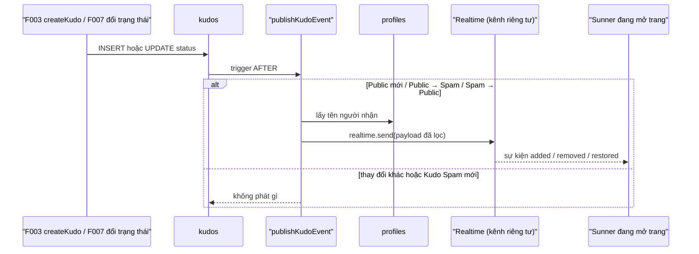
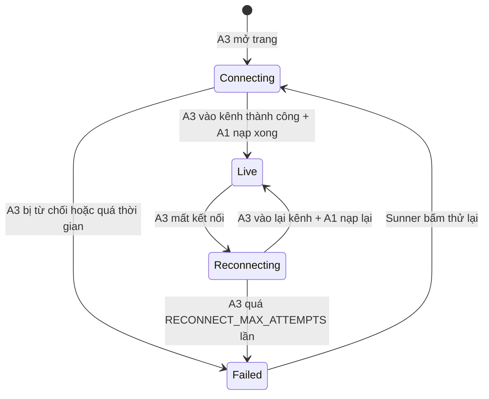

# F008_SpotlightBoard — Technical Spec

**Priority**: P2
**Type**: mixed
**Generated**: 2026-11-08

**See also:** [`functional-spec.md`](./functional-spec.md) — plain-language overview, open
decisions, requirements/business rules stated in one-liners, screens, user stories, scenarios,
edge cases, and configuration for a BA/QA audience.

**How to read this file:** § 2 is the index — pick the action you care about and read its block
in § 3 straight through; each block is one complete thread, top to bottom. § 4 is the shared
appendix — jump in only when a § 3 block points you there.

## 1. Technical Overview

Spotlight Board là một VÙNG (region) nhúng trong trang Live board của F004, không phải một trang riêng; trang và các vùng Highlight / All Kudos thuộc F004. Feature này chỉ đọc: số liệu ban đầu lấy bằng một truy vấn server (Next.js App Router + Drizzle trên Supabase Postgres), còn cập nhật sống đi qua kênh Broadcast riêng tư của Supabase Realtime do một trigger trên bảng `kudos` phát ra (xem INT-001 và D007). Bản ghi Kudo do F003 ghi, trạng thái Public/Spam do F007 quyết định, tên người nhận do F001. Mọi dữ liệu đến trình duyệt (cả ảnh chụp ban đầu lẫn sự kiện) chỉ nêu NGƯỜI NHẬN, không bao giờ có người gửi, và không tính Kudo Spam. Tên handler dưới đây là tên dự kiến (planned); cách nối Route Handler / Server Component sẽ chốt khi triển khai.

## 2. Action Index

| # | Action (handler) | Method · Path | Codes | Writes | Detail |
|---|---|---|---|---|---|
| **A0** | *cross-cutting — belongs to no single action* | — | FR-002, FR-601 | — | § 4.4 |
| **A1** | `SpotlightSnapshotHandler#get` (planned) | `GET` `/api/spotlight` | FR-001, FR-101, FR-201, FR-202, FR-203, FR-206, FR-406, FR-602, BR-001, BR-002, BR-003, ALG-001, US001 | — *(read-only)* | § 3.1 |
| **A2** | `SpotlightEventPublisher#publishKudoEvent` (planned, DB trigger) *(background, no FE)* | trigger · `kudos` → `realtime.send` | FR-001, FR-401, FR-402, FR-602, BR-001, BR-003, BR-004, INT-001, US002 | — *(chỉ phát sự kiện, không ghi bảng nghiệp vụ)* | § 3.2 ▸ **diagram** |
| **A3** | `SpotlightRealtimeClient#applyEvent` (planned, client only) | — | FR-204, FR-401, FR-402, FR-403, BR-002, DEC-001, SM-001, ALG-001, INT-001, US002 | — *(client only, no server write)* | § 3.2 |
| **A4** | `SpotlightSearch#filterNames` (planned, client only) | — | FR-404, BR-005, DEC-002, US003 | — *(client only, no server write)* | § 3.3 |
| **A5** | `SpotlightFullscreen#toggle` (planned, client only) | — | FR-405, US004 | — *(client only, no server write)* | § 3.4 |

## 3. Actions

### 3.1 CAP-01 — Xem đám mây tên và tổng số Kudos

#### A1 · Lấy ảnh chụp ban đầu của Spotlight Board
`GET /api/spotlight` → `` `SpotlightSnapshotHandler#get` (planned) ``
`FR-001` `FR-101` `FR-201` `FR-202` `FR-203` `FR-206` `FR-406` `FR-602` `BR-001` `BR-002` `BR-003` `ALG-001` `US001` · `SCR016_SpotlightBoardRegion` (draft)

**Who** · Sunner đã đăng nhập *(gate A0 — § 4.4)*
**FE** · Vùng Spotlight (R4 trong trang Live board của F004) hiện nhãn "Sun* Annual Awards 2025" và tiêu đề "SPOTLIGHT BOARD" (FR-201), bộ đếm "{số} KUDOS" (FR-203), đám mây tên người nhận (FR-202) và các dòng sự kiện gần nhất. Bấm một tên thì đi tới profile của người đó (FR-406, đích mặc định theo D004; profile thuộc F012). Khi không có Kudo Public nào thì hiện "0 KUDOS" kèm thông báo trống (FR-206). Cỡ và vị trí tên do ALG-001 tính ở client.
**Request** · không tham số; vùng gọi một lần khi mở trang và mỗi lần kết nối lại (A3)
**BE** · `` `SpotlightSnapshotHandler#get` (planned) `` — một truy vấn Drizzle gom Kudo Public theo người nhận, ghép tên từ hồ sơ Sunner, lấy tối đa `NAME_CLOUD_MAX` tên theo số Kudo giảm dần; một truy vấn đếm tổng Kudo Public (phạm vi mặc định theo D002); một truy vấn lấy `TICKER_HISTORY_ON_LOAD` Kudo Public mới nhất cho luồng sự kiện. Không chọn cột người gửi ở bất kỳ truy vấn nào (BR-003, không lộ người gửi, kể cả Kudo ẩn danh).
**Rule**
- **BR-001 — Chỉ Kudo Public được đếm và hiện.** *(§ 4.4)*
- **BR-002 — Cỡ tên theo số Kudo Public người đó nhận, chia theo `SIZE_TIERS` bậc.** *(§ 4.4)*
- **BR-003 — Không dữ liệu nào gửi trình duyệt có định danh người gửi.** *(§ 4.4)*
**Result** · read-only — không ghi DB. Trả `{ total, names[{recipientId, name, count}], recent[{kudoId, recipientId, name, occurredAt}] }`; `recent` xếp **cũ nhất trước** (hợp đồng `spotlight-views.ts`, phase 11). Vùng dựng đám mây theo ALG-001 (tính cỡ và vị trí ổn định, § 4.5).
**Source:** TBD (draft)

<!-- Không có diagram: dưới ngưỡng (chỉ đọc, đồng bộ, không ghi bảng nào). -->

---

### 3.2 CAP-02 — Theo dõi Kudo mới theo thời gian thực

Hai action đi chung một luồng dọc: A2 (trigger phát sự kiện) → kênh Broadcast → A3 (client áp sự kiện). Sơ đồ đặt ở A2; A3 là xử lý phía trình duyệt.

#### A2 · Phát sự kiện khi một Kudo Public xuất hiện, bị gỡ hoặc được khôi phục *(background, no FE)*
`trigger · kudos` → `` `SpotlightEventPublisher#publishKudoEvent` (planned) ``
`FR-001` `FR-401` `FR-402` `FR-602` `BR-001` `BR-003` `BR-004` `INT-001` `US002` · `SCR016_SpotlightBoardRegion` (draft)

**Who** · *no human actor — trigger chạy khi F003 ghi Kudo mới hoặc F007 đổi trạng thái Kudo*
**FE** · *none*
**Request** · *no HTTP request* — payload từ trigger: dòng `kudos` cũ/mới (`id`, `recipient_id`, `status`, `created_at`)
**BE** · `` `SpotlightEventPublisher#publishKudoEvent` (planned) `` — hàm Postgres chạy AFTER INSERT / AFTER UPDATE OF `status` trên `kudos`: ghép tên người nhận từ `profiles`, dựng payload tối thiểu rồi gọi `realtime.send` vào kênh riêng tư (INT-001: Supabase Realtime Broadcast, phát payload đã lọc tới các Sunner đang mở trang, *§ 4.5*). Lỗi khi phát bị nuốt và ghi log để không làm hỏng việc ghi Kudo.
**Rule**
- **BR-004 — Mỗi Kudo Public mới sinh đúng một sự kiện `added`; đổi Public → Spam sinh `removed`; đổi Spam → Public sinh `restored`; các thay đổi khác không sinh sự kiện.** Dùng `kudoId` làm khoá chống trùng ở client. TBD (draft)
- **BR-001 — Kudo không Public không bao giờ sinh sự kiện `added`.** *(§ 4.4)*
- **BR-003 — Payload không chứa `sender_id`, `is_anonymous` hay bất kỳ cột người gửi nào.** Trigger chọn từng trường một, không chuyển cả dòng. *(§ 4.4)*
**Result**
- Phát một thông điệp Broadcast `{ type, kudoId, recipientId, recipientName, occurredAt }` lên kênh `SPOTLIGHT_TOPIC` — không ghi bảng nghiệp vụ nào.
**Source:** TBD (draft)



<!-- Diagram vì là action nền/bất đồng bộ. Rung ghi sự thật (cột nào, payload nào); sơ đồ chỉ giữ thứ tự và nhánh. -->

---

#### A3 · Áp sự kiện vào bảng: bộ đếm, đám mây, luồng sự kiện *(client only)*
`—` → `` `SpotlightRealtimeClient#applyEvent` (planned) ``
`FR-204` `FR-401` `FR-402` `FR-403` `BR-002` `DEC-001` `SM-001` `ALG-001` `INT-001` `US002` · `SCR016_SpotlightBoardRegion` (draft)

**Who** · Sunner đã đăng nhập, đang mở Live board *(gate A0 — § 4.4)*
**FE** · Component client của vùng Spotlight vào kênh riêng tư `SPOTLIGHT_TOPIC` sau khi `setAuth` bằng phiên hiện tại (INT-001) và theo dõi trạng thái kết nối (SM-001). Mỗi sự kiện được áp theo DEC-001; dòng sự kiện hiện "{giờ} {tên người nhận} đã nhận được một Kudos mới" (FR-204), tối đa `TICKER_VISIBLE_LINES` dòng, dòng cũ mờ dần. Mất kết nối thì hiện nhãn "Đang kết nối lại…" (FR-403); nối lại được thì gọi lại A1 rồi thay toàn bộ số liệu.
**Request** · thông điệp Broadcast `{ type: added|removed|restored, kudoId, recipientId, recipientName, occurredAt }`; kiểm bằng Zod phía client, bỏ qua thông điệp sai dạng
**BE** · không có — xử lý hoàn toàn ở trình duyệt; quyền nhận do chính sách RLS trên `realtime.messages` (§ 4.4, A0).
**Rule** · quyết định cách áp một sự kiện:

| DEC | subtype | Condition | What the user sees | Source |
|---|---|---|---|---|
| **DEC-001** | render | `event.type = added` và `kudoId` chưa gặp | bộ đếm +1, số Kudo của người nhận +1 (thêm tên mới nếu chưa có, tên vừa nhận được làm nổi tạm thời), thêm một dòng vào luồng sự kiện | TBD (draft) |
| **DEC-001** | render | `event.type = removed` | bộ đếm −1, số Kudo của người nhận −1 (tên biến mất khi về 0), dòng sự kiện của `kudoId` đó rời luồng | TBD (draft) |
| **DEC-001** | render | `event.type = restored` | bộ đếm +1, số Kudo của người nhận +1, KHÔNG thêm dòng sự kiện (không phải tin mới) | TBD (draft) |

- **BR-002 — Cỡ tên theo số Kudo Public người đó nhận.** Khi số đếm đổi, chỉ tính lại bậc cỡ; tên đã đặt giữ nguyên vị trí nếu bậc không đổi. *(§ 4.4)*
**Result** · không gọi server khi áp sự kiện, không ghi DB. State client: tổng, bản đồ `recipientId → {name, count}`, danh sách dòng sự kiện. Cỡ/vị trí tính bằng ALG-001 *(§ 4.5)*.
**State** · `SM-001`: `Connecting` → `Live` · `Live` → `Reconnecting` → `Live` *(§ 4.3)*
**Source:** TBD (draft)

<!-- Không có diagram: thuần client, không ghi bảng; nhánh nằm trong bảng DEC-001. -->

---

### 3.3 CAP-03 — Tìm tên trên bảng

#### A4 · Lọc và làm nổi tên khớp trong đám mây *(client only)*
`—` → `` `SpotlightSearch#filterNames` (planned) ``
`FR-404` `BR-005` `DEC-002` `US003` · `SCR016_SpotlightBoardRegion` (draft)

**Who** · Sunner đã đăng nhập
**FE** · Ô "Tìm kiếm" ở góc trên trái vùng Spotlight. Gõ tới đâu lọc tới đó (có debounce) trên danh sách tên đang hiện, không gọi server (mặc định D003 — khác ô tìm profile của F004, vốn tìm toàn bộ Sunner).
**Request** · chuỗi gõ vào, cắt tối đa `SEARCH_MAX_LENGTH` ký tự
**BE** · không có.
**Rule** · quyết định cách hiện đám mây theo ô tìm:

| DEC | subtype | Condition | What the user sees | Source |
|---|---|---|---|---|
| **DEC-002** | interaction | ô tìm rỗng | mọi tên hiện bình thường | TBD (draft) |
| **DEC-002** | interaction | có chữ và có tên khớp | tên khớp được làm nổi, tên không khớp mờ đi (vị trí giữ nguyên) | TBD (draft) |
| **DEC-002** | interaction | có chữ nhưng không tên nào khớp | đám mây mờ hết kèm thông báo "Không tìm thấy tên nào" | TBD (draft) |

- **BR-005 — So khớp không phân biệt hoa thường và dấu tiếng Việt, theo mọi phần của tên.** Ví dụ "chuc" khớp "Nguyễn Bá Chức". TBD (draft)
**Result** · không ghi DB, không gọi server. Chỉ đổi trạng thái hiển thị; bộ đếm và luồng sự kiện không đổi.
**Source:** TBD (draft)

<!-- Không có diagram: thuần client, một bảng nhánh. -->

---

### 3.4 CAP-04 — Phóng to bảng

#### A5 · Phóng to / thu nhỏ vùng Spotlight *(client only)*
`—` → `` `SpotlightFullscreen#toggle` (planned) ``
`FR-405` `US004` · `SCR016_SpotlightBoardRegion` (draft)

**Who** · Sunner đã đăng nhập
**FE** · Nút phóng to ở góc dưới phải. Bấm thì gọi Fullscreen API trên chính vùng Spotlight (mặc định D005); khi đang phóng to, nút đổi thành thu nhỏ; phím Esc cũng thoát. Kết nối thời gian thực, bộ đếm, ô tìm và luồng sự kiện vẫn chạy bình thường khi phóng to. Trình duyệt không hỗ trợ hoặc từ chối thì hiện thông báo ngắn và vùng giữ nguyên.
**Result** · không gọi server, không ghi DB. Chỉ đổi chế độ hiển thị của vùng.
**Source:** TBD (draft)

<!-- Không có diagram: thuần client. -->

---

### 3.5 Edge cases

| Action | Scenario | Behavior |
|---|---|---|
| A1 | Chưa có Kudo Public nào | `total = 0`, `names` rỗng; FE hiện "0 KUDOS" và thông báo trống (FR-206) |
| A1 | Số người nhận vượt `NAME_CLOUD_MAX` | Chỉ trả các tên nhiều Kudo nhất; `total` vẫn là tổng thật, không phải tổng của các tên hiện |
| A1 | Hai người bằng số Kudo | Xếp theo `recipientId` tăng dần để danh sách ổn định giữa các lần gọi |
| A2 | Kudo mới tạo đã là Spam, hoặc sửa nội dung nhưng `status` không đổi | Không phát sự kiện (BR-004) |
| A2 | Hàm phát sự kiện lỗi (Realtime lỗi, thiếu hồ sơ người nhận) | Nuốt lỗi + ghi log; Kudo vẫn được ghi; client tự khớp lại ở lần nạp A1 kế tiếp |
| A2 · A3 | Sự kiện đến trùng `kudoId` (kết nối lại, phát lại) | Bỏ qua bản trùng (DEC-001), bộ đếm không tăng hai lần |
| A3 | Sự kiện `removed` cho `kudoId` mà client chưa từng thấy | Vẫn trừ bộ đếm và số Kudo của người nhận (không âm); không có dòng để gỡ |
| A3 | Đứt kết nối rồi nối lại | Gọi lại A1 và thay toàn bộ số liệu, không cộng dồn sự kiện bị lỡ |
| A3 | Phiên hết hạn trong lúc đang nghe | Quyền kênh được kiểm lúc vào và cache theo kết nối; gia hạn token rồi vào lại, không được thì hiện trạng thái lỗi (SM-001) |
| A4 | Chuỗi gõ chứa ký tự đặc biệt | So khớp như chuỗi thường (không dùng regex) |
| A5 | Thoát phóng to bằng Esc | Đồng bộ lại nút về trạng thái "phóng to" |
| A1-A5 | Chưa đăng nhập | Chuyển về màn đăng nhập (trang) hoặc 401 (dữ liệu); kênh riêng tư từ chối vào — cite A0 § 4.4 |

## 4. Shared Foundation

### 4.1 Components

| Component | Responsibility | Used in | File |
|---|---|---|---|
| `SpotlightSnapshotHandler` (planned) | Điểm vào đọc ảnh chụp ban đầu | A1 | `TBD (draft)` |
| `SpotlightPublicQuery` (planned) | Truy vấn Drizzle dùng chung: lọc Public, gom theo người nhận, không chọn cột người gửi | A1 | `TBD (draft)` |
| `SpotlightEventPublisher` (planned) | Hàm + trigger Postgres phát sự kiện đã lọc | A2 | `TBD (draft)` |
| `SpotlightBoardRegion` (planned) | Component client của vùng: giữ state, nối kênh, vẽ bộ đếm / đám mây / luồng sự kiện | A3, A4, A5 | `TBD (draft)` |
| `SpotlightCloudLayout` (planned) | Tính cỡ + vị trí tên (ALG-001) | A1, A3 | `TBD (draft)` |

### 4.2 Data Model

Feature này không có bảng nghiệp vụ mới; nó ĐỌC thực thể của feature khác và thêm đối tượng phía DB (hàm + trigger + chính sách kênh).

| Entity | Table | Used for | Action |
|---|---|---|---|
| Kudo *(F003, trạng thái F007)* | `kudos` | Nguồn đếm, người nhận, thời điểm gửi, `status`; trigger gắn vào đây | A1, A2 |
| Hồ sơ Sunner *(F001)* | `profiles` | Tên người nhận | A1, A2 |
| Hàm + trigger phát sự kiện *(F008, đối tượng DB, không phải bảng)* | `TBD (draft)` | Phát sự kiện đã lọc | A2 |
| Chính sách đọc kênh *(F008, trên bảng hệ thống `realtime.messages`)* | `TBD (draft)` | Chỉ Sunner đã xác thực nhận được | A3 |

#### Polymorphic Behavior

TBD (draft) — `kudos.status` (public | spam) là trường phân loại do F007 sở hữu và là trường duy nhất quyết định nhánh của A1/A2; mã DISC-### được cấp khi data model được promote, không cấp ở đây. Giá trị `type` của sự kiện (`added` | `removed` | `restored`) là hợp đồng thông điệp của INT-001, không phải cột của thực thể.

### 4.3 State Management

### Trạng thái kết nối thời gian thực của vùng Spotlight (SM-001)
**kind:** ui
**Linked FR:** FR-403
**Source:** TBD (draft)



**Action transitions:** guard và tác dụng phụ của từng cạnh nằm ở rung **Result** của action nêu trên cạnh (§ 3.2) — không lặp lại ở đây (DRY).

### 4.4 Shared Rules

#### Bin 3 — cross-cutting, belongs to no single action

**A0 · FR-601 / FR-002 — mọi action yêu cầu phiên đăng nhập hợp lệ và feature này không bao giờ ghi dữ liệu Kudo.**
Kiểm phiên Supabase Auth (Google, `@sun-asterisk.com`) ở lớp dùng chung của trang và route dữ liệu trước khi chạy truy vấn; không có phiên thì chuyển về đăng nhập (trang) hoặc trả 401 (dữ liệu). Kênh Broadcast là kênh riêng tư: chính sách trên `realtime.messages` chỉ cho vai trò đã xác thực nhận (`extension = broadcast` và topic = `SPOTLIGHT_TOPIC`); kênh công khai phải tắt trong cài đặt Realtime. Truy vấn của feature chỉ dùng SELECT; hàm phát sự kiện không sửa `kudos`. Cơ chế phiên thuộc F001; không phải rule riêng của feature này.
**Source:** TBD (draft)

#### Bin 2 — used by ≥2 named actions

**BR-001 — Chỉ Kudo ở trạng thái Public được đếm, hiện và phát đi.**
Used in: **A1** · **A2**. A1 lọc `status = 'public'` trong `SpotlightPublicQuery`; A2 chỉ phát `added` khi dòng mới là Public và chỉ phát `removed`/`restored` khi `status` đổi qua lại giữa hai giá trị. Spam không bao giờ vào tập đếm hay luồng.
**Source:** TBD (draft)
```text
A1: total = COUNT(kudos WHERE status = 'public')
A2: on INSERT  if NEW.status = 'public'                  -> send added
    on UPDATE  if OLD.status='public' AND NEW.status='spam'   -> send removed
               if OLD.status='spam'   AND NEW.status='public' -> send restored
```

**BR-002 — Cỡ tên theo số Kudo Public người đó nhận, chia theo `SIZE_TIERS` bậc, hạng phân vị trên tập tên đang hiện.**
Used in: **A1** · **A3**. A1 tính bậc lần đầu, A3 tính lại khi số đếm đổi. Tên có nhiều Kudo nhất rơi vào bậc lớn nhất; bằng nhau cùng bậc. Tiêu chí còn chờ xác nhận (D001).
**Source:** TBD (draft)
```text
ranked = sort(names, count desc, recipientId asc)
tier(n) = SIZE_TIERS - floor(rank(n) * SIZE_TIERS / len(ranked))   # 1..SIZE_TIERS
```

**BR-003 — Không dữ liệu nào đến trình duyệt có định danh người gửi, cả ảnh chụp lẫn sự kiện.**
Used in: **A1** · **A2**. Che ở nguồn: truy vấn không chọn cột người gửi, trigger tự chọn từng trường của payload thay vì chuyển cả dòng. Không dựa vào việc FE ẩn đi. Drizzle chạy bằng vai trò server nên bỏ qua RLS của Supabase; vì vậy việc loại cột phải nằm trong `SpotlightPublicQuery` và hàm phát sự kiện, không trông vào RLS.
**Source:** TBD (draft)
```text
payload = { type, kudoId: NEW.id, recipientId: NEW.recipient_id,
            recipientName: profiles.full_name, occurredAt: NEW.created_at }
# KHÔNG có: sender_id, is_anonymous, body, hashtag, ảnh
```

### 4.5 Algorithms & Integrations

### Xếp cỡ và vị trí tên trong đám mây sao cho ổn định giữa các lần cập nhật (ALG-001)
**Linked FR:** FR-202
**Used in:** A1, A3
**Source:** TBD (draft)
**Input:** danh sách `{recipientId, name, count}` (≤ `NAME_CLOUD_MAX`) · **Output:** `{recipientId, tier, x, y}` · **Complexity:** O(n²) trong trường hợp xấu, n ≤ `NAME_CLOUD_MAX` nên chấp nhận được
**Description:** Tính bậc cỡ theo BR-002 rồi đặt tên lớn trước theo vòng xoắn từ tâm, tránh đè nhau. Góc xuất phát lấy từ băm của `recipientId` nên cùng một người luôn ra cùng chỗ giữa các lần vẽ; khi một sự kiện chỉ đổi số đếm, tên đã đặt không bị xếp lại trừ khi đổi bậc.

**Pseudocode:**
```text
names = top NAME_CLOUD_MAX by (count desc, id asc)
for n in names: n.tier = tier(n)                    # BR-002
for n in names sorted by tier desc:
  a0 = hash(n.recipientId) mod 360
  for step in spiral(a0):                           # bán kính tăng dần
    if not overlaps(box(n, step), placed): place n; break
on count change: recompute tiers only; keep placed if tier unchanged
```

### Phát sự kiện Spotlight qua kênh Broadcast riêng tư của Supabase Realtime (INT-001)
**Linked FR:** FR-401
**Used in:** A2 → A3
**Source:** TBD (draft)
**Type:** event-publish
**Target:** Supabase Realtime — kênh Broadcast riêng tư `SPOTLIGHT_TOPIC`, phát từ trigger Postgres bằng `realtime.send`
**Payload:** `{ type: added|removed|restored, kudoId, recipientId, recipientName, occurredAt }` — không có trường người gửi (BR-003)
**Failure handling:** hàm phát bắt mọi lỗi và chỉ ghi log, không chặn việc ghi Kudo; sự kiện lỡ khi client đứt kết nối được bù bằng cách A3 gọi lại A1 khi nối lại, không phát lại sự kiện cũ. Quyền nhận kiểm lúc vào kênh và cache theo kết nối, nên gỡ quyền chỉ có hiệu lực khi token hết hạn.

### 4.6 Configuration

```text
NAME_CLOUD_MAX = 60               # số tên tối đa trong đám mây (A1) — mặc định đề xuất, D001
SIZE_TIERS = 4                    # số bậc cỡ chữ của tên (A1, A3) — mặc định đề xuất, D001
TICKER_VISIBLE_LINES = 5          # số dòng sự kiện hiện cùng lúc (A3) — mặc định đề xuất, D006
TICKER_HISTORY_ON_LOAD = 5        # số dòng lấy từ lịch sử khi mở trang (A1) — mặc định đề xuất, D006
SEARCH_MAX_LENGTH = 50            # độ dài tối đa ô tìm (A4)
SPOTLIGHT_TOPIC = "spotlight"     # tên kênh Broadcast riêng tư (A2, A3) — đã chốt ở phase 11 (event "kudo", `features/spotlight-board/spotlight-config.ts`)
RECONNECT_MAX_ATTEMPTS = 5        # số lần nối lại trước khi báo lỗi (A3, SM-001)
```

**Client behavior:** see
[`behavior-logic.md`](../../docs/generated/behavior-logic.md) (client-side patterns — debounce, optimistic UI, polling, upload, realtime),
[`permissions.md`](../../docs/system/permissions.md) (feature flags / experiments / env / locale gates),
[`architecture.md`](../../docs/system/architecture.md) (guards / deep-link state restoration / unsaved-changes protection).

## 5. Verification & Technical Notes

### 5.1 Technical Verification

- **SC-001** *(A1, A2)* Kudo Spam không được đếm, không hiện tên, không sinh sự kiện `added` (covers FR-001, BR-001)
- **SC-002** *(A1, A2)* Phản hồi A1 và payload A2 của Kudo ẩn danh không chứa trường nào của người gửi (covers FR-602, BR-003)
- **SC-003** *(A2, A3)* Tạo một Kudo Public thì mọi client đang mở thấy bộ đếm +1 và một dòng mới không cần tải lại (covers FR-401, BR-004, DEC-001)
- **SC-004** *(A2, A3)* Mark Spam / Un Spam đổi bộ đếm đúng hai chiều, và Un Spam không thêm dòng sự kiện (covers FR-402, DEC-001)
- **SC-005** *(A3)* Cắt kết nối rồi nối lại thì số liệu khớp với A1, không đếm đôi (covers FR-403, SM-001)
- **SC-006** *(A1, A3)* Không phiên thì không có ảnh chụp và không vào được kênh (covers FR-601)
- **SC-007** *(A4)* Gõ "chuc" làm nổi "Nguyễn Bá Chức" và làm mờ tên khác (covers FR-404, BR-005, DEC-002)

#### US001_ViewSpotlightBoard *(A1)*

**Independent Test:** Có Kudo Public gửi tới nhiều người nhận với số lượng khác nhau và một Kudo Spam; gọi A1.

**Acceptance Scenarios:**

1. **Given** 5 Kudo Public tới 3 người, **When** gọi A1, **Then** `total = 5`, `names` có 3 người với `count` đúng.
2. **Given** thêm một Kudo Spam, **When** gọi A1, **Then** `total` và `count` không đổi.

#### US002_FollowLiveKudosTicker *(A2, A3)*

**Independent Test:** Mở bảng ở hai trình duyệt; tạo một Kudo (một ẩn danh, một công khai) rồi Mark Spam.

**Acceptance Scenarios:**

1. **Given** hai phiên đang mở, **When** F003 ghi một Kudo ẩn danh tới Sunner X, **Then** cả hai thấy bộ đếm +1 và dòng "… X đã nhận được một Kudos mới", không có tên người gửi ở bất kỳ đâu trong thông điệp.
2. **Given** Kudo đó, **When** F007 Mark Spam, **Then** bộ đếm −1, số Kudo của X −1, dòng của Kudo đó rời luồng.

#### US003_SearchSpotlightNames *(A4)*

**Independent Test:** Bảng có tên "Nguyễn Bá Chức" và "Trần Văn An"; gõ từng từ khoá.

**Acceptance Scenarios:**

1. **Given** hai tên trên, **When** gõ "chuc", **Then** "Nguyễn Bá Chức" nổi, "Trần Văn An" mờ.
2. **Given** từ khoá không khớp, **When** gõ "zzzz", **Then** hiện "Không tìm thấy tên nào".

#### US004_ExpandSpotlightBoard *(A5)*

**Independent Test:** Bấm nút phóng to rồi Esc.

**Acceptance Scenarios:**

1. **Given** bảng ở chế độ thường, **When** bấm nút phóng to, **Then** vùng chiếm toàn màn hình và số liệu vẫn cập nhật.
2. **Given** đang phóng to, **When** bấm Esc, **Then** về chế độ thường và nút đổi lại.

### 5.2 Assumptions

- *(A1, A2)* F003 ghi `kudos` với cột `recipient_id`, `status`, `created_at`, `is_anonymous` như spec F003; người nhận không đổi được khi sửa Kudo (F003 D007, mặc định) nên không cần sự kiện đổi người nhận.
- *(A2)* Trigger + hàm phát sự kiện là migration của F008 và do F008 sở hữu; F003 không tự phát sự kiện (F003 § 5.2). Đây là thay đổi schema nên khi triển khai phải chạy kiểm thử đầy đủ cho đường ghi Kudo.
- *(A3)* Vài trăm Sunner mở trang cùng lúc là mức tải điển hình; Broadcast phù hợp mức này mà không cần hạ tầng thêm.
- *(A1)* Không cache ảnh chụp ở bản đầu, nên Mark Spam có hiệu lực ngay ở lần nạp kế tiếp.

### 5.3 Unresolved Questions

1. **Next.js 16** *(A1)*: Route Handler hay đọc thẳng trong Server Component cho ảnh chụp? Phải đối chiếu `node_modules/next/dist/docs/` khi triển khai vì phiên bản này có thay đổi so với kiến thức cũ; tên và path ở đây chỉ là dự kiến.
2. **`realtime.send` hay `realtime.broadcast_changes`** *(A2)*: tài liệu Supabase nhấn mạnh `broadcast_changes` (gửi cả dòng cũ/mới nên sẽ lộ `sender_id`); bản này chọn `realtime.send` với payload tự dựng. Cần thử trên môi trường thật xem `realtime.send` có hành vi đúng trong cùng giao dịch ghi Kudo (không phát khi rollback) không. **Đã kiểm trên Supabase local ở phase 11: không phát khi rollback; `realtime.send` đúng chữ ký, thêm khoá `id` vào payload.** Chưa kiểm trên hosted.
3. **Khôi phục sau đứt kết nối dài** *(A3)*: ngoài nạp lại khi nối lại, có cần làm tươi định kỳ để chống lệch số do sự kiện lỡ? Mặc định không, xem lại nếu đo thấy lệch.
4. **Xoá cứng Kudo** *(A2)*: nếu sau này có xoá thật (không chỉ Spam) thì cần thêm nhánh `removed` ở trigger DELETE; hiện chưa có luồng xoá.
5. **Đồng hồ hiển thị** *(A3)*: dùng giờ cục bộ của trình duyệt, định dạng theo ngôn ngữ (next-intl); múi giờ chuẩn của sự kiện lễ trao giải chưa nêu.

### 5.4 Source References

Chưa có mã nguồn — xem `## 7. User Stories` trong `functional-spec.md` cho hành vi dự kiến.

#### Data Flow

```text
INSERT/UPDATE kudos -> publishKudoEvent (lọc Public, bỏ cột người gửi, ghép tên người nhận) -> Broadcast riêng tư -> applyEvent (DEC-001) -> bộ đếm / đám mây / luồng sự kiện
mở trang hoặc nối lại -> SpotlightPublicQuery (Public, gom theo người nhận) -> ảnh chụp JSON -> ALG-001 -> vẽ
```

### 5.5 Artifact References

| Artifact | File | Codes Used | Reviewed |
|----------|------|------------|----------|
| System Overview | [system-overview.md](../../docs/system/system-overview.md) | TBD (draft) | [ ] |
| Architecture | [architecture.md](../../docs/system/architecture.md) | TBD (draft) | [ ] |
| Feature List | [feature-list.md](../feature-list.md) | F008 | [x] |
| API Map | [api-map.md](../../docs/generated/api-map.md) | TBD (draft) | [ ] |
| Entities | [entities.md](../../docs/generated/entities.md) | TBD (draft) | [ ] |
| Screens | [functional-spec.md § 6](./functional-spec.md#6-screens) | TBD (draft) | [ ] |
| Behavior Logic | [behavior-logic.md](../../docs/generated/behavior-logic.md) | TBD (draft) | [ ] |
| Permissions Matrix | [permissions-matrix.md](../../docs/generated/permissions-matrix.md) | TBD (draft) | [ ] |
| User Stories | [user-stories.md](../../docs/generated/user-stories.md) | TBD (draft) | [ ] |

**Codes are written BARE — no braces.** Hàng chưa có mã thật ghi `TBD (draft)`.

**Rule:** Every code listed in Codes Used MUST exist in its source artifact. Orphan refs = reviewer critical.
