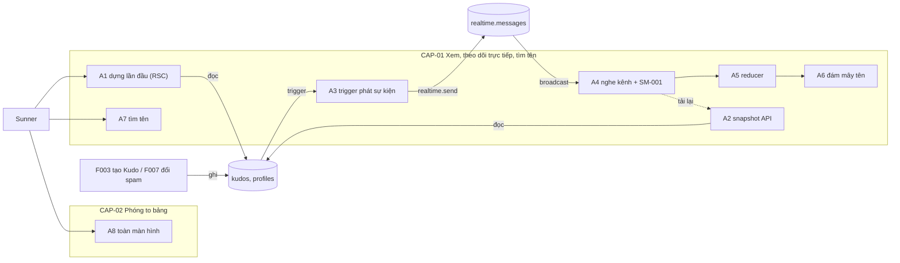
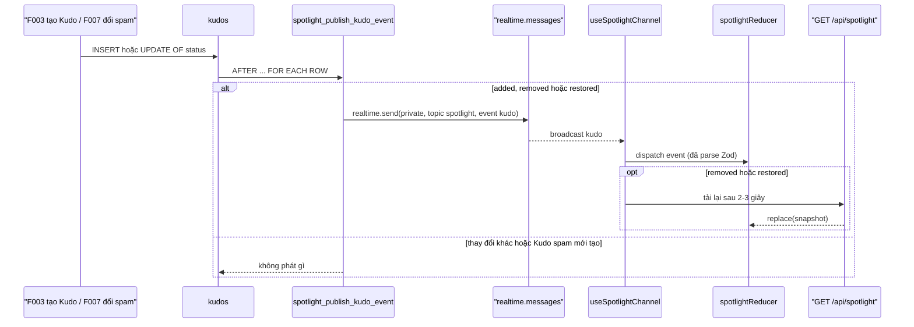
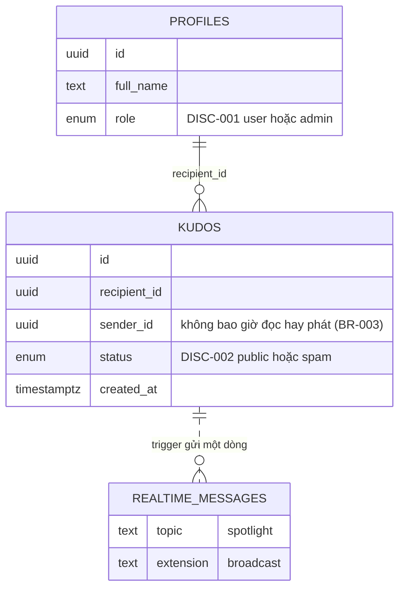
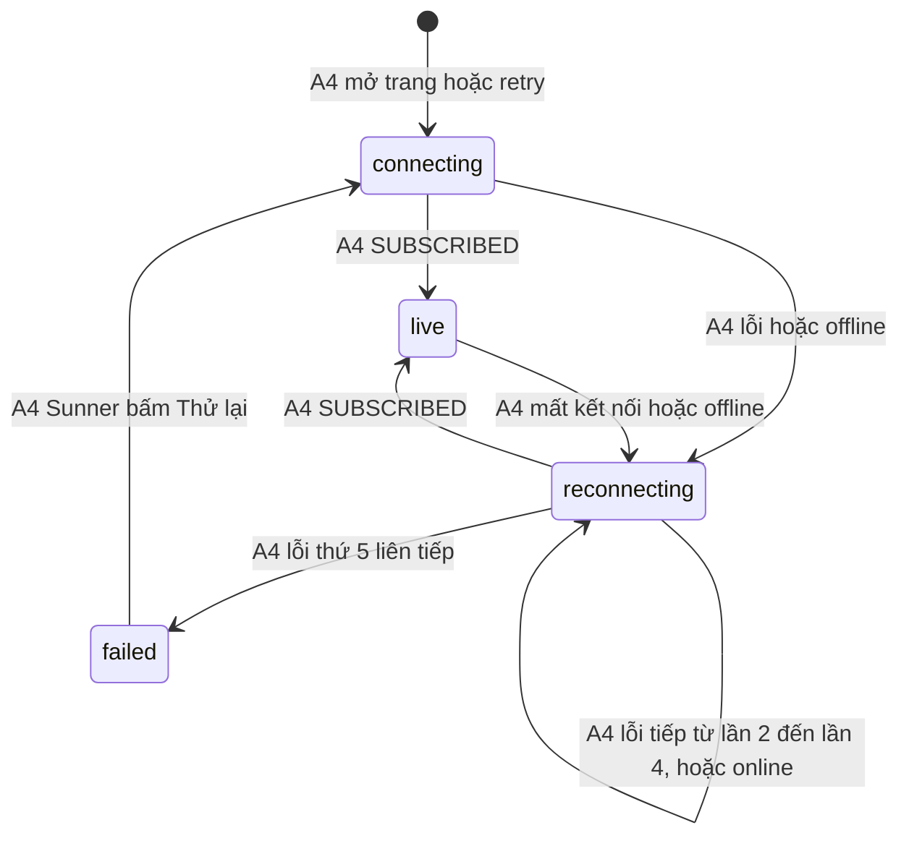

<!-- layout-exempt: rebuild-spec owns all docs/system|features|generated|flows paths — all references here are output targets or internal definitions -->
<!-- Contract: references/feature-spec-researcher-contract.md -->
<!-- Nửa Dev/QA/SA của cặp spec. Phát biểu bằng lời thường của FR/BR/DEC/SM nằm ở functional-spec.md; ở đây chỉ ghi cách triển khai. -->

# F008_SpotlightBoard — Technical Spec

**Priority**: P2
**Type**: mixed
**Generated**: 2026-11-24

**See also:** [`functional-spec.md`](./functional-spec.md) — plain-language overview, open
decisions, requirements/business rules stated in one-liners, screens, user stories, scenarios,
edge cases, and configuration for a BA/QA audience.

**How to read this file:** § 2 is the index — pick the action you care about and read its block
in § 3 straight through; each block is one complete thread, top to bottom. § 4 is the shared
appendix — jump in only when a § 3 block points you there.

## 1. Technical Overview

Spotlight Board là một vùng (region REG004) nhúng trong trang Live board `/kudos`, không có route riêng; feature chỉ đọc. Lần dựng đầu đọc một snapshot trên server (Next.js App Router, Drizzle trên Postgres của Supabase); sau đó một trigger trên bảng `kudos` phát sự kiện qua kênh Broadcast riêng tư `spotlight` của Supabase Realtime, trình duyệt áp sự kiện vào reducer thuần và tải lại snapshot ở các mốc nhất định để số liệu luôn khớp. Mọi dữ liệu tới trình duyệt chỉ nêu người nhận của Kudo public, không bao giờ có người gửi.



## 2. Action Index

| # | Action (handler) | Method · Path | Codes | Writes | Detail |
|---|---|---|---|---|---|
| **A0** | *cross-cutting — belongs to no single action* | — | FR-002, FR-601 | — | § 4.4 |
| **A1** | `load-spotlight-snapshot#loadSpotlightSnapshot` | `GET` `/kudos` | FR-001, FR-101, FR-201, FR-205, FR-206, FR-601, FR-602, BR-001, BR-003, US042 | — *(read-only)* | § 3.1 |
| **A2** | `spotlight/route#GET` | `GET` `/api/spotlight` | FR-001, FR-205, FR-407, FR-601, FR-602, BR-001, BR-003, US042 | — *(read-only)* | § 3.1 |
| **A3** | `spotlight_publish_kudo_event#fire` *(background, no FE)* | trigger · `AFTER INSERT OR UPDATE OF status ON public.kudos` | FR-001, FR-401, FR-402, FR-602, BR-001, BR-003, BR-004, INT-001 | — *(chỉ phát broadcast bằng `realtime.send`, không ghi bảng nghiệp vụ)* | § 3.1 ▸ **diagram** |
| **A4** | `use-spotlight-channel#useSpotlightChannel` | — | FR-403, FR-407, FR-601, BR-007, SM-001, INT-001, US042 | — *(client only)* | § 3.1 |
| **A5** | `spotlight-state-reducer#spotlightReducer` | — | FR-203, FR-204, FR-401, FR-402, FR-408, BR-007, DEC-001 | — *(client only)* | § 3.1 |
| **A6** | `spotlight-name-cloud#SpotlightNameCloud` | — | FR-202, FR-206, FR-406, BR-002, ALG-001 | — *(client only)* | § 3.1 |
| **A7** | `normalize-search-text#nameMatcher` | — | FR-404, BR-005, DEC-002, US042 | — *(client only)* | § 3.1 |
| **A8** | `use-fullscreen-toggle#useFullscreenToggle` | — | FR-405, BR-006, DEC-003, US043 | — *(client only)* | § 3.2 |

## 3. Actions

### 3.1 CAP-01 — Xem, theo dõi trực tiếp và tìm tên trên Spotlight Board

Một luồng dọc chạy qua nhiều handler, không handler nào giữ cả trình tự: trigger A3 phát sự kiện → A4 nhận và theo dõi kết nối → A5 áp vào state → A2 tải lại snapshot để chốt số. Một sơ đồ cho cả nhóm đặt ở đây; A1 (dựng lần đầu), A6 (đám mây) và A7 (tìm tên) đứng riêng.



#### A1 · Dựng vùng lần đầu trên server: cổng phiên, snapshot, skeleton hoặc lỗi riêng
`GET /kudos` (slot trong Live board) → `` `load-spotlight-snapshot#loadSpotlightSnapshot` ``
`FR-001` `FR-101` `FR-201` `FR-205` `FR-206` `FR-601` `FR-602` `BR-001` `BR-003` `US042` · `SCR007_KudosLiveBoardFeed/REG004_SpotlightBoard`

**Who** · Sunner đã đăng nhập và đã chọn phòng ban *(gate A0 — § 4.4)*: `requireSunner()` chuyển khách về `/login`, người chưa chọn phòng ban về trang onboarding, trước khi truy vấn chạy.
**FE** · `LiveBoardSpotlightSlot` bọc `SpotlightBoardLoader` trong một Suspense riêng (FR-101) nên feed không phải chờ snapshot; fallback là `SpotlightBoardSkeleton` giữ đúng khung (`aria-busy`, "Đang tải…" chỉ cho trình đọc màn hình). Xong thì `SpotlightBoardRegion` dựng header dùng chung `LiveBoardSectionHeader` (nhãn "Sun* Annual Awards 2025" và tiêu đề "SPOTLIGHT BOARD", FR-201) rồi chọn: `snapshot` có dữ liệu → `SpotlightBoard`; `null` → `SpotlightLoadError` trong khung rỗng với nút "Thử lại" gọi A2 (FR-205), phần còn lại của trang không bị ảnh hưởng.
**Request** · không tham số, không đọc query hay body
**BE** · `loadSpotlightSnapshot` gọi `requireSunner()` rồi `SpotlightSnapshotQuery.load()`; lỗi đọc bị bắt, ghi log `[spotlight-board] loading the snapshot failed` và trả `null`. `load()` chạy 2 truy vấn Drizzle song song bằng `Promise.all` (cả A1 lẫn A2 dùng chung, mô tả một lần ở đây): (1) `kudos` INNER JOIN `profiles` theo `recipient_id`, lọc `status = 'public'`, `GROUP BY profiles.id`, xếp `count(*)` giảm dần rồi `profiles.id` tăng dần, `LIMIT NAME_CLOUD_MAX`; tổng `total` là window sum `(sum(count(*)) over ())::int` tính trước LIMIT nên là tổng thật chứ không phải tổng 60 tên, không có nhóm nào thì `total = 0`; (2) `TICKER_HISTORY_ON_LOAD` Kudo public mới nhất theo `created_at DESC, id DESC`, đảo lại thành cũ trước. Không truy vấn nào chọn cột người gửi; Drizzle chạy bằng vai trò server nên bỏ qua RLS, vì vậy danh sách cột chọn chính là lớp bảo vệ. Kết quả đi qua `SpotlightSnapshotSchema.parse` rồi mới ra khỏi server.
**Rule**
- **BR-001 — Chỉ Kudo `public` được đếm, hiện tên và vào ticker.** Cả 2 truy vấn lọc `kudos.status = 'public'` (`DISC-002`: giá trị `spam` bị loại hẳn, `public` được tính). *(§ 4.4)*
- **BR-003 — Không dữ liệu nào ra trình duyệt mang định danh người gửi.** Truy vấn chỉ chọn `recipientId`, tên, đếm, `kudoId`, thời điểm; schema Zod cắt mọi khoá lạ. *(§ 4.4)*
**Result** · read-only — **không ghi DB**. Trả `SpotlightSnapshot` `{ total, names[{recipientId, name, count}], recent[{kudoId, recipientId, recipientName, occurredAt}] }`, `recent` xếp cũ nhất trước. Không cache: Mark Spam có hiệu lực ở lần đọc kế tiếp. Indexes dùng: `kudos_public_recipient_sender_idx` (partial, truy vấn 1) và `kudos_status_created_at_id_idx` (truy vấn 2).
**Source:** `features/kudos-feed/components/live-board-spotlight-slot.tsx:15-25` → `app/(app)/kudos/page.tsx:68` → `features/spotlight-board/server/load-spotlight-snapshot.ts:13-21` → `features/spotlight-board/server/spotlight-snapshot-query.ts:24-57` → `features/spotlight-board/components/spotlight-board-region.tsx:16-26` → `features/spotlight-board/components/spotlight-board-skeleton.tsx:14-33` → `features/spotlight-board/components/spotlight-load-error.tsx:15-36`

<!-- Không có diagram: chỉ đọc, một lượt đồng bộ, không ghi bảng nào; phần bất đồng bộ nằm ở sơ đồ cấp capability phía trên. -->

---

#### A2 · Trả snapshot qua API (thử lại, tải lại sau khi nối kênh, sau kiểm duyệt, khi tab hiện lại)
`GET /api/spotlight` → `` `spotlight/route#GET` ``
`FR-001` `FR-205` `FR-407` `FR-601` `FR-602` `BR-001` `BR-003` `US042` · `SCR007_KudosLiveBoardFeed/REG004_SpotlightBoard`

**Who** · Sunner đã đăng nhập *(gate A0 — § 4.4)*: proxy trả 401 JSON cho đường API không có phiên, handler kiểm lại bằng `getSessionUser()`; không đòi chọn phòng ban (khác A1).
**FE** · `fetchSpotlightSnapshot` gọi `fetch("/api/spotlight", { cache: "no-store" })` và parse bằng `SpotlightSnapshotSchema`; mọi thất bại (mạng, 401, 5xx, body sai dạng, abort) đều thành `null`, không ném lỗi. Hai nơi gọi: nút "Thử lại" của `SpotlightLoadError`, và `SpotlightBoard.resync` do A4 hẹn giờ (FR-407); mỗi lần resync mới `abort()` request đang bay. Resync lỗi giữ nguyên số đang hiện.
**Request** · không tham số; cookie phiên Supabase
**BE** · `` `SpotlightSnapshotQuery.load` `` — đúng truy vấn đã mô tả ở A1, không có đường đọc thứ hai. Header `Cache-Control: private, no-store` gắn vào cả 200, 401 và 500.
**Rule**
- **BR-001 — Chỉ Kudo `public` được đếm và hiện.** Dùng chung truy vấn với A1 nên spam không bao giờ vào `total`, `names` hay `recent`. *(§ 4.4)*
- **BR-003 — Phản hồi không chứa định danh người gửi.** Body đã qua `SpotlightSnapshotSchema.parse`; lỗi 500 chỉ trả `{ code }`, không kèm chi tiết. *(§ 4.4)*
**Result** · read-only — **không ghi DB**. 200 `SpotlightSnapshot`; 401 `{ code: "unauthorized" }` trả trước mọi truy vấn DB; 500 `{ code: "unexpected" }` (lỗi chỉ `console.error` phía server).
**Source:** `app/api/spotlight/route.ts:12-23` → `features/spotlight-board/server/spotlight-snapshot-query.ts:50-57` → `features/spotlight-board/lib/fetch-spotlight-snapshot.ts:14-22` → `features/spotlight-board/components/spotlight-board.tsx:33-40` → `shared/auth/session-proxy.ts:71-75`

<!-- Không có diagram: chỉ đọc, đồng bộ; trình tự tải lại nằm ở sơ đồ cấp capability. -->

---

#### A3 · Phát sự kiện khi Kudo public xuất hiện, bị gỡ hoặc được khôi phục *(background, no FE)*
`trigger · AFTER INSERT OR UPDATE OF status ON public.kudos` → `` `spotlight_publish_kudo_event#fire` ``
`FR-001` `FR-401` `FR-402` `FR-602` `BR-001` `BR-003` `BR-004` `INT-001`

**Who** · *no human actor — trigger chạy khi F003 chèn Kudo mới hoặc F007 đổi trạng thái spam*
**FE** · *none*
**Request** · *no HTTP request* — dòng `kudos` cũ/mới do trigger cấp (`NEW`/`OLD`: `id`, `recipient_id`, `status`, `created_at`)
**BE** · hàm plpgsql `public.spotlight_publish_kudo_event()` `SECURITY DEFINER`, `search_path = ''`, `EXECUTE` thu hồi khỏi `PUBLIC`, `anon`, `authenticated`. Chọn loại sự kiện bằng so sánh thuần (không thể ném lỗi) rồi mở khối con: `SELECT full_name … INTO STRICT` từ `profiles` (thiếu hồ sơ thì ném lỗi, không gửi tên null) và `realtime.send(payload, 'kudo', 'spotlight', true)` (đối số cuối `true` = kênh riêng tư). Mọi lỗi trong khối con bị `EXCEPTION WHEN OTHERS` bắt, ghi `RAISE LOG` và giao dịch ghi Kudo vẫn commit. Xem INT-001: phát payload đã lọc tới các Sunner đang mở trang qua Supabase Realtime *(§ 4.5)*.
**Rule**
- **BR-004 — Mỗi Kudo public mới sinh đúng một `added`; public → spam sinh `removed`; spam → public sinh `restored`; mọi thay đổi khác không sinh gì.** INSERT với `status = 'public'` → `added` (Kudo chèn thẳng là spam không gửi gì); UPDATE `public` → `spam` → `removed`; UPDATE `spam` → `public` → `restored`; sửa nội dung không liệt kê `status` nên trigger `UPDATE OF status` không chạy. `kudoId` là khoá chống trùng ở client (A5). `db/migrations/0017_spotlight_realtime.sql:36-44`
- **BR-001 — Kudo không public không bao giờ sinh `added`.** `DISC-002`: chỉ `status = 'public'` ở dòng mới mới ra `added`; `spam` chỉ xuất hiện qua cạnh `removed`/`restored`. *(§ 4.4)*
- **BR-003 — Payload không chứa `sender_id`, `is_anonymous`, `anonymous_nickname` hay nội dung.** Hàm dựng `jsonb_build_object` từng khoá, không dùng `realtime.broadcast_changes` (vì nó chở cả dòng). *(§ 4.4)*
**Result**
- Chèn một dòng `realtime.messages` (topic `spotlight`, event `kudo`, private) ngay trong giao dịch ghi Kudo, nên giao dịch rollback thì không phát. Không ghi bảng nghiệp vụ nào.
- Payload `{ type, kudoId, recipientId, recipientName, occurredAt }`; `occurredAt` = `kudos.created_at` đổi sang UTC dạng `YYYY-MM-DDTHH:MI:SS.MSZ` (cùng hình thức `toISOString` của A1). `realtime.send` tự thêm khoá `id`, client cắt bỏ (A4).
**Source:** `db/migrations/0017_spotlight_realtime.sql:29-67` → `db/migrations/0017_spotlight_realtime.sql:69-74` → `features/spotlight-board/spotlight-config.ts:18-19` → `shared/db/schema/kudos.ts:46`

<!-- Diagram: nằm ở cấp capability (đầu § 3.1) vì đây là bước nền/bất đồng bộ của một luồng nhiều handler (trigger → kênh → reducer → tải lại), không lặp lại theo từng handler. -->

---

#### A4 · Nghe kênh `spotlight`, theo dõi kết nối, hẹn tải lại snapshot
`—` → `` `use-spotlight-channel#useSpotlightChannel` ``
`FR-403` `FR-407` `FR-601` `BR-007` `SM-001` `INT-001` `US042` · `SCR007_KudosLiveBoardFeed/REG004_SpotlightBoard`

**Who** · Sunner đang mở Live board *(gate A0 — § 4.4; quyền vào kênh do policy `spotlight_authenticated_read`, PERM037)*
**FE** · `SpotlightBoard` gắn hook; `SpotlightConnectionBanner` (FR-403) ẩn khi `connecting`/`live`, hiện "Đang kết nối lại…" (`role="status"`) khi `reconnecting`, và khi `failed` hiện "Không cập nhật được trực tiếp." kèm nút "Thử lại" (`role="alert"`) gọi `retry()`. Vùng `role="status"` luôn mount để thay đổi được đọc ra.
**Request** · kênh Broadcast riêng tư: `supabase.channel("spotlight", { config: { private: true } })`, lắng nghe event `kudo`; trước khi join gọi `supabase.realtime.setAuth(access_token)` và gọi lại mỗi lần `TOKEN_REFRESHED`; mỗi payload qua `parseSpotlightEvent` (`SpotlightEventSchema.safeParse`), sai dạng thì bỏ qua, không ném lỗi
**BE** · không có mã server trong action này; cổng quyền là policy RLS trên `realtime.messages` do Realtime đọc lúc join (*§ 4.4, A0*). Client dùng `browserSupabase()` dùng chung một socket mỗi tab (BL010, thuộc F013, chỉ là phụ thuộc).
**Rule**
- **SM-001 — Máy trạng thái kết nối của vùng.** `connecting` → `live` khi `SUBSCRIBED`; `CHANNEL_ERROR`, `TIMED_OUT`, `CLOSED` mỗi lần cộng 1 lỗi liên tiếp (Supabase tự nối lại trong lúc đó); lỗi thứ 5 liên tiếp (`RECONNECT_MAX_ATTEMPTS`) → `failed` và hook gỡ kênh cho tới khi `retry()`; `offline` → `reconnecting`, `online` đặt lại bộ đếm và mở kênh mới. *(§ 4.3)*
- **BR-007 — Snapshot tải lại có tiếng nói cuối về số đếm.** Hẹn tải lại sau mỗi lần join (ngẫu nhiên 0-2 giây), 2-3 giây sau sự kiện `removed`/`restored` (trailing debounce: yêu cầu mới thay yêu cầu đang chờ), và ngay khi tab hiện lại; `added` không hẹn vì A5 đã chống trùng theo `kudoId`. *(§ 4.4)*
- **INT-001 — Nhận broadcast do A3 phát qua Supabase Realtime.** Chỉ nhận qua kênh riêng tư đã xác thực; sự kiện lỡ khi đứt kết nối không được phát lại mà được bù bằng lần tải lại sau join. *(§ 4.5)*
**Result** · không ghi DB. Cập nhật `status` cho banner, gọi `onEvent` (→ A5) cho mỗi sự kiện hợp lệ và `onResync` (→ A2) theo lịch trên. Tab hiện lại vẫn tải lại ngay kể cả khi đang `failed`. Gỡ kênh và mọi listener (`visibilitychange`, `online`, `offline`, `onAuthStateChange`) khi unmount; lỗi lấy phiên/`setAuth` chỉ `console.error` rồi vẫn thử join.
**State** · `SM-001`: `[*]` → `connecting` (mở trang hoặc `retry()`), `connecting` → `live`, `connecting` → `reconnecting`, `live` → `reconnecting`, `reconnecting` → `live`, `reconnecting` → `reconnecting` (lỗi lần 2-4 hoặc `online`), `reconnecting` → `failed` (lỗi thứ 5 liên tiếp), `failed` → `connecting` (bấm Thử lại) *(§ 4.3)*
**Source:** `features/spotlight-board/hooks/use-spotlight-channel.ts:31-120` → `features/spotlight-board/lib/spotlight-channel-state.ts:20-33` → `features/spotlight-board/lib/spotlight-resync-scheduler.ts:24-49` → `features/spotlight-board/lib/fetch-spotlight-snapshot.ts:9-11` → `features/spotlight-board/components/spotlight-connection-banner.tsx:19-36` → `shared/auth/supabase-browser-client.ts:14-20`

<!-- Không có diagram: thuần client, không ghi bảng; trình tự đã ở sơ đồ cấp capability. -->

---

#### A5 · Áp sự kiện và snapshot vào state: bộ đếm, ticker, đám mây
`—` → `` `spotlight-state-reducer#spotlightReducer` ``
`FR-203` `FR-204` `FR-401` `FR-402` `FR-408` `BR-007` `DEC-001` · `SCR007_KudosLiveBoardFeed/REG004_SpotlightBoard`

**Who** · Sunner đang mở Live board *(gate A0 — § 4.4)*
**FE** · `SpotlightBoard` giữ `useReducer(spotlightReducer, initial, initSpotlightState)` và vẽ: bộ đếm "{count} KUDOS" (FR-203, ở giữa trên; hàng trên cùng trên màn hẹp); `SpotlightTicker` (FR-204) là `role="log"` `aria-live="polite"`, tối đa `TICKER_VISIBLE_LINES = 5` dòng, mới nhất ở dưới, độ mờ từ dưới lên 100/100/70/50/30 %, giờ lấy từ đồng hồ trình duyệt bằng `Intl.DateTimeFormat` theo ngôn ngữ (vi "20:30", en "08:30 PM") và chỉ dựng sau hydrate (`useHydrated`); tên người vừa nhận Kudo mới đổi sang `#F17676` trong `SPOTLIGHT_HIGHLIGHT_MS` = 4000 ms (FR-408) rồi `unspotlight`.
**Request** · action `{ type: "event", event }` (từ A4, đã parse), `{ type: "replace", snapshot }` (từ A2) hoặc `{ type: "unspotlight", kudoId }` (hẹn giờ 4 giây trong `SpotlightBoard`)
**BE** · không có — reducer thuần, không I/O, không đọc đồng hồ
**Rule** · quyết định cách áp một cập nhật vào state; `applied` nhớ trạng thái cuối mà client này đã áp cho từng `kudoId`:

| DEC | subtype | Condition | What the user sees | Source |
|---|---|---|---|---|
| **DEC-001** | render | `event.type = added` và `kudoId` chưa có trong `applied` | bộ đếm +1; số Kudo của người nhận +1 (tên mới vào với 1 nếu chưa có); thêm một dòng ở cuối ticker (giữ 5 dòng cuối); tên người đó đổi màu nhấn 4 giây | `features/spotlight-board/lib/spotlight-state-reducer.ts:61-77` |
| **DEC-001** | render | `event.type = added` và `kudoId` đã có trong `applied` | không đổi gì (sự kiện phát lại không đếm đôi) | `features/spotlight-board/lib/spotlight-state-reducer.ts:62` |
| **DEC-001** | render | `event.type = removed` và `applied[kudoId]` khác `spam` (kể cả `kudoId` chưa từng thấy) | bộ đếm −1 (không âm); số Kudo của người nhận −1, về 0 thì tên rời đám mây; dòng ticker của kudo đó biến mất; bỏ màu nhấn nếu đang nhấn kudo đó | `features/spotlight-board/lib/spotlight-state-reducer.ts:78-89` |
| **DEC-001** | render | `event.type = removed` và `applied[kudoId] = spam` | không đổi gì | `features/spotlight-board/lib/spotlight-state-reducer.ts:80` |
| **DEC-001** | render | `event.type = restored` và `applied[kudoId]` khác `public` | bộ đếm +1, số Kudo của người nhận +1, không thêm dòng ticker; `kudoId` được nhớ vào `restoredIds` | `features/spotlight-board/lib/spotlight-state-reducer.ts:90-100` |
| **DEC-001** | render | `event.type = restored` và `applied[kudoId] = public` | không đổi gì | `features/spotlight-board/lib/spotlight-state-reducer.ts:92` |
| **DEC-001** | render | `replace` (snapshot tải lại) | `total`, `names`, 5 dòng ticker cuối thay hẳn bằng snapshot, bỏ dòng thuộc `restoredIds`; màu nhấn và `restoredIds` được giữ lại | `features/spotlight-board/lib/spotlight-state-reducer.ts:33-43` |

- **BR-007 — Snapshot tải lại là sự thật cuối cho số đếm.** `replace` ghi đè `total`/`names`/`ticker` và chỉ nhớ lại trạng thái `public` của các kudo còn trong ticker; sự kiện kiểm duyệt đến muộn có thể lệch số trong 2-3 giây cho tới lần `replace` kế (A4 đã hẹn). *(§ 4.4)*

**Result** · không gọi server, không ghi DB. State client: `{ total, names, ticker, applied, spotlit, restoredIds }`; `names` lọc bỏ mục `count <= 0`. Cỡ/vị trí tên do A6 tính từ `names`.
**Source:** `features/spotlight-board/lib/spotlight-state-reducer.ts:33-117` → `features/spotlight-board/components/spotlight-board.tsx:25-73` → `features/spotlight-board/components/spotlight-ticker.tsx:9-53` → `features/spotlight-board/hooks/use-hydrated.ts:8-14`

<!-- Không có diagram: thuần client, không ghi bảng; nhánh nằm trong bảng DEC-001. -->

---

#### A6 · Dựng đám mây tên, mở profile khi bấm tên
`—` → `` `spotlight-name-cloud#SpotlightNameCloud` ``
`FR-202` `FR-206` `FR-406` `BR-002` `ALG-001` · `SCR007_KudosLiveBoardFeed/REG004_SpotlightBoard`

**Who** · Sunner đang mở Live board *(gate A0 — § 4.4)*
**FE** · `SpotlightNameCloud` đặt mỗi vị trí thành một `Link` tới `/profile/{recipientId}` (`APP_ROUTES.profile`, `prefetch={false}`, `aria-label` "{name}, {count} Kudos") — FR-406; cỡ chữ theo bậc; chỉ dựng sau khi `useElementSize` (ResizeObserver) đo được khung, nên server và lần vẽ đầu không có tên. Không có tên nào thì vùng `aria-live="polite"` giữa khung hiện "Chưa có Kudos nào để vinh danh." (FR-206).
**Request** · `names` từ state A5 (≤ `NAME_CLOUD_MAX`) và kích thước khung theo px
**BE** · không có — thuần client. `cloudInputFor` đổi kích thước khung thành đầu vào bố cục: giới hạn 60 tên (24 khi bề rộng < 640 px), cỡ chữ bậc theo `TIER_FONT_SIZES` nhân hệ số co giãn, và các vùng cấm (ô tìm, bộ đếm, banner, ticker, nút phóng to).
**Rule**
- **BR-002 — Cỡ tên theo hạng số Kudo public của người đó, trên các số đếm khác nhau của tập tên đang hiện.** `tier = SIZE_TIERS − floor(rank × SIZE_TIERS / số_đếm_khác_nhau)`: nhiều Kudo nhất → bậc lớn nhất, bằng nhau cùng bậc, đuôi toàn 1 Kudo ở bậc nhỏ nhất. Tiêu chí này là mặc định chờ BTC xác nhận (D001). `features/spotlight-board/lib/spotlight-cloud-layout.ts:49-53`
- **ALG-001 — Bố cục ổn định:** đặt tên lớn trước vào vị trí ngẫu nhiên có hạt giống theo `recipientId`, không đè tên khác hay vùng cấm, và giữ nguyên chỗ cho tên không đổi bậc/chữ khi cập nhật. *(§ 4.5)*
**Result** · không ghi DB. Danh sách vị trí `{ x, y, fontSize, tier, … }` theo tỉ lệ khung; tên không tìm được chỗ trống (sau `MAX_TRIES` lần thử) bị bỏ khỏi bảng thay vì xếp chồng. Bố cục trước được giữ khi khung không đổi cỡ nên cập nhật trực tiếp không xáo trộn.
**Source:** `features/spotlight-board/components/spotlight-name-cloud.tsx:27-66` → `features/spotlight-board/lib/spotlight-cloud-input.ts:17-45` → `features/spotlight-board/lib/spotlight-cloud-layout.ts:40-141` → `features/spotlight-board/hooks/use-cloud-layout.ts:11-17` → `features/spotlight-board/hooks/use-element-size.ts:11-27`

<!-- Không có diagram: thuần client, tính toán đồng bộ; thuật toán nằm ở ALG-001 (§ 4.5). -->

---

#### A7 · Lọc và làm nổi tên khớp trong đám mây
`—` → `` `normalize-search-text#nameMatcher` ``
`FR-404` `BR-005` `DEC-002` `US042` · `SCR007_KudosLiveBoardFeed/REG004_SpotlightBoard`

**Who** · Sunner đang mở Live board *(gate A0 — § 4.4)*
**FE** · `SpotlightSearchInput`: ô `type="search"` (nhãn "Tìm kiếm", nhãn đọc màn hình "Tìm tên trong Spotlight Board") giới hạn `SEARCH_MAX_LENGTH = 50` bằng `maxLength` và `slice`; chờ `SEARCH_DEBOUNCE_MS = 200` ms sau lần gõ cuối rồi mới gọi `onSearch` → `setQuery` của `SpotlightBoard`. Lọc chạy trong `SpotlightNameCloud` trên các tên đang được xếp, không gọi server.
**Request** · chuỗi người dùng gõ (≤ 50 ký tự)
**BE** · không có — thuần client
**Rule** · quyết định cách đám mây hiện theo ô tìm:

| DEC | subtype | Condition | What the user sees | Source |
|---|---|---|---|---|
| **DEC-002** | interaction | chuỗi sau chuẩn hoá rỗng | mọi tên hiện bình thường, không lọc | `features/spotlight-board/lib/normalize-search-text.ts:19-23` |
| **DEC-002** | interaction | chuỗi không rỗng và có ít nhất một tên đang xếp khớp | tên khớp giữ nguyên, tên không khớp mờ còn 25 % (`opacity-25`), vị trí không đổi | `features/spotlight-board/components/spotlight-name-cloud.tsx:41-51` |
| **DEC-002** | interaction | chuỗi không rỗng, có tên trên bảng nhưng không tên nào khớp | mọi tên mờ và thông báo "Không tìm thấy tên nào" (`aria-live="polite"`) | `features/spotlight-board/components/spotlight-name-cloud.tsx:35-36` |

- **BR-005 — So khớp không phân biệt hoa thường và dấu tiếng Việt, theo mọi phần của tên.** Chuẩn hoá = chữ thường, NFD, bỏ dấu kết hợp, `đ` → `d`, gộp khoảng trắng và cắt đầu cuối; khớp khi tên chuẩn hoá *chứa* chuỗi tìm (không dùng regex, ký tự đặc biệt coi như chữ thường), nên "chuc" khớp "Nguyễn Bá Chức". `features/spotlight-board/lib/normalize-search-text.ts:5-23`

**Result** · không ghi DB, không gọi server. Chỉ đổi độ mờ và thông báo; bộ đếm và ticker không đổi. Tên bị A6 bỏ khỏi bảng (ngoài top 60/24 hoặc hết chỗ) không tìm được vì lọc chạy trên các tên đã xếp.
**Source:** `features/spotlight-board/components/spotlight-search-input.tsx:19-45` → `features/spotlight-board/lib/normalize-search-text.ts:5-23` → `features/spotlight-board/components/spotlight-name-cloud.tsx:33-51` → `features/spotlight-board/components/spotlight-board.tsx:28-61`

<!-- Không có diagram: thuần client, một bảng nhánh đọc dễ hơn sơ đồ. -->

---

### 3.2 CAP-02 — Phóng to bảng để trình chiếu

#### A8 · Phóng to và thu nhỏ khung bảng bằng Fullscreen API
`—` → `` `use-fullscreen-toggle#useFullscreenToggle` ``
`FR-405` `BR-006` `DEC-003` `US043` · `SCR007_KudosLiveBoardFeed/REG004_SpotlightBoard`

**Who** · Sunner đang mở Live board *(gate A0 — § 4.4)*
**FE** · `SpotlightFullscreenButton` ở góc dưới phải (`aria-label` "Phóng to bảng" ↔ "Thu nhỏ bảng") gọi `toggle`; khung `SpotlightBoardFrame` bỏ viền và bo góc khi `:fullscreen`; `SpotlightBoardToast` (`role="alert"`, 4 giây) hiện "Không thể phóng to bảng." khi bị từ chối. Nút nằm trong phần tử được phóng to nên focus giữ trên nút ở cả hai chiều.
**Request** · bấm nút; không tham số
**BE** · không có — Fullscreen API của trình duyệt trên `boardRef` (phần tử khung)
**Rule**
- **BR-006 — Phần tử vào toàn màn hình là khung bảng, không phải cả trang; ô tìm, bộ đếm, ticker, nhãn kết nối và nút đều nằm trong khung nên vẫn dùng được.** `active` theo dõi `fullscreenchange` và chỉ đúng khi `document.fullscreenElement` chính là khung, nên Esc hay thoát từ trình duyệt đều đồng bộ lại nút. `features/spotlight-board/hooks/use-fullscreen-toggle.ts:13-17`

| DEC | subtype | Condition | What the user sees | Source |
|---|---|---|---|---|
| **DEC-003** | interaction | `document.fullscreenElement` là khung | thoát toàn màn hình; lỗi khi thoát bị bỏ qua | `features/spotlight-board/hooks/use-fullscreen-toggle.ts:22-25` |
| **DEC-003** | interaction | chưa phóng to và (`!document.fullscreenEnabled` hoặc không có `requestFullscreen`) | toast "Không thể phóng to bảng.", bảng giữ nguyên | `features/spotlight-board/hooks/use-fullscreen-toggle.ts:26-29` |
| **DEC-003** | interaction | chưa phóng to, được hỗ trợ, `requestFullscreen()` bị từ chối | cùng toast, bảng giữ nguyên | `features/spotlight-board/hooks/use-fullscreen-toggle.ts:30-34` |
| **DEC-003** | interaction | chưa phóng to, được hỗ trợ, `requestFullscreen()` thành công | khung chiếm toàn màn hình, nhãn nút đổi thành "Thu nhỏ bảng", số liệu vẫn cập nhật | `features/spotlight-board/hooks/use-fullscreen-toggle.ts:13-17` |

**Result** · không gọi server, không ghi DB. Chỉ đổi chế độ hiển thị; kênh realtime, bộ đếm, tìm kiếm và ticker chạy tiếp bình thường trong toàn màn hình.
**Source:** `features/spotlight-board/hooks/use-fullscreen-toggle.ts:10-38` → `features/spotlight-board/components/spotlight-fullscreen-button.tsx:16-28` → `features/spotlight-board/components/spotlight-board-toast.tsx:16-32` → `features/spotlight-board/components/spotlight-board-frame.tsx:17-35` → `features/spotlight-board/components/spotlight-board.tsx:46-48`

<!-- Không có diagram: thuần client; nhánh nằm trong bảng DEC-003. -->

---

### 3.3 Edge cases

| Action | Scenario | Behavior |
|---|---|---|
| A1 · A2 | Chưa có Kudo public nào | `total = 0`, `names` rỗng; bộ đếm "0 KUDOS" và thông báo trống (FR-206) |
| A1 · A2 | Số người nhận vượt `NAME_CLOUD_MAX` | Chỉ trả 60 tên nhiều Kudo nhất (hòa thì `profiles.id` tăng dần); `total` vẫn là tổng thật |
| A1 | Truy vấn lỗi ở lần dựng đầu | Log, trả `null`, vùng hiện lỗi riêng với "Thử lại"; Live board vẫn dùng được |
| A1 | Người chưa chọn phòng ban | `requireSunner()` chuyển về onboarding trước khi đọc dữ liệu |
| A2 | Không phiên | 401 `{ code: "unauthorized" }`, không chạm DB |
| A2 | Truy vấn lỗi hoặc `SpotlightSnapshotSchema.parse` ném lỗi | 500 `{ code: "unexpected" }`; client coi là `null` và giữ số hiện có |
| A2 · A5 | Resync bay đồng thời | `abort()` request cũ; chỉ request mới nhất được `replace` |
| A3 | Kudo chèn thẳng là spam, hoặc sửa nội dung mà không đổi `status` | Không phát gì (BR-004) |
| A3 | Hàm phát lỗi (thiếu hồ sơ người nhận, Realtime lỗi quyền) | Nuốt lỗi, `RAISE LOG`; Kudo vẫn commit; client bù ở lần tải lại sau join, tab hiện lại hoặc sau một sự kiện kiểm duyệt |
| A3 | Giao dịch ghi Kudo bị rollback | Dòng `realtime.messages` cũng rollback, không có sự kiện |
| A3 · A4 | Sự kiện sai dạng hoặc thừa khoá (`id` do `realtime.send` thêm) | Zod cắt khoá thừa; sai dạng bị bỏ, không ném lỗi |
| A4 · A5 | Sự kiện `added` đến hai lần cùng `kudoId` | Lần sau bị bỏ (DEC-001), bộ đếm không tăng đôi |
| A4 · A5 | `removed` cho `kudoId` client chưa từng thấy | Vẫn trừ bộ đếm và số người nhận (không âm); không có dòng ticker để gỡ |
| A4 · A5 | `removed`/`restored` đến muộn sau một snapshot đã phản ánh nó | Số lệch tối đa 2-3 giây rồi `replace` kế sửa lại (BR-007) |
| A4 | Mất mạng | `offline` → "Đang kết nối lại…"; `online` mở kênh mới và tải lại snapshot sau join, không cộng dồn sự kiện lỡ |
| A4 | 5 lỗi liên tiếp | `failed`: gỡ kênh, hiện "Không cập nhật được trực tiếp." + "Thử lại"; số liệu cuối giữ nguyên |
| A4 | Token hết hạn khi đang nghe | `TOKEN_REFRESHED` → `setAuth` token mới; nếu không vào lại được thì đi theo đường lỗi ở trên |
| A4 | Tab ẩn rồi hiện | `resync.now()` tải lại ngay và huỷ yêu cầu đang chờ |
| A6 | Bảng hẹp (< 640 px) hoặc hết chỗ trống | Tối đa 24 tên hiện; tên không có chỗ bị bỏ chứ không đè lên nhau |
| A6 | Bấm tên của chính mình | Link tới `/profile/{id}` do F012 xử lý (chuyển sang profile của mình) |
| A7 | Chuỗi gõ chứa ký tự đặc biệt hoặc dài hơn 50 | So khớp như chuỗi thường; cắt còn 50 ký tự |
| A7 | Không có tên nào trên bảng | Thông báo trống "Chưa có Kudos nào để vinh danh." thay cho "Không tìm thấy tên nào" |
| A8 | Thoát bằng Esc | `fullscreenchange` đồng bộ lại nút về "Phóng to bảng" |
| A8 | Trình duyệt không hỗ trợ hoặc từ chối | Toast "Không thể phóng to bảng.", bảng giữ nguyên |
| A1-A8 | Chưa đăng nhập | Trang → `/login`; API → 401; anon bị Realtime từ chối vào kênh — cite A0 § 4.4 |
| A1 · A2 | Trước `LAUNCH_AT`, Sunner đã đăng nhập nhưng không phải admin | Cổng prelaunch ở proxy (sau kiểm phiên, trước trang và handler): trang `/kudos` → 307 `/countdown`; `GET /api/spotlight` → 403 `{ code: "prelaunch" }`, handler không chạy (cổng thuộc F006) — cite A0 § 4.4 |

## 4. Shared Foundation

### 4.1 Components

| Component | Responsibility | Used in | File |
|---|---|---|---|
| `LiveBoardSpotlightSlot` / `SpotlightBoardLoader` | Slot trong Live board (file thuộc seam F004, logic thuộc F008): Suspense riêng + đọc snapshot trên server | A1 | `features/kudos-feed/components/live-board-spotlight-slot.tsx` |
| `loadSpotlightSnapshot` | Cổng `requireSunner`, bắt lỗi đọc thành `null` | A1 | `features/spotlight-board/server/load-spotlight-snapshot.ts` |
| `SpotlightSnapshotQuery` | Truy vấn Drizzle duy nhất: top tên + tổng + ticker, chỉ Kudo public, không cột người gửi | A1, A2 | `features/spotlight-board/server/spotlight-snapshot-query.ts` |
| `GET` route handler | Điểm vào snapshot cho thử lại và tải lại ngầm | A2 | `app/api/spotlight/route.ts` |
| `spotlight_publish_kudo_event` (hàm + trigger) | Phát sự kiện đã lọc bằng `realtime.send` | A3 | `db/migrations/0017_spotlight_realtime.sql` |
| `spotlight_authenticated_read` (policy) | Chỉ vai trò `authenticated` đọc broadcast topic `spotlight` | A4 | `db/migrations/0017_spotlight_realtime.sql` |
| `useSpotlightChannel` | Join kênh riêng tư, `setAuth`, parse sự kiện, hẹn resync, nối offline/online | A4 | `features/spotlight-board/hooks/use-spotlight-channel.ts` |
| `nextChannelState`, `createSpotlightResync` | Chuyển trạng thái SM-001 thuần; bộ hẹn tải lại trailing debounce | A4 | `features/spotlight-board/lib/spotlight-channel-state.ts`, `features/spotlight-board/lib/spotlight-resync-scheduler.ts` |
| `SpotlightConnectionBanner` | Nhãn "Đang kết nối lại…" và "Thử lại" sau 5 lỗi | A4 | `features/spotlight-board/components/spotlight-connection-banner.tsx` |
| `fetchSpotlightSnapshot`, `parseSpotlightEvent` | Gọi API và parse Zod, mọi lỗi thành `null` | A2, A4 | `features/spotlight-board/lib/fetch-spotlight-snapshot.ts` |
| `spotlightReducer`, `initSpotlightState` | State thuần: đếm, tên, ticker, chống trùng, màu nhấn | A5 | `features/spotlight-board/lib/spotlight-state-reducer.ts` |
| `SpotlightBoard` | Chủ state: reducer + kênh + resync + fullscreen + toast | A2, A4, A5, A7, A8 | `features/spotlight-board/components/spotlight-board.tsx` |
| `SpotlightBoardRegion`, `SpotlightBoardSkeleton`, `SpotlightLoadError` | Header + chọn board/lỗi; trạng thái tải; lỗi tải đầu với "Thử lại" | A1, A2 | `features/spotlight-board/components/spotlight-board-region.tsx`, `features/spotlight-board/components/spotlight-board-skeleton.tsx`, `features/spotlight-board/components/spotlight-load-error.tsx` |
| `SpotlightTicker`, `useHydrated` | Dòng sự kiện, giờ cục bộ sau hydrate | A5 | `features/spotlight-board/components/spotlight-ticker.tsx`, `features/spotlight-board/hooks/use-hydrated.ts` |
| `SpotlightNameCloud`, `cloudInputFor`, `layoutNameCloud`, `useCloudLayout`, `useElementSize` | Vẽ tên, đổi kích thước thành đầu vào bố cục, ALG-001, đo khung | A6, A7 | `features/spotlight-board/components/spotlight-name-cloud.tsx`, `features/spotlight-board/lib/spotlight-cloud-input.ts`, `features/spotlight-board/lib/spotlight-cloud-layout.ts`, `features/spotlight-board/hooks/use-cloud-layout.ts`, `features/spotlight-board/hooks/use-element-size.ts` |
| `SpotlightSearchInput`, `nameMatcher` | Ô tìm có debounce; bộ khớp chuẩn hoá bỏ dấu | A7 | `features/spotlight-board/components/spotlight-search-input.tsx`, `features/spotlight-board/lib/normalize-search-text.ts` |
| `useFullscreenToggle`, `SpotlightFullscreenButton`, `SpotlightBoardToast`, `SpotlightBoardFrame` | Fullscreen API, nút, thông báo từ chối, khung là phần tử phóng to | A8 | `features/spotlight-board/hooks/use-fullscreen-toggle.ts`, `features/spotlight-board/components/spotlight-fullscreen-button.tsx`, `features/spotlight-board/components/spotlight-board-toast.tsx`, `features/spotlight-board/components/spotlight-board-frame.tsx` |
| `SpotlightEventSchema`, `SpotlightSnapshotSchema`, kiểu `Spotlight*` | Hợp đồng dữ liệu chia sẻ server/client, chỉ khoá whitelisted | A1, A2, A4 | `features/spotlight-board/schemas/spotlight-event-schema.ts`, `features/spotlight-board/schemas/spotlight-views.ts` |
| `browserSupabase` *(BL010, thuộc F013 — chỉ phụ thuộc)* | Client Supabase một bản mỗi tab để join kênh | A4 | `shared/auth/supabase-browser-client.ts` |

### 4.2 Data Model



| Entity | Table | Used for | Action |
|---|---|---|---|
| `MODEL003_Kudo` *(F003 ghi, F007 đổi trạng thái)* | `kudos` | Nguồn đếm, người nhận, thời điểm, `status`; trigger A3 gắn vào đây | A1, A2, A3 |
| `MODEL004_Profile` *(F001)* | `profiles` | Chỉ đọc `id` và `full_name` của người nhận | A1, A2, A3 |
| Dòng broadcast *(bảng hệ thống Supabase)* | `realtime.messages` | Nơi `realtime.send` ghi sự kiện; policy đọc của F008 đặt ở đây | A3, A4 |

Feature không có bảng nghiệp vụ mới; đối tượng DB do F008 sở hữu là hàm `spotlight_publish_kudo_event`, trigger cùng tên và policy `spotlight_authenticated_read` (migration `0017`, rollback ở `db/migrations/0017_spotlight_realtime.down.sql`).

#### Polymorphic Behavior

##### DISC-002 — Kudo.status

| Value | Render | Validation | Persistence |
|-------|--------|------------|-------------|
| public | Kudo được đếm vào `total` và số của người nhận, được vào `recent`; sự kiện `added` (hoặc `restored` khi từ spam về) làm bộ đếm +1 | Truy vấn A1/A2 lọc `status = 'public'`; trigger A3 chỉ coi `public` là điều kiện phát `added` | A3 đọc giá trị này, không ghi; F003 đặt mặc định `public`, F007 đổi qua lại |
| spam | Kudo không có trong `total`, `names`, `recent`; khi một Kudo đang hiện bị chuyển sang spam, sự kiện `removed` làm bộ đếm −1 và gỡ dòng ticker | Bị loại ở truy vấn; Kudo chèn thẳng ở trạng thái spam không phát gì | Chỉ F007 ghi `spam`; F008 không ghi `kudos` |

**Source:** docs/generated/entities.md § MODEL003_Kudo > Discriminator Fields

##### DISC-001 — Profile.role

| Value | Render | Validation | Persistence |
|-------|--------|------------|-------------|
| user | Thấy bảng như mọi Sunner; không có điều khiển riêng | Cổng phiên giống nhau, không kiểm vai trò ở A1/A2 | Không ghi |
| admin | Thấy đúng bảng như `user` (PERM037 cho `authenticated`, không phân biệt vai trò) | Không có nhánh riêng ở A1-A8 | Không ghi |

**Source:** docs/generated/entities.md § MODEL004_Profile > Discriminator Fields

### 4.3 State Management

### Trạng thái kết nối thời gian thực của vùng Spotlight (SM-001)
**kind:** ui
**Linked FR:** FR-403
**Source:** `features/spotlight-board/lib/spotlight-channel-state.ts:4-33`



**Action transitions:** guard và tác dụng phụ của từng cạnh nằm ở rung **State**/**Rule** của A4 (§ 3.1) — không lặp lại ở đây (DRY; một bản ghi cho mỗi sự thật). Bộ đếm lỗi đặt lại về 0 mỗi khi `SUBSCRIBED`, nên chỉ lỗi liên tiếp mới dẫn tới `failed`.

### 4.4 Shared Rules

#### Bin 3 — cross-cutting, belongs to no single action

**A0 · FR-601 / FR-002 — mọi action yêu cầu phiên đăng nhập hợp lệ, và feature không bao giờ ghi dữ liệu Kudo.**
Đây là rule **cross-cutting**, áp dụng cho cả tám action, không phải rule riêng của một action. Trang dựng lần đầu: `requireSunner()` (khách → `/login`, chưa chọn phòng ban → onboarding). Đường API: proxy trả 401 JSON khi không có phiên và `getSessionUser()` trong handler kiểm lại trước khi đọc DB (không đòi phòng ban). Kênh Broadcast là kênh riêng tư: policy `spotlight_authenticated_read` trên `realtime.messages` chỉ cho vai trò `authenticated` đọc, kiểm cả `realtime.topic()` lẫn cột `topic` của dòng (policy permissive được OR với nhau, thiếu một vế thì đọc được topic khác) và `extension = 'broadcast'`; không có policy INSERT/UPDATE/DELETE nên client không thể giả mạo sự kiện. Truy vấn chỉ SELECT; hàm phát sự kiện không sửa `kudos`. Trước `LAUNCH_AT`, bước (5) của proxy (cổng prelaunch của F006) chạy sau bước kiểm phiên của proxy nhưng trước trang và handler: người đã đăng nhập mà không phải admin mở trang `/kudos` bị chuyển 307 về `/countdown`, gọi `GET /api/spotlight` (ROUTE017) nhận 403 JSON `{ code: "prelaunch" }`; admin đi qua. Cơ chế phiên thuộc F001, kênh dùng chung socket thuộc F013 (BL010).
**Source:** `shared/auth/current-user.ts:18-31` · `shared/auth/current-user.ts:48-53` · `db/migrations/0017_spotlight_realtime.sql:79-81` · `shared/auth/session-proxy.ts:71-75` · `shared/auth/session-proxy.ts:112-120` · `features/awards-portal/server/prelaunch-gate.ts:56-70` · `features/awards-portal/server/prelaunch-gate-step.ts:14-30`

#### Bin 2 — used by ≥2 named actions

**BR-001 — Chỉ Kudo ở trạng thái public được đếm, hiện và phát đi.**
Used in: **A1** · **A2** · **A3**. A1/A2 lọc `status = 'public'` trong `SpotlightSnapshotQuery` (cả `total`, `names` lẫn `recent`); A3 chỉ phát `added` khi dòng mới là public, và chỉ phát `removed`/`restored` khi `status` đổi qua lại giữa hai giá trị. Spam không bao giờ vào tập đếm hay luồng.
**Source:** `features/spotlight-board/server/spotlight-snapshot-query.ts:21-48` · `db/migrations/0017_spotlight_realtime.sql:36-44`
```text
A1/A2: total = SUM over recipients of COUNT(kudos WHERE status = 'public')   # window sum trước LIMIT
A3:    INSERT & NEW.status = 'public'                    -> added
       UPDATE & OLD = 'public' & NEW = 'spam'            -> removed
       UPDATE & OLD = 'spam'   & NEW = 'public'          -> restored
       còn lại                                           -> không phát
```

**BR-003 — Không dữ liệu nào đến trình duyệt có định danh người gửi, cả snapshot lẫn sự kiện.**
Used in: **A1** · **A2** · **A3**. Che ở nguồn, không dựa vào việc ẩn ở giao diện: truy vấn chỉ chọn cột người nhận và đếm; trigger tự chọn từng khoá của payload thay vì chuyển cả dòng; schema Zod ở cả hai đầu cắt mọi khoá lạ. Drizzle chạy bằng vai trò server và bỏ qua RLS, nên việc loại cột phải nằm trong truy vấn và hàm phát, không trông vào RLS.
**Source:** `features/spotlight-board/server/spotlight-snapshot-query.ts:24-48` · `db/migrations/0017_spotlight_realtime.sql:50-61` · `features/spotlight-board/schemas/spotlight-event-schema.ts:16-41`
```text
payload = { type, kudoId: NEW.id, recipientId: NEW.recipient_id,
            recipientName: profiles.full_name, occurredAt: NEW.created_at (UTC ISO) }
# KHÔNG có: sender_id, is_anonymous, anonymous_nickname, body
select  = { recipientId, name, count, total } + { kudoId, recipientId, recipientName, occurredAt }
```

**BR-007 — Snapshot tải lại có tiếng nói cuối về số đếm; tải lỗi thì giữ số đang hiện.**
Used in: **A4** · **A5**. A4 hẹn tải lại sau mỗi `SUBSCRIBED` (0-2 giây ngẫu nhiên để một lần Realtime chập chờn không làm mọi bảng cùng gọi API), 2-3 giây sau sự kiện `removed`/`restored` (trailing debounce) và ngay khi tab hiện lại; A5 `replace` ghi đè `total`/`names`/`ticker`, giữ màu nhấn và `restoredIds`. `added` không cần hẹn vì bị chống trùng theo `kudoId`.
**Source:** `features/spotlight-board/lib/spotlight-resync-scheduler.ts:24-49` · `features/spotlight-board/lib/spotlight-state-reducer.ts:33-43` · `features/spotlight-board/components/spotlight-board.tsx:33-40`
```text
afterSubscribe: later(0, 2000)                       # jitter 0-2 s
afterEvent(removed|restored): later(2000, 1000)      # 2-3 s, thay yêu cầu đang chờ
afterEvent(added): không hẹn
visible: cancel(); run()
run(): snapshot = GET /api/spotlight ; if snapshot and not aborted -> replace(snapshot)
```

### 4.5 Algorithms & Integrations

### Xếp cỡ và vị trí tên trong đám mây sao cho ổn định giữa các lần cập nhật (ALG-001)
**Linked FR:** FR-202
**Used in:** A6
**Source:** `features/spotlight-board/lib/spotlight-cloud-layout.ts:40-141`
**Input:** `{ names[{recipientId, name, count}], max, width, height, fontSizes, obstacles }` và bố cục trước · **Output:** `{ key, placements[{recipientId, tier, fontSize, x, y, width, height}] }` · **Complexity:** O(n²) với n ≤ 60 (mỗi tên thử tối đa `MAX_TRIES` = 120 vị trí, mỗi lần so với các hộp đã đặt)
**Description:** Lấy top `max` tên theo (số Kudo giảm dần, `recipientId` tăng dần), tính bậc theo BR-002, rồi đặt tên lớn trước. Vị trí thử lấy từ dãy giả ngẫu nhiên có hạt giống là băm FNV-1a của `recipientId` (PRNG mulberry32), nên cùng một người luôn rơi vào cùng chỗ cho cùng kích thước khung; mỗi tên nhận vị trí đầu tiên không đè tên đã đặt hay vùng cấm (kèm khoảng đệm 3 px), không có chỗ thì bị bỏ. Khi bố cục trước còn cùng khoá (kích thước + cỡ chữ), tên không đổi bậc và chữ giữ nguyên toạ độ; chỉ tên mới hoặc đổi bậc được đặt lại. Độ rộng hộp ước lượng 0,62 em mỗi ký tự, cao 1,3 em.

**Pseudocode:**
```text
shown = top(names, max) by (count desc, recipientId asc)
tier(n) = SIZE_TIERS - floor(rankOfDistinctCount(n) * SIZE_TIERS / distinctCounts)
for n in shown: if previous[n] has same tier and name and same board key: keep previous position
pending = rest sorted by (tier desc, recipientId asc)
for n in pending:
  box = (len(name) * fontSize * 0.62, fontSize * 1.3)
  rng = mulberry32(fnv1a(recipientId))
  repeat up to 120 times: rect = (rng * spanX, rng * spanY, box); if rect overlaps no placed/obstacle: place n; break
  if none free: omit n
```

### Phát sự kiện Spotlight qua kênh Broadcast riêng tư của Supabase Realtime (INT-001)
**Linked FR:** FR-401
**Used in:** A3 → A4
**Source:** `db/migrations/0017_spotlight_realtime.sql:50-61`
**Type:** event-publish
**Target:** Supabase Realtime — kênh Broadcast riêng tư topic `spotlight`, event `kudo`, phát từ trigger Postgres bằng `realtime.send`
**Payload:** `{ type: added|removed|restored, kudoId, recipientId, recipientName, occurredAt }` — không có trường người gửi (BR-003); `realtime.send` thêm khoá `id` của thông điệp, client bỏ
**Failure handling:** hàm phát bắt mọi lỗi (`EXCEPTION WHEN OTHERS`), chỉ `RAISE LOG` và không chặn việc ghi Kudo; sự kiện lỡ khi client đứt kết nối không được phát lại mà được bù bằng lần tải lại snapshot sau mỗi lần join (A4, BR-007); quyền nhận được kiểm lúc vào kênh theo policy RLS.

### 4.6 Configuration

```text
NAME_CLOUD_MAX = 60                  # tên tối đa trong đám mây, truy vấn A1 và bố cục A6 (features/spotlight-board/spotlight-config.ts:9, D001)
TICKER_HISTORY_ON_LOAD = 5           # Kudo public mới nhất nạp sẵn vào ticker (spotlight-config.ts:12, D006)
SPOTLIGHT_TOPIC = "spotlight"        # topic Broadcast riêng tư; trigger hard-code cùng chữ (spotlight-config.ts:18)
SPOTLIGHT_EVENT = "kudo"             # tên event; trigger hard-code cùng chữ (spotlight-config.ts:19)
TICKER_VISIBLE_LINES = 5             # số dòng ticker hiện cùng lúc (lib/spotlight-ui-config.ts:8, D006)
TICKER_LINE_OPACITY = 1/1/0.7/0.5/0.3  # độ mờ từ dòng mới nhất lên trên (spotlight-ui-config.ts:10)
Cache-Control = "private, no-store"  # mọi phản hồi của snapshot API (app/api/spotlight/route.ts:12)
```

Tinh chỉnh phía giao diện, phần lớn nằm trong `features/spotlight-board/lib/spotlight-ui-config.ts`:

```text
SIZE_TIERS = 4                       # số bậc cỡ chữ (spotlight-ui-config.ts:13, D001)
NAME_CLOUD_MAX_NARROW = 24           # tên tối đa trên bảng hẹp (spotlight-ui-config.ts:15)
NARROW_BOARD_WIDTH = 640             # px; dưới mức này dùng giới hạn hẹp và cỡ chữ tối thiểu lớn hơn (spotlight-ui-config.ts:17)
TIER_FONT_SIZES = 6.7/7.9/10.2/11.3  # px ở khung 1157 px, nhân theo bề rộng khung (spotlight-ui-config.ts:23)
FIGMA_BOARD_WIDTH = 1157             # px chuẩn của thiết kế (spotlight-ui-config.ts:24)
NARROW_MIN_FONT_SCALE = 1.2          # hệ số co giãn tối thiểu trên bảng hẹp (spotlight-ui-config.ts:26)
SEARCH_MAX_LENGTH = 50               # độ dài tối đa ô tìm (spotlight-ui-config.ts:29)
SEARCH_DEBOUNCE_MS = 200             # chờ sau lần gõ cuối rồi mới lọc (spotlight-ui-config.ts:30)
SPOTLIGHT_HIGHLIGHT_MS = 4000        # thời gian tên người vừa nhận được tô màu (spotlight-ui-config.ts:33)
RECONNECT_MAX_ATTEMPTS = 5           # lỗi liên tiếp trước khi sang failed (spotlight-ui-config.ts:36)
MODERATION_RESYNC_DELAY_MS = 2000    # tải lại sau removed/restored (spotlight-ui-config.ts:45)
MODERATION_RESYNC_JITTER_MS = 1000   # cộng thêm 0-1 giây (spotlight-ui-config.ts:46)
SUBSCRIBE_RESYNC_JITTER_MS = 2000    # tải lại sau mỗi lần join chờ 0-2 giây (spotlight-ui-config.ts:47)
TOAST_DURATION_MS = 4000             # thông báo từ chối toàn màn hình (components/spotlight-board-toast.tsx:16)
```

Biến môi trường dùng gián tiếp (tên, không giá trị): `NEXT_PUBLIC_SUPABASE_URL` và `NEXT_PUBLIC_SUPABASE_ANON_KEY` cho client trình duyệt (BL010, F013). Bước triển khai ngoài mã: trong cài đặt Realtime của từng dự án Supabase phải tắt "Allow public access" để chỉ còn kênh riêng tư (ghi chú đầu `0017_spotlight_realtime.sql`).

**Client behavior:** see
[`behavior-logic.md`](../../generated/behavior-logic.md) (client-side patterns — debounce, optimistic UI, polling, upload, realtime),
[`permissions.md`](../../system/permissions.md) (feature flags / experiments / env / locale gates),
[`screen-flow.md`](../../generated/screen-flow.md) (guards / deep-link state restoration / unsaved-changes protection).

## 5. Verification & Technical Notes

### 5.1 Technical Verification

- **SC-001** *(A1, A2, A3)* Kudo spam không vào `total`, `names`, `recent` và không sinh `added` (covers FR-001, BR-001)
- **SC-002** *(A1, A2, A3)* Snapshot và payload sự kiện của Kudo ẩn danh không chứa khoá nào của người gửi (covers FR-602, BR-003)
- **SC-003** *(A3, A4, A5)* Tạo một Kudo public thì mọi bảng đang mở thấy bộ đếm +1 và một dòng ticker mới, không tải lại trang (covers FR-401, BR-004, DEC-001)
- **SC-004** *(A3, A4, A5)* Mark Spam rồi Un Spam: bộ đếm đúng hai chiều, Un Spam không thêm dòng ticker, snapshot sau 2-3 giây khớp (covers FR-402, FR-407, BR-007, DEC-001)
- **SC-005** *(A4, A5)* Offline rồi online: hiện "Đang kết nối lại…", tải lại snapshot, không đếm đôi; 5 lỗi liên tiếp thì hiện "Thử lại" (covers FR-403, SM-001)
- **SC-006** *(A1, A2, A4)* Không phiên: trang về `/login`, API 401 không chạm DB, anon không vào được kênh (covers FR-601)
- **SC-007** *(A6)* Cùng tập tên cho cùng bố cục; tên nhiều Kudo nhất ở bậc lớn nhất, không tên nào đè nhau hay vùng cấm (covers FR-202, BR-002, ALG-001)
- **SC-008** *(A7)* Gõ "chuc" làm nổi "Nguyễn Bá Chức" và làm mờ tên khác; "zzzz" hiện "Không tìm thấy tên nào" (covers FR-404, BR-005, DEC-002)
- **SC-009** *(A8)* Phóng to rồi Esc đồng bộ nút; trình duyệt từ chối thì hiện toast và bảng giữ nguyên (covers FR-405, BR-006, DEC-003)

Test hiện có phủ các hành vi trên: `tests/integration/spotlight-board/` (trigger, fault injection, policy kênh, giao sự kiện, snapshot query, route, migration), `tests/unit/spotlight-board/` và `tests/unit/spotlight-board-ui/` (schema, reducer, resync, trạng thái kênh, bố cục, tìm kiếm, ticker), `tests/e2e/spotlight-board.spec.ts` và `tests/e2e/spotlight-board-reconnect-and-search.spec.ts`.

#### US042_SearchSpotlightNames *(A1, A2, A4, A7)*

**Independent Test:** Bảng có "Nguyễn Bá Chức" và "Lê An"; gõ từng từ khoá vào ô tìm; riêng phần tải lỗi và nối lại kiểm bằng cách làm `GET /api/spotlight` trả 500 hoặc tắt mạng.

**Acceptance Scenarios:**

1. **Given** hai tên trên, **When** gõ "chuc" rồi ngừng 200 ms, **Then** "Nguyễn Bá Chức" giữ nguyên, "Lê An" mờ còn 25 %.
2. **Given** từ khoá không khớp, **When** gõ "zzz", **Then** mọi tên mờ và hiện "Không tìm thấy tên nào"; xoá hết chữ thì mọi tên rõ lại.
3. **Given** lần dựng đầu thất bại (`snapshot = null`), **When** bấm "Thử lại" và A2 trả 200, **Then** vùng chuyển sang bảng đầy đủ; nếu A2 lỗi tiếp thì thông báo lỗi được giữ.
4. **Given** kênh đã `failed` sau 5 lỗi liên tiếp, **When** bấm "Thử lại", **Then** mở kết nối mới và số liệu đang có không bị xoá.

#### US043_ToggleSpotlightFullscreen *(A8)*

**Independent Test:** Bấm nút phóng to rồi Esc; thử với `document.fullscreenEnabled = false`.

**Acceptance Scenarios:**

1. **Given** bảng ở khung thường, **When** bấm nút phóng to, **Then** khung bảng chiếm toàn màn hình, nhãn nút thành "Thu nhỏ bảng" và ô tìm, ticker vẫn dùng được.
2. **Given** đang toàn màn hình, **When** bấm Esc, **Then** về khung thường và nhãn nút trở lại "Phóng to bảng".
3. **Given** trình duyệt không hỗ trợ hoặc từ chối, **When** bấm nút phóng to, **Then** toast "Không thể phóng to bảng." và bảng giữ nguyên.

### 5.2 Assumptions

- *(A1, A2, A3)* F003 ghi `kudos` với `recipient_id`, `status`, `created_at` đúng như schema hiện tại và người nhận không đổi khi sửa Kudo; vì vậy không có sự kiện "đổi người nhận". Ghi nhận từ mã đọc được, không chạy ứng dụng ở lượt này.
- *(A3)* Trigger và hàm phát sự kiện là migration `0017` của F008; F003 và F007 không tự phát sự kiện. Trigger nằm trên đường ghi `kudos`, nên mọi thay đổi ở đây cần chạy kiểm thử đầy đủ cho đường ghi Kudo.
- *(A4)* Cổng quyền của kênh chỉ có ở policy RLS trên `realtime.messages` (PERM037); việc Supabase Realtime kiểm policy lúc join và cache theo kết nối chưa được xác nhận từ mã, chỉ từ ghi chú trong migration.
- *(A2, A5)* Không có làm tươi định kỳ: số liệu chỉ được chốt lại ở các mốc của BR-007, nên giả định lượng sự kiện lỡ giữa hai mốc đó là nhỏ.
- *(A4)* Client Supabase dùng chung socket theo tab (BL010) và không đọc bảng; mọi dữ liệu snapshot đi qua A2.

### 5.3 Unresolved Questions

1. **Hành vi `realtime.send` trên Supabase hosted** *(A3)*: migration ghi đã kiểm trên Realtime local (spike 2026-11-22) rằng rollback thì không phát; chưa thấy dấu vết kiểm trên hosted, và bước tắt "Allow public access" không kiểm được từ mã.
2. **Chú thích lệch số tên trên bảng hẹp** *(A6)*: comment đầu `spotlight-cloud-input.ts` nói "30 on a phone-width board" nhưng hằng `NAME_CLOUD_MAX_NARROW` bằng 24 (`features/spotlight-board/lib/spotlight-ui-config.ts:15`); mã chạy theo 24, chưa rõ comment hay số là bản đúng ý.
3. **Tên hồ sơ rỗng** *(A1, A2, A3)*: `SpotlightSnapshotSchema` đòi tên `min(1)` còn `profiles.full_name` chỉ `notNull` (không thấy CHECK trong schema đọc được); chưa xác nhận nơi tạo hồ sơ có bảo đảm tên không rỗng.
4. **Xoá cứng Kudo** *(A3)*: trigger chỉ chạy `INSERT` và `UPDATE OF status`; chưa có luồng xoá thật trong mã đọc được, nên không có nhánh `removed` cho `DELETE`.
5. **Múi giờ hiển thị** *(A5)*: giờ ticker dùng đồng hồ và ngôn ngữ của trình duyệt; chưa thấy múi giờ chuẩn cho sự kiện trao giải.

### 5.4 Source References

| Action | Order | Symbol | Path | Purpose |
|---|---|---|---|---|
| A1, A2, A3 | 1 | `kudos` / `kudoStatus` | `shared/db/schema/kudos.ts:26,46,64,69` | bảng nguồn, enum `status`, hai index mà truy vấn dùng |
| A1, A2 | 2 | `SpotlightSnapshotQuery` | `features/spotlight-board/server/spotlight-snapshot-query.ts:24-59` | truy vấn snapshot duy nhất, chỉ Kudo public, không cột người gửi |
| A2 | 3 | `GET` | `app/api/spotlight/route.ts:12-23` | điểm vào API, 401/500 và `no-store` |
| A1 | 4 | `loadSpotlightSnapshot` | `features/spotlight-board/server/load-spotlight-snapshot.ts:13-21` | cổng `requireSunner` và bắt lỗi thành `null` |
| A1 | 5 | `LiveBoardSpotlightSlot` | `features/kudos-feed/components/live-board-spotlight-slot.tsx:15-25` | Suspense riêng và skeleton của vùng |
| A3 | 6 | `spotlight_publish_kudo_event` | `db/migrations/0017_spotlight_realtime.sql:29-74` | hàm, trigger, thu hồi `EXECUTE` |
| A4 | 7 | `spotlight_authenticated_read` | `db/migrations/0017_spotlight_realtime.sql:79-81` | policy đọc kênh |
| A4 | 8 | `useSpotlightChannel` | `features/spotlight-board/hooks/use-spotlight-channel.ts:31-120` | join, `setAuth`, parse, resync, offline/online |
| A4 | 9 | `nextChannelState`, `createSpotlightResync` | `features/spotlight-board/lib/spotlight-channel-state.ts:20-33` | SM-001 thuần và bộ hẹn tải lại |
| A5 | 10 | `spotlightReducer` | `features/spotlight-board/lib/spotlight-state-reducer.ts:33-117` | DEC-001 và `replace` |
| A5, A7, A8 | 11 | `SpotlightBoard` | `features/spotlight-board/components/spotlight-board.tsx:25-74` | chủ state, resync, fullscreen, màu nhấn |
| A6 | 12 | `layoutNameCloud` | `features/spotlight-board/lib/spotlight-cloud-layout.ts:40-141` | tier và bố cục ổn định (ALG-001) |
| A7 | 13 | `nameMatcher` | `features/spotlight-board/lib/normalize-search-text.ts:5-23` | chuẩn hoá và so khớp |
| A8 | 14 | `useFullscreenToggle` | `features/spotlight-board/hooks/use-fullscreen-toggle.ts:10-38` | Fullscreen API và đồng bộ `fullscreenchange` |

#### Data Flow

```text
INSERT/UPDATE OF status trên kudos -> A3 (lọc Public, chọn từng khoá, ghép tên từ profiles) -> realtime.messages (private, topic spotlight)
  -> A4 (Zod parse) -> A5 (DEC-001) -> bộ đếm / đám mây (A6) / ticker ; removed|restored -> 2-3 s -> A2 -> replace
mở trang -> A1 (requireSunner, SpotlightSnapshotQuery) -> snapshot -> A5 initSpotlightState -> A6 bố cục theo kích thước khung
```

### 5.5 Artifact References

| Artifact | File | Codes Used | Reviewed |
|----------|------|------------|----------|
| System Overview | [overview.md](../../system/overview.md) | — | [x] |
| Architecture | [architecture.md](../../system/architecture.md) | — | [x] |
| Feature List | [feature-list.md](../../generated/feature-list.md) | F008 | [x] |
| API Map | [api-map.md](../../generated/api-map.md) | ROUTE017 | [x] |
| Entities | [entities.md](../../generated/entities.md) | MODEL003, MODEL004 | [x] |
| Screens | [functional-spec.md § 6](./functional-spec.md#6-screens) | SCR007/REG004 | [x] |
| Behavior Logic | [behavior-logic.md](../../generated/behavior-logic.md) | BL003, BL023, BL010 | [x] |
| Permissions Matrix | [permissions-matrix.md](../../generated/permissions-matrix.md) | PERM037, PERM008 | [x] |
| User Stories | [user-stories.md](../../generated/user-stories.md) | US042, US043 | [x] |
