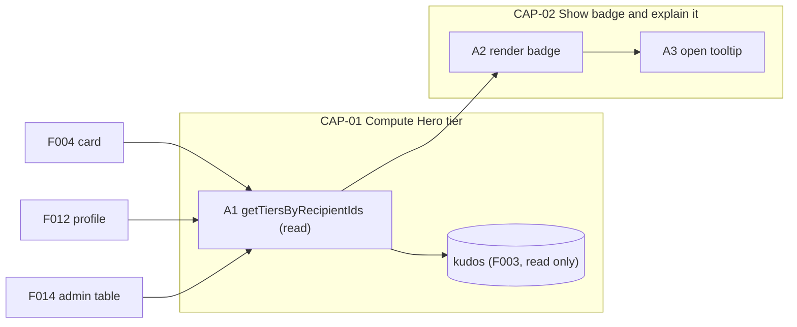
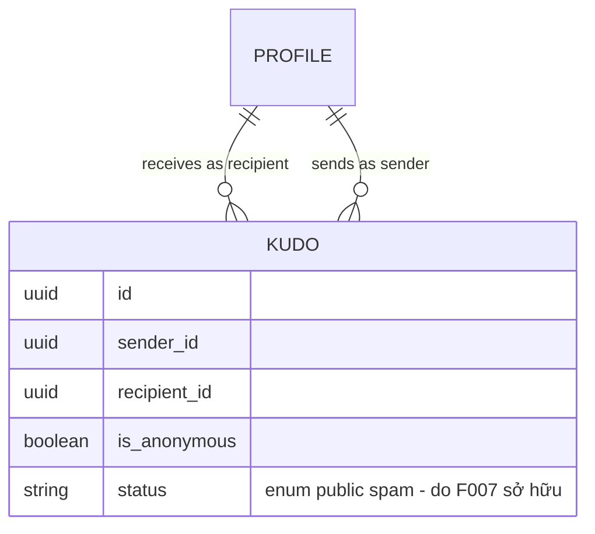

# F009_HeroBadges — Technical Spec

**Priority**: P2
**Type**: mixed
**Generated**: 2026-11-08

**See also:** [`functional-spec.md`](./functional-spec.md) — tổng quan, quyết định còn mở, yêu cầu/quy tắc nghiệp vụ dạng một dòng, user story, kịch bản, edge case cho BA/QA.

**How to read this file:** § 2 là bảng chỉ mục action; đọc khối tương ứng ở § 3 từ đầu đến cuối. § 4 là phụ lục dùng chung, chỉ nhảy vào khi § 3 trỏ tới.

## 1. Technical Overview

Feature tính cấp Hero (New / Rising / Super / Legend) của một Sunner từ số người khác nhau đã gửi Kudo công khai cho Sunner đó, rồi cung cấp MỘT thành phần huy hiệu kèm tooltip để F004 (thẻ Kudo), F012 (profile), F014 (bảng người dùng Admin) cùng dùng. Cấp Hero được tính khi đọc (computed-on-read) bằng một truy vấn đếm `COUNT(DISTINCT sender_id)` gộp theo lô người nhận trên bảng `kudos` của F003; không thêm bảng hay cột lưu cấp (DEC-002). Không có endpoint HTTP riêng: các feature chủ gọi hàm truy vấn trong tiến trình server (server component), client chỉ nhận tên cấp.



## 2. Action Index

| # | Action (handler) | Method · Path | Codes | Writes | Detail |
|---|---|---|---|---|---|
| **A0** | *cross-cutting — belongs to no single action* | — | FR-601 | — | § 4.4 |
| **A1** | `HeroTierQuery#getTiersByRecipientIds` (planned) | `server function` · — | FR-001, FR-002, FR-003, FR-602, BR-001, BR-002, BR-003, DEC-002, ALG-001, US001_SeeHeroBadge, US003_SeeTierFollowKudos | — *(read-only)* | § 3.1 |
| **A2** | `HeroBadge#render` (planned) | — | FR-101, FR-201, FR-202, FR-603, DEC-001, US001_SeeHeroBadge | — *(read-only)* | § 3.2 |
| **A3** | `HeroBadgeTooltip#toggle` (planned) | — | FR-401, FR-402, FR-403, DEC-003, US002_ReadHeroTierMeaning | — *(read-only)* | § 3.2 |

## 3. Actions

### 3.1 CAP-01 — Compute Hero tier

#### A1 · Get Hero tiers for a batch of recipients
`—` → `` `HeroTierQuery#getTiersByRecipientIds` (planned) ``
`FR-001` `FR-002` `FR-003` `FR-602` `BR-001` `BR-002` `BR-003` `DEC-002` `ALG-001` `US001_SeeHeroBadge` `US003_SeeTierFollowKudos`

**Who** · không có tác nhân người trực tiếp — hàm gọi trong tiến trình bởi bộ nạp dữ liệu của F004 (một trang thẻ), F012 (một profile), F014 (một trang bảng) cho Sunner đã đăng nhập xem (US001_SeeHeroBadge — thấy huy hiệu cạnh tên; US003_SeeTierFollowKudos — cấp theo kịp Kudo mới hoặc Kudo bị Spam) *(gate A0 — § 4.4)*
**Request** · `recipientIds[]` *(uuid, một trang, Zod kiểm `uuid` và độ dài tối đa — giới hạn TBD (draft))*. Đáp: `Record<recipientId, "new" | "rising" | "super" | "legend">`; người không có cấp (0 người gửi) không có khoá trong kết quả.
**BE** · `` `HeroTierQuery#getTiersByRecipientIds` `` chạy MỘT truy vấn tổng hợp gộp theo `recipient_id` trên `kudos` cho cả lô id (tránh N+1: FR-001 — cấp tính từ số người gửi khác nhau), rồi đổi từng số đếm sang cấp bằng `ALG-001` (FR-002 — bốn ngưỡng cấp, FR-003 — không lưu cấp, luôn tính lại). Drizzle dùng `countDistinct`. Trả về chỉ tên cấp, không bao giờ trả danh sách người gửi (FR-602).
**Rule**
- **BR-001 — Chỉ Kudo công khai được đếm.** Điều kiện `status = 'public'`; Kudo Spam không tính nên Mark Spam hạ cấp và Un Spam trả lại cấp ở lần đọc kế tiếp, khớp cách F005 loại Kudo Spam khỏi tổng tim.
- **BR-002 — Một người gửi chỉ tính một lần, bất kể gửi bao nhiêu Kudo, và không tính chính người nhận.** `COUNT(DISTINCT sender_id)` kèm điều kiện `sender_id <> recipient_id`, để việc "tự gửi cho mình" (câu hỏi mở ở F003) không thể nâng cấp.
- **BR-003 — Người gửi ẩn danh vẫn được đếm như một người gửi.** `is_anonymous` không nằm trong điều kiện lọc vì `sender_id` luôn được lưu; con số cuối chỉ là một số, không lộ ai gửi. Mặc định chờ xác nhận (functional-spec.md D001).

| DEC | subtype | Condition | What the user sees | Source |
|---|---|---|---|---|
| **DEC-002** | flow | `tier request for recipientIds` | cấp luôn được suy ra từ dữ liệu Kudo công khai hiện tại, không có bản lưu nào; Kudo mới, Mark Spam, Un Spam đều phản ánh ở lần tải trang kế tiếp; truy vấn lỗi thì trả lỗi để host bỏ huy hiệu, không bao giờ trả cấp sai | TBD (draft) |

**Result** · read-only — **no DB write**. Trả bản đồ `recipientId → tier`.
**Source:** TBD (draft)

<!-- No diagram: read-only, một bảng, đồng bộ. -->

---

### 3.2 CAP-02 — Show badge and explain it

#### A2 · Render the Hero badge next to a name
`—` → `` `HeroBadge#render` (planned) ``
`FR-101` `FR-201` `FR-202` `FR-603` `DEC-001` `US001_SeeHeroBadge`

**Who** · Sunner đã đăng nhập xem thẻ Kudo, profile hoặc bảng Admin (US001_SeeHeroBadge — thấy huy hiệu cạnh tên) *(gate A0)*
**FE** · `HeroBadge` là thành phần dùng chung (FR-202: host không tự vẽ lại). Nhận prop `tier` (hoặc rỗng) và vẽ nhãn dạng viên thuốc nhỏ ngay dưới tên/phòng ban (FR-201), đặt cạnh tên ở thẻ Kudo của F004, profile của F012 và bảng người dùng của F014 (FR-101). Nhãn lấy từ next-intl, khoá `hero.<tier>.label`.
**Request** · prop `tier` *("new" | "rising" | "super" | "legend" | rỗng)*. Host quyết định có truyền tier hay không; với Kudo ẩn danh, host bỏ cấp của người gửi trước khi vẽ (FR-603 — huy hiệu không phải đường rò danh tính; việc che nằm ở F004 BR-003).
**Rule** · quyết định có vẽ huy hiệu hay không:

| DEC | subtype | Condition | What the user sees | Source |
|---|---|---|---|---|
| **DEC-001** | render | `tier == null` | không vẽ gì (không có viên rỗng, không chừa khoảng trống); có tier thì vẽ viên nhãn "New Hero" / "Rising Hero" / "Super Hero" / "Legend Hero" | TBD (draft) |

**Result** · read-only — **no DB write**. Kiểu màu/biểu tượng theo từng cấp theo Figma — chi tiết TBD (draft).
**Source:** TBD (draft)

<!-- No diagram: client component thuần hiển thị, không ghi dữ liệu, không async. -->

---

#### A3 · Toggle the tooltip explaining the tier
`—` → `` `HeroBadgeTooltip#toggle` (planned) ``
`FR-401` `FR-402` `FR-403` `DEC-003` `US002_ReadHeroTierMeaning`

**Who** · Sunner đã đăng nhập muốn biết huy hiệu nghĩa là gì (US002_ReadHeroTierMeaning — đọc ý nghĩa cấp Hero) *(gate A0)*
**FE** · `HeroBadgeTooltip` (client component) bọc `HeroBadge`: hiện tooltip khi rê chuột vào huy hiệu (FR-401); mở được bằng focus bàn phím và chạm, đóng khi rời chuột, mất focus, nhấn Esc hoặc chạm lần hai (FR-402, đánh dấu `[EXPECTED]` vì Figma chỉ có trạng thái hover). Nội dung gồm dòng số người gửi của cấp và đoạn mô tả, đọc từ next-intl (FR-403): khoá `hero.<tier>.tooltipTitle`, `hero.<tier>.tooltipBody`; bản vi lấy nguyên văn từ Figma. Dùng thuộc tính `aria-describedby` để trình đọc màn hình đọc được nội dung `[EXPECTED]`.
**Request** · prop `tier`; không gọi server.
**Rule** · quyết định lúc nào tooltip hiện:

| DEC | subtype | Condition | What the user sees | Source |
|---|---|---|---|---|
| **DEC-003** | interaction | `pointerenter OR focus OR tap` mở; `pointerleave OR blur OR Escape OR second tap` đóng | tooltip hiện cạnh huy hiệu cùng lúc chỉ một cái; rời đi thì biến mất | TBD (draft) |

**Result** · read-only — **no DB write**. Nội dung tooltip là chuỗi tĩnh theo cấp, không phụ thuộc người xem.
**Source:** TBD (draft)

<!-- No diagram: tương tác phía client, hai trạng thái mở/đóng, không cross-request. -->

---

### 3.3 Edge cases

| Action | Scenario | Behavior |
|---|---|---|
| A1 | Người nhận chưa có người gửi nào (đếm 0) | Không có khoá trong kết quả; A2 không vẽ huy hiệu (DEC-001) |
| A1 | Một người gửi nhiều Kudo cho cùng người nhận | Tính một lần (BR-002) |
| A1 | Số đếm đúng 5, đúng 20, đúng 21 | 5 → Rising, 20 → Super, 21 → Legend (ALG-001, ngưỡng bao hàm cận dưới) |
| A1 | Kudo bị Mark Spam làm số người gửi tụt qua ngưỡng | Lần đọc kế tiếp trả cấp thấp hơn; Un Spam trả lại cấp cũ (BR-001, DEC-002) |
| A1 | Người gửi tự gửi cho chính mình | Không tính (BR-002) |
| A1 | Truy vấn đếm lỗi | Hàm ném lỗi; host (F004/F012/F014) bắt lỗi, vẫn vẽ thẻ/profile/bảng nhưng bỏ huy hiệu, không làm hỏng trang |
| A1 | Lô id rỗng hoặc có id trùng | Lô rỗng trả `{}` không chạy truy vấn; id trùng được khử trước khi truy vấn |
| A2 | Host truyền cấp của người gửi ẩn danh | Không được xảy ra: host bỏ cấp trước khi vẽ (FR-603; F004 BR-003) |
| A3 | Màn hình cảm ứng không có hover | Chạm mở/đóng tooltip (FR-402 `[EXPECTED]`) |
| A1-A3 | Gọi khi chưa đăng nhập | Chặn ở cổng chung của F001 (A0 — § 4.4), không tới được hàm truy vấn |

## 4. Shared Foundation

### 4.1 Components

| Component | Responsibility | Used in | File |
|---|---|---|---|
| `HeroTierQuery` | Truy vấn đếm người gửi khác nhau theo lô người nhận, đổi sang cấp bằng ALG-001 | A1 | TBD (draft) |
| `HeroBadge` | Client/server-neutral component vẽ viên nhãn cấp, dùng chung | A2 | TBD (draft) |
| `HeroBadgeTooltip` | Client component: tooltip hover/focus/chạm bọc quanh `HeroBadge` | A3 | TBD (draft) |

### 4.2 Data Model



| Entity | Table | Used for | Action |
|---|---|---|---|
| `Kudo` | `kudos` | Chỉ ĐỌC `sender_id`, `recipient_id`, `status` để đếm; F003 sở hữu bảng. MODEL### cấp ở bước reconcile — TBD (draft) | A1 |

F009 không có bảng riêng và không thêm cột vào `profiles` hay `kudos` (DEC-002). Để truy vấn đếm nhanh, đề xuất một index từng phần trên `kudos (recipient_id, sender_id) WHERE status = 'public'`; migration thuộc bảng của F003 nên chủ sở hữu quyết định lúc promote (§ 5.3).

#### Polymorphic Behavior

N/A — no discriminator fields in Key Entities.

<!-- Cấp Hero là giá trị TÍNH RA, không phải cột lưu nên không có DISC-###. `kudos.status` do F003/F007 gán DISC-###. -->

### 4.3 State Management

None.

<!-- Không có SM: cấp Hero là hàm thuần của số đếm hiện tại, không có vòng đời lưu trữ. -->

### 4.4 Shared Rules

#### Bin 3 — cross-cutting, belongs to no single action

**A0 · FR-601 — Chỉ Sunner đã đăng nhập mới tới được cấp Hero.**
Hàm truy vấn chỉ được gọi từ server component/bộ nạp của các trang đã nằm sau lớp chặn đăng nhập của F001 (proxy Next.js); F009 không mở endpoint công khai nào. **Not a rule of this feature** — cổng này dùng chung toàn hệ thống.
**Source:** TBD (draft)

#### Bin 2 — used by ≥2 named actions

Chưa có quy tắc dùng chung bởi từ hai action trở lên ở bản nháp này.

### 4.5 Algorithms & Integrations

### Map a distinct-sender count to a Hero tier (ALG-001)
**Linked FR:** FR-002
**Used in:** A1
**Source:** TBD (draft)
**Input:** `n` (số người gửi khác nhau, số nguyên ≥ 0) · **Output:** `"new" | "rising" | "super" | "legend" | null` · **Complexity:** O(1)
**Description:** Đổi số đếm sang cấp theo thể lệ. Bất biến: hàm thuần, đơn điệu không giảm theo `n`, không đọc dữ liệu ngoài; để F013 có thể gọi lại với số đếm trước/sau khi ghi Kudo nhằm phát hiện lên cấp (§ 5.3).

**Pseudocode:**
```text
tierFromCount(n):
  if n >= HERO_LEGEND_MIN: return "legend"   # > 20
  if n >= HERO_SUPER_MIN:  return "super"    # 10-20
  if n >= HERO_RISING_MIN: return "rising"   # 5-9
  if n >= HERO_NEW_MIN:    return "new"      # 1-4
  return null                                # 0 người gửi: không có huy hiệu

countDistinctSenders(ids):
  SELECT recipient_id, COUNT(DISTINCT sender_id) FROM kudos
  WHERE recipient_id IN ids AND status = 'public' AND sender_id <> recipient_id
  GROUP BY recipient_id
```

### 4.6 Configuration

```text
HERO_NEW_MIN = 1        # từ 1 người gửi là New Hero (A1)
HERO_RISING_MIN = 5     # từ 5 người gửi là Rising Hero (A1)
HERO_SUPER_MIN = 10     # từ 10 người gửi là Super Hero (A1)
HERO_LEGEND_MIN = 21    # trên 20 người gửi là Legend Hero (A1)
HERO_QUERY_MAX_IDS = TBD (draft)   # số id tối đa mỗi lần gọi (A1)
```

Các hằng số nằm trong một module hằng số duy nhất, không đặt thành biến môi trường (không có nhu cầu đổi khi chạy). Văn bản nhãn và tooltip nằm trong tệp thông điệp next-intl, không phải cấu hình.

## 5. Verification & Technical Notes

### 5.1 Technical Verification

- **SC-001** *(A1)* Với dữ liệu mẫu 0, 1, 4, 5, 9, 10, 20, 21 người gửi khác nhau, kết quả lần lượt là không có khoá, new, new, rising, rising, super, super, legend (covers FR-001, FR-002)
- **SC-002** *(A1)* Một người gửi 10 Kudo công khai cho cùng người nhận chỉ tăng số đếm một (covers BR-002)
- **SC-003** *(A1)* Đổi `status` một Kudo sang `spam` rồi về `public` làm cấp hạ rồi trả lại ở hai lần đọc liên tiếp, không cần job tính lại (covers FR-003, BR-001, DEC-002)
- **SC-004** *(A1)* Kudo tự gửi cho chính mình không tăng số đếm (covers BR-002)
- **SC-005** *(A1)* Kết quả chỉ chứa tên cấp, không có id hay danh sách người gửi (covers FR-602)
- **SC-006** *(A2, A3)* Không có `tier` thì không có phần tử huy hiệu trong DOM; có `tier` thì tooltip mở bằng hover và bằng focus bàn phím, đóng bằng Esc (covers FR-201, FR-401, FR-402, DEC-001, DEC-003)

#### US001_SeeHeroBadge *(A1, A2)*

**Independent Test:** Tạo người nhận có 5 người gửi khác nhau, mở thẻ Kudo của người đó trên feed, kiểm tra viên "Rising Hero" dưới tên.

**Acceptance Scenarios:**

1. **Given** người nhận có 5 người gửi khác nhau gửi Kudo công khai, **When** xem thẻ Kudo của họ, **Then** thấy "Rising Hero" dưới tên.
2. **Given** người nhận chưa có Kudo nào, **When** xem profile, **Then** không có huy hiệu.

#### US002_ReadHeroTierMeaning *(A3)*

**Independent Test:** Rê chuột (và tab bàn phím) vào viên huy hiệu, kiểm tra nội dung tooltip khớp cấp.

**Acceptance Scenarios:**

1. **Given** viên "New Hero" đang hiện, **When** rê chuột vào, **Then** tooltip hiện đoạn mô tả của New Hero.
2. **Given** tooltip đang mở, **When** nhấn Esc, **Then** tooltip đóng.

#### US003_SeeTierFollowKudos *(A1)*

**Independent Test:** Gửi Kudo mới từ người gửi thứ 5, tải lại trang của người nhận.

**Acceptance Scenarios:**

1. **Given** người nhận có 4 người gửi, **When** người thứ 5 gửi Kudo công khai và trang được tải lại, **Then** cấp đổi từ New sang Rising.
2. **Given** người nhận có 5 người gửi, **When** Kudo của người thứ 5 bị Mark Spam và trang được tải lại, **Then** cấp trở về New.

### 5.2 Assumptions

- *(A1)* Quy mô công ty (vài nghìn Sunner) đủ để tính cấp bằng truy vấn tổng hợp có index theo lô, không cần cột hay bảng lưu cấp; chỉ phi chuẩn hoá khi đo thấy chậm (§ 5.3).
- *(A1)* `kudos.sender_id` luôn được lưu cả với Kudo ẩn danh (F003 `is_anonymous` chỉ là cờ hiển thị), nên đếm người gửi khác nhau không cần bỏ ẩn danh.
- *(A1, A2)* Các feature chủ (F004, F012, F014) gọi A1 trong bộ nạp server component và truyền xuống `tier` đã tính; client không gọi lại server cho huy hiệu.
- *(A3)* Nội dung tooltip của Rising/Super/Legend lấy từ Figma (frame 3241:14995, 14999, 15003); ánh xạ frame → cấp cần đối chiếu lại khi có Figma. `[UNVERIFIED]`

### 5.3 Unresolved Questions

1. **Quy ước Next.js 16** *(A1, A2, A3)*: cách cache kết quả đếm (hoặc không cache), ranh giới server/client component cho `HeroBadgeTooltip`; phải đọc tài liệu trong `node_modules/next/dist/docs/` trước khi code (AGENTS.md cảnh báo có thay đổi lớn).
2. **Index trên `kudos`** *(A1)*: index từng phần `(recipient_id, sender_id) WHERE status = 'public'` do F009 hay F003 tạo, và có cần không khi dữ liệu còn nhỏ.
3. **Tải của bảng Admin** *(A1)*: F014 gọi A1 cho cả trang bảng người dùng; nếu có Export toàn bộ thì cần một truy vấn gộp riêng, không gọi theo trang.
4. **Phát hiện lên cấp cho F013** *(A1)*: ALG-001 là hàm thuần nên F013 có thể so cấp trước/sau; việc F013 nhận sự kiện ở đâu (trong giao dịch ghi Kudo của F003, hay đối chiếu định kỳ) chưa chốt.

### 5.4 Source References

Chưa có mã nguồn — xem `## 7. User Stories` trong functional-spec.md để biết hành vi dự kiến.

#### Data Flow

<!-- Suy ra từ § 3 ở trên (derived from § 3), không có hop nào có citation vì chưa có mã. -->

```text
recipientIds[] (từ host) -> A1 đếm DISTINCT sender_id (public, khác người nhận) -> ALG-001 đổi sang tier -> Record<recipientId, tier>
-> host truyền tier xuống A2 (vẽ viên nhãn) -> A3 (tooltip khi hover/focus/chạm)
```

### 5.5 Artifact References

| Artifact | File | Codes Used | Reviewed |
|----------|------|------------|----------|
| System Overview | TBD (draft) | — | [ ] |
| Architecture | TBD (draft) | — | [ ] |
| Feature List | [feature-list.md](../feature-list.md) | F009 | [x] |
| API Map | TBD (draft) | TBD (draft) | [ ] |
| Entities | TBD (draft) | TBD (draft) | [ ] |
| Screens | [functional-spec.md § 6](./functional-spec.md#6-screens) | TBD (draft) | [ ] |
| Behavior Logic | TBD (draft) | TBD (draft) | [ ] |
| Permissions Matrix | TBD (draft) | TBD (draft) | [ ] |
| User Stories | TBD (draft) | US001, US002, US003 | [ ] |

**Rule:** Mọi mã trong Codes Used phải tồn tại trong artifact nguồn; ở bản nháp, ô chưa có artifact để đối chiếu ghi `TBD (draft)`.
