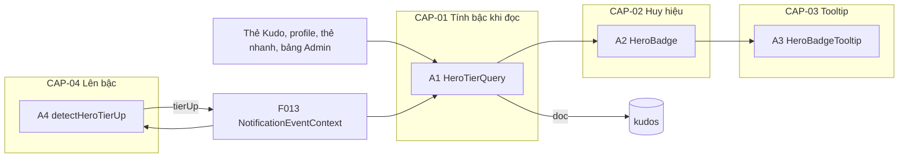
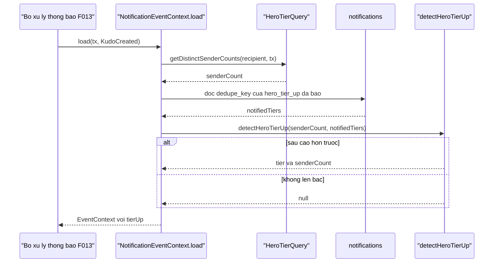
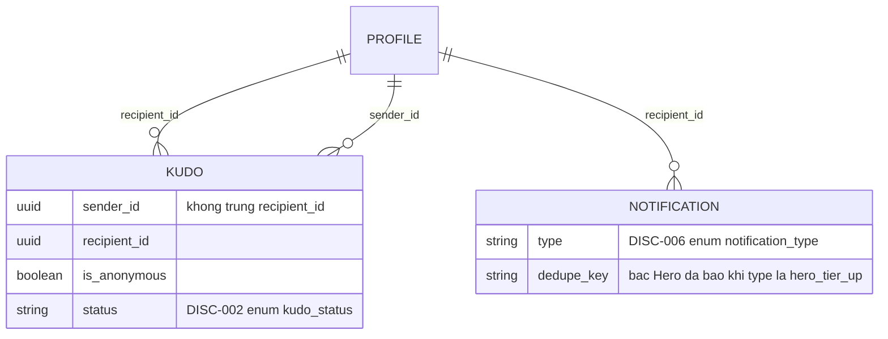
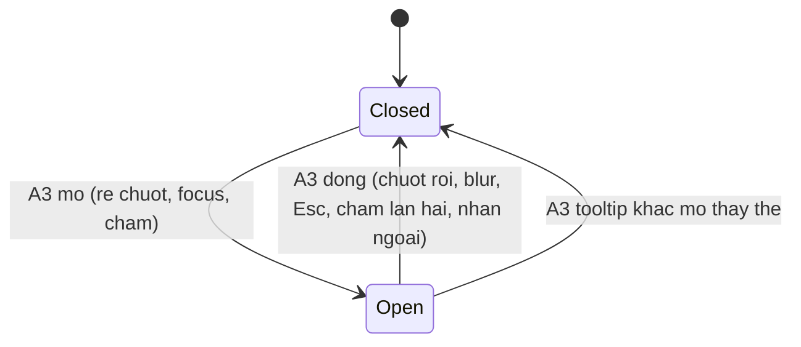

<!-- layout-exempt: rebuild-spec owns all docs/system|features|generated|flows paths — all references here are output targets or internal definitions -->
<!-- Contract: references/feature-spec-researcher-contract.md -->

# F009_HeroBadges — Technical Spec

**Priority**: P2
**Type**: background
**Generated**: 2026-11-24

**See also:** [`functional-spec.md`](./functional-spec.md) — tổng quan, quyết định mở, yêu cầu và luật nghiệp vụ viết một dòng, người dùng, kịch bản, ca biên và cấu hình cho BA/QA.

**How to read this file:** § 2 là mục lục hành động — chọn hành động cần đọc rồi đọc nguyên khối của nó ở § 3, từ trên xuống. § 4 là phụ lục dùng chung — chỉ nhảy vào khi một khối ở § 3 trỏ tới.

## 1. Technical Overview

F009 là một thư viện nhỏ không có route và không có màn hình riêng: nó tính bậc Hero của một người nhận Kudo khi đọc (đếm số người gửi công khai khác nhau, không lưu), vẽ huy hiệu và tooltip giải thích, và cung cấp hàm thuần `detectHeroTierUp` cho bộ xử lý thông báo của F013. Người dùng chỉ gặp nó qua màn hình của feature khác (thẻ Kudo, header profile, thẻ nhanh, trang Thể lệ, bảng Admin). Phía máy chủ chỉ đọc bảng `kudos` bằng một câu truy vấn gộp trên chỉ mục từng phần; không có bảng nào do F009 ghi.



## 2. Action Index

| # | Action (handler) | Method · Path | Codes | Writes | Detail |
|---|---|---|---|---|---|
| **A0** | *cross-cutting — belongs to no single action* | — | FR-601 | — | § 4.4 |
| **A1** | `HeroTierQuery#getTiersByRecipientIds` | — | FR-001, FR-002, FR-003, FR-004, FR-602, FR-603, BR-001, BR-002, BR-003, BR-004, DEC-002, ALG-001 | — *(read-only)* | § 3.1 |
| **A2** | `HeroBadge` *(render, server/client neutral)* | — | FR-201, FR-202, FR-203, BR-005, DEC-001 | — *(read-only)* | § 3.2 |
| **A3** | `HeroBadgeTooltip#onClick` *(client, no BE of its own)* | — | FR-401, FR-402, FR-403, FR-404, BR-005, DEC-003, DEC-004, SM-001, US040 | — *(client only)* | § 3.3 |
| **A4** | `detectHeroTierUp` *(background, no FE)* | — | FR-405, FR-406, BR-006, ALG-001, ALG-002 | — *(pure function, no write of its own)* | § 3.4 ▸ **diagram** |

## 3. Actions

### 3.1 CAP-01 — Tính bậc Hero khi đọc từ số người gửi công khai khác nhau

#### A1 · Tính bậc Hero theo lô người nhận
`HeroTierQuery#getTiersByRecipientIds` (cùng `getDistinctSenderCounts`, `distinctSenderCountSubquery`)
`FR-001` `FR-002` `FR-003` `FR-004` `FR-602` `FR-603` `BR-001` `BR-002` `BR-003` `BR-004` `DEC-002` `ALG-001` · host: SCR007/REG003, SCR007/REG005, SCR006, SCR015, SCR016, SCR018

**Who** · mã phía máy chủ của các feature khác (thẻ Kudo, profile, thẻ nhanh, danh sách Admin, bộ xử lý thông báo) *(gate A0 — § 4.4)*
**FE** · *no entry point found* — grepped `features/hero-badges/components` và các host; không có chỗ nào gọi truy vấn từ trình duyệt, kết quả chỉ tới client dưới dạng tên bậc đã gắn vào view (`features/kudos-feed/server/enrich-hero-tier.ts:23-28`).
**Request** · `recipientIds` *(string[], uuid; trùng id được loại, lô rỗng không chạy câu lệnh nào)* · tuỳ chọn `executor` *(Db | DbTx, mặc định pool dùng chung; bộ xử lý thông báo truyền transaction của sự kiện)*
**BE** · `` `HeroTierQuery#getDistinctSenderCounts` `` đếm `COUNT(DISTINCT sender_id)` theo `recipient_id`, mỗi 500 id một câu lệnh — `features/hero-badges/server/hero-tier-query.ts:27-39`. `` `HeroTierQuery#getTiersByRecipientIds` `` đổi số đếm thành tên bậc bằng `tierFromCount`, người 0 bậc không có khoá — `features/hero-badges/server/hero-tier-query.ts:42-49`. `` `HeroTierQuery#distinctSenderCountSubquery` `` là subquery cùng luật cho cột Level của Admin (`features/hero-badges/server/hero-tier-query.ts:56-63`, dùng ở `features/admin-users/server/user-admin-sql-fragments.ts:48`). Lớp gắn bậc lên thẻ Kudo: `` `enrichHeroTier` `` — một lần gọi cho mỗi trang thẻ (`features/kudos-feed/server/enrich-hero-tier.ts:14-29`). Profile và thẻ nhanh gọi trực tiếp: `features/profile/server/profile-page-data.ts:45`, `features/profile/server/sunner-card-query.ts:20`.
**Rule** · quyết định ai được gắn bậc trên thẻ Kudo, và đếm những Kudo nào:

| DEC | subtype | Condition | What the user sees | Source |
|---|---|---|---|---|
| **DEC-002** | render | `card.sender.anonymous` → không tra bậc người gửi; ngược lại tra cả `recipient.id` và `sender.id`; tra cứu lỗi → giữ nguyên thẻ với `tier: null` | người gửi ẩn danh không bao giờ có huy hiệu (không có trường `tier`); người gửi có tên và người nhận có huy hiệu hoặc không; lỗi tra cứu chỉ làm mất huy hiệu, trang vẫn hiện | `features/kudos-feed/server/enrich-hero-tier.ts:14-29` |

- **BR-001 — Kudo spam không được đếm.** Điều kiện `status = 'public'`; đánh dấu Spam làm số đếm giảm và bỏ Spam khôi phục ở lần đọc kế tiếp, không có bước tính lại. `features/hero-badges/server/hero-tier-query.ts:20`
- **BR-002 — Mỗi người gửi chỉ tính một lần và Kudo tự gửi không bao giờ tính.** `COUNT(DISTINCT sender_id)` cùng điều kiện `sender_id <> recipient_id` (phòng thủ thêm ngoài CHECK `kudos_no_self_send`). `features/hero-badges/server/hero-tier-query.ts:20-39`
- **BR-003 — Kudo ẩn danh vẫn được đếm cho người nhận.** `sender_id` luôn được lưu nên Kudo ẩn danh nằm trong `COUNT(DISTINCT sender_id)`; điều ẩn danh chỉ ảnh hưởng hiển thị (DEC-002). `features/hero-badges/server/hero-tier-query.ts:10-19`
- **BR-004 — Bậc luôn được tính khi đọc, không lưu và không cache.** Không có cột hay bảng bậc; module không dùng `use cache` nên mỗi lần tải trang đọc dữ liệu hiện tại. `features/hero-badges/server/hero-tier-query.ts:9-19`

**Result** · read-only — **no DB write**. Trả `Map<recipientId, count>` (`getDistinctSenderCounts`, người không có Kudo đếm được có 0) hoặc `Record<recipientId, HeroTier>` (`getTiersByRecipientIds`); khoá chỉ gồm id đã yêu cầu, không bao giờ lộ id người gửi (FR-602). Phần `distinctSenderCountSubquery` trả `(recipient_id, sender_count)` cho người có ≥1 người gửi; Admin lọc Level bằng `tierCountRange` nên ngưỡng không bị lặp trong SQL. Truy vấn đọc `kudos` và dùng chỉ mục từng phần `kudos_public_recipient_sender_idx` *(§ 4.2)*. Giải thích DISC-002: `status` = `public` được đếm, `spam` bị loại.
**Source:** `features/kudos-feed/server/kudo-card-enrichment.ts:12-15` → `features/kudos-feed/server/enrich-hero-tier.ts:14-29` → `features/hero-badges/server/hero-tier-query.ts:27-49` → `features/hero-badges/server/tier-from-count.ts:18-21`
**Shared structure:** `ALG-001` — đổi số người gửi khác nhau thành bậc (New 1–4, Rising 5–9, Super 10–20, Legend từ 21, dưới 1 là không có bậc), chi tiết *(§ 4.5)*

<!-- No diagram: below threshold — read-only, một bảng, đồng bộ. Một câu SQL gộp, không có nhánh ghi. -->

---

### 3.2 CAP-02 — Huy hiệu Hero dùng chung

#### A2 · Vẽ huy hiệu Hero
`HeroBadge` *(thành phần dùng chung)*
`FR-201` `FR-202` `FR-203` `BR-005` `DEC-001` · host: SCR007/REG003, SCR007/REG005, SCR006, SCR012, SCR015, SCR016

**Who** · Sunner đang xem một màn hình host *(gate A0)*
**FE** · `features/hero-badges/components/hero-badge.tsx:27-39` vẽ ảnh thẻ bậc `/images/awards-portal/hero-tag-<tier>.webp` bằng `next/image`, `alt` là nhãn bậc (`hero.<tier>.label`), kích thước theo `size` (`card` 109 px, `tooltip` 218 px, `rules` 126 px, `hoverCard` 164 px — `features/hero-badges/components/hero-badge.tsx:17`). Trên thẻ Kudo và header profile, huy hiệu đi kèm dấu chấm ngăn cách do `KudoCardHeroBadgeSlot` (`features/kudos-feed/components/kudo-card-hero-badge-slot.tsx:12-28`). Trên trang Thể lệ, `RulesHeroTierList` liệt kê cả bốn bậc (`features/awards-portal/components/rules-kudos-rewards.tsx:23-37`). Trên thẻ nhanh, `SunnerCardContent` vẽ cỡ `hoverCard` không có tooltip (`features/profile/components/sunner-card-content.tsx:84`).
**BE** · *none* — không có truy vấn riêng; `tier` đã nằm sẵn trong view (A1).
**Rule** · quyết định có vẽ gì khi có hay không có bậc:

| DEC | subtype | Condition | What the user sees | Source |
|---|---|---|---|---|
| **DEC-001** | render | `tier == null` → huy hiệu trả `null`, slot không vẽ gì; `afterDepartment` và `tier` có → thêm dấu chấm 4 px (ẩn khi khối tên hẹp dưới 12rem) | người chưa có bậc không thấy viên nhãn rỗng cũng không thấy dấu chấm; có bậc thì thấy huy hiệu, kèm dấu chấm khi đứng sau mã phòng ban | `features/kudos-feed/components/kudo-card-hero-badge-slot.tsx:21-27` |

- **BR-005 — Tên bậc và lời giải thích đến từ một bộ thông điệp `hero.*` duy nhất.** Huy hiệu (`alt`), tooltip và trang Thể lệ cùng đọc `hero.<tier>.label`, `tooltipTitle`, `tooltipBody` nên ba nơi không lệch nhau; ngôi "bạn" được giữ cả trên huy hiệu người khác. Dùng ở A2 và A3 *(§ 4.4)*

**Result** · read-only — **no DB write**. Hiển thị một ảnh `` có `alt` hoặc không (`decorative` bỏ `alt` khi huy hiệu nằm trong tooltip đã được nút mô tả).
**Source:** `features/hero-badges/components/hero-badge.tsx:27-39` → `features/kudos-feed/components/kudo-card-hero-badge-slot.tsx:12-28`

<!-- No diagram: below threshold — render thuần, không ghi, không rẽ nhánh theo thứ tự. -->

---

### 3.3 CAP-03 — Tooltip giải thích bậc

#### A3 · Mở và đóng tooltip bậc Hero
`HeroBadgeTooltip#onClick` *(client)*
`FR-401` `FR-402` `FR-403` `FR-404` `BR-005` `DEC-003` `DEC-004` `SM-001` `US040` · host: SCR007/REG003, SCR007/REG005, SCR006, SCR015, SCR016

**Who** · Sunner đang xem thẻ Kudo hoặc header profile *(gate A0)*
**FE** · `features/hero-badges/components/hero-badge-tooltip.tsx:23-122`: nút `<button>` bao huy hiệu `card` (`features/hero-badges/components/hero-badge-tooltip.tsx:86-114`), panel `role="tooltip"` render qua `createPortal` vào `document.body` (`features/hero-badges/components/hero-badge-tooltip.tsx:115-119`). Panel vẽ huy hiệu cỡ `tooltip` rồi tiêu đề (trắng) và mô tả (xám) từ `hero.<tier>.tooltipTitle/tooltipBody` (`features/hero-badges/components/hero-badge-tooltip-panel.tsx:49-63`). `tabbable={false}` (thẻ Kudo của chính mình dưới lớp phủ spam) đặt `tabIndex=-1` cho nút (`features/hero-badges/components/hero-badge-tooltip.tsx:90`).
**Request** · `tier` *(HeroTier | null)*, `tabbable` *(boolean, mặc định true)* — không có request mạng.
**BE** · *none* — trạng thái "đang mở" nằm ở module-state `activeId` đọc qua `useSyncExternalStore` (`features/hero-badges/components/active-hero-tooltip-store.ts:6-32`); vị trí tính bởi hàm thuần `placeHeroTooltip` (`features/hero-badges/components/place-hero-tooltip.ts:13-20`).
**Rule** · quyết định lúc nào tooltip mở, đóng và đặt ở đâu:

| DEC | subtype | Condition | What the user sees | Source |
|---|---|---|---|---|
| **DEC-003** | interaction | `pointerenter` kiểu `mouse` → mở; `focus` mà không có lần nhấn trước → mở; `click`: chuột → giữ mở, chạm → đảo (mở nếu đang đóng, đóng nếu đang mở) | rê, focus bàn phím hoặc chạm đều mở tooltip; chạm lần hai đóng | `features/hero-badges/components/hero-badge-tooltip.tsx:67-111` |
| **DEC-003** | interaction | đóng khi: chuột rời sau 120 ms (có thể di sang panel), `blur` (trừ khi lần nhấn rơi trong panel), `Escape` (pha capture, `stopPropagation`), nhấn ngoài badge và panel; mở tooltip khác thì tooltip cũ bị thay (`activeId` chỉ một giá trị) | mỗi lúc chỉ một tooltip mở; nhấn trong panel giữ mở; Esc đóng tooltip trước khi đóng hộp thoại phía dưới | `features/hero-badges/components/hero-badge-tooltip.tsx:12,43-63,71-82` và `features/hero-badges/components/active-hero-tooltip-store.ts:9-32` |
| **DEC-004** | render | `fitsBelow` (`below + panel.height <= viewport.height - 16`) hoặc `above < 16` → đặt dưới huy hiệu cách 8 px; ngược lại lật lên trên; `left` căn giữa rồi kẹp trong biên 16 px hai bên | tooltip nằm dưới huy hiệu, chỉ lật lên khi tràn đáy mà phía trên đủ chỗ; luôn nằm trọn trong màn hình 375 px | `features/hero-badges/components/place-hero-tooltip.ts:13-20` |

**Result** · client-only — **no DB write**. `aria-describedby` trỏ vào panel khi đang mở; panel không focus được nên focus không bị kẹt; panel đặt lại vị trí khi `resize` và `scroll` (`features/hero-badges/components/hero-badge-tooltip-panel.tsx:30-47`). Hàm đặt vị trí cũng được thẻ nhanh của F012 dùng lại (`features/profile/components/sunner-card-content.tsx:48-55`).
**State** · `SM-001`: `closed` → `open` (A3 mở) và `open` → `closed` (A3 đóng) *(§ 4.3)*
**Source:** `features/kudos-feed/components/kudo-card-hero-badge-slot.tsx:12-28` → `features/hero-badges/components/hero-badge-tooltip.tsx:23-122` → `features/hero-badges/components/hero-badge-tooltip-panel.tsx:27-65` → `features/hero-badges/components/place-hero-tooltip.ts:13-20`

<!-- No diagram: below threshold — client-only, không ghi bảng; ca phân nhánh nằm trọn trong bảng DEC. -->

---

### 3.4 CAP-04 — Phát hiện lên bậc Hero cho thông báo

Kudo công khai mới sinh sự kiện `KudoCreated`; bộ xử lý thông báo của F013 gọi chuỗi dưới đây trong cùng transaction với sự kiện. F009 sở hữu hàm so bậc, F013 sở hữu việc ghi thông báo.



#### A4 · Quyết định thông báo lên bậc *(background, no FE)*
`detectHeroTierUp` *(hàm thuần gọi từ `NotificationEventContext#load`)*
`FR-405` `FR-406` `BR-006` `ALG-001` `ALG-002` · BL014

**Who** · *no human actor — chạy trong bộ xử lý outbox của F013 khi xử lý `KudoCreated` của Kudo công khai không tự gửi*
**FE** · *none*
**Request** · *no HTTP request* — `senderCount` *(number)* từ A1 và `notifiedTiers` *(string[], các `dedupe_key` của thông báo `hero_tier_up` đã có)*
**BE** · `` `detectHeroTierUp` `` — `features/notifications/server/detect-hero-tier-up.ts:19-24`; nơi gọi `` `NotificationEventContext#load` `` chỉ gọi khi `KudoCreated` mà Kudo đang `public` và `senderId != recipientId` (`features/notifications/server/load-notification-event-context.ts:35-40`); `readTierUp` gom số đếm và các bậc đã báo (`features/notifications/server/load-notification-event-context.ts:26-33`).
**Rule** · **BR-006 — Chỉ báo lên bậc khi bậc đạt được cao hơn bậc cao nhất đã từng báo cho người nhận.** `after = tierFromCount(senderCount)`; `before` = hạng cao nhất trong `notifiedTiers`, không phải số đếm ngay trước Kudo, nên đúng cả khi sự kiện xử lý trễ, dồn hay đảo thứ tự; vượt nhiều ngưỡng thì báo bậc đạt được; bậc tụt vì Spam không kích hoạt lại bậc cũ; chỉ mục duy nhất từng phần `notifications_hero_tier_dedupe_unique` chặn hai bộ xử lý chạy song song. `features/notifications/server/detect-hero-tier-up.ts:19-24`; `shared/db/schema/notifications.ts:59-61`
**Result**
- Trả `{ tier, senderCount }` hoặc `null`; không có ghi của chính hàm này. Nơi gọi biến kết quả thành bản nháp `hero_tier_up` với `params = { tier, senderCount }` và `dedupe_key = tier` — `features/notifications/server/map-event-to-notifications.ts:37-38` (thuộc F013).
- Thông báo (do F013 ghi) gửi tới người nhận Kudo; lên bậc vì Kudo ẩn danh vẫn được báo (số đếm gồm cả Kudo ẩn danh, BR-003).
**Source:** `features/notifications/server/load-notification-event-context.ts:26-40` → `features/notifications/server/detect-hero-tier-up.ts:19-24` → `features/hero-badges/server/tier-from-count.ts:18-21`
**Shared structure:** `ALG-002` — so bậc hiện tại với bậc cao nhất đã báo để quyết định có nợ thông báo hay không, chi tiết *(§ 4.5)*

---

### 3.5 Edge cases

| Action | Scenario | Behavior |
|---|---|---|
| A1 | Người nhận không có Kudo công khai nào (hoặc mọi Kudo đều spam) | số đếm 0, không có khoá trong kết quả bậc, không có huy hiệu (DEC-001) |
| A1 | Một người gửi nhiều Kudo cho cùng một người nhận | tính một lần (BR-002) |
| A1 | Admin đánh dấu Spam một Kudo làm tụt dưới ngưỡng | lần đọc kế tiếp thấy bậc thấp hơn; bỏ Spam khôi phục ở lần đọc kế tiếp, không cần tính lại (BR-001) |
| A1 | Lô lớn hơn 500 id | tách thành các lô 500, mỗi lô một câu lệnh; lô rỗng không chạy câu lệnh nào; id trùng được loại trước (FR-003) |
| A1 | Tra bậc lỗi ở thẻ Kudo | log lỗi, thẻ giữ `tier: null`, trang vẫn hiện (DEC-002); profile cũng giữ trang và chỉ bỏ huy hiệu (`features/profile/server/profile-page-data.ts:23-30`) |
| A2 | `tier` null | `HeroBadge` trả `null`, slot không vẽ dấu chấm (DEC-001) |
| A3 | Hai huy hiệu cùng đòi tooltip | tooltip mới thay tooltip cũ (DEC-003); lệnh đóng từ tooltip khác bị bỏ qua |
| A3 | Chạm trên điện thoại | lần chạm mở, lần chạm thứ hai đóng; một lần chạm không mở rồi đóng ngay (DEC-003) |
| A3 | Viewport hẹp (375 px) hoặc badge sát đáy | panel kẹp trong biên 16 px; lật lên trên chỉ khi tràn đáy và đủ chỗ (DEC-004) |
| A3 | Component bị gỡ khi tooltip đang mở | `useEffect` dọn timer và đóng tooltip (`features/hero-badges/components/hero-badge-tooltip.tsx:35-41`) |
| A4 | Kudo spam hoặc tự gửi | `NotificationEventContext#load` không gọi (`tierUp` null) |
| A4 | Hai bộ xử lý cùng chạy một sự kiện | chỉ mục duy nhất từng phần chặn thông báo trùng (BR-006) |
| A1-A4 | Gọi từ trình duyệt không qua màn hình host | không có route nào để gọi (A0 — § 4.4) |

## 4. Shared Foundation

### 4.1 Components

| Component | Responsibility | Used in | File |
|---|---|---|---|
| `HeroTierQuery` | nguồn bậc duy nhất: đếm người gửi khác nhau, đổi sang bậc, subquery cho Admin | A1, A4 | `features/hero-badges/server/hero-tier-query.ts` |
| `tierFromCount`, `tierCountRange` | hàm thuần số đếm → bậc và bậc → khoảng đếm | A1, A4 | `features/hero-badges/server/tier-from-count.ts` |
| `hero-tier-constants` | ngưỡng 1, 5, 10, 21 và cỡ lô 500 | A1 | `features/hero-badges/server/hero-tier-constants.ts` |
| `HERO_TIERS` / `HeroTier` | danh sách bốn bậc, dùng chung server và client | A1-A4 | `features/hero-badges/schemas/hero-tier.ts` |
| `HeroBadge` | ảnh huy hiệu theo bậc và cỡ | A2, A3 | `features/hero-badges/components/hero-badge.tsx` |
| `HeroBadgeTooltip` | nút bao huy hiệu, quản lý mở/đóng | A3 | `features/hero-badges/components/hero-badge-tooltip.tsx` |
| `HeroBadgeTooltipPanel` | panel tooltip trong portal | A3 | `features/hero-badges/components/hero-badge-tooltip-panel.tsx` |
| `active-hero-tooltip-store` | trạng thái "tooltip nào đang mở" | A3 | `features/hero-badges/components/active-hero-tooltip-store.ts` |
| `placeHeroTooltip` | tính vị trí tooltip, kẹp biên, lật lên | A3 | `features/hero-badges/components/place-hero-tooltip.ts` |
| `enrichHeroTier` *(F004, seam do F009 sở hữu)* | gắn bậc lên người nhận và người gửi có tên của một trang thẻ | A1 | `features/kudos-feed/server/enrich-hero-tier.ts` |
| `KudoCardHeroBadgeSlot` *(F004, seam do F009 sở hữu)* | khe huy hiệu và dấu chấm trên thẻ và header profile | A2, A3 | `features/kudos-feed/components/kudo-card-hero-badge-slot.tsx` |
| `detectHeroTierUp` *(F013 chứa file, F009 sở hữu logic bậc)* | so bậc đạt được với bậc đã báo | A4 | `features/notifications/server/detect-hero-tier-up.ts` |

### 4.2 Data Model



| Entity | Table | Used for | Action |
|---|---|---|---|
| `Kudo` (MODEL003) | `kudos` | nguồn duy nhất của bậc: đếm `DISTINCT sender_id` trên Kudo `public`; chỉ mục từng phần `kudos_public_recipient_sender_idx` (`recipient_id`, `sender_id`, `WHERE status = 'public'`) trong `db/migrations/0014_kudos_hero_tier_index.sql:7` | A1, A4 |
| `Notification` (MODEL016) | `notifications` | chỉ ĐỌC `dedupe_key` của dòng `hero_tier_up` để biết bậc cao nhất đã báo (bộ nạp của F013); F009 không ghi | A4 |

#### Polymorphic Behavior

##### DISC-002 — Kudo.status

| Value | Render | Validation | Persistence |
|-------|--------|------------|-------------|
| public | được tính vào số đếm, nên làm huy hiệu của người nhận có thể xuất hiện hoặc tăng bậc | điều kiện `status = 'public'` của `countsPublicSenders` (`features/hero-badges/server/hero-tier-query.ts:20`) | F009 không ghi; Kudo mới luôn ở `public` (F003) |
| spam | không tính, huy hiệu người nhận có thể tụt bậc ở lần đọc kế tiếp | cùng điều kiện loại dòng này | F009 không ghi; F007 đổi `public` ↔ `spam`, F009 chỉ thấy ở lần đọc sau |

**Source:** docs/generated/entities.md § MODEL003_Kudo > Discriminator Fields

##### DISC-006 — Notification.type

| Value | Render | Validation | Persistence |
|-------|--------|------------|-------------|
| hero_tier_up | biểu tượng bậc, câu "thăng hạng" (F013 vẽ) | bậc đạt được phải cao hơn mọi `dedupe_key` đã báo (BR-006) | F013 ghi dòng với `dedupe_key = tier`; F009 chỉ cung cấp quyết định |
| kudo_received, heart_received, secret_box_granted, kudo_hidden_spam, icon_set_completed, national_kudos | unverified (F009 không đọc) | unverified (F009 không đọc) | unverified (F009 không ghi) |

**Source:** docs/generated/entities.md § MODEL016_Notification > Discriminator Fields

### 4.3 State Management

### Tooltip Hero mở hoặc đóng, mỗi lúc chỉ một cái mở trên trang (SM-001)
**kind:** ui
**Linked FR:** FR-401
**Source:** `features/hero-badges/components/active-hero-tooltip-store.ts:6-32`



**Action transitions:** guard và hiệu ứng của từng cạnh nằm ở rung **Rule** và **Result** của A3 (§ 3.3), không lặp lại ở đây.

### 4.4 Shared Rules

#### Bin 3 — cross-cutting, belongs to no single action

**A0 · FR-601 — chỉ mã phía máy chủ gọi truy vấn bậc; không có route, endpoint hay server action nào lộ nó (cross-cutting).**
`HeroTierQuery` có `import "server-only"` và không gắn với route nào; người dùng chỉ nhận tên bậc đã gắn trong view của màn hình host. Nơi gọi phục vụ người dùng (thẻ Kudo, profile, thẻ nhanh) đều đã đi qua cổng khu Sunner của feature host; bảng Admin đi qua cổng Admin; bộ xử lý thông báo chạy nền trong transaction của sự kiện, không có phiên người dùng. Không phải luật của riêng một hành động.
**Source:** `features/hero-badges/server/hero-tier-query.ts:1-19`

#### Bin 2 — used by ≥2 named actions

**BR-005 — Tên bậc và lời giải thích đến từ một bộ thông điệp `hero.*` duy nhất.**
Used in: **A2** · **A3**. `HeroBadge` lấy `alt` từ `hero.<tier>.label`; panel tooltip lấy tiêu đề và mô tả từ `hero.<tier>.tooltipTitle` và `tooltipBody`; trang Thể lệ dùng chính các khoá đó, nên ba nơi không thể lệch. Ngôi "bạn" được giữ nguyên cả khi xem huy hiệu người khác (quyết định đã chọn, xem D002 trong functional-spec).
**Source:** `messages/vi.json:306-331` · `features/hero-badges/components/hero-badge-tooltip-panel.tsx:58-62` · `features/awards-portal/components/rules-kudos-rewards.tsx:23-37`
```text
alt          = t(hero.<tier>.label)            # trừ decorative
tooltipTitle = t(hero.<tier>.tooltipTitle)
tooltipBody  = t(hero.<tier>.tooltipBody)
rulesPage    = cùng ba khoá cho cả bốn bậc
```

### 4.5 Algorithms & Integrations

### Số người gửi khác nhau đổi thành bậc Hero (ALG-001)
**Linked FR:** FR-002
**Used in:** A1, A4
**Source:** `features/hero-badges/server/tier-from-count.ts:5-27`
**Input:** `count` *(number)* · **Output:** `HeroTier | null` · **Complexity:** O(1) (bốn bậc)
**Description:** duyệt bậc từ cao xuống thấp, trả bậc đầu tiên có `count >=` ngưỡng của nó; dưới ngưỡng New (1) hoặc `count` không hữu hạn trả `null`. Hàm đơn điệu nên Admin lọc và sắp xếp Level theo số đếm; `tierCountRange` cho khoảng đếm đóng của mỗi bậc (Legend không có chặn trên) để SQL không lặp ngưỡng.

**Pseudocode:**
```text
TIER_MIN = { new: 1, rising: 5, super: 10, legend: 21 }
tierFromCount(count):
  if count is not finite: return null
  for tier in [legend, super, rising, new]:
    if count >= TIER_MIN[tier]: return tier
  return null
tierCountRange(tier): { min: TIER_MIN[tier], max: next ? TIER_MIN[next] - 1 : null }
```

### Quyết định thông báo lên bậc từ bậc đã báo cao nhất (ALG-002)
**Linked FR:** FR-405
**Used in:** A4
**Source:** `features/notifications/server/detect-hero-tier-up.ts:4-24`
**Input:** `senderCount` *(number)*, `notifiedTiers` *(string[])* · **Output:** `{ tier, senderCount } | null` · **Complexity:** O(n) theo số bậc đã báo (tối đa 4)
**Description:** `after` là bậc từ số đếm hiện tại (đã gồm Kudo mới vì đọc trong transaction của sự kiện); `before` là hạng lớn nhất trong các bậc đã báo (-1 nếu chưa báo bậc nào). Báo khi hạng `after` lớn hơn `before`; không khôi phục lại bậc đã tụt vì Spam.

**Pseudocode:**
```text
detectHeroTierUp(senderCount, notifiedTiers):
  after = tierFromCount(senderCount)
  if after is null: return null
  before = max(-1, rank(t) for t in notifiedTiers)
  if rank(after) > before: return { tier: after, senderCount }
  return null
```

### 4.6 Configuration

```text
HERO_NEW_MIN = 1           # ngưỡng dưới của New, hằng số trong mã (A1, A4)
HERO_RISING_MIN = 5        # ngưỡng dưới của Rising
HERO_SUPER_MIN = 10        # ngưỡng dưới của Super
HERO_LEGEND_MIN = 21       # ngưỡng dưới của Legend
HERO_QUERY_MAX_IDS = 500   # số id tối đa một câu lệnh, lô lớn hơn được tách (A1)
MOUSE_LEAVE_DELAY_MS = 120 # trễ đóng khi chuột rời huy hiệu, để kịp di sang panel (A3)
```

Không có biến môi trường: ngưỡng là hằng số trong `features/hero-badges/server/hero-tier-constants.ts:6-12`, độ trễ trong `features/hero-badges/components/hero-badge-tooltip.tsx:12`.

**Client behavior:** see
[`behavior-logic.md`](../../generated/behavior-logic.md) (client-side patterns — debounce, optimistic UI, polling, upload, realtime),
[`permissions.md`](../../system/permissions.md) (feature flags / experiments / env / locale gates),
[`architecture.md`](../../system/architecture.md) (guards / deep-link state restoration / unsaved-changes protection).

## 5. Verification & Technical Notes

### 5.1 Technical Verification

- **SC-001** *(A1)* Một người gửi 3 Kudo công khai cho cùng người nhận vẫn tính 1; đủ 5 người gửi khác nhau thì bậc là Rising (covers FR-001, FR-002, BR-002)
- **SC-002** *(A1)* Đánh dấu Spam một Kudo làm bậc tụt ở lần đọc kế tiếp, bỏ Spam khôi phục ngay, không có bước tính lại (covers BR-001, BR-004)
- **SC-003** *(A1)* Người gửi ẩn danh được tính vào số đếm của người nhận nhưng thẻ không có huy hiệu cho người gửi ẩn danh (covers BR-003, FR-603, DEC-002)
- **SC-004** *(A1)* Một trang 50 người nhận chỉ tốn một câu lệnh; lô trên 500 tách thành các lô 500 (covers FR-003)
- **SC-005** *(A3)* Chỉ một tooltip mở cùng lúc; Esc đóng tooltip trước hộp thoại phía dưới (covers FR-402, DEC-003)
- **SC-006** *(A4)* Người nhận đạt ngưỡng mới chỉ nhận một thông báo cho bậc đó; Kudo xử lý lệch thứ tự hoặc xử lý lại không báo đôi; vượt nhiều ngưỡng chỉ báo bậc đạt được; bậc tụt vì Spam không báo lại bậc cũ (covers FR-405, FR-406, BR-006)
- **SC-007** *(A1)* Cột Level và bộ lọc Level của Admin dùng `distinctSenderCountSubquery` + `tierCountRange` cùng luật đếm với huy hiệu; kết quả bậc chỉ khoá theo id đã yêu cầu, không mang id người gửi (covers FR-004, FR-602)
- **SC-008** *(A0, A1)* `HeroTierQuery` có `import "server-only"`, không có route/server action nào lộ truy vấn; client chỉ nhận tên bậc trong view (covers FR-601)
- **SC-009** *(A2)* `tier` null thì HeroBadge và slot không vẽ gì (không viên nhãn rỗng, không dấu chấm); bốn cỡ card/tooltip/rules/hoverCard cùng một hình theo bậc; trang Thể lệ liệt kê đủ bốn bậc từ cùng khoá `hero.*` (covers FR-201, FR-202, FR-203)
- **SC-010** *(A3)* Tooltip mở khi rê chuột, focus bàn phím hoặc chạm; hiện tiêu đề và mô tả của đúng bậc; ở màn 375 px panel kẹp cách mép 16 px và không nhận focus (covers FR-401, FR-403, FR-404)

#### US040 *(A1, A2, A3)*

**Independent Test:** mở thẻ Kudo của một người có bậc, rê chuột lên huy hiệu rồi kiểm tooltip hiện đúng tiêu đề và mô tả của bậc đó; lặp lại bằng phím Tab và bằng chạm.

**Acceptance Scenarios:**

1. **Given** người nhận có 5 người gửi công khai khác nhau, **When** rê chuột vào huy hiệu trên thẻ Kudo, **Then** tooltip hiện "Có 5–9 người gửi Kudos cho bạn" cùng mô tả Rising.
2. **Given** tooltip đang mở, **When** nhấn Esc, **Then** tooltip đóng và hộp thoại phía dưới (nếu có) vẫn mở.
3. **Given** một tooltip đang mở, **When** mở huy hiệu khác, **Then** tooltip trước đóng và chỉ tooltip mới còn mở.
4. **Given** người nhận chưa có người gửi công khai nào, **When** xem thẻ Kudo, **Then** không có huy hiệu và không có dấu chấm.
5. **Given** thẻ Kudo spam của chính mình dưới lớp phủ, **When** nhấn Tab, **Then** huy hiệu không nhận focus.

### 5.2 Assumptions

- *(A1)* Chỉ mục từng phần `kudos_public_recipient_sender_idx` có mặt ở môi trường chạy thật; truy vấn vẫn đúng khi thiếu nó, chỉ chậm hơn (`db/migrations/0014_kudos_hero_tier_index.down.sql:1-5`). Pass này không chạy ứng dụng nên chỉ ghi lại mã quan sát được.
- *(A3)* Hành vi chạm và focus được suy từ mã (`pointerType`, cờ `pressedWith`); không chạy thiết bị cảm ứng thật.
- *(A2, A3)* Ảnh `public/images/awards-portal/hero-tag-<tier>.webp` có mặt cho cả bốn bậc; pass này không đọc nhị phân ảnh.

### 5.3 Unresolved Questions

1. **Bản tiếng Anh của tooltip** *(A3)*: `messages/en.json` dùng bản dịch tạm; chưa rõ BTC duyệt khi nào (đã đưa lên D001 ở functional-spec).
2. **Nhịp xử lý sự kiện trễ** *(A4)*: chưa kiểm bằng ca chạy thật việc bộ xử lý outbox nhận `KudoCreated` đảo thứ tự; ALG-002 dựa vào `dedupe_key` đã báo nên được kỳ vọng đúng, nhưng chỉ đọc mã và test đơn vị `tests/unit/notifications/detect-hero-tier-up.test.ts`.

### 5.4 Source References

| Action | Order | Symbol | Path | Purpose |
|---|---|---|---|---|
| — | 1 | `kudos` (MODEL003) | `db/migrations/0014_kudos_hero_tier_index.sql:7` | chỉ mục từng phần phục vụ truy vấn đếm |
| A1 | 2 | `HeroTierQuery` | `features/hero-badges/server/hero-tier-query.ts:20-65` | nguồn bậc duy nhất |
| A1, A4 | 3 | `tierFromCount`, `tierCountRange` | `features/hero-badges/server/tier-from-count.ts:18-27` | số đếm sang bậc và khoảng đếm |
| A1 | 4 | `enrichHeroTier` | `features/kudos-feed/server/enrich-hero-tier.ts:14-29` | gắn bậc lên thẻ Kudo |
| A2 | 5 | `HeroBadge` | `features/hero-badges/components/hero-badge.tsx:27-39` | ảnh huy hiệu |
| A3 | 6 | `HeroBadgeTooltip` | `features/hero-badges/components/hero-badge-tooltip.tsx:23-122` | tooltip, mở/đóng |
| A3 | 7 | `HeroBadgeTooltipPanel` | `features/hero-badges/components/hero-badge-tooltip-panel.tsx:27-65` | panel và vị trí |
| A3 | 8 | `placeHeroTooltip` | `features/hero-badges/components/place-hero-tooltip.ts:13-20` | luật đặt vị trí |
| A4 | 9 | `detectHeroTierUp` | `features/notifications/server/detect-hero-tier-up.ts:19-24` | so bậc đã báo |
| A4 | 10 | `NotificationEventContext#load` | `features/notifications/server/load-notification-event-context.ts:35-40` | gọi A1 và A4 trong transaction sự kiện |

#### Data Flow

```text
A1: recipientIds[] -> dedupe -> chunk 500 -> SELECT recipient_id, COUNT(DISTINCT sender_id) FROM kudos WHERE status='public' AND sender_id<>recipient_id AND recipient_id IN (...) GROUP BY recipient_id -> Map<id,count> -> tierFromCount -> Record<id,tier> (không khoá nếu 0)
A4: KudoCreated -> readKudo -> getDistinctSenderCounts([recipient], tx) + dedupe_key đã báo -> detectHeroTierUp -> { tier, senderCount } | null -> mapEventToNotifications (F013) -> dòng hero_tier_up
```

### 5.5 Artifact References

| Artifact | File | Codes Used | Reviewed |
|----------|------|------------|----------|
| System Overview | [overview.md](../../system/overview.md) | — | [x] |
| Architecture | [architecture.md](../../system/architecture.md) | — | [x] |
| Feature List | [feature-list.md](../../generated/feature-list.md) | F009 | [x] |
| API Map | [api-map.md](../../generated/api-map.md) | — | [x] |
| Entities | [entities.md](../../generated/entities.md) | MODEL003, MODEL016 | [x] |
| Screens | [functional-spec.md § 6](./functional-spec.md#6-screens) | — | [x] |
| Behavior Logic | [behavior-logic.md](../../generated/behavior-logic.md) | BL014 | [x] |
| Permissions Matrix | [permissions-matrix.md](../../generated/permissions-matrix.md) | — | [x] |
| User Stories | [user-stories.md](../../generated/user-stories.md) | US040 | [x] |

**Rule:** Mọi mã trong Codes Used phải tồn tại trong artifact nguồn; F009 không sở hữu ROUTE hay SCR nên các hàng API Map, Screens để "—".
