<!-- layout-exempt: rebuild-spec owns all docs/system|features|generated|flows paths — all references here are output targets or internal definitions -->
<!-- Contract: references/feature-spec-researcher-contract.md -->

# F010_SecretBoxRewards — Technical Spec

**Priority**: P2
**Type**: mixed
**Generated**: 2026-11-24

**See also:** [`functional-spec.md`](./functional-spec.md) — tổng quan, quyết định còn mở, yêu cầu và quy tắc nghiệp vụ dạng một dòng, màn hình, user story, kịch bản, edge case và cấu hình cho BA/QA.

**How to read this file:** § 2 là bảng chỉ mục action; chọn action cần xem rồi đọc khối tương ứng ở § 3 từ đầu đến cuối, mỗi khối là một chuỗi hoàn chỉnh. § 4 là phụ lục dùng chung, chỉ nhảy vào khi một khối ở § 3 trỏ tới.

## 1. Technical Overview

F010 đổi tổng tim có trọng số mà Kudo công khai của một người gửi nhận được thành Secret Box (cứ `SECRET_BOX_HEARTS_PER_BOX` điểm, mặc định 5, một hộp). Sunner mở hộp qua `POST /api/secret-boxes/open` để máy chủ rút icon hoặc quà hiện vật, gom đủ 6 icon khác nhau thì nhận một Quà bí ẩn. Mỗi phút một tick nền (pg_cron qua pg_net, hoặc cron máy chủ, gọi `POST /api/internal/secret-box/tick`) cấp bù hộp cho người gửi vừa nhận tim rồi chốt Kudos Quốc Dân đúng một lần sau `NATIONAL_KUDOS_FINALIZE_AT`. Dữ liệu nằm ở Postgres (Drizzle, RLS bật, không policy cho client); mọi lần cấp, mở và chốt chạy trong giao dịch giữ advisory lock và có ràng buộc UNIQUE làm chốt chặn cuối. Giao diện là cột phần thưởng `REG006_RewardsColumn` nhúng trong Live board, một modal mở hộp, và hai thành phần dùng lại ở profile; sự kiện miền `BoxGranted`, `SetCompleted`, `NationalKudosFinalized` đi qua bảng outbox sang tính năng thông báo.

Hai sơ đồ dưới đây chia theo capability: sơ đồ đầu là đường Secret Box (cấp hộp, mở hộp, thu thập), sơ đồ sau là các đường đọc, Kudos Quốc Dân và tick nền. Bốn action A1, A2, A5 và A10 cùng ghi thêm `domain_event_outbox` (không vẽ để sơ đồ gọn).

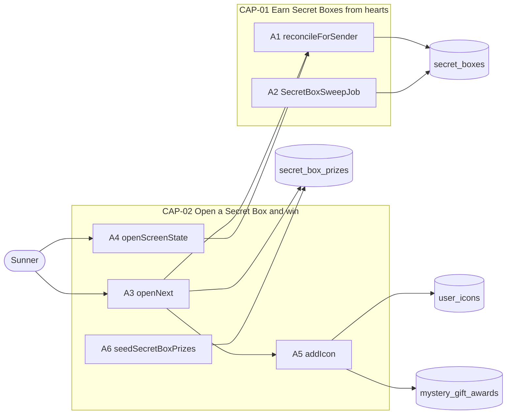

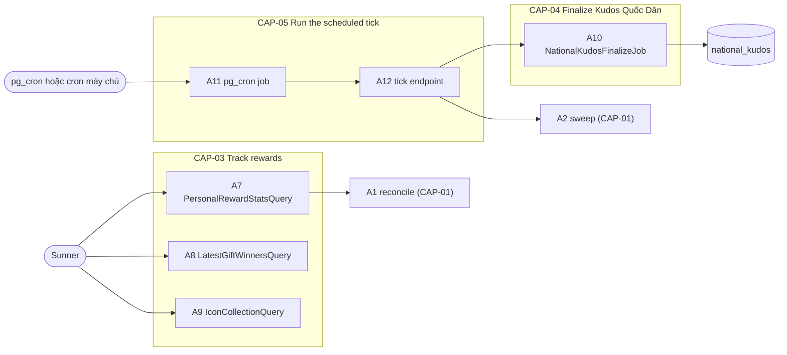

## 2. Action Index

| # | Action (handler) | Method · Path | Codes | Writes | Detail |
|---|---|---|---|---|---|
| **A0** | *cross-cutting — belongs to no single action* | — | FR-601 | — | § 4.4 |
| **A1** | `SecretBoxGrantService#reconcileForSender` *(in-process, no FE)* | — | FR-001, FR-401, FR-405, FR-407, BR-001, BR-002, BR-006, BR-007, SM-001, ALG-001, INT-001, INT-002 | `secret_boxes`, `domain_event_outbox` | § 3.1 ▸ **diagram** |
| **A2** | `SecretBoxSweepJob#run` *(background, no FE)* | scheduled · `SecretBoxTickJob#run` | FR-401, FR-405, FR-407, BR-001, BR-002, BR-006, BR-007, BR-012, SM-001, ALG-001, INT-001, INT-002 | `secret_boxes`, `domain_event_outbox` | § 3.1 ▸ **diagram** |
| **A3** | `SecretBoxOpenService#openNext` | `POST` `/api/secret-boxes/open` | FR-002, FR-302, FR-303, FR-305, FR-402, FR-403, FR-601, FR-602, BR-003, BR-004, BR-010, DEC-002, DEC-004, SM-001, SM-002, ALG-002, ALG-004, US044_OpenSecretBox | `secret_boxes`, `secret_box_prizes`, `user_icons`, `mystery_gift_awards`, `domain_event_outbox` | § 3.2 ▸ **diagram** |
| **A4** | `SecretBoxQuery#openScreenState` | `GET` `/api/secret-boxes/me` | FR-102, FR-301, FR-303, FR-305, FR-601, DEC-005, SM-002, US044_OpenSecretBox | — *(read-only; việc cấp hộp đi qua A1)* | § 3.2 |
| **A5** | `IconCollectionService#addIcon` *(in-process trong giao dịch của A3, no FE)* | — | FR-304, FR-404, FR-408, BR-005, INT-002 | `user_icons`, `mystery_gift_awards`, `domain_event_outbox` | § 3.2 ▸ **diagram** |
| **A6** | `secret-box-prize-loader#seedSecretBoxPrizes` *(CLI seed, no FE)* | — | FR-003, FR-004, BR-013 | `secret_box_prizes` | § 3.2 |
| **A7** | `PersonalRewardStatsQuery#forUser` | — | FR-101, FR-201, FR-202, FR-203, FR-208, FR-601, BR-007, BR-011, DEC-001, INT-001, US044_OpenSecretBox | — *(read-only; việc cấp hộp đi qua A1)* | § 3.3 |
| **A8** | `LatestGiftWinnersQuery#top10` | — | FR-204, FR-205, FR-206, FR-208, FR-601, FR-604, BR-009, DEC-003 | — *(read-only)* | § 3.3 |
| **A9** | `IconCollectionQuery#forUser` | — | FR-207 | — *(read-only)* | § 3.3 |
| **A10** | `NationalKudosFinalizeJob#run` *(background, no FE)* | scheduled · `SecretBoxTickJob#run` | FR-406, BR-007, BR-008, ALG-003, INT-002, INT-003 | `national_kudos`, `domain_event_outbox` | § 3.4 ▸ **diagram** |
| **A11** | `pg_cron#saa-secret-box-tick` *(background, no FE)* | queue · `pg_cron` | FR-401, FR-603, INT-004 | — *(chỉ đăng ký job pg_cron, không ghi bảng ứng dụng)* | § 3.5 ▸ **diagram** |
| **A12** | `SecretBoxTickJob#run` *(background, no FE)* | `POST` `/api/internal/secret-box/tick` | FR-401, FR-603, BR-012, INT-004 | — *(giao việc ghi cho A2 và A10)* | § 3.5 ▸ **diagram** |

**Rung set** theo template: Who → FE → Request → BE → Rule → Result → State → Source. Rung không áp dụng thì bỏ hẳn; rung **State** chỉ ghi khi đã xác nhận được chuyển trạng thái từ mã nguồn.

## 3. Actions

### 3.1 CAP-01 — Earn Secret Boxes from hearts

#### A1 · Reconcile one sender's Secret Boxes (read path)
`—` → `` `SecretBoxGrantService#reconcileForSender` ``
`FR-001` `FR-401` `FR-405` `FR-407` `BR-001` `BR-002` `BR-006` `BR-007` `SM-001` `ALG-001` `INT-001` `INT-002`

**Who** · không có người dùng trực tiếp; được gọi trong tiến trình trước mỗi lần đọc số liệu cá nhân: bảng thống kê (A7), `GET /api/secret-boxes/me` (A4) và trước khi mở hộp (A3), với `userId` lấy từ phiên *(gate A0 — § 4.4)*
**Request** · `userId` *(uuid, luôn từ phiên của người gọi)*, `now` *(Date, mặc định lúc gọi)*
**BE** · `` `SecretBoxGrantService#reconcileForSender` `` đọc tổng tim có trọng số của người gửi qua `INT-001` với mốc `asOf = min(now, EVENT_END_AT)`; `grantUpTo` so số hộp đáng được cấp (`ALG-001`) với `max(seq)` đã cấp và chỉ khi còn thiếu mới vào `insertGrants`, nơi lấy advisory lock theo người dùng rồi chèn các `seq` còn thiếu. `features/secret-box-rewards/server/secret-box-grant-service.ts:24-72`
**Rule**
- **BR-001 — Số hộp cấp bằng phần nguyên của tổng tim chia `SECRET_BOX_HEARTS_PER_BOX`, trừ số hộp đã cấp.** Mỗi hộp mang số thứ tự `seq` của người dùng; UNIQUE `(user_id, seq)` chặn cấp trùng một mốc dù hai tiến trình chạy song song. *(§ 4.4)*
- **BR-002 — Hộp đã cấp không bao giờ thu hồi.** Đường cấp chỉ chèn; tổng tim tụt xuống thì `entitled <= granted` và không có gì xảy ra. *(§ 4.4)*
- **BR-006 — Hộp chỉ tính tim thả đến `EVENT_END_AT`.** Mốc `asOf` bị kẹp ở `EVENT_END_AT`, nên tim thả sau đó không tính, nhưng lần đối soát muộn vẫn cấp hộp đã kiếm được trong cửa sổ. *(§ 4.4)*
- **BR-007 — Kudo ẩn danh vẫn được tính tim cho người gửi thật.** Tổng tim gom theo `sender_id` nội bộ, không lọc cờ ẩn danh. *(§ 4.4)*
**Result**
- Writes `secret_boxes` (`user_id`, `seq`; `status` mặc định `unopened`, `granted_at` mặc định `now()`) ← mỗi `seq` từ `max(seq)+1` tới `entitled`, `ON CONFLICT (user_id, seq) DO NOTHING` — `features/secret-box-rewards/server/secret-box-grant-service.ts:54-66`
- Publishes `BoxGranted { userId, count }` qua `INT-002` — gói tin để tính năng thông báo báo cho người gửi có hộp mới, chỉ ghi khi thật sự chèn được dòng và cùng giao dịch với các dòng hộp *(§ 4.5)* — `features/secret-box-rewards/server/secret-box-grant-service.ts:63`
- Trả `{ granted, stats }`; đọc tổng tim lỗi thì ném lỗi trước khi ghi bất cứ gì (A3 và A4 nuốt lỗi và ghi log qua `tryReconcile`, A7 để lỗi nổi lên thành trạng thái lỗi của bảng).
**State** · `SM-001`: `[*]` → `unopened` *(§ 4.3)*
**Source:** `features/secret-box-rewards/server/secret-box-grant-service.ts:24-72` → `features/kudos-hearts/server/heart-stats-query.ts:19-48` → `features/secret-box-rewards/server/secret-box-advisory-lock.ts:11-13` → `shared/events/domain-event-outbox.ts:18-29`

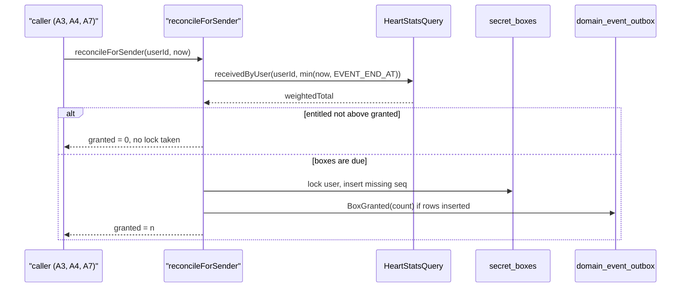

---

#### A2 · Sweep recently hearted senders *(background, no FE)*
`scheduled · SecretBoxTickJob#run` → `` `SecretBoxSweepJob#run` ``
`FR-401` `FR-405` `FR-407` `BR-001` `BR-002` `BR-006` `BR-007` `BR-012` `SM-001` `ALG-001` `INT-001` `INT-002` · `BL033_SecretBoxSweep`

**Who** · *không có người dùng — chạy mỗi tick do A12 gọi, để hộp và thông báo `BoxGranted` có sẵn mà không phải chờ người gửi ghé lại*
**Request** · *no HTTP request* — `now` do tick truyền vào
**BE** · `` `SecretBoxSweepJob#run` `` lấy các `sender_id` khác nhau có Kudo công khai vừa nhận tim trong `SWEEP_WINDOW_MIN` phút gần nhất, rồi `SecretBoxGrantService#reconcileForSenders` đọc gộp tổng tim và `max(seq)` (hai truy vấn), chọn những người còn nợ hộp, cắt tối đa `SWEEP_MAX_SENDERS_PER_TICK` người và gọi `insertGrants` cho từng người trong try/catch. `features/secret-box-rewards/server/secret-box-sweep-job.ts:17-30`, `features/secret-box-rewards/server/secret-box-grant-service.ts:82-99`
**Rule**
- **BR-012 — Mỗi tick quét người gửi có tim trong 10 phút gần nhất, tối đa 500 người đến hạn, và chỉ một tick chạy tại một thời điểm.** Phần dư vẫn đến hạn ở tick sau vì các cửa sổ chồng nhau; tick bắt đầu khi tick chậm còn chạy bị bỏ qua. *(§ 4.4)*
- **BR-001 / BR-002 / BR-006 — cùng cách tính và cấp như A1.** Số hộp đáng có là phần nguyên của tổng tim chia mốc hộp, chỉ chèn thêm không thu hồi, tim tính đến `EVENT_END_AT`. *(§ 4.4)*
- **BR-007 — Kudo ẩn danh vẫn tính cho người gửi thật.** Truy vấn tổng tim không lọc cờ ẩn danh. *(§ 4.4)*
**Result**
- Writes `secret_boxes` ← các `seq` còn thiếu của từng người đến hạn, mỗi người một giao dịch dưới advisory lock — `features/secret-box-rewards/server/secret-box-grant-service.ts:54-66`
- Publishes `BoxGranted { userId, count }` qua `INT-002` cho mỗi người vừa được cấp — gói tin để tính năng thông báo báo "bạn có hộp mới" *(§ 4.5)*
- Trả `SweepOutcome { senders, granted, failed, deferred }`; một người lỗi thì `failed += 1`, ghi log `[secret-box] sweep reconcile failed for one sender` và người đó vẫn đến hạn ở tick sau — `features/secret-box-rewards/server/secret-box-grant-service.ts:90-97`
**State** · `SM-001`: `[*]` → `unopened` *(§ 4.3)*
**Source:** `features/secret-box-rewards/server/secret-box-sweep-job.ts:17-30` → `features/secret-box-rewards/server/secret-box-grant-service.ts:37-99` → `features/kudos-hearts/server/heart-stats-query.ts:19-42`
**Shared structure:** `ALG-001` — tính số hộp một người gửi đáng có từ tổng tim và chèn phần còn thiếu, chi tiết *(§ 4.5)*

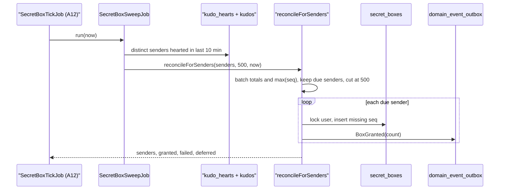

---

### 3.2 CAP-02 — Open a Secret Box and win

#### A3 · Open the next Secret Box
`POST /api/secret-boxes/open` → `` `SecretBoxOpenService#openNext` ``
`FR-002` `FR-302` `FR-303` `FR-305` `FR-402` `FR-403` `FR-601` `FR-602` `BR-003` `BR-004` `BR-010` `DEC-002` `DEC-004` `SM-001` `SM-002` `ALG-002` `ALG-004` `US044_OpenSecretBox` · `SCR007_KudosLiveBoardFeed/REG006_RewardsColumn`

**Who** · Sunner đã đăng nhập, mở hộp của chính mình (`US044_OpenSecretBox` — mở Secret Box) *(gate A0 — § 4.4)*
**FE** · bấm vào hộp trong modal thì `createSecretBoxOpener` chuyển sang `opening`, giữ khung "đang mở" tối thiểu 900 ms (0 ms khi người dùng bật giảm chuyển động) trong lúc chờ phản hồi, rồi hiện kết quả (`FR-302`); máy trạng thái của modal là `SM-002` *(§ 4.3)*. Mỗi lần bấm sinh một `Idempotency-Key` mới, trừ khi lần bấm trước chưa biết kết quả thì dùng lại đúng khoá cũ. Hộp bị khoá khi đang tải hoặc đang mở; X, Esc và bấm nền không đóng được lúc đang mở (`FR-305`), bị chặn bằng `busy` — `features/secret-box-rewards/components/secret-box-opener.ts:91-150`, `features/secret-box-rewards/components/use-secret-box-opener.ts:8-44`, `features/secret-box-rewards/components/secret-box-modal.tsx:33-116`, `features/secret-box-rewards/components/secret-box-modal-states.tsx:74-110`
**Request** · header `Idempotency-Key` *(uuid v4, bắt buộc; máy khách dựng bằng `getRandomValues` ở `features/secret-box-rewards/components/secret-box-format.ts:48-54`)*, không có body, quá 15 giây tính là lỗi mạng. Đáp 200 `OpenSecretBoxResult { kind, iconCode, name, setCompleted, giftName, duplicate, unopenedLeft, replayed }`.
**BE** · route `POST` kiểm phiên trước (`requireSecretBoxUser`, 401 trước mọi truy vấn), rồi `parseIdempotencyKey` (400 nếu không phải uuid v4), rồi `` `SecretBoxOpenService#openNext` ``: đối soát A1 theo kiểu cố gắng hết sức (`tryReconcile`), sau đó một giao dịch duy nhất lấy advisory lock theo người dùng, tra kết quả đã lưu theo khoá, nếu chưa có thì mở hộp `seq` thấp nhất còn `unopened` (`ALG-002`), rút giải (`ALG-004`), đánh dấu hộp đã mở, gọi A5 khi ra icon, rồi đếm số hộp chưa mở trong cùng giao dịch. `app/api/secret-boxes/open/route.ts:13-25`, `features/secret-box-rewards/server/secret-box-open-service.ts:87-95`
**Rule**
- **BR-003 — Mỗi hộp mở đúng một lần; cùng khoá yêu cầu thì trả đúng kết quả đã lưu.** `UPDATE ... WHERE status = 'unopened'` chỉ thành công khi hộp còn chưa mở; UNIQUE `(user_id, open_request_id)` làm yêu cầu lặp thấy `open_request_id` đã lưu và trả kết quả cũ với `replayed: true` thay vì mở hộp khác — `features/secret-box-rewards/server/secret-box-open-service.ts:35-53, 66-85`
- **BR-004 — Kết quả bốc theo trọng số trong số phần thưởng còn khả dụng; quà hết hàng bị loại và luôn có icon dự phòng.** Quà hữu hạn phải thắng `UPDATE ... SET stock_remaining = stock_remaining - 1 WHERE stock_remaining > 0`; thua tranh kho thì đọc lại và bốc lại, tối đa `MAX_REDRAW` lần, rồi chỉ bốc trong nhóm icon không giới hạn — `features/secret-box-rewards/server/prize-draw-service.ts:36-56`
- **BR-010 — Mở hộp luôn lấy hộp `seq` thấp nhất còn chưa mở; người dùng không chọn hộp.** `lowestUnopenedBoxId` sắp theo `seq` và khoá dòng `FOR UPDATE` — `features/secret-box-rewards/server/secret-box-open-service.ts:55-64`

**DEC-002** quyết định phần chữ và tiêu đề modal sau khi mở; tiêu đề chuyển sang "Chúc mừng…" khi `isCongratsResult` đúng, tức kết quả là quà hoặc vừa đủ bộ (`features/secret-box-rewards/components/secret-box-modal-states.tsx:28-30`, dùng ở `features/secret-box-rewards/components/secret-box-modal.tsx:90`). **DEC-004** quyết định máy khách làm gì với từng loại phản hồi của POST:

| DEC | subtype | Condition | What the user sees | Source |
|---|---|---|---|---|
| **DEC-002** | render, flow | `result.setCompleted == true` (icon thứ sáu khác loại) | tiêu đề "Chúc mừng bạn đã nhận được phần quà từ BTC SAA 2025", dòng "Bạn đã sưu tập trọn bộ 6 icon" kèm tên Quà bí ẩn; dòng hướng dẫn ẩn | `features/secret-box-rewards/components/secret-box-modal-states.tsx:120-127` |
| **DEC-002** | render | `result.kind == 'gift'` | tiêu đề chúc mừng như trên, tên quà hiện vật cỡ lớn dưới hộp, quầng sáng vàng thay ảnh quà | `features/secret-box-rewards/components/secret-box-modal-states.tsx:128` |
| **DEC-002** | render | `result.kind == 'icon'` AND `result.duplicate == true` AND NOT `setCompleted` | tiêu đề mặc định "KHÁM PHÁ SECRET BOX CỦA BẠN", icon có quầng sáng và dòng "Bạn đã có icon này rồi" | `features/secret-box-rewards/components/secret-box-modal-states.tsx:129` |
| **DEC-002** | render | `result.kind == 'icon'` AND `result.duplicate == false` AND NOT `setCompleted` | tiêu đề mặc định, icon có quầng sáng, không có dòng chú thích | `features/secret-box-rewards/components/secret-box-modal-states.tsx:129` |
| **DEC-004** | interaction, flow | phản hồi 200 có thân đọc được | sang `result`, xoá khoá đang chờ, số hộp chưa mở lấy từ `unopenedLeft` | `features/secret-box-rewards/components/secret-box-opener.ts:137-139` |
| **DEC-004** | interaction, flow | phản hồi 409 | sang `empty`, số hộp về 0, xoá khoá; dòng "Bạn chưa có Secret Box nào để mở" | `features/secret-box-rewards/components/secret-box-opener.ts:72` |
| **DEC-004** | interaction | phản hồi 400 | về `waiting`, xoá khoá, toast "Không thể mở hộp, vui lòng thử lại" | `features/secret-box-rewards/components/secret-box-opener.ts:73` |
| **DEC-004** | interaction, flow | phản hồi 401 | về `waiting`, GIỮ khoá, toast "Phiên đăng nhập đã hết hạn, vui lòng đăng nhập lại" | `features/secret-box-rewards/components/secret-box-opener.ts:74` |
| **DEC-004** | interaction | lỗi mạng, quá 15 giây, phản hồi 5xx hoặc thân không đọc được | về `waiting`, GIỮ khoá nên lần bấm kế gửi lại cùng khoá và máy chủ phát lại kết quả đã lưu; toast "Không thể mở hộp, vui lòng thử lại" | `features/secret-box-rewards/components/secret-box-opener.ts:75-80` |

**Result**
- Writes `secret_boxes.status`, `prize_id`, `open_request_id`, `opened_at` ← `'opened'`, giải vừa rút, khoá yêu cầu, `now()`; đây là bước `unopened` → `opened` của `SM-001` — `features/secret-box-rewards/server/secret-box-open-service.ts:70-75`
- Writes `secret_box_prizes.stock_remaining` ← trừ một khi trúng quà hữu hạn (cùng giao dịch, khoá dòng kho tới commit) — `features/secret-box-rewards/server/prize-draw-service.ts:36-43`
- Gọi A5 khi `prize.kind == 'icon'` để ghi `user_icons`, có thể ghi `mystery_gift_awards` và phát `SetCompleted` — `features/secret-box-rewards/server/secret-box-open-service.ts:76`
- Lỗi: 401 `unauthorized`, 400 `invalid_idempotency_key`, 409 `no_box_left` (do `NoBoxLeftError`), 500 `unexpected` (mọi lỗi khác, ghi log); luôn `Cache-Control: private, no-store`.
- User sees: modal chuyển sang kết quả theo `DEC-002`, bộ đếm "Secretbox chưa mở" giảm một; đóng modal thì trang làm mới để bảng thống kê thấy số mới.
**State** · `SM-001`: `unopened` → `opened` *(§ 4.3)*
**Source:** `app/api/secret-boxes/open/route.ts:13-25` → `features/secret-box-rewards/server/secret-box-api-session.ts:10-25` → `features/secret-box-rewards/server/secret-box-open-service.ts:20-95` → `features/secret-box-rewards/server/prize-draw-service.ts:19-56` → `features/secret-box-rewards/server/prize-weighted-pick.ts:17-38`

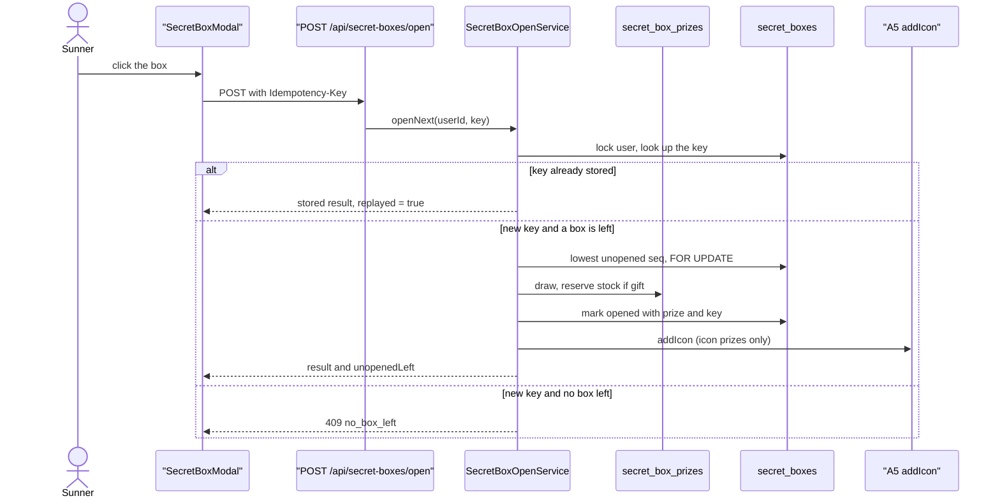

---

#### A4 · Open-screen state
`GET /api/secret-boxes/me` → `` `SecretBoxQuery#openScreenState` ``
`FR-102` `FR-301` `FR-303` `FR-305` `FR-601` `DEC-005` `SM-002` `US044_OpenSecretBox` · `SCR007_KudosLiveBoardFeed/REG006_RewardsColumn`

**Who** · Sunner đã đăng nhập vừa mở modal Secret Box (`US044_OpenSecretBox` — mở Secret Box) *(gate A0 — § 4.4)*
**FE** · `SecretBoxLauncher` mở modal từ nút "Mở Secret Box" hoặc từ đường dẫn `?secretBox=open` (thông báo hộp quà trỏ tới đó), kể cả khi bảng thống kê lỗi; khi modal gắn vào, `useSecretBoxOpener` gọi `load()` để đọc `GET /api/secret-boxes/me`. Lỗi đọc số hộp thì modal hiện "Không tải được số Secret Box. Vui lòng thử lại." kèm "Thử lại" (`FR-301`). Modal là một app modal gắn ở cuối `<body>`, giữ focus trong hộp thoại, khoá cuộn trang nền (`FR-305`); trạng thái giao diện theo `SM-002` *(§ 4.3)* — `features/secret-box-rewards/components/secret-box-launcher.tsx:38-73`, `features/secret-box-rewards/components/secret-box-opener.ts:114-124`, `features/secret-box-rewards/components/secret-box-modal-states.tsx:36-51`
**Request** · không tham số; `userId` lấy từ phiên.
**BE** · `` `SecretBoxQuery#openScreenState` `` gọi `tryReconcile` (A1) theo kiểu cố gắng hết sức rồi `countUnopened`; trả `{ unopened }`. Đối soát lỗi chỉ ghi log, các hộp đã cấp vẫn được đếm. `app/api/secret-boxes/me/route.ts:9-18`, `features/secret-box-rewards/server/secret-box-query.ts:13-47`
**Rule** · **DEC-005** quyết định khi nào modal mở, ai được đóng nó và việc gì chạy lúc đóng:

| DEC | subtype | Condition | What the user sees | Source |
|---|---|---|---|---|
| **DEC-005** | interaction, flow | `clicked` (đã bấm nút) HOẶC (`deepLinked` AND NOT `deepLinkDismissed`), sau khi hydrate | modal mở ngay; với đường dẫn thì modal mở cả khi không có nút | `features/secret-box-rewards/components/secret-box-launcher.tsx:40-49` |
| **DEC-005** | interaction, flow | đóng modal khi đang có tham số `secretBox` | tham số bị gỡ khỏi URL bằng `history.replaceState`, modal không bật lại khi URL còn cập nhật, trang làm mới | `features/secret-box-rewards/components/secret-box-launcher.tsx:51-58` |
| **DEC-005** | interaction | đóng modal khi bấm nút (không có tham số) | trang làm mới để bảng thống kê thấy số hộp mới; focus về nút nếu focus rơi xuống `<body>` | `features/secret-box-rewards/components/secret-box-launcher.tsx:51-65` |
| **DEC-005** | interaction | `phase == 'opening'` (`busy`) khi bấm X, Esc hoặc nền | bỏ qua yêu cầu đóng, nút X mờ `aria-disabled` | `features/secret-box-rewards/components/secret-box-modal.tsx:42-44` |

**Result** · read-only — **no DB write** ở chính action này (A1 là nơi ghi). Lỗi: 401 `unauthorized`, 500 `unexpected`; `Cache-Control: private, no-store`.
**State** · `SM-002`: `loading` → `waiting` hoặc `empty` hoặc `unavailable` *(§ 4.3)*
**Source:** `app/api/secret-boxes/me/route.ts:9-18` → `features/secret-box-rewards/server/secret-box-query.ts:13-47` → `features/secret-box-rewards/components/secret-box-launcher.tsx:38-73` → `features/secret-box-rewards/components/use-secret-box-opener.ts:29-44`

<!-- No diagram: read-only, một truy vấn đếm; phần nội dung chính là bảng DEC-005, vẽ thành sequence diagram sẽ ép các điều kiện song song thành một chuỗi giả. -->

---

#### A5 · Add an icon and award the mystery gift
`—` → `` `IconCollectionService#addIcon` ``
`FR-304` `FR-404` `FR-408` `BR-005` `INT-002`

**Who** · *không có người dùng trực tiếp — chạy trong giao dịch của A3 (đang giữ advisory lock của người dùng) khi hộp vừa mở ra icon*
**Request** · `tx`, `userId`, `iconCode` *(một trong 6 mã `SECRET_BOX_ICON_CODES`)* do `openLowestBox` truyền vào
**BE** · `` `IconCollectionService#addIcon` `` upsert `user_icons` (icon trùng chỉ cộng `quantity`), đếm số icon khác nhau của người dùng, nếu đủ 6 thì chèn `mystery_gift_awards` với `ON CONFLICT DO NOTHING` và chỉ khi dòng thật sự mới thì ghi sự kiện `SetCompleted`. `features/secret-box-rewards/server/icon-collection-service.ts:19-37`
**Rule** · **BR-005 — Gom đủ 6 icon khác nhau thì nhận đúng một Quà bí ẩn, một lần duy nhất; icon trùng chỉ cộng dồn số lượng.** `mystery_gift_awards.user_id` là khoá chính nên mỗi người tối đa một dòng; sự kiện chỉ phát khi `RETURNING` trả về dòng mới, nên mở thêm hộp sau khi đủ bộ không tạo thêm quà hay thông báo — `features/secret-box-rewards/server/icon-collection-service.ts:26-36`
**Result**
- Writes `user_icons` (`quantity` + 1 khi trùng; dòng mới với `first_obtained_at` mặc định `now()`) — `features/secret-box-rewards/server/icon-collection-service.ts:20-25`
- Writes `mystery_gift_awards` (`user_id`, `gift_name` ← `MYSTERY_GIFT_NAME`, `completed_at` mặc định `now()`, bằng `opened_at` của hộp vừa mở vì cùng giao dịch) khi vừa đủ bộ — `features/secret-box-rewards/server/icon-collection-service.ts:29-33`
- Publishes `SetCompleted { userId, giftName }` qua `INT-002` — gói tin để tính năng thông báo báo "bạn đã sưu tập đủ 6 icon" *(§ 4.5)* — `features/secret-box-rewards/server/icon-collection-service.ts:35`
- Trả `{ setCompleted, giftName, duplicate }` cho A3; `duplicate = quantity > 1` sau upsert.
**Source:** `features/secret-box-rewards/server/icon-collection-service.ts:19-37` → `features/secret-box-rewards/schemas/secret-box-views.ts:9-17` → `shared/events/domain-event-outbox.ts:18-29`

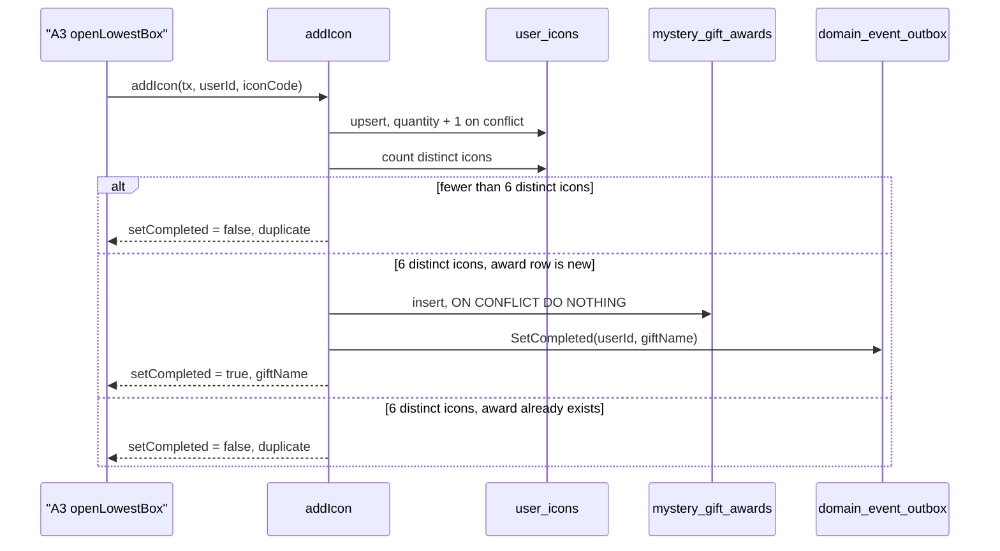

---

#### A6 · Seed the prize catalog *(CLI seed, no FE)*
`—` → `` `secret-box-prize-loader#seedSecretBoxPrizes` ``
`FR-003` `FR-004` `BR-013`

**Who** · người vận hành chạy `npm run db:seed` (`apply-all-seeds` gọi loader trong một giao dịch) — không phải Sunner
**Request** · *no HTTP request* — nguồn là `secretBoxPrizeCatalog` (9 dòng: 6 icon trọng số 10, kho không giới hạn; 3 quà hiện vật trọng số 1, kho 50 — số liệu tạm, chờ BTC)
**BE** · `` `seedSecretBoxPrizes` `` dựng dòng từ danh mục (`code` = `iconKey`, `icon_code` = `iconKey` viết hoa dấu gạch dưới với icon, `NULL` với quà), upsert theo `code`, rồi tắt (`active = false`) các giải không còn trong danh mục. `db/seeds/secret-box-prize-loader.ts:15-54`, `db/seeds/apply-all-seeds.ts:6, 24`
**Rule** · **BR-013 — Nạp lại danh mục giữ số quà đã phát.** Dòng mới bắt đầu với `stock_remaining = stock_total`; dòng đã có tính `stock_remaining = max(tổng mới − (tổng cũ − còn lại cũ), 0)` nên BTC đổi tổng bằng cách sửa danh mục rồi nạp lại; giải bị bỏ khỏi danh mục chỉ bị tắt chứ không xoá vì hộp đã mở còn tham chiếu — `db/seeds/secret-box-prize-loader.ts:36-52`
**Result**
- Writes `secret_box_prizes` (`code`, `kind`, `icon_code`, `name`, `weight`, `stock_total`, `stock_remaining`, `active`) ← danh mục; `stock_remaining` tính theo `BR-013` — `db/seeds/secret-box-prize-loader.ts:32-48`
**Source:** `db/seeds/secret-box-prize-loader.ts:15-54` → `db/seeds/secret-box-prize-catalog.ts:22-32` → `db/seeds/apply-all-seeds.ts:6-24`

<!-- No diagram: ghi một bảng, đồng bộ, chạy tay; không có nhánh bất đồng bộ. -->

---

### 3.3 CAP-03 — Track rewards

#### A7 · Personal reward stats and the open button
`—` → `` `PersonalRewardStatsQuery#forUser` ``
`FR-101` `FR-201` `FR-202` `FR-203` `FR-208` `FR-601` `BR-007` `BR-011` `DEC-001` `INT-001` `US044_OpenSecretBox` · `SCR007_KudosLiveBoardFeed/REG006_RewardsColumn`

**Who** · Sunner đã đăng nhập xem bảng thống kê của chính mình ở Live board và ở profile của mình (`US044_OpenSecretBox` — nút Mở Secret Box nằm trong bảng này) *(gate A0 — § 4.4)*
**FE** · `PersonalStatsPanel` vẽ năm dòng: Kudos nhận, Kudos gửi, tim nhận (có cờ lửa "x2" khi `campaignActive`), một đường kẻ, Secret Box đã mở và chưa mở, rồi `SecretBoxLauncher` với nút "Mở Secret Box" (`FR-201`, `FR-202`). Khi `stats = null` bảng hiện "Không tải được thống kê. Vui lòng thử lại." kèm "Thử lại" làm mới route (`FR-208`). Cột nằm trong `LiveBoardRewardsColumnSlot`, có Suspense riêng; ở profile là `ProfileStatsPanelSlot` — `features/secret-box-rewards/components/personal-stats-panel.tsx:41-71`, `features/secret-box-rewards/components/rewards-status-message.tsx:18-43`, `features/kudos-feed/components/live-board-rewards-column-slot.tsx:13-23`, `features/profile/components/profile-stats-panel-slot.tsx:13-30`
**Request** · gọi trong tiến trình từ `loadRewardsColumnData` (Live board) và `ProfileStatsPanelLoader` (profile của chính mình); `userId` lấy từ `requireSunner()`, không bao giờ từ URL.
**BE** · `` `PersonalRewardStatsQuery#forUser` `` gọi A1 (`reconcileForSender`, ném lỗi nếu hỏng) để chốt số hộp và lấy tổng tim có trọng số cùng cờ chiến dịch qua `INT-001`, rồi song song đếm Kudo công khai nhận và gửi bằng một truy vấn gộp trên `kudos` và đếm hộp theo `status` bằng `count(*) filter`. `features/secret-box-rewards/server/personal-reward-stats-query.ts:16-38`, `features/secret-box-rewards/server/secret-box-query.ts:22-31`
**Rule**
- **BR-011 — Số Kudo nhận và gửi chỉ tính Kudo đang công khai; Kudo ẩn danh vẫn tính cho người gửi.** Điều kiện `status = 'public'` loại Kudo bị Spam; người xem là người gửi thật nên không lộ danh tính — `features/secret-box-rewards/server/personal-reward-stats-query.ts:16-25`
- **BR-007 — Kudo ẩn danh vẫn tính tim và Kudo cho người gửi thật.** Tổng tim và số Kudo gửi gom theo `sender_id` nội bộ, không lọc cờ ẩn danh. *(§ 4.4)*

**DEC-001** quyết định nút Mở Secret Box:

| DEC | subtype | Condition | What the user sees | Source |
|---|---|---|---|---|
| **DEC-001** | interaction, render | `stats == null` (đọc thống kê lỗi) | không có nút; có thông báo lỗi và "Thử lại"; đường dẫn `?secretBox=open` vẫn mở được modal | `features/secret-box-rewards/components/personal-stats-panel.tsx:63-67`, `features/secret-box-rewards/components/secret-box-launcher.tsx:69` |
| **DEC-001** | interaction, render | `unopened > 0` | nút "Mở Secret Box" bấm được, mở modal (A4) | `features/secret-box-rewards/components/open-secret-box-button.tsx:59-64` |
| **DEC-001** | interaction, render | `unopened <= 0` | nút mờ, `aria-disabled` nhưng vẫn focus được; tooltip "Bạn chưa có Secret Box nào" hiện khi rê chuột, focus bàn phím hoặc chạm, đóng bằng Esc | `features/secret-box-rewards/components/open-secret-box-button.tsx:27-40` |

**Result** · read-only với dữ liệu hiển thị — **no DB write** ở chính action này (A1 là nơi ghi). Trả `PersonalRewardStatsView { kudosReceived, kudosSent, heartsReceived, campaignActive, boxesOpened, boxesUnopened }`; `heartsReceived` là tổng tim có trọng số dùng để tính hộp.
**Source:** `features/secret-box-rewards/components/personal-stats-panel.tsx:41-71` → `features/secret-box-rewards/components/open-secret-box-button.tsx:21-77` → `features/secret-box-rewards/server/rewards-column-data-loader.ts:15-31` → `features/secret-box-rewards/server/personal-reward-stats-query.ts:27-38` → `features/secret-box-rewards/server/secret-box-query.ts:22-31`

<!-- No diagram: read-only; một lời gọi A1 và hai truy vấn đếm, không ghi bảng nào ở chính action này. Phần chính là bảng DEC-001. -->

---

#### A8 · Latest 10 gift winners
`—` → `` `LatestGiftWinnersQuery#top10` ``
`FR-204` `FR-205` `FR-206` `FR-208` `FR-601` `FR-604` `BR-009` `DEC-003` · `SCR007_KudosLiveBoardFeed/REG006_RewardsColumn`

**Who** · Sunner đã đăng nhập xem Live board; khách bị `requireSunner()` chuyển về `/login` trước khi truy vấn chạy (`FR-604`) *(gate A0 — § 4.4)*
**FE** · `LatestGiftWinnersList` vẽ panel "10 SUNNER NHẬN QUÀ MỚI NHẤT": mỗi dòng avatar, tên (vàng) và "Nhận được {tên quà}", danh sách cuộn được và focus được bằng bàn phím (`FR-204`); khi `winners = null` hiện "Không tải được danh sách nhận quà. Vui lòng thử lại." kèm "Thử lại" (`FR-208`) — `features/secret-box-rewards/components/latest-gift-winners-list.tsx:16-46`
**Request** · gọi trong tiến trình từ `loadRewardsColumnData`; không tham số.
**BE** · `` `LatestGiftWinnersQuery#top10` `` chạy một truy vấn nối `secret_boxes` với `secret_box_prizes` (điều kiện `kind = 'gift'`) và `profiles`, lọc `status = 'opened'`, sắp `opened_at` giảm dần rồi `id` giảm dần, `LIMIT LATEST_WINNERS_LIMIT`; dùng chỉ mục `(status, opened_at DESC)`. `features/secret-box-rewards/server/latest-gift-winners-query.ts:15-31`
**Rule**
- **BR-009 — Danh sách là 10 lần mở hộp ra quà hiện vật gần nhất.** Nối giải với `kind = 'gift'` nên icon và Quà bí ẩn không vào danh sách; danh sách là các lần mở, nên một người có thể xuất hiện nhiều lần — `features/secret-box-rewards/server/latest-gift-winners-query.ts:24-30`

**DEC-003** quyết định panel hiện gì:

| DEC | subtype | Condition | What the user sees | Source |
|---|---|---|---|---|
| **DEC-003** | render | `winners == null` | thông báo lỗi riêng của panel và nút "Thử lại"; các panel khác vẫn dựng | `features/secret-box-rewards/components/latest-gift-winners-list.tsx:26` |
| **DEC-003** | render | `winners.length == 0` | "Chưa có Sunner nào nhận quà." | `features/secret-box-rewards/components/latest-gift-winners-list.tsx:27` |
| **DEC-003** | render | `winners.length > 0` | danh sách các dòng người nhận quà, mới nhất ở trên | `features/secret-box-rewards/components/latest-gift-winners-list.tsx:28-44` |

**Result** · read-only — **no DB write**. Tên thật và avatar lấy từ `profiles`; người nhận quà là chủ hộp chứ không phải người gửi Kudo nên không lộ danh tính ẩn danh nào — `features/secret-box-rewards/server/latest-gift-winners-query.ts:8-14`
**Source:** `features/secret-box-rewards/components/latest-gift-winners-list.tsx:16-46` → `features/secret-box-rewards/server/rewards-column-data-loader.ts:15-31` → `features/secret-box-rewards/server/latest-gift-winners-query.ts:15-31`

<!-- No diagram: read-only, một truy vấn nối ba bảng; phần chính là bảng DEC-003. -->

---

#### A9 · Icon collection for a user
`—` → `` `IconCollectionQuery#forUser` ``
`FR-207`

**Who** · Sunner đã đăng nhập xem bộ sưu tập của mình hoặc của đồng nghiệp ở profile *(gate A0 — § 4.4, do trang profile áp dụng)*
**FE** · `IconCollection` vẽ 6 vòng tròn theo thứ tự cố định REVIVAL, TOUCH OF LIGHT, STAY GOLD, FLOW TO HORIZON, BEYOND THE BOUNDARY, ROOT FURTHER dù đầu vào thứ tự nào; icon đã có hiện ảnh icon kèm nhãn vàng "×N" khi `quantity > 1`, icon chưa có hiện vòng xám rỗng; mỗi vòng có tên truy cập kiểu "REVIVAL, chưa có" — `features/secret-box-rewards/components/icon-collection.tsx:19-48`, `features/secret-box-rewards/components/secret-box-format.ts:34-38`
**Request** · `userId` *(người được xem)*, do `profile-page-data` truyền trong tiến trình; icon không phải thông tin riêng tư.
**BE** · `` `IconCollectionQuery#forUser` `` đọc `user_icons` theo người dùng rồi trả đúng 6 phần tử `{ iconCode, owned, quantity }` theo thứ tự `SECRET_BOX_ICON_CODES`, `quantity = 0` khi thiếu. `features/secret-box-rewards/server/icon-collection-query.ts:11-18`
**Result** · read-only — **no DB write**.
**Source:** `features/profile/server/profile-page-data.ts:46` → `features/secret-box-rewards/server/icon-collection-query.ts:11-18` → `features/secret-box-rewards/components/icon-collection.tsx:19-48`

<!-- No diagram: read-only, một truy vấn. Việc gom đủ bộ và tạo Quà bí ẩn nằm ở A5, không ở đây. -->

---

### 3.4 CAP-04 — Finalize Kudos Quốc Dân

#### A10 · Finalize Kudos Quốc Dân *(background, no FE)*
`scheduled · SecretBoxTickJob#run` → `` `NationalKudosFinalizeJob#run` ``
`FR-406` `BR-007` `BR-008` `ALG-003` `INT-002` `INT-003` · `BL032_NationalKudosFinalize`

**Who** · *không có người dùng — chạy mỗi tick do A12 gọi; Sunner không có đường kích hoạt*
**Request** · *no HTTP request* — `now` do tick truyền vào
**BE** · `` `NationalKudosFinalizeJob#run` `` theo `ALG-003`: trước `NATIONAL_KUDOS_FINALIZE_AT` thì trả `not_due`; nếu `national_kudos` đã có dòng thì `already_finalized`; ngược lại xếp hạng Kudo công khai theo số tim thô tính đến `NATIONAL_KUDOS_FINALIZE_AT` qua `INT-003` (đọc TRƯỚC giao dịch, không đọc pool khi đang giữ khoá), rồi trong một giao dịch lấy advisory lock, kiểm lại "đã chốt chưa", chèn tối đa 5 dòng và một sự kiện outbox. `features/secret-box-rewards/server/national-kudos-finalize-job.ts:25-63`
**Rule**
- **BR-008 — Kudos Quốc Dân là 5 Kudo công khai nhiều tim thô nhất tính đến mốc chốt, hoà thì Kudo cũ hơn đứng trước, mỗi Kudo cần ít nhất 1 tim, chốt đúng một lần.** Trạng thái Spam đọc tại thời điểm chốt; PK `kudo_id` và UNIQUE `rank` cùng bước kiểm "đã chốt" trong giao dịch làm job chạy lặp hay song song vẫn chỉ ghi 5 dòng — `features/secret-box-rewards/server/national-kudos-finalize-job.ts:29-46, 54-62`
- **BR-007 — Kudo ẩn danh vẫn được xếp hạng và người gửi thật vẫn là người nhận quà.** Truy vấn xếp hạng không lọc cờ ẩn danh; `senderId` thật chỉ đi trong sự kiện outbox và không bao giờ vào bảng hay giao diện hiển thị. *(§ 4.4)*
**Result**
- Writes `national_kudos` (`kudo_id`, `rank` = 1..5, `hearts_at_finalize` ← số tim thô tại mốc chốt, `finalized_at` mặc định `now()`) — `features/secret-box-rewards/server/national-kudos-finalize-job.ts:57`
- Publishes `NationalKudosFinalized { items: [{ kudoId, senderId, rank }] }` qua `INT-002` — gói tin để tính năng thông báo báo cho từng người gửi trong 5 Kudo, kèm câu nhắc quà đặc biệt "Root Further" nằm trong nội dung thông báo *(§ 4.5)* — `features/secret-box-rewards/server/national-kudos-finalize-job.ts:58-60`
- Trả `NationalKudosOutcome { status, count }` với `status` là `not_due`, `already_finalized`, `nothing_to_finalize` hoặc `finalized`; chưa Kudo nào có tim thì không ghi gì và tick sau kiểm lại.
**Source:** `features/secret-box-rewards/server/national-kudos-finalize-job.ts:25-63` → `features/kudos-hearts/server/heart-ranking-query.ts:25-61` → `features/kudos-feed/server/kudo-public-filters.ts:31-37` → `features/secret-box-rewards/server/secret-box-advisory-lock.ts:15-18`
**Shared structure:** `ALG-003` — xếp hạng Kudo công khai theo số tim thô và ghi 5 Kudo đầu một lần duy nhất, chi tiết *(§ 4.5)*

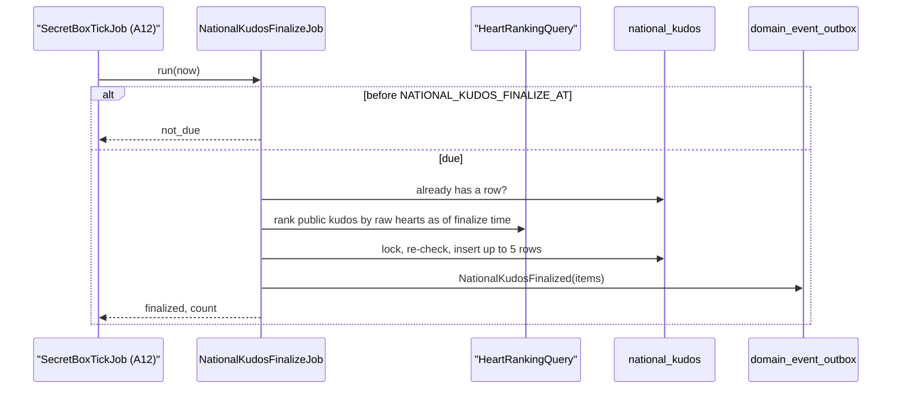

---

### 3.5 CAP-05 — Run the scheduled tick

Một chuỗi nhiều handler: pg_cron gọi endpoint mỗi phút, endpoint kiểm secret rồi giao cho `SecretBoxTickJob`, tick giữ một advisory lock chống chạy chồng rồi chạy lần lượt A2 và A10. Sơ đồ đặt ở cấp capability để không lặp ở từng action.

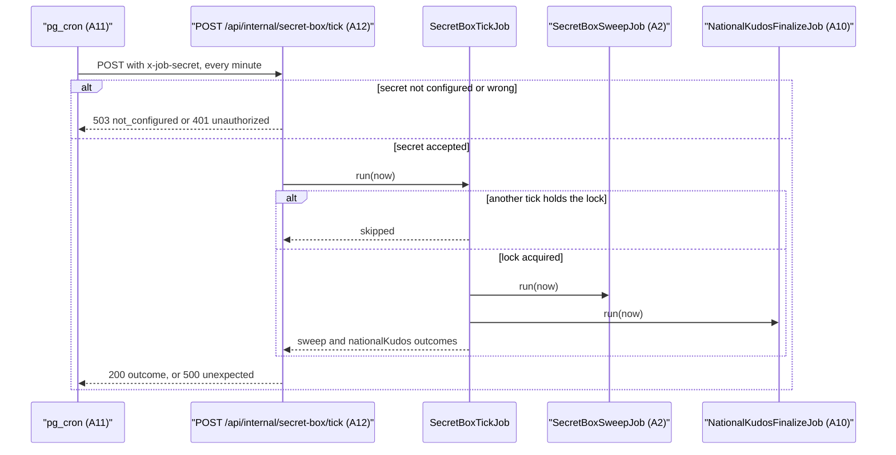

#### A11 · Register the minute cron job *(background, no FE)*
`queue · pg_cron` → `` `pg_cron#saa-secret-box-tick` ``
`FR-401` `FR-603` `INT-004` · `BL028_SecretBoxTickCron`

**Who** · *không có người dùng — bộ lập lịch của cơ sở dữ liệu (pg_cron) chạy job mỗi phút*
**Request** · *no HTTP request từ người dùng* — job gọi `net.http_post` tới URL lấy từ Supabase Vault với header `x-job-secret` lấy từ Vault, `timeout_milliseconds` 30000, chỉ gửi khi cả hai mục Vault có mặt.
**BE** · migration chạy trong khối `DO`: thiếu `pg_cron`, `pg_net` (có và được preload) hoặc Vault thì chỉ in `NOTICE` và không đổi gì để các migration sau vẫn áp dụng được; đủ thì `CREATE EXTENSION IF NOT EXISTS` rồi `cron.schedule('saa-secret-box-tick', '* * * * *', …)`; lập lịch theo tên là upsert nên chạy lại an toàn. `db/migrations/0016_secret_box_tick_cron.sql:15-47`
**Rule** · môi trường không có pg_cron, pg_net hoặc Vault phải dùng cron máy chủ POST cùng endpoint mỗi phút; tick lỡ chỉ làm thông báo `BoxGranted` đến trễ vì mọi đường đọc tự đối soát hộp (`FR-401`). Có `0016_secret_box_tick_cron.down.sql` để rollback.
**Result** · đăng ký (hoặc cập nhật) job `saa-secret-box-tick` trong pg_cron; không ghi bảng ứng dụng nào.
**Source:** `db/migrations/0016_secret_box_tick_cron.sql:15-47`
**Shared structure:** `INT-004` — pg_cron gọi endpoint nội bộ của ứng dụng bằng pg_net với secret đọc từ Vault, chi tiết *(§ 4.5)*

---

#### A12 · Run one tick *(background, no FE)*
`POST /api/internal/secret-box/tick` → `` `SecretBoxTickJob#run` ``
`FR-401` `FR-603` `BR-012` `INT-004` · `BL027_SecretBoxTickEndpoint` `BL034_SecretBoxTick`

**Who** · *không có người dùng — chỉ bộ lập lịch (pg_cron hoặc cron máy chủ) có secret; không có đường nào từ trình duyệt (`FR-603`)* *(gate: header `x-job-secret`, không phải gate A0)*
**Request** · header `x-job-secret` *(chuỗi bí mật, ≥ 32 ký tự khi cấu hình)*, thân rỗng. Đáp 200 `{ skipped: true }` hoặc `{ sweep: { senders, granted, failed, deferred }, nationalKudos: { status, count } }`; 503 `not_configured`; 401 `unauthorized`; 500 `unexpected`; luôn `Cache-Control: no-store`.
**BE** · route gọi `checkInternalJobSecret` (băm SHA-256 cả hai giá trị rồi `timingSafeEqual`), rồi `` `SecretBoxTickJob#run` ``: một `db.transaction` giữ `pg_try_advisory_xact_lock(hashtext('secret_box_tick'))`; không lấy được khoá thì trả `{ skipped: true }` ngay, lấy được thì chạy A2 rồi A10, mỗi job bọc `settle` để lỗi một job thành `null` (ghi log) mà job kia vẫn chạy. `app/api/internal/secret-box/tick/route.ts:16-30`, `features/secret-box-rewards/server/secret-box-tick-job.ts:20-36`
**Rule** · **BR-012 — Một tick mỗi lần, mỗi job lỗi riêng, tối đa 500 người đến hạn mỗi tick.** Tick chậm còn chạy thì tick mới (hoặc cuộc gọi cron thử lại) bị bỏ qua; hai job idempotent nên tick gọi lại vô hại; kết nối giữ khoá chỉ mang khoá (1 trong 10 kết nối của pool) và job không đọc qua nó. *(§ 4.4)*
**Result** · không ghi trực tiếp — A2 và A10 tự ghi trên kết nối và giao dịch của chúng. Một trong hai job lỗi, hoặc tick không khởi chạy được, thì 500 `unexpected`.
**Source:** `app/api/internal/secret-box/tick/route.ts:16-30` → `features/secret-box-rewards/server/internal-job-guard.ts:11-22` → `features/secret-box-rewards/server/secret-box-tick-job.ts:20-36` → `features/secret-box-rewards/server/secret-box-advisory-lock.ts:25-28` → `shared/auth/public-paths.ts:24, 38`
**Shared structure:** `INT-004` — endpoint này là đích của lời gọi pg_cron qua pg_net, chi tiết *(§ 4.5)*

---

### 3.6 Edge cases

| Action | Scenario | Behavior |
|---|---|---|
| A3 | Bấm đúp hoặc gửi lại cùng `Idempotency-Key` | advisory lock theo người dùng tuần tự hoá; lần sau thấy `open_request_id` đã lưu và trả kết quả cũ với `replayed: true`, không mở hộp thứ hai (BR-003) |
| A3 | Hai tab, hai khoá khác nhau, chỉ còn một hộp | lock tuần tự hoá; tab đến sau không còn hộp `unopened` nên trả 409 `no_box_left` |
| A3 | Hai người cùng bốc khi chỉ còn một quà hữu hạn | `UPDATE ... WHERE stock_remaining > 0` chỉ thành công một lần; người kia bốc lại tối đa `MAX_REDRAW` lần rồi rơi về nhóm icon (BR-004) |
| A3 | Toàn bộ quà hiện vật hết hàng | `pickPrize` chỉ còn ứng viên icon; hộp ra icon, không lỗi |
| A3 | `Idempotency-Key` thiếu hoặc không phải uuid v4 | 400 `invalid_idempotency_key`; kiểm phiên (401) chạy trước, chưa đụng cơ sở dữ liệu |
| A3 | Không còn icon không giới hạn đang `active` trong kho | `draw` ném lỗi "prize pool has no active unlimited icon"; giao dịch huỷ, hộp vẫn `unopened`, 500 `unexpected` (chạy `npm run db:seed`) |
| A3 · A5 | Lỗi giữa giao dịch, kể cả không ghi được outbox `SetCompleted` | giao dịch huỷ trọn: hộp vẫn `unopened`, kho không trừ, không có icon hay Quà bí ẩn thừa |
| A3 | Mất kết nối sau khi giao dịch đã commit | máy khách giữ khoá (DEC-004); lần bấm sau gửi lại cùng khoá và nhận đúng kết quả đã lưu |
| A3 | Mở hộp sau `EVENT_END_AT` | vẫn mở được; luồng mở không kiểm `now` so với mốc nào |
| A3 · A4 | Đối soát A1 lỗi lúc mở hộp hoặc đếm hộp | `tryReconcile` ghi log rồi đi tiếp; hộp đã cấp vẫn mở và đếm được |
| A1 | Hai lần chạy song song cho cùng người gửi | advisory lock tuần tự hoá; nếu lỡ, UNIQUE `(user_id, seq)` vẫn chặn cấp trùng (BR-001) |
| A1 · A2 | Tổng tim tụt dưới số hộp đã cấp | `entitled <= granted` nên không chèn, không thu hồi (BR-002) |
| A1 · A2 | Chạy sau `EVENT_END_AT` | `asOf` kẹp ở `EVENT_END_AT`: tim thả sau mốc không tính, hộp đáng có trong cửa sổ vẫn được cấp bù (BR-006) |
| A1 · A7 | Đọc tổng tim từ nguồn lỗi | A1 ném lỗi trước khi ghi; A7 trả lỗi nên panel thống kê hiện trạng thái lỗi riêng |
| A2 | Hơn 500 người đến hạn trong một tick | 500 người đầu được xử lý, phần còn lại tính vào `deferred` và được các tick sau nhặt tiếp (BR-012) |
| A2 | Một người lỗi khi cấp | `failed += 1`, ghi log, người đó vẫn đến hạn ở tick sau |
| A7 · A8 | Một panel lỗi khi nạp | `settle` trả `null` nên chỉ panel đó hiện lỗi kèm "Thử lại"; panel kia và cả trang vẫn dựng |
| A8 | Chưa có hộp nào ra quà hiện vật | trả danh sách rỗng, panel hiện thông báo trống (DEC-003) |
| A10 | Chạy hai lần hoặc song song | kiểm "đã chốt" cả ngoài lẫn trong giao dịch dưới advisory lock; PK `kudo_id` và UNIQUE `rank` chặn dòng thừa (BR-008) |
| A10 | Ít hơn 5 Kudo có tim | chốt bấy nhiêu Kudo có ít nhất 1 tim; không Kudo nào có tim thì `nothing_to_finalize`, tick sau kiểm lại |
| A10 | Kudo ẩn danh nằm trong top 5 | vẫn xếp hạng; `senderId` thật chỉ đi trong sự kiện outbox (BR-007) |
| A11 | Cơ sở dữ liệu thiếu pg_cron, pg_net hoặc Vault | migration chỉ `NOTICE` và không lập lịch; dùng cron máy chủ gọi cùng endpoint mỗi phút |
| A12 | Tick chậm chạy chồng với tick mới | `pg_try_advisory_xact_lock` trả false nên tick mới trả 200 `{ skipped: true }` (BR-012) |
| A12 | `INTERNAL_JOB_SECRET` chưa đặt, header thiếu hoặc sai | 503 `not_configured` khi chưa đặt secret; 401 `unauthorized` khi thiếu hoặc sai |
| A12 | Một job lỗi | job kia vẫn chạy xong; endpoint trả 500 `unexpected` |
| A3 · A4 | Gọi khi chưa đăng nhập | 401 JSON trước mọi truy vấn (A0 — § 4.4); loader của trang cho A7 và A8 thì `requireSunner()` chuyển về `/login` hoặc trang chọn phòng ban |

## 4. Shared Foundation

### 4.1 Components

| Component | Responsibility | Used in | File |
|---|---|---|---|
| `SecretBoxGrantService` | Tính và cấp hộp theo `ALG-001`; đường đọc một người (`reconcileForSender`) và đường quét nhiều người (`reconcileForSenders`) | A1, A2 | `features/secret-box-rewards/server/secret-box-grant-service.ts` |
| `SecretBoxSweepJob` | Chọn người gửi vừa nhận tim trong cửa sổ quét | A2 | `features/secret-box-rewards/server/secret-box-sweep-job.ts` |
| `SecretBoxOpenService` | Giao dịch mở hộp có phát lại theo khoá (`ALG-002`) | A3 | `features/secret-box-rewards/server/secret-box-open-service.ts` |
| `PrizeDrawService`, `pickPrize` | Bốc phần thưởng có trọng số và trừ kho nguyên tử (`ALG-004`); `pickPrize` thuần, nhận bộ sinh số tiêm vào | A3 | `features/secret-box-rewards/server/prize-draw-service.ts`, `features/secret-box-rewards/server/prize-weighted-pick.ts` |
| `IconCollectionService` | Cộng icon và trao Quà bí ẩn | A5 | `features/secret-box-rewards/server/icon-collection-service.ts` |
| `SecretBoxQuery` | Đếm hộp theo trạng thái; `tryReconcile` đối soát cố gắng hết sức | A3, A4, A7 | `features/secret-box-rewards/server/secret-box-query.ts` |
| `PersonalRewardStatsQuery` | Gom năm số cho bảng thống kê | A7 | `features/secret-box-rewards/server/personal-reward-stats-query.ts` |
| `LatestGiftWinnersQuery` | 10 người nhận quà hiện vật mới nhất | A8 | `features/secret-box-rewards/server/latest-gift-winners-query.ts` |
| `IconCollectionQuery` | 6 ô bộ sưu tập icon của một người | A9 | `features/secret-box-rewards/server/icon-collection-query.ts` |
| `loadRewardsColumnData` | Nạp dữ liệu cột phần thưởng sau `requireSunner()`, mỗi panel lỗi riêng thành `null` | A7, A8 | `features/secret-box-rewards/server/rewards-column-data-loader.ts` |
| `NationalKudosFinalizeJob` | Chốt Kudos Quốc Dân (`ALG-003`) | A10 | `features/secret-box-rewards/server/national-kudos-finalize-job.ts` |
| `SecretBoxTickJob` | Điều phối tick: khoá chống chạy chồng, A2 rồi A10 | A12 | `features/secret-box-rewards/server/secret-box-tick-job.ts` |
| advisory lock helpers | Khoá theo người dùng, khoá chốt Kudos Quốc Dân, khoá tick (`pg_try_advisory_xact_lock`) | A1, A3, A10, A12 | `features/secret-box-rewards/server/secret-box-advisory-lock.ts` |
| `checkInternalJobSecret` | So header `x-job-secret` với `INTERNAL_JOB_SECRET` bằng băm SHA-256 và `timingSafeEqual` | A12 | `features/secret-box-rewards/server/internal-job-guard.ts` |
| `requireSecretBoxUser`, `secretBoxJson`, `secretBoxError` | Cổng phiên và hình lỗi `{ code }` cho hai endpoint dữ liệu, `Cache-Control: private, no-store` | A3, A4 | `features/secret-box-rewards/server/secret-box-api-session.ts` |
| route handlers | Ba điểm vào HTTP | A3, A4, A12 | `app/api/secret-boxes/open/route.ts`, `app/api/secret-boxes/me/route.ts`, `app/api/internal/secret-box/tick/route.ts` |
| `seedSecretBoxPrizes` | Nạp danh mục giải theo `code` | A6 | `db/seeds/secret-box-prize-loader.ts` |
| `secretBoxPrizeCatalog` | Danh mục giải (dữ liệu thuần, số liệu tạm) | A6 | `db/seeds/secret-box-prize-catalog.ts` |
| `RewardsColumn` | Cột phải của Live board: thống kê rồi danh sách người nhận quà | A7, A8 | `features/secret-box-rewards/components/rewards-column.tsx` |
| `PersonalStatsPanel` | Bảng thống kê, cờ x2, nút mở hộp, trạng thái lỗi | A7 | `features/secret-box-rewards/components/personal-stats-panel.tsx` |
| `OpenSecretBoxButton` | Nút "Mở Secret Box" có tooltip khi hết hộp | A7 | `features/secret-box-rewards/components/open-secret-box-button.tsx` |
| `SecretBoxLauncher` | Mở modal từ nút hoặc đường dẫn, xử lý đóng và làm mới | A4, A7 | `features/secret-box-rewards/components/secret-box-launcher.tsx` |
| `SecretBoxModal` và `secret-box-modal-states` | Modal mở hộp, khung hộp, tên giải, bộ đếm, thông báo cho trình đọc màn hình | A3, A4 | `features/secret-box-rewards/components/secret-box-modal.tsx`, `features/secret-box-rewards/components/secret-box-modal-states.tsx` |
| `createSecretBoxOpener`, `useSecretBoxOpener` | Máy trạng thái phía máy khách (`SM-002`) và lớp nối React, không phụ thuộc framework nên kiểm thử được trong Node | A3, A4 | `features/secret-box-rewards/components/secret-box-opener.ts`, `features/secret-box-rewards/components/use-secret-box-opener.ts` |
| `SecretBoxErrorToast`, `use-secret-box-stage-motion` | Toast lỗi mở hộp và hoạt ảnh lắc hộp, trồi giải (Web Animations API, tắt khi giảm chuyển động) | A3 | `features/secret-box-rewards/components/secret-box-error-toast.tsx`, `features/secret-box-rewards/components/use-secret-box-stage-motion.ts` |
| `LatestGiftWinnersList` | Panel 10 người nhận quà, trạng thái rỗng và lỗi | A8 | `features/secret-box-rewards/components/latest-gift-winners-list.tsx` |
| `IconCollection` | 6 vòng tròn icon, dùng lại ở profile | A9 | `features/secret-box-rewards/components/icon-collection.tsx` |
| `RewardsStatusMessage` | Dòng rỗng hoặc lỗi của một panel, "Thử lại" gọi `router.refresh()` | A7, A8 | `features/secret-box-rewards/components/rewards-status-message.tsx` |
| host seams | Chỗ nhúng cột phần thưởng vào Live board và bảng thống kê vào profile của chính mình | A7, A8 | `features/kudos-feed/components/live-board-rewards-column-slot.tsx`, `features/profile/components/profile-stats-panel-slot.tsx` |
| view contracts | Kiểu dữ liệu dùng chung giữa máy chủ và giao diện, danh sách 6 mã icon | A3-A9 | `features/secret-box-rewards/schemas/secret-box-views.ts`, `features/secret-box-rewards/schemas/open-secret-box-schemas.ts`, `features/secret-box-rewards/secret-box-config.ts` |

### 4.2 Data Model

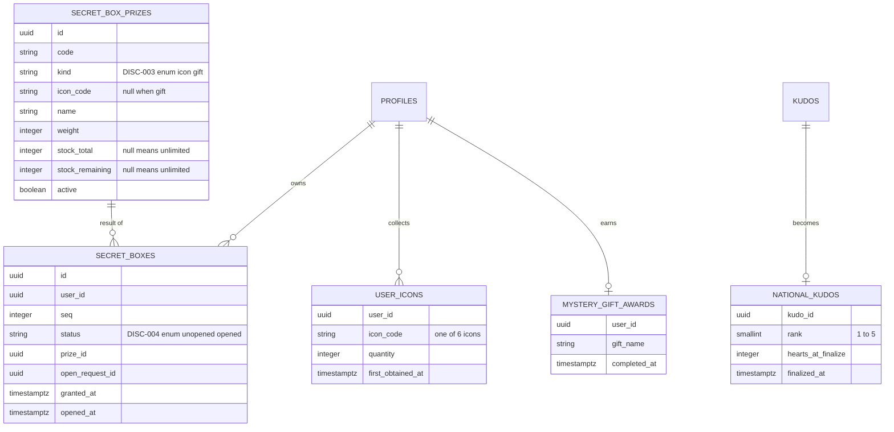

| Entity | Table | Used for | Action |
|---|---|---|---|
| `SecretBox` | `secret_boxes` | Một hộp đã cấp cho một Sunner (MODEL011). UNIQUE `(user_id, seq)` đỡ cấp bù đồng thời; UNIQUE `(user_id, open_request_id)` đỡ phát lại theo khoá; CHECK `secret_boxes_opened_has_result` buộc hộp `opened` có đủ `prize_id`, `opened_at`, `open_request_id`; chỉ mục `(user_id, status)` và `(status, opened_at DESC)` | A1-A4, A7, A8 |
| `SecretBoxPrize` | `secret_box_prizes` | Kho phần thưởng (MODEL010): 6 icon không giới hạn và quà hiện vật có `stock_remaining`; UNIQUE một phần trên `icon_code` khi `kind = 'icon'`; `weight > 0`; nạp bằng seed, không bằng migration | A3, A6, A8 |
| `UserIcon` | `user_icons` | Số icon từng loại của một Sunner (MODEL012); khoá chính `(user_id, icon_code)` | A5, A9 |
| `MysteryGiftAward` | `mystery_gift_awards` | Quà bí ẩn đã trao (MODEL013); `user_id` là khoá chính nên mỗi người một dòng; `completed_at` là số liệu "thời gian gom đủ 6 huy hiệu" | A3, A5 |
| `NationalKudo` | `national_kudos` | Kudo thành Kudos Quốc Dân (MODEL014); PK `kudo_id`, UNIQUE `rank`, CHECK `rank BETWEEN 1 AND 5`; không có cột tên quà | A10 |
| `DomainEventOutbox` | `domain_event_outbox` | Sự kiện chờ tính năng thông báo đọc (MODEL015); F010 chỉ ghi qua `DomainEventOutbox.add` | A1, A2, A5, A10 |
| `Kudo`, `KudoHeart`, `SunnerProfile` | `kudos`, `kudo_hearts`, `profiles` | Chỉ đọc; do các tính năng Kudo, Tim và Auth sở hữu | A1, A2, A7, A8, A10 |

Năm bảng của F010 đều bật RLS, không có policy và không cấp quyền cho client (`REVOKE ALL` ở migration nền), nên chỉ máy chủ qua Drizzle truy cập được. Mọi số đếm của bảng thống kê tính bằng truy vấn tổng hợp, không có cột đếm phi chuẩn hoá.

#### Polymorphic Behavior

##### DISC-003 — SecretBoxPrize.kind

| Value | Render | Validation | Persistence |
|-------|--------|------------|-------------|
| icon | khung kết quả hiện icon có quầng sáng; trùng thì thêm dòng "Bạn đã có icon này rồi"; không vào danh sách người nhận quà | `icon_code` phải khác null và thuộc 6 mã cố định (CHECK `secret_box_prizes_icon_code_matches_kind`); `stock_total` phải NULL (CHECK `secret_box_prizes_icons_unlimited`) nên không bao giờ hết | A3 gọi A5 cộng `user_icons`, có thể trao Quà bí ẩn; không trừ kho |
| gift | khung kết quả hiện quầng sáng vàng và tên quà; có mặt trong danh sách 10 người nhận quà | `icon_code` phải NULL; `stock_remaining` giữa 0 và `stock_total` | A3 trừ `stock_remaining` bằng `UPDATE ... WHERE stock_remaining > 0` |

**Source:** docs/generated/entities.md § SecretBoxPrize > Discriminator Fields
**Source:** `shared/db/schema/secret-box-rewards.ts:18-45`

##### DISC-004 — SecretBox.status

| Value | Render | Validation | Persistence |
|-------|--------|------------|-------------|
| unopened | tính vào "Secret Box chưa mở"; nút Mở Secret Box bấm được và A3 chỉ chọn hộp ở trạng thái này | `prize_id`, `opened_at`, `open_request_id` đều NULL (CHECK `secret_boxes_opened_has_result`) | A1 và A2 chèn dòng với `status` mặc định `unopened` |
| opened | tính vào "Secret Box đã mở"; hộp có thể xuất hiện ở danh sách người nhận quà nếu giải là quà | cả ba trường kết quả phải khác NULL; A3 chỉ cập nhật khi dòng còn `unopened` nên không quay lại | A3 cập nhật một chiều `unopened` → `opened` |

**Source:** docs/generated/entities.md § SecretBox > Discriminator Fields
**Source:** `shared/db/schema/secret-box-rewards.ts:51-77`

### 4.3 State Management

### Secret Box lifecycle: a box is granted unopened and becomes opened exactly once (SM-001)
**kind:** entity
**Linked FR:** FR-002
**Source:** `shared/db/schema/secret-box-rewards.ts:51-77`

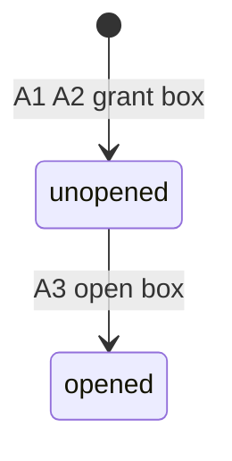

**Action transitions:** guard và tác dụng phụ của từng cạnh nằm ở rung **Result** của action nêu trên cạnh (§ 3.1, § 3.2), không lặp lại ở đây.

### The open-box modal moves through loading, waiting, opening and result, with empty and unavailable as side states (SM-002)
**kind:** ui
**Linked FR:** FR-303
**Source:** `features/secret-box-rewards/components/secret-box-opener.ts:12-150`

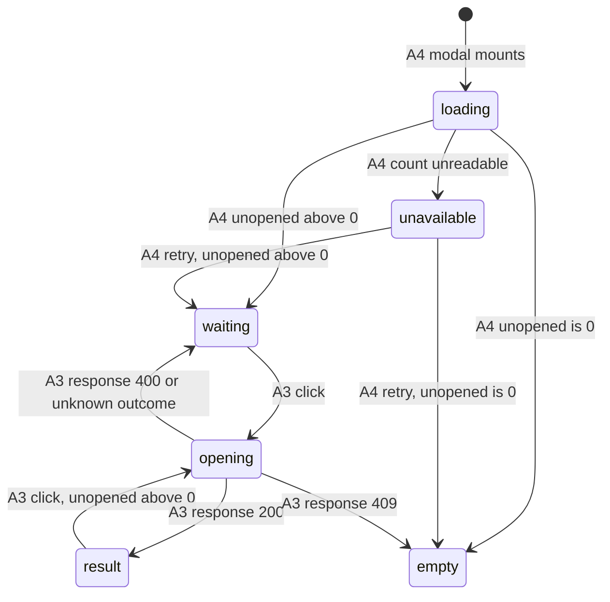

**Action transitions:** hoạt ảnh, thông báo lỗi và việc giữ hay xoá khoá ở từng cạnh được mô tả ở rung **FE** và bảng `DEC-004` của A3, cùng rung **FE** của A4, không lặp lại ở đây. Pha `result` với `unopened = 0` hiển thị như hết hộp (dòng "Bạn chưa có Secret Box nào để mở", hộp không bấm được) nhưng vẫn là pha `result` cho tới khi tải lại.

### 4.4 Shared Rules

#### Bin 3 — cross-cutting, belongs to no single action

**A0 · FR-601 — Mọi action phía Sunner chỉ chạy với Sunner đã đăng nhập và chỉ dưới danh nghĩa chính họ.**
Hai endpoint dữ liệu gọi `requireSecretBoxUser`, lấy `userId` từ phiên Supabase Auth và trả 401 JSON trước mọi truy vấn; không đọc `userId` từ body, query hay header, nên mở hộp chỉ tìm hộp của đúng người đó (PERM033). Loader của trang (A7, A8) gọi `requireSunner()`, khách bị chuyển về `/login` và Sunner chưa có phòng ban bị chuyển về trang chọn phòng ban trước khi đọc bất cứ thống kê hay tên người nhận quà nào. Proxy trả 401 JSON cho phiên thiếu và 403 JSON trước ngày ra mắt cho hai route `/api/secret-boxes/*`. Năm bảng bật RLS và không cấp quyền cho client nên không có đường đọc trực tiếp từ trình duyệt. Mọi câu trả lời theo từng người là `Cache-Control: private, no-store`. Endpoint tick (A12) không thuộc cổng này mà dùng secret riêng. **Not a rule of this feature** — cổng này dùng chung toàn hệ thống.
**Source:** `features/secret-box-rewards/server/secret-box-api-session.ts:10-25` · `features/secret-box-rewards/server/rewards-column-data-loader.ts:24-31` · route-list.md ROUTE015, ROUTE016

#### Bin 2 — used by ≥2 named actions

**BR-001 — Số hộp cấp bằng phần nguyên của tổng tim chia `SECRET_BOX_HEARTS_PER_BOX`, trừ số hộp đã cấp.**
Used in: **A1** · **A2**. Tổng tim là tổng `kudo_hearts.multiplier` của Kudo công khai do người đó gửi (nhân hệ số chiến dịch tại thời điểm thả); `entitled = floor(tổng / mốc)`; `granted` là `max(seq)` hiện có. Chỉ khi `entitled > granted` mới lấy khoá và chèn `seq` còn thiếu; UNIQUE `(user_id, seq)` là chốt chặn cuối.
**Source:** `features/secret-box-rewards/server/secret-box-grant-service.ts:29-51, 54-66`
```text
entitled = floor(weightedHearts(sender, asOf) / HEARTS_PER_BOX)   # asOf = min(now, EVENT_END_AT)
granted  = coalesce(max(seq), 0) of sender's secret_boxes
if entitled <= granted: return 0                                  # no lock taken
lock(user); insert seq in granted+1 .. entitled
  on conflict (user_id, seq) do nothing
```

**BR-002 — Hộp đã cấp không bao giờ thu hồi.**
Used in: **A1** · **A2**. Đường cấp chỉ chèn dòng, không xoá và không sửa hộp đã có. Bỏ tim hoặc Kudo bị Spam sau đó chỉ làm tổng tụt xuống nên `entitled <= granted` và hộp kế tiếp đến chậm hơn; Un Spam khôi phục tổng nhưng không cấp lại hộp đã có.
**Source:** `features/secret-box-rewards/server/secret-box-grant-service.ts:47-66`
```text
grantUpTo(user, total):
  entitled = floor(total / HEARTS_PER_BOX)
  if entitled <= 0 or granted(user) >= entitled: return 0         # total fell: nothing to do
  return insertGrants(user, entitled)                             # insert only, never delete
```

**BR-006 — Hộp chỉ tính tim thả đến `EVENT_END_AT`, nhưng hộp đã kiếm được trong cửa sổ vẫn được cấp bù muộn và mở hộp không bị khoá theo thời gian.**
Used in: **A1** · **A2**. `grantAsOf(now) = min(now, EVENT_END_AT)` làm mốc `asOf` của truy vấn tổng tim (`created_at <= asOf`), nên tim thả sau mốc không tính nhưng lần đối soát muộn (sweep trễ, lần ghé đầu tiên sau sự kiện) vẫn cấp những hộp đáng có trong cửa sổ. Luồng mở hộp không kiểm `now` so với mốc nào.
**Source:** `features/secret-box-rewards/server/secret-box-grant-service.ts:23-26` · `features/kudos-hearts/server/heart-stats-query.ts:19-42`
```text
asOf  = min(now, EVENT_END_AT)
total = sum(multiplier) over kudo_hearts h join kudos k
        where k.sender_id = sender and k.status = 'public' and h.created_at <= asOf
open(): no comparison of now with any cut-off
```

**BR-007 — Kudo ẩn danh vẫn được tính tim, hộp và Kudos Quốc Dân cho người gửi thật; danh tính chỉ ẩn ở lớp hiển thị.**
Used in: **A1** · **A2** · **A7** · **A10**. Tổng tim, số Kudo gửi và truy vấn xếp hạng đều nhóm theo `sender_id` nội bộ và không lọc cờ ẩn danh; `senderId` thật chỉ đi trong sự kiện outbox cho tính năng thông báo, và người xem số Kudo gửi chính là người gửi.
**Source:** `features/kudos-hearts/server/heart-stats-query.ts:19-42` · `features/secret-box-rewards/server/personal-reward-stats-query.ts:16-25` · `features/secret-box-rewards/server/national-kudos-finalize-job.ts:29-46`
```text
progress(sender) = sum(h.multiplier) over hearts of kudos where sender_id = sender and status = 'public'
                   # no is_anonymous predicate
rank(kudo)       = count(hearts) over kudos where status = 'public' and hearts.created_at <= finalizeAt
                   # no is_anonymous predicate; sender_id appears only in the outbox event
```

**BR-012 — Một tick mỗi lần, mỗi job lỗi riêng, tối đa 500 người đến hạn mỗi tick, cửa sổ quét 10 phút.**
Used in: **A2** · **A12**. Cả tick nằm trong một giao dịch giữ khoá tick, tick đến sau khi tick chậm còn chạy bị bỏ qua; A2 và A10 mỗi job lỗi thì ghi log và trả `null`, job kia vẫn chạy; sweep chỉ nhặt người gửi có tim trên Kudo công khai trong `SWEEP_WINDOW_MIN` phút và chỉ xử lý `SWEEP_MAX_SENDERS_PER_TICK` người đến hạn, phần còn lại ở lại cho tick sau vì cửa sổ các tick chồng lên nhau.
**Source:** `features/secret-box-rewards/server/secret-box-tick-job.ts:20-36` · `features/secret-box-rewards/server/secret-box-sweep-job.ts:17-30` · `features/secret-box-rewards/secret-box-config.ts:23-30`
```text
tick(now): in transaction
  if not try_lock('secret_box_tick'): return skipped
  sweep    = settle(sweep(now))        # hearted in last 10 min, at most 500 due senders
  finalize = settle(finalizeNationalKudos(now))
  return { sweep, finalize }           # either null -> HTTP 500
```

### 4.5 Algorithms & Integrations

### Compute and grant the Secret Boxes a sender has earned (ALG-001)
**Linked FR:** FR-001
**Used in:** A1, A2
**Source:** `features/secret-box-rewards/server/secret-box-grant-service.ts:24-99`
**Input:** `userId` hoặc danh sách `userIds`, `now` · **Output:** số hộp mới cấp (≥ 0) · **Complexity:** O(số hộp mới) cho một người; O(số người) cho sweep
**Description:** Đưa số hộp đã cấp lên đúng bằng số hộp đáng được cấp từ tổng tim có trọng số tính đến `min(now, EVENT_END_AT)`. Đọc tổng tim TRƯỚC giao dịch (không đọc pool khi đang giữ khoá); chỉ khi còn nợ hộp mới vào giao dịch có advisory lock. Bất biến: chạy lặp cho cùng đầu vào không đổi gì; không bao giờ xoá hộp; không bao giờ cấp một `seq` hai lần; sự kiện `BoxGranted` chỉ ghi khi có dòng mới.

**Pseudocode:**
```text
reconcileForSender(userId, now):
  stats = HeartStatsQuery.receivedByUser(userId, min(now, EVENT_END_AT))   # INT-001, before the tx
  entitled = floor(stats.weightedTotal / HEARTS_PER_BOX)
  if entitled <= 0 or maxSeq(userId) >= entitled: return 0
  begin tx
    lock(secret_box:userId)
    inserted = insert seq generate_series(maxSeq+1, entitled)
               on conflict (user_id, seq) do nothing returning seq
    if inserted > 0: outbox.add(BoxGranted, userId, count = inserted)     # INT-002
  commit
```

### Open one box and draw its prize atomically, replaying a stored result for a repeated key (ALG-002)
**Linked FR:** FR-402
**Used in:** A3
**Source:** `features/secret-box-rewards/server/secret-box-open-service.ts:35-95`
**Input:** `userId`, `requestId` (Idempotency-Key đã chuẩn hoá chữ thường) · **Output:** `OpenSecretBoxResult` · **Complexity:** O(số giải × `MAX_REDRAW`)
**Description:** Một giao dịch duy nhất dưới advisory lock của người dùng. Có hộp đã mở bằng `requestId` này thì dựng lại kết quả từ các dòng do lần mở đó ghi (cùng `now()`): `setCompleted` = có `mystery_gift_awards` với `completed_at = opened_at`; `duplicate` = `first_obtained_at` khác `opened_at` của icon (dùng `<>` vì giao dịch bắt đầu trước vẫn có thể lấy khoá sau). Chưa có thì mở hộp `seq` thấp nhất. Bất biến: cùng `requestId` luôn trả cùng kết quả; số hộp mở không vượt số hộp đã cấp; kết quả do máy chủ quyết định.

**Pseudocode:**
```text
openNext(userId, requestId):
  tryReconcile(userId)                                   # A1, best effort, own transaction
  begin tx
    lock(secret_box:userId)
    stored = box where user_id = userId and open_request_id = requestId
    if stored: return rebuild(stored) with replayed = true
    box = lowest seq unopened of userId, FOR UPDATE
    if not box: raise NoBoxLeftError                     # 409
    prize = PrizeDrawService.draw(tx)                    # ALG-004
    update box set status='opened', prize_id, open_request_id, opened_at = now()
          where id = box.id and status = 'unopened'      # no row: throw, 500
    if prize.kind = 'icon': IconCollectionService.addIcon(tx, userId, prize.iconCode)   # A5
    return result with unopenedLeft = count(unopened of userId in tx)
  commit
```

### Pick the five most-hearted public Kudos exactly once (ALG-003)
**Linked FR:** FR-406
**Used in:** A10
**Source:** `features/secret-box-rewards/server/national-kudos-finalize-job.ts:25-63`
**Input:** `now` · **Output:** tối đa 5 dòng `national_kudos` và một sự kiện · **Complexity:** O(số tim của Kudo công khai)
**Description:** Xếp hạng Kudo công khai theo số tim thô (hệ số không đổi thứ tự) tính đến `NATIONAL_KUDOS_FINALIZE_AT`, hoà thì Kudo cũ hơn rồi `id` nhỏ hơn đứng trước, bỏ Kudo không có tim, ghi 5 Kudo đầu một lần duy nhất. Bất biến: sau lần chốt đầu mọi lần chạy sau không đổi kết quả.

**Pseudocode:**
```text
finalize(now):
  if now < NATIONAL_KUDOS_FINALIZE_AT: return not_due
  if exists(national_kudos): return already_finalized
  winners = rank public kudos by raw hearts (created_at <= FINALIZE_AT),
            ties by created_at asc then id asc, limit 5, keep hearts >= 1   # INT-003, before the tx
  if winners is empty: return nothing_to_finalize
  begin tx
    lock('national_kudos')
    if exists(national_kudos): return already_finalized
    insert national_kudos(kudo_id, rank = position, hearts_at_finalize)
    outbox.add(NationalKudosFinalized, items = [kudoId, senderId, rank])    # INT-002
  commit
```

### Draw one prize with weights and an atomic stock reservation (ALG-004)
**Linked FR:** FR-403
**Used in:** A3
**Source:** `features/secret-box-rewards/server/prize-draw-service.ts:19-56`
**Input:** `tx` của giao dịch mở hộp · **Output:** `{ id, kind, iconCode, name }` · **Complexity:** O(số giải × `MAX_REDRAW`)
**Description:** Bốc trong các giải `active` còn khả dụng (kho NULL hoặc còn hàng); quà hữu hạn phải thắng bước trừ kho có điều kiện mới được trả về, thua thì đọc lại kho và bốc lại tối đa `MAX_REDRAW` lần rồi rơi về nhóm icon không giới hạn. Một giao dịch giữ tối đa một khoá dòng kho (trừ kho hỏng thì không giữ khoá nào) nên nhiều lần mở không gây deadlock trên kho. Số ngẫu nhiên lấy từ `crypto.randomInt` của máy chủ; trọng số không phải số nguyên dương thì ném lỗi thay vì lệch tỉ lệ.

**Pseudocode:**
```text
draw(tx):
  repeat up to MAX_REDRAW times:
    pool  = active prizes where stock is null or stock > 0
    prize = weightedPick(pool, crypto.randomInt)         # ticket in [0, sum(weights))
    if none: break
    if prize.stock is null: return prize                 # unlimited icon
    if update prizes set stock = stock - 1
         where id = prize.id and stock > 0: return prize # won the race
  pool = active prizes that are unlimited icons
  if pool is empty: throw "no active unlimited icon"     # 500, run db:seed
  return weightedPick(pool)
```

### Read the heart totals of a sender from the hearts feature (INT-001)
**Linked FR:** FR-001
**Used in:** A1, A2, A7
**Source:** `features/kudos-hearts/server/heart-stats-query.ts:19-50`
**Type:** api-call *(gọi hàm trong tiến trình)*
**Target:** `HeartStatsQuery#receivedByUser` (một người) và `HeartStatsQuery#receivedByUsers` (theo lô cho sweep) của tính năng Tim
**Payload:** `userId` hoặc `userIds`, `asOf` → `{ weightedTotal, rawTotal, campaignActive }`; chỉ tính Kudo công khai (Spam bị loại tại thời điểm đọc), tim tạo đến `asOf`, không lộ ai đã thả tim.
**Failure handling:** lỗi thì A1 ném lỗi trước khi ghi gì (A3 và A4 ghi log và đi tiếp, A7 hiện trạng thái lỗi của bảng) và lần chạy sau tính bù.

### Publish a domain event for the notifications feature (INT-002)
**Linked FR:** FR-407
**Used in:** A1, A2, A5, A10
**Source:** `shared/events/domain-event-outbox.ts:18-29` · `shared/events/domain-event-types.ts:29-42`
**Type:** event-publish
**Target:** bảng `domain_event_outbox`; tính năng thông báo là bên đọc duy nhất và biến sự kiện thành thông báo (`secret_box_granted`, `icon_set_completed`, `national_kudos`)
**Payload:** `BoxGranted { userId, count }`, `SetCompleted { userId, giftName }`, `NationalKudosFinalized { items: [{ kudoId, senderId, rank }] }`; chỉ id và tên quà, `strictObject` từ chối khoá lạ.
**Failure handling:** `DomainEventOutbox.add` nhận giao dịch của bên gọi và kiểm payload bằng Zod trước khi ghi; payload sai hoặc ghi lỗi thì ném lỗi và giao dịch nghiệp vụ huỷ theo, nên không bao giờ có sự kiện cho giao dịch đã huỷ hay hộp không kèm sự kiện. Việc đọc lại, thử lại và đánh dấu đã xử lý do tính năng thông báo lo.

### Rank public Kudos by raw hearts through the shared ranking query (INT-003)
**Linked FR:** FR-406
**Used in:** A10
**Source:** `features/kudos-hearts/server/heart-ranking-query.ts:25-61` · `features/kudos-feed/server/kudo-public-filters.ts:31-37`
**Type:** api-call *(gọi hàm trong tiến trình)*
**Target:** `HeartRankingQuery#rankKudoIds` với tập `KudoPublicQuery.publicKudoIdsSubquery()` và `heartCountsSubquery`, dùng chung với Highlight của Live board
**Payload:** `limit = NATIONAL_KUDOS_COUNT`, `asOf = NATIONAL_KUDOS_FINALIZE_AT`, `tieBreak: 'oldest'` → danh sách `kudoId` xếp tốt nhất trước; tập ứng viên không có cột người gửi nên xếp hạng không thể làm lộ người gửi.
**Failure handling:** đọc xếp hạng trước giao dịch; lỗi thì ném lên `settle` của tick, job trả `null` và tick sau thử lại.

### Call the internal tick from the database scheduler (INT-004)
**Linked FR:** FR-603
**Used in:** A11 → A12
**Source:** `db/migrations/0016_secret_box_tick_cron.sql:15-47` · `app/api/internal/secret-box/tick/route.ts:16-30`
**Type:** api-call
**Target:** `POST /api/internal/secret-box/tick` của chính ứng dụng; URL lấy từ Vault (mục `saa_secret_box_tick_url`), pg_cron gọi qua `net.http_post`
**Payload:** thân `{}`, header `content-type` và `x-job-secret` lấy từ Vault (mục `saa_internal_job_secret`, không ghi giá trị ở đây); `timeout_milliseconds` 30000.
**Failure handling:** không thử lại trong cron, lần thử kế là phút kế tiếp; tick lỡ chỉ làm thông báo `BoxGranted` đến trễ vì mọi đường đọc tự đối soát. Thiếu Vault hoặc pg_cron thì không lập lịch và phải dùng cron máy chủ.

### 4.6 Configuration

```text
SECRET_BOX_HEARTS_PER_BOX = 5        # env, mặc định 5, tối thiểu 1: điểm tim có trọng số đổi một hộp (A1, A2)
EVENT_END_AT = <env>                 # env: mốc kẹp tim cho hộp, sau mốc không tính tim mới (A1, A2); phải sau LAUNCH_AT
NATIONAL_KUDOS_FINALIZE_AT = <env>   # env: mốc chốt Kudos Quốc Dân, không sớm hơn EVENT_END_AT (A10)
INTERNAL_JOB_SECRET = <env, tuỳ chọn, ≥ 32 ký tự>   # secret của endpoint tick; chưa đặt thì 503 not_configured (A12)
MAX_REDRAW = 3                       # số lần bốc lại khi thua tranh kho quà (A3)
MYSTERY_GIFT_NAME = "Quà bí ẩn từ BTC SAA 2025"   # tên Quà bí ẩn, nội dung tạm chờ BTC (A5)
LATEST_WINNERS_LIMIT = 10            # số dòng danh sách nhận quà (A8)
NATIONAL_KUDOS_COUNT = 5             # số Kudo thành Kudos Quốc Dân (A10)
SWEEP_WINDOW_MIN = 10                # cửa sổ phút để tìm người gửi vừa nhận tim (A2)
SWEEP_MAX_SENDERS_PER_TICK = 500     # số người đến hạn tối đa mỗi tick (A2)
OPEN_TIMEOUT_MS = 15000              # client: quá mức này tính là lỗi mạng và lần bấm sau dùng lại khoá (A3)
OPENING_MIN_MS = 900                 # client: khung "đang mở" tối thiểu, 0 khi giảm chuyển động (A3)
cron.schedule = '* * * * *'          # pg_cron: mỗi phút, timeout_milliseconds 30000 (A11)
```

Trọng số và kho từng giải nằm trong `secret_box_prizes`, nạp bằng `npm run db:seed` từ `db/seeds/secret-box-prize-catalog.ts` (số liệu tạm), không phải biến môi trường. Giá trị thật của `EVENT_END_AT` và `NATIONAL_KUDOS_FINALIZE_AT` theo từng môi trường không được đọc trong lần này (file môi trường nằm ngoài phạm vi).

**Client behavior:** see
[`behavior-logic.md`](../../generated/behavior-logic.md) (client-side patterns — debounce, optimistic UI, polling, upload, realtime),
[`permissions.md`](../../system/permissions.md) (feature flags / experiments / env / locale gates),
[`screen-flow.md`](../../generated/screen-flow.md) (guards / deep-link state restoration / unsaved-changes protection).

## 5. Verification & Technical Notes

### 5.1 Technical Verification

- **SC-001** *(A1, A2)* Chạy song song đối soát đường đọc và sweep cho một người gửi chỉ để lại đúng số hộp đáng có và đúng một `BoxGranted { count }`; chạy lại không chèn gì (covers FR-001, FR-401, BR-001). Test hiện có: `tests/integration/secret-box-rewards/secret-box-grant-concurrency.test.ts:43-54`
- **SC-002** *(A1)* Đánh dấu Spam một Kudo không xoá hộp nào, chỉ cấp tiếp khi vượt mốc kế (covers BR-002). Test hiện có: `tests/integration/secret-box-rewards/secret-box-grant-rules.test.ts:89`
- **SC-003** *(A1, A2)* Tim thả sau `EVENT_END_AT` không tính, nhưng lần đối soát muộn vẫn cấp hộp đáng có trong cửa sổ (covers FR-405, BR-006). Test hiện có: `tests/integration/secret-box-rewards/secret-box-grant-rules.test.ts:112`
- **SC-004** *(A1, A2, A10)* Tim trên Kudo ẩn danh vẫn tính cho người gửi thật (covers BR-007). Test hiện có: `tests/integration/secret-box-rewards/secret-box-grant-rules.test.ts:81`
- **SC-005** *(A3)* Nhiều yêu cầu song song cùng `Idempotency-Key` để lại đúng một hộp `opened` và cùng một kết quả (covers FR-002, FR-402, BR-003). Test hiện có: `tests/integration/secret-box-rewards/secret-box-open-idempotency.test.ts:41`
- **SC-006** *(A3)* Quà hữu hạn còn 1 mà nhiều người mở cùng lúc: đúng một người nhận, `stock_remaining` không âm, người còn lại ra giải khác (covers FR-403, BR-004). Test hiện có: `tests/integration/secret-box-rewards/prize-stock-race.test.ts:38`
- **SC-007** *(A5)* Mở song song hoàn tất bộ 6 icon tạo đúng một `mystery_gift_awards` và một `SetCompleted`; không ghi được sự kiện thì cả lần mở huỷ (covers FR-404, FR-408, BR-005). Test hiện có: `tests/integration/secret-box-rewards/mystery-gift-once.test.ts:58, 78`
- **SC-008** *(A3, A4)* Không có phiên thì 401 và không đụng hộp nào; hộp mở luôn là của người dùng trong phiên, bất kể `userId` trong body hay query (covers FR-601, FR-602). Test hiện có: `tests/integration/secret-box-rewards/secret-box-api-auth.test.ts:53, 83`
- **SC-009** *(A7, A8)* Bảng thống kê khớp số liệu nguồn; danh sách nhận quà không chứa icon, tối đa 10 dòng, mới nhất trước (covers FR-201, FR-205, BR-009, BR-011). Test hiện có: `tests/integration/secret-box-rewards/personal-reward-stats-query.test.ts:45`, `tests/integration/secret-box-rewards/prize-stock-race.test.ts:52`
- **SC-010** *(A10)* Chạy job nhiều lần, kể cả song song, cho đúng 5 dòng `national_kudos`; hoà phân định theo Kudo cũ hơn; Spam và tim muộn bị loại (covers FR-406, BR-008). Test hiện có: `tests/integration/secret-box-rewards/national-kudos-finalize.test.ts:82, 102`
- **SC-011** *(A12)* Tick trả 503 khi chưa cấu hình secret, 401 khi sai, `{ skipped: true }` khi tick khác giữ khoá, và cắt ở 500 người mỗi tick (covers FR-603, BR-012). Test hiện có: `tests/integration/secret-box-rewards/internal-tick-guard.test.ts:43, 60`, `tests/integration/secret-box-rewards/secret-box-tick-overlap-and-cap.test.ts`
- **SC-012** *(A6)* Nạp lại danh mục giữ số quà đã phát và tắt giải bị bỏ khỏi danh mục (covers FR-004, BR-013). Test hiện có: `tests/integration/secret-box-rewards/prize-loader-reseed.test.ts:44-78`
- **SC-013** *(A3, A4)* Máy khách dùng lại khoá khi chưa biết kết quả, khoá hộp khi đang mở, và hiện đúng thông báo theo từng loại phản hồi (covers FR-302, FR-305, DEC-004, DEC-005). Test hiện có: `tests/unit/secret-box-rewards-ui/secret-box-opener.test.ts`

#### US044_OpenSecretBox *(A3, A4, A7)*

**Independent Test:** Dựng một Sunner có hai hộp chưa mở, mở modal, mở một hộp rồi gửi lại cùng khoá, đọc lại bảng thống kê.

**Acceptance Scenarios:**

1. **Given** hai hộp chưa mở, **When** gọi mở với khoá mới, **Then** 200 với một hộp `opened`, `unopenedLeft` còn 1, `replayed` là `false`.
2. **Given** hộp vừa mở bằng khoá K, **When** gọi lại với khoá K, **Then** 200 với đúng kết quả cũ, `replayed` là `true`, `unopenedLeft` không đổi.
3. **Given** không còn hộp chưa mở, **When** gọi mở, **Then** 409 `no_box_left`.
4. **Given** năm icon khác nhau, **When** hộp ra icon thứ sáu chưa có, **Then** `setCompleted` là `true`, `giftName` là tên Quà bí ẩn và có một dòng `mystery_gift_awards`.
5. **Given** không có hộp chưa mở, **When** tải bảng thống kê, **Then** nút "Mở Secret Box" mờ, `aria-disabled`, vẫn focus được và có tooltip "Bạn chưa có Secret Box nào".

### 5.2 Assumptions

- *(A1, A2, A3)* Postgres của Supabase hỗ trợ advisory lock theo giao dịch, `FOR UPDATE` và `ON CONFLICT`, và Drizzle chạy được các câu raw SQL cần thiết; không chạy cơ sở dữ liệu trong lần đọc này nên coi là đúng theo mã nguồn và test hiện có.
- *(A3)* Không có giới hạn tần suất riêng cho mở hộp: advisory lock theo người dùng và `Idempotency-Key` được coi là đủ chặn bấm đúp và gọi song song; đây là suy luận từ mã, mã không có bộ giới hạn tần suất nào.
- *(A11, A12)* Môi trường triển khai thật có pg_cron, pg_net và hai mục Vault, hoặc có cron máy chủ gọi endpoint mỗi phút; migration chỉ báo `NOTICE` khi thiếu, và lần này không kiểm được cấu hình môi trường.
- *(A1, A2, A10)* Tính năng thông báo là bên tiêu thụ duy nhất của `domain_event_outbox`; F010 chỉ ghi và không tiêu thụ sự kiện.
- *(A7, A8)* Quy mô công ty (vài nghìn Sunner) đủ để thống kê và danh sách nhận quà chạy bằng truy vấn tổng hợp có chỉ mục, không cần cột đếm phi chuẩn hoá.

### 5.3 Unresolved Questions

1. **Giá trị `EVENT_END_AT` và `NATIONAL_KUDOS_FINALIZE_AT` thật** *(A1, A2, A10)*: mã chỉ ràng buộc `EVENT_END_AT <= NATIONAL_KUDOS_FINALIZE_AT` và `LAUNCH_AT < EVENT_END_AT`; giá trị cụ thể nằm trong file môi trường, không được đọc.
2. **Chú thích cũ ở tính năng Tim** *(A1)*: đầu `features/kudos-hearts/server/heart-stats-query.ts` còn nhắc "phase 10 passes SECRET_BOX_LOCK_AT" trong khi F010 truyền `EVENT_END_AT`; cần xác nhận mốc đúng là `EVENT_END_AT` và sửa chú thích bên đó.
3. **Mục Vault đã có ở từng môi trường chưa** *(A11)*: `saa_secret_box_tick_url` và `saa_internal_job_secret` do vận hành đặt, mã chỉ ghi cách đặt; không kiểm được từ mã nguồn.
4. **Độ phủ user story của vùng REG006** *(A7, A8, A9, A10, A11, A12)*: chỉ `US044_OpenSecretBox` đứng tên vùng này; thống kê cá nhân, danh sách người nhận quà, bộ sưu tập icon và các job nền (BL027, BL028, BL032, BL033, BL034) không có story riêng, nên đang được gắn qua FR/BR. Cần quyết định có thêm story hệ thống cho job nền hay không.
5. **Kết quả chạy test** *(toàn bộ)*: lần này không chạy test, nên các `Test hiện có` ở § 5.1 chỉ là con trỏ tới test đã tồn tại, không phải bằng chứng đạt.
6. **Mức bao phủ E2E** *(A3, A4, A7, A8)*: có `tests/e2e/secret-box-rewards/` nhưng nội dung chưa được đọc trong lần này.

### 5.4 Source References

| Action | Order | Symbol | Path | Purpose |
|---|---|---|---|---|
| A1-A7, A10 | 1 | `secretBoxPrizes`, `secretBoxes`, `userIcons`, `mysteryGiftAwards`, `nationalKudos` | `shared/db/schema/secret-box-rewards.ts:18-129` | Năm bảng của feature, ràng buộc và chỉ mục |
| A1, A2, A6, A10 | 2 | migration `0015` | `db/migrations/0015_secret_box_rewards.sql:8-82` | DDL, RLS bật, không policy cho client |
| A12 | 3 | `POST` | `app/api/internal/secret-box/tick/route.ts:16-30` | Điểm vào của tick |
| A3 | 4 | `POST` | `app/api/secret-boxes/open/route.ts:13-25` | Điểm vào mở hộp |
| A4 | 5 | `GET` | `app/api/secret-boxes/me/route.ts:9-18` | Điểm vào trạng thái modal |
| A3, A4 | 6 | `requireSecretBoxUser`, `secretBoxError` | `features/secret-box-rewards/server/secret-box-api-session.ts:10-25` | Cổng phiên và hình lỗi |
| A12 | 7 | `checkInternalJobSecret` | `features/secret-box-rewards/server/internal-job-guard.ts:11-22` | So secret hằng thời gian |
| A12 | 8 | `SecretBoxTickJob#run` | `features/secret-box-rewards/server/secret-box-tick-job.ts:20-36` | Khoá chống chạy chồng, A2 rồi A10 |
| A1, A2 | 9 | `SecretBoxGrantService` | `features/secret-box-rewards/server/secret-box-grant-service.ts:24-101` | Tính và cấp hộp |
| A2 | 10 | `SecretBoxSweepJob#run` | `features/secret-box-rewards/server/secret-box-sweep-job.ts:17-30` | Chọn người gửi vừa nhận tim |
| A3 | 11 | `SecretBoxOpenService#openNext` | `features/secret-box-rewards/server/secret-box-open-service.ts:20-97` | Giao dịch mở hộp và phát lại |
| A3 | 12 | `PrizeDrawService#draw`, `pickPrize` | `features/secret-box-rewards/server/prize-draw-service.ts:19-58`, `features/secret-box-rewards/server/prize-weighted-pick.ts:17-38` | Bốc giải và trừ kho |
| A5 | 13 | `IconCollectionService#addIcon` | `features/secret-box-rewards/server/icon-collection-service.ts:19-39` | Cộng icon, trao Quà bí ẩn |
| A4, A7 | 14 | `SecretBoxQuery` | `features/secret-box-rewards/server/secret-box-query.ts:13-49` | Đếm hộp, đối soát cố gắng hết sức |
| A7, A8 | 15 | `loadRewardsColumnData` | `features/secret-box-rewards/server/rewards-column-data-loader.ts:15-31` | Nạp cột phần thưởng |
| A7 | 16 | `PersonalRewardStatsQuery#forUser` | `features/secret-box-rewards/server/personal-reward-stats-query.ts:16-40` | Năm số của bảng thống kê |
| A8 | 17 | `LatestGiftWinnersQuery#top10` | `features/secret-box-rewards/server/latest-gift-winners-query.ts:15-33` | Danh sách người nhận quà |
| A9 | 18 | `IconCollectionQuery#forUser` | `features/secret-box-rewards/server/icon-collection-query.ts:11-20` | Sáu ô bộ sưu tập |
| A10 | 19 | `NationalKudosFinalizeJob#run` | `features/secret-box-rewards/server/national-kudos-finalize-job.ts:25-65` | Chốt Kudos Quốc Dân |
| A11 | 20 | `cron.schedule` | `db/migrations/0016_secret_box_tick_cron.sql:15-47` | Lịch mỗi phút qua pg_net và Vault |
| A6 | 21 | `seedSecretBoxPrizes` | `db/seeds/secret-box-prize-loader.ts:15-54` | Nạp danh mục giải |
| A3, A4 | 22 | `createSecretBoxOpener` | `features/secret-box-rewards/components/secret-box-opener.ts:91-150` | Máy trạng thái modal phía máy khách |
| A3, A4 | 23 | `SecretBoxModal`, `SecretBoxLauncher` | `features/secret-box-rewards/components/secret-box-modal.tsx:33-116`, `features/secret-box-rewards/components/secret-box-launcher.tsx:38-73` | Modal, đường dẫn mở thẳng, đóng và làm mới |
| A7, A8 | 24 | `PersonalStatsPanel`, `LatestGiftWinnersList` | `features/secret-box-rewards/components/personal-stats-panel.tsx:41-71`, `features/secret-box-rewards/components/latest-gift-winners-list.tsx:16-46` | Hai panel của cột phần thưởng |

#### Data Flow

Hộp đi từ tim tới kết quả mở qua ba bước dữ liệu; mỗi mũi tên đã được trích nguồn ở rung tương ứng của A1 và A3, hoặc suy ra từ các rung đó ("derived from § 3 above").

```text
kudo_hearts (multiplier) -> weightedTotal by sender (INT-001, as of min(now, EVENT_END_AT)) -> entitled = floor(total / mốc)
  -> secret_boxes rows seq 1..entitled (A1/A2) -> POST open with Idempotency-Key (A3)
  -> lowest unopened seq -> drawn prize (stock reserved if gift) -> secret_boxes.status = opened
  -> user_icons.quantity + 1 (A5) -> 6 distinct icons -> mystery_gift_awards + SetCompleted -> response { result, unopenedLeft }
```

### 5.5 Artifact References

| Artifact | File | Codes Used | Reviewed |
|----------|------|------------|----------|
| System Overview | [overview.md](../../system/overview.md) | — | [x] |
| Architecture | [architecture.md](../../system/architecture.md) | — | [x] |
| Feature List | [feature-list.md](../../generated/feature-list.md) | F010 | [x] |
| API Map | [api-map.md](../../generated/api-map.md) | ROUTE006, ROUTE015, ROUTE016 | [x] |
| Entities | [entities.md](../../generated/entities.md) | MODEL010, MODEL011, MODEL012, MODEL013, MODEL014 | [x] |
| Screens | [functional-spec.md § 6](./functional-spec.md#6-screens) | SCR007_KudosLiveBoardFeed/REG006_RewardsColumn | [x] |
| Behavior Logic | [behavior-logic.md](../../generated/behavior-logic.md) | BL027, BL028, BL032, BL033, BL034 | [x] |
| Permissions Matrix | [permissions-matrix.md](../../generated/permissions-matrix.md) | PERM033, PERM034 | [x] |
| User Stories | [user-stories.md](../../generated/user-stories.md) | US044 | [x] |

**Rule:** Mọi mã trong Codes Used phải tồn tại trong artifact nguồn; `ROUTE###` ở hàng API Map trỏ tới cột `Code` của `route-list.md`.
