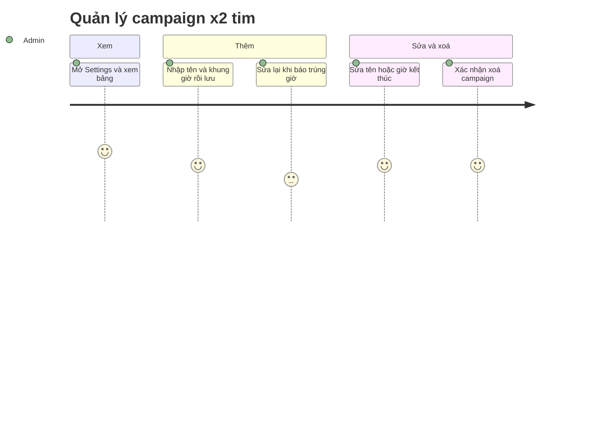

<!-- layout-exempt: rebuild-spec owns all docs/system|features|generated|flows paths — all references here are output targets or internal definitions -->
<!-- Contract: references/feature-spec-researcher-contract.md -->
<!-- Nửa BA/QA của cặp spec: đọc file này là trả lời được "làm gì, ứng xử ra sao, màn hình hiện gì" mà không phải mở file khác. Chi tiết kỹ thuật (đường dẫn, trích nguồn, ghi dữ liệu) nằm ở technical-spec.md. -->

# Functional Spec — F011_AdminCampaigns

**Priority**: P2
**Type**: ui
**Generated**: 2026-11-24

**See also:** [`technical-spec.md`](./technical-spec.md) — luồng xử lý từng thao tác, trích nguồn, ràng buộc cơ sở dữ liệu, cấu hình kỹ thuật cho Dev/QA/SA.

**Traceability:** F011_AdminCampaigns → SCR014_AdminCampaignSettings → US013_CreateCampaign, US014_EditCampaign, US015_DeleteCampaign → ROUTE029, ROUTE030, ROUTE031

## 1. Overview

**Problem:** Sự kiện cần một khung giờ ngắn trong đó mỗi lượt thả tim được nhân đôi để kích thích mọi người ghi nhận nhau. Nếu khung giờ phải sửa trong mã hoặc cơ sở dữ liệu, hoặc hai khung giờ chồng nhau làm "đang nhân đôi" không còn rõ ràng, thì Admin không kiểm soát được và Sunner không biết tim của mình được tính ra sao.
**Solution:** Admin vào Settings, xem các campaign "x2 tim" trong một bảng, thêm campaign mới bằng hộp thoại (tên, giờ bắt đầu, giờ kết thúc), sửa hoặc xoá campaign chưa kết thúc từ menu từng dòng. Hệ thống từ chối khung giờ chồng campaign khác, tính trạng thái từng campaign theo đồng hồ máy chủ, và chỉ lưu cấu hình: campaign đang hiệu lực là căn cứ để chức năng thả tim nhân đôi hệ số.
**Scope:** Xem danh sách campaign; thêm, sửa, xoá campaign với kiểm tra giờ và chống chồng giờ; luật khoá theo trạng thái (sắp tới, đang chạy, đã kết thúc); giờ nhập và hiển thị theo múi giờ Admin; cung cấp campaign đang hiệu lực cho chức năng thả tim.
**Non-Scope:** Không tự thả tim hay tính hệ số (do Kudos Hearts làm). Không có trường hệ số riêng cho từng campaign (hệ số chung do cấu hình hệ thống). Không lưu ai tạo, sửa hay xoá, không có lịch sử thay đổi, không khôi phục campaign đã xoá. Không phân trang, không tìm kiếm hay lọc bảng.

**Actors**

| Actor | Description | Primary goal |
|-------|--------------|---------------|
| Admin | Người quản trị đã đăng nhập, vào khu Admin › Settings | Đặt, chỉnh và huỷ khung giờ nhân đôi tim cho đúng kế hoạch sự kiện |
| Sunner thả tim | Người dùng thường thả tim lên Kudo của đồng nghiệp | Được tính tim nhân đôi khi thả trong khung giờ campaign (hưởng lợi gián tiếp, không dùng màn này) |

## 2. Functional Capabilities

| ID | Capability | What the user can do | User Stories | Requirements | Business Rules | Screens |
|----|------------|------------------------|-----------------|---------------|-------------------|---------|
| CAP-01 | Xem danh sách campaign | Vào Settings, xem bảng campaign (mới nhất trước), thấy trạng thái trống hoặc lỗi tải kèm nút thử lại, mở menu thao tác từng dòng | N/A — xem danh sách không phải một câu chuyện người dùng riêng của feature này | FR-002, FR-101, FR-201, FR-202, FR-204, FR-205, FR-206, FR-404, FR-601, FR-602 | BR-006, DEC-001, DEC-004 | SCR014_AdminCampaignSettings |
| CAP-02 | Thêm campaign | Mở hộp "Add Campaign", nhập tên và giờ bắt đầu, kết thúc, lưu; bị từ chối nếu chồng giờ hoặc nhập sai | US013 | FR-001, FR-003, FR-203, FR-301, FR-303, FR-304, FR-305, FR-309, FR-310 | BR-002, BR-003, DEC-003 | N/A — màn hình đã tính ở CAP-01 |
| CAP-03 | Sửa campaign | Sửa campaign chưa kết thúc; campaign đang chạy chỉ đổi được tên và giờ kết thúc | US014 | FR-302, FR-306, FR-307 | BR-004, DEC-002 | N/A — màn hình đã tính ở CAP-01 |
| CAP-04 | Xoá campaign | Xoá campaign sắp tới hoặc đang chạy sau khi xác nhận; xoá campaign đang chạy là dừng sớm | US015 | FR-308 | BR-007, DEC-005 | N/A — màn hình đã tính ở CAP-01 |
| CAP-05 | Cung cấp campaign đang hiệu lực | Sunner thả tim trong khung giờ campaign được nhân đôi; chức năng thả tim hỏi hệ thống xem có campaign nào đang hiệu lực | N/A — phục vụ chức năng thả tim của Sunner, không có thao tác Admin | FR-401, FR-402 | BR-001, BR-005 | N/A — không có màn hình |

## 3. Open Decisions

None — no unresolved domain confirmations.

## 4. Requirements

### Foundation (0xx)

- **FR-001** Mỗi campaign có mã số (ID), tên, giờ bắt đầu và giờ kết thúc (gồm ngày, giờ, phút).
- **FR-002** Giờ nhập và giờ hiển thị luôn theo múi giờ Admin của hệ thống (mặc định giờ Việt Nam); hệ thống lưu thống nhất theo giờ quốc tế.
- **FR-003** Hai campaign không bao giờ chồng khoảng giờ lên nhau.

### Navigation (1xx)

- **FR-101** Admin vào trang Setting từ mục "Settings" trên menu khu Admin; trang chỉ có một địa chỉ, hộp thoại không đổi địa chỉ.

### Setting — danh sách (2xx)

- **FR-201** Bảng có bốn cột ID, Name, Time, Actions; cột Time hiện giờ bắt đầu và giờ kết thúc dạng ngày/tháng/năm - giờ:phút, tên dài bị cắt một dòng và xem đủ khi rê chuột.
- **FR-202** Bảng sắp theo giờ bắt đầu mới nhất trước, hiện toàn bộ campaign, không phân trang.
- **FR-203** Nút "Add Campaign" ở đầu trang mở hộp thoại thêm campaign.
- **FR-204** Dòng chưa kết thúc có nút "⋯" mở menu Edit / Delete; dòng đã kết thúc không có nút nào.
- **FR-205** Chưa có campaign nào thì bảng hiện một dòng gợi ý bấm Add Campaign để tạo.
- **FR-206** Trong lúc danh sách đang tải, trang hiện khung chờ có tiêu đề và vài dòng mờ.

### Hộp thoại Add / Edit / Delete (3xx)

- **FR-301** Hộp "Add Campaign" có ô Campaign Name, ô Start Date, ô End Date (đều bắt buộc, chọn ngày kèm giờ bằng bộ chọn ngày giờ), nút Cancel và nút Add Campaign; con trỏ vào ô tên khi mở.
- **FR-302** Hộp "Edit Campaign" có cùng các ô, điền sẵn giá trị hiện tại, nút lưu là "Save Campaign".
- **FR-303** Hệ thống kiểm: tên không rỗng và tối đa 100 ký tự; đủ hai mốc, là ngày giờ có thật từ năm 2000; giờ kết thúc sau giờ bắt đầu và sau thời điểm hiện tại; lỗi hiện dưới từng ô và con trỏ nhảy tới ô lỗi đầu tiên.
- **FR-304** Khoảng giờ trùng campaign khác thì không lưu và báo dưới ô End Date tên cùng khoảng giờ của campaign đang trùng.
- **FR-305** Lưu thành công thì hộp đóng, bảng cập nhật và hiện thông báo trong 5 giây; Cancel hoặc phím Esc đóng hộp mà không lưu, bấm ra ngoài hộp không đóng.
- **FR-306** Campaign đang chạy: ô Start Date bị khoá kèm lý do, vẫn sửa được tên và giờ kết thúc.
- **FR-307** Campaign đã kết thúc thì không sửa và không xoá được; nếu campaign hết hạn hoặc bị xoá khi hộp đang mở, hộp đóng, hiện thông báo lỗi và bảng làm mới.
- **FR-308** Chọn Delete mở hộp xác nhận nêu tên campaign; chỉ khi xác nhận mới xoá, Cancel hoặc Esc đóng hộp mà không xoá, và nút Cancel là nút có sẵn con trỏ.
- **FR-309** Trong lúc đang lưu hoặc đang xoá, các ô nhập chỉ đọc, hai nút bị khoá và Esc không đóng hộp.
- **FR-310** Lỗi bất ngờ khi lưu hoặc xoá thì hộp ở lại, dữ liệu đã nhập giữ nguyên và hiện dòng báo lỗi chung.

### Interaction (4xx)

- **FR-401** Campaign đang hiệu lực tại một thời điểm là campaign có giờ bắt đầu không muộn hơn thời điểm đó và giờ kết thúc muộn hơn thời điểm đó; không có thì không có campaign nào đang hiệu lực.
- **FR-402** Thêm, sửa, xoá có hiệu lực cho lần thả tim kế tiếp; tim đã thả giữ nguyên hệ số tại lúc thả.
- **FR-404** Không tải được danh sách thì hiện khối báo lỗi kèm liên kết "Thử lại" để tải lại trang.

### Security (6xx)

- **FR-601** Chỉ Admin xem và thay đổi campaign; người không phải Admin bị chặn ở trang và ở từng thao tác thêm, sửa, xoá, khách chưa đăng nhập được đưa về trang đăng nhập.
- **FR-602** Dữ liệu campaign không đọc được trực tiếp từ trình duyệt bằng khoá công khai của dịch vụ dữ liệu; mọi truy cập đi qua máy chủ.

## 5. Business Rules

- Campaign đang chạy trong khoảng từ giờ bắt đầu đến trước giờ kết thúc (đúng giờ kết thúc thì đã hết), chưa chạy trước giờ bắt đầu; không chồng giờ nên tối đa một campaign đang hiệu lực (BR-001)
- Hai campaign chồng giờ khi mỗi cái bắt đầu trước khi cái kia kết thúc; chạm đầu mút thì không chồng; luôn bị từ chối, kể cả khi hai Admin lưu cùng lúc (BR-002)
- Campaign hợp lệ khi tên không rỗng sau khi cắt khoảng trắng và tối đa 100 ký tự, giờ kết thúc sau giờ bắt đầu và sau hiện tại; giờ bắt đầu trong quá khứ vẫn được nhận (BR-003)
- Quyền sửa xoá theo trạng thái tính bằng đồng hồ máy chủ lúc lưu, không theo trạng thái màn hình từng thấy: đã kết thúc chỉ đọc; đang chạy sửa tên và giờ kết thúc, xoá được; sắp tới sửa và xoá tự do (BR-004)
- Hệ số x2 gắn vào mỗi tim ngay lúc thả; sửa hay xoá campaign không tính lại tim đã thả (BR-005)
- Giờ nhập và hiển thị theo múi giờ Admin, lưu theo giờ quốc tế; một campaign hiện cùng một giờ cho mọi Admin (BR-006)
- Xoá là xoá hẳn, không khôi phục; xoá campaign đang chạy nghĩa là dừng sớm, tim thả sau đó trở về hệ số 1 (BR-007)
- Dòng đã kết thúc không có menu thao tác; danh sách rỗng hiện một dòng gợi ý thay cho bảng (DEC-001)
- Khi sửa campaign đang chạy, ô giờ bắt đầu bị khoá và không được gửi đi; campaign sắp tới mở khoá cả ba ô (DEC-002)
- Sau khi gửi hộp Add/Edit: thành công thì đóng và báo; campaign không còn hoặc đã kết thúc thì đóng và báo lỗi; nhập sai hoặc chồng giờ thì giữ hộp và báo ngay tại ô liên quan; lỗi khác thì báo chung và giữ dữ liệu (DEC-003)
- Danh sách tải lỗi hiện khối báo lỗi kèm thử lại, không hiện bảng rỗng đánh lừa (DEC-004)
- Sau khi xác nhận xoá: thành công thì đóng và báo; campaign không còn hoặc đã kết thúc thì đóng và báo lỗi; lỗi khác thì giữ hộp với dòng báo "Không xoá được" (DEC-005)

## 6. Screens

| Screen Name | SCR### | What User Sees | What User Can Do |
|-------------|--------|-----------------|-------------------|
| Admin Campaign Settings | SCR014_AdminCampaignSettings | Tiêu đề "Setting", nút Add Campaign, bảng campaign bốn cột (ID, Name, Time, Actions), khung chờ lúc tải, khối báo lỗi khi tải hỏng, hộp thoại Add/Edit Campaign, hộp xác nhận Delete Campaign và thông báo kết quả | Thêm campaign; mở menu "⋯" để sửa hoặc xoá dòng chưa kết thúc; xác nhận hoặc huỷ; thử lại khi tải lỗi; chuyển sang mục khác của khu Admin bằng menu Admin |

### User Journey

1. Admin chọn mục Settings và thấy khung chờ, rồi bảng campaign sắp theo giờ bắt đầu mới nhất.
2. Admin bấm Add Campaign, nhập tên cùng giờ bắt đầu, kết thúc rồi bấm Add Campaign; hộp đóng, bảng có thêm một dòng và có thông báo "Đã thêm chiến dịch".
3. Với dòng chưa kết thúc, Admin mở "⋯", chọn Edit, đổi tên hoặc giờ (campaign đang chạy chỉ đổi được tên và giờ kết thúc) rồi bấm Save Campaign; hộp đóng và có thông báo "Đã lưu chiến dịch".
4. Admin mở "⋯", chọn Delete, đọc tên campaign trong hộp xác nhận rồi bấm Delete; dòng biến khỏi bảng kèm thông báo "Đã xoá chiến dịch".
5. Nếu khung giờ mới trùng campaign khác, lỗi hiện dưới End Date nêu tên và khoảng giờ campaign đó; Admin chỉnh lại và lưu lại.



## 7. User Stories

### US013_CreateCampaign — Tạo campaign x2 tim

**Actor:** Admin
**Goal:** Tạo một campaign x2 tim với khung giờ riêng để tim thả trong khung giờ đó được nhân hệ số.
**Business value:** Sự kiện bật được thời điểm khuyến khích ghi nhận mà không cần can thiệp kỹ thuật, và hai khung giờ không bao giờ chồng nhau gây hiểu nhầm.

Nút mở hộp không có kết quả độc lập nên được gộp vào câu chuyện này.

**Acceptance Criteria:**
- [ ] Nút Add Campaign mở hộp gồm Campaign Name (bắt buộc, tối đa 100 ký tự), Start Date, End Date, Cancel và nút Add Campaign.
- [ ] Lỗi nhập hiện dưới từng ô (thiếu tên, thiếu giờ, ngày giờ không hợp lệ, giờ kết thúc không sau giờ bắt đầu, giờ kết thúc đã qua) và con trỏ nhảy tới ô lỗi đầu tiên.
- [ ] Giờ bắt đầu trong quá khứ được nhận; giờ kết thúc phải sau giờ bắt đầu và sau hiện tại.
- [ ] Khoảng giờ chồng campaign khác bị từ chối và lỗi dưới End Date nêu tên và khoảng giờ campaign đụng; chạm đầu mút thì được.
- [ ] Thành công thì hộp đóng, hiện "Đã thêm chiến dịch" và bảng có thêm dòng mới theo thứ tự giờ bắt đầu giảm dần.
- [ ] Lỗi chung hiện "Không lưu được, vui lòng thử lại" và giữ nguyên dữ liệu đã nhập; trong lúc lưu các ô chỉ đọc và hai nút bị khoá.
- [ ] Trong khi campaign đang chạy, tim mới thả được nhân hệ số cấu hình (mặc định 2); không còn campaign hiệu lực thì hệ số là 1.

### US014_EditCampaign — Sửa campaign

**Actor:** Admin
**Goal:** Sửa thông tin một campaign chưa kết thúc để khung giờ nhân đôi khớp kế hoạch mới.
**Business value:** Điều chỉnh được kế hoạch giữa chừng mà không phải xoá làm lại, đồng thời không cho đổi lịch sử đã diễn ra.

**Acceptance Criteria:**
- [ ] Nút "⋯" chỉ có ở dòng sắp tới hoặc đang chạy; mục Edit mở hộp "Edit Campaign" đã điền tên, Start, End hiện có.
- [ ] Campaign sắp tới sửa được cả ba ô; campaign đang chạy chỉ sửa tên và End, ô Start chỉ đọc kèm lý do "Chiến dịch đang chạy, không thể đổi giờ bắt đầu".
- [ ] Trạng thái được máy chủ tính lại lúc lưu: campaign hết hạn trong lúc đang sửa thì báo "Chiến dịch đã kết thúc, không thể sửa hoặc xoá"; bị xoá trong lúc sửa thì báo "Chiến dịch không còn tồn tại"; cả hai đóng hộp và bảng làm mới.
- [ ] Cùng luật giờ và luật không chồng giờ như khi tạo, không tính chính campaign đang sửa.
- [ ] Thành công thì hộp đóng, hiện "Đã lưu chiến dịch" và bảng làm mới.
- [ ] Lỗi chung hiện "Không lưu được, vui lòng thử lại" và giữ nguyên dữ liệu nhập.

### US015_DeleteCampaign — Xoá campaign

**Actor:** Admin
**Goal:** Xoá một campaign chưa kết thúc để huỷ khung giờ nhân đôi tim đó.
**Business value:** Dừng hoặc huỷ nhanh một khung giờ đặt nhầm; xoá có xác nhận nên không mất campaign do bấm nhầm.

**Acceptance Criteria:**
- [ ] Mục Delete mở hộp xác nhận nêu tên campaign, có nút Delete (đỏ) và Cancel; Cancel là nút có sẵn con trỏ.
- [ ] Trong lúc xoá cả hai nút bị khoá; Cancel hoặc Esc đóng hộp mà không xoá.
- [ ] Campaign đang chạy bị xoá thì dừng sớm: tim thả sau đó trở về hệ số 1; campaign đã kết thúc thì không xoá được.
- [ ] Thành công thì hộp đóng, hiện "Đã xoá chiến dịch" và dòng biến khỏi bảng.
- [ ] Campaign đã bị xoá từ trước hoặc đã kết thúc thì hộp đóng, hiện thông báo lỗi và bảng làm mới; lỗi khác giữ hộp mở với "Không xoá được, vui lòng thử lại".

## 8. Scenarios

### US013_CreateCampaign — Happy Path

**Given** không có campaign nào chồng giờ, **When** Admin nhập tên, giờ bắt đầu, giờ kết thúc hợp lệ rồi bấm Add Campaign, **Then** hộp đóng, hiện "Đã thêm chiến dịch" và dòng mới xuất hiện trong bảng.

### US013_CreateCampaign — Error: chồng giờ

**Given** đã có campaign trùng một phần khoảng giờ, **When** Admin bấm Add Campaign, **Then** dưới End Date hiện câu "Khoảng thời gian trùng với chiến dịch {tên} ({bắt đầu} - {kết thúc})", hộp ở lại và không có gì được lưu.

### US013_CreateCampaign — Error: giờ kết thúc không sau giờ bắt đầu

**Given** hộp đang mở, **When** Admin nhập giờ kết thúc không sau giờ bắt đầu, **Then** dưới End Date hiện "Giờ kết thúc phải sau giờ bắt đầu", hệ thống không lưu.

### US014_EditCampaign — Happy Path

**Given** campaign đang ở trạng thái sắp tới, **When** Admin đổi tên và giờ kết thúc rồi bấm Save Campaign, **Then** hộp đóng, hiện "Đã lưu chiến dịch" và bảng hiện giá trị mới.

### US014_EditCampaign — Error: campaign đã kết thúc trong lúc sửa

**Given** campaign hết hạn khi hộp Edit đang mở, **When** Admin bấm Save Campaign, **Then** hộp đóng, hiện "Chiến dịch đã kết thúc, không thể sửa hoặc xoá", bảng làm mới và dòng không còn nút "⋯".

### US015_DeleteCampaign — Happy Path

**Given** campaign chưa kết thúc, **When** Admin chọn Delete rồi bấm Delete trong hộp xác nhận, **Then** hộp đóng, hiện "Đã xoá chiến dịch" và dòng biến khỏi bảng.

### US015_DeleteCampaign — Error: lỗi bất ngờ

**Given** hệ thống gặp lỗi bất ngờ khi xoá, **When** Admin xác nhận xoá, **Then** hộp ở lại và hiện "Không xoá được, vui lòng thử lại"; campaign còn nguyên.

## 9. Edge Cases

| Scenario | What Happens | User-Facing Message |
|----------|--------------|----------------------|
| Khoảng giờ chồng campaign khác (chạm đầu mút thì không chồng) | Không lưu; chỉ ra campaign đụng sớm nhất; hộp ở lại | "Khoảng thời gian trùng với chiến dịch {tên} ({bắt đầu} - {kết thúc})" |
| Hai Admin lưu hai khoảng chồng nhau cùng lúc | Chỉ một lượt thắng; lượt sau bị ràng buộc ở cơ sở dữ liệu chặn và nhận cùng thông báo trùng giờ | "Khoảng thời gian trùng với chiến dịch {tên} ({bắt đầu} - {kết thúc})" |
| Giờ kết thúc không sau giờ bắt đầu hoặc đã qua | Không lưu; con trỏ nhảy tới End Date | "Giờ kết thúc phải sau giờ bắt đầu" hoặc "Giờ kết thúc phải sau thời điểm hiện tại" |
| Tên rỗng hoặc dài quá 100 ký tự | Không lưu; con trỏ nhảy tới ô tên | "Vui lòng nhập tên chiến dịch (tối đa 100 ký tự)" |
| Thiếu giờ, hoặc ngày giờ không có thật hay trước năm 2000 | Không lưu; lỗi dưới ô tương ứng | "Vui lòng chọn giờ bắt đầu", "Vui lòng chọn giờ kết thúc" hoặc "Ngày giờ không hợp lệ" |
| Giờ bắt đầu trong quá khứ, giờ kết thúc ở tương lai | Được lưu; campaign chạy ngay | "Đã thêm chiến dịch" |
| Sửa giờ bắt đầu của campaign đang chạy (qua yêu cầu không đi qua màn hình) | Không lưu; ô Start báo bị khoá | "Chiến dịch đang chạy, không thể đổi giờ bắt đầu" |
| Campaign hết hạn trong lúc hộp Edit hoặc Delete đang mở | Hộp đóng; bảng làm mới; dòng mất nút "⋯" | "Chiến dịch đã kết thúc, không thể sửa hoặc xoá" |
| Campaign đã bị Admin khác xoá | Hộp đóng; bảng làm mới | "Chiến dịch không còn tồn tại" |
| Chưa có campaign nào | Bảng hiện một dòng gợi ý | "Chưa có chiến dịch nào. Bấm Add Campaign để tạo." |
| Không tải được danh sách | Hiện khối báo lỗi kèm liên kết tải lại | "Không tải được danh sách chiến dịch." |
| Lỗi bất ngờ hoặc đứt mạng khi lưu hoặc xoá | Hộp ở lại; dữ liệu nhập giữ nguyên | "Không lưu được, vui lòng thử lại" hoặc "Không xoá được, vui lòng thử lại" |
| Người không phải Admin hoặc Admin vừa bị hạ quyền mở trang Settings | Bị chặn trước khi trang hiện; hiện trang từ chối truy cập | Trang "không có quyền truy cập" dùng chung của hệ thống |
| Khách chưa đăng nhập vào trang Settings | Được đưa về trang đăng nhập | None — chuyển trang |

## 10. Edge Behaviours to Verify

- **FR-003** → Tạo hai campaign chạm đầu mút thì cả hai lưu được; đẩy lùi một phút thì bị báo trùng giờ; năm lượt tạo chồng nhau đồng thời chỉ một lượt thành công.
- **FR-201** → Bảng đúng bốn cột; giờ hiện đúng theo múi giờ Admin cho mọi Admin, tên dài bị cắt và xem đủ khi rê chuột.
- **FR-204** → Dòng đã kết thúc không có nút "⋯"; dòng sắp tới và đang chạy có Edit và Delete.
- **FR-303** → Gửi form trống thì con trỏ nhảy tới ô tên; nhập năm 1999 báo ngày giờ không hợp lệ.
- **FR-306** → Mở Edit trên campaign đang chạy thì Start chỉ đọc kèm lý do, tên và End sửa được.
- **FR-307** → Campaign hết hạn khi hộp đang mở: lưu hoặc xoá đều báo đã kết thúc và không thay đổi gì.
- **FR-309** → Đang lưu hoặc xoá thì Esc không đóng hộp và hai nút không bấm được.
- **FR-401** → Tại đúng giờ bắt đầu campaign được coi là đang hiệu lực, tại đúng giờ kết thúc thì không.
- **FR-402** → Xoá campaign đang chạy thì tim thả sau đó dùng hệ số 1; tim đã thả trước đó giữ nguyên hệ số.
- **FR-601** → Người không phải Admin không xem được trang và không thêm, sửa, xoá được.

## 11. Risks & Known Issues

| ID | Type | Description | Impact | Status |
|----|------|--------------|--------|--------|
| RISK-01 | known-issue | Admin bị hạ quyền giữa phiên, đang mở hộp Add/Edit/Delete rồi gửi thì thấy dòng báo lỗi chung ("Không lưu được" hoặc "Không xoá được"), không thấy trang từ chối truy cập; nội dung thao tác không được lưu | Admin cũ thấy lỗi chung khó hiểu thay vì biết mình hết quyền; chỉ xảy ra với hộp đang mở từ trước khi bị hạ quyền | [INFERRED] |
| RISK-02 | risk | Xoá campaign đang chạy làm hệ số x2 tắt ngay cho tim thả sau đó | Sunner đang thả tim có thể thấy nhãn nhân đôi biến mất khi tải lại; tim đã thả giữ nguyên hệ số | [INFERRED] |
| RISK-03 | risk | Không lưu ai tạo, sửa hay xoá campaign và xoá là xoá hẳn | Khó truy vết khi có tranh cãi về khung giờ nhân đôi | confirmed |
| RISK-04 | known-issue | Hệ số x2 là một giá trị cấu hình chung cho mọi campaign; hộp thoại không có trường hệ số | Không thể đặt hệ số riêng cho một campaign (ví dụ x3) nếu không đổi cấu hình hệ thống | confirmed |
| RISK-05 | known-issue | Hệ thống có sẵn tên và khung giờ của campaign đang hiệu lực nhưng chưa nơi nào dùng; nhãn trên màn thống kê của Sunner chỉ báo tim đang được nhân đôi, không nêu tên hay khung giờ | Sunner không biết campaign kéo dài đến khi nào | confirmed |

## 12. Dependencies

| Dependency | Type | Why this feature needs it | Evidence |
|------------|------|-----------------------------|----------|
| F001_Auth | feature | Xác định phiên đăng nhập và vai trò Admin cho trang và từng thao tác | FR-601 |
| F002_AppShell | feature | Khung và menu khu Admin chứa mục "Settings" | FR-101 |
| F005_KudosHearts | feature | Hỏi campaign đang hiệu lực khi thả tim để quyết hệ số; giữ hệ số đã chụp trên từng tim | FR-401, FR-402, BR-005 |
| F010_SecretBoxRewards | feature | Hiện nhãn "Tim đang được nhân đôi" trên màn thống kê cá nhân khi có campaign đang hiệu lực | FR-401 |
| Cơ sở dữ liệu của hệ thống | infrastructure | Lưu campaign và chặn chồng giờ ở tầng dữ liệu | FR-003, BR-002 |
| Múi giờ Admin của hệ thống | config | Nhập và hiển thị mốc giờ; mặc định giờ Việt Nam | FR-002, BR-006 |

## 13. Configuration

```text
ADMIN_TIMEZONE = Asia/Ho_Chi_Minh     # múi giờ nhập và hiển thị giờ campaign, mọi Admin thấy cùng một giờ
HEART_CAMPAIGN_MULTIPLIER = 2         # hệ số nhân tim trong campaign, số nguyên tối thiểu 2, chung cho mọi campaign (Kudos Hearts đọc)
CAMPAIGN_NAME_MAX_LENGTH = 100        # độ dài tối đa tên campaign
CAMPAIGN_MIN_YEAR = 2000              # năm sớm nhất nhận được, chặn gõ thiếu chữ số
TOAST_DURATION_SEC = 5                # thông báo kết quả hiện bao nhiêu giây
```
