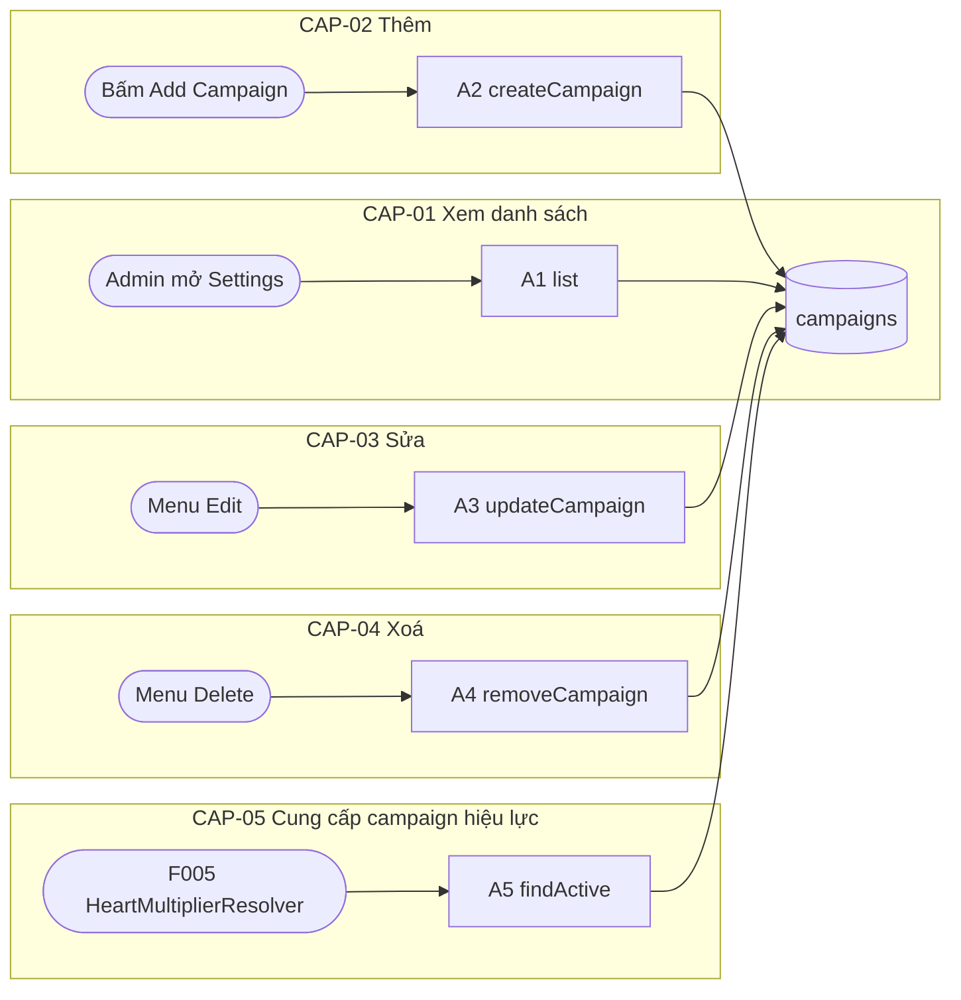
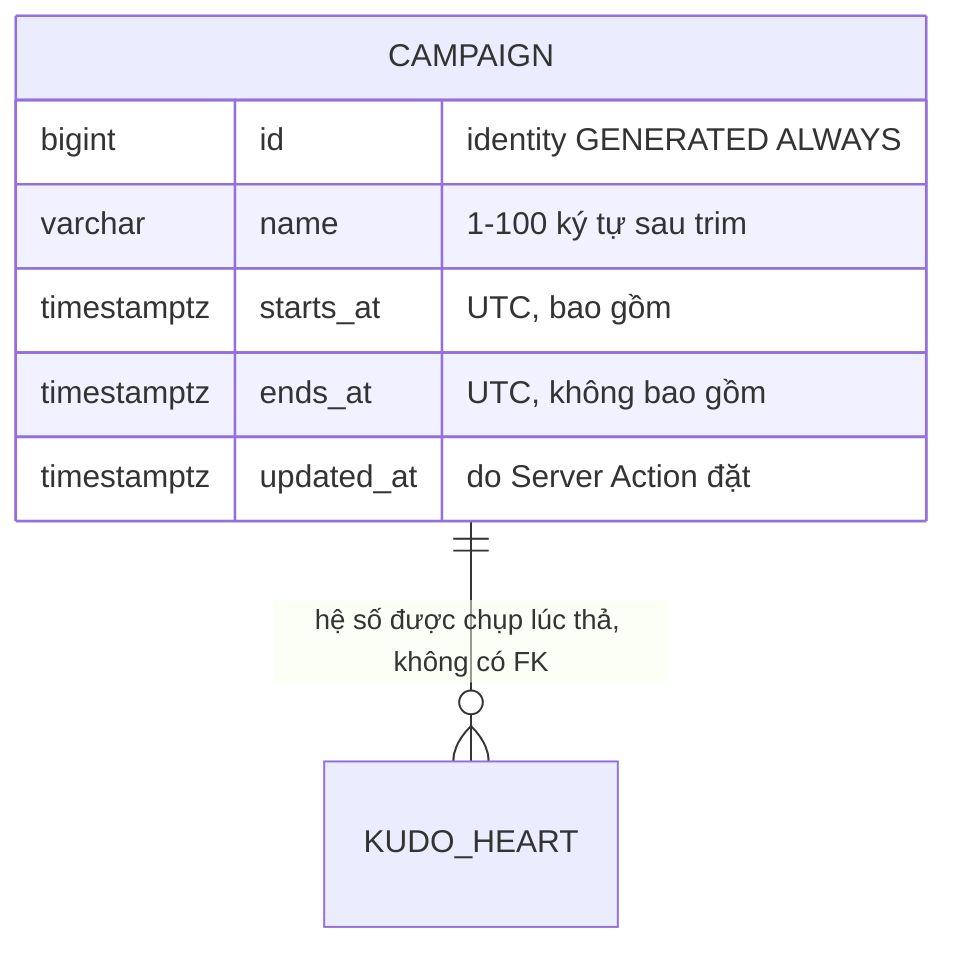

<!-- layout-exempt: rebuild-spec owns all docs/system|features|generated|flows paths — all references here are output targets or internal definitions -->
<!-- Contract: references/feature-spec-researcher-contract.md -->
<!-- Nửa Dev/QA/SA của cặp spec. Mọi mã FR/BR/DEC/ALG được PHÁT BIỂU một lần ở functional-spec.md và CÀI ĐẶT một lần ở đây; không lặp câu quy tắc thuần ngôn ngữ ở file này. -->

# F011_AdminCampaigns — Technical Spec

**Priority**: P2
**Type**: ui
**Generated**: 2026-11-24

**See also:** [`functional-spec.md`](./functional-spec.md) — tổng quan, quyết định còn mở, yêu cầu và quy tắc nghiệp vụ dạng một dòng, màn hình, user story, kịch bản, edge case và cấu hình cho BA/QA.

**How to read this file:** § 2 là bảng chỉ mục action; chọn action cần xem rồi đọc khối của nó ở § 3 từ đầu đến cuối, mỗi khối là một luồng hoàn chỉnh. § 4 là phụ lục dùng chung, chỉ nhảy vào khi § 3 chỉ sang đó.

## 1. Technical Overview

F011 là màn Admin › Settings (`/admin/settings`) quản lý campaign "x2 tim": một trang Server Component đọc danh sách qua `CampaignAdminQuery#list`, một thân client (`CampaignSettingsPanel`) giữ hộp thoại đang mở và toast, và ba Server Action (`createCampaign`, `updateCampaign`, `removeCampaign`) ghi bảng `campaigns` trong một giao dịch. Mốc giờ nhập theo `ADMIN_TIMEZONE`, lưu UTC; pha upcoming/active/ended không lưu mà tính từ đồng hồ máy chủ mỗi lần đọc và mỗi lần ghi; luật không chồng giờ có hai lớp (kiểm trước để nêu tên campaign đụng, ràng buộc EXCLUDE trong DB để chặn hai admin lưu cùng lúc). Feature chỉ ghi cấu hình: `campaignActiveReader#findActive` là cầu nối chỉ đọc mà F005 (`HeartMultiplierResolver`) gọi khi thả tim để biết có áp hệ số x2 hay không.



## 2. Action Index

| # | Action (handler) | Method · Path | Codes | Writes | Detail |
|---|---|---|---|---|---|
| **A0** | *cross-cutting — belongs to no single action* | — | FR-601, FR-602 | — | § 4.4 |
| **A1** | `CampaignAdminQuery#list` | `GET` `/admin/settings` | FR-002, FR-101, FR-201, FR-202, FR-204, FR-205, FR-206, FR-404, BR-001, BR-006, DEC-001, DEC-004 | — *(read-only)* | § 3.1 |
| **A2** | `campaign-admin-actions#createCampaign` | `POST` `/admin/settings` *(Server Action, ROUTE029)* | FR-001, FR-003, FR-203, FR-301, FR-303, FR-304, FR-305, FR-309, FR-310, BR-002, BR-003, BR-006, DEC-003, US013 | `campaigns` | § 3.2 |
| **A3** | `campaign-admin-actions#updateCampaign` | `POST` `/admin/settings` *(Server Action, ROUTE030)* | FR-302, FR-303, FR-304, FR-306, FR-307, BR-001, BR-002, BR-003, BR-004, BR-005, BR-006, DEC-002, US014 | `campaigns` | § 3.3 |
| **A4** | `campaign-admin-actions#removeCampaign` | `POST` `/admin/settings` *(Server Action, ROUTE031)* | FR-307, FR-308, BR-001, BR-004, BR-005, BR-007, DEC-005, US015 | `campaigns` | § 3.4 |
| **A5** | `campaignActiveReader#findActive` *(in-process, no FE)* | — | FR-401, FR-402, BR-001, BR-005, ALG-001 | — *(read-only)* | § 3.5 |

**Ghi chú về cột Codes:** BR dùng chung (BR-001..BR-006) có khối đầy đủ ở § 4.4 Bin 2; mỗi action dùng chúng vẫn chú giải ngay trong rung Rule của mình. Ba Server Action cùng một Method · Path (`/admin/settings`) nên khoá action là handler, không phải đường dẫn.

## 3. Actions

### 3.1 CAP-01 — Xem danh sách campaign

#### A1 · Xem danh sách campaign trong Admin › Settings
`GET /admin/settings` → `` `CampaignAdminQuery#list` ``
`FR-002` `FR-101` `FR-201` `FR-202` `FR-204` `FR-205` `FR-206` `FR-404` `BR-001` `BR-006` `DEC-001` `DEC-004` · `SCR014_AdminCampaignSettings`

**Who** · Admin đã đăng nhập *(qua cổng A0 — § 4.4)*
**FE** · `app/admin/settings/page.tsx:40-47` bọc phần đọc trong `Suspense`, fallback `CampaignSettingsSkeleton` (`features/admin-campaigns/components/campaign-settings-skeleton.tsx:5-23`); `CampaignSettingsPanel` (`features/admin-campaigns/components/campaign-settings-panel.tsx:22-78`) vẽ tiêu đề `h1` "Setting", nút Add Campaign và bảng; `CampaignTable` (`features/admin-campaigns/components/campaign-table.tsx:33-94`) có bốn cột ID, Name, Time, Actions, tên cắt một dòng với `title` đầy đủ, hai mốc giờ chia ngày/giờ từ chuỗi đã định dạng sẵn ở server; menu "⋯" `CampaignRowMenu` (`features/admin-campaigns/components/campaign-row-menu.tsx:26-106`) có điều khiển phím (Enter/Space/mũi tên mở, Esc đóng về nút, Tab đóng và đi tiếp).
**Request** · không có tham số từ client — tải trang; cookie phiên Supabase đi theo yêu cầu
**BE** · `` `CampaignAdminQuery#list` `` gọi `requireAdmin()` đầu tiên rồi `SELECT id, name, starts_at, ends_at FROM campaigns ORDER BY starts_at DESC, id DESC` (không phân trang), dựng DTO `CampaignListItem` gồm pha, chuỗi `datetime-local` và chuỗi hiển thị — `features/admin-campaigns/server/campaign-admin-query.ts:16-34`. `loadCampaigns` bắt lỗi đọc thành `null` nhưng `unstable_rethrow` cho lỗi 403 / chuyển hướng đi tiếp — `app/admin/settings/page.tsx:19-27`.
**Rule** · BR-001 — campaign đang chạy trên khoảng nửa mở [bắt đầu, kết thúc), đã kết thúc từ đúng giờ kết thúc, chưa chạy trước giờ bắt đầu; `campaignPhase` tính cột pha của mỗi dòng từ đồng hồ máy chủ lúc đọc *(§ 4.4)*. BR-006 — mốc lưu UTC, định dạng `dd/MM/yyyy - HH:mm` và `yyyy-MM-ddTHH:mm` theo `ADMIN_TIMEZONE` ngay ở server vì trình duyệt không biết múi giờ này *(§ 4.4)*. Hai quyết định hiển thị:

| DEC | subtype | Condition | What the user sees | Source |
|---|---|---|---|---|
| **DEC-001** | render | `campaigns.length === 0`; ngược lại với mỗi dòng `campaign.phase !== "ended"` | Danh sách rỗng: một dòng thông báo "Chưa có chiến dịch nào. Bấm Add Campaign để tạo."; dòng chưa kết thúc có nút "⋯", dòng đã kết thúc không có nút nào | `features/admin-campaigns/components/campaign-table.tsx:61-90` |
| **DEC-004** | render | `campaigns === null` (đọc lỗi) so với mảng (có thể rỗng) | Lỗi đọc: khối cảnh báo "Không tải được danh sách chiến dịch." kèm liên kết "Thử lại" về `/admin/settings`; ngược lại là bảng | `features/admin-campaigns/components/campaign-settings-panel.tsx:57-70` |

**Result** · read-only — **không ghi DB**. Trả mảng `CampaignListItem` đã sắp `starts_at DESC, id DESC`; liên kết "Thử lại" là thẻ `a` tải lại trang, không gọi action.
**Source:** `app/admin/settings/page.tsx:19-47` → `features/admin-campaigns/server/campaign-admin-query.ts:16-34` → `features/admin-campaigns/components/campaign-table.tsx:33-94`

<!-- No diagram: below threshold — một bảng, đồng bộ, chỉ đọc; nội dung thật là hai bảng nhánh render (DEC-001, DEC-004). -->

---

### 3.2 CAP-02 — Thêm campaign

#### A2 · Thêm campaign mới
`POST /admin/settings` → `` `campaign-admin-actions#createCampaign` ``
`FR-001` `FR-003` `FR-203` `FR-301` `FR-303` `FR-304` `FR-305` `FR-309` `FR-310` `BR-002` `BR-003` `BR-006` `DEC-003` `US013` · `SCR014_AdminCampaignSettings`

**Who** · Admin *(cổng A0 — § 4.4: `requireAdmin()` là lệnh đầu của action)*
**FE** · nút Add Campaign mở hộp thoại (`features/admin-campaigns/components/campaign-settings-panel.tsx:53-55`); `CampaignFormModal` (`features/admin-campaigns/components/campaign-form-modal.tsx:23-95`) có Campaign Name, Start Date, End Date (`datetime-local`), Cancel và nút gửi, ô tên có `data-autofocus`; hook `useCampaignForm` (`features/admin-campaigns/components/use-campaign-form.ts:43-116`) kiểm sớm bằng cùng schema Zod cộng so sánh chuỗi `endsAt <= startsAt` (cùng múi giờ và độ rộng cố định nên thứ tự chuỗi là thứ tự thời gian) rồi mới gọi action; lỗi theo trường hiện dưới ô và focus nhảy tới ô lỗi đầu tiên; khi đang lưu các ô `readOnly`, hai nút `aria-disabled` để focus không rơi ra `body` (`features/admin-campaigns/components/campaign-form-modal.tsx:62-90`); khung `CampaignDialogFrame` đóng bằng Esc trừ khi đang lưu, bấm nền không đóng (`features/admin-campaigns/components/campaign-dialog-frame.tsx:42-50`).
**Request** · `createCampaign(input)` với `{ name, startsAt, endsAt }`, hai mốc là chuỗi `yyyy-MM-ddTHH:mm` đọc theo `ADMIN_TIMEZONE`
**BE** · `` `createCampaign` `` — `requireAdmin()` → `CampaignCreateSchema.safeParse` (lỗi thì `VALIDATION` kèm `fieldErrors`) → `zonedDateTimeToUtc` cho cả hai mốc → `campaignWindowErrors(window, new Date())` → `runCampaignWrite` mở giao dịch: `assertNoOverlap` rồi `INSERT ... RETURNING id` — `features/admin-campaigns/server/campaign-admin-actions.ts:39-52`; mốc đổi múi giờ ở `shared/admin/timezone.ts:110-118`.
**Rule** · BR-003 — tên cắt khoảng trắng 1–100 ký tự, cả hai mốc phải là ngày giờ thật từ năm 2000, giờ kết thúc sau giờ bắt đầu rồi sau thời điểm hiện tại, giờ bắt đầu trong quá khứ vẫn nhận *(§ 4.4)*. BR-002 — hai khoảng nửa mở chồng nhau khi mỗi khoảng bắt đầu trước khi khoảng kia kết thúc, chạm đầu mút thì không; `CampaignOverlapCheck.find` kiểm trước trong giao dịch và ràng buộc EXCLUDE `campaigns_no_overlap` là chốt chặn cuối khi hai admin lưu cùng lúc *(§ 4.4)*. BR-006 — giờ nhập đọc theo `ADMIN_TIMEZONE` và lưu UTC; câu báo trùng giờ định dạng theo cùng múi giờ *(§ 4.4)*. Quyết định sau khi gửi:

| DEC | subtype | Condition | What the user sees | Source |
|---|---|---|---|---|
| **DEC-003** | flow | kết quả action: `ok`; `NOT_FOUND` hoặc `ENDED`; `VALIDATION`; `OVERLAP`; còn lại | Thành công: hộp đóng, toast "Đã thêm chiến dịch" hoặc "Đã lưu chiến dịch", bảng làm mới. Không còn / đã kết thúc: hộp đóng, toast lỗi theo mã, bảng làm mới. `VALIDATION`: lỗi dưới từng ô và focus ô lỗi đầu. `OVERLAP`: dưới End Date nêu tên và khoảng giờ campaign đụng, hộp mở. Còn lại: dòng "Không lưu được, vui lòng thử lại" trong hộp, dữ liệu nhập giữ nguyên | `features/admin-campaigns/components/use-campaign-form.ts:94-100` |

**Result** · **Ghi** `campaigns` (`name`, `starts_at`, `ends_at`; `id` identity, `created_at` / `updated_at` mặc định `now()`) — `features/admin-campaigns/server/campaign-admin-actions.ts:47-51`. `runCampaignWrite` gọi `revalidatePath("/admin/settings")` với mọi kết quả trừ `VALIDATION` và `UNEXPECTED` nên bảng tươi trong cùng một vòng gọi — `features/admin-campaigns/server/campaign-write-transaction.ts:53-61`. Lỗi bất ngờ: `console.error("[campaigns] write failed", …)` rồi trả `UNEXPECTED` (HTTP 200 trong băng, mã `500` chỉ là ý nghĩa tài liệu). User sees: toast xanh 5 giây (`features/admin-campaigns/components/campaign-settings-toast.tsx:20-39`), hàng mới ở vị trí theo `starts_at` giảm dần.
**Source:** `features/admin-campaigns/components/use-campaign-form.ts:43-116` → `features/admin-campaigns/server/campaign-admin-actions.ts:30-52` → `features/admin-campaigns/server/campaign-write-transaction.ts:38-61` → `features/admin-campaigns/server/campaign-overlap-check.ts:15-36`

<!-- No diagram: ghi một bảng, đồng bộ; thứ tự (kiểm trước → INSERT → EXCLUDE là chốt) đã nằm trong rung Rule/BE. -->

---

### 3.3 CAP-03 — Sửa campaign

#### A3 · Sửa campaign chưa kết thúc
`POST /admin/settings` → `` `campaign-admin-actions#updateCampaign` ``
`FR-302` `FR-303` `FR-304` `FR-306` `FR-307` `BR-001` `BR-002` `BR-003` `BR-004` `BR-005` `BR-006` `DEC-002` `US014` · `SCR014_AdminCampaignSettings`

**Who** · Admin *(cổng A0 — § 4.4)*
**FE** · mục Edit trong `CampaignRowMenu` (`features/admin-campaigns/components/campaign-row-menu.tsx:94-97`) — nút "⋯" chỉ có ở dòng chưa kết thúc (DEC-001 ở A1) — mở `CampaignFormModal` với ba ô điền sẵn `startsAtLocal` / `endsAtLocal` của DTO; khi pha lúc mở là `active`, ô Start Date `readOnly` kèm gợi ý "Chiến dịch đang chạy, không thể đổi giờ bắt đầu" (`features/admin-campaigns/components/campaign-form-modal.tsx:51-66`). Cách xử lý kết quả dùng chung `DEC-003` của A2: hook `useCampaignForm` là một, hai chế độ add/edit.
**Request** · `updateCampaign(input)` với `{ id, name, endsAt }` và `startsAt` chỉ khi ô không bị khoá (`features/admin-campaigns/components/use-campaign-form.ts:81-83`)
**BE** · `` `updateCampaign` `` — `requireAdmin()` → `CampaignUpdateSchema.safeParse` (lỗi nhưng không có lỗi theo trường, ví dụ `id` sai, thì trả `NOT_FOUND`) → trong `runCampaignWrite`: `lockCampaignRow` (`SELECT … FOR UPDATE`, không thấy hàng thì `NOT_FOUND`) → `campaignPhase(row, now)` → áp luật pha → `campaignWindowErrors` → `assertNoOverlap(tx, window, id)` → `UPDATE campaigns SET name, starts_at, ends_at, updated_at = now()` — `features/admin-campaigns/server/campaign-admin-actions.ts:58-86`; khoá hàng ở `features/admin-campaigns/server/campaign-write-transaction.ts:25-33`.
**Rule** · BR-004 — pha tính lại bằng đồng hồ máy chủ trên hàng đã khoá, không tin pha trình duyệt từng thấy: đã kết thúc thì `ENDED`; đang chạy thì chỉ sửa tên và giờ kết thúc, `startsAt` khác phút đã lưu bị trả `startLocked`, nếu bỏ trống thì giữ giờ bắt đầu đã lưu; chưa chạy thì sửa cả ba *(§ 4.4)*. BR-001 — pha lấy từ khoảng nửa mở [bắt đầu, kết thúc) *(§ 4.4)*. BR-003 — luật giờ như khi tạo, tính trên cửa sổ kết quả *(§ 4.4)*. BR-002 — kiểm không chồng giờ loại trừ chính campaign đang sửa *(§ 4.4)*. BR-005 — sửa không chạm `kudo_hearts`; tim đã thả giữ hệ số đã chụp lúc thả, chỉ tim thả sau đó theo khung giờ mới *(§ 4.4)*. BR-006 — mốc giờ gửi lên đọc theo `ADMIN_TIMEZONE` rồi đổi sang UTC, chuỗi sẵn có trong DTO cùng múi giờ *(§ 4.4)*. Quyết định khoá giờ bắt đầu:

| DEC | subtype | Condition | What the user sees | Source |
|---|---|---|---|---|
| **DEC-002** | interaction | chế độ sửa AND `campaign.phase === "active"` | Ô Start Date chỉ đọc kèm lý do; lệnh gửi không mang `startsAt`; chưa chạy thì ô sửa được và `startsAt` đi kèm | `features/admin-campaigns/components/use-campaign-form.ts:81-83` |

**Result** · **Ghi** `campaigns` (`name`, `starts_at`, `ends_at`, `updated_at` = `now()` do action đặt, không có trigger) — `features/admin-campaigns/server/campaign-admin-actions.ts:83`. Làm mới `/admin/settings` như A2. User sees: toast "Đã lưu chiến dịch"; `ENDED` hoặc `NOT_FOUND` giữa chừng thì hộp đóng, toast "Chiến dịch đã kết thúc, không thể sửa hoặc xoá" hoặc "Chiến dịch không còn tồn tại" và dòng đổi trạng thái sau khi bảng làm mới.
**Source:** `features/admin-campaigns/components/campaign-row-menu.tsx:94-97` → `features/admin-campaigns/components/use-campaign-form.ts:81-100` → `features/admin-campaigns/server/campaign-admin-actions.ts:58-86` → `features/admin-campaigns/server/campaign-phase.ts:8-12`

<!-- No diagram: ghi một bảng, đồng bộ; luồng khoá hàng → pha → ghi đã nằm trong rung BE. -->

---

### 3.4 CAP-04 — Xoá campaign

#### A4 · Xoá campaign sau khi xác nhận
`POST /admin/settings` → `` `campaign-admin-actions#removeCampaign` ``
`FR-307` `FR-308` `BR-001` `BR-004` `BR-005` `BR-007` `DEC-005` `US015` · `SCR014_AdminCampaignSettings`

**Who** · Admin *(cổng A0 — § 4.4)*
**FE** · mục Delete trong menu dòng mở `CampaignDeleteDialog` (`features/admin-campaigns/components/campaign-delete-dialog.tsx:36-89`): `alertdialog` nêu câu hỏi và tên campaign, nút Delete (đỏ) và Cancel; Cancel mang `data-autofocus` nên là lựa chọn an toàn có focus; đang xoá cả hai nút `aria-disabled`, Esc không đóng; mọi lỗi ném hoặc đứt mạng quy về `UNEXPECTED` qua `removeSafely` (403 và chuyển hướng của Next đi tiếp nhờ `unstable_rethrow`) — `features/admin-campaigns/components/campaign-delete-dialog.tsx:19-27`.
**Request** · `removeCampaign(id)` với `id` là số nguyên dương
**BE** · `` `removeCampaign` `` — `requireAdmin()` → `z.int().positive()` (sai thì `NOT_FOUND`, không chạm DB) → `runCampaignWrite`: `lockCampaignRow` → nếu `campaignPhase(row, new Date()) === "ended"` thì `ENDED` → `DELETE FROM campaigns WHERE id` — `features/admin-campaigns/server/campaign-admin-actions.ts:89-99`.
**Rule** · BR-007 — xoá cứng một hàng trong giao dịch đã khoá hàng; xoá campaign đang chạy nghĩa là dừng sớm, tim thả sau đó dùng hệ số 1; không có đường khôi phục — `features/admin-campaigns/server/campaign-admin-actions.ts:94-99`. Tái dùng BR-004 (đã kết thúc thì từ chối, phán theo đồng hồ máy chủ trên hàng đã khoá) *(§ 4.4)*, BR-001 (campaign đang chạy là campaign có khoảng nửa mở chứa thời điểm hiện tại) *(§ 4.4)* và BR-005 (xoá không tính lại tim đã thả) *(§ 4.4)*. Quyết định sau khi xác nhận:

| DEC | subtype | Condition | What the user sees | Source |
|---|---|---|---|---|
| **DEC-005** | flow | kết quả `removeCampaign`: `ok`; `NOT_FOUND` hoặc `ENDED`; còn lại | Thành công: hộp đóng, toast "Đã xoá chiến dịch", hàng biến khỏi bảng. Không còn / đã kết thúc: hộp đóng, toast lỗi theo mã, bảng làm mới. Còn lại: hộp ở lại với "Không xoá được, vui lòng thử lại" | `features/admin-campaigns/components/campaign-delete-dialog.tsx:45-52` |

**Result** · **Xoá** một dòng `campaigns` — `features/admin-campaigns/server/campaign-admin-actions.ts:97`. `runCampaignWrite` làm mới `/admin/settings` khi kết quả đã chạm DB (`ok`, `NOT_FOUND` trong giao dịch, `ENDED`); id sai bị loại trước giao dịch nên không làm mới. User sees: toast và hàng biến mất; nếu xoá campaign đang chạy thì nhãn x2 ở feature khác tắt ngay cho lần đọc kế tiếp.
**Source:** `features/admin-campaigns/components/campaign-delete-dialog.tsx:36-89` → `features/admin-campaigns/server/campaign-admin-actions.ts:89-99` → `features/admin-campaigns/server/campaign-write-transaction.ts:25-33`

<!-- No diagram: ghi một bảng, đồng bộ, hai nhánh từ chối nằm gọn trong rung BE. -->

---

### 3.5 CAP-05 — Cung cấp campaign đang hiệu lực

#### A5 · Tìm campaign đang hiệu lực tại một thời điểm *(in-process, no FE)*
`campaignActiveReader.findActive(at)` → `` `campaignActiveReader#findActive` ``
`FR-401` `FR-402` `BR-001` `BR-005` `ALG-001`

**Who** · *không có người dùng — gọi trong tiến trình bởi `HeartMultiplierResolver` của F005 (lúc thả tim và lúc dựng cờ `campaignActive`)*
**Request** · *không có HTTP* — tham số `at: Date`
**BE** · `` `findActive` `` — `SELECT id, name, starts_at, ends_at FROM campaigns WHERE starts_at <= at AND ends_at > at ORDER BY starts_at DESC LIMIT 2`; không có `requireAdmin()` vì không có bề mặt HTTP — `features/admin-campaigns/server/campaign-active-reader.ts:15-24`.
**Rule** · BR-001 — campaign hiệu lực là campaign có khoảng nửa mở [bắt đầu, kết thúc) chứa `at`, không có thì không có hệ số *(§ 4.4)*. BR-005 — F011 chỉ trả campaign; hệ số được F005 chụp vào dòng tim lúc thả (`kudo_hearts.multiplier`), nên sửa hay xoá campaign không tính lại tim cũ *(§ 4.4)*.
**Result** · read-only — **không ghi DB**. Trả `ActiveCampaign` (`id`, `name`, `startsAt`, `endsAt`) hoặc `null`; lỗi DB lan ra cho người gọi (F005 bắt, `console.warn`, dùng hệ số 1 — `features/kudos-hearts/server/heart-multiplier-resolver.ts:13-21`). F005 chỉ dùng cặp "có / không": `kudo-heart-service.ts` lấy hệ số cho dòng tim mới (`features/kudos-hearts/server/kudo-heart-service.ts:63`) và `HeartStatsQuery` đổi thành cờ `campaignActive` (`features/kudos-hearts/server/heart-stats-query.ts:21-34`) mà F010 hiện thành nhãn x2.
**Source:** `features/admin-campaigns/server/campaign-active-reader.ts:15-26` → `features/kudos-hearts/server/active-campaign-reader.ts:8-12` → `features/kudos-hearts/server/heart-multiplier-resolver.ts:13-21`
**Shared structure:** `ALG-001` — chọn campaign có khoảng nửa mở chứa thời điểm hỏi, nhiều hơn một (chèn tay) thì lấy campaign bắt đầu muộn nhất và ghi cảnh báo, chi tiết *(§ 4.5)*

<!-- No diagram: một câu truy vấn đọc, đồng bộ, không phải bước nền. -->

---

### 3.6 Edge cases

| Action | Scenario | Behavior |
|---|---|---|
| A2 · A3 | Khoảng giờ chồng campaign khác (chạm đầu mút thì không chồng) | `CampaignOverlapCheck.find` trả campaign đụng sớm nhất theo `starts_at`; `OVERLAP` kèm `conflict` (tên, hai mốc đã định dạng) hiện dưới End Date; hộp ở lại, không ghi |
| A2 · A3 | Hai admin lưu hai khoảng chồng nhau cùng lúc | Cả hai qua kiểm trước; ràng buộc `campaigns_no_overlap` làm giao dịch thứ hai lỗi SQLSTATE `23P01`, `settle` bắt và tra lại campaign thắng bằng `db`; trả cùng `OVERLAP`; nếu tra lỗi thì `OVERLAP` không có `conflict` và dòng chung "Khoảng thời gian trùng với một chiến dịch khác" (`features/admin-campaigns/server/campaign-write-transaction.ts:38-51`) |
| A2 · A3 | Giờ kết thúc không sau giờ bắt đầu, hoặc đã qua | `endBeforeStart` / `endInPast` dưới End Date; client chặn trước bằng so sánh chuỗi, server tính lại trên mốc UTC (`features/admin-campaigns/schemas/campaign-input-schema.ts:68-72`) |
| A2 · A3 | Tên rỗng hoặc dài hơn 100 ký tự, thiếu mốc, mốc không phải ngày giờ thật hoặc trước năm 2000 | `nameRequired` (cùng một khoá cho rỗng và quá dài), `startRequired`, `endRequired`, `invalidDateTime` theo từng trường; focus nhảy tới trường lỗi đầu tiên (`features/admin-campaigns/schemas/campaign-input-schema.ts:35-47`) |
| A2 | Giờ bắt đầu trong quá khứ, kết thúc tương lai | Được lưu; campaign ở pha `active` ngay |
| A3 | Sửa campaign đang chạy với `startsAt` khác phút đã lưu (yêu cầu không đi qua UI) | `VALIDATION` với `startsAt: ["startLocked"]`, không ghi (`features/admin-campaigns/server/campaign-admin-actions.ts:75-77`) |
| A3 · A4 | Campaign hết hạn trong lúc hộp đang mở | Hàng khoá phán lại bằng đồng hồ máy chủ: `ENDED`; hộp đóng, toast lỗi, bảng làm mới, hàng mất nút "⋯" |
| A3 · A4 | Admin khác đã xoá campaign | `lockCampaignRow` không thấy hàng: `NOT_FOUND`; hộp đóng, toast "Chiến dịch không còn tồn tại", bảng làm mới |
| A1 | Chưa có campaign nào | Một dòng rỗng "Chưa có chiến dịch nào. Bấm Add Campaign để tạo." |
| A1 | Đọc danh sách lỗi | `list()` ném, `loadCampaigns` bắt, trả `null`, khối cảnh báo với liên kết "Thử lại"; 403 và chuyển hướng không bị nuốt |
| A2 · A3 · A4 | Lỗi bất ngờ hoặc đứt mạng khi lưu / xoá | Quy về `UNEXPECTED`; hộp ở lại, dữ liệu nhập giữ nguyên; Esc và Cancel vẫn dùng được khi hết trạng thái đang xử lý |
| A1-A4 | Admin bị hạ quyền giữa phiên rồi mở trang | Bước 4b của proxy trả trang 403 (yêu cầu tải trang, không có header `next-action`) trước layout (A0 — § 4.4) |
| A2 · A3 · A4 | Admin bị hạ quyền giữa phiên khi hộp thoại đang mở rồi gửi | Proxy trả JSON 403 cho Server Action; client Next không nhận được phản hồi `text/x-component` nên ném `Error`; hook quy thành `UNEXPECTED`: hộp ở lại với "Không lưu được, vui lòng thử lại" (hộp xoá: "Không xoá được, vui lòng thử lại"), không hiện trang 403 *(đọc từ mã, chưa chạy thử — § 5.2)* |
| A1-A4 | Khách gọi các tuyến này | Bước 4 của proxy chuyển `/login`; không tới action (A0 — § 4.4) |
| A5 | Nhiều campaign cùng chứa `at` (chỉ xảy ra khi chèn SQL tay, né ràng buộc) | Lấy campaign `starts_at` lớn nhất, `console.warn` danh sách id |

## 4. Shared Foundation

### 4.1 Components

| Component | Responsibility | Used in | File |
|---|---|---|---|
| `AdminSettingsPage`, `loadCampaigns` | Trang `/admin/settings`, đọc danh sách, Suspense và trạng thái lỗi E14 | A1 | `app/admin/settings/page.tsx` |
| `CampaignAdminQuery` | Đọc toàn bộ campaign, dựng DTO có pha, chuỗi `datetime-local` và chuỗi hiển thị | A1 | `features/admin-campaigns/server/campaign-admin-query.ts` |
| `CampaignSettingsPanel` | Tiêu đề, nút Add Campaign, giữ hộp thoại đang mở, toast, trả focus về nút Add khi người mở không còn | A1-A4 | `features/admin-campaigns/components/campaign-settings-panel.tsx` |
| `CampaignTable`, `CampaignRowMenu` | Bảng bốn cột; menu "⋯" Edit / Delete chỉ cho dòng chưa kết thúc | A1, A3, A4 | `features/admin-campaigns/components/campaign-table.tsx`, `features/admin-campaigns/components/campaign-row-menu.tsx` |
| `CampaignFormModal`, `CampaignFormField`, `useCampaignForm` | Hộp Add/Edit, trường có nhãn / lỗi / gợi ý, trạng thái và luồng gửi | A2, A3 | `features/admin-campaigns/components/campaign-form-modal.tsx`, `features/admin-campaigns/components/campaign-form-field.tsx`, `features/admin-campaigns/components/use-campaign-form.ts` |
| `CampaignDeleteDialog` | `alertdialog` xác nhận xoá, gọi `removeCampaign` | A4 | `features/admin-campaigns/components/campaign-delete-dialog.tsx` |
| `CampaignDialogFrame` | Khung modal: bẫy focus, Esc, khoá cuộn nền, trả focus cho người mở | A2, A3, A4 | `features/admin-campaigns/components/campaign-dialog-frame.tsx` |
| `CampaignSettingsToast` | Toast thành công (`status`) hoặc lỗi (`alert`) 5 giây | A2, A3, A4 | `features/admin-campaigns/components/campaign-settings-toast.tsx` |
| `CampaignSettingsSkeleton` | Fallback Suspense của danh sách | A1 | `features/admin-campaigns/components/campaign-settings-skeleton.tsx` |
| `createCampaign`, `updateCampaign`, `removeCampaign` | Ba Server Action, `requireAdmin()` đầu tiên | A2, A3, A4 | `features/admin-campaigns/server/campaign-admin-actions.ts` |
| `runCampaignWrite`, `lockCampaignRow`, `CampaignWriteError` | Giao dịch ghi dùng chung: khoá hàng, đổi từ chối dự kiến thành kết quả trong băng, đổi `23P01` thành `OVERLAP`, làm mới trang | A2, A3, A4 | `features/admin-campaigns/server/campaign-write-transaction.ts` |
| `CampaignOverlapCheck` | Kiểm trước chồng giờ và nhận diện lỗi EXCLUDE | A2, A3 | `features/admin-campaigns/server/campaign-overlap-check.ts` |
| `campaignPhase` | Hàm thuần: pha từ cửa sổ và đồng hồ | A1, A3, A4 | `features/admin-campaigns/server/campaign-phase.ts` |
| `CampaignCreateSchema`, `CampaignUpdateSchema`, `campaignWindowErrors`, `campaignFieldErrors` | Schema Zod an toàn cho client, luật giờ, đổi lỗi Zod thành khoá `errors.fields.*` | A2, A3, A4 | `features/admin-campaigns/schemas/campaign-input-schema.ts` |
| `CampaignActionResult`, `CampaignListItem` | Hợp đồng kết quả và DTO dòng bảng | A1-A4 | `features/admin-campaigns/schemas/campaign-admin-result.ts` |
| `formatCampaignInstant`, `toCampaignLocalValue` | Mốc UTC sang chuỗi theo `ADMIN_TIMEZONE` | A1, A2, A3 | `features/admin-campaigns/server/campaign-time-format.ts` |
| `campaignActiveReader` | Bộ đọc campaign hiệu lực mà F005 gọi | A5 | `features/admin-campaigns/server/campaign-active-reader.ts` |

### 4.2 Data Model



| Entity | Table | Used for | Action |
|---|---|---|---|
| `Campaign` (MODEL009) | `campaigns` | khung giờ x2 do admin cấu hình; pha tính khi đọc, không có cột pha | A1-A5 |

Ràng buộc DB (`db/migrations/0011_campaigns.sql:4-15`, `db/migrations/0012_campaigns_no_overlap_exclude.sql:8-12`): `campaigns_ends_after_starts` (`ends_at > starts_at`), `campaigns_name_not_blank` (`btrim(name) <> ''`), `campaigns_no_overlap` (`EXCLUDE USING gist (tstzrange(starts_at, ends_at, '[)') WITH &&)`, viết tay vì Drizzle không biểu diễn được), RLS bật không có policy, `REVOKE ALL` cho `anon` và `authenticated`. Định nghĩa bảng Drizzle ở `shared/db/schema/campaigns.ts:12-27`.

#### Polymorphic Behavior

N/A — no discriminator fields in Key Entities.

### 4.3 State Management

None.

Pha upcoming / active / ended là giá trị tính (BR-001, hàm thuần `campaignPhase`), không phải cột lưu và không phải trạng thái component, nên không lập SM; hộp thoại đang mở là `useState` của `CampaignSettingsPanel` (một trong add / edit / delete / không), dưới ngưỡng SM.

### 4.4 Shared Rules

#### Bin 3 — cross-cutting, belongs to no single action

**A0 · FR-601 / FR-602 — mọi action của feature chỉ dành cho admin và bảng campaign không đọc được từ trình duyệt.** *(cross-cutting)* Ba lớp áp lên cả ba Server Action và trang, không thuộc riêng màn nào: (1) bước 4b của proxy đọc `profiles.role`, người không phải admin gặp trang 403 khi tải trang hoặc JSON 403 với Server Action, trước cả layout; khách bị chuyển `/login` ở bước 4. (2) `app/admin/layout.tsx` chạy `requireShellAdmin()` trước mọi markup admin. (3) `CampaignAdminQuery#list` và mỗi action gọi `requireAdmin()` đầu tiên (đọc `profiles.role` từ DB mỗi lần, nên hạ quyền có hiệu lực ở yêu cầu kế tiếp; khách → `/login`, không phải admin → `forbidden()`). Dữ liệu: bảng `campaigns` bật RLS không có policy cho client và bị `REVOKE ALL` cho `anon` / `authenticated`, nên chỉ máy chủ (Drizzle) đọc ghi được.
**Source:** `shared/auth/session-proxy.ts:92-110` · `app/admin/layout.tsx:10-12` · `shared/auth/admin-guard.ts:30-35` · `db/migrations/0012_campaigns_no_overlap_exclude.sql:12-12` · route-list ROUTE029-ROUTE031

#### Bin 2 — used by ≥2 named actions

**BR-001 — Campaign chạy trên khoảng nửa mở [bắt đầu, kết thúc): đã kết thúc từ đúng giờ kết thúc, chưa chạy trước giờ bắt đầu.**
Used in: **A1** · **A3** · **A4** · **A5**. `campaignPhase` so từng mốc với đồng hồ máy chủ; ràng buộc EXCLUDE bảo đảm tối đa một campaign chứa một thời điểm, nên "campaign đang hiệu lực" là duy nhất.
**Source:** `features/admin-campaigns/server/campaign-phase.ts:8-12` · `features/admin-campaigns/server/campaign-active-reader.ts:15-24`
```text
phase(window, now):
  if window.endsAt   <= now: return "ended"
  if window.startsAt <= now: return "active"
  return "upcoming"
```

**BR-002 — Hai khoảng nửa mở chồng nhau khi mỗi khoảng bắt đầu trước khi khoảng kia kết thúc; kết thúc đúng lúc cái kia bắt đầu thì không chồng; luôn bị từ chối.**
Used in: **A2** · **A3**. Kiểm trước trong giao dịch để trả tên campaign đụng; chốt chặn cuối là EXCLUDE (SQLSTATE `23P01`) cho trường hợp hai admin lưu cùng lúc, `settle` đổi thành cùng kết quả `OVERLAP`.
**Source:** `features/admin-campaigns/server/campaign-overlap-check.ts:15-36` · `features/admin-campaigns/server/campaign-write-transaction.ts:38-51`
```text
overlap(candidate, other):  other.startsAt < candidate.endsAt AND other.endsAt > candidate.startsAt
find(candidate, excludeId): first by startsAt ASC with overlap(...) and id <> excludeId
```

**BR-003 — Campaign hợp lệ khi tên 1–100 ký tự sau trim, hai mốc là ngày giờ thật từ năm 2000, giờ kết thúc sau giờ bắt đầu rồi sau thời điểm hiện tại; giờ bắt đầu trong quá khứ vẫn nhận.**
Used in: **A2** · **A3**. Schema Zod an toàn cho client dùng cho kiểm sớm; server parse lại rồi `campaignWindowErrors` kiểm trên mốc UTC (kiểm "bắt đầu sau kết thúc" trước, "kết thúc đã qua" sau).
**Source:** `features/admin-campaigns/schemas/campaign-input-schema.ts:35-72`
```text
name:   trim, length 1..100            (else nameRequired)
window: both match yyyy-MM-ddTHH:mm, real date, year >= 2000   (else invalidDateTime)
        endsAt <= startsAt -> endBeforeStart ; endsAt <= now -> endInPast
```

**BR-004 — Quyền sửa và xoá theo pha, tính bằng đồng hồ máy chủ trên hàng đã khoá: đã kết thúc chỉ đọc; đang chạy sửa tên và giờ kết thúc, giờ bắt đầu bị khoá, xoá được; chưa chạy sửa và xoá tự do.**
Used in: **A3** · **A4**. `lockCampaignRow` đọc lại hàng `FOR UPDATE` trong giao dịch rồi `campaignPhase`, nên pha trình duyệt đã thấy không có giá trị quyết định; gốc quyết định ở máy chủ.
**Source:** `features/admin-campaigns/server/campaign-write-transaction.ts:25-33` · `features/admin-campaigns/server/campaign-admin-actions.ts:70-80`
```text
row = SELECT ... FOR UPDATE      # none -> NOT_FOUND
phase = campaignPhase(row, serverNow)
ended  -> ENDED
active -> requested start must equal stored start (same minute) else startLocked; start := stored
```

**BR-005 — Hệ số x2 được chụp vào dòng tim lúc thả; sửa hay xoá campaign không tính lại tim đã thả.**
Used in: **A3** · **A4** · **A5**. F011 không ghi `kudo_hearts`; F005 chụp hệ số vào `kudo_hearts.multiplier` ở thời điểm thả, rồi hai bên không còn liên kết (không có FK).
**Source:** `features/kudos-hearts/server/kudo-heart-service.ts:63-65` · `features/kudos-hearts/server/heart-multiplier-resolver.ts:13-21`

**BR-006 — Giờ nhập và hiển thị theo `ADMIN_TIMEZONE`, lưu UTC; mọi admin thấy cùng một giờ.**
Used in: **A1** · **A2** · **A3**. Trình duyệt không biết múi giờ này nên server gửi sẵn chuỗi hiển thị và chuỗi `datetime-local`; khi nhập, server đọc chuỗi `yyyy-MM-ddTHH:mm` như giờ treo tường của múi giờ đó rồi đổi sang UTC.
**Source:** `features/admin-campaigns/server/campaign-time-format.ts:11-20` · `shared/admin/timezone.ts:110-118`

### 4.5 Algorithms & Integrations

### Chọn campaign có khoảng nửa mở chứa một thời điểm, nhiều hơn một thì lấy campaign bắt đầu muộn nhất (ALG-001)
**Linked FR:** FR-401
**Used in:** A5
**Source:** `features/admin-campaigns/server/campaign-active-reader.ts:15-24`
**Input:** `at: Date` · **Output:** `ActiveCampaign | null` · **Complexity:** quét tuần tự một bảng chỉ vài dòng
**Description:** lọc `starts_at <= at < ends_at` bằng so sánh cột thường rồi lấy tối đa hai dòng theo `starts_at` giảm dần; ràng buộc EXCLUDE khiến bình thường chỉ có một dòng, nên dòng thứ hai chỉ hiện khi ai đó chèn SQL tay né ràng buộc, khi đó trả dòng bắt đầu muộn nhất và ghi cảnh báo. Chỉ mục GiST đi kèm EXCLUDE chỉ phục vụ ràng buộc, không phục vụ bộ lọc này.

**Pseudocode:**
```text
rows = SELECT id,name,starts_at,ends_at FROM campaigns
       WHERE starts_at <= at AND ends_at > at ORDER BY starts_at DESC LIMIT 2
if rows.length > 1: warn("overlapping active campaigns", ids)
return rows[0] or null
```

None.

<!-- INT: không có tích hợp ngoài; `revalidatePath` là làm mới bộ nhớ đệm của chính trang, đã ghi ở Result của A2-A4. -->

### 4.6 Configuration

```text
ADMIN_TIMEZONE = Asia/Ho_Chi_Minh        # múi giờ IANA đọc và hiển thị mốc giờ campaign; shared/config/env-schema.ts:73-75 (A1, A2, A3)
HEART_CAMPAIGN_MULTIPLIER = 2            # số nguyên >= 2, chung cho mọi campaign; shared/config/env-schema.ts:71; F005 đọc, F011 không đọc
CAMPAIGN_NAME_MAX_LENGTH = 100           # features/admin-campaigns/schemas/campaign-input-schema.ts:10 (A2, A3)
CAMPAIGN_MIN_YEAR = 2000                 # năm nhỏ nhất nhận được; campaign-input-schema.ts:29 (A2, A3)
toast durationMs = 5000                  # thời gian toast; features/admin-campaigns/components/campaign-settings-toast.tsx:20
```

**Client behavior:** see
[`behavior-logic.md`](../../generated/behavior-logic.md) (client-side patterns — debounce, optimistic UI, polling, upload, realtime),
[`permissions.md`](../../system/permissions.md) (feature flags / experiments / env / locale gates),
[`architecture.md`](../../system/architecture.md) (guards / deep-link state restoration / unsaved-changes protection).

## 5. Verification & Technical Notes

### 5.1 Technical Verification

- **SC-001** *(A2, A3)* Hai khoảng nửa mở chạm đầu mút cùng được lưu; chồng một phút thì `OVERLAP` có tên campaign đụng (covers FR-003, BR-002)
- **SC-002** *(A2, A3)* Năm lượt tạo chồng nhau đồng thời chỉ một lượt thắng, các lượt còn lại nhận `OVERLAP` (covers FR-003, BR-002) — `tests/integration/admin-campaigns/campaign-exclude-race.test.ts`
- **SC-003** *(A3, A4)* Campaign hết hạn hoặc bị xoá giữa lúc mở hộp cho `ENDED` / `NOT_FOUND`, không ghi (covers BR-004, FR-307)
- **SC-004** *(A5)* `findActive` trả campaign tại đúng `starts_at`, không trả tại đúng `ends_at`; lần thả tim kế tiếp hỏi lại campaign đang hiệu lực nên thêm/sửa/xoá có hiệu lực ngay, tim đã thả giữ hệ số đã lưu (covers FR-401, FR-402, BR-001) — `tests/integration/admin-campaigns/campaign-admin-query.test.ts`, `tests/unit/kudos-hearts/heart-multiplier-resolver.test.ts`
- **SC-005** *(A1-A4)* Không phải admin không đọc và không ghi được; `requireAdmin()` chạy trước mọi truy vấn; bảng `campaigns` bật RLS không policy, REVOKE ALL cho anon/authenticated (covers FR-601, FR-602) — `tests/integration/admin-campaigns/campaign-admin-actions.test.ts`, `tests/integration/admin-campaigns/hearts-and-campaigns-migrations.test.ts`
- **SC-006** *(A1)* Bảng bốn cột ID/Name/Time/Actions sắp `starts_at DESC, id DESC` không phân trang, giờ theo ADMIN_TIMEZONE giống nhau cho mọi Admin, tên dài cắt một dòng có `title`; dòng đã kết thúc không có "⋯"; rỗng hiện dòng gợi ý; đọc lỗi hiện khối lỗi + "Thử lại"; skeleton lúc tải (covers FR-002, FR-101, FR-201, FR-202, FR-204, FR-205, FR-206, FR-404) — `tests/e2e/admin-campaigns/settings-crud.spec.ts`, `tests/unit/admin-campaigns/zoned-date-time-to-utc.test.ts`; trạng thái rỗng, khối lỗi và skeleton chưa có test tự động, cần kiểm thủ công
- **SC-007** *(A2)* Hộp Add có 3 ô bắt buộc, focus vào ô tên; tên 1-100 ký tự, mốc thật từ 2000, end sau start và sau hiện tại; lỗi dưới từng ô, focus ô lỗi đầu; OVERLAP nêu tên và khoảng giờ dưới End Date; thành công đóng hộp + toast 5 giây; Cancel/Esc đóng, bấm nền không đóng; đang lưu ô readOnly, hai nút khoá, Esc không đóng; lỗi bất ngờ giữ hộp và dữ liệu (covers FR-001, FR-203, FR-301, FR-303, FR-304, FR-305, FR-309, FR-310) — `tests/e2e/admin-campaigns/settings-crud.spec.ts`, `tests/e2e/admin-campaigns/settings-dialog-escape.spec.ts`, `tests/unit/admin-campaigns/campaign-input-schema.test.ts`
- **SC-008** *(A3)* Hộp Edit điền sẵn, nút "Save Campaign"; campaign đang chạy khoá Start kèm lý do, vẫn sửa tên và End; `startsAt` khác phút đã lưu bị `startLocked` (covers FR-302, FR-306) — `tests/e2e/admin-campaigns/settings-crud.spec.ts`, `tests/integration/admin-campaigns/campaign-admin-actions.test.ts`
- **SC-009** *(A4)* Hộp xác nhận xoá nêu tên campaign, Cancel có focus; Cancel/Esc không xoá; đang xoá hai nút khoá; lỗi khác giữ hộp với "Không xoá được" (covers FR-308, FR-309, FR-310) — `tests/e2e/admin-campaigns/settings-crud.spec.ts`, `tests/e2e/admin-campaigns/settings-dialog-escape.spec.ts`

#### US013_CreateCampaign *(A2)*

**Independent Test:** mở hộp Add Campaign, nhập tên và hai mốc hợp lệ không chồng rồi gửi; kiểm dòng mới ở bảng và toast.

**Acceptance Scenarios:**

1. **Given** không có campaign chồng giờ, **When** gửi tên + Start + End hợp lệ, **Then** `{ ok: true, id }`, hộp đóng, bảng làm mới, toast "Đã thêm chiến dịch".
2. **Given** Start trong quá khứ và End tương lai, **When** gửi, **Then** lưu thành công, campaign hiện ở pha chạy.
3. **Given** có campaign trùng một phần, **When** gửi, **Then** `OVERLAP` kèm tên và hai mốc, lỗi dưới End Date, không ghi.

#### US014_EditCampaign *(A3)*

**Independent Test:** sửa campaign đang chờ rồi sửa campaign đang chạy; đối chiếu ô khoá và kết quả.

**Acceptance Scenarios:**

1. **Given** campaign chưa chạy, **When** đổi tên và End rồi lưu, **Then** `{ ok: true }`, toast "Đã lưu chiến dịch", bảng mới.
2. **Given** campaign đang chạy, **When** mở hộp sửa, **Then** Start chỉ đọc kèm lý do; gửi Start khác phút đã lưu bằng yêu cầu tay thì `startLocked`.
3. **Given** campaign vừa hết hạn, **When** lưu, **Then** `ENDED`, hộp đóng, toast lỗi, hàng mất nút "⋯".

#### US015_DeleteCampaign *(A4)*

**Independent Test:** xoá một campaign chưa chạy và một campaign đang chạy; kiểm `findActive` sau đó.

**Acceptance Scenarios:**

1. **Given** campaign chưa kết thúc, **When** chọn Delete rồi xác nhận, **Then** hàng bị xoá cứng, toast "Đã xoá chiến dịch".
2. **Given** campaign đang chạy, **When** xác nhận xoá, **Then** `findActive` ngay sau đó trả `null` và tim mới dùng hệ số 1.
3. **Given** campaign đã kết thúc hoặc đã bị xoá từ trước, **When** xác nhận, **Then** `ENDED` / `NOT_FOUND`, hộp đóng, toast lỗi, bảng làm mới.

### 5.2 Assumptions

- *(A2, A3, A4)* Hành vi khi admin bị hạ quyền giữa phiên và gửi từ hộp thoại đang mở (hiện "Không lưu được" thay vì trang 403) được suy từ mã: proxy trả JSON 403 (`shared/auth/session-proxy.ts:92-96`), client Next ném `Error` chung khi không phải phản hồi `text/x-component` (`node_modules/next/dist/client/components/router-reducer/reducers/server-action-reducer.js:137-142`), `unstable_rethrow` chỉ cho lỗi nội bộ của Next đi tiếp nên hook bắt và quy thành `UNEXPECTED` (`features/admin-campaigns/components/use-campaign-form.ts:25-33`). Đợt này không chạy ứng dụng nên đây là hành vi đọc từ mã, không phải xác nhận lúc chạy.
- *(A1)* Mọi admin thấy cùng một mốc giờ vì định dạng chạy ở server theo `ADMIN_TIMEZONE`; Asia/Ho_Chi_Minh không có giờ mùa hè nên phép đổi hai lần của `wallClockToUtc` không phát sinh mốc nhập nhằng ở mặc định.
- *(A5)* F011 không có người gọi nào ngoài `HeartMultiplierResolver`; nếu có thêm bên đọc `findActive` thì họ cần tự xử lý lỗi DB vì bộ đọc để lỗi lan ra.

### 5.3 Unresolved Questions

1. **Ba trường `name`, `startsAt`, `endsAt` của `ActiveCampaign` không có người dùng** *(A5)*: chú thích trong `features/kudos-hearts/server/active-campaign-reader.ts:6` nói pha F010 đọc ba trường này cho tooltip x2, nhưng `HeartStatsQuery` chỉ dùng cặp có / không (`features/kudos-hearts/server/heart-stats-query.ts:34`) và F010 hiện nhãn "x2" cố định (`features/secret-box-rewards/components/personal-stats-panel.tsx:56`); chưa rõ có định hiện tên và khung giờ về sau hay thu gọn kiểu trả về.
2. **Chú thích migration lệch với truy vấn** *(A5)*: `db/migrations/0012_campaigns_no_overlap_exclude.sql:5-6` viết chỉ mục GiST của EXCLUDE cũng phục vụ `findActive`, nhưng bộ lọc là so sánh cột thường nên quét tuần tự (`features/admin-campaigns/server/campaign-active-reader.ts:10-14`); không ảnh hưởng đúng sai với bảng chỉ vài dòng.
3. **Khoảng trống kiểm thử đơn vị của hook form** *(A2, A3)*: `features/admin-campaigns/components/use-campaign-form.ts` được liệt vào nhóm 0% cover ở số liệu bàn giao; luồng này có kiểm thử e2e (`tests/e2e/admin-campaigns/settings-crud.spec.ts`, `tests/e2e/admin-campaigns/settings-dialog-escape.spec.ts`) nhưng không có kiểm thử đơn vị / tích hợp.
4. **Id sai ở `updateCampaign` / `removeCampaign` không làm mới trang** *(A3, A4)*: `NOT_FOUND` trả sớm từ bước parse không đi qua `runCampaignWrite` nên không `revalidatePath` (`features/admin-campaigns/server/campaign-admin-actions.ts:61-64`, `features/admin-campaigns/server/campaign-admin-actions.ts:91-92`); chỉ xảy ra với yêu cầu dựng tay.

### 5.4 Source References

| Action | Order | Symbol | Path | Purpose |
|---|---|---|---|---|
| A1-A5 | 1 | `campaigns` (bảng) | `shared/db/schema/campaigns.ts:12-27` | thực thể trung tâm: identity, hai mốc UTC, CHECK, RLS |
| A2, A3 | 2 | `campaigns_no_overlap` | `db/migrations/0012_campaigns_no_overlap_exclude.sql:8-9` | ràng buộc EXCLUDE chặn chồng giờ ở tầng dữ liệu |
| A1 | 3 | `AdminSettingsPage`, `loadCampaigns` | `app/admin/settings/page.tsx:19-47` | trang, Suspense, trạng thái lỗi |
| A1 | 4 | `CampaignAdminQuery#list` | `features/admin-campaigns/server/campaign-admin-query.ts:16-34` | đọc danh sách, dựng DTO |
| A2, A3, A4 | 5 | `createCampaign`, `updateCampaign`, `removeCampaign` | `features/admin-campaigns/server/campaign-admin-actions.ts:39-99` | ba Server Action |
| A2, A3, A4 | 6 | `runCampaignWrite`, `lockCampaignRow`, `settle` | `features/admin-campaigns/server/campaign-write-transaction.ts:25-61` | giao dịch ghi, khoá hàng, ánh xạ `23P01` |
| A2, A3 | 7 | `CampaignOverlapCheck` | `features/admin-campaigns/server/campaign-overlap-check.ts:15-36` | kiểm trước chồng giờ |
| A1, A3, A4 | 8 | `campaignPhase` | `features/admin-campaigns/server/campaign-phase.ts:8-12` | pha từ đồng hồ máy chủ |
| A2, A3 | 9 | `CampaignCreateSchema`, `campaignWindowErrors` | `features/admin-campaigns/schemas/campaign-input-schema.ts:35-72` | luật nhập liệu dùng chung hai phía |
| A5 | 10 | `campaignActiveReader#findActive` | `features/admin-campaigns/server/campaign-active-reader.ts:15-26` | bộ đọc cho F005 |
| A2, A3 | 11 | `useCampaignForm` | `features/admin-campaigns/components/use-campaign-form.ts:43-116` | luồng gửi và ánh xạ kết quả |
| A1-A4 | 12 | `CampaignSettingsPanel` | `features/admin-campaigns/components/campaign-settings-panel.tsx:22-78` | giữ hộp thoại và toast |
| A4 | 13 | `CampaignDeleteDialog` | `features/admin-campaigns/components/campaign-delete-dialog.tsx:36-89` | hộp xác nhận xoá |

#### Data Flow

```text
Add/Edit form (yyyy-MM-ddTHH:mm theo ADMIN_TIMEZONE) -> Zod + so sánh chuỗi ở client -> Server Action: requireAdmin, Zod, zonedDateTimeToUtc, campaignWindowErrors
  -> giao dịch: lockCampaignRow (sửa/xoá) -> campaignPhase -> CampaignOverlapCheck.find -> INSERT/UPDATE/DELETE campaigns (EXCLUDE là chốt chặn)
  -> CampaignActionResult (ok hoặc mã) -> revalidatePath /admin/settings -> toast + bảng mới
```

Luồng đọc F005: `HeartMultiplierResolver.resolve(at)` -> `campaignActiveReader.findActive(at)` -> `campaigns` -> hệ số `HEART_CAMPAIGN_MULTIPLIER` hoặc 1 (dẫn xuất từ § 3.5, A5).

### 5.5 Artifact References

| Artifact | File | Codes Used | Reviewed |
|----------|------|------------|----------|
| System Overview | [overview.md](../../system/overview.md) | — | [x] |
| Architecture | [architecture.md](../../system/architecture.md) | — | [x] |
| Feature List | [feature-list.md](../../generated/feature-list.md) | F011 | [x] |
| API Map | [api-map.md](../../generated/api-map.md) | ROUTE029, ROUTE030, ROUTE031 | [x] |
| Entities | [entities.md](../../generated/entities.md) | MODEL009 | [x] |
| Screens | [functional-spec.md § 6](./functional-spec.md#6-screens) | SCR014 | [x] |
| Behavior Logic | [behavior-logic.md](../../generated/behavior-logic.md) | — | [x] |
| Permissions Matrix | [permissions-matrix.md](../../generated/permissions-matrix.md) | PERM020 | [x] |
| User Stories | [user-stories.md](../../generated/user-stories.md) | US013, US014, US015 | [x] |

**Rule:** Mọi mã trong Codes Used phải tồn tại trong artifact nguồn. `ROUTE###` ở hàng API Map là cầu tới cột `Code` của `route-list.md`; trang `/admin/settings` không có mã ROUTE riêng (chỉ ba Server Action); F011 không có BL.
