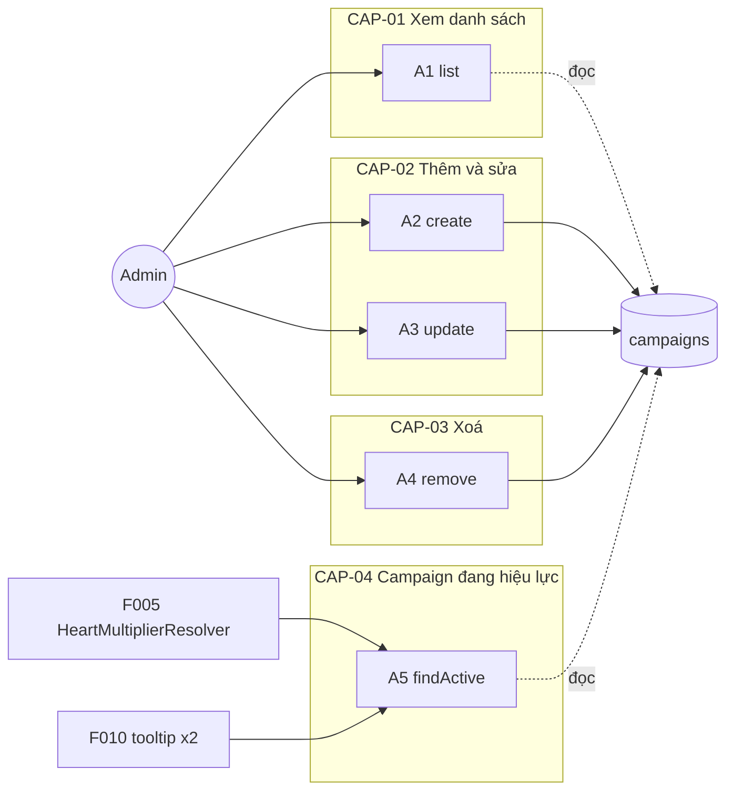
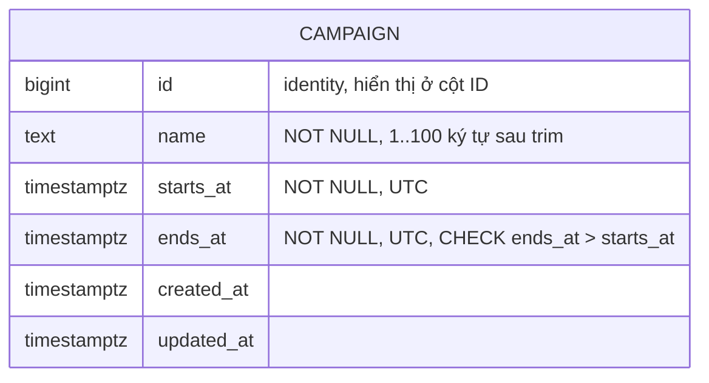

# F011_AdminCampaigns — Technical Spec

**Priority**: P2
**Type**: ui
**Generated**: 2026-11-08

**See also:** [`functional-spec.md`](./functional-spec.md) — tổng quan bằng ngôn ngữ thường, quyết định còn mở, yêu cầu và luật nghiệp vụ một dòng, màn hình, user story, kịch bản, trường hợp biên và cấu hình cho BA/QA.

**How to read this file:** § 2 là bảng chỉ mục — chọn action cần xem rồi đọc block của nó ở § 3 một mạch từ trên xuống. § 4 là phụ lục dùng chung — chỉ nhảy vào khi một block ở § 3 trỏ tới.

## 1. Technical Overview

F011 cho Admin thêm, sửa, xoá campaign "x2 heart" (tên, giờ bắt đầu, giờ kết thúc) trên trang Setting, và **cài đặt** giao diện `ActiveCampaignReader` mà F005 đã khai báo (F005 hiện có bản mặc định luôn trả `null`; F011 thay bằng bản đọc bảng `campaigns`, không khai báo lại giao diện). Mọi xử lý nằm ở server (Next.js App Router, server action + Drizzle trên Supabase Postgres); vì Drizzle chạy bằng vai trò server nên bỏ qua RLS, **mỗi server action của Admin tự gọi `AdminGuard#requireAdmin` của F001** trước khi đụng dữ liệu (cùng quy ước F007). Dữ liệu là `timestamptz` (UTC), giờ nhập và hiển thị theo `ADMIN_TIMEZONE`. Tính không chồng giờ được đảm bảo ở tầng DB bằng exclusion constraint trên khoảng giờ, nên hai Admin lưu đồng thời cũng không tạo được hai campaign chồng nhau. Hệ số x2 nằm ở F005 và được gắn vào tim lúc thả, nên F011 không bao giờ ghi vào bảng tim.



## 2. Action Index

| # | Action (handler) | Method · Path | Codes | Writes | Detail |
|---|---|---|---|---|---|
| **A0** | *cross-cutting — belongs to no single action* | — | FR-601, FR-602 | — | § 4.4 |
| **A1** | `CampaignAdminQuery#list` (planned) | `GET` `/admin/settings` (TBD (draft)) | FR-002, FR-101, FR-201, FR-202, FR-204, FR-205, FR-404, BR-004, BR-006, DEC-001, US001_ListCampaigns | — *(read-only)* | § 3.1 |
| **A2** | `CampaignAdminActions#create` (planned) | `ACTION` `/admin/settings` (server action) | FR-001, FR-003, FR-203, FR-301, FR-303, FR-304, FR-305, BR-002, BR-003, BR-006, US002_AddCampaign | `campaigns` | § 3.2 |
| **A3** | `CampaignAdminActions#update` (planned) | `ACTION` `/admin/settings` (server action) | FR-302, FR-303, FR-304, FR-305, FR-306, FR-307, BR-002, BR-003, BR-004, BR-006, DEC-002, US003_EditCampaign | `campaigns` | § 3.2 |
| **A4** | `CampaignAdminActions#remove` (planned) | `ACTION` `/admin/settings` (server action) | FR-307, FR-308, FR-402, BR-004, BR-005, US004_DeleteCampaign | `campaigns` | § 3.3 |
| **A5** | `CampaignActiveReader#findActive` (planned) *(nội bộ, không có FE)* | `call` · in-process (bước tính hệ số của F005, F010) | FR-401, FR-402, FR-403, BR-001, ALG-001, US005_ActiveCampaignDoubleHearts | — *(read-only)* | § 3.4 |

**Diagram:** không action nào ghi ≥2 bảng hay chạy nền; không có `sequenceDiagram` ở § 3 (xem ghi chú từng block).

## 3. Actions

### 3.1 CAP-01 — Xem danh sách campaign

#### A1 · Lấy danh sách campaign cho trang Setting
`GET /admin/settings` (đường dẫn do F002 chốt, TBD (draft)) → `` `CampaignAdminQuery#list` `` (planned)
`FR-002` `FR-101` `FR-201` `FR-202` `FR-204` `FR-205` `FR-404` `BR-004` `BR-006` `DEC-001` `US001_ListCampaigns` · `SCR019_AdminCampaignSettings` (draft)

**Who** · Admin *(gate A0 — § 4.4)*
**FE** · Trang Setting trong khung Admin của F002: tiêu đề "Setting", nút "Add Campaign", bảng tối ID / Name / Time / Actions (FR-201). Cột Time hiện `starts_at – ends_at` đổi sang giờ Việt Nam (FR-002). Cột Actions là biểu tượng mở menu nhỏ theo DEC-001. Không có dòng thì hiện trạng thái trống (FR-205); gọi lỗi thì hiện lỗi kèm nút thử lại (FR-404).
**Request** · không tham số (server component đọc trực tiếp)
**BE** · `` `CampaignAdminQuery#list` `` gọi `AdminGuard#requireAdmin`, `SELECT` toàn bộ `campaigns` `ORDER BY starts_at DESC, id DESC` (FR-202, không phân trang), kèm `now` của server để tính giai đoạn từng dòng.
**Rule**
- **BR-006 — Giờ lưu UTC, hiển thị theo giờ Việt Nam.** Định dạng `dd/MM/yyyy - HH:mm` theo `ADMIN_TIMEZONE`, mọi Admin thấy cùng giờ. *(§ 4.4)*
- **BR-004 — Giai đoạn quyết định được sửa / xoá gì.** Đã kết thúc: chỉ đọc; đang chạy: sửa tên và giờ kết thúc, xoá được; chưa chạy: sửa và xoá tự do. *(§ 4.4)*

| DEC | subtype | Condition | What the user sees | Source |
|---|---|---|---|---|
| **DEC-001** | render | `phase(row, now)` ∈ {`upcoming`, `active`} | menu dòng có Edit và Delete; `ended`: biểu tượng menu ẩn (không có mục nào) | TBD (draft) |

**Result** · read-only — **no DB write**. Giai đoạn là giá trị tính (`ended` nếu `ends_at <= now`, `active` nếu `starts_at <= now < ends_at`, còn lại `upcoming`), không lưu cột.
**Source:** TBD (draft)

<!-- Không có diagram: dưới ngưỡng (chỉ đọc, một bảng, đồng bộ). Nội dung chính là bảng DEC. -->

---

### 3.2 CAP-02 — Thêm và sửa campaign

#### A2 · Thêm campaign
`ACTION` (server action, trang `/admin/settings`) → `` `CampaignAdminActions#create` `` (planned)
`FR-001` `FR-003` `FR-203` `FR-301` `FR-303` `FR-304` `FR-305` `BR-002` `BR-003` `BR-006` `US002_AddCampaign` · `SCR020_CampaignFormModal` (draft)

**Who** · Admin *(gate A0 — § 4.4)*
**FE** · Nút "Add Campaign" (FR-203) mở hộp thoại ba ô Campaign Name, Start Date, End Date (FR-301); ô ngày dùng bộ chọn lịch kèm giờ. Lỗi hiện dưới từng ô; lỗi trùng giờ hiện dưới ô End Date nêu campaign trùng (FR-304). Thành công: đóng hộp, `revalidatePath` bảng, toast (FR-305).
**Request** · `name` *(string)*, `startsAt`, `endsAt` *(chuỗi `yyyy-MM-ddTHH:mm`, hiểu theo `ADMIN_TIMEZONE`, không tin múi giờ trình duyệt)*
**BE** · `` `CampaignAdminActions#create` `` gọi `AdminGuard#requireAdmin`, parse bằng `CampaignInputSchema` (Zod), đổi giờ Việt Nam sang UTC, kiểm trùng giờ rồi `INSERT`.
**Rule**
- **BR-003 — Campaign hợp lệ khi tên không rỗng (đã cắt khoảng trắng), tối đa 100 ký tự, giờ kết thúc sau giờ bắt đầu và sau hiện tại.** *(§ 4.4)*
- **BR-002 — Hai campaign chồng giờ thì bị từ chối.** Chồng khi mỗi cái bắt đầu trước khi cái kia kết thúc; kết thúc đúng lúc cái khác bắt đầu thì không chồng. Kiểm ở app để báo lỗi thân thiện, và DB constraint là chốt chặn cuối. *(§ 4.4)*
- **BR-006 — Chuỗi giờ nhập được hiểu là giờ Việt Nam rồi lưu UTC.** *(§ 4.4)*

**Result**
- Writes `campaigns` (`name`, `starts_at`, `ends_at`, `created_at`, `updated_at`) ← giá trị đã kiểm; `id` do DB sinh (FR-001).
- Vi phạm `BR-003`: trả lỗi theo trường, không ghi. Vi phạm `BR-002` (kể cả khi DB trả SQLSTATE `23P01` do hai Admin lưu đồng thời): trả lỗi trùng giờ kèm tên và khoảng giờ campaign đang trùng (FR-303, FR-304).
- User sees: hộp đóng, dòng mới trong bảng, toast thành công (FR-305).
**Source:** TBD (draft)

<!-- Không có diagram: dưới ngưỡng (một bảng, đồng bộ). -->

---

#### A3 · Sửa campaign
`ACTION` (server action) → `` `CampaignAdminActions#update` `` (planned)
`FR-302` `FR-303` `FR-304` `FR-305` `FR-306` `FR-307` `BR-002` `BR-003` `BR-004` `BR-006` `DEC-002` `US003_EditCampaign` · `SCR020_CampaignFormModal` (draft)

**Who** · Admin *(gate A0 — § 4.4)*
**FE** · Mục Edit trên menu dòng mở hộp "Edit Campaign" điền sẵn giá trị hiện tại (FR-302). Theo DEC-002, campaign đang chạy thì ô Start Date bị khoá (FR-306). Campaign đã kết thúc không có lối vào Edit (FR-307). Lỗi, thành công như A2.
**Request** · `id`, `name`, `endsAt`, và `startsAt` *(chỉ được thay đổi khi `upcoming`)*
**BE** · `` `CampaignAdminActions#update` `` gọi `AdminGuard#requireAdmin`, đọc lại dòng theo `id` **trong cùng giao dịch** để tính giai đoạn tại `now` server, áp BR-004 rồi BR-003, BR-002 (loại chính nó khỏi phép kiểm trùng), cuối cùng `UPDATE`.
**Rule**
- **BR-004 — Giai đoạn quyết định được sửa gì.** `ended`: từ chối ("Chiến dịch đã kết thúc, không thể sửa"); `active`: nhận `name` và `endsAt`, bỏ qua / từ chối `startsAt` khác giá trị cũ; `upcoming`: nhận cả ba. Giai đoạn tính lại ở server, không tin giai đoạn FE đã thấy. *(§ 4.4)*
- **BR-003 — Cùng luật hợp lệ như lúc thêm (tên, kết thúc sau bắt đầu, kết thúc sau hiện tại).** *(§ 4.4)*
- **BR-002 — Không chồng giờ campaign khác (trừ chính nó).** *(§ 4.4)*
- **BR-006 — Giờ nhập theo giờ Việt Nam, lưu UTC.** *(§ 4.4)*

| DEC | subtype | Condition | What the user sees | Source |
|---|---|---|---|---|
| **DEC-002** | render, interaction | `phase(campaign, now) == active` | ô Start Date khoá (chỉ đọc), Campaign Name và End Date sửa được | TBD (draft) |
| **DEC-002** | render, interaction | `phase(campaign, now) == upcoming` | cả ba ô sửa được | TBD (draft) |

**Result**
- Writes `campaigns` (`name`, `ends_at`, và `starts_at` khi `upcoming`, `updated_at`) ← giá trị đã kiểm.
- Dòng không còn (Admin khác đã xoá): trả "Chiến dịch không còn tồn tại", bảng tải lại.
- User sees: hộp đóng, dòng cập nhật, toast thành công.
**Source:** TBD (draft)

<!-- Không có diagram: dưới ngưỡng (một bảng, đồng bộ). Hai action A2/A3 dùng chung BR-002/003/006 nên các luật đó ở § 4.4 Bin 2. -->

---

### 3.3 CAP-03 — Xoá campaign

#### A4 · Xoá campaign
`ACTION` (server action) → `` `CampaignAdminActions#remove` `` (planned)
`FR-307` `FR-308` `FR-402` `BR-004` `BR-005` `US004_DeleteCampaign` · `SCR019_AdminCampaignSettings` (draft)

**Who** · Admin *(gate A0 — § 4.4)*
**FE** · Mục Delete trên menu dòng mở hộp xác nhận "Delete Campaign" nêu tên campaign (FR-308); nút xác nhận gọi action, nút Cancel chỉ đóng hộp. Trong lúc xoá, nút xác nhận khoá kèm trạng thái chờ.
**Request** · `id`
**BE** · `` `CampaignAdminActions#remove` `` gọi `AdminGuard#requireAdmin`, đọc dòng theo `id` để tính giai đoạn tại `now`, từ chối nếu `ended`, còn lại `DELETE` cứng theo `id` (không soft delete, D008).
**Rule**
- **BR-004 — Giai đoạn quyết định được xoá hay không.** `ended`: từ chối (FR-307); `active` và `upcoming`: xoá được. Xoá campaign đang chạy là cách dừng sớm. *(§ 4.4)*
- **BR-005 — Xoá hay sửa campaign không tính lại tim đã thả.** Hệ số x2 đã gắn vào từng tim lúc thả (do F005 làm; FR-402); F011 không đọc hay ghi bảng tim, nên xoá campaign chỉ làm lần thả kế tiếp trở về hệ số 1.

**Result** · Writes `campaigns` ← xoá một dòng. Dòng không còn: coi như xong, trả "Chiến dịch không còn tồn tại" và tải lại bảng (idempotent). User sees: dòng biến mất khỏi bảng, toast.
**Source:** TBD (draft)

<!-- Không có diagram: dưới ngưỡng (một bảng, đồng bộ). BR-005 chỉ dùng ở A4 nên nằm inline (Bin 1). -->

---

### 3.4 CAP-04 — Cung cấp campaign đang hiệu lực

#### A5 · Tìm campaign đang hiệu lực tại một thời điểm *(background, no FE)*
`call · in-process` → `` `CampaignActiveReader#findActive` `` (planned) — cài đặt `ActiveCampaignReader` của F005
`FR-401` `FR-402` `FR-403` `BR-001` `ALG-001` `US005_ActiveCampaignDoubleHearts`

**Who** · *không có tác nhân người — được gọi bởi `HeartMultiplierResolver#resolve` (bước tính hệ số của F005) và bởi dữ liệu bảng thống kê cá nhân của F010*
**FE** · *none*
**Request** · `now` *(timestamp máy chủ)*
**BE** · `` `CampaignActiveReader#findActive` `` implements `ActiveCampaignReader.findActive(now)`; truy vấn một dòng bằng `ALG-001`, ánh xạ sang `ActiveCampaign { id, name, startsAt, endsAt }` hoặc `null`. Không gọi `AdminGuard` (không phải route, chỉ import được từ server). Được nối vào F005 bằng cách đổi binding mặc định `NullActiveCampaignReader` sang bản này ở một điểm lắp ráp duy nhất (module composition, TBD (draft)); F005 không sửa gì.
**Rule** · **BR-001 — Campaign đang hiệu lực khi `starts_at <= now < ends_at`.** Khoảng nửa mở: đúng `ends_at` thì đã hết; vì BR-002 cấm chồng giờ nên tối đa một dòng khớp. Giá trị `startsAt`/`endsAt` trả kèm để F010 đổ vào tooltip x2 (FR-403).
**Result** · read-only — **no DB write**. Trả `ActiveCampaign` hoặc `null`; lỗi DB thì **ném lên** (F005 bắt lỗi, ghi log và dùng hệ số 1; F011 không nuốt lỗi để F005 còn biết ghi log).
**Source:** TBD (draft)
**Shared structure:** `ALG-001` — truy vấn một dòng chứa `now` trong khoảng nửa mở `[starts_at, ends_at)`, full detail *(§ 4.5)*

<!-- Không có diagram: một truy vấn đồng bộ, chỉ đọc. Dù mang nhãn "background", không có hàng đợi hay nhiều handler. -->

---

### 3.5 Edge cases

| Action | Scenario | Behavior |
|---|---|---|
| A2 · A3 | `name` chỉ khoảng trắng hoặc dài hơn `CAMPAIGN_NAME_MAX_LENGTH` | Lỗi theo trường, không ghi (BR-003) |
| A2 · A3 | `endsAt <= startsAt` hoặc `endsAt <= now` | Lỗi theo trường, không ghi (BR-003) |
| A2 · A3 | Chồng giờ campaign khác | Lỗi trùng giờ nêu tên và khoảng giờ campaign đó (BR-002) |
| A2 · A3 | Hai Admin lưu hai campaign chồng nhau cùng lúc | Kiểm ở app cả hai cùng qua; exclusion constraint từ chối bản sau (SQLSTATE `23P01`), ánh xạ về cùng lỗi trùng giờ |
| A2 · A3 | `startsAt` của campaign B bằng đúng `endsAt` của campaign A | Cho phép (khoảng nửa mở) |
| A3 | Mở Edit lúc chưa hết, lưu sau khi đã hết giờ kết thúc | Từ chối "đã kết thúc" vì giai đoạn tính lại ở server (BR-004) |
| A3 | Đổi `startsAt` của campaign đang chạy bằng cách gọi thẳng action | Từ chối / bỏ qua giá trị mới (BR-004), FE khoá chỉ là tiện lợi |
| A3 · A4 | `id` không còn (Admin khác đã xoá) | "Chiến dịch không còn tồn tại", tải lại bảng |
| A4 | Xoá campaign đang chạy lúc Sunner đang thả tim | Tim đã ghi giữ hệ số cũ; lần sau hệ số 1 (BR-005) |
| A5 | `now == ends_at` | Không có campaign đang hiệu lực (BR-001) |
| A5 | Dữ liệu cũ bị chèn tay làm chồng giờ (bỏ qua constraint) | Lấy dòng có `starts_at` muộn nhất, ghi log cảnh báo; F005 vẫn dùng hệ số 2 |
| A1-A4 | Người không phải Admin | 403, không đọc / ghi gì (A0) |

## 4. Shared Foundation

### 4.1 Components

| Component | Responsibility | Used in | File |
|---|---|---|---|
| `CampaignAdminQuery` (planned) | Truy vấn danh sách campaign cho trang Setting và tính giai đoạn từng dòng | A1 | TBD (draft) |
| `CampaignAdminActions` (planned) | Ba server action thêm / sửa / xoá, gọi `requireAdmin`, kiểm bằng schema, ánh xạ lỗi DB | A2, A3, A4 | TBD (draft) |
| `CampaignInputSchema` (planned) | Zod schema cho tên, giờ bắt đầu, giờ kết thúc (BR-003); dùng chung cho FE và server | A2, A3 | TBD (draft) |
| `campaignPhase` (planned) | Hàm thuần tính `ended` / `active` / `upcoming` từ `starts_at`, `ends_at`, `now` | A1, A3, A4 | TBD (draft) |
| `CampaignActiveReader` (planned) | Cài đặt `ActiveCampaignReader` của F005 bằng bảng `campaigns` | A5 | TBD (draft) |
| `ActiveCampaignReader` *(F005 khai báo)* | Giao diện đọc campaign đang hiệu lực; F011 chỉ cài đặt, không định nghĩa lại | A5 | TBD (draft) |
| `CampaignSettingsTable`, `CampaignFormModal`, `CampaignDeleteDialog` (planned) | Bảng, hộp Add / Edit, hộp Delete Campaign; dùng bảng Admin và nút vàng theo quy ước của F007 / F002 | A1-A4 | TBD (draft) |
| `AdminGuard#requireAdmin` *(F001)* | Cổng role Admin dùng chung | A1-A4 | TBD (draft) |

### 4.2 Data Model



<!-- Không có quan hệ khoá ngoại: tim không trỏ tới campaign (hệ số gắn lúc thả, F005), nên xoá campaign không cascade. -->

| Entity | Table | Used for | Action |
|---|---|---|---|
| `Campaign` | `campaigns` | Một khung giờ x2 tim. Ràng buộc: `CHECK (ends_at > starts_at)`; `EXCLUDE USING gist (tstzrange(starts_at, ends_at, '[)') WITH &&)` để chặn chồng giờ (SQLSTATE `23P01`); khoá chính cũng là chỉ mục tra cứu theo `now` nhờ GiST ở constraint. RLS bật, không có policy cho `anon` / `authenticated` (chỉ server). Mã `MODEL###` do bước data-model cấp sau | A1-A5 |

Drizzle chưa mô tả được `EXCLUDE` trong schema TS, nên constraint này nằm trong file migration SQL viết tay cạnh migration do drizzle-kit sinh `[INFERRED]`; kiểm lại khi build (§ 5.3 mục 2).

#### Polymorphic Behavior

N/A — no discriminator fields in Key Entities.

<!-- Giai đoạn campaign là giá trị tính từ thời gian, không phải cột enum; không có DISC. -->

### 4.3 State Management

None.

<!-- Giai đoạn upcoming → active → ended là hàm của thời gian (campaignPhase), không có chuyển trạng thái được lưu hay kích hoạt bởi sự kiện, nên không đặt SM-###. -->

### 4.4 Shared Rules

#### Bin 3 — cross-cutting, belongs to no single action

**A0 · FR-601 / FR-602 — mọi thao tác trên campaign phải do Admin thực hiện, và bảng chỉ đi qua server.**
Layout khu Admin của F002 chặn người không phải Admin ở trang (403), và **từng server action A2-A4 cùng truy vấn A1 tự gọi `AdminGuard#requireAdmin` trước mọi truy vấn** (role đọc từ DB, không tin cookie hay tham số; Drizzle bỏ qua RLS nên không dựa vào RLS). Bảng `campaigns` bật RLS không có policy cho `anon` / `authenticated` để không đọc / ghi được qua API Supabase công khai. Cổng chung thuộc F001; **không phải rule riêng của F011**. A5 không thuộc phạm vi này vì không phải điểm vào từ ngoài.
**Source:** TBD (draft)

#### Bin 2 — used by ≥2 named actions

**BR-002 — Hai campaign không được chồng khoảng giờ.**
Used in: **A2** · **A3**. Hai khoảng `[starts_at, ends_at)` chồng nhau khi `a.starts < b.ends AND b.starts < a.ends`. App kiểm trước bằng một truy vấn tìm campaign trùng (lấy `name`, `starts_at`, `ends_at` để báo lỗi, A3 loại `id` đang sửa); DB exclusion constraint chặn phần còn lại khi đồng thời. Mã lỗi `23P01` được ánh xạ về cùng thông báo.
**Source:** TBD (draft)
```text
overlaps(a, b): a.starts_at < b.ends_at AND b.starts_at < a.ends_at
create/update(input):
  conflict = SELECT FROM campaigns WHERE overlaps(input, row) AND row.id != input.id LIMIT 1
  if conflict: return error(overlap, conflict.name, conflict.starts_at, conflict.ends_at)
  write; on SQLSTATE 23P01: return error(overlap)   # race với Admin khác
```

**BR-003 — Campaign hợp lệ khi tên 1-100 ký tự, kết thúc sau bắt đầu và sau hiện tại.**
Used in: **A2** · **A3**. `CampaignInputSchema` (Zod) chạy ở FE để báo lỗi sớm và lặp lại ở server (không tin FE): `name.trim()` dài 1..`CAMPAIGN_NAME_MAX_LENGTH`; `endsAt > startsAt`; `endsAt > now` (giờ server). `startsAt` được phép ở quá khứ (D005).
**Source:** TBD (draft)
```text
valid(input, now):
  name = trim(input.name); len(name) in 1..CAMPAIGN_NAME_MAX_LENGTH
  input.endsAt > input.startsAt
  input.endsAt > now
```

**BR-004 — Giai đoạn campaign quyết định được sửa / xoá gì.**
Used in: **A1** · **A3** · **A4**. `phase(c, now)`: `ended` nếu `c.ends_at <= now`; `active` nếu `c.starts_at <= now < c.ends_at`; còn lại `upcoming`. A1 dùng để ẩn / hiện menu (DEC-001); A3 và A4 tính lại ở server trong cùng giao dịch với ghi (không tin FE). Hàm thuần `campaignPhase` dùng chung.
**Source:** TBD (draft)
```text
update: ended -> reject
        active -> allow name, endsAt; startsAt must equal stored value
        upcoming -> allow all three
delete: ended -> reject; active, upcoming -> allow
```

**BR-006 — Giờ lưu UTC, nhập và hiển thị theo `ADMIN_TIMEZONE`.**
Used in: **A1** · **A2** · **A3**. Chuỗi nhập `yyyy-MM-ddTHH:mm` được hiểu theo `ADMIN_TIMEZONE` (Asia/Ho_Chi_Minh, UTC+7 cố định, không có giờ mùa hè) rồi đổi sang UTC ở server; hiển thị đổi ngược và định dạng `dd/MM/yyyy - HH:mm`. Dùng chung hàm chuyển đổi múi giờ với F007 (F007 cũng dùng `ADMIN_TIMEZONE`); không thêm thư viện múi giờ riêng cho F011.
**Source:** TBD (draft)
```text
toUtc(local):  parse local as ADMIN_TIMEZONE -> UTC instant
toDisplay(t):  format(t in ADMIN_TIMEZONE, "dd/MM/yyyy - HH:mm")
```

<!-- BR-001 (chỉ A5) và BR-005 (chỉ A4) dùng bởi đúng một action nên nằm inline ở § 3 (Bin 1). -->

### 4.5 Algorithms & Integrations

### Tìm campaign đang hiệu lực tại một thời điểm (ALG-001)
**Linked FR:** FR-401
**Used in:** A5
**Source:** TBD (draft)
**Input:** `now` (timestamp) · **Output:** `ActiveCampaign { id, name, startsAt, endsAt }` hoặc `null` · **Complexity:** O(log n) nhờ chỉ mục GiST của constraint, n rất nhỏ
**Description:** Trả campaign có `now` nằm trong khoảng nửa mở `[starts_at, ends_at)`. Bất biến: không bao giờ trả hơn một campaign; nếu dữ liệu (chèn tay) có nhiều dòng thì lấy `starts_at` muộn nhất và ghi log cảnh báo. Không cache ở bản đầu: F005 gọi ở mỗi lần thả tim, nhưng là một truy vấn có chỉ mục trên bảng vài dòng (YAGNI); xem § 5.3 mục 3.

**Pseudocode:**
```text
findActive(now):
  rows = SELECT id, name, starts_at, ends_at FROM campaigns
         WHERE tstzrange(starts_at, ends_at, '[)') @> now
         ORDER BY starts_at DESC LIMIT 2
  if rows is empty: return null
  if len(rows) > 1: log warning "overlapping campaigns"
  return map(rows[0])
```

None — không có tích hợp ngoài (INT-###): F005 và F010 gọi hàm trong cùng tiến trình.

### 4.6 Configuration

```text
CAMPAIGN_NAME_MAX_LENGTH = 100        # độ dài tối đa tên campaign (A2, A3 — BR-003; đề xuất, D007)
ADMIN_TIMEZONE = "Asia/Ho_Chi_Minh"   # múi giờ nhập/hiển thị giờ campaign (A1-A3 — BR-006); dùng chung với F007
```

Hệ số x2 (`HEART_CAMPAIGN_MULTIPLIER`) thuộc F005 (mục cấu hình của F005), không đặt ở đây (D001).

**Client behavior:** trạng thái chờ của nút lưu / xoá, khoá ô Start Date và bộ chọn ngày giờ, xem [`../../screens/SCR020_CampaignFormModal/spec.md`](../../screens/SCR020_CampaignFormModal/spec.md) và [`../../screens/SCR019_AdminCampaignSettings/spec.md`](../../screens/SCR019_AdminCampaignSettings/spec.md).

## 5. Verification & Technical Notes

### 5.1 Technical Verification

- **SC-001** *(A2, A3)* Hai campaign chồng giờ không cùng tồn tại: kể cả hai lần lưu đồng thời, bản sau nhận lỗi trùng giờ và bảng chỉ có một dòng (covers FR-003, FR-304, BR-002)
- **SC-002** *(A2, A3)* Mỗi vi phạm tên / giờ trả đúng lỗi theo trường và không ghi DB (covers FR-303, BR-003)
- **SC-003** *(A3, A4)* Gọi thẳng action sửa / xoá campaign `ended` bị từ chối; đổi `startsAt` campaign `active` bị từ chối (covers FR-306, FR-307, BR-004)
- **SC-004** *(A5)* `findActive` trả campaign tại `starts_at`, trả `null` tại đúng `ends_at` và khi bảng rỗng; trả kèm `startsAt`/`endsAt` (covers FR-401, FR-403, BR-001, ALG-001)
- **SC-005** *(A4, A5)* Xoá campaign `active` rồi gọi A5 thì `null`; bảng tim không đổi (covers FR-402, BR-005)
- **SC-006** *(A0)* Tài khoản không phải Admin gọi A1-A4 nhận 403 và không đọc / ghi gì (covers FR-601, FR-602)

#### US001_ListCampaigns *(A1)*

**Independent Test:** Seed ba campaign ở ba giai đoạn rồi mở trang Setting.

**Acceptance Scenarios:**

1. **Given** ba campaign (đã kết thúc, đang chạy, chưa chạy), **When** Admin mở trang, **Then** bảng sắp theo `starts_at` giảm dần, giờ theo giờ Việt Nam, dòng đã kết thúc không có menu thao tác.
2. **Given** bảng rỗng, **When** Admin mở trang, **Then** hiện trạng thái trống.

#### US002_AddCampaign *(A2)*

**Independent Test:** Gọi action thêm với các tổ hợp đầu vào hợp lệ và không hợp lệ.

**Acceptance Scenarios:**

1. **Given** không có campaign trùng, **When** thêm `23/12/2025 10:00`–`24/12/2025 10:00` (giờ Việt Nam), **Then** `campaigns` có một dòng với `starts_at = 2025-12-23T03:00:00Z`.
2. **Given** đã có campaign trong khoảng đó, **When** thêm khoảng chồng, **Then** lỗi trùng giờ nêu campaign cũ và không có dòng mới.

#### US003_EditCampaign *(A3)*

**Independent Test:** Sửa campaign ở từng giai đoạn.

**Acceptance Scenarios:**

1. **Given** campaign `active`, **When** đổi tên và `endsAt` hợp lệ, **Then** lưu thành công và `starts_at` không đổi.
2. **Given** campaign `ended`, **When** gửi action sửa, **Then** bị từ chối.

#### US004_DeleteCampaign *(A4)*

**Independent Test:** Xoá campaign `active` rồi kiểm F005.

**Acceptance Scenarios:**

1. **Given** campaign `active` và Sunner đã nhận tim x2 trước đó, **When** Admin xoá, **Then** dòng bị xoá và tim đã nhận giữ nguyên số.
2. **Given** campaign `ended`, **When** gửi action xoá, **Then** bị từ chối.

#### US005_ActiveCampaignDoubleHearts *(A5)*

**Independent Test:** Seed một campaign rồi gọi `findActive` ở ba thời điểm: trước, trong, sau.

**Acceptance Scenarios:**

1. **Given** campaign 10:00–12:00, **When** `findActive(11:00)`, **Then** trả campaign đó và F005 chọn hệ số 2.
2. **Given** cùng campaign, **When** `findActive(12:00)`, **Then** `null` và F005 chọn hệ số 1.

### 5.2 Assumptions

- *(A5)* F005 giữ giao diện `ActiveCampaignReader.findActive(now)` trả "campaign hoặc `null`"; F011 mở rộng kiểu trả về thành `ActiveCampaign { id, name, startsAt, endsAt }` (F005 chỉ cần biết khác `null`). `[INFERRED]` từ cách F005 mô tả bước tính hệ số.
- *(A2, A3)* Hệ số luôn là 2, không có cột hệ số (D001). `[INFERRED]` từ thiết kế chỉ có tên và hai ô ngày giờ, và chữ "x2" cứng trong tooltip.
- *(A1-A3)* Chỉ có campaign trong trang Setting (menu "Settings" không có mục cấu hình khác); nếu có thì tách thành phần riêng của trang, không đổi F011. `[INFERRED]`
- *(A1)* Số campaign nhỏ (vài dòng mỗi sự kiện) nên bỏ phân trang (D006).
- *(A5)* Việt Nam không có giờ mùa hè nên `ADMIN_TIMEZONE` luôn lệch +07:00 cố định. `[INFERRED]`

### 5.3 Unresolved Questions

1. **Đường dẫn trang Setting** *(A1)*: F002 chốt route khu Admin và mục menu "Settings"; F011 chỉ gắn trang vào route đó (`/admin/settings` chỉ là đề xuất).
2. **Exclusion constraint với Drizzle** *(A2, A3)*: drizzle-kit không sinh `EXCLUDE`; cần xác nhận khi build rằng migration SQL viết tay không bị drizzle-kit xoá ở lần `generate` sau, và cách Drizzle đưa lỗi `23P01` ra ngoài (trường `code` của lỗi driver).
3. **Cache kết quả A5** *(A5)*: nếu F005 thả tim rất dồn, có cần cache ngắn (ví dụ vài giây, vô hiệu khi A2-A4 ghi) hay một truy vấn có chỉ mục là đủ.
4. **Điểm lắp ráp binding** *(A5)*: nơi thay `NullActiveCampaignReader` bằng `CampaignActiveReader` (module composition hay DI thủ công) cần thống nhất với F005 khi promote để hai bên không trùng lặp.
5. **Giai đoạn tại ranh giới giữa hai lần đọc** *(A1, A3)*: giai đoạn trên trang là ảnh chụp tại lúc render; đã chấp nhận vì server tính lại khi ghi (BR-004).

### 5.4 Source References

Chưa có mã nguồn — xem `## 7. User Stories` trong `functional-spec.md` để biết hành vi dự kiến. Bảng tham chiếu sẽ được điền ở bước đối chiếu sau khi implement.

#### Data Flow

Derived from § 3 above:

```text
Trang Setting -> requireAdmin -> CampaignAdminQuery (SELECT campaigns ORDER BY starts_at DESC) -> campaignPhase -> bảng (giờ Việt Nam)
Hộp Add/Edit -> CampaignInputSchema -> toUtc -> kiểm trùng (BR-002) -> INSERT/UPDATE campaigns (exclusion constraint chốt chặn) -> revalidate bảng
Delete -> requireAdmin -> campaignPhase != ended -> DELETE campaigns
F005 HeartMultiplierResolver / F010 -> CampaignActiveReader#findActive(now) -> ALG-001 -> ActiveCampaign | null
```

### 5.5 Artifact References

| Artifact | File | Codes Used | Reviewed |
|----------|------|------------|----------|
| System Overview | TBD (draft) | TBD (draft) | [ ] |
| Architecture | TBD (draft) | TBD (draft) | [ ] |
| Feature List | [feature-list.md](../feature-list.md) | F011 | [x] |
| API Map | TBD (draft) | TBD (draft) | [ ] |
| Entities | TBD (draft) | TBD (draft) | [ ] |
| Screens | [functional-spec.md § 6](./functional-spec.md#6-screens) | TBD (draft) | [ ] |
| Behavior Logic | TBD (draft) | TBD (draft) | [ ] |
| Permissions Matrix | TBD (draft) | TBD (draft) | [ ] |
| User Stories | TBD (draft) | TBD (draft) | [ ] |

**Rule:** Mọi mã trong Codes Used phải tồn tại trong artifact nguồn. Mã `F011` là tạm (PROVISIONAL), cấp lại khi promote.
