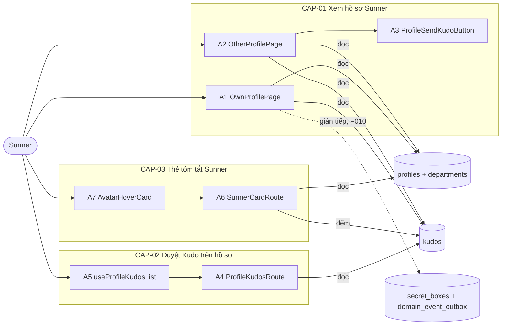
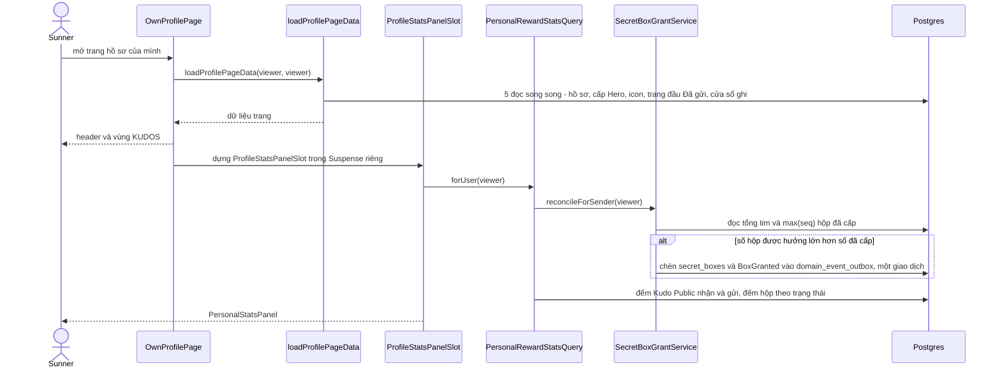
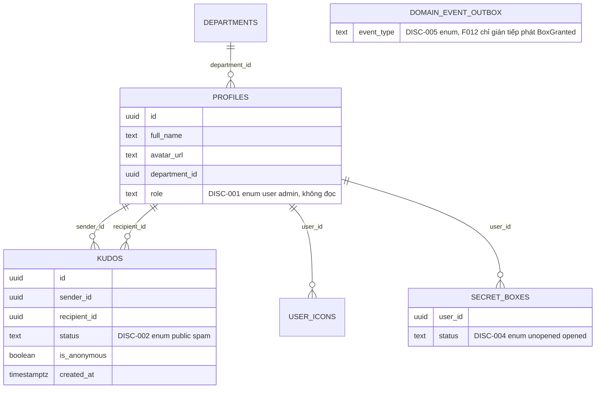
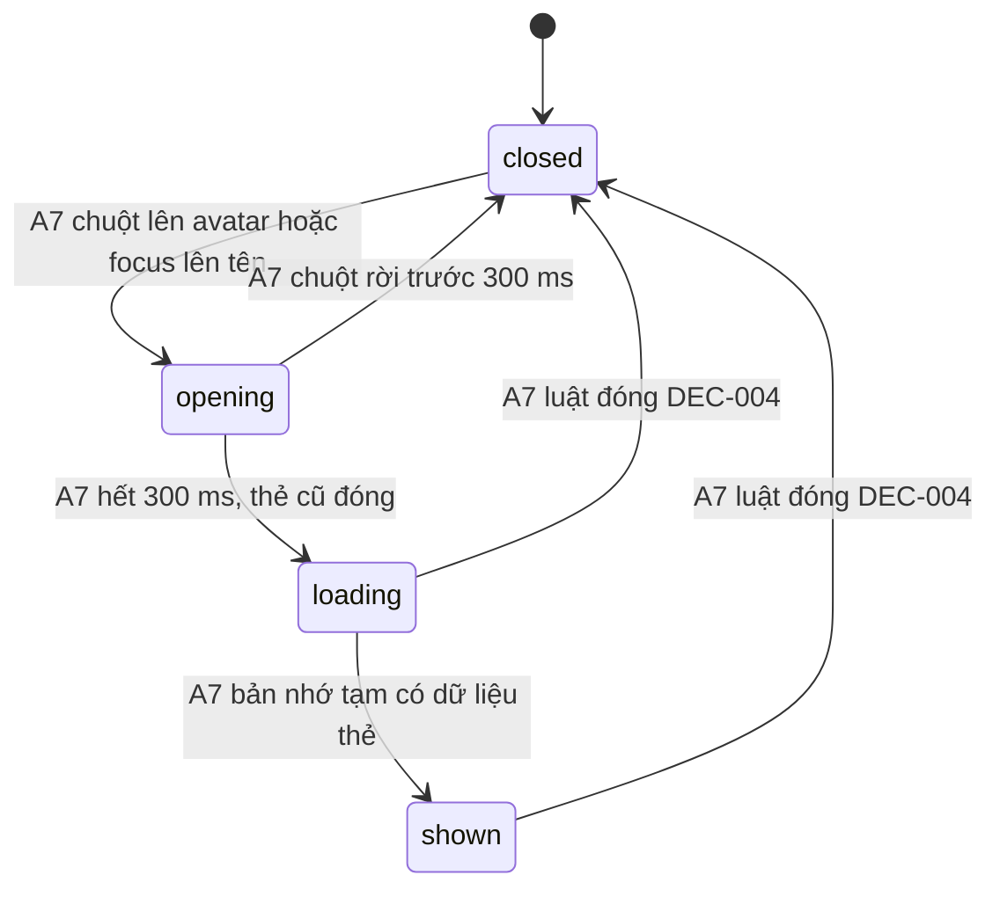
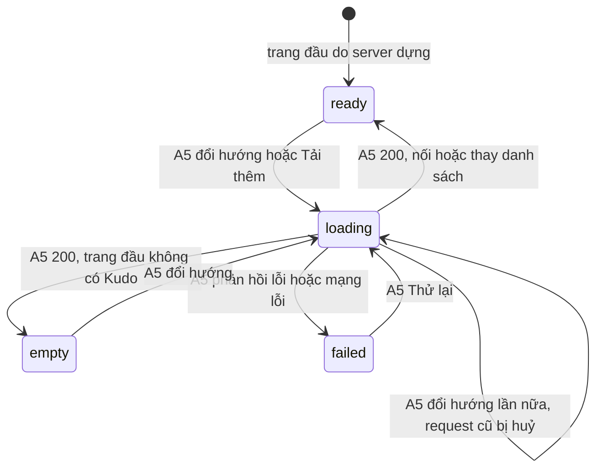

<!-- layout-exempt: rebuild-spec owns all docs/system|features|generated|flows paths — all references here are output targets or internal definitions -->
<!-- Contract: references/feature-spec-researcher-contract.md -->
<!-- Nửa Dev/QA/SA của cặp spec. Mọi code (FR/BR/SM/DEC/ALG) được PHÁT BIỂU một lần ở functional-spec.md và CÀI ĐẶT một lần ở đây. -->

# F012_Profile — Technical Spec

**Priority**: P2
**Type**: ui
**Generated**: 2026-11-24

**See also:** [`functional-spec.md`](./functional-spec.md) — plain-language overview, open
decisions, requirements/business rules stated in one-liners, screens, user stories, scenarios,
edge cases, and configuration for a BA/QA audience.

**How to read this file:** § 2 is the index — pick the action you care about and read its block
in § 3 straight through; each block is one complete thread, top to bottom. § 4 is the shared
appendix — jump in only when a § 3 block points you there.

## 1. Technical Overview

Feature hồ sơ Sunner gồm hai trang Server Component của Next.js App Router (`/profile`, `/profile/:userId`), hai Route Handler dữ liệu (danh sách Kudo của hồ sơ, thẻ tóm tắt) và các component client (vùng KUDOS, nút gửi lời cảm ơn, thẻ hover trên avatar). Trang đọc song song qua Drizzle trên Supabase Postgres; Drizzle chạy bằng vai trò server nên bỏ qua RLS, vì vậy mọi ràng buộc riêng tư nằm ở code (bộ lọc `profile-kudos-filter.ts`, bộ che người gửi của F004). Các khối nhúng thuộc feature khác (thẻ Kudo và `KudoPublicQuery` của F004, huy hiệu và `HeroTierQuery` của F009, icon và bảng thống kê của F010, form viết Kudo của F003) được gọi nguyên trạng, không đặc tả lại ở đây.



## 2. Action Index

| # | Action (handler) | Method · Path | Codes | Writes | Detail |
|---|---|---|---|---|---|
| **A0** | *cross-cutting — belongs to no single action* | — | FR-001, FR-002, FR-601 | — | § 4.4 |
| **A1** | `OwnProfilePage#default` | `GET` `/profile` | FR-101, FR-201, FR-202, FR-203, FR-603, BR-002, BR-003, BR-004, BR-005, BR-006, BR-010, DEC-007, ALG-001, US034 | `secret_boxes`, `domain_event_outbox` | § 3.1 ▸ **diagram** |
| **A2** | `OtherProfilePage#default` | `GET` `/profile/:userId` | FR-102, FR-103, FR-104, FR-301, FR-302, FR-303, FR-305, BR-001, BR-003, BR-004, BR-005, BR-006, BR-010, DEC-001, DEC-007, US034 | — *(read-only)* | § 3.1 |
| **A3** | `ProfileSendKudoButton#onClick` *(client only)* | — | FR-304, BR-009, BR-011, US034 | — *(client only)* | § 3.1 |
| **A4** | `ProfileKudosRoute#GET` | `GET` `/api/profile/:userId/kudos` | FR-205, FR-602, FR-603, FR-604, BR-001, BR-002, BR-003, BR-006, DEC-002, ALG-001, US041 | — *(read-only)* | § 3.2 |
| **A5** | `useProfileKudosList#fetchPage` *(client only)* | — | FR-204, FR-305, FR-401, FR-402, FR-405, FR-406, DEC-008, SM-002, US041 | — *(client only)* | § 3.2 |
| **A6** | `SunnerCardRoute#GET` | `GET` `/api/sunners/:userId/card` | FR-407, FR-605, BR-005, BR-007, BR-008, BR-009, US035 | — *(read-only)* | § 3.3 |
| **A7** | `AvatarHoverCard#openSoon` *(client only)* | — | FR-403, FR-404, FR-407, FR-408, BR-007, BR-009, BR-011, DEC-003, DEC-004, DEC-005, DEC-006, SM-001, ALG-002, US035 | — *(client only)* | § 3.3 |

**Rung set** theo template: Who → FE → Request → BE → Rule → Result → State → Source. Rung vắng thì bỏ hẳn. A1 là action duy nhất có `Writes`: ghi nằm trong đường đọc của F010 nhúng ở trang, không phải code của F012 (xem Result của A1).

## 3. Actions

### 3.1 CAP-01 — Xem hồ sơ Sunner

#### A1 · Dựng trang hồ sơ của chính mình
`GET /profile` → `` `OwnProfilePage#default` ``
`FR-101` `FR-201` `FR-202` `FR-203` `FR-603` `BR-002` `BR-003` `BR-004` `BR-005` `BR-006` `BR-010` `DEC-007` `ALG-001` `US034` · `SCR016_OwnProfile`

**Who** · Sunner đã đăng nhập, xem chính mình *(gate A0 — § 4.4)*
**FE** · Vào từ mục "Profile" của menu tài khoản (`account-menu.tsx:61`) và từ thông báo lên bậc Hero hoặc đủ bộ icon (`notification-view-mapper.ts:51-53`). Trang dựng `ProfilePageFrame` → `ProfileHeader` (avatar 200 px, tên `<h1>`, dòng "mã phòng ban · huy hiệu", hàng 6 icon với chú thích `iconCollectionOwn`) → `ProfileStatsPanelSlot` (Suspense riêng, `fallback={null}`) → `ProfileKudosSection own` mở bằng trang đầu của "Đã gửi". Trang khai `export const instant = false` (route chặn, như `/kudos/[id]`).
**Request** · không tham số; `userId` luôn lấy từ phiên qua `requireSunner()`, không nhận từ client *(FR-603)*
**BE** · `loadProfilePageData(userId, userId)` đọc song song 5 vùng: `ProfileQuery.getById`, `HeroTierQuery.getTiersByRecipientIds`, `IconCollectionQuery.forUser`, `listProfileKudos` (hướng `sent`), `isKudoWritingOpen`. Bảng thống kê đọc ở vùng riêng: `ProfileStatsPanelSlot` gọi `PersonalRewardStatsQuery.forUser(userId)`, lỗi đọc thì `stats = null` và panel tự hiện trạng thái lỗi. `profileKudosKey` đặt khoá để vùng KUDOS dựng lại khi trang đầu đổi.
**Rule** · quyết định ô nào của phần đầu trang được dựng:

| DEC | subtype | Condition | What the user sees | Source |
|---|---|---|---|---|
| **DEC-007** | render | `profile.department` hoặc `tier` có giá trị | hiện dòng "mã phòng ban · huy hiệu"; dấu chấm ngăn chỉ hiện khi có đủ cả hai; không có cả hai thì bỏ cả dòng | `profile-header.tsx:32-37` |
| **DEC-007** | render | `icons !== null` | hiện hàng 6 icon và chú thích; đọc icon lỗi thì bỏ cả khối, không dựng hàng rỗng | `profile-header.tsx:39-47`, `profile-page-data.ts:23-30` |
| **DEC-007** | render | trang của mình (`own`) | thêm bảng thống kê cá nhân giữa phần đầu và KUDOS; trang người khác không có | `page.tsx:32`, `profile-stats-panel-slot.tsx:24-30` |

- **BR-002 — "Đã gửi" chỉ có trên hồ sơ của mình và luôn lọc theo id phiên.** Trang gọi `listProfileKudos` với `direction = sent` và id phiên cho cả hai tham số; danh sách gồm Kudo Public cùng Kudo Spam của chính mình. *(§ 4.4)*
- **BR-003 — Người gửi ẩn danh luôn chỉ hiện biệt danh.** Thẻ đi qua bộ che của F004, kể cả trên "Đã gửi" của chính người gửi. *(§ 4.4)*
- **BR-004 — Bảng thống kê chỉ dựng trên hồ sơ của chính mình.** Id đọc từ phiên, không có đường truyền id khác vào. *(§ 4.4)*
- **BR-005 — Huy hiệu Hero chỉ dựng khi `HeroTierQuery` trả cấp.** Chưa có cấp thì bỏ phần huy hiệu. *(§ 4.4)*
- **BR-006 — Số trong dropdown bằng số thẻ phân trang ra.** Số đếm dùng đúng bộ lọc của danh sách. *(§ 4.4)*
- **BR-010 — Một vùng đọc lỗi chỉ làm mất vùng đó.** Cấp Hero, icon, trang đầu KUDOS lỗi thì vùng ấy dùng phương án dự phòng; hồ sơ lỗi thì cả trang lỗi. *(§ 4.4)*
- **ALG-001 — Kudo Spam của mình được trộn vào "Đã gửi" ngay trong SQL bằng một khoá phân trang duy nhất.** *(§ 4.5)*

**Result** · F012 không ghi DB, nhưng bước thống kê của F010 nhúng ở trang có thể ghi: `reconcileForSender` đối chiếu số hộp với tổng tim, nếu số hộp được hưởng lớn hơn số đã cấp thì chèn hàng vào `secret_boxes` và `BoxGranted` vào `domain_event_outbox` trong một giao dịch (idempotent, `on conflict do nothing`). Người dùng thấy header, icon, thống kê, trang đầu "Đã gửi". Không có hồ sơ cho user phiên thì `throw` (lỗi nội bộ; F001 luôn tạo hồ sơ ở lần đăng nhập đầu).
**Source:** `app/(app)/profile/page.tsx:23-36` → `features/profile/server/profile-page-data.ts:38-58` → `features/profile/components/profile-header.tsx:24-50` → `features/profile/components/profile-stats-panel-slot.tsx:13-30` → `features/secret-box-rewards/server/personal-reward-stats-query.ts:27-38` → `features/secret-box-rewards/server/secret-box-grant-service.ts:47-72`



---

#### A2 · Dựng trang hồ sơ của một Sunner khác
`GET /profile/:userId` → `` `OtherProfilePage#default` ``
`FR-102` `FR-103` `FR-104` `FR-301` `FR-302` `FR-303` `FR-305` `BR-001` `BR-003` `BR-004` `BR-005` `BR-006` `BR-010` `DEC-001` `DEC-007` `US034` · `SCR015_OtherProfile`

**Who** · Sunner đã đăng nhập, xem đồng nghiệp *(gate A0 — § 4.4)*
**FE** · Vào từ tên hoặc avatar trên thẻ Kudo (`kudo-card-sender.tsx:27-49`), kết quả ô tìm Sunner (`sunner-profile-search.tsx:25`), tên trong đám mây Spotlight (`spotlight-name-cloud.tsx:46`) và tên trong thẻ tóm tắt (`sunner-card-content.tsx:75-80`). Trang dựng `ProfileHeader` (chú thích `iconCollectionOther`, cùng quy tắc ô của DEC-007 như A1), `ProfileSendKudoButton` (A3) và `ProfileKudosSection own={false}` (nhãn "Đã nhận: n Kudos", không dropdown). Không dựng `ProfileStatsPanelSlot`. Trang khai `instant = false`.
**Request** · path param `userId` *(Promise của Next `params`; kiểm uuid trong `loadProfilePageData`, sai định dạng trả `null`)*
**BE** · so `userId` với id phiên; khác thì `loadProfilePageData(viewerId, userId)` với hướng `received`, cùng 5 vùng đọc như A1 nhưng không có thống kê; `ProfileQuery.getById` được `cache()` nên trang và `listProfileKudos` dùng chung một lần đọc.
**Rule** · quyết định trang nào dựng cho địa chỉ này:

| DEC | subtype | Condition | What the user sees | Source |
|---|---|---|---|---|
| **DEC-001** | flow | `userId === viewerId` | chuyển hướng về `/profile`; mọi liên kết tới hồ sơ của mình đều đi qua đây nên chỉ có một trang "của mình" | `page.tsx:33` |
| **DEC-001** | flow | `userId` sai định dạng uuid hoặc không có hồ sơ | `notFound()` → trang "Không tìm thấy Sunner này." kèm nút về Live board | `page.tsx:35`, `profile-page-data.ts:39`, `profile-page-data.ts:50`, `not-found.tsx:11-25` |
| **DEC-001** | render | `userId !== viewerId` và có hồ sơ | trang người khác, không bảng thống kê | `page.tsx:37-43` |

- **BR-001 — "Đã nhận" chỉ gồm Kudo Public.** Trang đầu của KUDOS đọc qua `KudoPublicQuery` với bộ lọc người nhận. *(§ 4.4)*
- **BR-003 — Người gửi ẩn danh luôn chỉ hiện biệt danh.** *(§ 4.4)*
- **BR-004 — Bảng thống kê chỉ dựng trên hồ sơ của chính mình.** Trang này không dựng nó. *(§ 4.4)*
- **BR-005 — Huy hiệu Hero chỉ dựng khi có cấp.** *(§ 4.4)*
- **BR-006 — Nhãn "Đã nhận: n" bằng số thẻ Public người đó nhận.** *(§ 4.4)*
- **BR-010 — Cấp Hero, icon hoặc trang đầu KUDOS đọc lỗi thì chỉ vùng đó rơi về dự phòng.** *(§ 4.4)*
- **DEC-007 — Phần đầu trang** dùng chung component với A1, quy tắc ô như bảng DEC-007 ở A1 (§ 3.1).

**Result** · read-only — không ghi DB. Người dùng thấy header, icon (6 ô, ô sở hữu nhiều hơn một hiện "×N"), nút gửi lời cảm ơn, nhãn và trang đầu "Đã nhận". Sau khi shell đã stream ở production, `redirect()` chạy phía client và 404 là 404 mềm (ghi chú trong `page.tsx:17-21`); nội dung như nhau.
**Source:** `app/(app)/profile/[userId]/page.tsx:30-44` → `features/profile/server/profile-page-data.ts:38-58` → `features/profile/server/profile-query.ts:17-36` → `features/profile/components/profile-header.tsx:24-50` → `features/secret-box-rewards/components/icon-collection.tsx:20-48`

<!-- Không có diagram: dưới ngưỡng (chỉ đọc, không ghi bảng nào, đồng bộ; bảng DEC-001 là bảng phân nhánh song song, vẽ thành sơ đồ trình tự sẽ khó đọc hơn). -->

---

#### A3 · Mở form viết Kudo với người nhận điền sẵn và khoá *(client only)*
`—` → `` `ProfileSendKudoButton#onClick` ``
`FR-304` `BR-009` `BR-011` `US034` · `SCR015_OtherProfile`

**Who** · Sunner đã đăng nhập, đang xem hồ sơ đồng nghiệp *(gate A0 — § 4.4)*
**FE** · Nút pill 680×72 "Gửi lời cảm ơn và ghi nhận tới {tên}" (`profile-send-kudo-button.tsx:30-42`). Bấm lần đầu thì mount `LockedRecipientComposer` (cổng `document.body`), các lần sau chỉ đổi `open`. Hết cửa sổ ghi thì nút `disabled` và dòng thông báo `kudosComposer.errors.WRITING_CLOSED` gắn `aria-describedby`.
**Rule**
- **BR-009 — Nút gửi chỉ bật trong cửa sổ ghi Kudo.** `writingOpen` đến từ `isKudoWritingOpen()` (`LAUNCH_AT ≤ now < EVENT_END_AT`), truyền xuống từ trang. *(§ 4.4)*
- **BR-011 — Form mở với người nhận điền sẵn và khoá; đóng form thì không có Kudo nào được gửi.** Composer chạy chế độ `create`, `lockRecipient`, người nhận chỉ mang `id` và tên (email để rỗng, avatar `null`), nên hồ sơ không cần email của người nhận. *(§ 4.4)*
**Result** · không có gọi server của feature này; việc ghi do `createKudo` của F003 làm. Khi lưu xong, `onSaved` gọi `invalidateSunnerCard(recipient.id)` để thẻ của người nhận tải lại số đếm ở lần mở kế (ALG-002).
**Source:** `features/profile/components/profile-send-kudo-button.tsx:21-51` → `features/profile/components/locked-recipient-composer.tsx:22-35`

<!-- Không có diagram: thuần client, không gọi server, không ghi bảng. -->

---

### 3.2 CAP-02 — Duyệt Kudo trên hồ sơ

#### A4 · Lấy một trang Kudo cho vùng KUDOS của hồ sơ
`GET /api/profile/:userId/kudos` → `` `ProfileKudosRoute#GET` ``
`FR-205` `FR-602` `FR-603` `FR-604` `BR-001` `BR-002` `BR-003` `BR-006` `DEC-002` `ALG-001` `US041` · `SCR015_OtherProfile` · `SCR016_OwnProfile` · `ROUTE014`

**Who** · Sunner đã đăng nhập; "Đã gửi" chỉ cho chủ hồ sơ *(gate A0 — § 4.4)*
**Request** · path `userId` *(uuid)*; query `direction` *(`received` mặc định | `sent`)*, `cursor` *(chuỗi mờ ≤ 200 ký tự, giải mã chặt; vắng = trang đầu)*. Khoá có mặt nhưng rỗng hoặc hỏng thì 400 VALIDATION `{ fieldErrors }` trước mọi lần đọc; khoá lạ bị bỏ qua nên không request nào nêu được người gửi.
**BE** · `requireApiSunner()` → `parseProfileKudosParams` → kiểm uuid của `userId` → `listProfileKudos({ viewerId, profileUserId, direction, cursor, locale })`: dựng bộ lọc bằng `profileKudosFilter` (từ chối `sent` của người khác trước mọi lần đọc), rồi song song `ProfileQuery.getById` (bỏ qua nếu xem chính mình), `KudoPublicQuery.list` (10 thẻ, `(created_at, id)` giảm dần) và `ProfileKudoCountsQuery.forProfile`. Thứ tự trả lỗi: 401 → 403 ONBOARDING_REQUIRED → 400 → 404 (id sai định dạng) → 403 FORBIDDEN → 404 (không có hồ sơ) → 200; lỗi lạ 500 UNEXPECTED.
**Rule** · quyết định danh sách dựng theo hướng và chủ hồ sơ:

| DEC | subtype | Condition | What the user sees | Source |
|---|---|---|---|---|
| **DEC-002** | render | `direction = received` | các Kudo Public mà `userId` nhận, người gửi ẩn danh bị che | `profile-kudos-filter.ts:16`, `profile-kudos-filter.ts:23-25` |
| **DEC-002** | render | `direction = sent` và `userId === viewerId` | Kudo Public mình gửi trộn Kudo Spam của mình; thẻ spam mang `isSpam` (lớp mờ và tag "Spam") | `profile-kudos-filter.ts:19-21`, `kudo-public-query.ts:53-55` |
| **DEC-002** | flow | `direction = sent` và `userId !== viewerId` | 403 FORBIDDEN, không trả dữ liệu, cũng không dò được hồ sơ có tồn tại hay không | `profile-kudos-filter.ts:19-21`, `profile-kudos-list-service.ts:30-31`, `route.ts:42` |

- **BR-001 — "Đã nhận" chỉ gồm Kudo Public.** Mọi đọc đi qua `KudoPublicQuery`, nền `status = 'public'`; hướng `received` không có `senderId` nên `includeOwnSpam` không bao giờ được nhận. *(§ 4.4)*
- **BR-002 — "Đã gửi" chỉ phục vụ chủ hồ sơ; bộ lọc người gửi không bao giờ nhận id từ client.** `senderId` lấy từ phiên; lọc theo người gửi của người khác sẽ lộ người gửi ẩn danh bằng phép trừ tập, nên bị chặn. *(§ 4.4)*
- **BR-003 — Kudo ẩn danh luôn trả thẻ đã che người gửi.** `maskKudoRow` chỉ trả `{ anonymous, nickname }`, kể cả trên "Đã gửi" của chính người gửi. *(§ 4.4)*
- **BR-006 — `counts` dùng cùng điều kiện với danh sách.** `received` = số Kudo Public nhận; `sent` (chỉ ở hồ sơ của mình) = Public gửi + Spam của mình. *(§ 4.4)*
- **ALG-001 — Spam của mình trộn vào "Đã gửi" trong SQL, cùng một khoá `(created_at, id)`.** *(§ 4.5)*

**Result** · read-only — không ghi DB. Trả `{ items: KudoCardView[], nextCursor?, counts: { received, sent? } }` kèm `Cache-Control: private, no-store` trên mọi phản hồi. Lỗi bắt được thì log `[profile] listing profile kudos failed`; thân lỗi chỉ có `{ code }`.
**Source:** `app/api/profile/[userId]/kudos/route.ts:19-49` → `features/profile/schemas/profile-kudos-request-schema.ts:11-16` → `features/profile/server/profile-kudos-list-service.ts:29-39` → `features/profile/lib/profile-kudos-filter.ts:12-38` → `features/kudos-feed/server/kudo-public-query.ts:51-82` → `features/profile/server/profile-kudo-counts-query.ts:13-20`

<!-- Không có diagram: dưới ngưỡng (chỉ đọc, đồng bộ, không ghi bảng nào). Thứ tự trả lỗi đã nằm trong rung BE; phần phân nhánh thật nằm ở bảng DEC-002. -->

---

#### A5 · Đổi hướng, tải thêm và thử lại danh sách Kudo trên trình duyệt *(client only)*
`—` → `` `useProfileKudosList#fetchPage` ``
`FR-204` `FR-305` `FR-401` `FR-402` `FR-405` `FR-406` `DEC-008` `SM-002` `US041` · `SCR015_OtherProfile` · `SCR016_OwnProfile`

**Who** · Sunner đã đăng nhập, đang ở vùng KUDOS của một hồ sơ *(gate A0 — § 4.4)*
**FE** · `ProfileKudosSection` dùng `useProfileKudosList` với hướng đầu `sent` (hồ sơ của mình) hoặc `received`; trang đầu do server đã dựng (`initial`). Dropdown `ProfileKudosDirectionDropdown` chỉ có ở hồ sơ của mình: nút mang tên danh sách hiện tại kèm số, danh sách `listbox` mở ra với focus vào mục hiện tại, ↑/↓/Home/End di chuyển, Enter/Space chọn, Tab đóng và đi tiếp, Esc hoặc bấm ngoài đóng. "Tải thêm" nối trang kế, chuyển focus vào thẻ đầu của trang vừa nối và đọc `loaded` qua vùng `role="status"`.
**Request** · `fetch` `GET /api/profile/{id}/kudos?direction=&cursor=` (A4) với `AbortController`: request mới huỷ request đang bay, nên sau khi đổi hướng liên tiếp chỉ lựa chọn cuối được hiện. `loadMore` bị bỏ qua khi đang có request hoặc hết cursor.
**Rule** · quyết định phần nào của vùng KUDOS hiện theo trạng thái nạp:

| DEC | subtype | Condition | What the user sees | Source |
|---|---|---|---|---|
| **DEC-008** | render | `counts` có, `own`, `counts.sent !== undefined` | dropdown "Đã gửi (n)" / "Đã nhận (n)" ở đầu vùng | `profile-kudos-section.tsx:56-58` |
| **DEC-008** | render | `counts` có, không phải `own` | nhãn "Đã nhận: n Kudos", không dropdown | `profile-kudos-section.tsx:59` |
| **DEC-008** | render | `failure` và không `pending` | khối cảnh báo; lỗi thường có "Thử lại", 401 có liên kết "Đăng nhập lại" quay về đúng trang hồ sơ | `profile-kudos-section.tsx:65`, `kudo-feed-status-message.tsx:22-48` |
| **DEC-008** | render | `pending` và chưa `loaded` | dòng "Đang tải Kudos…" | `profile-kudos-section.tsx:66` |
| **DEC-008** | render | không `failure`, đã `loaded`, `items.length === 0` | "Chưa có Kudo nào." và không có nút "Tải thêm" | `profile-kudos-section.tsx:67` |
| **DEC-008** | render | có `cursor`, đã `loaded`, (không `failure` hoặc đang `pending`) | nút "Tải thêm" (`aria-disabled` khi đang nạp); hết cursor thì biến mất | `profile-kudos-section.tsx:68-79` |

Phản hồi 400 khi đang có `cursor` làm xoá danh sách và `loaded = false`, nên "Thử lại" kế tiếp nạp lại từ trang đầu; mọi 401 hiện trạng thái hết phiên.
**Result** · read-only phía server; trạng thái cục bộ cập nhật `items`, `cursor`, `counts` theo từng phản hồi (số đếm đi theo mọi câu trả lời). Vùng KUDOS dựng lại hẳn (khoá `profileKudosKey`) khi một lần làm mới trang đưa về trang đầu khác, ví dụ sau khi gửi Kudo từ thẻ tóm tắt.
**State** · `SM-002`: `ready` → `loading` → `ready` | `empty` | `failed` *(§ 4.3)*
**Source:** `features/profile/components/use-profile-kudos-list.ts:22-95` → `features/profile/components/profile-kudos-section.tsx:30-86` → `features/profile/components/profile-kudos-direction-dropdown.tsx:27-108` → `features/kudos-feed/components/kudo-feed-status-message.tsx:22-52`

<!-- Không có diagram: dưới ngưỡng (client thuần, không ghi bảng nào); nội dung chính là bảng DEC-008 và máy trạng thái SM-002 ở § 4.3. -->

---

### 3.3 CAP-03 — Thẻ tóm tắt Sunner

#### A6 · Lấy dữ liệu thẻ tóm tắt của một Sunner
`GET /api/sunners/:userId/card` → `` `SunnerCardRoute#GET` ``
`FR-407` `FR-605` `BR-005` `BR-007` `BR-008` `BR-009` `US035` · `SCR015_OtherProfile` · `SCR016_OwnProfile` · `ROUTE019`

**Who** · Sunner đã đăng nhập, rê chuột hoặc đặt focus lên người có tên trên thẻ Kudo *(gate A0 — § 4.4)*
**Request** · path `userId`; route không tự kiểm uuid, `ProfileQuery.getById` kiểm và trả `null` cho id sai định dạng.
**BE** · `requireApiSunner()` → `getSunnerCard(viewerId, userId, locale)`: đọc `ProfileQuery.getById`, rồi song song `HeroTierQuery.getTiersByRecipientIds([userId])`, `ProfileKudoCountsQuery.forSunnerCard`, `isKudoWritingOpen`. Đối tượng trả về được dựng từng trường một, không trải hàng nguồn. 404 NOT_FOUND khi `null`; 500 UNEXPECTED khi throw.
**Rule**
- **BR-005 — Huy hiệu Hero chỉ có khi có cấp.** `heroTier = tiers[userId] ?? null`. *(§ 4.4)*
- **BR-007 — Chỉ Sunner thật có thẻ; dữ liệu thẻ không gắn với Kudo nào.** Thẻ là về một người, không có Kudo hay người gửi, nên không suy ra được người gửi ẩn danh từ thẻ. *(§ 4.4)*
- **BR-009 — "Gửi KUDO" chỉ có khi cửa sổ ghi còn mở.** `canSendKudo = writingOpen && userId !== viewerId`: thẻ của chính mình không có nút. *(§ 4.4)*
- **BR-008 — Số đếm trên thẻ: nhận = Kudo Public nhận; gửi = Kudo Public gửi không tính Spam; với người khác thì bỏ cả Kudo ẩn danh.** `forSunnerCard` gọi `KudoPublicQuery.count` hai lần (`recipientId`, `senderId`); bộ lọc người gửi đi qua chốt C-05 (`is_anonymous = false` hoặc người gửi là người xem) nên Kudo ẩn danh của người khác không vào số và số không nhúc nhích khi họ gửi ẩn danh; trên thẻ của chính mình, Kudo Public ẩn danh của mình vẫn được đếm, cùng cách đếm với bảng thống kê của F010 (quyết định 2026-11-23). **Source:** `features/profile/server/profile-kudo-counts-query.ts:22-34`, `features/kudos-feed/server/kudo-public-query.ts:51-62`
**Result** · read-only — không ghi DB. Trả đúng 7 trường `{ id, fullName, departmentName, heroTier, kudosReceived, kudosSent, canSendKudo }` (FR-605: không email, role, avatar, Kudo hay dữ liệu người gửi), `departmentName` theo ngôn ngữ yêu cầu; `Cache-Control: private, no-store` trên mọi phản hồi.
**Source:** `app/api/sunners/[userId]/card/route.ts:15-33` → `features/profile/server/sunner-card-query.ts:16-33` → `features/profile/server/profile-kudo-counts-query.ts:28-34` → `features/profile/schemas/profile-views.ts:35-43`

<!-- Không có diagram: dưới ngưỡng (chỉ đọc, đồng bộ, không ghi bảng nào). -->

---

#### A7 · Mở, đóng và điều khiển thẻ tóm tắt trên avatar *(client only)*
`—` → `` `AvatarHoverCard#openSoon` ``
`FR-403` `FR-404` `FR-407` `FR-408` `BR-007` `BR-009` `BR-011` `DEC-003` `DEC-004` `DEC-005` `DEC-006` `SM-001` `ALG-002` `US035` · `SCR015_OtherProfile` · `SCR016_OwnProfile`

**Who** · Sunner đã đăng nhập; chuột hoặc bàn phím, không phải cảm ứng *(gate A0 — § 4.4)*
**FE** · `NamedPerson` của thẻ Kudo bọc avatar và khối tên bằng `AvatarHoverCard` (`kudo-card-sender.tsx:27-49`); `AnonymousSender` không bao giờ được bọc (`kudo-card-sender.tsx:52-65`). Avatar giữ vai trò cũ: liên kết chỉ dành cho con trỏ (`aria-hidden`, `tabIndex=-1`), viền đổi vàng khi hover hoặc khi thẻ mở; liên kết tên mang `data-hover-card-name` và là điểm Tab duy nhất của mỗi người. Thẻ là `role="dialog"` không modal, `position: fixed` trong cổng `document.body`, đặt chỗ trước khi vẽ bằng `placeHeroTooltip` của F009 và đặt lại khi cuộn hoặc đổi cỡ cửa sổ. `canSendKudo` bật nút "Gửi KUDO", bấm thì mở `LockedRecipientComposer` (A3).
**Request** · `fetch` `GET /api/sunners/{userId}/card` (A6) qua `refreshSunnerCard`, chỉ khi trang này chưa giữ bản mới hơn 60 giây; các lần mở đồng thời dùng chung một request.
**Rule** · quyết định avatar nào có thẻ, khi nào đóng, Tab đi đâu và thẻ hiện gì:

| DEC | subtype | Condition | What the user sees | Source |
|---|---|---|---|---|
| **DEC-003** | interaction | người có tên (người nhận, hoặc người gửi không ẩn danh), `enabled`, con trỏ không phải cảm ứng | rê chuột lên avatar, hoặc focus bàn phím (`:focus-visible`) lên tên, đủ 300 ms thì mở thẻ | `avatar-hover-card.tsx:90-97`, `avatar-hover-card.tsx:108-111`, `avatar-hover-card.tsx:127-128` |
| **DEC-003** | interaction | người gửi ẩn danh | không bọc, không có thẻ, không gọi A6 | `kudo-card-sender.tsx:52-65`, `kudo-card-sender.tsx:76` |
| **DEC-003** | interaction | Kudo Spam của chính mình (dưới lớp mờ, `enabled = false`) | chỉ còn liên kết avatar thường, không thẻ | `avatar-hover-card.tsx:134-141`, `kudo-card-sender.tsx:30` |
| **DEC-003** | interaction | con trỏ cảm ứng | chạm avatar chỉ là liên kết tới hồ sơ, thẻ không mở | `avatar-hover-card.tsx:34`, `avatar-hover-card.tsx:127-128` |
| **DEC-004** | interaction | chuột rời khối người và thẻ, focus không nằm trong thẻ | đóng sau 150 ms; chuột kịp di vào thẻ thì giữ mở | `avatar-hover-card.tsx:98-107` |
| **DEC-004** | interaction | nhấn Esc | đóng; focus đang ở trong thẻ thì trả về tên, đang ở tên thì thẻ giữ đóng tới khi focus rời tên | `avatar-hover-card.tsx:71-77`, `use-hover-card-keyboard.ts:50-57` |
| **DEC-004** | interaction | nhấn chuột ngoài khối người và thẻ, hoặc focus rời cả tên lẫn thẻ | đóng | `avatar-hover-card.tsx:78-81`, `use-hover-card-keyboard.ts:78-87` |
| **DEC-004** | interaction | một thẻ khác sắp mở | thẻ đang mở đóng ngay; mỗi lúc chỉ một thẻ trên trang | `avatar-hover-card.tsx:21`, `avatar-hover-card.tsx:93-94` |
| **DEC-005** | interaction | Tab trên tên khi thẻ đang hiện | focus vào điều khiển đầu tiên của thẻ (thẻ nằm trong cổng nên phải bắc cầu tay) | `use-hover-card-keyboard.ts:59-66` |
| **DEC-005** | interaction | Shift+Tab trên điều khiển đầu của thẻ | focus về tên | `use-hover-card-keyboard.ts:67` |
| **DEC-005** | interaction | Tab trên điều khiển cuối của thẻ | thẻ đóng, focus sang phần tử sau tên | `use-hover-card-keyboard.ts:68-72` |
| **DEC-006** | render | luôn | tên (liên kết tới hồ sơ) và hai số "Số Kudos nhận được" / "Số Kudos đã gửi" | `sunner-card-content.tsx:75-80`, `sunner-card-content.tsx:87-90` |
| **DEC-006** | render | `departmentName` có | dòng "Tên đơn vị: …", tối đa 3 dòng | `sunner-card-content.tsx:81-83` |
| **DEC-006** | render | `heroTier` có | huy hiệu Hero cỡ thẻ (không có cấp thì không có gì) | `sunner-card-content.tsx:84` |
| **DEC-006** | render | `canSendKudo` | nút "Gửi KUDO" toàn chiều rộng; không có trên thẻ của chính mình hay sau khi hết cửa sổ ghi | `sunner-card-content.tsx:91-100` |

- **BR-007 — Chỉ Sunner thật có thẻ.** Host không bao giờ bọc người gửi ẩn danh; thẻ chỉ mở từ avatar mà thẻ Kudo đã hiển thị danh tính. *(§ 4.4)*
- **BR-009 — "Gửi KUDO" chỉ có khi `canSendKudo`.** Giá trị đến từ A6 và đóng băng trong bản nhớ tạm tối đa 60 giây. *(§ 4.4)*
- **BR-011 — "Gửi KUDO" mở form với người nhận điền sẵn và khoá.** Trước khi mở, thẻ trả focus về tên để form trả focus lại đó khi đóng. *(§ 4.4)*
- **ALG-002 — Dữ liệu thẻ được nhớ theo trang 60 giây** (dùng bản cũ trong lúc làm mới, chia sẻ request đang bay, bỏ bản bị vô hiệu). *(§ 4.5)*

**Result** · read-only phía server. Cục bộ: thẻ chỉ hiện khi đã có dữ liệu; tải lỗi thì không hiện thẻ nào (không bao giờ có thẻ rỗng) và lần mở sau gọi lại. Gửi Kudo xong từ thẻ thì `invalidateSunnerCard` bỏ bản của người đó.
**State** · `SM-001`: `closed` → `opening` → `loading` → `shown` → `closed` *(§ 4.3)*
**Source:** `features/profile/components/avatar-hover-card.tsx:47-172` → `features/profile/components/use-sunner-card.ts:12-30` → `features/profile/lib/sunner-card-cache.ts:24-59` → `features/profile/components/use-hover-card-keyboard.ts:37-90` → `features/profile/components/sunner-card-content.tsx:41-103`

<!-- Không có diagram: dưới ngưỡng (client thuần, không ghi bảng nào); nội dung là các bảng DEC-003..006 và SM-001, vẽ thành sơ đồ trình tự chỉ ép các điều kiện song song thành một chuỗi giả. -->

---

### 3.4 Edge cases

| Action | Scenario | Behavior |
|---|---|---|
| A2 | `userId` là chính mình | chuyển hướng về `/profile` (DEC-001) |
| A2 | `userId` sai định dạng uuid hoặc không có hồ sơ | `notFound()`, trang "Không tìm thấy Sunner này." (DEC-001); không phân biệt hai trường hợp |
| A1 · A2 | Hồ sơ chưa có phòng ban (`department_id` null) hoặc chưa có cấp Hero | bỏ phần thiếu, không để ô trống (DEC-007) |
| A1 · A2 | Đọc cấp Hero, icon hoặc trang đầu KUDOS lỗi | vùng đó rơi về dự phòng (bỏ huy hiệu, bỏ hàng icon, khối lỗi có "Thử lại"); đọc hồ sơ lỗi thì cả trang lỗi (BR-010) |
| A1 | Đọc bảng thống kê lỗi | panel tự hiện trạng thái lỗi, phần còn lại không đổi (`stats = null`) |
| A4 | `direction = sent` với `userId` không phải mình | 403 FORBIDDEN trước mọi lần đọc, kể cả khi `userId` không tồn tại (DEC-002) |
| A4 | `direction` ngoài `received\|sent`, hoặc `cursor` rỗng/hỏng/dài quá 200 ký tự | 400 VALIDATION `{ fieldErrors }`, client về trang đầu ở lần thử lại |
| A4 | `userId` không phải uuid | 404 NOT_FOUND (sau bước kiểm tham số) |
| A4 | Kudo bị Spam hoặc Un Spam giữa hai lần gọi | lần gọi sau phản ánh trạng thái mới; khoá `(created_at, id)` giữ cursor ổn định, không trùng không sót (ALG-001) |
| A4 | Hai Kudo cùng `created_at` ở ranh giới trang | `id` phá hoà, mỗi Kudo xuất hiện đúng một lần (ALG-001) |
| A4 · A6 | Kudo ẩn danh của chính mình trong "Đã gửi" | thẻ vẫn che người gửi, `isOwner` giữ nút sửa (BR-003) |
| A5 | Đổi dropdown nhanh liên tiếp | request cũ bị huỷ, chỉ kết quả cuối được hiện |
| A5 | Bấm "Tải thêm" khi đang nạp | bỏ qua |
| A5 | 400 khi nạp trang kế (cursor bị từ chối) | danh sách bị xoá, "Thử lại" nạp lại từ trang đầu |
| A5 | 401 khi nạp | khối "Phiên đăng nhập đã hết hạn" kèm liên kết đăng nhập quay về đúng hồ sơ |
| A6 | `userId` không có hồ sơ hoặc sai định dạng | 404 NOT_FOUND; client không hiện thẻ |
| A6 | Thẻ của chính mình | có số đếm, không có "Gửi KUDO" (BR-009) |
| A7 | Chạm trên màn cảm ứng | không thẻ; avatar là liên kết tới hồ sơ |
| A7 | Tải dữ liệu thẻ lỗi | không hiện thẻ; bấm avatar vẫn mở hồ sơ; lần mở sau thử lại |
| A7 | Chuyển trang (đổi `pathname`) | bản nhớ tạm xoá hết (ALG-002) |
| A1-A7 | Chưa đăng nhập | trang: chuyển về `/login?next=…`; dữ liệu: 401 JSON (A0, § 4.4) |
| A1-A7 | Trước giờ mở (prelaunch) | trang bị chặn, dữ liệu 403 JSON `{ code: "prelaunch" }` với người không phải admin (A0, § 4.4) |

## 4. Shared Foundation

### 4.1 Components

| Component | Responsibility | Used in | File |
|---|---|---|---|
| `OwnProfilePage` | Server Component trang `/profile` | A1 | `app/(app)/profile/page.tsx` |
| `OtherProfilePage` | Server Component trang `/profile/:userId`, quyết định DEC-001 | A2 | `app/(app)/profile/[userId]/page.tsx` |
| `SunnerNotFound` | trang 404 của `/profile/:userId` | A2 | `app/(app)/profile/[userId]/not-found.tsx` |
| `ProfilePageFrame` | khung trang: nền keyvisual, cột 680 px | A1, A2 | `features/profile/components/profile-page-frame.tsx` |
| `ProfileHeader` | avatar, tên, mã phòng ban, huy hiệu, hàng icon | A1, A2 | `features/profile/components/profile-header.tsx` |
| `ProfileStatsPanelSlot` | bọc Suspense, đọc thống kê của phiên | A1 | `features/profile/components/profile-stats-panel-slot.tsx` |
| `loadProfilePageData` | đọc song song 5 vùng của trang, `profileKudosKey` | A1, A2 | `features/profile/server/profile-page-data.ts` |
| `ProfileQuery` | hồ sơ nối phòng ban, cột tường minh, `cache()` | A1, A2, A4, A6 | `features/profile/server/profile-query.ts` |
| `listProfileKudos` | một trang Kudo + counts, từ chối `sent` của người khác | A1, A2, A4 | `features/profile/server/profile-kudos-list-service.ts` |
| `profileKudosFilter`, `profileCountFilters` | bộ lọc của danh sách và của số đếm, thuần | A1, A2, A4 | `features/profile/lib/profile-kudos-filter.ts` |
| `ProfileKudoCountsQuery` | số đếm hồ sơ và số đếm thẻ qua `KudoPublicQuery.count` | A1, A2, A4, A6 | `features/profile/server/profile-kudo-counts-query.ts` |
| `parseProfileKudosParams` | Zod: `direction`, `cursor` | A4 | `features/profile/schemas/profile-kudos-request-schema.ts` |
| `ProfileKudosRoute` | Route Handler danh sách Kudo | A4 | `app/api/profile/[userId]/kudos/route.ts` |
| `ProfileKudosSection` | vùng KUDOS: header, danh sách thẻ, trạng thái | A5 | `features/profile/components/profile-kudos-section.tsx` |
| `ProfileKudosDirectionDropdown` | dropdown "Đã gửi" / "Đã nhận" có bàn phím | A5 | `features/profile/components/profile-kudos-direction-dropdown.tsx` |
| `useProfileKudosList` | trạng thái danh sách, huỷ request cũ, tải thêm, thử lại | A5 | `features/profile/components/use-profile-kudos-list.ts` |
| `ProfileSendKudoButton` | nút pill mở form | A3 | `features/profile/components/profile-send-kudo-button.tsx` |
| `LockedRecipientComposer` | form F003 chế độ tạo, người nhận khoá | A3, A7 | `features/profile/components/locked-recipient-composer.tsx` |
| `getSunnerCard` | dựng đối tượng thẻ từng trường một | A6 | `features/profile/server/sunner-card-query.ts` |
| `SunnerCardRoute` | Route Handler thẻ tóm tắt | A6 | `app/api/sunners/[userId]/card/route.ts` |
| `AvatarHoverCard` | bọc avatar, mở/đóng thẻ, một thẻ mỗi lúc | A7 | `features/profile/components/avatar-hover-card.tsx` |
| `SunnerCardContent` | nội dung và vị trí thẻ | A7 | `features/profile/components/sunner-card-content.tsx` |
| `useHoverCardKeyboard` | cầu Tab, trả focus, `aria-expanded` | A7 | `features/profile/components/use-hover-card-keyboard.ts` |
| `useSunnerCard`, `sunner-card-cache` | bản nhớ tạm theo trang, TTL, vô hiệu | A3, A7 | `features/profile/components/use-sunner-card.ts`, `features/profile/lib/sunner-card-cache.ts` |
| `profile-views` | DTO an toàn cho client (không email, role) | A1-A7 | `features/profile/schemas/profile-views.ts` |
| `KudoCard`, `KudoPublicQuery`, `maskKudoRow` *(F004)* | thẻ Kudo, đọc Public, che người gửi | A1, A2, A4, A5 | `features/kudos-feed/server/kudo-public-query.ts`, `features/kudos-feed/server/kudo-row-mask.ts` |
| `HeroBadge`, `HeroTierQuery` *(F009)* | huy hiệu và cấp tính khi đọc | A1, A2, A6, A7 | `features/hero-badges/server/hero-tier-query.ts` |
| `IconCollection`, `IconCollectionQuery`, `PersonalStatsPanel`, `PersonalRewardStatsQuery` *(F010)* | icon và thống kê | A1, A2 | `features/secret-box-rewards/server/personal-reward-stats-query.ts` |
| `KudoComposerModal`, `requireApiSunner`, `isKudoWritingOpen` *(F003)* | form viết Kudo, cổng phiên cho route dữ liệu, cửa sổ ghi | A3, A4, A6 | `features/kudos-authoring/server/require-api-sunner.ts` |

### 4.2 Data Model



| Entity | Table | Used for | Action |
|---|---|---|---|
| Profile (MODEL004) | `profiles` | tên, avatar, phòng ban của người được xem; chỉ chọn cột tường minh (`id`, `full_name`, `avatar_url`, `department_id`) | A1, A2, A4, A6 |
| Department (MODEL001) | `departments` | mã và tên phòng ban theo ngôn ngữ (`name_vi` / `name_en`) | A1, A2, A6 |
| Kudo (MODEL003) | `kudos` | danh sách và số đếm (Public, và Spam của chính người gửi), cấp Hero (đếm người gửi khác nhau), số Kudo trong bảng thống kê | A1, A2, A4, A6 |
| KudoHashtag, KudoImage, KudoHeart (MODEL005, 006, 008) | `kudo_hashtags`, `kudo_images`, `kudo_hearts` | chỉ đọc, qua bộ dựng thẻ Kudo của F004/F005 để vẽ thẻ trong danh sách | A1, A2, A4 |
| UserIcon (MODEL012) | `user_icons` | 6 ô bộ sưu tập icon (F010) | A1, A2 |
| SecretBox (MODEL011) | `secret_boxes` | đếm hộp đã mở/chưa mở trong bảng thống kê; **ghi gián tiếp** khi đối chiếu cấp thêm hộp (F010) | A1 |
| DomainEventOutbox (MODEL015) | `domain_event_outbox` | **ghi gián tiếp** `BoxGranted` cùng giao dịch cấp hộp (F010) | A1 |

#### Polymorphic Behavior

##### DISC-001 — Profile.role

| Value | Render | Validation | Persistence |
|-------|--------|------------|-------------|
| user | không khác gì admin: `ProfileQuery` không chọn cột `role`, DTO không có trường role | không có luật nào của feature rẽ theo role (PERM030: Sunner, admin cùng điều kiện) | F012 không ghi |
| admin | như `user`; admin cũng không thấy người gửi thật của Kudo ẩn danh ở đây | như `user` | F012 không ghi |

**Source:** docs/generated/entities.md § MODEL004_Profile > Discriminator Fields

##### DISC-002 — Kudo.status

| Value | Render | Validation | Persistence |
|-------|--------|------------|-------------|
| public | có trong "Đã nhận" của người nhận, trong "Đã gửi" của người gửi, trong số đếm và trong cấp Hero | nền của mọi lần đọc (`status = 'public'`) | F012 không ghi trạng thái |
| spam | chỉ hiện trong "Đã gửi" của chính người gửi, `isSpam` bật: lớp mờ và tag "Spam"; không có trong "Đã nhận" của ai, không vào số đếm của thẻ, cấp Hero hay bảng thống kê | `includeOwnSpam` chỉ được nhận khi `senderId === viewerId` (`kudo-public-query.ts:33`, `kudo-public-query.ts:53-55`) | F012 không ghi; chuyển trạng thái do F007 |

**Source:** docs/generated/entities.md § MODEL003_Kudo > Discriminator Fields

##### DISC-004 — SecretBox.status

| Value | Render | Validation | Persistence |
|-------|--------|------------|-------------|
| unopened | tính vào "Secret Box chưa mở" của bảng thống kê (F010) | không | hộp mới do bước đối chiếu của A1 chèn vào (mặc định `unopened`) |
| opened | tính vào "Secret Box đã mở" của bảng thống kê (F010) | không | F012 không ghi; việc mở thuộc F010 |

**Source:** docs/generated/entities.md § MODEL011_SecretBox > Discriminator Fields · `features/secret-box-rewards/server/personal-reward-stats-query.ts:27-38`

##### DISC-005 — DomainEventOutbox.event_type

| Value | Render | Validation | Persistence |
|-------|--------|------------|-------------|
| BoxGranted | không có giao diện ở F012 | không | A1 có thể sinh gián tiếp qua F010 khi cấp hộp mới |
| KudoCreated | unverified (ngoài luồng F012) | không | không sinh từ code F012 |
| HeartAdded | unverified (ngoài luồng F012) | không | không sinh từ code F012 |
| KudoMarkedSpam | unverified (ngoài luồng F012) | không | không sinh từ code F012 |
| SetCompleted | unverified (ngoài luồng F012) | không | không sinh từ code F012 |
| NationalKudosFinalized | unverified (ngoài luồng F012) | không | không sinh từ code F012 |

**Source:** docs/generated/entities.md § MODEL015_DomainEventOutbox > Discriminator Fields

### 4.3 State Management

### Vòng đời thẻ tóm tắt trên một avatar, kể cả thẻ đang tải (SM-001)
**kind:** ui
**Linked FR:** FR-403
**Source:** `features/profile/components/avatar-hover-card.tsx:47-141`



**Action transitions:** điều kiện và tác dụng phụ của từng cạnh nằm ở rung **Rule** và **State** của A7 (§ 3.3), bảng DEC-003 và DEC-004 — không lặp lại ở đây.

### Trạng thái nạp danh sách Kudo của vùng KUDOS (SM-002)
**kind:** ui
**Linked FR:** FR-401
**Source:** `features/profile/components/use-profile-kudos-list.ts:22-95`



**Action transitions:** `ready` mà còn `cursor` thì có nút "Tải thêm"; 400 khi đang có cursor đưa danh sách về trạng thái chưa nạp nên "Thử lại" nạp trang đầu — chi tiết ở rung **Rule** của A5 (§ 3.2), không lặp lại ở đây.

### 4.4 Shared Rules

#### Bin 3 — cross-cutting, belongs to no single action

**A0 · FR-001 / FR-002 / FR-601 — mọi action cần phiên hợp lệ, feature không tự ghi dữ liệu, và dữ liệu hồ sơ luôn đọc từ bảng hồ sơ và phòng ban của F001.**
Cổng nằm ở ba lớp dùng chung, **áp cho cả 7 action**, không thuộc riêng màn nào: (1) proxy `runSessionProxy`: khách vào trang thì chuyển về `/login?next=…`, khách gọi `/api/*` thì 401 JSON `{ code: "unauthorized" }`; trước giờ mở thì người không phải admin bị chặn (trang) hoặc 403 `{ code: "prelaunch" }` (dữ liệu); (2) trang gọi `requireSunner()`: chưa đăng nhập về `/login`, chưa chọn phòng ban về trang chọn phòng ban; (3) hai Route Handler gọi `requireApiSunner()`: 401 UNAUTHENTICATED, 403 ONBOARDING_REQUIRED, và đặt `Cache-Control: private, no-store` lên mọi phản hồi. Mã trong `features/profile/` chỉ dùng SELECT, không có action sửa tên hay avatar. Cơ chế phiên thuộc F001, **không phải rule riêng của feature này**.
**Source:** `shared/auth/route-access-policy.ts:29-40` · `shared/auth/session-proxy.ts:112-120` · `shared/auth/current-user.ts:48-53` · `features/kudos-authoring/server/require-api-sunner.ts:12-18` · route-list.md ROUTE014, ROUTE019

#### Bin 2 — used by ≥2 named actions

**BR-001 — "Đã nhận" chỉ gồm Kudo Public.**
Used in: **A2** · **A4**. Mọi đọc Kudo của hồ sơ đi qua `KudoPublicQuery`, nền `status = 'public'`; không có đường truy vấn riêng bỏ điều kiện Public. Hướng `received` chỉ đặt `recipientId`, nên Kudo Spam của người khác gửi cho bạn không bao giờ xuất hiện.
**Source:** `features/profile/lib/profile-kudos-filter.ts:16`, `features/profile/lib/profile-kudos-filter.ts:23-25` · `features/kudos-feed/server/kudo-public-query.ts:51-62`
```text
received = { recipientId: profileUserId }          # không senderId, không includeOwnSpam
where    = status = 'public' AND recipient_id = profileUserId
```

**BR-002 — "Đã gửi" chỉ phục vụ chủ hồ sơ; bộ lọc người gửi luôn gắn id của phiên.**
Used in: **A1** · **A4**. `sentFilter` trả `{ senderId: viewerId, includeOwnSpam: true }` khi `profileUserId === viewerId`, ngược lại `"forbidden"` và dịch vụ trả `forbidden` trước mọi lần đọc. Id người gửi không bao giờ đến từ request: lọc theo người gửi trên hồ sơ người khác sẽ lộ người gửi ẩn danh bằng phép trừ tập (tập tất cả Kudo họ nhận trừ tập Kudo họ nhận từ người gửi có tên).
**Source:** `features/profile/lib/profile-kudos-filter.ts:12-25` · `features/profile/server/profile-kudos-list-service.ts:29-39` · `app/api/profile/[userId]/kudos/route.ts:42`
```text
sent(profileUserId, viewerId) = profileUserId == viewerId ? { senderId: viewerId, includeOwnSpam: true } : forbidden
if filter == forbidden: return 403 before ProfileQuery / KudoPublicQuery run
```

**BR-003 — Người gửi ẩn danh luôn chỉ hiện biệt danh.**
Used in: **A1** · **A2** · **A4**. `maskKudoRow` dựng thẻ từ danh sách trường cho phép: Kudo ẩn danh trả `{ anonymous: true, nickname }`, không id, tên, avatar, phòng ban hay cấp Hero; `isOwner` là tín hiệu sở hữu duy nhất. Chốt C-05 trong bộ lọc cũng giữ Kudo ẩn danh ngoài mọi bộ lọc người gửi trừ khi người gửi là người xem.
**Source:** `features/kudos-feed/server/kudo-row-mask.ts:27-58` · `features/kudos-feed/server/kudo-public-query.ts:57-58`
```text
sender = row.isAnonymous ? { anonymous: true, nickname } : { anonymous: false, id, name, avatarUrl, department, tier: null }
isOwner = row.senderId == viewerId
```

**BR-004 — Bảng thống kê cá nhân chỉ dựng cho chính chủ.**
Used in: **A1** · **A2**. `ProfileStatsPanelSlot` chỉ nằm trong `OwnProfilePage` và gọi `PersonalRewardStatsQuery.forUser` bằng id lấy từ phiên; `OtherProfilePage` không dựng slot. Drizzle bỏ qua RLS nên việc loại trừ nằm ở code của trang.
**Source:** `app/(app)/profile/page.tsx:32` · `features/profile/components/profile-stats-panel-slot.tsx:13-22`
```text
own page:   stats = PersonalRewardStatsQuery.forUser(session.userId); render PersonalStatsPanel(stats | error)
other page: render nothing  # không có đường truyền userId khác vào truy vấn thống kê
```

**BR-005 — Huy hiệu Hero chỉ dựng khi `HeroTierQuery` trả cấp.**
Used in: **A1** · **A2** · **A6**. `HeroTierQuery` trả bản đồ không có khoá cho người chưa có cấp; trang bỏ phần huy hiệu thay vì dựng ô trống, và đọc cấp lỗi thì cũng bỏ huy hiệu, không bao giờ dựng cấp sai (trang dùng `settle`; thẻ để lỗi nổi lên thành 500).
**Source:** `features/profile/server/profile-page-data.ts:23-30`, `features/profile/server/profile-page-data.ts:45`, `features/profile/server/profile-page-data.ts:53` · `features/profile/server/sunner-card-query.ts:19-28` · `features/profile/components/profile-header.tsx:32-37`
```text
tier = HeroTierQuery([userId])[userId] ?? null
render HeroBadge(tier) only if tier != null
```

**BR-006 — Số đếm dùng đúng bộ lọc của danh sách mà nó gắn nhãn.**
Used in: **A1** · **A2** · **A4**. `profileCountFilters` trả đúng các bộ lọc `receivedFilter`/`sentFilter` mà danh sách dùng; `ProfileKudoCountsQuery.forProfile` đếm bằng `KudoPublicQuery.count` với cùng `listConditions`, nên chốt C-05 và `includeOwnSpam` áp như nhau và số không trôi khỏi những gì phân trang ra. Hồ sơ người khác chỉ có `received`.
**Source:** `features/profile/lib/profile-kudos-filter.ts:27-38` · `features/profile/server/profile-kudo-counts-query.ts:13-20` · `features/kudos-feed/server/kudo-public-query.ts:97-107`
```text
counts = { received: count(filters.received), sent: filters.sent ? count(filters.sent) : omitted }
count(f) = SELECT count(*) FROM kudos WHERE listConditions(f, cursor = null)
```

**BR-007 — Chỉ Sunner thật có thẻ tóm tắt; dữ liệu thẻ không gắn với Kudo.**
Used in: **A6** · **A7**. Thẻ chỉ có avatar mà thẻ Kudo hiển thị danh tính: `AnonymousSender` không bọc `AvatarHoverCard`; dưới lớp mờ spam `enabled = false`. Phản hồi của A6 không mang Kudo hay người gửi, nên không suy được người gửi ẩn danh từ thẻ.
**Source:** `features/kudos-feed/components/kudo-card-sender.tsx:27-65`, `features/kudos-feed/components/kudo-card-sender.tsx:76` · `features/profile/server/sunner-card-query.ts:9-33`
```text
sender.anonymous ? render plain AnonymousSender (no card, no link) : render AvatarHoverCard(enabled = tabbable)
```

**BR-009 — "Gửi lời cảm ơn" và "Gửi KUDO" chỉ có trong cửa sổ ghi Kudo.**
Used in: **A3** · **A6** · **A7**. Cửa sổ ghi là `LAUNCH_AT ≤ now < EVENT_END_AT`. Nút ở hồ sơ người khác `disabled` kèm thông báo khi cửa sổ đóng; `canSendKudo = writingOpen && userId !== viewerId` do A6 tính, nên thẻ của chính mình không có nút. Ở thẻ, giá trị này bị đóng băng trong bản nhớ tạm tối đa 60 giây.
**Source:** `features/kudos-authoring/server/kudo-write-window.ts:11-14` · `shared/config/event-window.ts:11-14` · `features/profile/server/sunner-card-query.ts:31` · `features/profile/components/profile-send-kudo-button.tsx:32`, `features/profile/components/profile-send-kudo-button.tsx:43-47`
```text
writingOpen = LAUNCH_AT <= now < EVENT_END_AT
pill.disabled = !writingOpen
card.canSendKudo = writingOpen && userId != viewerId
```

**BR-010 — Một vùng đọc lỗi chỉ làm mất vùng đó, không làm hỏng cả trang.**
Used in: **A1** · **A2**. `settle` bắt lỗi của cấp Hero, icon và trang đầu KUDOS rồi trả `null`; trang vẽ phương án dự phòng (bỏ huy hiệu, bỏ hàng icon, khối lỗi có "Thử lại"). Riêng hồ sơ: `ProfileQuery.getById` không được `settle`, lỗi đọc làm cả trang lỗi, còn "không có hồ sơ" cho id người khác là 404.
**Source:** `features/profile/server/profile-page-data.ts:22-58`
```text
profile = await ProfileQuery.getById(...)             # throw → cả trang lỗi
tier, icons, kudos = settle(read) -> value | null     # null → vùng rơi về dự phòng
```

**BR-011 — Form viết Kudo mở từ hồ sơ hoặc thẻ có người nhận điền sẵn và khoá.**
Used in: **A3** · **A7**. `LockedRecipientComposer` chạy `KudoComposerModal` chế độ `create` với `lockRecipient`; người nhận chỉ mang `id` và tên nên không cần email; `onSaved` vô hiệu hoá bản nhớ tạm thẻ của người nhận.
**Source:** `features/profile/components/locked-recipient-composer.tsx:22-35`
```text
open(recipient) -> KudoComposerModal(mode = create, recipient, lockRecipient = true)
onSaved -> invalidateSunnerCard(recipient.id)
```

### 4.5 Algorithms & Integrations

### Kudo Spam của chính chủ được trộn vào "Đã gửi" bằng một khoá phân trang duy nhất theo thời gian (ALG-001)
**Linked FR:** FR-205
**Used in:** A1 → A4
**Source:** `features/profile/lib/profile-kudos-filter.ts:19-21` · `features/kudos-feed/server/kudo-public-query.ts:51-82` · `features/kudos-feed/server/kudo-row-mask.ts:40-58`
**Input:** `{ senderId: viewerId, includeOwnSpam: true }`, `cursor?` · **Output:** một trang tối đa 10 thẻ + `nextCursor?` · **Complexity:** O(p) với p là cỡ trang (chỉ mục `kudos_sender_id_created_at_id_idx`)
**Description:** Không còn bước trộn ở tầng ứng dụng: "Đã gửi" của mình là một truy vấn `status IN ('public','spam')` sắp theo `(created_at DESC, id DESC)` với một keyset, nên Public và Spam xen kẽ đúng thời gian, cursor không bỏ sót hay lặp, kể cả khi hai hàng cùng `created_at` ở ranh giới trang. `includeOwnSpam` chỉ được nhận khi `senderId === viewerId`; thẻ spam mang `isSpam = true`.

**Pseudocode:**
```text
where = status IN ('public','spam')                    # chỉ khi senderId == viewerId và includeOwnSpam
        AND sender_id = viewerId
        AND (is_anonymous = false OR sender_id = viewerId)
        AND (created_at, id) < (cursor.createdAt, cursor.id)   # nếu có cursor
rows  = SELECT ... WHERE where ORDER BY created_at DESC, id DESC LIMIT 11
page  = rows[0..9]
nextCursor = rows.length > 10 ? encode(page.last.created_at, page.last.id) : none
card.isSpam = row.status == 'spam'
```

### Dữ liệu thẻ tóm tắt được nhớ theo trang 60 giây, có làm mới và vô hiệu (ALG-002)
**Linked FR:** FR-403
**Used in:** A7
**Source:** `features/profile/lib/sunner-card-cache.ts:4-59` · `features/profile/components/use-sunner-card.ts:12-30`
**Input:** `userId` · **Output:** `SunnerCardView | null` · **Complexity:** O(1) mỗi lần mở
**Description:** Bản nhớ tạm ở phía trình duyệt, khoá theo `userId`, xoá hết khi `window.location.pathname` đổi. Bản còn dưới `SUNNER_CARD_TTL_MS` được dùng mà không hỏi lại; bản quá hạn vẫn hiện trong lúc bản mới tải (stale-while-revalidate). Các lần mở đồng thời dùng chung một request; lỗi không bao giờ được nhớ. `invalidateSunnerCard` xoá cả bản đã nạp lẫn request đang bay, nên câu trả lời đến muộn bị bỏ.

**Pseudocode:**
```text
refresh(userId):
  resetIfPathChanged()
  e = loaded[userId]
  if e and now - e.loadedAt < 60s: return null            # còn mới
  return load(userId)
load(userId):
  if pending[userId]: return pending[userId]              # chia sẻ request đang bay
  req = fetch(card(userId)) -> if pending[userId] === req: loaded[userId] = { card, now }
  pending[userId] = req                                   # lỗi: log, không lưu
invalidate(userId): delete loaded[userId]; delete pending[userId]
render: loaded[userId]?.card (kể cả quá TTL), cùng pathname
```

Không có tích hợp ngoài: mọi cộng tác (F003, F004, F009, F010) là lời gọi trong tiến trình; hai Route Handler của feature là bề mặt dữ liệu nội bộ cho chính các component client của nó.

### 4.6 Configuration

```text
PROFILE_KUDOS_PAGE_SIZE = 10          # = FEED_PAGE_SIZE của F004; cỡ trang A4 (profile-kudos-list-service.ts:10)
HOVER_CARD_OPEN_DELAY_MS = 300        # trễ trước khi mở thẻ (A7, avatar-hover-card.tsx:16)
POINTER_LEAVE_DELAY_MS = 150          # ân hạn khi chuột rời, để kịp di vào thẻ (A7, avatar-hover-card.tsx:18)
SUNNER_CARD_TTL_MS = 60000            # tuổi tối đa của bản thẻ nhớ tạm (A7, sunner-card-cache.ts:4)
KUDO_FEED_CURSOR_MAX_LENGTH = 200     # độ dài tối đa của cursor (A4, kudo-feed-cursor.ts:13)
LAUNCH_AT, EVENT_END_AT               # biến môi trường: cửa sổ ghi Kudo (BR-009, event-window.ts:11-14)
instant = false                       # hai trang hồ sơ là route chặn (A1, A2)
Cache-Control = private, no-store     # mọi phản hồi của hai Route Handler (A4, A6)
```

**Client behavior:** see
[`behavior-logic.md`](../../generated/behavior-logic.md) (client-side patterns — debounce, optimistic UI, polling, upload, realtime; BL-C05 là độ trễ mở thẻ),
[`permissions.md`](../../system/permissions.md) (feature flags / experiments / env / locale gates),
[`architecture.md`](../../system/architecture.md) (guards / deep-link state restoration / unsaved-changes protection).

## 5. Verification & Technical Notes

### 5.1 Technical Verification

- **SC-001** *(A2)* `userId` bằng id phiên thì chuyển hướng về `/profile`; id sai định dạng hoặc không có hồ sơ thì trang 404 (covers FR-103, FR-104, DEC-001; `tests/e2e/profile.spec.ts`)
- **SC-002** *(A1, A2)* Trang của mình có bảng thống kê, trang người khác không có bất kể cách vào (covers FR-203, FR-303, BR-004)
- **SC-003** *(A4)* Không kịch bản nào để Sunner A lấy `direction=sent` của Sunner B: gọi thử trả 403 và không có dữ liệu, theo cả hai chiều của cặp (covers FR-603, BR-002, DEC-002; `tests/integration/profile/profile-kudos-route-guards.test.ts`)
- **SC-004** *(A4, A6, A7)* Kudo ẩn danh không lộ định danh người gửi trong phản hồi A4 (trên hồ sơ người nhận lẫn người gửi), thẻ của người nhận Kudo ẩn danh không nêu người gửi, và avatar ẩn danh không mở thẻ cũng không gọi mạng (covers FR-602, BR-003, BR-007, DEC-003; `profile-kudos-route-lists.test.ts`, `sunner-card-route.test.ts`)
- **SC-005** *(A4)* Kudo Spam chỉ xuất hiện trong "Đã gửi" của chính người gửi kèm cờ spam, không xuất hiện trong "Đã nhận" của ai (covers FR-604, FR-205, BR-001, BR-002)
- **SC-006** *(A1, A4)* `counts` bằng số thẻ khi duyệt hết các trang; 16 Kudo gửi có 4 Spam xen kẽ và hoà `created_at` ở ranh giới trang ra 10 + 6, không trùng, không sót (covers BR-006, ALG-001, FR-204, FR-305; `profile-kudos-route-lists.test.ts`)
- **SC-007** *(A6)* Thẻ chỉ trả 7 trường trong danh sách cho phép, 401 JSON khi không có phiên, mọi phản hồi `no-store` (covers FR-605, BR-007; `sunner-card-route.test.ts`)
- **SC-008** *(A6)* Số đếm thẻ của người khác không tính Kudo ẩn danh hay Spam; thẻ của chính mình tính Kudo Public ẩn danh của mình và không có "Gửi KUDO"; hết cửa sổ ghi thì `canSendKudo = false` (covers BR-008, BR-009)
- **SC-009** *(A7)* Bản thẻ dùng được 60 giây, làm mới trong lúc vẫn hiện bản cũ, vô hiệu sau khi gửi Kudo, chia sẻ request đồng thời và bắt đầu rỗng ở trang khác (covers ALG-002, FR-403; `tests/unit/profile/sunner-card-cache-ttl-and-invalidation.test.ts`)
- **SC-010** *(A7)* Bàn phím: Tab vào thẻ và qua thẻ, Shift+Tab và Esc trả về tên, tên có `aria-expanded` và `aria-controls` (covers DEC-004, DEC-005, FR-404; `tests/e2e/profile-hover-card-keyboard.spec.ts`)

#### US034 *(A1, A2, A3)*

**Independent Test:** Từ thẻ Kudo có người nhận tên "A", bấm tên "A"; sau đó bấm tên chính mình; sau đó mở `/profile/<uuid không tồn tại>`.

**Acceptance Scenarios:**

1. **Given** thẻ Kudo có người nhận "A", **When** bấm tên "A", **Then** `/profile/{id của A}` hiện hồ sơ của A, có nút gửi lời cảm ơn, không có bảng thống kê.
2. **Given** thẻ Kudo có tên chính Sunner, **When** bấm tên mình, **Then** `/profile/{id}` chuyển về `/profile` (DEC-001).
3. **Given** id không có trong DB, **When** mở `/profile/{id}`, **Then** trang "Không tìm thấy Sunner này." và nút "Quay lại Live board" (HTTP 404 khi trang chưa stream, 404 mềm sau đó).

#### US041 *(A4, A5, A1, A2)*

**Independent Test:** Hồ sơ của mình có 25 Kudo đã gửi (xen Spam) và một số Kudo nhận; mở hồ sơ, bấm "Tải thêm" hai lần, đổi dropdown hai chiều, rồi thử `direction=sent` của người khác.

**Acceptance Scenarios:**

1. **Given** 25 Kudo đã gửi, **When** bấm "Tải thêm" hai lần, **Then** hiện 10, 20, 25 thẻ, nút biến mất ở cuối, focus vào thẻ đầu mỗi trang mới và vùng `status` đọc "Đã tải thêm {n} Kudo".
2. **Given** đang ở "Đã gửi (n)", **When** chọn "Đã nhận", **Then** danh sách xoá và nạp lại từ trang đầu với `direction=received`, `counts` cập nhật.
3. **Given** hồ sơ người khác, **When** gọi `direction=sent`, **Then** 403 FORBIDDEN `{ code }`, không có dữ liệu.

#### US035 *(A6, A7)*

**Independent Test:** Rê chuột lên avatar người gửi có tên trên thẻ Kudo 300 ms, rồi lên khối người gửi ẩn danh, rồi chạm trên màn cảm ứng.

**Acceptance Scenarios:**

1. **Given** avatar Sunner có tên, **When** rê chuột đủ 300 ms, **Then** viền vàng và thẻ hiện với tên, đơn vị, cấp Hero (nếu có), hai số đếm và "Gửi KUDO" khi `canSendKudo`.
2. **Given** thẻ Kudo ẩn danh, **When** rê chuột lên khối người gửi, **Then** không có thẻ và không có request mạng.
3. **Given** `GET /api/sunners/{id}/card` trả 500, **When** rê chuột, **Then** không hiện thẻ nào; lần rê sau gọi lại.

### 5.2 Assumptions

- *(A1, A2)* Next.js 16 với `cacheComponents: true`: hai trang khai `instant = false` nên đọc theo phiên là route chặn, riêng bảng thống kê stream trong Suspense riêng. Đây là điều đọc được từ chú thích code; spec không chạy ứng dụng nên không xác nhận hành vi runtime. `[UNVERIFIED]` — AGENTS.md cảnh báo phiên bản có thay đổi phá vỡ, cần đối chiếu `node_modules/next/dist/docs/` khi sửa.
- *(A4, A6)* Drizzle chạy bằng vai trò server, bỏ qua RLS (chú thích `kudo-row-mask.ts:11-17`), nên riêng tư của hồ sơ dựa hoàn toàn vào bộ lọc và bộ che trong code, không dựa vào chính sách DB.
- *(A7)* Bản nhớ tạm thẻ là trạng thái module của trình duyệt, một bản cho mỗi tab, nhận diện trang bằng `window.location.pathname`; chuyển trang nội bộ xoá bản nhớ.
- *(A2)* `redirect()` và `notFound()` chạy ngoài try/catch; sau khi shell đã stream ở production thì chuyển hướng phía client và 404 mềm (chú thích `page.tsx:17-21`, decision-log 2026-11-16), chỉ ghi nhận từ code.

### 5.3 Unresolved Questions

1. **Danh sách phía client sau khi sửa Kudo của mình** *(A5)*: `items` nằm trong state của `useProfileKudosList` còn `initial` chỉ dùng lúc mount; vùng KUDOS chỉ dựng lại khi `profileKudosKey` (counts và id đầu) đổi. Chưa xác nhận từ code thẻ Kudo đã sửa trong danh sách có hiện nội dung mới không khi `updateKudo` làm mới trang.
2. **Điều kiện tách `catch` của A4** *(A4)*: `listProfileKudos` ghi chú có thể ném `InvalidKudoFeedCursorError`, nhưng route đã giải mã cursor trong `parseProfileKudosParams`; chưa xác nhận nhánh này không còn tới được (nếu tới được sẽ ra 500 thay vì 400).
3. **Focus khi trộn chuột và bàn phím** *(A7)*: `openCard.close()` đóng thẻ cũ bằng `close` thuần, không trả focus; focus đang trong thẻ cũ thì rơi về `body` (RISK-03). Chưa có test và chưa xác nhận cách sửa.
4. **Độ trễ 300 ms và 150 ms** *(A7)*: chưa thấy test đo hai mốc này; các e2e hiện chờ điều kiện quan sát được thay vì thời gian cố định.
5. **`ProfileQuery` ngoài render** *(A4, A6)*: `cache()` của React chỉ ghi nhớ trong một lượt render; trong Route Handler nó là lời gọi thường. Chưa xác nhận không có chỗ nào kỳ vọng kết quả được chia sẻ giữa A4 và `getSunnerCard`.

### 5.4 Source References

| Action | Order | Symbol | Path | Purpose |
|---|---|---|---|---|
| A1, A2, A4, A6 | 1 | `ProfileQuery` | `features/profile/server/profile-query.ts:17-36` | hồ sơ nối phòng ban, thực thể mà cả feature xoay quanh |
| A1, A2, A4 | 2 | `profileKudosFilter`, `profileCountFilters` | `features/profile/lib/profile-kudos-filter.ts:12-38` | lõi riêng tư: ai thấy "Đã gửi", id người gửi luôn từ phiên |
| A1 | 3 | `OwnProfilePage` | `app/(app)/profile/page.tsx:23-36` | trang hồ sơ của mình |
| A2 | 4 | `OtherProfilePage` | `app/(app)/profile/[userId]/page.tsx:30-44` | trang hồ sơ người khác, DEC-001 |
| A1, A2 | 5 | `loadProfilePageData` | `features/profile/server/profile-page-data.ts:38-64` | đọc song song 5 vùng, vùng lỗi rơi về dự phòng |
| A1, A2, A4 | 6 | `listProfileKudos` | `features/profile/server/profile-kudos-list-service.ts:29-39` | một trang Kudo kèm counts |
| A4 | 7 | `ProfileKudosRoute` | `app/api/profile/[userId]/kudos/route.ts:19-49` | route dữ liệu danh sách, thứ tự lỗi |
| A1, A2, A4, A6 | 8 | `KudoPublicQuery` *(F004)* | `features/kudos-feed/server/kudo-public-query.ts:51-107` | đọc Public, keyset, đếm, chốt C-05 |
| A6 | 9 | `getSunnerCard` | `features/profile/server/sunner-card-query.ts:16-33` | đối tượng thẻ 7 trường |
| A6 | 10 | `SunnerCardRoute` | `app/api/sunners/[userId]/card/route.ts:15-33` | route dữ liệu thẻ |
| A5 | 11 | `useProfileKudosList` | `features/profile/components/use-profile-kudos-list.ts:22-95` | trạng thái danh sách phía client |
| A5 | 12 | `ProfileKudosSection` | `features/profile/components/profile-kudos-section.tsx:30-86` | vùng KUDOS dùng chung của hai trang |
| A7 | 13 | `AvatarHoverCard` | `features/profile/components/avatar-hover-card.tsx:47-172` | mở, đóng, một thẻ mỗi lúc |
| A7 | 14 | `sunner-card-cache` | `features/profile/lib/sunner-card-cache.ts:4-59` | bản nhớ tạm theo trang |
| A7 | 15 | `useHoverCardKeyboard` | `features/profile/components/use-hover-card-keyboard.ts:37-90` | cầu Tab và trả focus |

#### Data Flow

```text
GET /profile/:userId (A2) -> userId == viewer ? redirect /profile : loadProfilePageData(viewer, userId)
  -> 5 đọc song song (hồ sơ, cấp Hero, icon, trang đầu received + counts, cửa sổ ghi) -> props của ProfileKudosSection
GET /api/profile/:id/kudos?direction&cursor (A5 -> A4) -> requireApiSunner -> Zod -> profileKudosFilter
  -> KudoPublicQuery.list (+ count) -> maskKudoRow -> { items, nextCursor?, counts } -> state của useProfileKudosList
```

### 5.5 Artifact References

| Artifact | File | Codes Used | Reviewed |
|----------|------|------------|----------|
| System Overview | [overview.md](../../system/overview.md) | — | [x] |
| Architecture | [architecture.md](../../system/architecture.md) | — | [x] |
| Feature List | [feature-list.md](../../generated/feature-list.md) | F012 | [x] |
| API Map | [api-map.md](../../generated/api-map.md) | ROUTE014, ROUTE019 | [ ] |
| Entities | [entities.md](../../generated/entities.md) | MODEL001, MODEL003, MODEL004, MODEL011, MODEL012 | [x] |
| Screens | [functional-spec.md § 6](./functional-spec.md#6-screens) | SCR015, SCR016 | [x] |
| Behavior Logic | [behavior-logic.md](../../generated/behavior-logic.md) | BL009 | [x] |
| Permissions Matrix | [permissions-matrix.md](../../generated/permissions-matrix.md) | PERM030, PERM031 | [x] |
| User Stories | [user-stories.md](../../generated/user-stories.md) | US034, US035, US041 | [x] |
