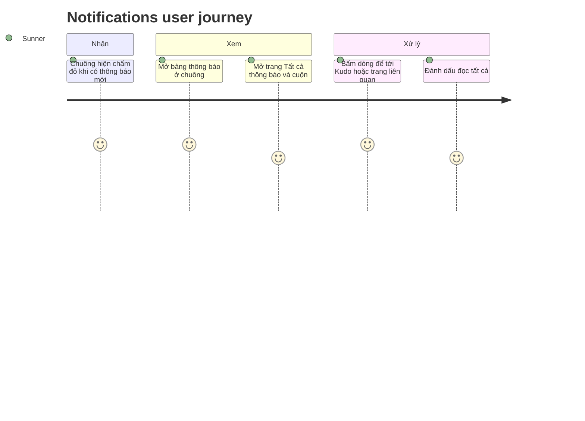

<!-- layout-exempt: rebuild-spec owns all docs/system|features|generated|flows paths — all references here are output targets or internal definitions -->
<!-- Contract: references/feature-spec-researcher-contract.md -->
<!-- Nửa BA/QA của cặp spec: đọc file này là trả lời được "làm gì, ứng xử ra sao, màn hình hiện gì" mà không phải mở file khác. Chi tiết kỹ thuật (đường dẫn, trích nguồn, ghi dữ liệu) nằm ở technical-spec.md. -->

# Functional Spec — F013_Notifications

**Priority**: P2
**Type**: mixed
**Generated**: 2026-11-24

**See also:** [`technical-spec.md`](./technical-spec.md) — luồng xử lý hàng chờ sự việc, chống sinh trùng, kênh realtime riêng tư, trích nguồn, thiết kế dữ liệu cho Dev/QA/SA.

**Traceability:** F013_Notifications → SCR003/REG001_NotificationBell, SCR017_AllNotifications → US023_BrowseNotifications, US024_OpenNotification, US025_MarkAllNotificationsRead → BL002, BL010, BL014, BL015, BL016, BL017, BL024, BL025, BL026, BL029, BL030, BL031 → ROUTE005, ROUTE011, ROUTE012, ROUTE033, ROUTE034

## 1. Overview

**Problem:** Sunner không biết kịp thời khi có việc liên quan mình: được gửi Kudo mới, Kudo của mình được thả tim, có thêm lượt mở Secret Box, thăng hạng Hero, gom đủ bộ 6 icon, Kudo lọt Kudos Quốc Dân, hay Kudo bị tạm ẩn. Nếu thông báo bị trùng, lộ người gửi ẩn danh, mỗi lượt tim một dòng hoặc đến muộn thì danh sách thành nhiễu, mất lòng tin và người dùng bỏ qua.
**Solution:** Hệ thống tự tạo một thông báo cho đúng Sunner mỗi khi một feature khác ghi lại sự việc liên quan. Chuông ở header hiện chấm đỏ khi còn thông báo chưa đọc và cập nhật gần như ngay, không cần tải lại trang; bấm chuông mở mười thông báo mới nhất, "Xem tất cả" mở trang đầy đủ cuộn vô hạn; bấm một dòng đánh dấu đã đọc và đi tới đối tượng liên quan, hoặc đánh dấu đọc tất cả bằng một lần bấm. Phía sau, một bộ xử lý nền chạy theo lịch, thử lại khi lỗi và có công việc dọn dẹp định kỳ.
**Scope:** Tạo thông báo từ sự việc Kudo, thả tim, kiểm duyệt, Secret Box, đủ bộ icon, Kudos Quốc Dân và thăng hạng Hero; chuông với chấm đỏ cập nhật tức thì; danh sách ở chuông; trang "Tất cả thông báo"; đánh dấu đã đọc một dòng và tất cả; xử lý hàng chờ theo lịch với thử lại và dừng thử; dọn dẹp định kỳ hàng chờ và lịch sử chạy lịch.
**Non-Scope:** Không tự phát hiện nghiệp vụ gốc: Kudo, tim, kiểm duyệt, Secret Box, hạng Hero chỉ báo sự việc cho feature này. Không dựng header (chỉ chiếm chỗ chuông mà header chừa sẵn). Không thông báo cho Admin về Kudo bị hệ thống gắn cờ, không thông báo nhắc tên, không gửi email hay thông báo đẩy ngoài trình duyệt. Không có trang chi tiết riêng cho một thông báo: bấm dòng đi thẳng tới đối tượng. Không rút hay sửa thông báo đã gửi, không báo khi Kudo được Un Spam, không xoá thông báo cũ.

**Actors**

| Actor | Description | Primary goal |
|-------|--------------|---------------|
| Sunner nhận thông báo | Sunner đã đăng nhập, đang dùng ứng dụng hoặc quay lại sau một lúc | Biết ngay có việc liên quan mình và đi thẳng tới đó |
| Hệ thống (bộ xử lý nền) | Chạy theo lịch, đọc các sự việc mà feature khác ghi lại trong hàng chờ chung | Mỗi sự việc ra đúng một thông báo cho đúng người, không trùng, không lộ ẩn danh |
| Người vận hành | Người theo dõi hệ thống sau khi chạy thật | Biết khi có sự việc bị dừng thử và phát lại sau khi sửa nguyên nhân |

Feature này chưa tham gia luồng liên-feature nào được ghi trong thư mục luồng của tài liệu (hiện chưa có luồng nào); các feature nguồn chỉ giao sự việc qua hàng chờ chung.

## 2. Functional Capabilities

| ID | Capability | What the user can do | User Stories | Requirements | Business Rules | Screens |
|----|------------|------------------------|-----------------|---------------|-------------------|---------|
| CAP-01 | Generate notifications from domain events | Nhận một thông báo đúng loại, đúng người, không trùng cho mỗi sự việc liên quan mình, kể cả khi hệ thống xử lý lại hoặc gặp lỗi tạm thời | N/A — chạy nền, không có user story riêng | FR-001, FR-004, FR-005, FR-006, FR-007, FR-405, FR-406, FR-407, FR-408, FR-603, FR-604 | BR-001, BR-002, BR-003, BR-004, BR-005, BR-006, BR-008, BR-011, BR-012, BR-015, BR-017, SM-002 | N/A — chạy nền, không có màn hình riêng |
| CAP-02 | Bell badge and realtime sync | Thấy chấm đỏ trên chuông khi còn thông báo chưa đọc và thấy nó cập nhật ngay khi có thông báo mới hoặc khi kết nối trở lại, kể cả giữa chuông, danh sách và trang | N/A — nằm trong tiêu chí của story duyệt thông báo ở CAP-03 | FR-101, FR-401, FR-402, FR-409, FR-410, FR-602 | BR-016, DEC-003 | N/A — hiển thị trên vùng chuông thuộc CAP-03 |
| CAP-03 | Browse notifications | Xem mười thông báo mới nhất ở chuông và toàn bộ ở trang riêng bằng cuộn vô hạn, với trạng thái đang tải, rỗng và lỗi | US023_BrowseNotifications | FR-002, FR-003, FR-102, FR-201, FR-202, FR-203, FR-301, FR-302, FR-411, FR-601 | BR-009, BR-010, DEC-001, DEC-002, DEC-004, SM-003 | SCR003/REG001_NotificationBell, SCR017_AllNotifications |
| CAP-04 | Open a notification and manage read state | Bấm một thông báo để tới đối tượng liên quan và đánh dấu đã đọc, hoặc đánh dấu tất cả đã đọc bằng một lần bấm | US024_OpenNotification, US025_MarkAllNotificationsRead | FR-103, FR-403, FR-404 | BR-007, BR-018, BR-019, DEC-005, SM-001 | N/A — dùng chung màn hình với CAP-03 |
| CAP-05 | Keep the outbox and cron history bounded | Hệ thống tự dọn sự việc đã xử lý quá 30 ngày và lịch sử chạy lịch quá 7 ngày, không đụng vào sự việc đang chờ hay đã dừng thử | N/A — công việc vận hành, không có user story | FR-008 | BR-013, BR-014 | N/A — chạy nền, không có màn hình |

## 3. Open Decisions

| D### | Decision | Default proposal | Rationale | Blocks work |
|------|----------|-------------------|-----------|--------------|
| D001 | Câu chữ và biểu tượng cho thông báo Kudos Quốc Dân là gì (thiết kế chưa có mẫu, BTC chưa xác nhận)? | Giữ câu chúc mừng hiện tại có nêu hạng (hoặc bản không hạng) và dùng chung biểu tượng của "đủ bộ 6 icon" cho tới khi có xác nhận | Câu đã có sẵn trong ứng dụng, đổi chữ chỉ là sửa bản dịch, không đổi logic | no |
| D002 | Ai nhận cảnh báo khi một sự việc bị dừng thử sau 5 lần lỗi và quy trình phát lại là gì? | Hệ thống chỉ ghi nhật ký lỗi; người vận hành phát lại bằng câu lệnh thủ công sau khi sửa nguyên nhân, chưa có cảnh báo tự động | Chưa có kênh cảnh báo nào được chọn; quy mô nhỏ nên theo dõi thủ công chấp nhận được | no |
| D003 | Có cần chính sách xoá hay lưu trữ thông báo cũ sau chiến dịch không? | Không xoá: giữ toàn bộ thông báo trong thời gian sự kiện, chỉ dọn hàng chờ và lịch sử chạy lịch | Quy mô nhỏ, chiến dịch ngắn; xoá thông báo chỉ thêm việc và có thể làm mất lịch sử người dùng | no |

## 4. Requirements

### Foundation (0xx)

- **FR-001** Mỗi sự việc liên quan tới một Sunner sinh tối đa một thông báo cho mỗi loại, kể cả khi hệ thống xử lý sự việc đó nhiều lần.
- **FR-002** Thông báo lưu loại và dữ kiện chứ không lưu câu chữ; câu hiển thị theo ngôn ngữ đang chọn, kể cả thông báo cũ.
- **FR-003** Mỗi Sunner chỉ xem và đổi trạng thái thông báo của chính mình.
- **FR-004** Có bảy loại thông báo: Kudo mới nhận, Kudo được thả tim, có lượt mở Secret Box mới, thăng hạng Hero, Kudo bị tạm ẩn, đủ bộ 6 icon, Kudos Quốc Dân.
- **FR-005** Hệ thống xử lý các sự việc đang chờ theo lịch mỗi 5 giây, mỗi lượt tối đa 50 sự việc cũ nhất, mỗi sự việc xử lý độc lập với nhau.
- **FR-006** Sự việc gặp lỗi tạm thời được thử lại với khoảng chờ tăng dần 1, 2, 4, 8 phút; sau 5 lần lỗi thì dừng thử và chờ người vận hành phát lại, các sự việc khác không bị ảnh hưởng.
- **FR-007** Sự việc sai dạng hoặc thuộc loại lạ được ghi nhận rồi bỏ qua, không làm kẹt hàng chờ và không tạo thông báo.
- **FR-008** Mỗi ngày hệ thống dọn sự việc đã xử lý quá 30 ngày và lịch sử chạy lịch quá 7 ngày; sự việc đang chờ hoặc đã dừng thử không bao giờ bị dọn.

### Navigation (1xx)

- **FR-101** Chuông thông báo nằm trong header của khu Sunner (chỗ header chừa sẵn); bấm chuông mở danh sách thông báo, bấm lại hoặc nhấn Esc hoặc bấm ra ngoài thì đóng.
- **FR-102** Liên kết "Xem tất cả" ở danh sách của chuông mở trang "Tất cả thông báo".
- **FR-103** Bấm một thông báo đi tới đối tượng liên quan của loại đó: Kudo, màn mở Secret Box hoặc hồ sơ của chính mình.

### Notification Panel (2xx)

- **FR-201** Danh sách của chuông có tiêu đề "Thông báo", liên kết "Xem tất cả", nút biểu tượng đánh dấu đọc tất cả và tối đa 10 thông báo mới nhất ở trên cùng; mỗi lần mở nạp lại.
- **FR-202** Mỗi dòng có biểu tượng theo loại, nội dung, thời gian tương đối ("Vừa xong", "15 phút trước"), chấm đỏ bên phải nếu chưa đọc, và cả dòng là một liên kết nổi bật khi trỏ chuột hoặc focus.
- **FR-203** Chưa có thông báo nào thì hiện "Bạn chưa có thông báo nào" thay vì khung trống.

### All Notifications Page (3xx)

- **FR-301** Trang "Tất cả thông báo" có tiêu đề "Thông báo", hành động "Đánh dấu đọc tất cả" và danh sách cùng kiểu dòng như của chuông.
- **FR-302** Trang nạp 20 dòng mỗi lượt; cuộn gần tới cuối thì tự nạp 20 dòng cũ hơn, hết dữ liệu thì dừng, không có nút "Tải thêm".

### Interaction (4xx)

- **FR-401** Chuông hiện chấm đỏ (không hiện số) khi còn ít nhất một thông báo chưa đọc và mất chấm khi hết.
- **FR-402** Thông báo mới làm chuông cập nhật trong vài giây mà không cần tải lại trang; nếu danh sách đang mở thì dòng mới hiện ở đầu và các dòng đang xem giữ nguyên.
- **FR-403** Bấm một thông báo đánh dấu riêng thông báo đó đã đọc ngay, không chờ máy chủ; nếu máy chủ từ chối thì dòng trở lại chưa đọc nhưng vẫn đi tới đích.
- **FR-404** Đánh dấu đọc tất cả đặt mọi thông báo chưa đọc của mình, kể cả dòng chưa nạp, thành đã đọc và chấm đỏ biến mất ngay; thông báo đến sau vẫn chưa đọc.
- **FR-405** Tim cho cùng một Kudo khi dòng tim chưa đọc thì gộp vào một dòng có số tim; đã đọc rồi thì tim kế tiếp mở dòng mới.
- **FR-406** Thông báo nhận Kudo ẩn danh không bao giờ để lộ người gửi; chỉ hiện biệt danh của Kudo hoặc câu không tên.
- **FR-407** Thông báo thăng hạng Hero chỉ gửi khi hạng thật sự cao hơn hạng đã báo, đúng một lần cho mỗi hạng của mỗi người.
- **FR-408** Kudo đã bị tạm ẩn hoặc đã bị xoá thì không sinh thông báo Kudo mới, tim hay thăng hạng.
- **FR-409** Mất kết nối realtime rồi nối lại, quay lại tab hoặc có mạng trở lại thì chuông tự đọc lại đúng số chưa đọc.
- **FR-410** Chuông, danh sách của chuông và trang "Tất cả thông báo" trong cùng một tab đồng bộ với nhau: đánh dấu đọc ở nơi này thì nơi kia cập nhật, tín hiệu mới làm các danh sách đang mở nạp lại trang đầu.
- **FR-411** Danh sách có khung chờ khi nạp trang đầu, thông báo lỗi kèm nút "Thử lại" khi nạp trang đầu thất bại, và lỗi nạp thêm giữ nguyên các dòng đã có kèm nút thử lại riêng.

### Security (6xx)

- **FR-601** Mọi thao tác với thông báo đòi hỏi đã đăng nhập; chưa đăng nhập thì bị đưa về màn đăng nhập.
- **FR-602** Tin báo realtime chỉ đến đúng Sunner được thông báo, không đến người khác.
- **FR-603** Thông báo không chứa nội dung Kudo hay danh tính người gửi ẩn danh.
- **FR-604** Lời gọi nội bộ kích hoạt xử lý chỉ được chấp nhận khi mang đúng khoá bí mật dùng chung; chưa cấu hình khoá thì bị từ chối.

## 5. Business Rules

- Một sự việc, một người nhận, một loại thì tối đa một thông báo; xử lý lại không sinh thêm (BR-001)
- Người gây ra sự việc không nhận thông báo về hành động của chính mình, như tự thả tim cho Kudo của mình (BR-002)
- Chỉ Kudo còn Public mới sinh thông báo Kudo mới, tim và thăng hạng; thông báo Kudo bị tạm ẩn vẫn gửi cho chủ Kudo (BR-003)
- Tim cho cùng Kudo gộp vào thông báo chưa đọc và đẩy dòng lên đầu; thông báo đã đọc thì tim sau mở thông báo mới (BR-004)
- Thăng hạng Hero báo khi hạng hiện tại cao hơn hạng cao nhất đã báo, đúng một lần cho mỗi hạng; hạng tụt rồi lên lại không báo lại (BR-005)
- Kudo ẩn danh không bao giờ để lộ người gửi trong thông báo, kể cả ở dữ liệu gửi xuống trình duyệt; ẩn danh theo trạng thái hiện tại của Kudo (BR-006)
- Đã đọc là một chiều: không có thao tác đưa thông báo về chưa đọc; đánh dấu lặp hoặc từ hai tab không gây lỗi (BR-007)
- Thông báo đã gửi không bị rút hay sửa khi nguồn đổi sau đó, như bỏ tim hay Un Spam (BR-008)
- Danh sách xếp mới nhất trước theo thời điểm của sự việc gần nhất, không phải lúc hệ thống xử lý (BR-009)
- Thông báo lưu loại và dữ kiện, câu chữ dựng theo ngôn ngữ đang chọn (BR-010)
- Mỗi sự việc xử lý độc lập: thông báo và dấu "đã xử lý" cùng thành công hoặc cùng huỷ, lỗi một sự việc không chặn sự việc khác (BR-011)
- Sự việc lỗi thử lại sau 1, 2, 4, 8 phút rồi dừng ở lần lỗi thứ 5 chờ phát lại thủ công (BR-012)
- Chỉ dọn sự việc đã xử lý quá 30 ngày; sự việc đang chờ hoặc đã dừng thử không bao giờ bị xoá (BR-013)
- Lịch sử chạy lịch chỉ giữ 7 ngày và chỉ dọn phần của các công việc do hệ thống này lên lịch (BR-014)
- Người nhận đã bị xoá hồ sơ thì bị bỏ qua, không biến sự việc thành vòng thử lại (BR-015)
- Tin báo realtime chỉ mang mã và loại thông báo, chỉ phát khi có thông báo mới hoặc tim được cộng, không bao giờ vì đánh dấu đọc (BR-016)
- Lời gọi nội bộ kích hoạt xử lý phải mang đúng khoá bí mật, so sánh theo thời gian cố định (BR-017)
- Mã thông báo sai dạng, không tồn tại hoặc của người khác nhận cùng một câu trả lời "không tìm thấy", không lộ mã có tồn tại hay không (BR-018)
- Đánh dấu đọc hiện ngay trên giao diện và hoàn tác nếu máy chủ từ chối; dòng đã đánh dấu cục bộ không bị phản hồi cũ làm sống lại (BR-019)
- Câu thông báo nhận Kudo đổi theo ẩn danh: có biệt danh thì "Sunner {biệt danh} (ẩn danh)…", có tên thì "Sunner {tên}…", không có cả hai thì "Một Sunner ẩn danh…" (DEC-001)
- Thông báo tim dùng câu một lượt khi có một tim, và câu có số khi đã gộp từ hai tim trở lên (DEC-002)
- Chuông có chấm đỏ khi còn thông báo chưa đọc, không có chấm khi bằng 0 (DEC-003)
- Danh sách chọn một trong các trạng thái đang tải, lỗi, rỗng hoặc có dòng thay vì khung trắng; lỗi nạp thêm giữ dòng đã có (DEC-004)
- Bấm dòng: ở danh sách của chuông thì đóng danh sách; chỉ dòng chưa đọc mới được đánh dấu; việc đi tới đích không bị chặn dù đánh dấu thất bại (DEC-005)
- Thông báo có vòng đời chưa đọc rồi đã đọc, một chiều (SM-001)
- Sự việc trong hàng chờ đi từ đang chờ tới đã xử lý, hoặc qua giai đoạn chờ thử lại tới dừng thử, và có thể được phát lại thủ công (SM-002)
- Danh sách ở giao diện chuyển giữa đang tải, sẵn sàng và lỗi, có thể thử lại từ lỗi (SM-003)

## 6. Screens

| Screen Name | SCR### | What User Sees | What User Can Do |
|-------------|--------|-----------------|-------------------|
| Notification Bell and Panel | SCR003/REG001_NotificationBell | Chuông ở header với chấm đỏ khi còn thông báo chưa đọc; bấm chuông mở bảng thả xuống "Thông báo" gồm tiêu đề, "Xem tất cả", biểu tượng đánh dấu đọc tất cả và tối đa 10 dòng mới nhất (biểu tượng theo loại, nội dung, thời gian tương đối, chấm đỏ nếu chưa đọc) | Mở và đóng bảng (bấm chuông, Esc, bấm ra ngoài), bấm dòng để tới đối tượng, đánh dấu đọc tất cả, mở trang "Tất cả thông báo", cuộn trong bảng để nạp thêm |
| All Notifications | SCR017_AllNotifications | Khung tối ở giữa trang dưới hình nền Live board, tiêu đề "Thông báo", "Đánh dấu đọc tất cả" và danh sách dòng cùng kiểu với bảng của chuông; có khung chờ, trạng thái rỗng và trạng thái lỗi | Bấm dòng để tới đối tượng, đánh dấu đọc tất cả, cuộn để nạp thêm 20 dòng cũ hơn, thử lại khi lỗi |

### User Journey

1. Sunner đang dùng ứng dụng thì có người gửi Kudo cho mình; chuông ở header hiện chấm đỏ mà không cần tải lại trang.
2. Sunner bấm chuông và thấy bảng "Thông báo" với dòng mới nhất ở trên cùng, có chấm đỏ bên phải.
3. Sunner bấm dòng đó: bảng đóng, chấm đỏ của dòng mất và Sunner được đưa tới Kudo vừa nhận.
4. Muốn xem lại thông báo cũ, Sunner mở bảng, bấm "Xem tất cả" và cuộn trang "Tất cả thông báo"; cuộn gần tới cuối thì 20 dòng cũ hơn tự nạp thêm.
5. Sunner bấm "Đánh dấu đọc tất cả": mọi chấm đỏ ở các dòng và trên chuông biến mất.



## 7. User Stories

### US023_BrowseNotifications — Browse Notifications

**Actor:** Sunner nhận thông báo
**Goal:** Xem danh sách thông báo của mình ở chuông và ở trang tất cả thông báo để biết ai vừa gửi Kudo, thả tim hay có phần thưởng mới.
**Business value:** Sunner không bỏ sót được ghi nhận hay phần thưởng, nên tiếp tục tham gia chiến dịch.

**Acceptance Criteria:**
- [ ] Chuông ở header mở và đóng bảng; nhấn Esc hoặc bấm ra ngoài thì đóng; chấm đỏ (không hiện số) sáng khi còn thông báo chưa đọc.
- [ ] Mỗi lần mở bảng nạp 10 thông báo mới nhất của chính mình, mới tới cũ.
- [ ] Trang "Tất cả thông báo" nạp 20 dòng mỗi lượt; cuộn tới cuối thì nạp tiếp 20 dòng cũ hơn, hết thì dừng.
- [ ] Có đủ trạng thái: khung chờ khi nạp trang đầu, "Bạn chưa có thông báo nào" khi rỗng, "Không tải được thông báo. Vui lòng thử lại." kèm nút "Thử lại"; lỗi nạp thêm có nút thử lại riêng và vẫn giữ các dòng đã có.
- [ ] Có thông báo mới thì chấm đỏ sáng ngay và danh sách đang mở nạp lại trang đầu; thông báo nhận Kudo ẩn danh chỉ hiện biệt danh, không bao giờ kèm tên người gửi.

### US024_OpenNotification — Open Notification

**Actor:** Sunner nhận thông báo
**Goal:** Bấm vào một thông báo để đi tới Kudo hoặc trang liên quan và đồng thời thông báo đó được đánh dấu đã đọc.
**Business value:** Từ thông báo tới hành động chỉ một cú bấm, tăng tương tác với Kudo và phần thưởng.

**Acceptance Criteria:**
- [ ] Cả dòng là một liên kết; bấm vào đánh dấu dòng đã đọc ngay, không chờ máy chủ, rồi đi tới đích; ở bảng của chuông thì bảng đóng lại.
- [ ] Đích theo loại: Kudo mới, tim và Kudo bị tạm ẩn tới chi tiết Kudo; lượt mở Secret Box tới màn mở hộp; thăng hạng Hero và đủ bộ icon tới hồ sơ của chính mình; Kudos Quốc Dân tới Kudo xếp hạng cao nhất trong thông báo.
- [ ] Đánh dấu đọc chỉ một chiều và chỉ cho thông báo của chính mình; mở lại hay mở ở hai tab vẫn giữ thời điểm đọc đầu tiên; dòng đã đọc bấm lại không gọi máy chủ.
- [ ] Nếu máy chủ từ chối hoặc lỗi, dòng trở lại chưa đọc nhưng việc đi tới đích vẫn diễn ra.
- [ ] Sau khi máy chủ xác nhận, chuông đọc lại số chưa đọc và danh sách ở nơi khác tải lại để khớp.

### US025_MarkAllNotificationsRead — Mark All Notifications Read

**Actor:** Sunner nhận thông báo
**Goal:** Đánh dấu đọc tất cả thông báo bằng một lần bấm để xoá chấm đỏ mà không phải mở từng dòng.
**Business value:** Chuông trở lại sạch để thông báo mới nổi bật, Sunner không phải dọn thủ công.

**Acceptance Criteria:**
- [ ] Bảng của chuông có nút biểu tượng "Đánh dấu đọc tất cả" cạnh "Xem tất cả"; trang "Tất cả thông báo" có nút cùng tên (biểu tượng kèm chữ) ở hàng tiêu đề.
- [ ] Bấm nút đánh dấu mọi dòng đang hiện là đã đọc ngay và tắt chấm đỏ; máy chủ đánh dấu toàn bộ thông báo chưa đọc của người dùng, kể cả dòng chưa nạp; không hỏi xác nhận.
- [ ] Chỉ đánh dấu thông báo của chính mình; thông báo tới sau lệnh này vẫn chưa đọc; trong lúc chờ nút bị khoá.
- [ ] Nếu máy chủ trả lỗi, các dòng vừa đánh dấu trở lại chưa đọc và chuông đọc lại số thật.
- [ ] Chuông, bảng và trang đồng bộ nhau: đánh dấu ở nơi này thì nơi kia tải lại trạng thái.

## 8. Scenarios

### US023_BrowseNotifications — Happy Path

**Given** Sunner có 14 thông báo và 3 chưa đọc, **When** Sunner bấm chuông, **Then** bảng mở với 10 dòng mới nhất trước, chuông có chấm đỏ và có liên kết "Xem tất cả".

### US023_BrowseNotifications — Happy Path: trang đầy đủ

**Given** Sunner có 45 thông báo, **When** Sunner mở trang "Tất cả thông báo" và cuộn tới cuối hai lần, **Then** hiện 20 rồi 40 rồi đủ 45 dòng không lặp, sau đó không nạp thêm.

### US023_BrowseNotifications — Error: nạp danh sách lỗi

**Given** mạng hoặc máy chủ lỗi lúc nạp danh sách, **When** Sunner mở bảng của chuông, **Then** bảng hiện "Không tải được thông báo. Vui lòng thử lại." kèm nút "Thử lại" và chuông vẫn hoạt động; bấm nút thì nạp lại.

### US023_BrowseNotifications — Edge: thông báo tới khi đang xem

**Given** bảng đang mở, **When** một thông báo mới tới, **Then** chấm đỏ sáng ngay, trang đầu được nạp lại và gộp vào, các dòng đang xem giữ nguyên.

### US024_OpenNotification — Happy Path

**Given** Sunner có thông báo nhận Kudo chưa đọc, **When** Sunner bấm dòng đó trong bảng của chuông, **Then** dòng thành đã đọc, bảng đóng và Sunner tới trang chi tiết của Kudo đó.

### US024_OpenNotification — Error: máy chủ từ chối

**Given** máy chủ từ chối việc đánh dấu đọc (mạng lỗi hoặc mã không hợp lệ), **When** Sunner bấm một dòng chưa đọc, **Then** dòng trở lại chưa đọc nhưng Sunner vẫn được đưa tới đích.

### US024_OpenNotification — Edge: đã đọc ở tab khác

**Given** thông báo đã được đọc ở một tab khác, **When** Sunner bấm dòng ở tab này, **Then** thời điểm đọc đầu tiên được giữ và Sunner vẫn tới đích.

### US025_MarkAllNotificationsRead — Happy Path

**Given** Sunner có 8 thông báo chưa đọc, **When** Sunner bấm "Đánh dấu đọc tất cả", **Then** mọi dòng đang hiện thành đã đọc ngay, chuông hết chấm đỏ và cả 8 thông báo được ghi nhận đã đọc.

### US025_MarkAllNotificationsRead — Error: máy chủ lỗi

**Given** máy chủ trả lỗi lúc Sunner bấm đánh dấu tất cả, **When** yêu cầu thất bại, **Then** các dòng vừa đánh dấu trở lại chưa đọc, chuông đọc lại số thật và Sunner có thể bấm lại.

### US025_MarkAllNotificationsRead — Edge: không còn gì để đánh dấu

**Given** không còn thông báo chưa đọc, **When** Sunner bấm nút, **Then** thao tác thành công mà không đổi gì và không có lỗi.

## 9. Edge Cases

| Scenario | What Happens | User-Facing Message |
|----------|--------------|----------------------|
| Một sự việc bị xử lý hai lần (hai lượt chạy chồng nhau) | Hệ thống chỉ giữ một thông báo; số tim gộp không bị cộng đôi | None — silent handling |
| Tim đến đúng lúc Sunner vừa đọc dòng tim | Dòng đã đọc giữ nguyên, tim mới tạo một dòng chưa đọc | None — silent handling |
| Kudo bị tạm ẩn hoặc bị xoá trước khi thông báo được tạo | Không tạo thông báo Kudo mới, tim hay thăng hạng; chủ Kudo vẫn nhận thông báo tạm ẩn | None — silent handling |
| Sunner tự thả tim cho Kudo của chính mình | Không tạo thông báo | None — silent handling |
| Nhiều Kudo tới gần nhau làm thăng hạng | Chỉ một thông báo thăng hạng cho mỗi hạng mới đạt, không báo đôi và không trượt hạng | None — silent handling |
| Người gửi có hai Kudo trong Kudos Quốc Dân | Một thông báo liệt kê hạng tốt nhất; bấm vào đi tới Kudo xếp hạng cao nhất | None — silent handling |
| Kudo ẩn danh được đổi sang không ẩn danh (hoặc ngược lại) sau khi đã có thông báo | Danh sách theo trạng thái hiện tại của Kudo: ẩn danh thì chỉ hiện biệt danh, không ẩn danh thì hiện tên | None — silent handling |
| Chưa có thông báo nào | Bảng và trang hiện trạng thái rỗng | "Bạn chưa có thông báo nào" |
| Nạp danh sách lỗi | Hiện lỗi kèm nút thử lại, chuông không bị ảnh hưởng | "Không tải được thông báo. Vui lòng thử lại." |
| Nạp thêm trang cũ hơn lỗi | Các dòng đã có giữ nguyên, hiện lỗi và nút thử lại riêng bên dưới | "Không tải được thông báo. Vui lòng thử lại." |
| Mất kết nối realtime rồi nối lại, hoặc quay lại tab | Chuông tự đọc lại số chưa đọc và danh sách đang mở nạp lại trang đầu | None — silent handling |
| Đánh dấu đọc tất cả cùng lúc có thông báo mới đến | Thông báo đến sau lệnh vẫn chưa đọc, chuông đúng theo số thật | None — silent handling |
| Đánh dấu đọc tất cả mà máy chủ lỗi | Các dòng trở lại chưa đọc, chấm đỏ trên chuông hiện lại sau khi đọc lại số thật | None — silent handling |
| Bấm thông báo của người khác bằng cách đoán mã | Từ chối như thông báo không tồn tại, không lộ mã có tồn tại hay không | None — silent handling |
| Chưa đăng nhập | Bị đưa về màn đăng nhập | None — chuyển thẳng về màn đăng nhập |
| Trước ngày ra mắt, người dùng không phải admin | Bị chặn bởi cổng trước ngày ra mắt, chuyển tới màn đếm ngược | None — chuyển thẳng tới màn đếm ngược |
| Thông báo cũ dẫn tới Kudo sau đó bị tạm ẩn | Thông báo vẫn còn; mở ra, chủ Kudo vẫn xem được Kudo của mình, người khác thấy trang không tìm thấy | Trang "không tìm thấy" của hệ thống |
| Sự việc sai dạng hoặc thuộc loại lạ | Ghi nhận và bỏ qua, không tạo thông báo, không kẹt hàng chờ | None — silent handling |
| Sự việc lỗi tạm thời nhiều lần liên tiếp | Thử lại sau 1, 2, 4, 8 phút rồi dừng ở lần thứ 5 chờ người vận hành phát lại | None — silent handling |
| Người nhận đã bị xoá hồ sơ | Bỏ qua người đó, sự việc vẫn coi là đã xử lý | None — silent handling |

## 10. Edge Behaviours to Verify

- **FR-001** → xử lý lại cùng một sự việc không làm số thông báo hay số tim gộp tăng thêm
- **FR-002** → đổi ngôn ngữ Việt hoặc Anh thì cả thông báo cũ đổi câu theo
- **FR-003** → Sunner không thấy và không đánh dấu được thông báo của người khác
- **FR-004** → mỗi trong bảy loại tạo thông báo đúng người, đúng nội dung
- **FR-005** → sự việc ghi vào hàng chờ thành thông báo trong vài giây; mỗi lượt không quá 50 sự việc
- **FR-006** → lỗi tạm thời được thử lại sau 1, 2, 4, 8 phút và dừng ở lần lỗi thứ 5; sự việc đã dừng không bị tự thử lại
- **FR-007** → sự việc sai dạng không tạo thông báo và không chặn các sự việc sau nó
- **FR-008** → sự việc đang chờ hoặc đã dừng thử còn nguyên sau lượt dọn; thông báo cũ không bị xoá theo
- **FR-101** → chuông có trong header, mở bảng khi bấm, đóng bằng Esc hoặc bấm ra ngoài
- **FR-102** → "Xem tất cả" mở trang tất cả thông báo
- **FR-103** → bấm từng loại đi tới đối tượng đúng
- **FR-201** → bảng đủ tiêu đề, "Xem tất cả", nút đọc tất cả và tối đa 10 dòng mới nhất trước
- **FR-202** → dòng có biểu tượng, nội dung, thời gian tương đối; dòng chưa đọc có chấm đỏ bên phải
- **FR-203** → chưa có thông báo thì hiện trạng thái rỗng
- **FR-301** → trang đủ tiêu đề, hành động đọc tất cả và danh sách dài
- **FR-302** → cuộn gần cuối nạp 20 dòng kế, không lặp dòng, hết thì dừng
- **FR-401** → chấm đỏ đúng với số chưa đọc, mất khi về 0
- **FR-402** → thông báo mới làm chuông cập nhật trong vài giây không tải lại trang
- **FR-403** → bấm một dòng chỉ đổi dòng đó sang đã đọc; máy chủ từ chối thì dòng trở lại chưa đọc
- **FR-404** → đánh dấu tất cả đổi mọi dòng chưa đọc, kể cả dòng chưa nạp; thông báo đến sau vẫn chưa đọc
- **FR-405** → năm tim liên tiếp cho cùng Kudo hiện một dòng có số tim
- **FR-406** → Kudo ẩn danh không để lộ người gửi trong thông báo hay dữ liệu gửi xuống
- **FR-407** → một hạng Hero chỉ báo một lần
- **FR-408** → Kudo đã bị tạm ẩn không sinh thông báo Kudo mới, tim, thăng hạng
- **FR-409** → ngắt rồi nối lại kết nối thì chuông khớp số thật
- **FR-410** → đánh dấu đọc ở bảng thì trang cập nhật và ngược lại; tín hiệu mới làm danh sách đang mở nạp lại
- **FR-411** → khung chờ, lỗi kèm thử lại và lỗi nạp thêm giữ dòng đã có đều hiện đúng
- **FR-601** → chưa đăng nhập không đọc hay đổi được thông báo
- **FR-602** → thông báo mới của Sunner X không đến chuông của Sunner Y
- **FR-603** → thông báo không chứa nội dung Kudo hay danh tính người gửi ẩn danh
- **FR-604** → lời gọi kích hoạt xử lý không có khoá bị từ chối, có khoá đúng mới chạy

## 11. Risks & Known Issues

| ID | Type | Description | Impact | Status |
|----|------|--------------|--------|--------|
| RISK-01 | known-issue | Cột lưu người gửi của thông báo nhận Kudo giữ người gửi thật khi Kudo không ẩn danh; nếu Kudo sau đó được đổi sang ẩn danh, giá trị cũ vẫn còn trong cơ sở dữ liệu dù danh sách đã che theo trạng thái hiện tại | Không lộ ra trình duyệt, nhưng dữ liệu thô vẫn có danh tính nếu ai đó truy cập trực tiếp cơ sở dữ liệu | confirmed |
| RISK-02 | risk | Kênh realtime chỉ cố gắng hết sức: tin có thể rơi khi mạng chập chờn, chuông chỉ khớp lại ở lần nối lại, khi quay lại tab hoặc khi có mạng trở lại | Chấm đỏ chậm tới lần đó | [EXPECTED] |
| RISK-03 | risk | Không có chính sách xoá thông báo: bảng thông báo chỉ tăng theo thời gian, chỉ hàng chờ sự việc và lịch sử chạy lịch được dọn | Trang "Tất cả thông báo" dài dần; chấp nhận được trong thời gian sự kiện | confirmed |
| RISK-04 | risk | Sự việc bị dừng thử sau 5 lần lỗi chỉ được ghi nhật ký, chưa có cảnh báo tự động; phát lại bằng câu lệnh thủ công | Thông báo tương ứng không bao giờ tới cho tới khi người vận hành phát hiện và phát lại | confirmed |
| RISK-05 | risk | Đường kích hoạt xử lý theo lịch đã chạy thật ở môi trường cục bộ, chưa được kiểm chứng trên môi trường thử nghiệm hay thật với kho khoá bí mật thật | Nếu thiếu khoá hoặc địa chỉ sai, thông báo không được tạo (nằm chờ trong hàng chờ) | [UNVERIFIED] |
| RISK-06 | risk | Thông báo cũ không bị rút khi nguồn đổi, nên có thể dẫn tới Kudo sau đó bị tạm ẩn và người nhận chỉ thấy trang không tìm thấy | Người nhận bấm vào một thông báo không còn mở được nội dung | [INFERRED] |
| RISK-07 | risk | Việc dọn sự việc đã xử lý chạy một câu xoá mỗi ngày, không có chỉ mục riêng và không chia lô; chấp nhận được ở quy mô hiện tại | Khi hàng chờ vượt khoảng một triệu dòng thì lượt dọn có thể chậm | confirmed |

## 12. Dependencies

| Dependency | Type | Why this feature needs it | Evidence |
|------------|------|-----------------------------|----------|
| F001_Auth | feature | Phiên đăng nhập và hồ sơ Sunner (tên hiển thị trong thông báo, người nhận còn tồn tại) | FR-003, FR-601 |
| F002_AppShell | feature | Header chừa chỗ cho chuông, ngôn ngữ đang chọn, hành vi đóng bảng bằng Esc hoặc bấm ra ngoài | FR-101, FR-002 |
| F003_KudosAuthoring | feature | Ghi sự việc Kudo mới (người nhận, ẩn danh, biệt danh) | FR-004, FR-406 |
| F004_KudosFeed | feature | Trang chi tiết Kudo là đích của thông báo Kudo; cùng cách phân trang theo mốc thời gian | FR-103, FR-302 |
| F005_KudosHearts | feature | Ghi sự việc thả tim cho Kudo | FR-405 |
| F006_AwardsPortal | feature | Trang Tiêu chuẩn cộng đồng là đích của liên kết trong thông báo Kudo bị ẩn; cổng trước ngày ra mắt chặn người dùng thường | FR-103, SCR017_AllNotifications |
| F007_AdminModeration | feature | Ghi sự việc Kudo bị tạm ẩn | FR-004 |
| F009_HeroBadges | feature | Cách tính hạng Hero và cách đếm người gửi khác nhau; việc phát hiện thăng hạng dùng lại kết quả này | FR-407 |
| F010_SecretBoxRewards | feature | Ghi sự việc cấp Secret Box, đủ bộ icon và Kudos Quốc Dân; màn mở hộp là đích | FR-004, FR-103 |
| F012_Profile | feature | Hồ sơ của chính mình là đích của hai loại thông báo | FR-103 |
| Bảng sự việc dùng chung (hàng chờ) | data | Nguồn dữ liệu duy nhất để tạo thông báo; các feature nguồn ghi vào đây cùng lúc với thay đổi của mình | FR-001, FR-005 |
| Kênh realtime của Supabase | external-service | Đẩy tin báo có thông báo mới tới đúng Sunner | FR-402, FR-602 |
| Bộ lập lịch của cơ sở dữ liệu và kho khoá bí mật | infrastructure | Kích hoạt xử lý mỗi 5 giây và dọn dẹp hằng ngày; thiếu thì dùng lịch chạy ở máy chủ | FR-005, FR-008 |
| Khoá bí mật dùng chung cho lời gọi nội bộ | config | Không có khoá thì lời gọi xử lý theo lịch bị từ chối | FR-604 |

## 13. Configuration

```text
NOTIFICATION_DROPDOWN_LIMIT = 10          # số thông báo mới nhất ở bảng của chuông mỗi lần mở
NOTIFICATION_PAGE_SIZE = 20               # số thông báo mỗi lượt nạp ở trang Tất cả thông báo
NOTIFICATION_MAX_PAGE_SIZE = 50           # trần số dòng một lượt nạp
DRAIN_INTERVAL_SECONDS = 5                # hệ thống xử lý hàng chờ sự việc mỗi 5 giây
OUTBOX_BATCH_SIZE = 50                    # số sự việc tối đa mỗi lượt xử lý
OUTBOX_MAX_ATTEMPTS = 5                   # số lần lỗi trước khi dừng thử và chờ phát lại thủ công
RETRY_WAIT_MINUTES = 1, 2, 4, 8           # khoảng chờ giữa các lần thử lại
OUTBOX_RETENTION_DAYS = 30                # sự việc đã xử lý được giữ bao lâu trước khi dọn
CRON_HISTORY_RETENTION_DAYS = 7           # lịch sử chạy lịch được giữ bao lâu
```
