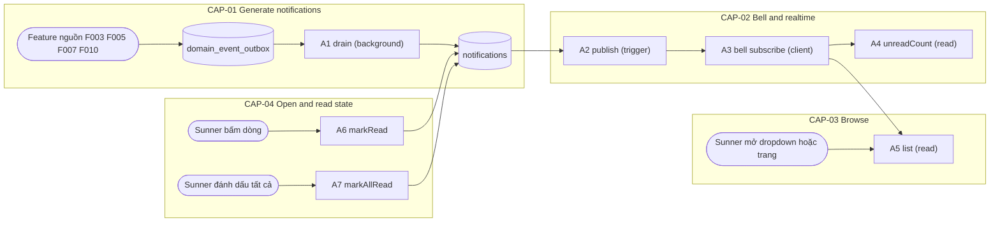
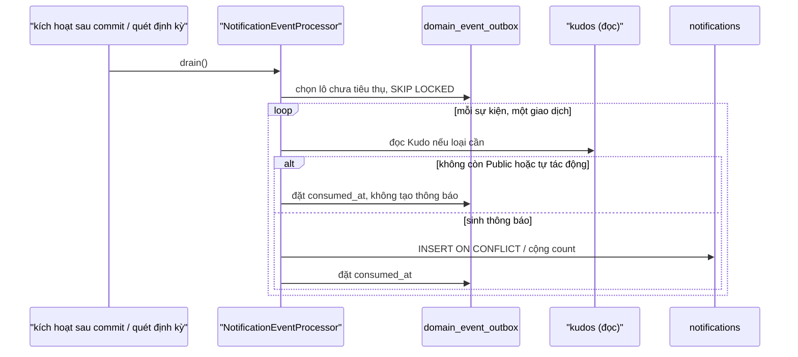
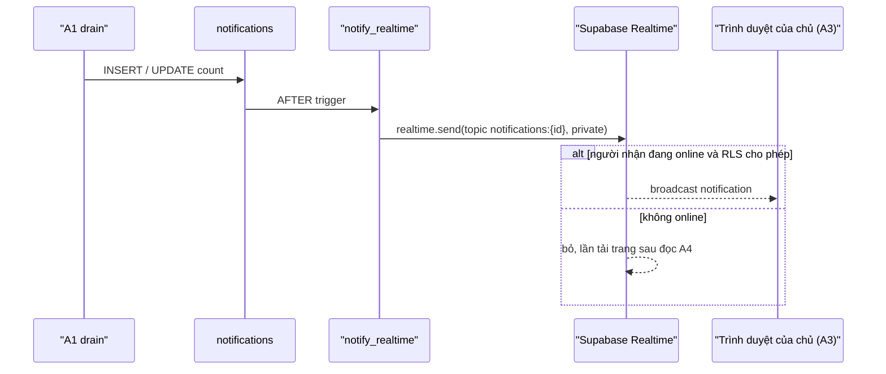
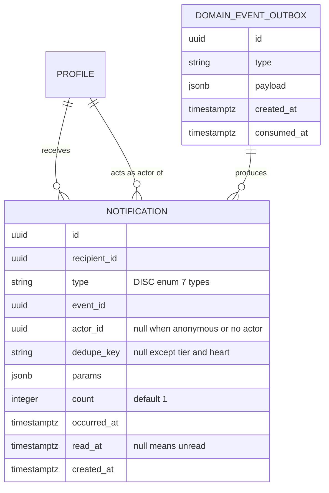
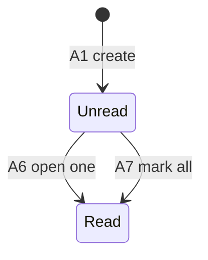

# F013_Notifications — Technical Spec

**Priority**: P2
**Type**: mixed
**Generated**: 2026-11-08

**See also:** [`functional-spec.md`](./functional-spec.md) — tổng quan, quyết định còn mở, yêu cầu/quy tắc nghiệp vụ dạng một dòng, màn hình, user story, kịch bản, edge case và cấu hình cho BA/QA.

**How to read this file:** § 2 là bảng chỉ mục action; đọc khối tương ứng ở § 3 từ đầu đến cuối. § 4 là phụ lục dùng chung, chỉ nhảy vào khi § 3 trỏ tới.

## 1. Technical Overview

Feature biến sự kiện miền của các feature khác thành thông báo trong ứng dụng cho từng Sunner: chuông ở header với chấm đỏ khi còn thông báo chưa đọc và cập nhật realtime, dropdown "Thông báo", trang "Tất cả thông báo", đánh dấu đã đọc từng dòng hoặc tất cả. Feature không tự phát hiện thay đổi dữ liệu: các feature nguồn ghi sự kiện vào bảng `domain_event_outbox` (cơ chế outbox do F010 phác thảo, chọn làm cơ chế sự kiện chung của hệ thống) trong cùng giao dịch nghiệp vụ, rồi một bộ xử lý nền của F013 đọc, sinh thông báo theo ràng buộc duy nhất nên xử lý lặp không sinh trùng. Thông báo lưu loại cộng tham số, câu chữ dựng ở trình duyệt theo ngôn ngữ đang chọn (next-intl). Thông báo mới đẩy tới đúng chủ qua kênh Broadcast riêng tư của Supabase Realtime, cùng cách F008 đã chọn, phát từ trigger Postgres và giới hạn bằng RLS trên `realtime.messages`. Dữ liệu ở Postgres (Supabase, Drizzle).



## 2. Action Index

| # | Action (handler) | Method · Path | Codes | Writes | Detail |
|---|---|---|---|---|---|
| **A0** | *cross-cutting — belongs to no single action* | — | FR-003, FR-601 | — | § 4.4 |
| **A1** | `NotificationEventProcessor#drain` (planned) *(background, no FE)* | queue · `domain_event_outbox` (kích hoạt sau commit của feature nguồn và quét định kỳ) | FR-001, FR-002, FR-004, FR-405, FR-406, FR-407, FR-408, FR-603, BR-001, BR-002, BR-003, BR-004, BR-005, BR-006, BR-008, BR-010, SM-001, ALG-001, ALG-002, INT-001, INT-003, US001_ReceiveNotifications | `notifications`, `domain_event_outbox` | § 3.1 ▸ **diagram** |
| **A2** | `notify_realtime` (trigger Postgres, planned) *(background, no FE)* | trigger · `notifications` | FR-402, FR-602, INT-002, US002_SeeUnreadBell | — *(chỉ phát tin Broadcast, không ghi bảng nghiệp vụ)* | § 3.2 ▸ **diagram** |
| **A3** | `NotificationBell#subscribe` (planned, client) | — | FR-101, FR-401, FR-409, DEC-003, US002_SeeUnreadBell | — *(client only)* | § 3.2 |
| **A4** | `NotificationQuery#unreadCount` (planned) | `GET` `/api/notifications/unread-count` | FR-401, FR-409, US002_SeeUnreadBell | — *(read-only)* | § 3.2 |
| **A5** | `NotificationQuery#list` (planned) | `GET` `/api/notifications` | FR-102, FR-201, FR-202, FR-203, FR-301, FR-302, BR-009, DEC-001, DEC-002, DEC-004, ALG-003, US003_BrowseRecentNotifications, US004_BrowseAllNotifications | — *(read-only)* | § 3.3 |
| **A6** | `NotificationController#markRead` (planned) | `POST` `/api/notifications/{id}/read` | FR-103, FR-403, BR-007, SM-001, ALG-003, US005_OpenNotification | `notifications` | § 3.4 |
| **A7** | `NotificationController#markAllRead` (planned) | `POST` `/api/notifications/read-all` | FR-404, BR-007, SM-001, US006_MarkAllRead | `notifications` | § 3.4 |

**Rung set** theo template: Who → FE → Request → BE → Rule → Result → State → Source. Rung vắng thì bỏ hẳn. **State** bỏ trong bản nháp vì chưa có nguồn xác nhận.

## 3. Actions

### 3.1 CAP-01 — Generate notifications from events

#### A1 · Drain the event outbox into notifications *(background, no FE)*
`queue · domain_event_outbox` → `` `NotificationEventProcessor#drain` (planned) ``
`FR-001` `FR-002` `FR-004` `FR-405` `FR-406` `FR-407` `FR-408` `FR-603` `BR-001` `BR-002` `BR-003` `BR-004` `BR-005` `BR-006` `BR-008` `BR-010` `SM-001` `US001_ReceiveNotifications`

**Who** · *không có người dùng trực tiếp — chạy sau khi feature nguồn commit một sự kiện và theo lịch quét dự phòng (US001_ReceiveNotifications — Sunner nhận thông báo cho từng sự việc liên quan mình)*
**Request** · *no HTTP request* — mỗi dòng outbox `{ id, type, payload, created_at }`; payload kiểm bằng Zod theo `type` (xem bảng sự kiện ở `INT-001`)
**BE** · `` `NotificationEventProcessor#drain` `` chọn lô dòng chưa tiêu thụ bằng `FOR UPDATE SKIP LOCKED`, rồi với MỖI sự kiện mở một giao dịch riêng: ánh xạ sự kiện sang 0..n thông báo theo `ALG-001`, ghi `notifications` và đặt `consumed_at` trong cùng giao dịch. Một sự kiện lỗi chỉ huỷ giao dịch của chính nó, không chặn các sự kiện khác.
**Rule**
- **BR-001 — Một sự kiện, một người nhận, một loại thì tối đa một thông báo.** Ràng buộc duy nhất `(event_id, recipient_id, type)` cộng việc đặt `consumed_at` cùng giao dịch làm xử lý lặp hoặc chạy song song không sinh trùng (FR-001).
- **BR-002 — Người gây ra sự kiện không tự nhận thông báo về hành động của chính mình.** Thả tim vào Kudo của chính mình, hay Kudo có người gửi trùng người nhận, không sinh thông báo (FR-004).
- **BR-003 — Chỉ Kudo đang Public mới sinh thông báo Kudo mới, thả tim, lên cấp.** Lúc xử lý bộ xử lý đọc lại `kudos.status`; Kudo đã bị Spam thì bỏ qua và vẫn đánh dấu sự kiện đã tiêu thụ (FR-408). Thông báo "Kudo bị tạm ẩn" không bị lọc này.
- **BR-004 — Tim cho cùng một Kudo gộp vào một thông báo chưa đọc.** Khi đã có dòng `heart_received` chưa đọc cho `(người nhận, Kudo)` thì cộng `count` và dời `occurred_at` lên mới nhất; đã đọc rồi thì tim kế tiếp mở dòng mới (FR-405, mặc định D001).
- **BR-005 — Lên cấp Hero chỉ báo khi cấp sau cao hơn cấp trước và đúng một lần cho mỗi cấp của mỗi người.** Cấp trước/sau tính theo `ALG-002`; ràng buộc duy nhất `(recipient_id, dedupe_key)` với `type = 'hero_tier_up'` chặn báo lặp một cấp (FR-407).
- **BR-008 — Thông báo đã tạo không bị thu hồi hay sửa khi nguồn đổi sau đó.** Bỏ tim, Un Spam, đổi cấp ngược đều không xoá hay hạ thông báo cũ (D009, D010).
- **BR-006 — Kudo ẩn danh không bao giờ để lộ người gửi trong thông báo.** `actor_id` ghi `NULL` khi `kudos.is_anonymous` đúng; không có cột hay tham số nào khác mang danh tính người gửi. *(§ 4.4)*
- **BR-010 — Thông báo lưu loại và tham số, không lưu câu chữ.** Câu hiển thị dựng ở trình duyệt từ next-intl theo locale. *(§ 4.4)*
**Result**
- Writes `notifications` (`recipient_id`, `type`, `event_id`, `actor_id`, `dedupe_key`, `params`, `count`, `occurred_at`; `read_at = NULL`) ← kết quả `ALG-001`; mỗi dòng mới khởi đầu vòng đời `SM-001` (chưa đọc) *(§ 4.3)*.
- Writes `domain_event_outbox.consumed_at` ← thời điểm xử lý xong, cùng giao dịch với thông báo.
- Sự kiện sai dạng hoặc loại lạ: ghi log, vẫn đặt `consumed_at` để không kẹt hàng đợi (xem § 3.5).
- Gọi `INT-003` (hàm thuần `tierFromCount` của F009) khi xử lý Kudo mới để biết người nhận có lên cấp *(§ 4.5)*.
**State** · [UNVERIFIED] `SM-001`: transition not confirmed from source *(§ 4.3)*
**Source:** TBD (draft)
**Shared structure:** `ALG-001` — ánh xạ sáu loại sự kiện sang thông báo cho đúng người nhận; `ALG-002` — so cấp Hero trước và sau một Kudo; `INT-001` — hợp đồng đọc outbox; chi tiết *(§ 4.5)*



---

### 3.2 CAP-02 — Bell badge and realtime delivery

Một luồng dọc qua ba action: A2 (trigger phát tin khi thông báo được ghi) → kênh Broadcast riêng tư → A3 (chuông ở trình duyệt nhận tin) → A4 (đọc lại số chưa đọc). Sơ đồ đặt ở A2.

#### A2 · Push a realtime signal to the owner *(background, no FE)*
`trigger · notifications` → `` `notify_realtime` (trigger Postgres, planned) ``
`FR-402` `FR-602` `US002_SeeUnreadBell`

**Who** · *không có người dùng — trigger chạy khi A1 chèn một thông báo hoặc cộng `count` của thông báo tim (US002_SeeUnreadBell — thấy chuông cập nhật khi có thông báo mới)*
**Request** · *no HTTP request* — dòng `notifications` vừa ghi
**BE** · hàm Postgres chạy AFTER INSERT / AFTER UPDATE OF `count` trên `notifications`: dựng payload tối thiểu rồi gọi `realtime.send` vào kênh riêng tư `notifications:{recipient_id}` qua `INT-002` (phát tin báo "có thông báo mới" tới đúng chủ). Lỗi phát bị nuốt và ghi log để không làm hỏng giao dịch ghi thông báo của A1.
**Result**
- Publishes thông điệp Broadcast `{ notificationId, type, occurredAt }` lên kênh của người nhận qua `INT-002` — không kèm nội dung, tên hay tham số *(§ 4.5)* (FR-402, FR-602).
- Không ghi bảng nghiệp vụ nào.
**Source:** TBD (draft)



---

#### A3 · Show the unread dot and keep it live *(client only)*
`—` → `` `NotificationBell#subscribe` (planned) ``
`FR-101` `FR-401` `FR-409` `DEC-003` `US002_SeeUnreadBell` · bell trong header (draft `SCR025_NotificationDropdown`)

**Who** · Sunner đã đăng nhập, ở bất kỳ trang nào có header của F002 (US002_SeeUnreadBell — thấy chuông cập nhật) *(gate A0 — § 4.4)*
**FE** · `NotificationBell` là client component gắn vào slot chuông của header F002: nhận `initialUnread` do server dựng, vẽ chấm đỏ theo `DEC-003`, bấm thì mở dropdown (FR-101). Khi mount thì đăng ký kênh riêng tư `notifications:{userId}`; mỗi thông điệp hợp lệ (Zod, bỏ qua sai dạng) kích hoạt gọi lại A4 và, nếu dropdown đang mở, gọi lại A5 trang đầu. Khi kênh nối lại sau khi đứt, và khi tab chuyển từ ẩn sang hiện, gọi lại A4 (FR-409). Huỷ đăng ký khi unmount.
**Request** · thông điệp Broadcast `{ notificationId, type, occurredAt }`
**Rule** · quyết định chấm đỏ trên chuông:

| DEC | subtype | Condition | What the user sees | Source |
|---|---|---|---|---|
| **DEC-003** | render | `unread > 0` | chấm đỏ trên chuông | TBD (draft) |
| **DEC-003** | render | `unread == 0` | chuông không có chấm | TBD (draft) |

**Result** · read-only với dữ liệu — **no DB write**. Chỉ đổi trạng thái giao diện của chuông.
**Source:** TBD (draft)

<!-- No diagram: client thuần, một nguồn sự kiện, hai lời gọi đọc; thứ tự đã nằm ở sơ đồ của A2. -->

---

#### A4 · Read the unread count
`GET /api/notifications/unread-count` → `` `NotificationQuery#unreadCount` (planned) ``
`FR-401` `FR-409` `US002_SeeUnreadBell` · bell trong header (draft `SCR025_NotificationDropdown`)

**Who** · Sunner đã đăng nhập (US002_SeeUnreadBell — thấy số chưa đọc đúng) *(gate A0)*
**FE** · `NotificationBell` gọi sau thông điệp realtime, sau khi nối lại, khi tab hiện lại; giá trị đầu tiên do server dựng cùng header.
**Request** · không tham số; `userId` lấy từ session.
**BE** · `` `NotificationQuery#unreadCount` `` chạy `SELECT count(*) FROM notifications WHERE recipient_id = userId AND read_at IS NULL` (dùng chỉ mục từng phần trên chưa đọc). Trả `{ unread }`.
**Result** · read-only — **no DB write**.
**Source:** TBD (draft)

<!-- No diagram: read-only, một truy vấn. -->

---

### 3.3 CAP-03 — Browse notifications

#### A5 · List notifications for the current user
`GET /api/notifications` → `` `NotificationQuery#list` (planned) ``
`FR-102` `FR-201` `FR-202` `FR-203` `FR-301` `FR-302` `BR-009` `DEC-001` `DEC-002` `DEC-004` `US003_BrowseRecentNotifications` `US004_BrowseAllNotifications` · `SCR025_NotificationDropdown` · `SCR024_AllNotifications`

**Who** · Sunner đã đăng nhập (US003_BrowseRecentNotifications — xem thông báo gần nhất ở dropdown; US004_BrowseAllNotifications — xem toàn bộ ở trang riêng) *(gate A0 — § 4.4)*
**FE** · Dropdown gọi trang đầu với `limit = NOTIFICATION_DROPDOWN_LIMIT` mỗi lần mở; trang "Tất cả thông báo" gọi `limit = NOTIFICATION_PAGE_SIZE` và nạp tiếp bằng `nextCursor` (FR-302). Cả hai dùng chung `NotificationRow`: biểu tượng theo loại, câu chữ dựng bằng next-intl từ `type` + `params` (khoá `notifications.<type>`, tên cấp Hero lấy từ khoá nhãn cấp của F009), thời gian tương đối bằng `Intl.RelativeTimeFormat` theo locale, chấm đỏ bên phải dòng chưa đọc. Liên kết "Xem tất cả" ở dropdown mở trang riêng (FR-102).
**Request** · param `cursor` *(chuỗi mờ, tuỳ chọn)*, `limit` *(int 1..`NOTIFICATION_MAX_PAGE_SIZE`, Zod)*
**BE** · `` `NotificationQuery#list` `` chọn `notifications` của `userId` từ session, sắp `occurred_at` giảm dần rồi `id` giảm dần (BR-009), phân trang cursor theo cặp đó, nối `profiles` để lấy tên/ảnh `actor` và tên người nhận Kudo (qua `kudos`) vào từng dòng; tên luôn lấy mới nhất, không lưu bản sao. Dòng có `actor_id` rỗng thì không trả trường người gửi.
**Rule**
- **BR-009 — Sắp mới nhất trước theo thời điểm của sự kiện gần nhất.** Thông báo tim vừa được cộng `count` nhảy lên đầu vì `occurred_at` được dời (FR-201).
- **BR-006 — Kudo ẩn danh không lộ người gửi.** Phản hồi của dòng `new_kudo` ẩn danh không có `actor`; chỉ có cờ để FE chọn câu chữ ẩn danh. *(§ 4.4)*
- **BR-010 — Câu chữ do trình duyệt dựng từ loại và tham số.** API không trả câu đã dịch. *(§ 4.4)*

| DEC | subtype | Condition | What the user sees | Source |
|---|---|---|---|---|
| **DEC-001** | render | `type == 'new_kudo' AND actor == null` | câu "Một Sunner ẩn danh vừa gửi đến bạn lời ghi nhận đầy yêu thương!" thay cho câu có tên người gửi | TBD (draft) |
| **DEC-002** | render | `type == 'heart_received' AND count == 1` | câu "...vừa nhận thêm lượt tim!" | TBD (draft) |
| **DEC-002** | render | `type == 'heart_received' AND count > 1` | câu có số tim, ví dụ "...vừa nhận thêm {count} lượt tim!" [INFERRED] | TBD (draft) |
| **DEC-004** | render | `items.length == 0` | trạng thái trống "Bạn chưa có thông báo nào" [INFERRED] | TBD (draft) |

**Result** · read-only — **no DB write**. Trả `{ items: [{ id, type, count, occurredAt, readAt, actor, params }], nextCursor }`; tính đích đến của từng dòng ở trình duyệt theo `ALG-003` *(§ 4.5)*. Lỗi nạp: dropdown và trang hiện trạng thái lỗi kèm thử lại, chuông không bị ảnh hưởng.
**Source:** TBD (draft)

<!-- No diagram: read-only, một truy vấn nối bảng; bảng DEC mới là phần phân nhánh. -->

---

### 3.4 CAP-04 — Open a notification and manage read state

#### A6 · Mark one notification read
`POST /api/notifications/{id}/read` → `` `NotificationController#markRead` (planned) ``
`FR-103` `FR-403` `BR-007` `SM-001` `US005_OpenNotification` · `SCR025_NotificationDropdown` · `SCR024_AllNotifications`

**Who** · Sunner đã đăng nhập, chỉ với thông báo của chính mình (US005_OpenNotification — mở thông báo tới đối tượng liên quan) *(gate A0 — § 4.4)*
**FE** · Bấm một dòng: bỏ chấm đỏ ngay (cập nhật lạc quan), gọi API bằng `fetch` có `keepalive` rồi điều hướng tới đích của `ALG-003` mà không chờ phản hồi (FR-103, FR-403). Lỗi mạng thì chấm đỏ trở lại ở lần nạp kế; việc điều hướng không bị chặn.
**Request** · param `id` *(uuid, Zod)*, không body.
**BE** · `` `NotificationController#markRead` `` chạy `UPDATE notifications SET read_at = now() WHERE id = id AND recipient_id = userId AND read_at IS NULL`. Không dòng nào bị ghi thì đọc lại `WHERE id AND recipient_id`: có thì coi như đã đọc (thành công), không có thì 404.
**Rule**
- **BR-007 — Đã đọc là một chiều và đánh dấu lặp là vô hại.** Điều kiện `read_at IS NULL` làm gọi lặp hay hai tab cùng bấm không đổi `read_at` đã có và không lỗi; không có thao tác nào đưa dòng về chưa đọc. *(§ 4.4)*
**Result**
- Writes `notifications.read_at` ← thời điểm hiện tại; đây là bước chuyển chưa đọc sang đã đọc của `SM-001` *(§ 4.3)* (FR-403).
- Lỗi dự kiến: 401 chưa đăng nhập; 400 `id` không phải uuid; 404 không phải thông báo của mình hoặc không tồn tại (cùng một phản hồi).
- User sees: chấm đỏ của dòng mất, chuông cập nhật theo `unread` trả về `{ unread }`.
**State** · [UNVERIFIED] `SM-001`: transition not confirmed from source *(§ 4.3)*
**Source:** TBD (draft)
**Shared structure:** `ALG-003` — đổi loại thông báo thành đích đến để điều hướng, chi tiết *(§ 4.5)*

<!-- No diagram: ghi một bảng, đồng bộ. -->

---

#### A7 · Mark all notifications read
`POST /api/notifications/read-all` → `` `NotificationController#markAllRead` (planned) ``
`FR-404` `BR-007` `SM-001` `US006_MarkAllRead` · `SCR025_NotificationDropdown` · `SCR024_AllNotifications`

**Who** · Sunner đã đăng nhập (US006_MarkAllRead — đánh dấu đọc tất cả) *(gate A0)*
**FE** · Biểu tượng ≡ ở dropdown và nút "Đánh dấu đọc tất cả" ở trang riêng; bấm thì mọi chấm đỏ biến mất ngay, không hỏi xác nhận. Khi `unread == 0` thì nút mờ không bấm được [INFERRED].
**Request** · không tham số; `userId` lấy từ session.
**BE** · `` `NotificationController#markAllRead` `` chạy `UPDATE notifications SET read_at = now() WHERE recipient_id = userId AND read_at IS NULL`; trả số dòng đã đổi.
**Rule** · **BR-007 — Đã đọc là một chiều và đánh dấu lặp là vô hại.** Thông báo đến sau lệnh này vẫn chưa đọc; gọi khi không còn dòng chưa đọc trả thành công với `updated = 0`. *(§ 4.4)*
**Result**
- Writes `notifications.read_at` ← thời điểm hiện tại cho mọi dòng chưa đọc của người dùng (FR-404); mỗi dòng đi qua bước chuyển của `SM-001` *(§ 4.3)*.
- User sees: mọi chấm đỏ và chấm trên chuông mất; trả `{ updated, unread: 0 }`.
**State** · [UNVERIFIED] `SM-001`: transition not confirmed from source *(§ 4.3)*
**Source:** TBD (draft)

<!-- No diagram: một câu UPDATE đồng bộ. -->

---

### 3.5 Edge cases

| Action | Scenario | Behavior |
|---|---|---|
| A1 | Cùng một sự kiện bị xử lý hai lần (kích hoạt sau commit trùng lịch quét) | `SKIP LOCKED` cho một tiến trình; nếu lỡ, ràng buộc `(event_id, recipient_id, type)` chặn dòng trùng và `consumed_at` cùng giao dịch chặn cộng `count` hai lần (BR-001) |
| A1 | Sự kiện sai dạng payload hoặc loại lạ | Ghi log, đặt `consumed_at`, không tạo thông báo; không kẹt hàng đợi |
| A1 | Lỗi tạm thời (mất kết nối DB, F009 lỗi) giữa giao dịch | Giao dịch huỷ trọn vẹn, `consumed_at` vẫn rỗng, lần quét sau thử lại; quá `OUTBOX_MAX_ATTEMPTS` thì đánh dấu thất bại để cảnh báo (cần cột `attempts`, § 5.3 mục 3) |
| A1 | Kudo bị Spam hoặc xoá trước khi xử lý | Bỏ qua thông báo Kudo mới/tim/lên cấp (BR-003); thông báo "Kudo bị tạm ẩn" vẫn gửi |
| A1 | Hai tim cho cùng Kudo xử lý song song, chưa có dòng chưa đọc | Chỉ mục duy nhất từng phần làm một bên chèn, bên kia cộng `count` (BR-004) |
| A1 | Tim đến đúng lúc Sunner vừa bấm đọc dòng tim | Dòng đã đọc không khớp chỉ mục từng phần nên tim sinh dòng mới chưa đọc (BR-004, BR-007) |
| A1 | Nhiều Kudo tới cùng người nhận gần nhau, xử lý lệch thứ tự | Cấp trước/sau tính theo vị trí `(created_at, id)` của từng Kudo nên mỗi cấp chỉ được báo ở đúng một Kudo (BR-005) |
| A1 | Người gửi có hai Kudo trong 5 Kudos Quốc Dân | Một thông báo cho người đó, `params.items` liệt kê cả hai (BR-001) |
| A1 | Feature nguồn chưa ghi outbox (F003 hoặc F005 chưa nối) | Loại thông báo tương ứng không bao giờ sinh; các loại khác không ảnh hưởng (xem § 5.3 mục 1) |
| A2 | Người nhận offline hoặc kênh lỗi | Tin bị bỏ; A4 ở lần tải trang kế và khi tab hiện lại trả số đúng |
| A3 · A4 | Kênh realtime đứt rồi nối lại | Gọi lại A4 và, nếu dropdown mở, A5 (FR-409) |
| A3 | Thông điệp sai dạng | Zod từ chối, bỏ qua, không đổi chuông |
| A5 | Trang đang cuộn mà có thông báo mới hoặc tim làm dời `occurred_at` | Dòng có thể lặp hoặc lệch giữa hai trang; FE khử trùng theo `id` khi nối trang (§ 5.3 mục 6) |
| A5 | `cursor` hỏng | 400 thông điệp chung; FE hiện lỗi và cho nạp lại từ đầu |
| A5 | Kudo đích đã Spam khi Sunner bấm | Dòng vẫn hiện, đích dẫn tới trang "không tìm thấy" của F002 (qua trang chi tiết Kudo) |
| A6 | Bấm thông báo của người khác hoặc id lạ | 404 cùng một phản hồi, không lộ id có tồn tại |
| A6 · A7 | Bấm đọc tất cả cùng lúc thông báo mới đến | Dòng đến sau câu `UPDATE` vẫn chưa đọc, chuông đúng theo A4 |
| A0-A7 | Chưa đăng nhập | 401 từ cổng chung (A0 — § 4.4) |

## 4. Shared Foundation

### 4.1 Components

| Component | Responsibility | Used in | File |
|---|---|---|---|
| `NotificationEventProcessor` | Chọn lô outbox, mở giao dịch từng sự kiện, gọi `ALG-001`, ghi thông báo và `consumed_at` | A1 | TBD (draft) |
| `DomainEventOutbox` | Hợp đồng ghi/đọc `domain_event_outbox`; F010 đã phác thảo, F013 dùng lại và là bên tiêu thụ | A1 | TBD (draft) |
| `notify_realtime` | Hàm trigger Postgres phát tin Broadcast riêng tư | A2 | TBD (draft) |
| `NotificationBell` | Client component ở slot chuông của F002: chấm đỏ, đăng ký kênh, mở dropdown | A3, A4, A5 | TBD (draft) |
| `NotificationDropdown` | Client component: tiêu đề, "Xem tất cả", ≡, danh sách | A5, A7 | TBD (draft) |
| `NotificationsPage` | Server component trang "Tất cả thông báo" kèm nạp thêm | A5, A7 | TBD (draft) |
| `NotificationRow` | Component dùng chung của dropdown và trang: biểu tượng theo loại, câu chữ next-intl, thời gian tương đối, chấm đỏ, điều hướng | A5, A6 | TBD (draft) |
| `NotificationQuery` | Truy vấn Drizzle: đếm chưa đọc, danh sách cursor kèm tên | A4, A5 | TBD (draft) |
| `NotificationController` | Route handler đánh dấu đọc một và tất cả, kiểm session và Zod | A6, A7 | TBD (draft) |

### 4.2 Data Model



| Entity | Table | Used for | Action |
|---|---|---|---|
| `Notification` | `notifications` | Một thông báo cho một Sunner. `UNIQUE (event_id, recipient_id, type)`; chỉ mục duy nhất từng phần `(recipient_id, dedupe_key)` khi `type = 'hero_tier_up'`; chỉ mục duy nhất từng phần `(recipient_id, dedupe_key)` khi `type = 'heart_received' AND read_at IS NULL` (`dedupe_key` = id Kudo); chỉ mục `(recipient_id, occurred_at DESC, id DESC)`; chỉ mục từng phần `(recipient_id)` khi `read_at IS NULL`; `CHECK (count >= 1)`; khoá ngoại tới `profiles` (F001) | A1-A7 |
| `DomainEventOutbox` | `domain_event_outbox` | Sự kiện chờ tiêu thụ. F010 đã phác thảo (`type`, `payload`, `created_at`, `consumed_at`); F013 cần thêm `id`, và `attempts`, `failed_at` (§ 5.3 mục 3); chỉ mục từng phần `(created_at)` khi `consumed_at IS NULL` | A1 |
| `Kudo`, `SunnerProfile` | `kudos`, `profiles` | Chỉ đọc; do F003 (và F007 cho `status`), F001 sở hữu | A1, A5 |

#### Polymorphic Behavior

Một trường rời rạc quyết định hành vi; mã `DISC-###` cấp ở bước reconcile — TBD (draft).

##### DISC-### (TBD draft) — Notification.type

| Value | Render | Validation | Persistence |
|-------|--------|------------|-------------|
| new_kudo | biểu tượng thư; "{tên người gửi} vừa gửi đến bạn lời ghi nhận đầy yêu thương!" hoặc câu ẩn danh (DEC-001); đích: trang chi tiết Kudo | `params.kudoId`; người nhận là `kudos.recipient_id` | A1 từ sự kiện Kudo mới (F003); mỗi sự kiện một dòng; `actor_id` rỗng khi ẩn danh |
| heart_received | biểu tượng tim+; "Wow! Lời nhắn gửi của bạn cho Sunner {tên người nhận Kudo} vừa nhận thêm lượt tim!" (DEC-002); đích: trang chi tiết Kudo | `params.kudoId`; người nhận là `kudos.sender_id`; `count >= 1` | A1 từ sự kiện thả tim (F005); gộp theo Kudo khi chưa đọc; không lưu ai thả tim |
| box_granted | biểu tượng quà; "Chúc mừng! Bạn vừa nhận được lượt mở Secret Box mới! Click vào đây để mở ngay nhé!"; đích: modal mở hộp (F010) | `params.count >= 1` | A1 từ sự kiện cấp hộp (F010) |
| hero_tier_up | biểu tượng sao; "Bạn nhận được {số} lời nhắn gửi từ đồng nghiệp và thăng hạng {tên cấp}! Tiếp tục lan tỏa năng lượng tích cực đến đồng nghiệp nhé!"; đích: profile của chính mình (F012, TBD) | `params.tier` thuộc bốn cấp của F009; `params.count` | A1 suy ra từ sự kiện Kudo mới (F003) bằng `ALG-002`; `dedupe_key` = cấp |
| kudo_hidden | biểu tượng cảnh báo; "Tiếc quá! Bạn có một lời nhắn bị tạm ẩn vì "vướng" một số tiêu chuẩn! Hãy xem các tiêu chuẩn và gửi lại cho đồng đội nhé!" kèm liên kết "Tiêu chuẩn cộng đồng"; đích: trang Tiêu chuẩn cộng đồng (F006) | `params.kudoId`; người nhận là chủ Kudo | A1 từ sự kiện Mark Spam (F007) |
| set_completed | biểu tượng danh sách tick; "Chúc mừng bạn đã thu thập đủ 6 huy hiệu của SAA. Bạn đã nhận được phần quà từ BTC chính là {tên quà}. BTC sẽ liên hệ để gửi quà đến bạn vào cuối sự kiện."; đích: profile của chính mình hoặc bộ sưu tập (TBD) | `params.giftName` | A1 từ sự kiện đủ bộ (F010) |
| national_kudos | biểu tượng và câu chữ chưa có trong thiết kế [NEEDS_DOMAIN_CONFIRMATION] (D006); đích: chi tiết Kudo xếp hạng cao nhất của người đó | `params.items = [{ kudoId, rank }]` (1..5) | A1 từ sự kiện chốt Kudos Quốc Dân (F010); một dòng cho mỗi người gửi |

Loại thứ bảy trong thiết kế ("có lời nhắn cần bạn xem xét" dành cho Admin, do gắn cờ tự động) nằm ngoài phạm vi, theo quyết định D014 của F007.

**Source:** TBD (draft)

### 4.3 State Management

### Notification read lifecycle: a notification is created unread and becomes read once (SM-001)
**kind:** entity
**Linked FR:** FR-403
**Source:** TBD (draft)



**Action transitions:** guard và tác dụng phụ của từng cạnh nằm ở rung **Result** của action nêu trên cạnh (§ 3.1, § 3.4), không lặp lại ở đây. Thông báo tim đã đọc không quay về chưa đọc: tim sau sinh dòng mới (BR-004).

### 4.4 Shared Rules

#### Bin 3 — cross-cutting, belongs to no single action

**A0 · FR-003 / FR-601 — Mọi action chỉ chạy với Sunner đã đăng nhập và chỉ trên thông báo của chính họ.**
Route handler, bộ nạp trang và `NotificationBell` đọc session Supabase Auth do F001 cung cấp và lấy `userId` từ session, không bao giờ từ body, đường dẫn hay query; thiếu session trả 401 trước khi đụng cơ sở dữ liệu. Mọi truy vấn và `UPDATE` đều có `recipient_id = userId`. Drizzle chạy bằng vai trò server nên bỏ qua RLS của Supabase; bộ lọc `recipient_id` phải nằm trong `NotificationQuery` và `NotificationController`, không trông vào RLS. RLS trên `notifications` (`recipient_id = auth.uid()`) là lớp thứ hai nếu sau này có truy cập trực tiếp từ client. Kênh Broadcast có chính sách RLS riêng trên `realtime.messages` (FR-602, xem `INT-002`). A1 chạy bằng khoá dịch vụ phía máy chủ, không có đường gọi từ trình duyệt. **Not a rule of this feature** — cổng này dùng chung toàn hệ thống.
**Source:** TBD (draft)

#### Bin 2 — used by ≥2 named actions

**BR-006 — Kudo ẩn danh không lộ người gửi trong thông báo ở bất kỳ dữ liệu nào đến trình duyệt.**
Used in: **A1** · **A5**. Che ở nguồn: A1 ghi `actor_id = NULL` và không đưa tên hay id người gửi vào `params`; A5 không có gì để lộ và không nối `profiles` cho dòng đó. Không dựa vào việc FE ẩn đi.
**Source:** TBD (draft)
```text
A1: actor_id = kudo.is_anonymous ? NULL : kudo.sender_id
    params   = { kudoId }              # không có senderId, senderName
A5: if actor_id IS NULL: không join profiles, không trả actor
```

**BR-007 — Đã đọc là một chiều, đánh dấu lặp là vô hại.**
Used in: **A6** · **A7**. Mọi `UPDATE` đều có điều kiện `read_at IS NULL`; không đường nào đặt `read_at` về rỗng.
**Source:** TBD (draft)
```text
UPDATE notifications SET read_at = now()
 WHERE recipient_id = :userId AND read_at IS NULL [AND id = :id]
# 0 dòng bị ghi vẫn là thành công
```

**BR-010 — Thông báo lưu loại và tham số, câu chữ dựng ở trình duyệt theo locale.**
Used in: **A1** · **A5**. A1 chỉ ghi `type`, `params`, `count`; A5 trả dữ liệu thô; `NotificationRow` dựng câu bằng next-intl (khoá `notifications.<type>`, tham số ICU `{actor}`, `{recipient}`, `{count}`, `{tier}`, `{giftName}`) nên đổi ngôn ngữ ở F002 có hiệu lực cho cả thông báo cũ.
**Source:** TBD (draft)
```text
copy = t(`notifications.${type}`, { actor, recipient, count, tier: t(`hero.${tier}.label`), giftName })
```

### 4.5 Algorithms & Integrations

### Map one outbox event to the notifications it owes (ALG-001)
**Linked FR:** FR-001
**Used in:** A1
**Source:** TBD (draft)
**Input:** một dòng outbox đã kiểm Zod · **Output:** 0..n thông báo cần ghi · **Complexity:** O(1) truy vấn mỗi sự kiện, cộng O(n) cho `NationalKudosFinalized`
**Description:** Quyết định ai nhận thông báo gì từ một sự kiện. Bất biến: kết quả chỉ phụ thuộc sự kiện và dữ liệu hiện tại; không bao giờ tạo thông báo cho chính người gây ra sự kiện; ghi lặp cho cùng đầu vào không tạo dòng mới.

**Pseudocode:**
```text
map(e):
  KudoCreated:  k = kudo(e.kudoId); if k.status != 'public' or k.senderId == k.recipientId: return []
                out = [new_kudo(to k.recipientId, actor k.isAnonymous ? null : k.senderId, kudoId)]
                if t = tierUp(k): out += [hero_tier_up(to k.recipientId, tier t.tier, count t.count)]  # ALG-002
  HeartAdded:   k = kudo(e.kudoId); if k.status != 'public' or e.heartUserId == k.senderId: return []
                return [heart_received(to k.senderId, kudoId)]       # gộp khi chưa đọc (BR-004)
  KudoMarkedSpam: return [kudo_hidden(to e.ownerId, kudoId)]
  BoxGranted:   return [box_granted(to e.userId, count e.count)]
  SetCompleted: return [set_completed(to e.userId, giftName e.giftName)]
  NationalKudosFinalized: group e.items by senderId -> [national_kudos(to sender, items)]
  other: log; return []
write: heart_received -> upsert unread (recipient, kudoId): count += 1, occurred_at = now
       others         -> INSERT ON CONFLICT (event_id, recipient_id, type) DO NOTHING
```

### Detect a Hero tier-up caused by one Kudo (ALG-002)
**Linked FR:** FR-407
**Used in:** A1
**Source:** TBD (draft)
**Input:** một Kudo `k` · **Output:** `{ tier, count }` hoặc rỗng · **Complexity:** O(số Kudo Public của người nhận)
**Description:** So cấp Hero của người nhận ngay trước và ngay sau Kudo `k`, theo số người gửi khác nhau cách F009 đếm. Bất biến: cấp trước/sau tính theo vị trí `(created_at, id)` của `k`, không theo lúc xử lý, nên xử lý lệch thứ tự không làm trượt hay báo đôi một mốc.

**Pseudocode:**
```text
tierUp(k):
  prior  = distinct senders of public kudos to k.recipient, sender != recipient,
           with (created_at, id) < (k.created_at, k.id)
  before = |prior|
  after  = before + (1 if k.senderId not in prior else 0)
  tb, ta = tierFromCount(before), tierFromCount(after)      # INT-003
  if ta > tb: return { tier: ta, count: after }             # dedupe_key = ta (BR-005)
  return null
```

### Map a notification to its destination (ALG-003)
**Linked FR:** FR-103
**Used in:** A5, A6
**Source:** TBD (draft)
**Input:** `type`, `params` · **Output:** đích đến `{ kind, id? }` · **Complexity:** O(1)
**Description:** Hàm thuần ở client đổi một thông báo thành đích điều hướng. Đường dẫn thật do feature chủ của đích đặt (F004, F006, F010, F012), nên hàm chỉ chứa bảng ánh xạ loại → đích, không chứa chuỗi đường dẫn cứng rải rác.

**Pseudocode:**
```text
target(type, params):
  new_kudo, heart_received -> kudoDetail(params.kudoId)            # F004
  box_granted              -> secretBoxModal                       # F010
  hero_tier_up, set_completed -> ownProfile                        # F012, TBD
  kudo_hidden              -> communityStandards                   # F006
  national_kudos           -> kudoDetail(params.items[0].kudoId)   # TBD
```

### Consume domain events from the shared outbox (INT-001)
**Linked FR:** FR-001
**Used in:** A1
**Source:** TBD (draft)
**Type:** queue-job
**Target:** bảng `domain_event_outbox` (chung cho cả hệ thống; mọi feature nguồn ghi bằng cùng một hàm `DomainEventOutbox#add(tx, type, payload)` trong giao dịch nghiệp vụ của mình)
**Payload:** bảng sự kiện F013 tiêu thụ, mọi payload không kèm nội dung Kudo hay dữ liệu nhạy cảm:

| Event `type` | Feature nguồn | Payload | Người nhận thông báo |
|---|---|---|---|
| `KudoCreated` | F003 | `{ kudoId }` | người nhận Kudo |
| `HeartAdded` | F005 | `{ kudoId, heartUserId }` | người gửi Kudo |
| `KudoMarkedSpam` | F007 | `{ kudoId, ownerId, moderatedAt }` | `ownerId` |
| `BoxGranted` | F010 | `{ userId, count }` | `userId` |
| `SetCompleted` | F010 | `{ userId, giftName }` *(giftName là yêu cầu bổ sung)* | `userId` |
| `NationalKudosFinalized` | F010 | `{ items: [{ kudoId, senderId, rank }] }` | từng `senderId` |

**Failure handling:** mỗi sự kiện một giao dịch; lỗi thì huỷ giao dịch đó, `consumed_at` vẫn rỗng và lần quét sau thử lại, tối đa `OUTBOX_MAX_ATTEMPTS` rồi đánh dấu thất bại và ghi log cảnh báo. Sự kiện sai dạng hoặc loại lạ thì ghi log và đánh dấu đã tiêu thụ. Feature nguồn chưa build thì không có sự kiện, không ảnh hưởng phần còn lại.

### Push a realtime signal for a new notification (INT-002)
**Linked FR:** FR-402
**Used in:** A2 → A3
**Source:** TBD (draft)
**Type:** event-publish
**Target:** Supabase Realtime — kênh Broadcast riêng tư `notifications:{recipient_id}` (một kênh cho mỗi Sunner), phát từ trigger Postgres bằng `realtime.send`, cùng cách F008 dùng
**Payload:** `{ notificationId, type, occurredAt }`; không kèm câu chữ, tên, tham số
**Failure handling:** lỗi phát bị nuốt và ghi log, không huỷ giao dịch ghi thông báo; không retry. Mất tin được bù bằng A4 khi tải trang, nối lại kênh, hoặc tab hiện lại. Quyền nhận do chính sách RLS trên `realtime.messages`: Sunner đã xác thực chỉ nhận kênh có topic bằng `notifications:` ghép `auth.uid()` của chính mình.

### Compute the Hero tier from a count with the F009 pure function (INT-003)
**Linked FR:** FR-407
**Used in:** A1
**Source:** TBD (draft)
**Type:** api-call *(gọi hàm trong tiến trình)*
**Target:** F009 `tierFromCount(n)` (hàm thuần đơn điệu, xem technical-spec của F009)
**Payload:** `n` *(số người gửi khác nhau)* → tên cấp hoặc rỗng
**Failure handling:** hàm thuần không có I/O nên không có lỗi mạng; ngưỡng đổi ở F009 thì F013 tự theo. Nếu hàm bị đổi chữ ký thì sự kiện thất bại và đi theo đường thử lại của `INT-001`.

### 4.6 Configuration

```text
NOTIFICATION_DROPDOWN_LIMIT = 10          # số dòng dropdown mỗi lần mở (A5) [INFERRED]
NOTIFICATION_PAGE_SIZE = 20               # số dòng mỗi lần nạp ở trang tất cả (A5) [INFERRED]
NOTIFICATION_MAX_PAGE_SIZE = 50           # trần của tham số limit (A5)
OUTBOX_BATCH_SIZE = 50                    # số sự kiện lấy mỗi lần drain (A1)
OUTBOX_SWEEP_INTERVAL_SEC = 60            # chu kỳ quét dự phòng (A1)
OUTBOX_MAX_ATTEMPTS = 5                   # số lần thử trước khi đánh dấu thất bại (A1)
NOTIFICATION_TOPIC_PREFIX = "notifications"   # tiền tố kênh Broadcast (A2, A3) — TBD (draft) chốt khi triển khai
```

**Client behavior:** xem `behavior-logic`, `permissions`, `architecture` của hệ thống — TBD (draft), chưa có artifact để dẫn liên kết. Hành vi ở trình duyệt gồm: đăng ký kênh realtime và huỷ khi unmount, gọi lại số chưa đọc khi nối lại kênh hoặc tab hiện lại, cập nhật lạc quan khi đánh dấu đọc, khử trùng dòng theo `id` khi nối trang.

## 5. Verification & Technical Notes

### 5.1 Technical Verification

- **SC-001** *(A1)* Xử lý cùng một sự kiện 20 lần song song để lại đúng một thông báo cho mỗi cặp (người nhận, loại) và `count` của thông báo tim không bị cộng đôi (covers FR-001, BR-001)
- **SC-002** *(A1)* Mỗi trong sáu loại sự kiện sinh đúng thông báo cho đúng người nhận với tham số đúng; loại lạ không sinh và không kẹt (covers FR-004, ALG-001, INT-001)
- **SC-003** *(A1, A5)* Kudo ẩn danh: dòng `new_kudo` có `actor_id` rỗng và phản hồi A5 không chứa trường định danh người gửi (covers FR-406, BR-006)
- **SC-004** *(A1)* Năm tim liên tiếp cho cùng Kudo khi chưa đọc cho một dòng `count = 5`; đọc dòng rồi thả thêm một tim cho dòng mới chưa đọc (covers FR-405, BR-004)
- **SC-005** *(A1)* Người nhận từ 2 lên đúng mốc cấp mới chỉ nhận một thông báo lên cấp; xử lý Kudo lệch thứ tự và xử lý lại không báo đôi hay trượt mốc (covers FR-407, BR-005, ALG-002)
- **SC-006** *(A1)* Kudo đã Spam lúc xử lý không sinh thông báo Kudo mới, tim, lên cấp; thông báo "Kudo bị tạm ẩn" vẫn sinh; tự thả tim cho Kudo của mình không sinh gì (covers FR-408, BR-002, BR-003)
- **SC-007** *(A2, A3)* Chèn thông báo cho Sunner X: trình duyệt của X nhận thông điệp trong vài giây, trình duyệt của Sunner Y không nhận; thông điệp không chứa câu chữ hay tên (covers FR-402, FR-602)
- **SC-008** *(A3, A4)* Chấm đỏ hiện khi `unread > 0` và mất khi về 0; ngắt rồi nối lại kênh thì số được đồng bộ (covers FR-401, FR-409, DEC-003)
- **SC-009** *(A5)* Danh sách sắp mới nhất trước, phân trang cursor không lặp không sót khi dữ liệu đứng yên; tên người gửi lấy mới nhất; danh sách rỗng hiện trạng thái trống (covers FR-201, FR-302, BR-009, DEC-004)
- **SC-010** *(A6, A7)* Đánh dấu đọc lặp hoặc song song vẫn một `read_at`; thông báo đến sau "đọc tất cả" vẫn chưa đọc; dòng của người khác nhận 404 (covers FR-403, FR-404, BR-007)
- **SC-011** *(A0)* Yêu cầu không có session nhận 401 và không ghi gì; không đọc hay đánh dấu được thông báo của người khác (covers FR-003, FR-601)

#### US001_ReceiveNotifications *(A1)*

**Independent Test:** Ghi lần lượt từng loại sự kiện vào outbox rồi chạy A1; kiểm bảng `notifications`.

**Acceptance Scenarios:**

1. **Given** một sự kiện Kudo mới cho Sunner B, **When** chạy A1, **Then** B có đúng một thông báo `new_kudo` chưa đọc.
2. **Given** sự kiện đã tiêu thụ, **When** chạy A1 lần nữa, **Then** không có thêm thông báo.
3. **Given** Kudo ẩn danh, **When** chạy A1, **Then** thông báo không có người gửi.

#### US002_SeeUnreadBell *(A2, A3, A4)*

**Independent Test:** Mở app bằng Sunner B, ghi một thông báo cho B từ phía máy chủ, quan sát chuông.

**Acceptance Scenarios:**

1. **Given** B không có thông báo chưa đọc, **When** một thông báo mới được ghi cho B, **Then** chuông hiện chấm đỏ không cần tải lại trang.
2. **Given** B có chấm đỏ, **When** B đọc hết, **Then** chấm đỏ mất.
3. **Given** kênh realtime đứt, **When** kênh nối lại, **Then** chuông khớp số chưa đọc thật.

#### US003_BrowseRecentNotifications *(A5)*

**Independent Test:** Dựng 12 thông báo, mở dropdown.

**Acceptance Scenarios:**

1. **Given** 12 thông báo, **When** mở dropdown, **Then** thấy 10 dòng mới nhất trước, mỗi dòng có biểu tượng, nội dung, thời gian tương đối; dòng chưa đọc có chấm đỏ.
2. **Given** không có thông báo, **When** mở dropdown, **Then** thấy trạng thái trống.

#### US004_BrowseAllNotifications *(A5)*

**Independent Test:** Dựng 45 thông báo, mở trang "Tất cả thông báo", nạp thêm.

**Acceptance Scenarios:**

1. **Given** 45 thông báo, **When** mở trang và nạp thêm hai lần, **Then** thấy 20, 20, 5 dòng không lặp.

#### US005_OpenNotification *(A6)*

**Independent Test:** Bấm một dòng mỗi loại và kiểm trạng thái đọc cùng đích.

**Acceptance Scenarios:**

1. **Given** thông báo Secret Box chưa đọc, **When** bấm dòng, **Then** dòng thành đã đọc và mở modal mở hộp.
2. **Given** thông báo của người khác, **When** gọi A6 với id đó, **Then** 404.

#### US006_MarkAllRead *(A7)*

**Independent Test:** Dựng 8 thông báo chưa đọc, gọi A7.

**Acceptance Scenarios:**

1. **Given** 8 chưa đọc, **When** đánh dấu tất cả, **Then** cả 8 có `read_at` và chuông hết chấm đỏ.
2. **Given** không còn chưa đọc, **When** gọi lại, **Then** thành công với `updated = 0`.

### 5.2 Assumptions

- *(A1)* Quy mô vài nghìn Sunner với vài chục sự kiện mỗi người đủ để bộ xử lý một tiến trình quét theo lô; không cần hàng đợi riêng (Postgres outbox là đủ, YAGNI).
- *(A1)* Postgres của Supabase hỗ trợ `FOR UPDATE SKIP LOCKED`, `ON CONFLICT` với chỉ mục duy nhất từng phần và giao dịch lồng theo từng sự kiện; dùng được qua Drizzle (raw SQL ở các bước cần).
- *(A2, A3)* `realtime.send` trong trigger đẩy tin theo commit của giao dịch và chính sách RLS trên `realtime.messages` có thể so topic với `auth.uid()` [UNVERIFIED — F008 đã chọn cùng cách; cần thử khi triển khai].
- *(A3)* Vài trăm Sunner mở app cùng lúc là mức tải điển hình; một kênh riêng cho mỗi người đủ mà không cần hạ tầng thêm.
- *(A6, A7)* Đồng bộ trạng thái đọc giữa nhiều tab chỉ cần khi tab hiện lại; không cần phát tin khi đọc.

### 5.3 Unresolved Questions

1. **Cách feature nguồn ghi outbox** *(A1)*: F003 và F005 hiện chưa có bước ghi `domain_event_outbox` (F003 ghi chú không tự đẩy sự kiện; F005 phát tin trong tiến trình cho F010). Cần thống nhất khi promote: gọi `DomainEventOutbox#add` trong giao dịch nghiệp vụ, hay trigger Postgres trên `kudos` và `kudo_hearts`.
2. **Cơ chế kích hoạt bộ xử lý** *(A1)*: gọi `drain` ngay sau commit (qua hàm hậu commit của Next.js hay helper dùng chung) cộng quét định kỳ bằng `pg_cron`, Vercel Cron hay Edge Function; mỗi cách xác thực khác nhau và đều phải chạy bằng khoá dịch vụ. Cùng câu hỏi kích hoạt job ở F010.
3. **Hình dạng bảng outbox** *(A1)*: F010 phác thảo bốn cột; F013 cần `id` (để làm `event_id`), `attempts`, `failed_at`. Ai sở hữu migration, và F010 có tiêu thụ cùng bảng bằng `consumed_at` riêng không (một cột `consumed_at` chỉ hợp với một bên tiêu thụ).
4. **Quy ước Next.js 16** *(A3, A5, A6, A7)*: Route Handler hay Server Action cho đánh dấu đọc, cách dựng trang và slot chuông trong layout; phải đọc tài liệu trong `node_modules/next/dist/docs/` trước khi code (AGENTS.md cảnh báo có thay đổi lớn).
5. **Giao diện slot chuông** *(A3)*: F002 chưa chốt props giữa header và F013; đề xuất `NotificationBell` nhận `initialUnread` và tự lo phần còn lại.
6. **Cursor khi `occurred_at` đổi** *(A5)*: thông báo tim được dời lên đầu khi cộng `count` nên trang đang cuộn có thể lặp dòng; chấp nhận khử trùng ở client hay chuyển sang cursor theo `created_at`.
7. **Trùng sự kiện thả tim với F010** *(A1)*: F010 nhận `HeartAdded` trong tiến trình sau commit, F013 nhận qua outbox; xác nhận F005 phát hai đường hay F010 chuyển sang đọc outbox.

### 5.4 Source References

Chưa có mã nguồn — xem `## 7. User Stories` trong functional-spec.md để biết hành vi dự kiến.

#### Data Flow

```text
sự kiện nguồn (outbox) -> drain: kiểm Zod, ALG-001/ALG-002 -> INSERT notifications + consumed_at -> trigger notify_realtime -> Broadcast riêng tư -> NotificationBell -> A4/A5 -> NotificationRow (next-intl) -> A6/A7 -> read_at
```

### 5.5 Artifact References

| Artifact | File | Codes Used | Reviewed |
|----------|------|------------|----------|
| System Overview | TBD (draft) | — | [ ] |
| Architecture | TBD (draft) | — | [ ] |
| Feature List | [feature-list.md](../feature-list.md) | F013 | [x] |
| API Map | TBD (draft) | TBD (draft) | [ ] |
| Entities | TBD (draft) | TBD (draft) | [ ] |
| Screens | [functional-spec.md § 6](./functional-spec.md#6-screens) | TBD (draft) | [ ] |
| Behavior Logic | TBD (draft) | TBD (draft) | [ ] |
| Permissions Matrix | TBD (draft) | TBD (draft) | [ ] |
| User Stories | TBD (draft) | TBD (draft) | [ ] |

**Rule:** Mọi mã trong Codes Used phải tồn tại trong artifact nguồn; ở bản nháp, ô chưa có artifact để đối chiếu ghi `TBD (draft)`.
