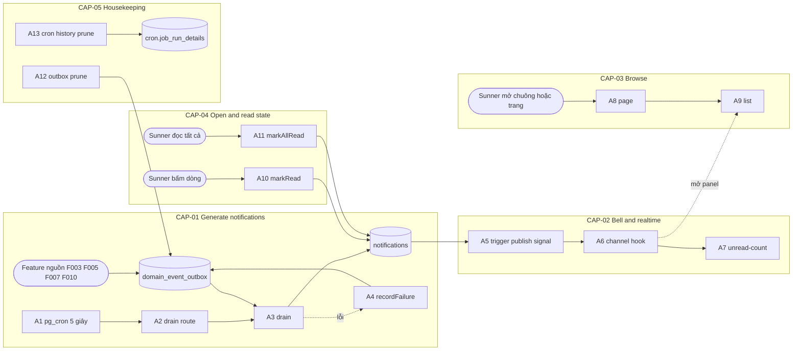
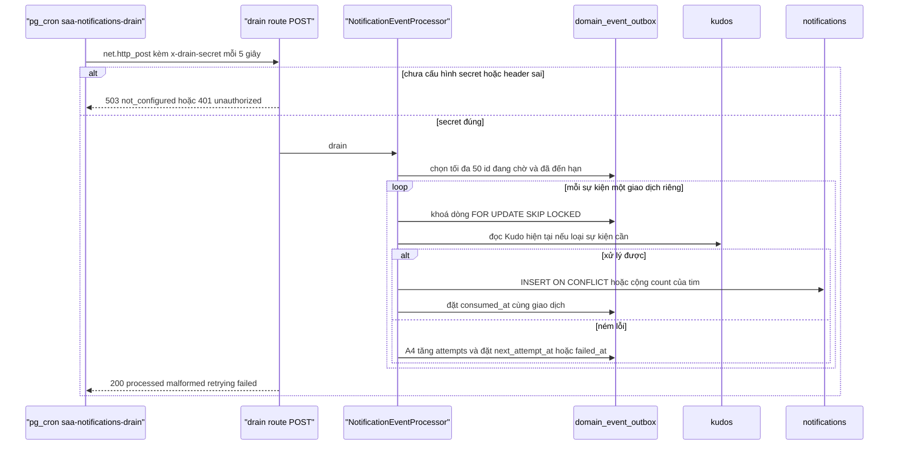
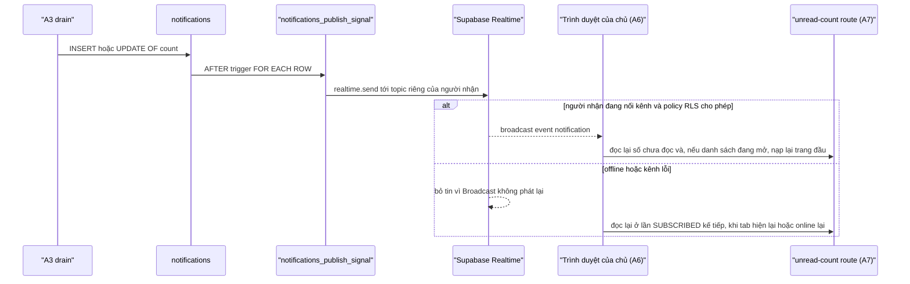
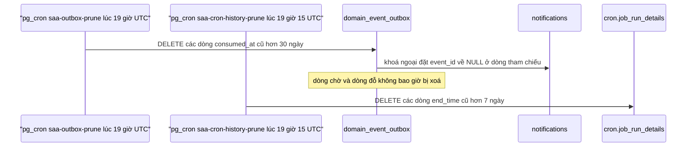
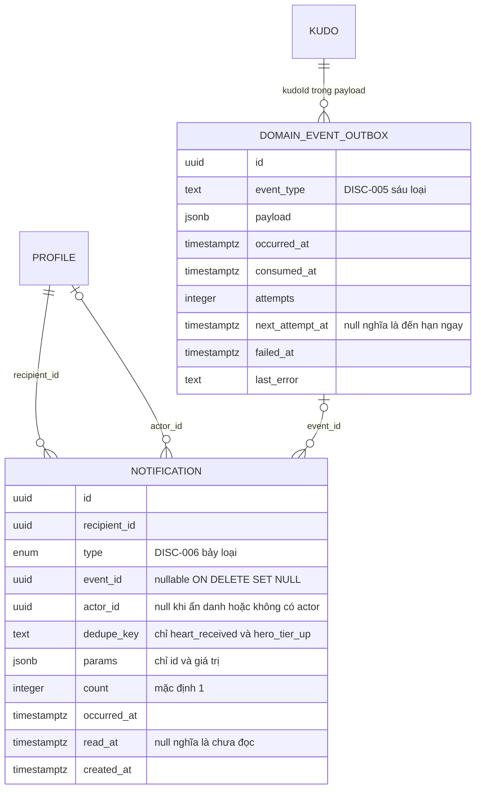
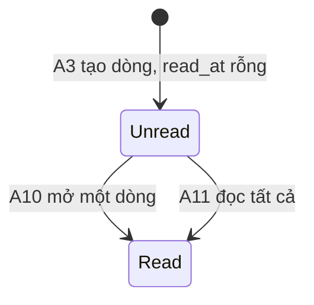
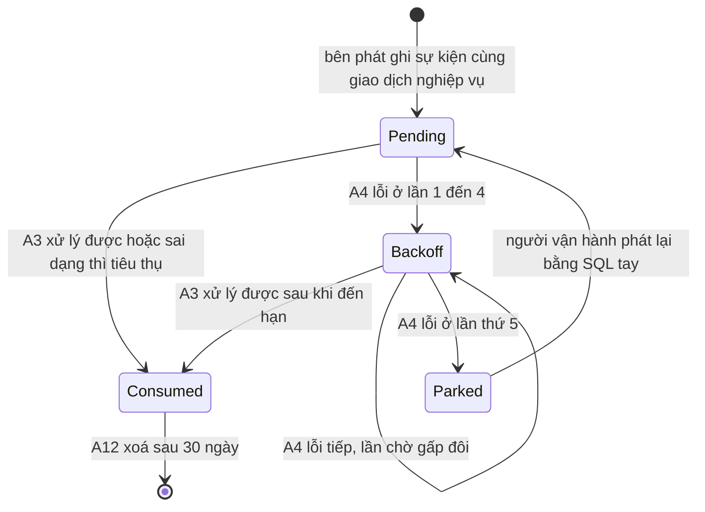
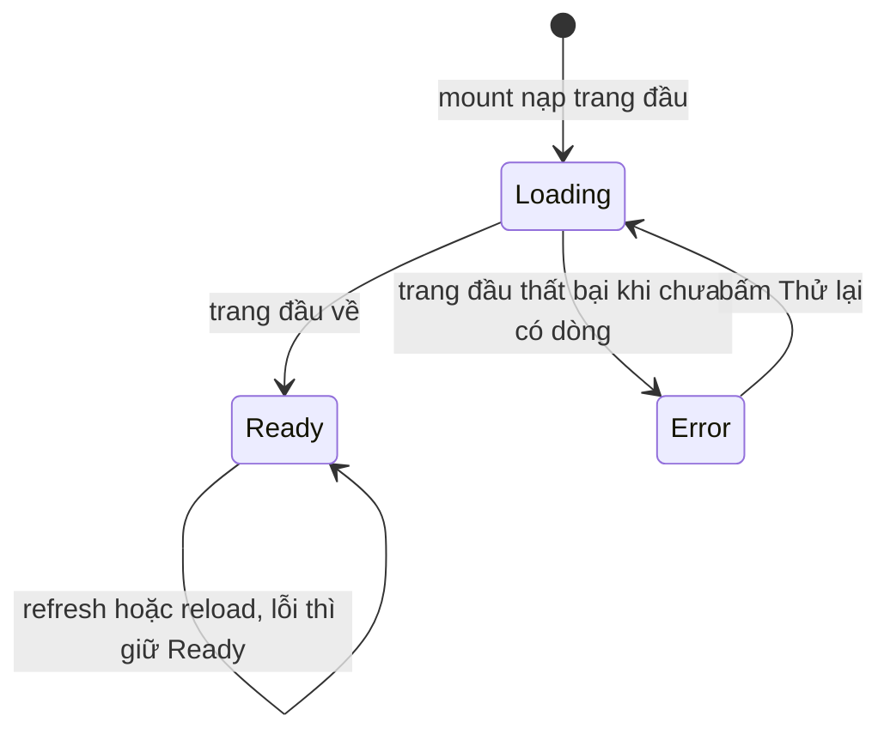

<!-- layout-exempt: rebuild-spec owns all docs/system|features|generated|flows paths — all references here are output targets or internal definitions -->
<!-- Contract: references/feature-spec-researcher-contract.md -->
<!-- Nửa Dev/QA/SA của cặp spec. Mọi mã FR/BR/SM/DEC/ALG/INT được PHÁT BIỂU một lần ở functional-spec.md và CÀI ĐẶT một lần ở đây; không lặp câu quy tắc thuần ngôn ngữ ở file này. -->

# F013_Notifications — Technical Spec

**Priority**: P2
**Type**: mixed
**Generated**: 2026-11-24

**See also:** [`functional-spec.md`](./functional-spec.md) — tổng quan, quyết định còn mở, yêu cầu và quy tắc nghiệp vụ dạng một dòng, màn hình, user story, kịch bản, edge case và cấu hình cho BA/QA.

**How to read this file:** § 2 là bảng chỉ mục action; chọn action cần xem rồi đọc khối của nó ở § 3 từ đầu đến cuối, mỗi khối là một luồng hoàn chỉnh. § 4 là phụ lục dùng chung, chỉ nhảy vào khi § 3 trỏ tới.

## 1. Technical Overview

F013 biến sự kiện miền của F003, F005, F007 và F010 thành thông báo trong ứng dụng: các feature nguồn ghi `domain_event_outbox` trong giao dịch nghiệp vụ của mình, pg_cron gọi endpoint drain nội bộ mỗi 5 giây, bộ xử lý mở một giao dịch cho từng sự kiện rồi ghi `notifications` cùng dấu `consumed_at`. Trigger Postgres bắn tín hiệu Broadcast riêng tư (chỉ id và loại) để chuông ở header (slot do F002 chừa) cập nhật gần như tức thì; danh sách đọc qua route có cursor, đánh dấu đã đọc qua hai Server Action, câu chữ dựng ở trình duyệt bằng next-intl. Hai job pg_cron hằng ngày dọn outbox đã xử lý và lịch sử chạy cron. Dữ liệu ở Postgres (Supabase, Drizzle), giao diện Next.js.



## 2. Action Index

| # | Action (handler) | Method · Path | Codes | Writes | Detail |
|---|---|---|---|---|---|
| **A0** | *cross-cutting — belongs to no single action* | — | FR-003, FR-601, BR-008 | — | § 4.4 |
| **A1** | `cron.schedule#saa-notifications-drain` *(background, no FE)* | queue · `pg_cron` | FR-005, INT-001, INT-005 | — *(gọi A2 qua HTTP)* | § 3.1 ▸ **diagram** |
| **A2** | `drain/route#POST` *(background, no FE)* | `POST` `/api/internal/notifications/drain` | FR-005, FR-604, BR-017 | — *(giao A3 xử lý)* | § 3.1 ▸ **diagram** |
| **A3** | `NotificationEventProcessor#drain` *(background, no FE)* | queue · `domain_event_outbox` | FR-001, FR-004, FR-005, FR-007, FR-405, FR-406, FR-407, FR-408, FR-603, BR-001, BR-002, BR-003, BR-004, BR-005, BR-006, BR-009, BR-010, BR-011, BR-015, SM-001, SM-002, ALG-001, ALG-002, INT-001, INT-003 | `notifications`, `domain_event_outbox` | § 3.1 ▸ **diagram** |
| **A4** | `NotificationEventProcessor#recordFailure` *(background, no FE)* | queue · `domain_event_outbox` | FR-006, BR-011, BR-012, SM-002 | `domain_event_outbox` | § 3.1 ▸ **diagram** |
| **A5** | `notifications_publish_signal` *(background, no FE)* | trigger · `notifications` | FR-402, FR-602, BR-016, INT-002 | `realtime.messages` | § 3.2 ▸ **diagram** |
| **A6** | `useNotificationChannel` *(client hook)* | — | FR-101, FR-401, FR-402, FR-409, FR-410, DEC-003, INT-002, INT-004, US023 | — *(client only)* | § 3.2 |
| **A7** | `unread-count/route#GET` | `GET` `/api/notifications/unread-count` | FR-401, FR-409, US023 | — *(read-only)* | § 3.2 |
| **A8** | `NotificationsPage` | `GET` `/notifications` | FR-301, FR-302, FR-411, US023 | — *(read-only)* | § 3.3 |
| **A9** | `NotificationQuery#list` | `GET` `/api/notifications` | FR-002, FR-102, FR-201, FR-202, FR-203, FR-302, FR-410, FR-411, BR-006, BR-009, BR-010, DEC-001, DEC-002, DEC-004, SM-003, ALG-003, ALG-004, ALG-005, US023 | — *(read-only)* | § 3.3 |
| **A10** | `markNotificationRead` | `POST` `(Server Action)` | FR-103, FR-403, BR-007, BR-018, BR-019, DEC-005, SM-001, ALG-003, US024 | `notifications` | § 3.4 |
| **A11** | `markAllNotificationsRead` | `POST` `(Server Action)` | FR-404, BR-007, BR-019, SM-001, US025 | `notifications` | § 3.4 |
| **A12** | `cron.schedule#saa-outbox-prune` *(background, no FE)* | queue · `pg_cron` | FR-008, BR-013 | `domain_event_outbox`, `notifications` | § 3.5 ▸ **diagram** |
| **A13** | `cron.schedule#saa-cron-history-prune` *(background, no FE)* | queue · `pg_cron` | FR-008, BR-014 | `cron.job_run_details` | § 3.5 ▸ **diagram** |

**Rung set** theo template: Who → FE → Request → BE → Rule → Result → State → Source. Rung vắng thì bỏ hẳn, không ghi `N/A`.

## 3. Actions

### 3.1 CAP-01 — Generate notifications from domain events

Một luồng nền dọc qua bốn action: A1 (pg_cron gọi mỗi 5 giây) → A2 (endpoint drain kiểm secret) → A3 (xử lý từng sự kiện outbox thành thông báo), với A4 ghi nhận lỗi và backoff khi một sự kiện thất bại. Không handler nào một mình giữ trọn thứ tự, nên sơ đồ đặt ở cấp capability.



#### A1 · Schedule the drain every five seconds *(background, no FE)*
`queue · pg_cron` → `` `cron.schedule#saa-notifications-drain` ``
`FR-005` `INT-001` `INT-005` · BL029

**Who** · *không có người dùng — job pg_cron do migration 0020 đăng ký, chạy theo lịch `5 seconds`*
**Request** · *no inbound request* — mỗi lượt job tự bắn một lời gọi HTTP tới A2 bằng `net.http_post`: `url` và header `x-drain-secret` đọc từ Vault (`saa_notifications_drain_url`, `saa_outbox_drain_secret`), body `{}`, `timeout_milliseconds` 30000.
**BE** · khối `DO` của migration kiểm `pg_cron`, `pg_net` có sẵn và đã preload, `vault.decrypted_secrets` tồn tại; rồi `cron.schedule('saa-notifications-drain', '5 seconds', …)` (upsert theo tên nên chạy lại an toàn). Lời gọi tới A2 đi qua `INT-005` — bộ lập lịch của cơ sở dữ liệu gọi HTTP ra ứng dụng (pg_cron + pg_net + Vault) *(§ 4.5)*. Việc kích hoạt đọc hàng đợi `INT-001` — hợp đồng đọc sự kiện từ outbox dùng chung *(§ 4.5)*.
**Rule** · job chỉ gửi khi cả hai secret cùng có trong Vault; thiếu `pg_cron`, `pg_net` hoặc Vault thì migration chỉ `RAISE NOTICE` và không lên lịch, môi trường đó dùng cron máy chủ POST cùng endpoint. `db/migrations/0020_notifications_drain_cron.sql:26-32`, `:45-46`
**Result** · không ghi bảng nghiệp vụ; mỗi lượt chạy thêm một dòng vào `cron.job_run_details` (khoảng 17 nghìn dòng mỗi ngày), được A13 dọn *(§ 3.5)*.
**Source:** `db/migrations/0020_notifications_drain_cron.sql:17-49` → `db/migrations/0020_notifications_drain_cron.sql:35-47`

---

#### A2 · Accept the internal drain call *(background, no FE)*
`POST /api/internal/notifications/drain` → `` `drain/route#POST` ``
`FR-005` `FR-604` `BR-017` · ROUTE005 · BL025

**Who** · *pg_cron (A1) hoặc cron máy chủ — không có session*; đường này là đúng một mục trong `PUBLIC_PATHS` nên qua cổng session, và cổng prelaunch cũng cho đường công khai đi qua.
**Request** · header `x-drain-secret` *(string)*; không có body, không có query.
**BE** · `` `POST` `` gọi `checkOutboxDrainSecret(request.headers.get("x-drain-secret"))` rồi `NotificationEventProcessor.drain()`. `app/api/internal/notifications/drain/route.ts:15-21`
**Rule** · **BR-017 — Lời gọi drain chỉ được chấp nhận khi mang đúng khoá bí mật dùng chung.** Chưa đặt `OUTBOX_DRAIN_SECRET` thì 503 `{ code: "not_configured" }`; thiếu header hoặc khác giá trị thì 401 `{ code: "unauthorized" }`; cả hai giá trị được băm SHA-256 rồi so bằng `timingSafeEqual` nên thời gian so sánh không lộ độ dài hay byte khác đầu tiên. `features/notifications/server/outbox-drain-guard.ts:17-22`
**Result** · 200 `{ processed, malformed, retrying, failed }` cho một lượt drain; 500 `{ code: "unexpected" }` khi lượt drain không khởi chạy được (chỉ khi không đọc nổi danh sách ứng viên); mọi phản hồi `Cache-Control: no-store`. Lời gọi lặp hay chồng nhau vô hại vì A3 khoá từng dòng. `app/api/internal/notifications/drain/route.ts:20-25`
**Source:** `app/api/internal/notifications/drain/route.ts:15-26` → `features/notifications/server/outbox-drain-guard.ts:17-22` → `shared/auth/public-paths.ts:30-40` → `features/awards-portal/server/prelaunch-gate.ts:67`

---

#### A3 · Drain the outbox into notifications *(background, no FE)*
`queue · domain_event_outbox` → `` `NotificationEventProcessor#drain` ``
`FR-001` `FR-004` `FR-005` `FR-007` `FR-405` `FR-406` `FR-407` `FR-408` `FR-603` `BR-001` `BR-002` `BR-003` `BR-004` `BR-005` `BR-006` `BR-009` `BR-010` `BR-011` `BR-015` `SM-001` `SM-002` · BL026 · BL015 · BL014 · BL016 · BL017

**Who** · *không có người dùng — chạy khi A2 gọi (mỗi 5 giây)*
**Request** · *no HTTP request* — mỗi dòng outbox `{ id, event_type, payload }`; payload kiểm bằng `domainEventSchema` (Zod discriminated union theo `type`, `strictObject` nên khoá lạ bị từ chối) cho sáu loại sự kiện ở `INT-001`.
**BE** · `` `NotificationEventProcessor#drain` `` lấy tối đa `OUTBOX_BATCH_SIZE` id đang chờ và đã đến hạn (`consumed_at`, `failed_at` rỗng; `next_attempt_at` rỗng hoặc đã qua), cũ nhất trước theo `(occurred_at, id)`, không khoá. Với MỖI id, `consume` mở một `db.transaction` riêng, đọc lại dòng bằng `FOR UPDATE SKIP LOCKED` (đã bị bên khác giữ hoặc đã xử lý thì bỏ qua, kết quả `skipped`), kiểm Zod (sai thì đánh dấu đã tiêu thụ kèm `last_error` bắt đầu bằng `malformed`, ghi `console.warn`, kết quả `malformed`), rồi `NotificationEventContext.load` → `mapEventToNotifications` → `NotificationWriter.write` → đặt `consumed_at`. Lỗi ném ra thì `processEvent` chuyển cho A4. `features/notifications/server/notification-event-processor.ts:40-48,60-79,101-117`
**Rule** · các quy tắc quyết định ai nhận thông báo gì và khi nào được ghi:
- **BR-001 — Một sự kiện, một người nhận, một loại thì tối đa một thông báo.** Ràng buộc duy nhất `(event_id, recipient_id, type)` là chốt cuối; thêm `consumed_at` đặt cùng giao dịch và `SKIP LOCKED` để xử lý lặp hoặc chạy song song không sinh trùng; mọi INSERT dùng `ON CONFLICT DO NOTHING` trên mọi khoá duy nhất. `features/notifications/server/notification-writer.ts:29-37`; `db/migrations/0018_notifications.sql:21`
- **BR-002 — Người gây ra sự kiện không tự nhận thông báo về hành động của chính mình.** Kudo có người gửi trùng người nhận không sinh gì; thả tim mà người thả chính là chủ Kudo cũng không sinh gì. `features/notifications/server/map-event-to-notifications.ts:30,43-47`
- **BR-003 — Chỉ Kudo còn Public mới sinh thông báo Kudo mới, thả tim và lên bậc Hero.** Bộ xử lý đọc lại `kudos.status` trong giao dịch của sự kiện; Kudo đã Spam hoặc đã bị xoá thì bỏ qua rồi vẫn đánh dấu đã tiêu thụ. Riêng `KudoMarkedSpam` luôn sinh `kudo_hidden_spam` cho chủ Kudo, kể cả khi Kudo đã được Un Spam sau đó (Un Spam không phát sự kiện nên không báo). `features/notifications/server/load-notification-event-context.ts:18-24,35-40`; `features/notifications/server/map-event-to-notifications.ts:69-71`
- **BR-004 — Tim cho cùng một Kudo gộp vào một thông báo chưa đọc.** `heart_received` upsert theo chỉ mục duy nhất từng phần `(recipient_id, dedupe_key)` khi `type = 'heart_received'` và `read_at` rỗng: `count + 1`, `occurred_at` chỉ tiến lên (`greatest`); dòng đã đọc không còn khớp chỉ mục nên tim kế tiếp mở dòng mới. `features/notifications/server/notification-writer.ts:18-27`; `db/migrations/0018_notifications.sql:31`
- **BR-005 — Lên bậc Hero chỉ báo khi bậc hiện tại cao hơn bậc cao nhất đã báo, đúng một lần cho mỗi bậc của mỗi người.** "Trước" là bậc cao nhất đã có trong `dedupe_key` của `hero_tier_up`, không phải số đếm ngay trước Kudo; chỉ mục duy nhất từng phần chặn hai drainer song song; nhảy qua nhiều ngưỡng thì báo bậc đạt được; bậc tụt vì Spam không kích hoạt lại bậc cũ. Chi tiết `ALG-002` *(§ 4.5)*. `features/notifications/server/detect-hero-tier-up.ts:19-24`; `db/migrations/0018_notifications.sql:32`
- **BR-015 — Người nhận đã bị xoá hồ sơ thì bị bỏ qua, không biến sự kiện thành vòng thử lại.** Mọi INSERT là `INSERT … SELECT … FROM profiles WHERE p.id = recipient`, không có dòng hồ sơ thì không chèn gì và sự kiện vẫn được đánh dấu tiêu thụ. `features/notifications/server/notification-writer.ts:19-23,30-36`
- **BR-006 — Kudo ẩn danh không bao giờ để lộ người gửi trong thông báo.** `actor_id` ghi `NULL` khi Kudo ẩn danh, `params` chỉ có `{ kudoId }`; người gửi thật của Kudos Quốc Dân chỉ dùng để chọn người nhận. *(§ 4.4)*
- **BR-009 — Danh sách xếp mới nhất trước theo thời điểm của sự kiện.** Mọi dòng mới lấy `occurred_at` của sự kiện outbox, không phải lúc drain. *(§ 4.4)*
- **BR-010 — Thông báo lưu loại và tham số, không lưu câu chữ.** A3 chỉ ghi `type`, `params`, `count`. *(§ 4.4)*
- **BR-011 — Mỗi sự kiện xử lý trong giao dịch riêng, thông báo và dấu đã xử lý cùng thành công hoặc cùng huỷ.** Một sự kiện lỗi không chặn sự kiện khác trong lô. *(§ 4.4)*
**Result** · ghi `notifications` (`recipient_id`, `type`, `event_id`, `actor_id`, `dedupe_key`, `params`, `occurred_at`; `count` mặc định 1, `read_at` rỗng) ← kết quả `ALG-001` — hàm thuần đổi một sự kiện thành 0..n bản nháp thông báo *(§ 4.5)*; ghi `domain_event_outbox.consumed_at` ← `now()` cùng giao dịch (kèm `last_error` cho sự kiện sai dạng, FR-007). `KudoCreated` của Kudo Public có thể sinh thêm `hero_tier_up` qua `ALG-002` — hàm thuần so bậc Hero hiện tại với bậc đã báo, dùng `INT-003` (hàm `tierFromCount` và truy vấn đếm người gửi của F009) *(§ 4.5)*; BL014 là phần phát hiện này do F009 sở hữu logic bậc, F013 chỉ dùng. Mỗi INSERT hoặc `UPDATE OF count` kích hoạt A5. Trả `DrainOutcome { processed, malformed, retrying, failed }`.
**State** · `SM-002`: `Pending` → `Consumed`; `SM-001`: *(chưa có dòng)* → `Unread` *(§ 4.3)*
**Source:** `features/notifications/server/notification-event-processor.ts:60-79` → `features/notifications/server/load-notification-event-context.ts:35-40` → `features/notifications/server/map-event-to-notifications.ts:63-79` → `features/notifications/server/notification-writer.ts:39-43`
**Shared structure:** `ALG-001` — ánh xạ sáu loại sự kiện thành thông báo cho đúng người nhận; `ALG-002` — phát hiện lên bậc Hero; `INT-001` — hợp đồng đọc outbox; `INT-003` — dùng hàm bậc Hero của F009; chi tiết *(§ 4.5)*

---

#### A4 · Record a failed event with backoff *(background, no FE)*
`queue · domain_event_outbox` → `` `NotificationEventProcessor#recordFailure` ``
`FR-006` `BR-011` `BR-012` `SM-002` · BL026

**Who** · *không có người dùng — gọi từ `processEvent` khi `consume` của A3 ném lỗi*
**Request** · *no HTTP request* — id sự kiện và lỗi vừa bắt (thông điệp cắt còn 500 ký tự).
**BE** · `` `NotificationEventProcessor#recordFailure` `` chạy MỘT câu `UPDATE` trên `domain_event_outbox` với điều kiện đang chờ và đến hạn, `RETURNING failed_at is not null`. `features/notifications/server/notification-event-processor.ts:81-99`
**Rule** · các quy tắc của đường lỗi:
- **BR-012 — Sự kiện lỗi được thử lại với khoảng chờ tăng dần và bị đỗ sau 5 lần.** `next_attempt_at = now() + 60 s × 2^attempts_trước` nên các lần chờ là 1, 2, 4, 8 phút (năm lần thử trải khoảng 15 phút, không phải 25 giây của 5 nhịp cron); đủ `OUTBOX_MAX_ATTEMPTS` thì đặt `failed_at` và `console.error`, dòng đỗ rời khỏi điều kiện đang chờ nên không bao giờ thử lại cho tới khi người vận hành phát lại bằng SQL tay; vì câu `UPDATE` cũng đòi "đến hạn", hai drain chồng nhau chỉ tính một lần thử. `features/notifications/server/notification-event-processor.ts:85-93`; `features/notifications/notification-config.ts:22-29`
- **BR-011 — Giao dịch của sự kiện lỗi huỷ trọn vẹn, sự kiện khác không bị ảnh hưởng.** Vì `consume` chạy trong `db.transaction` riêng nên khi ném lỗi cả thông báo lẫn `consumed_at` đều không được lưu. *(§ 4.4)*
**Result** · ghi `domain_event_outbox.attempts` ← `attempts + 1`, `last_error` ← thông điệp, `next_attempt_at` ← mốc backoff, `failed_at` ← `now()` chỉ ở lần thứ 5; kết quả `retrying` hoặc `failed`. Nếu chính câu `UPDATE` ghi lỗi cũng ném thì chỉ log `could not be recorded`, lần thử đó không được tính và kết quả vẫn là `retrying`. `features/notifications/server/notification-event-processor.ts:92-98`
**State** · `SM-002`: `Pending` → `Backoff` (lần lỗi 1 đến 4), `Backoff` → `Parked` (lần lỗi thứ 5) *(§ 4.3)*
**Source:** `features/notifications/server/notification-event-processor.ts:81-99` → `features/notifications/notification-config.ts:22-29`

---

### 3.2 CAP-02 — Bell badge and realtime sync

Một luồng qua ba action: A5 (trigger phát tín hiệu khi A3 ghi thông báo) → kênh Broadcast riêng tư → A6 (chuông ở trình duyệt nhận tín hiệu) → A7 (đọc lại số chưa đọc). Sơ đồ đặt ở cấp capability.



#### A5 · Push a content-free signal to the owner *(background, no FE)*
`trigger · notifications` → `` `notifications_publish_signal` ``
`FR-402` `FR-602` `BR-016` `INT-002` · BL024 · PERM038

**Who** · *không có người dùng — trigger chạy khi A3 chèn một thông báo hoặc tăng `count` của thông báo tim*
**Request** · *no HTTP request* — dòng `notifications` vừa ghi (`NEW`).
**BE** · hàm plpgsql `public.notifications_publish_signal()` (`SECURITY DEFINER`, `search_path = ''`), trigger `AFTER INSERT OR UPDATE OF count … FOR EACH ROW`, gọi `realtime.send(jsonb_build_object('notificationId', NEW.id, 'type', NEW.type, 'occurredAt', …), 'notification', 'notifications:' || NEW.recipient_id, true)` qua `INT-002` — phát tín hiệu "có thông báo mới" tới kênh riêng của đúng chủ *(§ 4.5)*. `EXECUTE` bị thu hồi khỏi `PUBLIC`, `anon`, `authenticated`. `db/migrations/0019_notifications_realtime.sql:25-51`
**Rule** · **BR-016 — Tín hiệu chỉ mang id, loại và thời điểm; chỉ phát khi có dòng mới hoặc tim tăng, không bao giờ vì đọc.** Trigger chỉ khớp `INSERT` và `UPDATE OF count` nên `UPDATE OF read_at` không phát; payload dựng từng trường nên không có `params`, actor hay nội dung Kudo; lỗi phát bị nuốt (`RAISE LOG`) để không huỷ giao dịch ghi thông báo; không có retry, mất tin được bù ở A6 và A7. Quyền nhận (PERM038): policy `notifications_recipient_read` trên `realtime.messages` cho `authenticated` đọc, và đòi cả topic của lần join lẫn topic của dòng tin đều bằng `'notifications:' || auth.uid()` cùng `extension = 'broadcast'`; không có policy ghi nên client không giả được tin. `db/migrations/0019_notifications_realtime.sql:29-41,46-48,53-59`
**Result** · ghi `realtime.messages` ← một tin Broadcast `{ notificationId, type, occurredAt }` (cộng `id` của chính `realtime.send`, client bỏ qua); nằm trong giao dịch của A3 nên sự kiện bị huỷ thì không phát tin.
**Source:** `db/migrations/0019_notifications_realtime.sql:25-48` → `db/migrations/0019_notifications_realtime.sql:51` → `db/migrations/0019_notifications_realtime.sql:53-59`
**Shared structure:** `INT-002` — phát tín hiệu realtime riêng tư tới trình duyệt của chủ; chi tiết *(§ 4.5)*

---

#### A6 · Show the unread dot and keep it live *(client only)*
`—` → `` `useNotificationChannel` ``
`FR-101` `FR-401` `FR-402` `FR-409` `FR-410` `DEC-003` `INT-002` `INT-004` `US023` · `SCR003_AppLayout/REG001_NotificationBell` · BL002 · BL010

**Who** · Sunner đã đăng nhập, ở bất kỳ trang nào có header của F002 *(gate A0 — § 4.4)*
**FE** · `NotificationBellSlot` (server) đọc `getUnreadCount(userId)` lúc dựng layout và truyền `initialUnread` vào `NotificationBell` (đọc lỗi thì 0 và ghi log, lần join kênh đầu sẽ đọc lại); slot gắn vào header qua `bellSlot`. `NotificationBell` (client) vẽ chấm đỏ `size-2` không kèm số, nút có `aria-expanded`/`aria-controls`, `aria-label` đổi giữa "Thông báo" và "Thông báo (có thông báo chưa đọc)", một vùng `role="status"` đọc "Bạn có thông báo mới" (thêm/bớt khoảng trắng cuối để tin lặp vẫn được đọc lại), bấm thì bật/tắt `NotificationPanel` (A9). Hook `useNotificationChannel` khi mount lấy `browserSupabase()` (`INT-004` — client Supabase phía trình duyệt, một bản mỗi tab, chỉ dùng để vào kênh *(§ 4.5)*), `auth.getSession()` rồi `realtime.setAuth(token)`, mở kênh `notifications:{userId}` với `{ config: { private: true } }` và nghe broadcast event `notification`; payload qua `isNotificationSignal` mới tới `onSignal`; mỗi lần `SUBSCRIBED` (kể cả lần đầu), `visibilitychange` sang visible, hoặc `online` trở lại thì gọi `onResync` vì Broadcast không phát lại; `TOKEN_REFRESHED` gọi lại `setAuth`; `offline` đóng kênh, `online` đóng rồi mở kênh mới; unmount gỡ kênh và mọi listener. `onSignal`: tăng `countSeq` (huỷ kết quả đọc số đang bay), bật chấm, đọc thông báo, phát sự kiện đồng bộ `incoming` để danh sách đang mở gộp trang đầu mới; `onResync`: gọi A7 và phát `incoming`. Nghe lại sự kiện đồng bộ nguồn khác: `all-read` tắt chấm ngay, `read` gọi lại A7. `features/notifications/components/notification-bell-slot.tsx:9-17`; `features/notifications/components/notification-bell.tsx:29-97`; `features/notifications/hooks/use-notification-channel.ts:24-87`
**Request** · thông điệp Broadcast `{ notificationId: string, type: string, occurredAt: string }`; phần tử khác bị bỏ qua.
**Rule** · quyết định chấm đỏ trên chuông:

| DEC | subtype | Condition | What the user sees | Source |
|---|---|---|---|---|
| **DEC-003** | render | `hasUnread` đúng: `initialUnread > 0` ở lần vẽ đầu, hoặc một tín hiệu hợp lệ vừa tới, hoặc lần đọc số gần nhất cho `unread > 0` | chấm đỏ trên chuông, nhãn "Thông báo (có thông báo chưa đọc)" | `features/notifications/components/notification-bell.tsx:42-59` |
| **DEC-003** | render | `hasUnread` sai: lần đọc số cho `unread == 0`, hoặc một danh sách vừa phát `all-read` | chuông không có chấm, nhãn "Thông báo" | `features/notifications/components/notification-bell.tsx:66-73` |

**Result** · không ghi dữ liệu — chỉ đổi trạng thái giao diện của chuông; tín hiệu đến sau một lần đọc số đang bay thì kết quả đọc cũ bị bỏ (`countSeq`).
**Source:** `features/notifications/components/notification-bell-slot.tsx:9-17` → `features/notifications/components/notification-bell.tsx:29-97` → `features/notifications/hooks/use-notification-channel.ts:24-87` → `features/notifications/lib/notification-sync-events.ts:16-28` → `shared/auth/supabase-browser-client.ts:14-20`
**Shared structure:** `INT-002` — tín hiệu realtime nhận từ A5; `INT-004` — client trình duyệt dùng chung với Spotlight; chi tiết *(§ 4.5)*

<!-- No diagram: client thuần, một nguồn sự kiện và hai lời gọi đọc; thứ tự đã nằm ở sơ đồ capability phía trên. -->

---

#### A7 · Read the unread count
`GET /api/notifications/unread-count` → `` `unread-count/route#GET` ``
`FR-401` `FR-409` `US023` · ROUTE012 · `SCR003_AppLayout/REG001_NotificationBell`

**Who** · Sunner đã đăng nhập *(gate A0 — § 4.4)*
**FE** · `fetchUnreadCount` gọi route này ở A6 sau `SUBSCRIBED`, khi tab hiện lại, khi `online` trở lại và sau mỗi lần đánh dấu đọc đã chốt (A10, A11). `features/notifications/lib/fetch-notifications.ts:27-30`
**Request** · không tham số; `userId` lấy từ session.
**BE** · `requireNotificationUser()` trả 401 trước khi đụng cơ sở dữ liệu, rồi `getUnreadCount(userId)` chạy `count(*)` trên `notifications` với `recipient_id = userId AND read_at IS NULL` (chỉ mục từng phần `notifications_recipient_unread_idx`). `app/api/notifications/unread-count/route.ts:9-19`; `features/notifications/server/notification-unread-query.ts:11-17`
**Result** · read-only. 200 `{ unread }`; 401 `{ code: "unauthorized" }`; 500 `{ code: "unexpected" }`; `Cache-Control: private, no-store`.
**Source:** `app/api/notifications/unread-count/route.ts:9-19` → `features/notifications/server/notification-api-session.ts:9-25` → `features/notifications/server/notification-unread-query.ts:11-17`

<!-- No diagram: đọc một truy vấn, đồng bộ. -->

---

### 3.3 CAP-03 — Browse notifications

#### A8 · Open the all-notifications page
`GET /notifications` → `` `NotificationsPage` ``
`FR-301` `FR-302` `FR-411` `US023` · `SCR017_AllNotifications`

**Who** · Sunner đã đăng nhập *(gate A0 — § 4.4)*
**FE** · `NotificationsPage` dựng `LiveBoardKeyvisualBackground` rồi `NotificationListPageClient`: panel rộng 680 giữa trang, tiêu đề `h1` "Thông báo", nút "Đánh dấu đọc tất cả" (biểu tượng kèm chữ, `aria-disabled` khi đang đánh dấu — A11) và danh sách dùng `useNotificationList(NOTIFICATION_PAGE_SIZE)`; `loading.tsx` là khung chờ tức thì; `generateMetadata` đặt tiêu đề "Thông báo"; `instant = false` vì trang đọc session mỗi request. Nguồn sự kiện đồng bộ của trang là `page`. `app/(app)/notifications/page.tsx:7-29`; `features/notifications/components/notification-list-page-client.tsx:22-69`; `app/(app)/notifications/loading.tsx:4-21`
**Request** · không tham số.
**BE** · `requireSunner()`: khách chuyển về `/login`, người chưa có phòng ban chuyển về trang onboarding; không có truy vấn dữ liệu — dòng thông báo nạp ở trình duyệt từ A9. `app/(app)/notifications/page.tsx:21-23`; `shared/auth/current-user.ts:48-53`
**Result** · read-only; trả khung trang, danh sách tải sau qua A9.
**Source:** `app/(app)/notifications/page.tsx:21-29` → `features/notifications/components/notification-list-page-client.tsx:22-69` → `shared/auth/current-user.ts:48-53`

<!-- No diagram: render một trang, không ghi dữ liệu, không bất đồng bộ phía máy chủ. -->

---

#### A9 · List notifications for the current user
`GET /api/notifications` → `` `NotificationQuery#list` ``
`FR-002` `FR-102` `FR-201` `FR-202` `FR-203` `FR-302` `FR-410` `FR-411` `BR-006` `BR-009` `BR-010` `DEC-001` `DEC-002` `DEC-004` `SM-003` `ALG-003` `ALG-004` `ALG-005` `US023` · ROUTE011 · `SCR003_AppLayout/REG001_NotificationBell` · `SCR017_AllNotifications`

**Who** · Sunner đã đăng nhập, chỉ thấy dòng của chính mình *(gate A0 — § 4.4)*
**FE** · ba phần dùng chung một đường đọc. (1) Panel của chuông (`NotificationPanel`) chỉ mount khi mở, mỗi lần mở nạp `NOTIFICATION_DROPDOWN_LIMIT` dòng mới nhất, và đây là cỡ trang chứ không phải giới hạn: panel truyền `onLoadMore`/`scrollRoot` cho `NotificationList` nên cuộn trong bảng nạp tiếp từng trang 10 dòng cũ hơn; hộp thoại không modal, nhận focus khi mở, Esc hoặc bấm ra ngoài đóng (do `useDismissable` của F002 trong chuông xử lý), tiêu đề "Thông báo", liên kết "Xem tất cả" tới `/notifications` (FR-102) và nút biểu tượng đánh dấu đọc tất cả (A11). (2) Trang A8 nạp `NOTIFICATION_PAGE_SIZE` dòng mỗi lần. (3) `NotificationList` dùng chung: khung chờ 3 dòng, trạng thái lỗi, trạng thái rỗng, `NotificationRow` (biểu tượng 40 px theo loại, câu chữ, `<time>` tương đối, chấm đỏ cho dòng chưa đọc, toàn dòng là một liên kết tới `href`; dòng `kudo_hidden_spam` có thêm liên kết "Tiêu chuẩn cộng đồng" tới `/community-standards`). Cuộn vô hạn: `useInfiniteScrollSentinel` quan sát một phần tử đáy bằng `IntersectionObserver` với `rootMargin` 160 px và gọi `loadMore` khi `status == ready`, còn `nextCursor` và `moreStatus == idle`; observer dựng lại mỗi khi số dòng đổi nên trang ngắn vẫn tiếp tục nạp; `useMinuteClock` làm mới thời gian tương đối mỗi phút. Hook `useNotificationList` nạp trang đầu lúc mount, nối trang cũ hơn bằng `ALG-005` — hàm thuần khử trùng theo id khi nối và gộp trang đầu *(§ 4.5)*, và bỏ phản hồi trang đầu cũ hơn lần yêu cầu mới nhất. `features/notifications/components/notification-panel.tsx:31-107`; `features/notifications/components/notification-list.tsx:50-110`; `features/notifications/components/notification-row.tsx:27-69`; `features/notifications/hooks/use-infinite-scroll-sentinel.ts:11-35`; `features/notifications/hooks/use-notification-list.ts:37-126`
**Request** · query `limit` *(số nguyên dương, mặc định `NOTIFICATION_PAGE_SIZE`, kẹp ở `NOTIFICATION_MAX_PAGE_SIZE`; mẫu `^[1-9]\d{0,5}$`)*, `cursor` *(chuỗi mờ, bộ mã hoá `(timestamp µs, uuid)` chặt dùng chung với feed Kudo của F004; sai thì 400)*. `features/notifications/server/notification-list-params.ts:9-24`
**BE** · `requireNotificationUser()` (401 trước mọi truy vấn) → `parseNotificationListParams` (400 `invalid_request`) → `NotificationQuery#list` chạy một câu SQL: `notifications n` `LEFT JOIN kudos` (chỉ với `kudo_received`, `heart_received`; `params->>'kudoId'` qua kiểm mẫu UUID rồi ép `uuid`) `LEFT JOIN profiles` cho tên người gửi và tên người nhận Kudo, `WHERE n.recipient_id = userId`, sắp `occurred_at DESC, id DESC`, phân trang keyset `(occurred_at, id) < cursor`, lấy `limit + 1` dòng để biết còn trang sau và mã hoá `nextCursor` từ dòng cuối bằng `cursor_at` (µs). `toNotificationView` đổi từng dòng thành `{ id, type, occurredAt, read, href, params }` (`href` do `ALG-003` tính, `params` theo loại). `app/api/notifications/route.ts:13-26`; `features/notifications/server/notification-query.ts:34-73`; `features/notifications/server/notification-view-mapper.ts:63-91`
**Rule** · các quyết định hiển thị của danh sách:
- **BR-006 — Kudo ẩn danh không bao giờ để lộ người gửi trong dữ liệu gửi xuống trình duyệt.** Ẩn danh theo trạng thái HIỆN TẠI của Kudo (có thể sửa sau): câu SQL chỉ chọn `actor.full_name` khi Kudo hiện không ẩn danh và chỉ chọn `anonymous_nickname` khi Kudo hiện ẩn danh, giá trị còn lại không rời cơ sở dữ liệu; `toNotificationView` không bao giờ đặt `actorName` cạnh `anonymousNickname`. *(§ 4.4)*
- **BR-009 — Xếp mới nhất trước theo `(occurred_at, id)`.** Thông báo tim vừa được cộng `count` nhảy lên đầu vì `occurred_at` được dời. *(§ 4.4)*
- **BR-010 — Câu chữ do trình duyệt dựng từ loại và tham số.** Route không trả câu đã dịch, chỉ trả `type` và `params`. *(§ 4.4)*

| DEC | subtype | Condition | What the user sees | Source |
|---|---|---|---|---|
| **DEC-001** | render | `type == 'kudo_received'` và có `params.anonymousNickname` | câu "Sunner {nickname} (ẩn danh) vừa gửi đến bạn lời ghi nhận đầy yêu thương!" | `features/notifications/lib/notification-message.ts:14-18` |
| **DEC-001** | render | `type == 'kudo_received'`, không có nickname, có `params.actorName` | câu "Sunner {name} vừa gửi đến bạn lời ghi nhận đầy yêu thương!" | `features/notifications/lib/notification-message.ts:14-18` |
| **DEC-001** | render | `type == 'kudo_received'`, không có cả hai | câu "Một Sunner ẩn danh vừa gửi đến bạn lời ghi nhận đầy yêu thương!" | `features/notifications/lib/notification-message.ts:14-18` |
| **DEC-002** | render | `type == 'heart_received'` và `count == 1` | "Wow! Lời nhắn gửi của bạn cho Sunner {name} vừa nhận thêm lượt tim!" | `features/notifications/lib/notification-message.ts:32-33`; `messages/vi.json:738` |
| **DEC-002** | render | `type == 'heart_received'` và `count > 1` | cùng câu nhưng "vừa nhận thêm {count} lượt tim!" (ICU plural `=1` / `other`) | `messages/vi.json:738` |
| **DEC-004** | render | `status == 'loading'` | 3 dòng khung chờ, chữ ẩn "Đang tải thông báo…" | `features/notifications/components/notification-list.tsx:60-69` |
| **DEC-004** | render | `status == 'error'` và `items.length == 0` | cảnh báo "Không tải được thông báo. Vui lòng thử lại." kèm nút "Thử lại" | `features/notifications/components/notification-list.tsx:70-79` |
| **DEC-004** | render | `status == 'ready'` và `items.length == 0` | "Bạn chưa có thông báo nào" | `features/notifications/components/notification-list.tsx:80-86` |
| **DEC-004** | render | có dòng và `moreStatus == 'error'` / `'loading'` | giữ nguyên các dòng; lỗi hiện cảnh báo và nút "Thử lại" riêng, đang nạp hiện "Đang tải thêm thông báo…" | `features/notifications/components/notification-list.tsx:88-106` |

**Result** · read-only. 200 `NotificationPage { items: NotificationView[], nextCursor: string | null }` chỉ gồm dòng của người dùng phiên; 401 `{ code: "unauthorized" }`, 400 `{ code: "invalid_request" }`, 500 `{ code: "unexpected" }`; `Cache-Control: private, no-store`. Đích bấm của từng dòng tính ở máy chủ bằng `ALG-003` — bảng loại thông báo → đường dẫn đích *(§ 4.5)*; thời gian tương đối dựng ở trình duyệt bằng `ALG-004` — hàm thuần đổi khoảng thời gian thành "Vừa xong", "15 phút trước"… theo ngôn ngữ đang chọn *(§ 4.5)*.
**State** · `SM-003`: `Loading` → `Ready` hoặc `Error` (nạp trang đầu), `Error` → `Loading` ("Thử lại") *(§ 4.3)*
**Source:** `app/api/notifications/route.ts:13-26` → `features/notifications/server/notification-list-params.ts:16-24` → `features/notifications/server/notification-query.ts:34-73` → `features/notifications/server/notification-view-mapper.ts:43-91` → `features/notifications/components/notification-list.tsx:50-110` → `features/notifications/hooks/use-notification-list.ts:78-126`
**Shared structure:** `ALG-003` — đích điều hướng của dòng; `ALG-004` — thời gian tương đối; `ALG-005` — gộp và khử trùng danh sách; chi tiết *(§ 4.5)*

<!-- No diagram: đọc một truy vấn; phần phân nhánh thật là các bảng DEC phía trên, vẽ thành sơ đồ trình tự chỉ làm sai thứ tự song song của chúng. -->

---

### 3.4 CAP-04 — Open a notification and manage read state

#### A10 · Mark one notification read
`Server Action` → `` `markNotificationRead` ``
`FR-103` `FR-403` `BR-007` `BR-018` `BR-019` `DEC-005` `SM-001` `ALG-003` `US024` · ROUTE033 · `SCR003_AppLayout/REG001_NotificationBell` · `SCR017_AllNotifications`

**Who** · Sunner đã đăng nhập, chỉ với thông báo của chính mình *(gate A0 — § 4.4)*
**FE** · bấm vào dòng (`NotificationRow`, toàn dòng là liên kết tới `href`) gọi `onOpen(item)`; việc điều hướng tới `href` do liên kết đảm nhiệm và không chờ phản hồi. Ở panel `openItem` đóng panel trước rồi, nếu dòng chưa đọc, `list.markRead(item)` và sau khi xong phát sự kiện đồng bộ `read`; ở trang thì không đóng gì. `markRead` bỏ qua dòng đã đọc hoặc đã đánh dấu cục bộ, thêm id vào `locallyRead`, đổi dòng thành đã đọc ngay, gọi Server Action ở nền; thất bại (ném lỗi hoặc `{ ok: false }`) thì `revert` trả dòng về chưa đọc. `features/notifications/components/notification-row.tsx:41-52`; `features/notifications/components/notification-panel.tsx:48-52`; `features/notifications/components/notification-list-page-client.tsx:32-35`; `features/notifications/hooks/use-notification-list.ts:128-148`
**Request** · tham số `id` *(string, `z.uuid()`)*; không có route HTTP riêng (ROUTE033 là Server Action gửi về trang hiện tại).
**BE** · `` `markNotificationRead` `` gọi `requireSunner()` (khách về `/login`), kiểm `z.uuid()` (sai dạng thì `not_found`), rồi `NotificationReadState.markRead(userId, id)`: `UPDATE notifications SET read_at = now() WHERE id AND recipient_id = userId AND read_at IS NULL RETURNING id`; không dòng nào bị ghi thì đọc lại `WHERE id AND recipient_id`: có thì coi như đã đọc (thành công), không có thì `not_found`. Sau đó `getUnreadCount(userId)`. Không `revalidatePath`: chuông và panel tự cập nhật lạc quan rồi đọc lại qua A7. `features/notifications/server/notification-actions.ts:15-26`; `features/notifications/server/notification-read-state.ts:14-23`
**Rule** · các quy tắc của việc mở và đánh dấu một dòng:
- **BR-007 — Đã đọc là một chiều và đánh dấu lặp là vô hại.** Điều kiện `read_at IS NULL` làm gọi lặp hay hai tab cùng bấm không đổi `read_at` đã có và không lỗi; không đường nào đặt `read_at` về rỗng. *(§ 4.4)*
- **BR-018 — Id sai dạng, không tồn tại hoặc của người khác trả cùng một câu trả lời `not_found`.** Không lộ id có tồn tại hay không; `unexpected` chỉ dành cho lỗi ghi. `features/notifications/server/notification-actions.ts:17-18,20,22-25`
- **BR-019 — Đánh dấu lạc quan: dòng thành đã đọc ngay, server từ chối thì trả về chưa đọc, id đã đọc cục bộ thắng mọi phản hồi tải về từ trước.** *(§ 4.4)*

| DEC | subtype | Condition | What the user sees | Source |
|---|---|---|---|---|
| **DEC-005** | interaction | bấm dòng ở panel | panel đóng ngay; dòng chưa đọc được đánh dấu lạc quan, dòng đã đọc không gọi server | `features/notifications/components/notification-panel.tsx:48-52` |
| **DEC-005** | interaction | bấm dòng ở trang `/notifications` | không đóng gì; cùng quyết định đọc hoặc bỏ qua | `features/notifications/components/notification-list-page-client.tsx:32-35` |
| **DEC-005** | interaction | server từ chối hoặc ném lỗi | chấm đỏ của dòng quay lại, nhưng việc đi tới `href` vẫn diễn ra | `features/notifications/hooks/use-notification-list.ts:138-148` |

**Result** · ghi `notifications.read_at` ← `now()` cho đúng dòng (chỉ lần đọc đầu tiên, `read_at` đã có thì giữ nguyên); trả `{ ok: true, unread }`; lỗi dự kiến `{ ok: false, code: "not_found" }` và `{ ok: false, code: "unexpected" }` (ghi `console.error`). Bước chuyển chưa đọc sang đã đọc của `SM-001` *(§ 4.3)*. Đích điều hướng của từng loại do `ALG-003` — bảng loại thông báo → đích — đã gắn sẵn ở `href` *(§ 4.5)*.
**State** · `SM-001`: `Unread` → `Read` *(§ 4.3)*
**Source:** `features/notifications/components/notification-row.tsx:41-52` → `features/notifications/components/notification-panel.tsx:48-52` → `features/notifications/hooks/use-notification-list.ts:138-148` → `features/notifications/server/notification-actions.ts:15-26` → `features/notifications/server/notification-read-state.ts:14-23` → `features/notifications/server/notification-view-mapper.ts:43-57`

<!-- No diagram: một bảng được ghi, đồng bộ; nhánh phân quyết nằm ở bảng DEC phía trên. -->

---

#### A11 · Mark all notifications read
`Server Action` → `` `markAllNotificationsRead` ``
`FR-404` `BR-007` `BR-019` `SM-001` `US025` · ROUTE034 · `SCR003_AppLayout/REG001_NotificationBell` · `SCR017_AllNotifications`

**Who** · Sunner đã đăng nhập *(gate A0 — § 4.4)*
**FE** · biểu tượng đánh dấu đọc tất cả ở panel (nhãn truy cập "Đánh dấu đọc tất cả") và nút chữ cùng tên ở trang; bấm thì không hỏi xác nhận: bỏ qua nếu đang đánh dấu (`markingAll`, `aria-disabled`), phát sự kiện đồng bộ `all-read` (chuông tắt chấm ngay), `list.markAllRead()` đổi mọi dòng đang nạp thành đã đọc rồi gọi Server Action (thất bại thì `revert` đúng các id đó), rồi phát `read` — chuông đọc lại số thật nên chấm trở lại nếu server lỗi. `features/notifications/components/notification-panel.tsx:54-61,80-89`; `features/notifications/components/notification-list-page-client.tsx:37-44,52-55`; `features/notifications/hooks/use-notification-list.ts:151-158`
**Request** · không tham số; `userId` lấy từ session.
**BE** · `` `markAllNotificationsRead` `` gọi `requireSunner()` rồi `NotificationReadState.markAllRead(userId)`: `UPDATE notifications SET read_at = now() WHERE recipient_id = userId AND read_at IS NULL RETURNING id`, đếm số dòng đổi; sau đó `getUnreadCount(userId)`. `features/notifications/server/notification-actions.ts:28-37`; `features/notifications/server/notification-read-state.ts:26-33`
**Rule** · **BR-007 — Đã đọc là một chiều và đánh dấu lặp là vô hại.** Chỉ chạm dòng chưa đọc của chính người dùng, kể cả dòng chưa nạp trên màn hình; dòng đến sau câu `UPDATE` vẫn chưa đọc; gọi khi không còn dòng chưa đọc vẫn thành công với `updated = 0`. *(§ 4.4)* **BR-019 — Đánh dấu lạc quan, hoàn tác khi server từ chối.** Mọi dòng đang nạp đổi sang đã đọc ngay và trở lại chưa đọc nếu action thất bại. *(§ 4.4)*
**Result** · ghi `notifications.read_at` ← `now()` cho mọi dòng chưa đọc của người dùng; trả `{ ok: true, updated, unread }` hoặc `{ ok: false, code: "unexpected" }` (ghi `console.error`); mỗi dòng đi qua bước chuyển chưa đọc sang đã đọc của `SM-001` *(§ 4.3)*.
**State** · `SM-001`: `Unread` → `Read` *(§ 4.3)*
**Source:** `features/notifications/components/notification-panel.tsx:54-61` → `features/notifications/hooks/use-notification-list.ts:151-158` → `features/notifications/server/notification-actions.ts:28-37` → `features/notifications/server/notification-read-state.ts:26-33`

<!-- No diagram: một câu UPDATE đồng bộ trên một bảng. -->

---

### 3.5 CAP-05 — Keep the outbox and cron history bounded

Hai job pg_cron độc lập, chạy hằng ngày trong Postgres, không có handler nào gọi nhau; một sơ đồ chung ở cấp capability.



#### A12 · Prune consumed outbox events daily *(background, no FE)*
`queue · pg_cron` → `` `cron.schedule#saa-outbox-prune` ``
`FR-008` `BR-013` · BL031

**Who** · *không có người dùng — job pg_cron chạy 19:00 UTC (02:00 ICT) mỗi ngày, do migration 0023 đăng ký*
**Request** · *no inbound request* — chỉ có câu SQL đã lên lịch.
**BE** · `cron.schedule('saa-outbox-prune', '0 19 * * *', …)` với `DELETE FROM public.domain_event_outbox WHERE consumed_at IS NOT NULL AND consumed_at < now() - interval '30 days'`; thiếu `pg_cron` (có sẵn và đã preload) thì migration chỉ `RAISE NOTICE`, môi trường đó chạy cùng câu DELETE bằng cron máy chủ. `db/migrations/0023_housekeeping_outbox_and_cron_history_prune.sql:26-35`
**Rule** · **BR-013 — Chỉ xoá sự kiện đã xử lý quá 30 ngày; sự kiện đang chờ và sự kiện đã đỗ không bao giờ bị xoá.** Điều kiện `consumed_at IS NOT NULL` loại cả dòng chờ lẫn dòng đỗ (`failed_at` có giá trị, `consumed_at` rỗng, chờ phát lại thủ công) dù cũ đến đâu; người đọc outbox duy nhất là A3 và nó chỉ đọc dòng đang chờ; `notifications.event_id` là `ON DELETE SET NULL` nên lịch sử thông báo còn nguyên với `event_id` rỗng, và việc đó không phát tín hiệu vì trigger chỉ khớp `INSERT` và `UPDATE OF count`. Không có chỉ mục trên `consumed_at` và không chia lô. `db/migrations/0023_housekeeping_outbox_and_cron_history_prune.sql:3-14,32-35`; `db/migrations/0021_notifications_retry_backoff_and_event_fk.sql:15-19`
**Result** · xoá dòng của `domain_event_outbox`; khoá ngoại đặt `notifications.event_id` ← `NULL` ở các dòng thông báo tham chiếu. Giữ 30 ngày để xem lại sự cố, kể cả sự kiện sai dạng (cột `last_error`).
**State** · `SM-002`: `Consumed` → *(đã xoá khỏi hàng chờ)* *(§ 4.3)*
**Source:** `db/migrations/0023_housekeeping_outbox_and_cron_history_prune.sql:22-35` → `db/migrations/0021_notifications_retry_backoff_and_event_fk.sql:15-19`

---

#### A13 · Prune old cron run history daily *(background, no FE)*
`queue · pg_cron` → `` `cron.schedule#saa-cron-history-prune` ``
`FR-008` `BR-014` · BL030

**Who** · *không có người dùng — job pg_cron chạy 19:15 UTC (02:15 ICT) mỗi ngày*
**Request** · *no inbound request* — chỉ có câu SQL đã lên lịch.
**BE** · `cron.schedule('saa-cron-history-prune', '15 19 * * *', …)` với `DELETE FROM cron.job_run_details WHERE end_time < now() - interval '7 days'`. `db/migrations/0023_housekeeping_outbox_and_cron_history_prune.sql:36-39`
**Rule** · **BR-014 — Giữ lịch sử chạy cron 7 ngày; chỉ dọn được lịch sử của các job do vai trò migration lên lịch.** pg_cron chạy mỗi job bằng vai trò đã lên lịch và RLS của `cron.job_run_details` giới hạn theo `username = current_user`, nên chỉ lịch sử các job `saa-*` bị dọn, job của vai trò khác giữ nguyên; riêng job drain 5 giây đã thêm khoảng 17 nghìn dòng mỗi ngày. `db/migrations/0023_housekeeping_outbox_and_cron_history_prune.sql:15-17,36-39`
**Result** · xoá dòng của `cron.job_run_details`.
**Source:** `db/migrations/0023_housekeeping_outbox_and_cron_history_prune.sql:36-39` → `db/migrations/0023_housekeeping_outbox_and_cron_history_prune.sql:15-17`

---

### 3.6 Edge cases

| Action | Scenario | Behavior |
|---|---|---|
| A3 | Cùng một sự kiện bị xử lý hai lần (hai drain chồng nhau) | `SKIP LOCKED` cho một tiến trình; nếu lỡ, `UNIQUE (event_id, recipient_id, type)` chặn dòng trùng và `consumed_at` cùng giao dịch chặn cộng `count` hai lần (BR-001) |
| A3 | Payload sai dạng hoặc `event_type` lạ | `console.warn`, đặt `consumed_at` kèm `last_error` bắt đầu bằng `malformed`, không tạo thông báo, không kẹt hàng đợi; kết quả `malformed` (FR-007) |
| A3 · A4 | Lỗi tạm thời (mất kết nối DB, F009 lỗi) giữa giao dịch | giao dịch huỷ trọn, `consumed_at` rỗng; A4 đặt `attempts + 1` và `next_attempt_at` (1, 2, 4, 8 phút), lần thứ 5 đặt `failed_at` và `console.error` (BR-012) |
| A3 | Kudo đã Spam hoặc đã bị xoá trước khi xử lý | bỏ qua `kudo_received`, `heart_received`, `hero_tier_up` và vẫn đánh dấu tiêu thụ; `kudo_hidden_spam` vẫn được sinh (BR-003) |
| A3 | Hai tim cho cùng Kudo xử lý song song, chưa có dòng chưa đọc | chỉ mục duy nhất từng phần làm một bên chèn, bên kia cộng `count` (BR-004) |
| A3 · A10 | Tim đến đúng lúc Sunner vừa đọc dòng tim | dòng đã đọc không khớp chỉ mục từng phần nên tim sinh dòng mới chưa đọc (BR-004, BR-007) |
| A3 | Nhiều Kudo tới cùng người nhận, xử lý lệch thứ tự hoặc theo đợt | "trước" là bậc cao nhất đã báo nên mỗi bậc chỉ báo đúng một lần, không trượt, không báo đôi (BR-005) |
| A3 | Người gửi có hai Kudo trong Kudos Quốc Dân | một thông báo `national_kudos` cho người đó, `params.items` liệt kê cả hai theo hạng tăng dần (BR-001) |
| A3 | Người nhận đã bị xoá hồ sơ | `INSERT … SELECT FROM profiles` không chèn gì, sự kiện vẫn tiêu thụ, không vòng thử lại (BR-015) |
| A2 | Gọi drain khi chưa đặt `OUTBOX_DRAIN_SECRET` | 503 `not_configured`; sự kiện nằm chờ trong outbox, chưa có thông báo nào (BR-017) |
| A2 | Gọi drain thiếu hoặc sai `x-drain-secret` | 401 `unauthorized`, không chạy drain (BR-017) |
| A1 · A2 | Một lượt cron lỡ hoặc `timeout_milliseconds` 30000 hết | thông báo chỉ trễ tới lượt kế; drain idempotent nên lượt chồng vô hại |
| A5 · A6 | Người nhận offline hoặc kênh lỗi | tin bị bỏ (Broadcast không phát lại); A7 đọc số đúng ở lần `SUBSCRIBED` kế, khi tab hiện lại hoặc `online` trở lại |
| A6 | Kênh realtime đứt rồi nối lại | mỗi `SUBSCRIBED` gọi `onResync`: đọc lại A7 và gộp lại trang đầu của danh sách đang mở (FR-409) |
| A6 | Thông điệp Broadcast sai dạng | `isNotificationSignal` từ chối, bỏ qua, chuông không đổi |
| A6 | Token phiên được làm mới | `TOKEN_REFRESHED` gọi lại `realtime.setAuth` để kênh riêng tư không bị từ chối |
| A5 | Lỗi `realtime.send` trong trigger | nuốt và `RAISE LOG`, giao dịch ghi thông báo vẫn commit (BR-016) |
| A9 | Trang đang cuộn mà có thông báo mới hoặc tim làm dời `occurred_at` | một dòng có thể lệch giữa hai trang; `ALG-005` khử trùng theo `id`, bản mới thắng khi gộp trang đầu |
| A9 | `cursor` hỏng hoặc `limit` không phải số nguyên dương | 400 `invalid_request`; FE hiện trạng thái lỗi và cho "Thử lại" từ đầu |
| A9 | `limit` lớn hơn trần | kẹp xuống `NOTIFICATION_MAX_PAGE_SIZE` (50), không lỗi |
| A9 | Nạp trang kế thất bại | giữ các dòng đã có, hiện cảnh báo và nút "Thử lại" riêng (`moreStatus == 'error'`) |
| A3 · A9 | Kudo ẩn danh được sửa thành không ẩn danh sau khi đã có thông báo | `actor_id` vẫn `NULL` (ghi lúc A3), A9 trả cả `actorName` lẫn `anonymousNickname` rỗng nên dòng hiện câu "Một Sunner ẩn danh…" (DEC-001); chiều ngược lại (không ẩn danh → ẩn danh) chỉ còn biệt danh (BR-006) |
| A9 | Kudo đích đã Spam khi Sunner bấm dòng cũ | dòng vẫn hiện (BR-008); đích dẫn tới trang chi tiết Kudo, chủ Kudo vẫn xem được Kudo bị ẩn của mình, người khác nhận trang không tìm thấy *(do F004 quyết định)* |
| A10 | Id lạ, sai dạng hoặc của người khác | `{ ok: false, code: "not_found" }` cùng một phản hồi (BR-018) |
| A10 | Hai tab cùng bấm một dòng | `read_at` đầu tiên được giữ, lần sau thành công không đổi gì (BR-007) |
| A10 · A11 | Đánh dấu đọc tất cả cùng lúc có thông báo mới đến | dòng đến sau câu `UPDATE` vẫn chưa đọc, chuông đúng theo A7 (BR-007) |
| A11 | Server lỗi khi đánh dấu tất cả | các dòng trở lại chưa đọc; chuông đã tắt chấm lạc quan nhưng sau `read` đọc lại số thật nên chấm trở lại (BR-019) |
| A12 | Sự kiện đang chờ hoặc đã đỗ rất cũ | không bị xoá, vì điều kiện `consumed_at IS NOT NULL` (BR-013) |
| A0 · A7-A11 | Chưa đăng nhập | route trả 401 `{ code: "unauthorized" }` trước khi đụng cơ sở dữ liệu; trang và Server Action chuyển về `/login` (gate A0 — § 4.4) |
| A0 · A7-A11 | Trước `LAUNCH_AT`, người dùng không phải admin | cổng prelaunch trả 403 `{ code: "prelaunch" }` cho API và action, chuyển về `/countdown` với trang (gate A0 — § 4.4) |

## 4. Shared Foundation

### 4.1 Components

| Component | Responsibility | Used in | File |
|---|---|---|---|
| `NotificationEventProcessor` | Chọn lô outbox, mở giao dịch từng sự kiện, ghi nhận lỗi và backoff | A3, A4 | `features/notifications/server/notification-event-processor.ts` |
| `NotificationEventContext` | Đọc lại Kudo hiện tại và bậc Hero cần cho `ALG-001` trong giao dịch của sự kiện | A3 | `features/notifications/server/load-notification-event-context.ts` |
| `mapEventToNotifications` / `detectHeroTierUp` | Hàm thuần: sự kiện → bản nháp thông báo (`ALG-001`); phát hiện lên bậc (`ALG-002`) | A3 | `features/notifications/server/map-event-to-notifications.ts`, `features/notifications/server/detect-hero-tier-up.ts` |
| `NotificationWriter` | Ghi bản nháp: upsert tim, `ON CONFLICT DO NOTHING` cho loại còn lại, bỏ qua người nhận đã xoá | A3 | `features/notifications/server/notification-writer.ts` |
| `drain/route`, `checkOutboxDrainSecret` | Endpoint drain nội bộ và guard secret thời gian cố định | A2 | `app/api/internal/notifications/drain/route.ts`, `features/notifications/server/outbox-drain-guard.ts` |
| `DomainEventOutbox`, `domainEventSchema` | Hợp đồng ghi outbox của bên phát (`add(tx, type, payload)`) và schema Zod dùng chung hai phía | A3 | `shared/events/domain-event-outbox.ts`, `shared/events/domain-event-types.ts` |
| `notifications_publish_signal` | Trigger Postgres phát tín hiệu Broadcast riêng tư | A5 | `db/migrations/0019_notifications_realtime.sql` |
| `NotificationBellSlot`, `NotificationBell` | Nửa server đọc số chưa đọc; nửa client vẽ chấm đỏ, sở hữu kênh realtime, mở panel | A6 | `features/notifications/components/notification-bell-slot.tsx`, `features/notifications/components/notification-bell.tsx` |
| `useNotificationChannel`, `browserSupabase` | Hook kênh `notifications:{userId}` và client Supabase một bản mỗi tab | A6 | `features/notifications/hooks/use-notification-channel.ts`, `shared/auth/supabase-browser-client.ts` |
| `notification-sync-events`, `useNotificationSync` | Bus `CustomEvent` trong tab giữa chuông, panel và trang | A6, A9, A10, A11 | `features/notifications/lib/notification-sync-events.ts`, `features/notifications/hooks/use-notification-sync.ts` |
| `unread-count/route`, `getUnreadCount` | Đếm chưa đọc của người dùng phiên | A6, A7, A10, A11 | `app/api/notifications/unread-count/route.ts`, `features/notifications/server/notification-unread-query.ts` |
| `NotificationsPage`, `NotificationListPageClient` | Trang `/notifications` và thân client của nó | A8, A10, A11 | `app/(app)/notifications/page.tsx`, `features/notifications/components/notification-list-page-client.tsx` |
| `notifications/route`, `parseNotificationListParams`, `NotificationQuery`, `toNotificationView` | Route list, phân tích query, truy vấn keyset, đổi dòng thành view | A9 | `app/api/notifications/route.ts`, `features/notifications/server/notification-list-params.ts`, `features/notifications/server/notification-query.ts`, `features/notifications/server/notification-view-mapper.ts` |
| `NotificationPanel`, `NotificationList`, `NotificationRow`, `NotificationTypeIcon` | Panel dropdown, danh sách dùng chung, dòng, biểu tượng theo loại | A9, A10, A11 | `features/notifications/components/notification-panel.tsx`, `notification-list.tsx`, `notification-row.tsx`, `notification-type-icon.tsx` |
| `useNotificationList`, `notification-list-merge`, `useInfiniteScrollSentinel`, `useMinuteClock` | Nạp, gộp, khử trùng, cuộn vô hạn, đồng hồ phút, đánh dấu lạc quan | A9, A10, A11 | `features/notifications/hooks/use-notification-list.ts`, `features/notifications/lib/notification-list-merge.ts`, `features/notifications/hooks/use-infinite-scroll-sentinel.ts`, `features/notifications/hooks/use-minute-clock.ts` |
| `notification-actions`, `NotificationReadState` | Server Action đánh dấu đọc và các câu UPDATE lọc theo người nhận | A10, A11 | `features/notifications/server/notification-actions.ts`, `features/notifications/server/notification-read-state.ts` |
| `notification-message`, `notification-relative-time` | Dựng câu theo loại và thời gian tương đối theo ngôn ngữ | A9 | `features/notifications/lib/notification-message.ts`, `features/notifications/lib/notification-relative-time.ts` |
| `notification-config` | Hằng số dùng chung server và client | A3, A4, A6, A9 | `features/notifications/notification-config.ts` |
| Housekeeping migration | Hai job pg_cron dọn outbox và lịch sử cron | A12, A13 | `db/migrations/0023_housekeeping_outbox_and_cron_history_prune.sql` |

### 4.2 Data Model



| Entity | Table | Used for | Action |
|---|---|---|---|
| `Notification` | `notifications` | Một thông báo cho một Sunner. `UNIQUE (event_id, recipient_id, type)`; chỉ mục duy nhất từng phần `(recipient_id, dedupe_key)` khi `type = 'hero_tier_up'` và khi `type = 'heart_received' AND read_at IS NULL`; chỉ mục `(recipient_id, occurred_at DESC, id DESC)`; chỉ mục từng phần `(recipient_id)` khi `read_at IS NULL`; `CHECK (count >= 1)`, `CHECK (jsonb_typeof(params) = 'object')`, `CHECK ((type IN ('heart_received','hero_tier_up')) = (dedupe_key IS NOT NULL))`; FK `recipient_id` → `profiles` `ON DELETE CASCADE`, `actor_id` → `profiles` `ON DELETE SET NULL`, `event_id` → `domain_event_outbox` `ON DELETE SET NULL` (nullable từ 0021); RLS bật, không policy, không quyền cho client | A3, A5, A7, A9, A10, A11, A12 |
| `DomainEventOutbox` | `domain_event_outbox` | Hàng đợi sự kiện giao dịch dùng chung; F013 là bên đọc duy nhất và ghi `consumed_at`, `attempts`, `next_attempt_at`, `failed_at`, `last_error`; chỉ mục từng phần `(occurred_at, id)` khi `consumed_at` và `failed_at` rỗng; RLS bật, không policy | A3, A4, A12 |
| `Kudo` | `kudos` | Chỉ đọc: người gửi, người nhận, `is_anonymous`, `anonymous_nickname`, `status` hiện tại | A3, A9 |
| `Profile` | `profiles` | Chỉ đọc: kiểm người nhận còn tồn tại khi ghi, tên người gửi và người nhận Kudo khi liệt kê | A3, A9 |
| `RealtimeMessage` | `realtime.messages` | Bảng của Supabase Realtime; `realtime.send` trong trigger chèn một tin; policy SELECT `notifications_recipient_read` | A5 |
| `CronJobRun` | `cron.job_run_details` | Lịch sử chạy của pg_cron; A13 xoá dòng cũ hơn 7 ngày | A13 |

#### Polymorphic Behavior

##### DISC-001 — Profile.role

| Value | Render | Validation | Persistence |
|-------|--------|------------|-------------|
| user | không đổi: không có nhánh theo role trong `features/notifications` | trước `LAUNCH_AT` cổng prelaunch trả 403 `{ code: "prelaunch" }` cho API và action, `/countdown` cho trang; sau đó đi như admin | không ghi gì theo role |
| admin | không đổi | qua cổng prelaunch trước `LAUNCH_AT` (đọc role ở proxy); không có đường riêng cho admin trong F013 | không ghi gì theo role |

**Source:** docs/generated/entities.md § Profile > Discriminator Fields

##### DISC-002 — Kudo.status

| Value | Render | Validation | Persistence |
|-------|--------|------------|-------------|
| public | dòng `kudo_received`, `heart_received`, `hero_tier_up` hiện bình thường | `liveKudo` đúng nên A3 sinh các loại này (BR-003) | A3 ghi các dòng đó với `occurred_at` của sự kiện |
| spam | dòng đã sinh vẫn hiện (BR-008); dòng `kudo_hidden_spam` hiện kèm liên kết "Tiêu chuẩn cộng đồng" | A3 bỏ qua `kudo_received`, `heart_received`, `hero_tier_up` và vẫn tiêu thụ sự kiện; `KudoMarkedSpam` luôn sinh `kudo_hidden_spam` | A3 chỉ ghi `kudo_hidden_spam` cho chủ Kudo; Un Spam không phát sự kiện nên không ghi gì |

**Source:** docs/generated/entities.md § Kudo > Discriminator Fields

##### DISC-005 — DomainEventOutbox.event_type

| Value | Render | Validation | Persistence |
|-------|--------|------------|-------------|
| KudoCreated | không hiển thị trực tiếp | payload `{ kudoId }` (uuid) | A3 sinh `kudo_received` cho người nhận Kudo, và `hero_tier_up` nếu `ALG-002` báo bậc mới |
| HeartAdded | không hiển thị trực tiếp | payload `{ kudoId, heartUserId }` | A3 sinh `heart_received` cho người gửi Kudo (gộp khi chưa đọc), bỏ qua nếu người thả tim là người gửi |
| KudoMarkedSpam | không hiển thị trực tiếp | payload `{ kudoId, ownerId, moderatedAt }` (`moderatedAt` là ISO có offset) | A3 sinh `kudo_hidden_spam` cho `ownerId` |
| BoxGranted | không hiển thị trực tiếp | payload `{ userId, count }` (`count` nguyên dương) | A3 sinh `secret_box_granted` cho `userId` với `params.count` |
| SetCompleted | không hiển thị trực tiếp | payload `{ userId, giftName }` (1 đến 200 ký tự sau trim) | A3 sinh `icon_set_completed` cho `userId` với `params.giftName` |
| NationalKudosFinalized | không hiển thị trực tiếp | payload `{ items: [{ kudoId, senderId, rank }] }` (`rank` nguyên dương) | A3 sinh một `national_kudos` cho mỗi người gửi, `params.items` sắp theo hạng tăng dần |

**Source:** docs/generated/entities.md § DomainEventOutbox > Discriminator Fields

##### DISC-006 — Notification.type

| Value | Render | Validation | Persistence |
|-------|--------|------------|-------------|
| kudo_received | biểu tượng thư; ba câu theo `DEC-001`; đích `/kudos/{kudoId}` | `params.kudoId`; người nhận là `kudos.recipient_id`; `actor_id` rỗng khi ẩn danh | A3 từ `KudoCreated`, mỗi sự kiện một dòng |
| heart_received | biểu tượng tim; một câu theo `DEC-002` có tên người nhận Kudo và `count`; đích `/kudos/{kudoId}` | `params.kudoId`, `dedupe_key` = id Kudo, `count >= 1`; người nhận là người gửi Kudo; không lưu ai thả tim | A3 từ `HeartAdded`, gộp khi chưa đọc |
| secret_box_granted | biểu tượng hộp quà; câu mời mở hộp; đích `/kudos?secretBox=open` | `params.count` | A3 từ `BoxGranted` |
| hero_tier_up | biểu tượng bậc Hero; hai dòng ("thăng hạng {tier}" và lời động viên); đích `/profile` | `params.tier` thuộc bốn bậc của F009, `params.senderCount`, `dedupe_key` = bậc | A3 suy ra từ `KudoCreated` bằng `ALG-002` |
| kudo_hidden_spam | biểu tượng cảnh báo; câu "bị tạm ẩn" kèm liên kết "Tiêu chuẩn cộng đồng"; đích `/kudos/{kudoId}` | `params.kudoId`; người nhận là chủ Kudo | A3 từ `KudoMarkedSpam` |
| icon_set_completed | biểu tượng bộ icon; câu nêu `{gift}`; đích `/profile` | `params.giftName` | A3 từ `SetCompleted` |
| national_kudos | tái dùng biểu tượng bộ icon; câu có hạng hoặc câu không hạng; đích Kudo xếp hạng cao nhất trong `items` | `params.items = [{ kudoId, rank }]` | A3 từ `NationalKudosFinalized`, một dòng cho mỗi người gửi |

**Source:** docs/generated/entities.md § Notification > Discriminator Fields

### 4.3 State Management

### Một thông báo được tạo ở trạng thái chưa đọc và chỉ chuyển sang đã đọc một chiều (SM-001)
**kind:** entity
**Linked FR:** FR-403
**Source:** `features/notifications/server/notification-read-state.ts:6-10,14-33`



**Action transitions:** guard và tác dụng phụ của từng cạnh nằm ở rung **Result** của action nêu trên cạnh (§ 3.1, § 3.4) — không lặp lại ở đây. Không có cạnh nào từ `Read` về `Unread`: tim kế tiếp sau khi dòng tim đã đọc mở một dòng mới (BR-004), không mở lại dòng cũ.

### Một sự kiện outbox chờ, thử lại với backoff, được tiêu thụ hoặc bị đỗ (SM-002)
**kind:** entity
**Linked FR:** FR-006
**Source:** `features/notifications/server/notification-event-processor.ts:12-29,35-38,81-99`



**Action transitions:** guard và tác dụng phụ của từng cạnh nằm ở rung **Result** của A3 (§ 3.1), **Result** của A4 (§ 3.1) và **BE** của A12 (§ 3.5). `Backoff` vẫn thuộc điều kiện "đang chờ" nhưng chưa "đến hạn" (`next_attempt_at` còn ở tương lai); `Parked` rời điều kiện đang chờ nên mọi drain bỏ qua.

### Danh sách thông báo ở giao diện chuyển giữa đang nạp, sẵn sàng và lỗi (SM-003)
**kind:** ui
**Linked FR:** FR-411
**Source:** `features/notifications/hooks/use-notification-list.ts:15-17,78-107`



**Action transitions:** việc nạp trang đầu là bước **FE** của A9 (§ 3.3). Trục thứ hai `moreStatus` (`idle`, `loading`, `error`) của lần nạp trang cũ hơn được mô tả trong bảng `DEC-004` ở A9, không tách SM riêng. Phản hồi trang đầu cũ hơn lần yêu cầu mới nhất bị bỏ nên không đổi trạng thái.

### 4.4 Shared Rules

#### Bin 3 — cross-cutting, belongs to no single action

**A0 · FR-003 / FR-601 — Mọi route, trang và Server Action chỉ chạy với Sunner đã đăng nhập và chỉ trên thông báo của chính họ.** *(cross-cutting: áp cho mọi action của feature trừ các đường nội bộ A1-A5, A12-A13)*
Route handler đọc session qua `getSessionUser()` và lấy `userId` từ session, không bao giờ từ query, header hay body; thiếu session thì 401 trước khi đụng cơ sở dữ liệu. Trang và Server Action dùng `requireSunner()`: khách về `/login`, người chưa có phòng ban về onboarding. Trước đó proxy chặn khách (API trả 401, trang chuyển `/login`) và cổng prelaunch chặn người không phải admin trước `LAUNCH_AT` (403 `{ code: "prelaunch" }` hoặc `/countdown`). Mọi truy vấn và `UPDATE` đều có `recipient_id = userId`; Drizzle chạy bằng vai trò server nên bỏ qua RLS, bộ lọc nằm trong code chứ không trông vào RLS. RLS trên `notifications` được bật và không có policy nên role client không đọc được bảng; kênh Broadcast có policy riêng ở `realtime.messages` (PERM038, A5). PERM032: thông báo chỉ thuộc người nhận. **Not a rule of this feature** — cổng session và prelaunch dùng chung toàn hệ thống.
**Source:** `features/notifications/server/notification-api-session.ts:9-25` · `shared/auth/current-user.ts:18,48-53` · `shared/auth/session-proxy.ts:98-120` · `features/notifications/server/notification-query.ts:34-53` · `db/migrations/0018_notifications.sql:27`

**A0 · BR-008 — Thông báo đã tạo không bị thu hồi hay sửa khi nguồn đổi sau đó.** *(cross-cutting: không action nào xoá hay hạ một thông báo)*
Không có đường nào xoá hay ghi đè dòng `notifications` ngoài hai ngoại lệ có chủ đích: `read_at` (A10, A11) và `count` cùng `occurred_at` của dòng tim chưa đọc (A3); bỏ tim, Un Spam hay đổi bậc ngược không sinh sự kiện huỷ, và FK `recipient_id` `ON DELETE CASCADE` chỉ xoá khi hồ sơ người nhận bị xoá. Hệ quả: dòng cũ có thể dẫn tới Kudo không còn xem được.
**Source:** `features/notifications/server/notification-writer.ts:6-17` · `features/notifications/server/map-event-to-notifications.ts:69-71` · `db/migrations/0018_notifications.sql:28-30`

#### Bin 2 — used by ≥2 named actions

**BR-006 — Kudo ẩn danh không bao giờ để lộ người gửi trong thông báo, ở bất kỳ dữ liệu nào đến trình duyệt.**
Used in: **A3** · **A9**. Che ở nguồn, hai lớp: A3 ghi `actor_id = NULL` khi `kudos.is_anonymous` đúng lúc xử lý và không đưa id hay tên người gửi vào `params`; với Kudos Quốc Dân, `items[].senderId` là người gửi thật và chỉ dùng để chọn người nhận, `params` giữ `{ kudoId, rank }`. A9 quyết theo trạng thái hiện tại của Kudo (có thể sửa sau): chỉ chọn tên người gửi khi Kudo hiện không ẩn danh, chỉ chọn biệt danh khi hiện ẩn danh, và `paramsOf` cho biệt danh thắng, không bao giờ đặt tên thật cạnh nó. Hệ quả bất đối xứng: Kudo đổi từ không ẩn danh sang ẩn danh thì A9 chỉ còn trả biệt danh; Kudo đổi từ ẩn danh sang không ẩn danh thì `actor_id` đã là `NULL` từ lúc A3 ghi, nên A9 không có tên lẫn biệt danh và giao diện hiện câu ẩn danh chung (DEC-001 dòng 3). Không dựa vào việc FE ẩn đi.
**Source:** `features/notifications/server/map-event-to-notifications.ts:32-41,49-57` · `features/notifications/server/notification-query.ts:28-33,42-44` · `features/notifications/server/notification-view-mapper.ts:63-68`
```text
A3:  actor_id = kudo.is_anonymous ? NULL : kudo.sender_id
     params   = { kudoId }                       # không có senderId, senderName
     national_kudos: recipient = items[].senderId ; params = { items: [{ kudoId, rank }] }
A9:  actor_name         = (type == kudo_received AND kudo NOT anonymous NOW) ? actor.full_name : NULL
     anonymous_nickname = (type == kudo_received AND kudo anonymous NOW)     ? k.anonymous_nickname : NULL
     view.params        = nickname ? { anonymousNickname } : { actorName }
```

**BR-007 — Đã đọc là một chiều và đánh dấu lặp là vô hại.**
Used in: **A10** · **A11**. Mọi `UPDATE` đều lọc `recipient_id = userId` và `read_at IS NULL`; không đường nào đặt `read_at` về rỗng; không dòng nào bị ghi vẫn là thành công (A10 đọc lại để phân biệt "đã đọc" với "không phải của mình"); dòng đến sau câu `UPDATE` của A11 vẫn chưa đọc.
**Source:** `features/notifications/server/notification-read-state.ts:6-10,14-33` · `features/notifications/server/notification-actions.ts:15-37`
```text
UPDATE notifications SET read_at = now()
 WHERE recipient_id = :userId AND read_at IS NULL [AND id = :id]
# 0 dòng bị ghi vẫn là thành công; A10 đọc lại (id AND recipient_id) để trả ok hay not_found
```

**BR-009 — Danh sách xếp mới nhất trước theo thời điểm của sự kiện gần nhất.**
Used in: **A3** · **A9**. A3 gán `occurred_at` của sự kiện outbox cho mọi dòng mới (không phải lúc drain) và với tim chỉ dời `occurred_at` tiến lên (`greatest`); A9 sắp `occurred_at DESC, id DESC` và phân trang keyset theo đúng cặp đó với độ chính xác µs.
**Source:** `features/notifications/server/notification-writer.ts:6-8,22-26` · `features/notifications/server/notification-query.ts:34-37,52`
```text
write : occurred_at = event.occurred_at ; heart upsert: occurred_at = greatest(old, event.occurred_at)
list  : ORDER BY occurred_at DESC, id DESC ; next page: (occurred_at, id) < (cursor.at, cursor.id)
```

**BR-010 — Thông báo lưu loại và tham số, câu chữ dựng ở trình duyệt theo ngôn ngữ đang chọn.**
Used in: **A3** · **A9**. A3 chỉ ghi `type`, `params`, `count`; A9 trả dữ liệu thô; `formatNotificationMessage` dựng câu từ khoá `notifications.types.*` của next-intl nên đổi ngôn ngữ có hiệu lực cho cả thông báo cũ; tên bậc Hero lấy từ khoá nhãn bậc của F009.
**Source:** `features/notifications/lib/notification-message.ts:25-54` · `features/notifications/server/notification-view-mapper.ts:63-80` · `messages/vi.json:715-751`
```text
copy = t(`notifications.types.${type}`, { name | nickname | count | tier: t(`hero.${tier}.label`) | gift | rank })
```

**BR-011 — Mỗi sự kiện xử lý trong giao dịch riêng, thông báo và dấu đã xử lý cùng thành công hoặc cùng huỷ.**
Used in: **A3** · **A4**. `consume` mở `db.transaction` riêng cho từng sự kiện, ghi `notifications` và `consumed_at` trong đó; ném lỗi thì cả hai không được lưu và chỉ sự kiện đó bị ảnh hưởng, A4 ghi nhận lỗi bằng một câu `UPDATE` ngoài giao dịch đã huỷ.
**Source:** `features/notifications/server/notification-event-processor.ts:12-19,60-79,101-107`
```text
for each id in oldest 50 pending-and-due:
  try   tx { lock row SKIP LOCKED ; parse ; write notifications ; set consumed_at }   # all or nothing
  catch recordFailure(id)                                                             # separate UPDATE
```

**BR-019 — Đánh dấu lạc quan, hoàn tác khi server từ chối.**
Used in: **A10** · **A11**. Dòng đổi sang đã đọc ngay trong danh sách và id vào `locallyRead`; server từ chối hoặc ném lỗi thì `revert` trả đúng các id đó về chưa đọc; vì đã đọc là một chiều nên id trong `locallyRead` thắng mọi phản hồi tải về đã bay từ trước (`withLocalReads`).
**Source:** `features/notifications/hooks/use-notification-list.ts:56-62,128-158`
```text
markRead(item): if item.read or locallyRead.has(id) return ; locallyRead.add(id) ; row.read = true
                ok = await action() ; if not ok: locallyRead.delete(id) ; row.read = false
page(response): items = items.map(i => locallyRead.has(i.id) ? { ...i, read: true } : i)
```

### 4.5 Algorithms & Integrations

### Đổi một sự kiện outbox thành các thông báo mà nó nợ (ALG-001)
**Linked FR:** FR-001
**Used in:** A3
**Source:** `features/notifications/server/map-event-to-notifications.ts:63-79`
**Input:** sự kiện đã qua `domainEventSchema` cộng `EventContext { kudo, tierUp }` · **Output:** 0..n `NotificationDraft` · **Complexity:** O(1) truy vấn mỗi sự kiện, O(n) cho `NationalKudosFinalized`
**Description:** Hàm thuần: kết quả chỉ phụ thuộc sự kiện và ngữ cảnh đọc cùng giao dịch. Không bao giờ tạo thông báo cho chính người gây ra sự kiện; `params` chỉ chứa id và giá trị, không bao giờ có id hay tên người gửi.

**Pseudocode:**
```text
map(e, ctx):
  KudoCreated:  if not live(ctx.kudo): return []              # live = public AND sender != recipient
                out = [kudo_received(to recipient, actor anon ? null : sender, {kudoId})]
                if ctx.tierUp: out += [hero_tier_up(to recipient, {tier, senderCount}, dedupe = tier)]
  HeartAdded:   if not live(ctx.kudo) or e.heartUserId == kudo.sender: return []
                return [heart_received(to kudo.sender, {kudoId}, dedupe = kudoId)]
  KudoMarkedSpam: return [kudo_hidden_spam(to e.ownerId, {kudoId})]       # luôn nợ
  BoxGranted:   return [secret_box_granted(to e.userId, {count})]
  SetCompleted: return [icon_set_completed(to e.userId, {giftName})]
  NationalKudosFinalized: group e.items by senderId -> [national_kudos(to sender, {items sorted by rank})]
write: heart_received -> upsert unread (recipient, kudoId): count += 1 ; others -> INSERT ON CONFLICT DO NOTHING
```

### Phát hiện lên bậc Hero do một Kudo gây ra (ALG-002)
**Linked FR:** FR-407
**Used in:** A3
**Source:** `features/notifications/server/detect-hero-tier-up.ts:6-24` · `features/notifications/server/load-notification-event-context.ts:26-33`
**Input:** số người gửi khác nhau hiện tại và danh sách bậc đã báo · **Output:** `{ tier, senderCount }` hoặc rỗng · **Complexity:** O(số bậc) cộng một truy vấn đếm
**Description:** "Sau" là `tierFromCount` của số người gửi khác nhau hiện tại, đọc trong giao dịch của sự kiện (đã tính cả Kudo mới) bằng truy vấn đếm của F009; "trước" là bậc cao nhất người nhận đã được báo (các `dedupe_key` của `hero_tier_up`), không phải số đếm ngay trước Kudo. Nhờ vậy đúng cả khi sự kiện được xử lý muộn, theo đợt hay lệch thứ tự: sự kiện đầu tiên sau khi vượt ngưỡng báo, các sự kiện sau thấy đã báo. Chỉ báo khi "sau" xếp cao hơn "trước"; vượt nhiều ngưỡng thì báo bậc đạt được; bậc tụt vì Spam không kích hoạt lại bậc đã báo; chỉ mục duy nhất từng phần là chốt cho hai drainer song song.

**Pseudocode:**
```text
detect(senderCount, notifiedTiers):
  after = tierFromCount(senderCount)              # INT-003, null dưới ngưỡng thấp nhất
  if after is null: return null
  before = max(-1, rank of each notified tier)    # rank theo thứ tự HERO_TIERS
  return rank(after) > before ? { tier: after, senderCount } : null
```

### Đổi một thông báo thành đích điều hướng (ALG-003)
**Linked FR:** FR-103
**Used in:** A9, A10
**Source:** `features/notifications/server/notification-view-mapper.ts:35-57`
**Input:** `type`, `params` · **Output:** `href` app-relative · **Complexity:** O(1)
**Description:** Hàm thuần chạy ở máy chủ khi dựng `NotificationView`, nên trình duyệt chỉ việc dùng `href`. Đường dẫn lấy từ `APP_ROUTES`; id Kudo được `encodeURIComponent`; thiếu `kudoId` thì về `/kudos`.

**Pseudocode:**
```text
href(type, params):
  kudo_received, heart_received, kudo_hidden_spam -> /kudos/{kudoId}      # chủ vẫn xem được Kudo bị ẩn của mình
  secret_box_granted                              -> /kudos?secretBox=open
  hero_tier_up, icon_set_completed                -> /profile
  national_kudos                                  -> /kudos/{items[0].kudoId}   # hạng tốt nhất
```

### Đổi khoảng thời gian thành chữ tương đối (ALG-004)
**Linked FR:** FR-202
**Used in:** A9
**Source:** `features/notifications/lib/notification-relative-time.ts:8-42`
**Input:** mốc ISO, "bây giờ", ngôn ngữ · **Output:** chuỗi như "Vừa xong", "15 phút trước" · **Complexity:** O(1)
**Description:** Hàm thuần nhận `now` từ ngoài (`useMinuteClock` làm mới mỗi phút). Dưới 1 phút (kể cả mốc hơi ở tương lai do lệch đồng hồ) là "Vừa xong"/"Just now"; còn lại chọn đơn vị lớn nhất mà khoảng thời gian lấp được ít nhất một lần và làm tròn xuống nên dòng không bao giờ trông cũ hơn thực tế: 59 phút vẫn là phút, 7 ngày là 1 tuần, 30 ngày là 1 tháng, 365 ngày là 1 năm. Dùng `Intl.RelativeTimeFormat` với `numeric: "always"`.

**Pseudocode:**
```text
elapsed = now - occurredAt
if elapsed is NaN: return ""
if elapsed < 1 minute: return JUST_NOW[locale]
(unit, size) = first of [year 365d, month 30d, week 7d, day, hour, minute] with elapsed >= size
return RelativeTimeFormat(locale, numeric always).format(-floor(elapsed / size), unit)
```

### Gộp và khử trùng danh sách thông báo ở trình duyệt (ALG-005)
**Linked FR:** FR-402
**Used in:** A9
**Source:** `features/notifications/lib/notification-list-merge.ts:10-44`
**Input:** danh sách đang nạp cộng một trang · **Output:** danh sách mới và `nextCursor` · **Complexity:** O(n)
**Description:** Nối trang cũ hơn giữ bản đầu tiên của mỗi id nên dòng tim bị máy chủ dời giữa hai trang không hiện hai lần. Gộp trang đầu mới (sau tín hiệu, nối lại, tab hiện lại): dòng mới lên trên và bản mới của một id thắng (dòng tim lên đầu với `count` mới); dòng cũ không có trong trang mới nằm dưới với `nextCursor` cũ; trang mới thay hẳn khi đã chứa mọi dòng đang nạp, hoặc đã hết danh sách, hoặc không chạm tới dòng đang nạp (để không giấu dòng giữa hai đoạn).

**Pseudocode:**
```text
append(state, page): known = ids(state) ; items = state.items + page.items not in known ; cursor = page.nextCursor
merge(state, fresh): rest = state.items not in ids(fresh) ; overlaps = len(rest) < len(state.items)
  if rest empty or fresh.nextCursor is null or not overlaps: return fresh
  return { items: fresh.items + rest, nextCursor: state.nextCursor }
```

### Đọc sự kiện miền từ outbox dùng chung (INT-001)
**Linked FR:** FR-005
**Used in:** A1 → A2 → A3 → A4
**Source:** `shared/events/domain-event-types.ts:12-43` · `shared/events/domain-event-outbox.ts:18-29` · `features/notifications/server/notification-event-processor.ts:36-48`
**Type:** queue-job
**Target:** bảng `domain_event_outbox` (dùng chung toàn hệ thống); mọi feature nguồn ghi bằng `DomainEventOutbox.add(tx, type, payload)` trong giao dịch nghiệp vụ của mình, hàm kiểm payload bằng cùng `domainEventSchema` rồi ném `ZodError` (huỷ giao dịch nghiệp vụ) nếu sai.
**Payload:** mọi payload chỉ có id và giá trị tối thiểu, không có nội dung Kudo hay tên người:

| Event `type` | Bên phát (nơi gọi `add`) | Payload | Người nhận thông báo |
|---|---|---|---|
| `KudoCreated` | F003, `features/kudos-authoring/server/create-kudo-action.ts:32` | `{ kudoId }` | người nhận Kudo |
| `HeartAdded` | F005, `features/kudos-hearts/server/kudo-heart-service.ts:66` | `{ kudoId, heartUserId }` | người gửi Kudo |
| `KudoMarkedSpam` | F007, `features/admin-moderation/server/kudo-moderation-service.ts:31` | `{ kudoId, ownerId, moderatedAt }` | `ownerId` |
| `BoxGranted` | F010, `features/secret-box-rewards/server/secret-box-grant-service.ts:63` | `{ userId, count }` | `userId` |
| `SetCompleted` | F010, `features/secret-box-rewards/server/icon-collection-service.ts:35` | `{ userId, giftName }` | `userId` |
| `NationalKudosFinalized` | F010, `features/secret-box-rewards/server/national-kudos-finalize-job.ts:58` | `{ items: [{ kudoId, senderId, rank }] }` | từng `senderId` |

**Failure handling:** mỗi sự kiện một giao dịch; lỗi thì A4 tăng `attempts`, ghi `last_error`, đặt `next_attempt_at` (1, 2, 4, 8 phút) và lần thứ 5 đặt `failed_at` (đỗ, không thử lại, `console.error`). Sự kiện sai dạng hoặc loại lạ thì ghi log, ghi `last_error` (chỉ đường dẫn trường, không giá trị) và đánh dấu đã tiêu thụ. Phát lại thủ công các sự kiện đã đỗ sau khi sửa nguyên nhân (drain kế nhặt lại; thêm `AND id = '<uuid>'` để chỉ phát lại một sự kiện; an toàn vì khoá hàng, `consumed_at` cùng giao dịch và `UNIQUE (event_id, recipient_id, type)` vẫn áp dụng):

```sql
update public.domain_event_outbox
set failed_at = null, attempts = 0, next_attempt_at = null
where consumed_at is null and failed_at is not null;
```

### Phát tín hiệu realtime riêng tư tới trình duyệt của chủ (INT-002)
**Linked FR:** FR-402
**Used in:** A5 → A6
**Source:** `db/migrations/0019_notifications_realtime.sql:25-59` · `features/notifications/notification-config.ts:12-19`
**Type:** event-publish
**Target:** Supabase Realtime — kênh Broadcast riêng tư `notifications:{recipient_id}` (một kênh cho mỗi Sunner), event `notification`, phát từ trigger Postgres bằng `realtime.send`, cùng cách F008 dùng cho Spotlight
**Payload:** `{ notificationId, type, occurredAt }`; không kèm câu chữ, tên hay `params`
**Failure handling:** lỗi phát bị nuốt và `RAISE LOG`, giao dịch ghi thông báo vẫn commit; không retry. Mất tin được bù ở phía nhận: A7 đọc lại khi tải trang, mỗi `SUBSCRIBED`, khi tab hiện lại và khi `online` trở lại. Quyền nhận do policy `notifications_recipient_read` (PERM038) trên `realtime.messages`.

### Tính bậc Hero bằng hàm và truy vấn của F009 (INT-003)
**Linked FR:** FR-407
**Used in:** A3
**Source:** `features/hero-badges/server/tier-from-count.ts:18-21` · `features/hero-badges/server/hero-tier-query.ts:27-39` · `features/notifications/server/load-notification-event-context.ts:26-33`
**Type:** api-call *(gọi hàm trong tiến trình)*
**Target:** F009 — `tierFromCount(n)` (hàm thuần đơn điệu) và `HeroTierQuery.getDistinctSenderCounts(ids, tx)` (nhận `tx` của giao dịch sự kiện)
**Payload:** id người nhận → số người gửi khác nhau (theo cách F009 đếm Kudo công khai) → tên bậc hoặc rỗng
**Failure handling:** không có I/O mạng; truy vấn đếm lỗi thì ném trong giao dịch của sự kiện và đi theo đường thử lại của `INT-001`; ngưỡng đổi ở F009 thì F013 tự theo vì không lặp lại ngưỡng ở nơi khác.

### Dùng client Supabase của trình duyệt để vào kênh realtime (INT-004)
**Linked FR:** FR-402
**Used in:** A6
**Source:** `shared/auth/supabase-browser-client.ts:14-20` · `features/notifications/hooks/use-notification-channel.ts:41-60`
**Type:** api-call
**Target:** Supabase Realtime qua `createBrowserClient` của `@supabase/ssr`, singleton theo tab dùng chung với Spotlight
**Payload:** `NEXT_PUBLIC_SUPABASE_URL`, khoá anon công khai; access token của session đặt qua `realtime.setAuth` trước khi vào kênh riêng tư
**Failure handling:** `getSession`/`setAuth` lỗi thì `console.error` và vẫn thử vào kênh (policy từ chối nếu token thiếu); `detectSessionInUrl: false` vì việc đổi mã PKCE thuộc `/auth/callback` phía server; client chỉ vào kênh, không đọc bảng.

### Bộ lập lịch của cơ sở dữ liệu gọi endpoint drain qua HTTP (INT-005)
**Linked FR:** FR-005
**Used in:** A1
**Source:** `db/migrations/0020_notifications_drain_cron.sql:17-49`
**Type:** api-call
**Target:** `POST /api/internal/notifications/drain` (A2) qua `net.http_post` của pg_net, lên lịch bằng pg_cron, URL và secret đọc từ Supabase Vault
**Payload:** header `content-type` và `x-drain-secret`, body `{}`; giá trị secret không bao giờ nằm trong file migration
**Failure handling:** thiếu pg_cron, pg_net (có sẵn và đã preload) hoặc Vault thì chỉ `RAISE NOTICE` và không lên lịch (dùng cron máy chủ POST cùng endpoint); thiếu một trong hai secret thì job không gửi gì; một lượt lỡ chỉ làm thông báo trễ; không retry riêng vì lượt sau (5 giây) là lần thử lại.

### 4.6 Configuration

```text
NOTIFICATION_DROPDOWN_LIMIT = 10          # số dòng panel nạp mỗi lần mở (A9)
NOTIFICATION_PAGE_SIZE = 20               # số dòng mỗi lần nạp ở /notifications và limit mặc định của route (A8, A9)
NOTIFICATION_MAX_PAGE_SIZE = 50           # trần của tham số limit (A9)
NOTIFICATION_TOPIC_PREFIX = "notifications"   # tiền tố kênh Broadcast, topic là notifications:{userId} (A5, A6)
NOTIFICATION_SIGNAL_EVENT = "notification"    # tên event Broadcast do trigger phát (A5, A6)
OUTBOX_BATCH_SIZE = 50                    # số sự kiện lấy mỗi lượt drain (A3)
OUTBOX_MAX_ATTEMPTS = 5                   # số lần lỗi trước khi đỗ bằng failed_at (A4)
OUTBOX_RETRY_BASE_DELAY_SECONDS = 60      # backoff: sau lần lỗi n chờ 60 × 2^(n-1) giây (A4)
OUTBOX_DRAIN_SECRET = <env, tuỳ chọn, tối thiểu 32 ký tự>   # chưa đặt thì drain trả 503 (A2); khai báo ở shared/config/env-schema.ts:84
# pg_cron 'saa-notifications-drain'  '5 seconds'   (0020, không phải hằng số trong mã)  — A1
# pg_cron 'saa-outbox-prune'         '0 19 * * *'  (0023)  retention 30 ngày consumed    — A12
# pg_cron 'saa-cron-history-prune'   '15 19 * * *' (0023)  retention 7 ngày end_time     — A13
# Vault: saa_notifications_drain_url, saa_outbox_drain_secret (đặt theo môi trường, giá trị không nằm trong repo)
# Supabase Realtime: tắt "Allow public access" (chỉ kênh riêng tư) — yêu cầu triển khai của 0019
```

**Client behavior:** see
[`behavior-logic.md`](../../generated/behavior-logic.md) (client-side patterns — debounce, optimistic UI, polling, upload, realtime),
[`permissions.md`](../../system/permissions.md) (feature flags / experiments / env / locale gates),
[`architecture.md`](../../system/architecture.md) (guards / deep-link state restoration / unsaved-changes protection).

## 5. Verification & Technical Notes

### 5.1 Technical Verification

- **SC-001** *(A3)* Xử lý cùng một sự kiện nhiều lần song song để lại đúng một thông báo cho mỗi cặp (người nhận, loại) và `count` của dòng tim không bị cộng đôi (covers FR-001, BR-001, BR-011)
- **SC-002** *(A3)* Mỗi trong sáu loại sự kiện sinh đúng loại thông báo cho đúng người nhận với `params` đúng; loại lạ và payload sai dạng được tiêu thụ kèm `last_error`, không kẹt hàng đợi (covers FR-004, FR-007, ALG-001, INT-001)
- **SC-003** *(A3, A9)* Kudo ẩn danh: dòng `kudo_received` có `actor_id` rỗng và phản hồi A9 chỉ có `anonymousNickname`, không có `actorName` (covers FR-406, FR-603, BR-006)
- **SC-004** *(A3, A10)* Năm tim liên tiếp cho cùng Kudo khi chưa đọc cho một dòng `count = 5`; đọc dòng rồi thả thêm một tim cho một dòng mới chưa đọc (covers FR-405, BR-004)
- **SC-005** *(A3)* Người nhận lên đúng ngưỡng mới chỉ nhận một `hero_tier_up`; xử lý Kudo lệch thứ tự hoặc xử lý lại không báo đôi hay trượt ngưỡng (covers FR-407, BR-005, ALG-002)
- **SC-006** *(A3)* Kudo đã Spam lúc xử lý không sinh `kudo_received`, `heart_received`, `hero_tier_up`; `kudo_hidden_spam` vẫn sinh; tự thả tim cho Kudo của mình không sinh gì (covers FR-408, BR-002, BR-003)
- **SC-007** *(A3, A4)* Sự kiện lỗi tạm thời được thử lại theo 1, 2, 4, 8 phút và đỗ ở lần thứ 5; sự kiện đỗ không bị drain nhặt lại cho tới khi phát lại thủ công (covers FR-006, BR-012, SM-002)
- **SC-008** *(A2)* Gọi drain không có secret cấu hình trả 503, thiếu hoặc sai header trả 401, đúng secret trả 200 với bốn bộ đếm (covers FR-604, BR-017)
- **SC-009** *(A5, A6)* Chèn thông báo cho Sunner X: trình duyệt của X nhận tín hiệu trong vài giây, trình duyệt của Sunner Y không nhận; tín hiệu không chứa câu chữ, tên hay `params`; đánh dấu đọc không phát tín hiệu (covers FR-402, FR-602, BR-016)
- **SC-010** *(A6, A7)* Chấm đỏ hiện khi `unread > 0` và mất khi về 0; ngắt rồi nối lại kênh, tab hiện lại hoặc `online` trở lại thì số được đồng bộ (covers FR-401, FR-409, DEC-003)
- **SC-011** *(A8, A9)* Danh sách xếp mới nhất trước, nạp 20 dòng mỗi lần bằng cuộn vô hạn, không lặp không sót khi dữ liệu đứng yên, panel nạp 10; danh sách rỗng, đang nạp và lỗi hiện đúng trạng thái (covers FR-201, FR-302, FR-411, BR-009, DEC-004)
- **SC-012** *(A10, A11)* Đánh dấu đọc lặp hoặc song song vẫn một `read_at`; thông báo đến sau "đọc tất cả" vẫn chưa đọc; dòng của người khác nhận `not_found`; server lỗi thì dòng trở lại chưa đọc (covers FR-403, FR-404, BR-007, BR-018, BR-019)
- **SC-013** *(A0)* Yêu cầu không có session nhận 401 và không ghi gì; không đọc hay đánh dấu được thông báo của người khác (covers FR-003, FR-601)
- **SC-014** *(A12, A13)* Job dọn xoá sự kiện đã xử lý quá 30 ngày và lịch sử cron quá 7 ngày; sự kiện đang chờ và đã đỗ còn nguyên; thông báo còn lại với `event_id` rỗng (covers FR-008, BR-013, BR-014)

#### US023_BrowseNotifications *(A6, A7, A8, A9)*

**Independent Test:** Dựng 14 thông báo (3 chưa đọc) cho một Sunner, mở app, bấm chuông rồi mở `/notifications`.

**Acceptance Scenarios:**

1. **Given** Sunner có 14 thông báo và 3 chưa đọc, **When** bấm chuông, **Then** panel mở với 10 dòng mới nhất trước, chuông có chấm đỏ.
2. **Given** Sunner có 45 thông báo, **When** mở `/notifications` và cuộn xuống đáy hai lần, **Then** hiện 20, 40 rồi 45 dòng không lặp, sau đó không nạp thêm.
3. **Given** A9 trả 500, **When** mở panel, **Then** hiện "Không tải được thông báo. Vui lòng thử lại." kèm nút "Thử lại"; bấm nút nạp lại danh sách.
4. **Given** panel đang mở, **When** một thông báo mới tới qua Realtime, **Then** chấm đỏ sáng ngay, trang đầu được nạp lại và gộp vào, các dòng đang xem giữ nguyên.

#### US024_OpenNotification *(A10)*

**Independent Test:** Bấm một dòng mỗi loại ở panel và ở trang, kiểm `read_at` và đích đến.

**Acceptance Scenarios:**

1. **Given** có `kudo_received` chưa đọc cho Kudo X, **When** bấm dòng ở panel, **Then** panel đóng, dòng thành đã đọc, trình duyệt tới `/kudos/X` và `read_at` được ghi.
2. **Given** có `secret_box_granted` chưa đọc, **When** bấm dòng, **Then** tới `/kudos?secretBox=open`.
3. **Given** `markNotificationRead` trả `{ ok: false }`, **When** bấm một dòng chưa đọc, **Then** dòng trở lại chưa đọc và trình duyệt vẫn tới đích.
4. **Given** thông báo đã được đọc ở tab khác, **When** bấm dòng ở tab này, **Then** `read_at` giữ giá trị đầu tiên và vẫn tới đích.

#### US025_MarkAllNotificationsRead *(A11)*

**Independent Test:** Dựng 8 thông báo chưa đọc (một phần chưa nạp trên màn hình), bấm "Đánh dấu đọc tất cả".

**Acceptance Scenarios:**

1. **Given** 8 thông báo chưa đọc, **When** bấm nút, **Then** các dòng đang hiện thành đã đọc ngay, chuông hết chấm đỏ và cả 8 có `read_at` ở cơ sở dữ liệu.
2. **Given** không còn thông báo chưa đọc, **When** gọi lại, **Then** thành công với `updated = 0`.
3. **Given** server trả lỗi, **When** bấm nút, **Then** các dòng vừa đánh dấu trở lại chưa đọc và chuông đọc lại số thật.

### 5.2 Assumptions

- *(A3, A4)* Quy mô vài nghìn Sunner với vài chục sự kiện mỗi người đủ để một bộ xử lý quét theo lô 50 mỗi 5 giây theo nhịp cron; Postgres outbox là đủ, không cần hàng đợi riêng (YAGNI).
- *(A3)* `FOR UPDATE SKIP LOCKED`, `ON CONFLICT` với chỉ mục duy nhất từng phần và `db.transaction` mỗi sự kiện chạy được qua Drizzle với `tx.execute` cho raw SQL.
- *(A3)* Phía F003 đã chặn `SELF_SEND` và phía F005 có nhánh `SELF_HEART` trước khi ghi sự kiện, nên các nhánh bỏ qua tự gửi và tự thả tim ở `ALG-001` là lớp phòng thủ thứ hai *[INFERRED — chỉ đọc đoạn mã gần chỗ ghi sự kiện]*.
- *(A5, A6)* `realtime.send` trong trigger đẩy tin theo commit của giao dịch A3 và policy RLS trên `realtime.messages` so được topic với `auth.uid()`; đã chạy thật ở máy local *[UNVERIFIED trên staging và production — chỉ có bằng chứng local]*.
- *(A1)* Đường pg_cron → pg_net → drain đã chạy thật ở Supabase local (lượt chạy 232 trả 200 `{ processed: 1 }` sau khoảng 2 giây); môi trường khác cần Vault thật và URL ứng dụng đúng.
- *(A10, A11)* Đồng bộ trạng thái đọc giữa nhiều tab chỉ cần khi tab hiện lại hoặc sau một lần đánh dấu đã chốt; không cần phát tin khi đọc.

### 5.3 Unresolved Questions

1. **Chú thích lỗi thời về nút "Tải thêm"** *(A8, A9)*: comment đầu `app/api/notifications/route.ts` (dòng 8) và `notification-config.ts` (dòng 7-8) vẫn nói "Tải thêm", trong khi hành vi thật là cuộn vô hạn bằng `useInfiniteScrollSentinel`; code là nguồn đúng, chỉ chú thích cần sửa.
2. **`recordFailure` trả `retrying` kể cả khi câu `UPDATE` không khớp dòng nào** *(A4)*: nếu một drain khác đã xử lý hoặc đỗ sự kiện giữa chừng thì `row` rỗng, `failed` là `false` và log vẫn nói "will retry with backoff" *[INFERRED từ `processor.ts:92-94`; chỉ ảnh hưởng bộ đếm `retrying` của phản hồi]*.
3. **Trigger không khớp thay đổi `occurred_at`** *(A5)*: tim cộng `count` phát tín hiệu nhưng việc chỉ dời `occurred_at` thì không; đúng thiết kế vì `occurred_at` dời cùng câu `UPDATE` tăng `count`.
4. **Chỉ mục cho job dọn outbox** *(A12)*: không có chỉ mục trên `consumed_at` và không chia lô; comment migration đề nghị xem lại khi outbox vượt khoảng 1 triệu dòng.
5. **Phát hiện dòng đỗ** *(A4)*: chỉ có `console.error`; chưa tìm thấy mã nào truy vấn hay cảnh báo theo `failed_at` ngoài câu SQL phát lại ghi trong comment.
6. **Kiểm thử cho đường cron thật** *(A1)*: `tests/integration/notifications/notification-cron-script-runner.ts` và bằng chứng local có, chưa có kiểm thử tự động trên môi trường có Vault thật.

### 5.4 Source References

| Action | Order | Symbol | Path | Purpose |
|---|---|---|---|---|
| A3, A5, A7-A11 | 1 | `notifications` (bảng) | `shared/db/schema/notifications.ts:15-76` | thực thể trung tâm: enum 7 loại, khoá duy nhất, chỉ mục, CHECK, RLS |
| A3, A4, A12 | 2 | `domain_event_outbox` (bảng) | `shared/db/schema/domain-event-outbox.ts:9-29` | hàng đợi sự kiện giao dịch, cột backoff |
| A3 | 3 | `domainEventSchema` | `shared/events/domain-event-types.ts:12-43` | hợp đồng sáu loại sự kiện |
| A1 | 4 | `saa-notifications-drain` | `db/migrations/0020_notifications_drain_cron.sql:17-49` | lịch 5 giây gọi endpoint drain |
| A2 | 5 | `POST` | `app/api/internal/notifications/drain/route.ts:15-26` | endpoint drain nội bộ |
| A2 | 6 | `checkOutboxDrainSecret` | `features/notifications/server/outbox-drain-guard.ts:17-22` | guard secret thời gian cố định |
| A3, A4 | 7 | `NotificationEventProcessor` | `features/notifications/server/notification-event-processor.ts:12-119` | lô, giao dịch từng sự kiện, backoff, đỗ |
| A3 | 8 | `NotificationEventContext.load` | `features/notifications/server/load-notification-event-context.ts:18-40` | đọc lại Kudo và bậc đã báo |
| A3 | 9 | `mapEventToNotifications` | `features/notifications/server/map-event-to-notifications.ts:29-79` | ALG-001 thuần |
| A3 | 10 | `detectHeroTierUp` | `features/notifications/server/detect-hero-tier-up.ts:6-24` | ALG-002 thuần |
| A3 | 11 | `NotificationWriter.write` | `features/notifications/server/notification-writer.ts:18-43` | upsert tim, INSERT một lần, bỏ qua người nhận đã xoá |
| A5 | 12 | `notifications_publish_signal` | `db/migrations/0019_notifications_realtime.sql:25-59` | trigger và policy realtime |
| A6 | 13 | `NotificationBell`, `useNotificationChannel` | `features/notifications/components/notification-bell.tsx:29-97`, `features/notifications/hooks/use-notification-channel.ts:24-87` | chuông, kênh realtime |
| A7 | 14 | `GET` | `app/api/notifications/unread-count/route.ts:9-19` | route số chưa đọc |
| A9 | 15 | `NotificationQuery.list` | `features/notifications/server/notification-query.ts:34-73` | truy vấn keyset kèm tên |
| A9 | 16 | `toNotificationView` | `features/notifications/server/notification-view-mapper.ts:35-91` | `href` và `params` theo loại |
| A8, A9 | 17 | `NotificationList`, `NotificationRow` | `features/notifications/components/notification-list.tsx:50-110`, `features/notifications/components/notification-row.tsx:27-69` | trạng thái danh sách và dòng |
| A9-A11 | 18 | `useNotificationList` | `features/notifications/hooks/use-notification-list.ts:37-171` | nạp, gộp, lạc quan |
| A10, A11 | 19 | `markNotificationRead`, `markAllNotificationsRead` | `features/notifications/server/notification-actions.ts:15-37` | Server Action |
| A10, A11 | 20 | `NotificationReadState` | `features/notifications/server/notification-read-state.ts:14-33` | câu UPDATE một chiều |
| A12, A13 | 21 | `saa-outbox-prune`, `saa-cron-history-prune` | `db/migrations/0023_housekeeping_outbox_and_cron_history_prune.sql:22-41` | hai job dọn |

#### Data Flow

```text
bên phát (outbox.add) -> domain_event_outbox -> A1 cron -> A2 kiểm secret -> A3: Zod, context, ALG-001/002, INSERT notifications + consumed_at
  -> A5 trigger realtime.send -> A6 NotificationBell -> A7 unread + A9 trang đầu -> NotificationRow (next-intl) -> A10/A11 -> read_at
```

Kiểm thử: `tests/unit/notifications/`, `tests/unit/notifications-ui/`, `tests/integration/notifications/`, `tests/e2e/notifications.spec.ts`.

### 5.5 Artifact References

| Artifact | File | Codes Used | Reviewed |
|----------|------|------------|----------|
| System Overview | [overview.md](../../system/overview.md) | — | [x] |
| Architecture | [architecture.md](../../system/architecture.md) | — | [x] |
| Feature List | [feature-list.md](../../generated/feature-list.md) | F013 | [x] |
| API Map | [api-map.md](../../generated/api-map.md) | ROUTE005, ROUTE011, ROUTE012, ROUTE033, ROUTE034 | [x] |
| Entities | [entities.md](../../generated/entities.md) | MODEL015, MODEL016 | [x] |
| Screens | [functional-spec.md § 6](./functional-spec.md#6-screens) | SCR017, SCR003/REG001 | [x] |
| Behavior Logic | [behavior-logic.md](../../generated/behavior-logic.md) | BL002, BL010, BL014, BL015, BL016, BL017, BL024, BL025, BL026, BL029, BL030, BL031 | [x] |
| Permissions Matrix | [permissions-matrix.md](../../generated/permissions-matrix.md) | PERM032, PERM038 | [x] |
| User Stories | [user-stories.md](../../generated/user-stories.md) | US023, US024, US025 | [x] |

**Rule:** Mọi mã trong Codes Used phải tồn tại trong artifact nguồn. `ROUTE###` ở hàng API Map là cầu tới cột `Code` của `route-list.md`; BL014 do F009 sở hữu và chỉ được tham chiếu như phụ thuộc nhà sản xuất của `hero_tier_up`.
