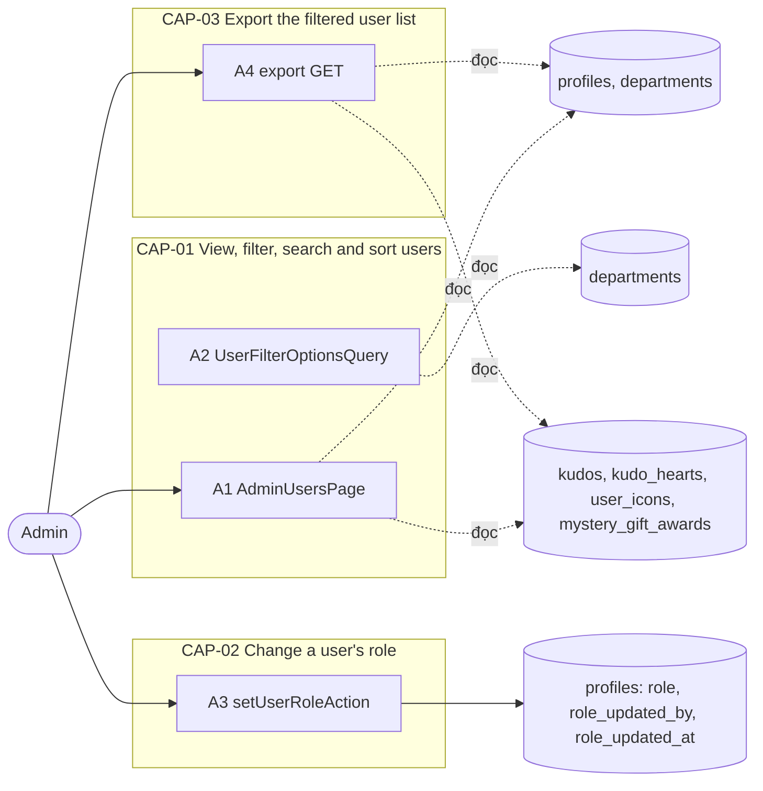
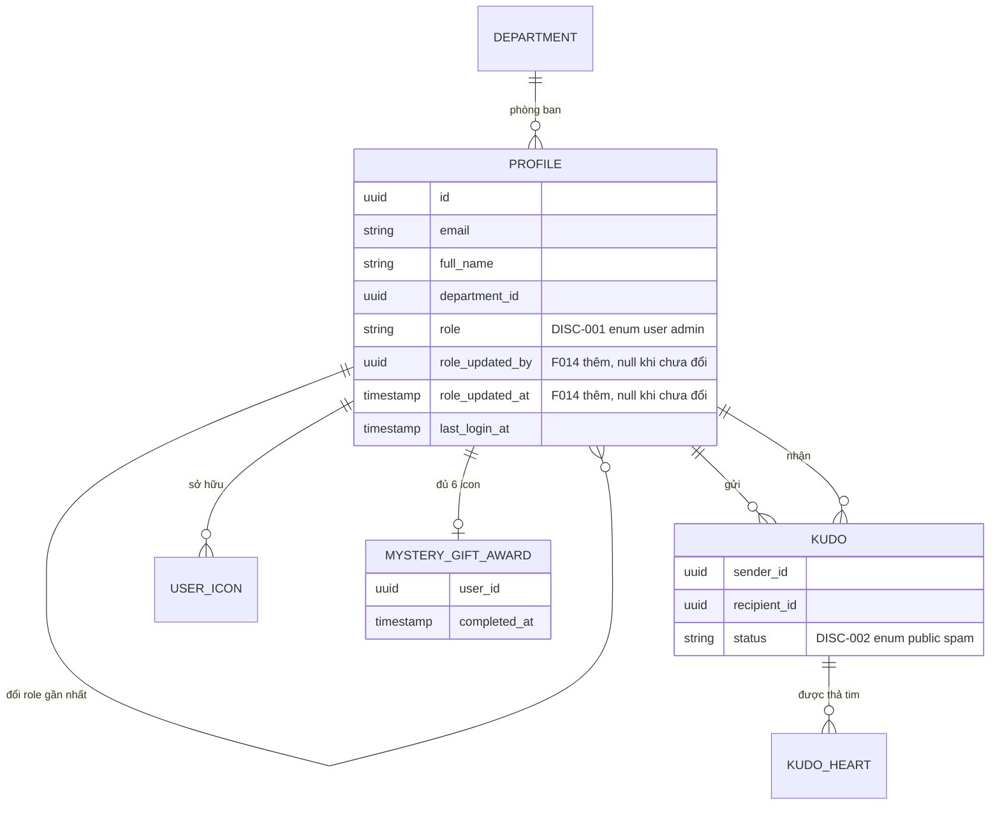
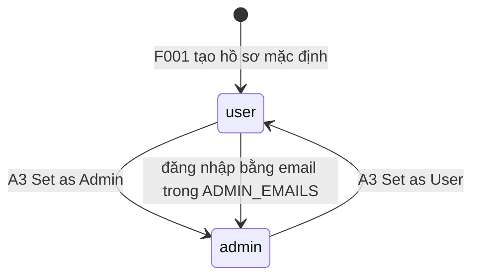
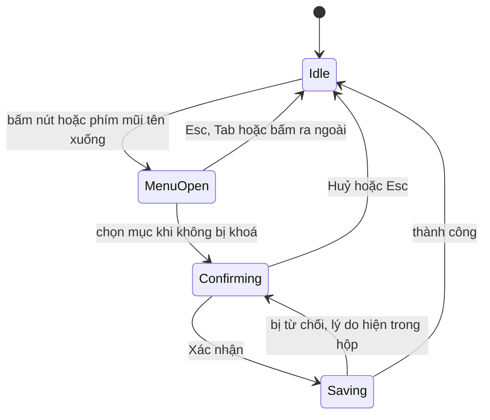

<!-- layout-exempt: rebuild-spec owns all docs/system|features|generated|flows paths — all references here are output targets or internal definitions -->
<!-- Contract: references/feature-spec-researcher-contract.md -->
<!-- Nửa Dev/QA/SA của cặp spec. Mọi mã FR/BR/SM/DEC được PHÁT BIỂU một lần ở functional-spec.md và CÀI ĐẶT một lần ở đây; không lặp câu quy tắc thuần ngôn ngữ ở file này. -->

# F014_AdminUserManagement — Technical Spec

**Priority**: P2
**Type**: ui
**Generated**: 2026-11-24

**See also:** [`functional-spec.md`](./functional-spec.md) — tổng quan, quyết định còn mở, yêu cầu và quy tắc nghiệp vụ dạng một dòng, màn hình, user story, kịch bản, edge case và cấu hình cho BA/QA.

**How to read this file:** § 2 là bảng chỉ mục action; chọn action cần xem rồi đọc khối của nó ở § 3 từ đầu đến cuối, mỗi khối là một luồng hoàn chỉnh. § 4 là phụ lục dùng chung, chỉ nhảy vào khi một khối ở § 3 trỏ tới.

## 1. Technical Overview

F014 là trang Admin › User (`/admin/users`): server component đọc cả bảng Sunner kèm số liệu tham gia bằng **một câu SELECT Drizzle** (lọc, tìm không dấu, sắp xếp, phân trang đều chạy trong SQL), một server action `setUserRoleAction` đổi role trong giao dịch khoá các hàng admin, và một route handler xuất CSV theo đúng bộ lọc đang xem. F014 **không tạo bảng mới**: nó đọc `profiles`, `departments`, `kudos`, `kudo_hearts`, `user_icons`, `mystery_gift_awards` và **chỉ ghi `profiles.role`** cùng hai cột ghi nhận người và thời điểm đổi (`role_updated_by`, `role_updated_at`, migration 0022). Drizzle chạy bằng vai trò server nên bỏ qua RLS, vì vậy mỗi điểm vào tự gọi guard Admin của F001 trước khi đụng dữ liệu; riêng `/api/admin/*` không có cổng ở proxy nên route xuất CSV chỉ được bảo vệ trong handler (A0, § 4.4). Level lấy từ hạng Hero của F009 và Total Heart từ truy vấn đếm tim của F005, không định nghĩa lại phép đếm nào.



## 2. Action Index

| # | Action (handler) | Method · Path | Codes | Writes | Detail |
|---|---|---|---|---|---|
| **A0** | *cross-cutting — belongs to no single action* | — | FR-601, FR-602 | — | § 4.4 |
| **A1** | `AdminUsersPage` | `GET` `/admin/users` | FR-101, FR-102, FR-201, FR-202, FR-203, FR-204, FR-205, FR-206, FR-207, FR-208, FR-210, FR-402, FR-407, FR-408, FR-409, BR-004, BR-005, BR-008, BR-009, DEC-003, DEC-004, US009 | — *(read-only)* | § 3.1 |
| **A2** | `UserFilterOptionsQuery#get` | — | FR-203, FR-407, US009 | — *(read-only)* | § 3.1 |
| **A3** | `setUserRoleAction` | `POST` `/admin/users` *(server action)* | FR-001, FR-002, FR-209, FR-401, FR-404, FR-405, FR-406, FR-410, FR-411, BR-001, BR-002, BR-003, BR-007, DEC-001, DEC-005, SM-001, SM-002, US010, US011 | `profiles` | § 3.2 |
| **A4** | `export/route#GET` | `GET` `/api/admin/users/export` | FR-403, FR-603, FR-604, BR-004, BR-005, BR-006, BR-008, BR-009, DEC-002, US012 | — *(read-only, trả tệp)* | § 3.3 |

## 3. Actions

### 3.1 CAP-01 — View, filter, search and sort users

#### A1 · Open the Admin › User page and read one filtered page
`GET /admin/users` → `` `AdminUsersPage` `` (không có `GET /api/admin/users`: trang đọc thẳng trong server component)
`FR-101` `FR-102` `FR-201` `FR-202` `FR-203` `FR-204` `FR-205` `FR-206` `FR-207` `FR-208` `FR-210` `FR-402` `FR-407` `FR-408` `FR-409` `BR-004` `BR-005` `BR-008` `BR-009` `DEC-003` `DEC-004` `US009` · `SCR018_AdminUser`

**Who** · Admin *(gate A0 — § 4.4)*
**FE** · mục "User" trên menu khu Admin dẫn tới trang (FR-101, `features/app-shell/components/admin-top-bar.tsx:24`, F002). `AdminUsersScreen` là server component: đổi hai mốc thời gian sang `dd/MM/yyyy HH:mm` theo `ADMIN_TIMEZONE` trước khi gửi xuống trình duyệt rồi giao cho `AdminUsersView` (`features/admin-users/components/admin-users-screen.tsx:7-35`). URL là nguồn sự thật (FR-102): mỗi lần đổi lọc, tìm, sắp xếp hay trang, `navigate` gọi `router.replace` trong một transition, `useOptimistic` hiện ngay chế độ xem mới và các dòng mờ đi tới khi server trả lời (`features/admin-users/components/admin-users-view.tsx:43-49`; BL-C08 trong behavior-logic); mọi thay đổi trừ đổi trang đặt `page = 1` (FR-402, `features/admin-users/lib/admin-user-url-params.ts:44-46`). Ô Search chỉ gửi sau 300 ms ngừng gõ hoặc khi nhấn Enter, `maxLength` 100, không gửi trùng một truy vấn hai lần liên tiếp (FR-206, `features/admin-moderation/components/review-search-input.tsx:9-10,33-39,53-63`). Ba dropdown Unit, Level, Role đều mở đầu bằng "Tất cả" (FR-203, FR-204, FR-205, `features/admin-users/components/admin-user-filters.tsx:29-45`). Bấm đầu cột số liệu gọi `nextUserSort`: cột mới bắt đầu giảm dần, cột đang sắp thì đảo chiều, `aria-sort` phản ánh chiều (FR-207, `features/admin-users/lib/admin-user-url-params.ts:52-61`). Tiêu đề hai cột Kudo kèm tổng của cả bộ lọc (FR-210, `features/admin-users/components/admin-user-table.tsx:65-66`). Ô chưa có giá trị hiện "—": Level rỗng, hai mốc thời gian rỗng, tên hoặc email rỗng (FR-208, `features/admin-users/components/admin-user-table-row.tsx:17-27,44-55`). Phân trang ẩn khi chỉ có một trang và trang hiển thị bị kẹp vào `pageCount` (FR-202, `features/admin-moderation/components/review-pagination.tsx:15`, `features/admin-users/components/admin-users-view.tsx:87`). Ba trạng thái thay cho bảng theo DEC-003, thông báo lỗi lọc theo DEC-004 (FR-407, FR-409); `app/admin/users/loading.tsx:1-10` là khung chờ tức thì, `app/admin/users/error.tsx:7-23` bắt lỗi render và có nút thử lại.
**Request** · query `page` *(số nguyên ≥ 1, mặc định 1)*, `unit` *(uuid phòng ban hoặc `none` = chưa gán)*, `level` *(`new` \| `rising` \| `super` \| `legend` \| `none`)*, `role` *(`admin` \| `user`)*, `q` *(đã trim, tối đa `USER_SEARCH_MAX_LENGTH` ký tự tính theo code point)*, `sort` *(`sent` \| `received` \| `hearts` \| `level` \| `badges` \| `six_badges_at` \| `last_login_at`; vắng = tên A–Z rồi `id`)*, `dir` *(`asc` \| `desc`, mặc định `desc`)*; giá trị rỗng coi như vắng, khoá lặp hay giá trị ngoài whitelist là `invalid_params`, `q` quá dài là `query_too_long` — `features/admin-users/schemas/user-list-params-schema.ts:36-73`
**BE** · `AdminUsersPage` gọi `requireAdmin()` đầu tiên, `parseUserListParams` (sai thì dùng `DEFAULT_ADMIN_USER_FILTER` kèm `filterError`), rồi `loadUsers` chạy song song `UserAdminQuery#listPage` và A2 bằng `Promise.allSettled`; bảng lỗi thì `loadError`, lựa chọn lỗi thì `NO_OPTIONS` — `app/admin/users/page.tsx:23-62`. `listPage` gọi `readRows`: một giao dịch đặt `SET LOCAL enable_nestloop = off` rồi một câu SELECT trên `profiles` LEFT JOIN `departments`, năm truy vấn gộp theo người (`sent`, `received`, `hearts`, `icons`, `tiers`) và `mystery_gift_awards`; `WHERE`, `ORDER BY`, `LIMIT 20 OFFSET` nằm trong SQL, kèm `count(*) over ()` và tổng hai cột Kudo làm giá trị cửa sổ nên không có lần gộp thứ hai; trang vượt cuối thì đọc thêm một dòng để biết tổng rồi đọc lại trang cuối — `features/admin-users/server/user-admin-query.ts:24-116`; các mảnh SQL ở `features/admin-users/server/user-admin-sql-fragments.ts:23-110`. `toAdminUserRow` đổi số người gửi thành hạng Hero bằng `tierFromCount`, cắt id còn 8 ký tự và gắn cờ `envAdmin` bằng `isEnvAdminEmail` — `features/admin-users/server/user-admin-query.ts:78-95`
**Rule** · quyết định phần hiển thị của bảng, lỗi lọc và nguồn số liệu dùng chung với A4:

| DEC | subtype | Condition | What the user sees | Source |
|---|---|---|---|---|
| **DEC-003** | render | đọc bảng ném lỗi (`loadError`) | `AdminLoadErrorPanel` thay cho bảng và phân trang: "Không tải được danh sách người dùng. Vui lòng thử lại." kèm nút "Thử lại" | `features/admin-users/components/admin-users-view.tsx:71-73` |
| **DEC-003** | render | `rows.length == 0` và đang có lọc (Unit, Level, Role hoặc từ khoá) | "Không có người dùng nào phù hợp bộ lọc." kèm nút "Xoá bộ lọc" đặt Unit, Level, Role, từ khoá về mặc định và về trang 1 | `features/admin-users/components/admin-user-table.tsx:81-93` |
| **DEC-003** | render | `rows.length == 0` và không có lọc | cùng câu trống, không có nút | `features/admin-users/components/admin-user-table.tsx:81-93` |
| **DEC-003** | render | đọc lựa chọn Unit lỗi nhưng đọc bảng được | dropdown Unit chỉ còn "Tất cả" và "Chưa gán đơn vị"; bảng vẫn dùng và lọc được theo Level, Role | `app/admin/users/page.tsx:23-31` |
| **DEC-004** | flow | `q` dài hơn 100 ký tự (`query_too_long`) | dòng đỏ "Từ khoá tối đa 100 ký tự" phía trên bảng; bảng là trang 1 chưa lọc | `app/admin/users/page.tsx:46-47` |
| **DEC-004** | flow | khoá lặp hoặc giá trị ngoài whitelist (`invalid_params`) | dòng đỏ "Bộ lọc không hợp lệ, đang hiện tất cả người dùng."; bảng là trang 1 chưa lọc | `features/admin-users/schemas/user-list-params-schema.ts:61-73` |

- **BR-004 — Bảng và Export dùng chung một bộ lọc AND và một thứ tự.** Các điều kiện kết hợp AND, điều kiện vắng nghĩa là không lọc; mặc định tên A–Z rồi `id` tăng dần để phân trang không lặp không sót. *(§ 4.4)*
- **BR-005 — Số Kudo gửi, Kudo nhận và tim chỉ tính Kudo Public.** Truy vấn gộp lọc `kudos.status = 'public'` lúc đọc nên Mark Spam làm số giảm và Un Spam khôi phục; Kudo ẩn danh vẫn tính cho người gửi thật. *(§ 4.4)*
- **BR-008 — Level là hạng Hero tính khi đọc.** Hạng suy ra từ số người gửi Kudo Public khác nhau mà người đó nhận được (`HeroTierQuery` của F009), không lưu cột riêng; lọc và sắp xếp Level dùng chính số người gửi. *(§ 4.4)*
- **BR-009 — Total Heart và Number of Badges có định nghĩa riêng.** Tim là số lượt tim thô trên Kudo Public người đó đã gửi (đếm bằng `heartCountsSubquery` của F005, không nhân hệ số chiến dịch); Badge là số `icon_code` khác nhau trong `user_icons`. *(§ 4.4)*

**Result** · read-only — **không ghi DB**. Trả `AdminUserPage { rows, total, page, pageCount, columnTotals }` với `page` đã kẹp vào `[1, pageCount]`; hai mốc thời gian trả dạng ISO rồi được `AdminUsersScreen` đổi thành chuỗi `dd/MM/yyyy HH:mm`; trang được đọc theo từng request (session, `searchParams` và DB đều đọc lúc request).
**Source:** `app/admin/users/page.tsx:23-62` → `features/admin-users/schemas/user-list-params-schema.ts:61-73` → `features/admin-users/server/user-admin-query.ts:37-116` → `features/admin-users/server/user-admin-sql-fragments.ts:23-110` → `features/admin-users/components/admin-users-view.tsx:32-93`

<!-- No diagram: dưới ngưỡng — chỉ đọc, một câu SELECT đồng bộ, không ghi bảng. Phần phân nhánh thật là các bảng DEC phía trên; vẽ thành sơ đồ trình tự chỉ ép các điều kiện song song thành một chuỗi giả. -->

---

#### A2 · Read the options of the Unit dropdown
`—` → `` `UserFilterOptionsQuery#get` ``
`FR-203` `FR-407` `US009` · `SCR018_AdminUser`

**Who** · Admin *(gate A0 — § 4.4; người gọi là A1 đã `requireAdmin()`)*
**FE** · nạp cùng lần với A1, không có request riêng của trình duyệt; dropdown Unit = "Tất cả" + các phòng ban + "Chưa gán đơn vị" (`features/admin-users/components/admin-user-filters.tsx:30-34`). Level (bốn hạng Hero + "Chưa có Level") và Role (`admin`, `user`) là hằng của UI, không đọc DB (`features/admin-users/components/admin-user-filters.tsx:35-44`).
**Request** · tham số `locale` (`vi` \| `en`) lấy từ `getLocale()` của trang; không có tham số từ client.
**BE** · `` `UserFilterOptionsQuery#get` `` đọc `departments(id, name_vi, name_en)`, chọn tên theo locale và sắp bằng `Intl.Collator("vi", { numeric: true })` để CEVC2 đứng trước CEVC10 — `features/admin-users/server/user-filter-options-query.ts:12-20`. Không có guard nội bộ: Drizzle bỏ qua RLS nên người gọi phải guard trước.
**Result** · read-only — **không ghi DB**. Trả `{ departments: [{ id, name }] }`; khi hàm ném lỗi, A1 thay bằng `NO_OPTIONS` và bảng vẫn hiện (DEC-003) — `app/admin/users/page.tsx:17,23-31`.
**Source:** `features/admin-users/server/user-filter-options-query.ts:12-20` → `app/admin/users/page.tsx:23-31` → `features/admin-users/components/admin-user-filters.tsx:24-45`

<!-- No diagram: dưới ngưỡng — chỉ đọc một bảng, đồng bộ. -->

### 3.2 CAP-02 — Change a user's role

#### A3 · Set a user's role (Set as Admin / Set as User)
`POST /admin/users` *(server action)* → `` `setUserRoleAction` `` → `` `UserRoleService#setRole` ``
`FR-001` `FR-002` `FR-209` `FR-401` `FR-404` `FR-405` `FR-406` `FR-410` `FR-411` `BR-001` `BR-002` `BR-003` `BR-007` `DEC-001` `DEC-005` `SM-001` `SM-002` `US010` `US011` · ROUTE032 · `SCR018_AdminUser`

**Who** · Admin *(gate A0 — § 4.4)*
**FE** · nút "⋯" `AdminUserRoleMenu` ở mỗi dòng (nhãn "Thao tác cho {name}") mở một menu một mục về bên trái; nội dung menu theo DEC-001 (FR-209). Chọn mục mở `AdminUserRoleDialog` (`role="alertdialog"`): tiêu đề là hành động, câu hỏi, tên và email người đó, nút "Xác nhận" và "Huỷ"; "Huỷ" giữ focus ban đầu; khi đang lưu cả hai nút khoá kèm spinner và Esc không đóng hộp (FR-411, `features/admin-users/components/admin-user-role-dialog.tsx:29-74`, `features/admin-campaigns/components/campaign-dialog-frame.tsx:44-46`). Bàn phím: Enter, Space hoặc ↓ mở menu và focus vào mục, Esc đóng về nút, Tab đóng và đi tiếp, bấm ra ngoài đóng (`features/admin-users/components/admin-user-role-menu.tsx:36-43,88-100`). Kết quả hiện theo DEC-005; thành công thì `handleRoleChanged` vá ô Role của dòng từ kết quả action rồi trang nạp lại nhờ `revalidatePath` (FR-401, `features/admin-users/components/admin-users-view.tsx:52-55`).
**Request** · `userId` *(uuid)*, `role` *(`admin` \| `user`)* qua `setUserRoleInputSchema`; `actorId` lấy từ session của `requireAdmin()`, không bao giờ nhận từ client — `features/admin-users/schemas/set-user-role-input-schema.ts:7-12`, `features/admin-users/server/set-user-role-action.ts:19-21`
**BE** · `setUserRoleAction`: `requireAdmin()` đầu tiên → kiểm tham số (sai thì `{ ok: false, error: "INVALID" }`) → `UserRoleService#setRole` → `revalidatePath("/admin/users")` sau **mọi** câu trả lời của service, kể cả từ chối; ngoại lệ bất ngờ thì log và `{ ok: false, error: "UNEXPECTED" }`. Từ chối đi trong thân kết quả theo C-18, không phải mã HTTP — `features/admin-users/server/set-user-role-action.ts:18-31`. Service chạy một giao dịch: khoá các hàng admin theo `id`, đọc người đích, chạy các chốt ở khối Rule bên dưới, rồi UPDATE có điều kiện — `features/admin-users/server/user-role-service.ts:30-55`.
**Rule** · thứ tự quyết định trong giao dịch: người đích không tồn tại → bỏ qua nếu đã đúng role → (khi hạ) tự hạ → admin cấu hình sẵn → admin cuối cùng → actor còn là admin không → ghi:

- **BR-001 — Chỉ ghi khi role hiện tại khác role đích; lệnh trùng không lỗi.** Hai Admin cùng đặt một người làm Admin: lần đến sau nhận trạng thái hiện tại và không ghi đè `role_updated_by` hay `role_updated_at` của người đến trước (FR-406). `features/admin-users/server/user-role-service.ts:40`
- **BR-002 — Admin không được tự hạ role của chính mình.** `userId` bằng `actorId` và `role = 'user'` thì trả `SELF_DEMOTE`, kể cả khi còn nhiều Admin khác (FR-404). `features/admin-users/server/user-role-service.ts:43`
- **BR-003 — Luôn còn ít nhất một Admin.** Số Admin được đếm trên tập hàng đã khoá nên hai Admin hạ nhau cùng lúc: người thứ hai thấy chỉ còn một Admin và nhận `LAST_ADMIN`, không bao giờ về 0 (FR-405, FR-406). `features/admin-users/server/user-role-service.ts:32-37,45`
- **BR-007 — Tài khoản trong `ADMIN_EMAILS` không hạ được từ giao diện.** `isEnvAdminEmail(target.email)` (cắt khoảng trắng, chữ thường) thì trả `ENV_ADMIN`, vì `completeLogin` đặt lại `role = 'admin'` ở mỗi lần đăng nhập nên việc hạ sẽ âm thầm quay lại (FR-410). `features/admin-users/server/user-role-service.ts:44`, `features/admin-users/server/env-admin-email.ts:9-11`, `features/auth/server/complete-login.ts:43-46`

```text
BEGIN
  admins = SELECT id FROM profiles WHERE role='admin' ORDER BY id FOR UPDATE
  target = SELECT role, email FROM profiles WHERE id=:userId
  if target is null:                    return refuse(NOT_FOUND)
  if target.role == :role:              return ok(:userId, :role)          # BR-001
  if :role == 'user':
      if :userId == :actorId:           return refuse(SELF_DEMOTE)         # BR-002
      if isEnvAdminEmail(target.email): return refuse(ENV_ADMIN)           # BR-007
      if count(admins) <= 1:            return refuse(LAST_ADMIN)          # BR-003
  if :actorId not in admins:            return refuse(FORBIDDEN)           # actor bị hạ giữa chừng
  UPDATE profiles SET role=:role, role_updated_by=:actorId, role_updated_at=now()
    WHERE id=:userId AND role <> :role
COMMIT
```

| DEC | subtype | Condition | What the user sees | Source |
|---|---|---|---|---|
| **DEC-001** | render | `row.id == actorId` | nút "⋯" bị khoá (`aria-disabled`), không có menu; rê hoặc focus hiện chú thích "Bạn không thể tự hạ role của mình." | `features/admin-users/lib/admin-user-role-menu-state.ts:17-22` |
| **DEC-001** | render | `row.role == 'user'` và không phải dòng của mình | menu một mục "Set as Admin" | `features/admin-users/lib/admin-user-role-menu-state.ts:17-22` |
| **DEC-001** | render | `row.role == 'admin'`, không phải dòng của mình, `envAdmin == false` | menu một mục "Set as User" | `features/admin-users/lib/admin-user-role-menu-state.ts:17-22` |
| **DEC-001** | render | `row.role == 'admin'`, không phải dòng của mình, `envAdmin == true` | mục "Set as User" hiện nhưng khoá kèm chú thích, chọn không mở hộp; ô Role hiện nhãn "Admin · env" | `features/admin-users/lib/admin-user-role-menu-state.ts:17-22` |
| **DEC-005** | interaction | kết quả action `ok == true` | hộp đóng, ô Role của dòng đổi ngay, toast "Đã đặt {name} làm Admin." hoặc "Đã đặt {name} làm User." | `features/admin-users/components/admin-user-role-menu.tsx:75-86` |
| **DEC-005** | interaction | `error` là `SELF_DEMOTE`, `LAST_ADMIN`, `ENV_ADMIN`, `FORBIDDEN` hoặc `NOT_FOUND` | lý do riêng hiện trong hộp (ví dụ `LAST_ADMIN` → "Không thể hạ Admin cuối cùng.", `FORBIDDEN` → "Bạn không còn quyền Admin.", `NOT_FOUND` → "Người dùng này không còn tồn tại."); hộp ở lại để huỷ hoặc thử lại | `features/admin-users/lib/admin-user-role-menu-state.ts:24-41` |
| **DEC-005** | interaction | `INVALID`, `UNEXPECTED` hoặc action ném lỗi mạng | "Không cập nhật được role. Vui lòng thử lại." trong hộp; ngắt điều hướng 403 hoặc chuyển trang vẫn truyền lên (`unstable_rethrow`) | `features/admin-users/components/admin-user-role-menu.tsx:24-33` |

**Result** · ghi `profiles.role` ← role đích; `profiles.role_updated_by` ← `actorId`; `profiles.role_updated_at` ← `now()` — chỉ khi qua mọi chốt và `role <> đích`, đây là bảng duy nhất F014 ghi (FR-001: mỗi người đúng một role; FR-002: lưu người và thời điểm của lần đổi gần nhất, không có bảng lịch sử). Trả `SetUserRoleResult`: `{ ok: true, id, role }` hoặc `{ ok: false, error }` với `error` ∈ `NOT_FOUND`, `SELF_DEMOTE`, `LAST_ADMIN`, `ENV_ADMIN`, `FORBIDDEN`, `INVALID`, `UNEXPECTED`. Role luôn được guard đọc lại từ DB nên người bị hạ mất quyền `/admin/*` ở request kế (A0) — `features/admin-users/server/user-role-service.ts:49-53`, `features/admin-users/schemas/admin-user-views.ts:101-104`.
**State** · `SM-001`: `user` → `admin` (Set as Admin); `admin` → `user` (Set as User, sau BR-002, BR-007, BR-003); `SM-002`: `Idle` → `MenuOpen` → `Confirming` → `Saving` → `Idle`, hoặc `Saving` → `Confirming` khi bị từ chối *(§ 4.3)*
**Source:** `features/admin-users/components/admin-user-role-menu.tsx:44-159` → `features/admin-users/components/admin-user-role-dialog.tsx:29-74` → `features/admin-users/server/set-user-role-action.ts:18-31` → `features/admin-users/server/user-role-service.ts:30-55` → `features/admin-users/lib/admin-user-role-menu-state.ts:17-41`

<!-- No diagram: dưới ngưỡng — chỉ ghi một bảng, đồng bộ. Chuỗi chốt nằm trong khối pseudocode và hai bảng DEC; SM-001 và SM-002 giữ sơ đồ trạng thái ở § 4.3. -->

### 3.3 CAP-03 — Export the filtered user list

#### A4 · Download the CSV of the current filter
`GET /api/admin/users/export` → `` `export/route#GET` ``
`FR-403` `FR-603` `FR-604` `BR-004` `BR-005` `BR-006` `BR-008` `BR-009` `DEC-002` `US012` · ROUTE004 · `SCR018_AdminUser`

**Who** · Admin *(gate A0 — § 4.4; ở đây guard trả JSON, không chuyển trang)*
**FE** · nút "Export" (`ReviewExportButton`) cạnh tiêu đề trang; bấm thì `fetch` đường dẫn xuất của chế độ xem hiện tại (`adminUsersExportHref`: cùng tham số lọc và sắp xếp, **không có** `page`), khoá nút kèm spinner "Đang xuất…" trong lúc chờ, rồi lưu blob thành tệp theo tên trong `Content-Disposition` (FR-403) — `features/admin-users/components/admin-users-view.tsx:63`, `features/admin-users/lib/admin-user-url-params.ts:38-41`, `features/admin-moderation/components/review-export-button.tsx:36-61`. Kết quả hiện theo DEC-002.
**Request** · `GET /api/admin/users/export?<cùng tham số với A1>`; qua cùng `parseUserListParams` nên bảng và tệp từ chối đúng cùng những giá trị; `page` nếu có vẫn qua schema nhưng `listForExport` đọc từ `offset 0` nên không dùng — `app/api/admin/users/export/route.ts:28-29`
**BE** · `requireAdminApi()` chạy **trước khi đọc bất kỳ tham số nào**: khách nhận 401 `unauthorized`, người không phải Admin nhận 403 `forbidden` (FR-604); `parseUserListParams` (sai → 400 `invalid_params`); `UserAdminQuery#listForExport(filter, "vi", EXPORT_MAX_ROWS + 1)` đọc tối đa N+1 dòng theo đúng thứ tự bảng bằng cùng `readRows` của A1; `assertWithinExportLimit(rows.length)` ném `ExportLimitExceededError` khi có dòng thừa → 422 `export_too_large`, không cắt bớt dòng; ngược lại `serializeAdminUserCsv` trả `text/csv; charset=utf-8` với `Content-Disposition: attachment; filename="users-yyyyMMdd-HHmm.csv"` (giờ `ADMIN_TIMEZONE`); lỗi khác log rồi 500 `unexpected`. Mọi câu trả lời, kể cả lỗi, mang `Cache-Control: private, no-store` — `app/api/admin/users/export/route.ts:18-45`, `features/admin-moderation/server/admin-api-guard.ts:15-24`, `shared/admin/export-limit.ts:19-26`, `shared/admin/admin-csv-filename.ts:4-9`, `features/admin-users/server/user-admin-query.ts:118-125`.
**Rule** · cột của tệp, định dạng CSV và giới hạn kích thước:

- **BR-006 — Ô văn bản bắt đầu bằng `=`, `+`, `-`, `@`, tab hoặc CR bị vô hiệu hoá công thức.** Serializer thêm `'` đứng đầu ô; ô có dấu phẩy, nháy kép hoặc xuống dòng được bọc nháy kép theo RFC 4180, dòng kết thúc CRLF, thêm BOM UTF-8 để Excel đọc đúng tiếng Việt; tên và email do người dùng và Google cung cấp nên không tin nội dung (FR-603). Dùng serializer chung của khu Admin, không tự viết lại. `shared/admin/csv-serializer.ts:9-21,35-53`
- Tệp có đúng 11 cột như bảng (không có Actions): `ID` là uuid đầy đủ, `User`, `Email`, `Sent Kudos`, `Received Kudos`, `Total Heart`, `Level` ("New Hero", "Rising Hero", "Super Hero", "Legend Hero" hoặc rỗng), `Number of Badges`, `Time to get 6 Badges`, `Last Logged in`, `Role` ("Admin" hoặc "User"); mốc thời gian dạng `dd/MM/yyyy HH:mm` theo `ADMIN_TIMEZONE`, ô "—" của bảng để rỗng, tiêu đề tiếng Anh. `features/admin-users/server/user-export-columns.ts:14-51`
- **BR-004 — Cùng bộ lọc và thứ tự với A1.** Tệp khớp từng dòng với những gì Admin thấy khi duyệt hết các trang, vì cả hai đi qua cùng schema tham số và cùng `readRows`. *(§ 4.4)*
- **BR-005 — Số Kudo gửi, Kudo nhận và tim chỉ tính Kudo Public.** Dùng chung mảnh SQL với A1 nên bảng và tệp không lệch nhau. *(§ 4.4)*
- **BR-008 — Level là hạng Hero tính khi đọc.** Cột `Level` đi qua cùng `tierFromCount` với bảng; không có hạng thì ô rỗng. *(§ 4.4)*
- **BR-009 — Total Heart và Number of Badges có định nghĩa riêng.** Cùng cách đếm với A1: tim thô trên Kudo Public đã gửi, Badge là số loại icon khác nhau. *(§ 4.4)*

| DEC | subtype | Condition | What the user sees | Source |
|---|---|---|---|---|
| **DEC-002** | interaction, flow | phản hồi thành công (200) | trình duyệt lưu tệp `users-yyyyMMdd-HHmm.csv`; nút trở về "Export" | `features/admin-moderation/components/review-export-button.tsx:44-49` |
| **DEC-002** | interaction, flow | 422 `export_too_large` (số dòng khớp > `EXPORT_MAX_ROWS`) | không có tệp; toast lỗi "Có quá nhiều dòng để xuất. Hãy thu hẹp bộ lọc." | `features/admin-moderation/components/review-export-button.tsx:44-49` |
| **DEC-002** | interaction, flow | mọi trạng thái lỗi khác (400, 401, 403, 500) hoặc mất mạng | toast lỗi "Không xuất được tệp. Vui lòng thử lại." | `features/admin-moderation/components/review-export-button.tsx:44-52` |

**Result** · read-only — **không ghi DB**. Phản hồi là tệp CSV (200), hoặc `{ code }` với 401 `unauthorized`, 403 `forbidden`, 400 `invalid_params`, 422 `export_too_large`, 500 `unexpected`; luôn `Cache-Control: private, no-store`.
**Source:** `app/api/admin/users/export/route.ts:18-45` → `features/admin-users/server/user-admin-query.ts:118-125` → `features/admin-users/server/user-export-columns.ts:14-51` → `shared/admin/csv-serializer.ts:35-53` → `features/admin-moderation/components/review-export-button.tsx:36-61`

<!-- No diagram: dưới ngưỡng — không ghi bảng, một bước đồng bộ (đọc rồi dựng chuỗi CSV). Không dùng XLSX để tránh thêm thư viện cho yêu cầu chưa ai đặt ra. -->

### 3.4 Edge cases

| Action | Scenario | Behavior |
|---|---|---|
| A3 | Hai Admin cùng đặt một người làm Admin | Giao dịch xếp hàng nhờ khoá hàng admin; chỉ lần đầu ghi, lần sau thấy role đã đúng và trả `{ ok: true }` mà không ghi (BR-001) |
| A3 | Hai Admin hạ nhau cùng lúc khi chỉ có hai Admin | Cả hai khoá hàng admin theo thứ tự `id`; một lệnh thành công, lệnh còn lại đọc lại thấy một Admin và nhận `LAST_ADMIN`; không deadlock (BR-003) |
| A3 | Admin gửi thẳng action hạ chính mình (bỏ qua giao diện) | `SELF_DEMOTE` kể cả khi còn nhiều Admin; role không đổi (BR-002) |
| A3 | Hạ tài khoản trong `ADMIN_EMAILS` | `ENV_ADMIN`; giao diện đã khoá mục "Set as User" (BR-007, DEC-001) |
| A3 | Admin bị hạ trong lúc đang mở trang rồi bấm đổi role | proxy bước 4b đọc lại role và trả JSON 403 `{ code: "forbidden" }` cho POST Server Action (`requireAdmin()` cũng chặn nếu tới được action); phía client lệnh gọi action ném lỗi, `setRoleSafely` bắt và trả `UNEXPECTED` → hộp hiện "Không cập nhật được role. Vui lòng thử lại." (key `failed`, suy từ code, chưa chạy trên trình duyệt); `FORBIDDEN` ("Bạn không còn quyền Admin.") chỉ xảy ra khi actor bị hạ trong lúc giao dịch chờ khoá; không ghi gì (A0) — `shared/auth/session-proxy.ts:93-110`, `features/admin-users/components/admin-user-role-menu.tsx:24-33`, `features/admin-users/lib/admin-user-role-menu-state.ts:29-37` |
| A3 | Người đích đã bị xoá trong lúc hộp xác nhận đang mở | `NOT_FOUND` hiện trong hộp (DEC-005) |
| A3 | `userId` không phải uuid hoặc `role` ngoài `admin`/`user` | `INVALID` trước khi chạm DB; hộp hiện lỗi chung (DEC-005) |
| A1 · A4 | `q` dài hơn 100 ký tự, lặp khoá hoặc giá trị ngoài whitelist | A1 hiện lỗi lọc trên trang 1 chưa lọc (DEC-004); A4 trả 400 `invalid_params` |
| A1 | `page` vượt tổng trang | `listPage` đọc lại trang cuối, `page` trả về đã kẹp; phân trang hiển thị `min(page, pageCount)` |
| A1 | Không có người khớp bộ lọc | `rows` rỗng; hiện thông báo trống, kèm "Xoá bộ lọc" khi đang lọc (DEC-003) |
| A1 | Đọc bảng lỗi / đọc lựa chọn Unit lỗi | Lỗi bảng: panel lỗi kèm thử lại; lỗi Unit: dropdown chỉ còn "Tất cả" và "Chưa gán đơn vị" (DEC-003) |
| A1 · A4 | Người chưa đăng nhập lần nào hoặc chưa đủ 6 Badge | Ô hiện "—" (rỗng trong tệp); khi sắp xếp hai cột thời gian, ô trống luôn nằm cuối ở cả hai chiều (BR-004) |
| A1 · A4 | Sắp xếp theo Level, Kudo hoặc Badge | Các cột đếm sắp như số, người chưa có hạng tính là 0 người gửi nên đứng đầu khi tăng dần (BR-004, BR-008) |
| A1 · A4 | Kudo bị Mark Spam rồi Un Spam | Số gửi, nhận, tim, Level giảm rồi khôi phục theo lần đọc; số Badge không đổi (BR-005, BR-009) |
| A4 | Số dòng khớp lớn hơn `EXPORT_MAX_ROWS` | 422 `export_too_large`, không tạo tệp (DEC-002) |
| A4 | Tên hoặc email bắt đầu bằng `=`, `+`, `-`, `@` hoặc chứa dấu phẩy, nháy kép | Thêm `'` đứng đầu ô nguy hiểm; ô có dấu phẩy hoặc nháy kép được bọc nháy kép (BR-006) |
| A1-A4 | Khách hoặc Sunner thường gọi thẳng trang, action hoặc route xuất | Trang và action: chuyển `/login` (khách) hoặc 403 (Sunner thường); route xuất: 401 `unauthorized` hoặc 403 `forbidden` trước khi đọc tham số; dữ liệu không đổi (A0 § 4.4) |

## 4. Shared Foundation

### 4.1 Components

| Component | Responsibility | Used in | File |
|---|---|---|---|
| `AdminUsersPage` | Điểm vào đọc trang (server component): guard, parse tham số, nạp bảng và lựa chọn Unit | A1, A2 | `app/admin/users/page.tsx` |
| `loading.tsx`, `error.tsx` | Khung chờ tức thì; error boundary có nút thử lại | A1 | `app/admin/users/loading.tsx`, `app/admin/users/error.tsx` |
| `AdminUsersScreen` | Server component: đổi hai mốc thời gian sang `ADMIN_TIMEZONE` | A1 | `features/admin-users/components/admin-users-screen.tsx` |
| `AdminUsersView` | Client: URL làm nguồn sự thật, `router.replace` trong transition, vá role tại chỗ, toast | A1, A3, A4 | `features/admin-users/components/admin-users-view.tsx` |
| `AdminUserFilters`, `AdminUserTable`, `AdminUserTableRow`, `AdminUserSortableHeader` | Ba dropdown + ô Search; bảng 12 cột, dòng, tiêu đề cột sắp được | A1, A2, A3 | `features/admin-users/components/` |
| `AdminUserRoleMenu`, `AdminUserRoleDialog` | Menu "⋯" và hộp xác nhận đổi role | A3 | `features/admin-users/components/admin-user-role-menu.tsx`, `features/admin-users/components/admin-user-role-dialog.tsx` |
| `roleMenuState`, `roleErrorKey` | Chọn mục menu theo dòng; ánh xạ mã từ chối sang câu hiển thị | A3 | `features/admin-users/lib/admin-user-role-menu-state.ts` |
| `admin-user-url-params` | Dựng URL xem và URL xuất, `applyUserFilterPatch`, `nextUserSort` | A1, A4 | `features/admin-users/lib/admin-user-url-params.ts` |
| `parseUserListParams` | Schema Zod + whitelist chung cho tham số của A1 và A4 | A1, A4 | `features/admin-users/schemas/user-list-params-schema.ts` |
| `UserAdminQuery`, mảnh SQL | Một câu SELECT dùng chung: lọc AND, sắp xếp, đếm, số liệu gộp; `listPage` và `listForExport` | A1, A4 | `features/admin-users/server/user-admin-query.ts`, `features/admin-users/server/user-admin-sql-fragments.ts` |
| `UserFilterOptionsQuery` | Danh sách phòng ban cho dropdown Unit | A2 | `features/admin-users/server/user-filter-options-query.ts` |
| `setUserRoleAction`, `UserRoleService` | Server action đổi role; service giữ giao dịch, khoá và các chốt an toàn | A3 | `features/admin-users/server/set-user-role-action.ts`, `features/admin-users/server/user-role-service.ts` |
| `isEnvAdminEmail` | So email với `ADMIN_EMAILS` (cắt khoảng trắng, chữ thường) | A1, A3 | `features/admin-users/server/env-admin-email.ts` |
| `export/route#GET`, `serializeAdminUserCsv` | Route xuất CSV; cột và nhãn của tệp | A4 | `app/api/admin/users/export/route.ts`, `features/admin-users/server/user-export-columns.ts` |
| Chung của F007 / F011 | Nút Export, phân trang, ô Search, panel lỗi; khung hộp thoại, toast | A1, A3, A4 | `features/admin-moderation/components/review-export-button.tsx`, `features/admin-moderation/components/review-pagination.tsx`, `features/admin-moderation/components/review-search-input.tsx`, `features/admin-campaigns/components/campaign-dialog-frame.tsx` |
| Chung của khu Admin | Serializer CSV, trần dòng, tên tệp, định dạng giờ, múi giờ | A1, A4 | `shared/admin/csv-serializer.ts`, `shared/admin/export-limit.ts`, `shared/admin/admin-csv-filename.ts`, `shared/admin/admin-date-time-format.ts`, `shared/admin/timezone.ts` |
| `requireAdmin`, `requireAdminApi` *(F001, F007)* | Guard Admin: trang và action chuyển trang / 403; route trả JSON 401 / 403 | A0 | `shared/auth/admin-guard.ts`, `features/admin-moderation/server/admin-api-guard.ts` |
| `HeroTierQuery`, `tierFromCount`, `tierCountRange` *(F009)*, `heartCountsSubquery` *(F005)* | Nguồn duy nhất của hạng Hero và đếm tim | A1, A4 | `features/hero-badges/server/hero-tier-query.ts`, `features/hero-badges/server/tier-from-count.ts`, `features/kudos-hearts/server/heart-ranking-query.ts` |

### 4.2 Data Model



| Entity | Table | Used for | Action |
|---|---|---|---|
| `Profile` *(F001)* | `profiles` | Nguồn của bảng; F014 là nơi duy nhất ghi `role`, `role_updated_by`, `role_updated_at` từ giao diện | A1-A4 |
| `Department` *(F001)* | `departments` | Tên phòng ban cho dropdown Unit; lọc bằng `profiles.department_id` | A1, A2, A4 |
| `Kudo` *(F003; `status` do F007)* | `kudos` | Đếm Kudo gửi (`sender_id`), nhận (`recipient_id`) và số người gửi khác nhau cho Level; chỉ `status = 'public'` | A1, A4 |
| `KudoHeart` *(F005)* | `kudo_hearts` | Tim thô trên Kudo Public đã gửi, qua `heartCountsSubquery` | A1, A4 |
| `UserIcon` *(F010)* | `user_icons` | Number of Badges = số `icon_code` khác nhau của người dùng | A1, A4 |
| `MysteryGiftAward` *(F010)* | `mystery_gift_awards` | `completed_at` cho cột "Time to get 6 Badges" | A1, A4 |

Không có bảng lịch sử đổi role: chỉ lần đổi gần nhất được lưu (migration 0022: hai cột nullable, FK tự tham chiếu `ON DELETE SET NULL`, RLS của `profiles` không đổi) — `db/migrations/0022_profiles_role_audit.sql:8-10`, `shared/db/schema/profiles.ts:12-32`.

#### Polymorphic Behavior

##### DISC-001 — Profile.role

| Value | Render | Validation | Persistence |
|-------|--------|------------|-------------|
| user | Cột Role hiện "User"; dòng có menu "Set as Admin"; lọc Role = User | Mặc định của mọi hồ sơ mới; không vào được `/admin/*` (A0) | F001 đặt lúc tạo hồ sơ; A3 đặt khi hạ từ Admin, sau BR-002, BR-007, BR-003 |
| admin | Cột Role hiện "Admin", hoặc nhãn "Admin · env" khi email thuộc `ADMIN_EMAILS` (`features/admin-users/components/admin-user-table-row.tsx:57-59`); menu "Set as User", khoá ở dòng của chính mình và ở Admin cấu hình sẵn (DEC-001) | Phải qua `requireAdmin` / `requireAdminApi`; hạ phải qua ba chốt của A3 | A3 đặt khi nâng từ User; `completeLogin` (F001) đặt lại `admin` ở mỗi lần đăng nhập của email trong `ADMIN_EMAILS` (`features/auth/server/complete-login.ts:43-46`) |

**Source:** docs/generated/entities.md § MODEL004_Profile > Discriminator Fields

##### DISC-002 — Kudo.status

| Value | Render | Validation | Persistence |
|-------|--------|------------|-------------|
| public | Kudo được tính vào Kudo gửi, Kudo nhận, Total Heart và Level của người gửi / nhận | Điều kiện `kudos.status = 'public'` ở mọi truy vấn gộp (`features/admin-users/server/user-admin-sql-fragments.ts:20`) | F014 không ghi; mặc định của Kudo mới (F003) |
| spam | Kudo không vào số nào; bấm Un Spam thì số khôi phục ở lần đọc kế tiếp | Bị loại ngay trong SQL, không có bước lọc ở bộ nhớ | F007 đặt khi Mark Spam; F014 không ghi |

**Source:** docs/generated/entities.md § MODEL003_Kudo > Discriminator Fields

### 4.3 State Management

### Role của một người dùng chuyển giữa User và Admin, riêng chiều hạ phải qua các chốt an toàn (SM-001)
**kind:** entity
**Linked FR:** FR-001
**Source:** `features/admin-users/server/user-role-service.ts:30-55`



**Action transitions:** điều kiện chuyển và việc ghi `role_updated_*` nằm ở rung **Result** của A3 (§ 3.2); cạnh `admin → user` chỉ đi qua khi qua đủ BR-002, BR-007 và BR-003 — không lặp lại ở đây (DRY). Cạnh `user → admin` theo email cấu hình sẵn thuộc luồng đăng nhập của F001.

### Hộp xác nhận đổi role đi qua mở menu, chọn mục, xác nhận rồi lưu (SM-002)
**kind:** ui
**Linked FR:** FR-411
**Source:** `features/admin-users/components/admin-user-role-menu.tsx:44-86`



**Action transitions:** trong `Saving`, hai nút và Esc bị khoá; thành công thì `onChanged` báo lên `AdminUsersView`, bị từ chối thì `errorKey` đặt lý do và hộp ở lại — chi tiết ở rung **FE** và DEC-005 của A3 (§ 3.2).

### 4.4 Shared Rules

#### Bin 3 — cross-cutting, belongs to no single action

**A0 · FR-601 / FR-602 — Mọi điểm vào của F014 yêu cầu Admin, kiểm ở server, role đọc lại từ DB mỗi lần.** *(cross-cutting: áp dụng cho cả A1-A4, không phải rule riêng của một action)*
A1 và A2 (qua A1) gọi `requireAdmin()` đầu tiên (`app/admin/users/page.tsx:45`), A3 gọi `requireAdmin()` đầu tiên (`features/admin-users/server/set-user-role-action.ts:19`), A4 gọi `requireAdminApi()` trước khi đọc tham số (`app/api/admin/users/export/route.ts:25-26`). Role đọc từ `profiles.role` ở mỗi lần gọi, không tin cookie hay JWT, nên hạ quyền có hiệu lực ở request kế (`shared/auth/admin-guard.ts:17-35`). `UserAdminQuery`, `UserFilterOptionsQuery` và `UserRoleService` **không có guard nội bộ**: Drizzle chạy bằng vai trò server nên bỏ qua RLS, người gọi phải guard trước. Cổng 4b của proxy chỉ khớp `/admin` và `/admin/*`, vì vậy `/api/admin/users/export` **chỉ được chặn trong handler** (ROUTE004); proxy chỉ chặn khách (401) và người không phải Admin trước `LAUNCH_AT` (403). Server action đi qua cổng 4b vì POST tới `/admin/users` (ROUTE032). `profiles` bật RLS và không có policy cho client nên Sunner không tự nâng role qua API công khai của Supabase. Vi phạm: khách chuyển `/login` (trang, action) hoặc 401 JSON (xuất); Sunner thường nhận trang 403 hoặc JSON 403; không ghi gì. Cổng đăng nhập chung thuộc F001; không phải rule riêng của F014.
**Source:** `shared/auth/admin-guard.ts:17-35` · `features/admin-moderation/server/admin-api-guard.ts:15-24` · `shared/auth/route-access-policy.ts:25-27` · `shared/auth/session-proxy.ts:92-110` · `db/migrations/0022_profiles_role_audit.sql:5-6`

#### Bin 2 — used by ≥2 named actions

**BR-004 — Bảng và Export dùng chung một bộ lọc AND và một thứ tự.**
Used in: **A1** · **A4**. Cùng `parseUserListParams` (tên tham số trong `ADMIN_USER_PARAMS`) và cùng `readRows`, nên tệp khớp bảng. Tìm kiếm bỏ qua hoa thường và dấu tiếng Việt bằng `public.f_unaccent` (escape `\`, `%`, `_`); các cột đếm sắp như số với `NULL` thành 0 nên người chưa có giá trị đứng đầu khi tăng dần; hai mốc thời gian dùng `NULLS LAST` ở cả hai chiều; luôn kết thúc bằng `id` tăng dần để thứ tự toàn phần.
**Source:** `features/admin-users/server/user-admin-sql-fragments.ts:53-110` · `features/admin-users/schemas/user-list-params-schema.ts:61-73` · `db/migrations/0007_kudos_constraints.sql:34-38`
```text
where = AND of (only the present ones):
  unit  : 'none' -> profiles.department_id IS NULL ; uuid -> profiles.department_id = unit
  role  : profiles.role = role
  level : senderCount in tierCountRange(level) ; 'none' -> senderCount < 1     # BR-008
  q     : f_unaccent(full_name) ILIKE '%'||f_unaccent(q)||'%' OR the same on email
order = no sort            -> full_name asc, id asc
        six_badges_at/last_login_at -> col dir NULLS LAST, id asc
        sent/received/hearts/level/badges -> coalesce(col,0) dir, id asc
```

**BR-005 — Số Kudo gửi, Kudo nhận và tim chỉ tính Kudo Public.**
Used in: **A1** · **A4**. Các truy vấn gộp lọc `kudos.status = 'public'` ngay lúc đọc, không lưu số riêng, nên Mark Spam / Un Spam của F007 tự phản ánh ở lần đọc kế tiếp; Kudo ẩn danh vẫn đếm cho người gửi thật vì `sender_id` luôn được lưu.
**Source:** `features/admin-users/server/user-admin-sql-fragments.ts:20-49`
```text
sent(u)     = COUNT(kudos WHERE sender_id = u AND status = 'public')
received(u) = COUNT(kudos WHERE recipient_id = u AND status = 'public')
hearts(u)   = SUM(heartCounts.raw) over public kudos WHERE sender_id = u     # xem BR-009
absent group -> 0 (coalesce)
```

**BR-008 — Level là hạng Hero tính khi đọc.**
Used in: **A1** · **A4**. F014 không lưu và không định nghĩa ngưỡng: số người gửi khác nhau của Kudo Public (bỏ Kudo tự gửi) đi qua `tierFromCount` của F009; lọc Level dùng `tierCountRange` nên ngưỡng không lặp lại trong SQL, sắp xếp Level theo số người gửi vì hạng đơn điệu theo số này.
**Source:** `features/admin-users/server/user-admin-sql-fragments.ts:48,61-62,81-85` · `features/admin-users/server/user-admin-query.ts:87` · `features/hero-badges/server/hero-tier-query.ts:20,56-63` · `features/hero-badges/server/tier-from-count.ts:18-27` · `features/hero-badges/server/hero-tier-constants.ts:6-9`
```text
senderCount(u) = COUNT(DISTINCT sender_id) WHERE recipient_id = u AND status='public' AND sender_id <> recipient_id
level(u)       = tierFromCount(senderCount(u))     # new >=1, rising >=5, super >=10, legend >=21; else null
filter tier    : min(tier) <= senderCount <= max(tier)
filter 'none'  : senderCount < 1
```

**BR-009 — Total Heart và Number of Badges có định nghĩa riêng.**
Used in: **A1** · **A4**. Tim là số lượt tim thô (không nhân `HEART_CAMPAIGN_MULTIPLIER`) trên các Kudo Public người đó **đã gửi**, đếm bằng `heartCountsSubquery` của F005; Badge là số `icon_code` khác nhau trong `user_icons` (0–6), không phụ thuộc trạng thái Kudo; "Time to get 6 Badges" là `mystery_gift_awards.completed_at`, rỗng khi chưa đủ bộ.
**Source:** `features/admin-users/server/user-admin-sql-fragments.ts:36-47,56-67` · `features/kudos-hearts/server/heart-ranking-query.ts:25-32` · `shared/db/schema/secret-box-rewards.ts:80-111`
```text
hearts(u)      = SUM(rawCount of each public kudo SENT by u)      # raw, không x2
badges(u)      = COUNT(DISTINCT icon_code) FROM user_icons WHERE user_id = u     # 0..6
sixBadgesAt(u) = mystery_gift_awards.completed_at WHERE user_id = u              # NULL nếu chưa đủ
```

### 4.5 Algorithms & Integrations

None.

<!-- Không có ALG/INT riêng: lọc và sắp xếp là SQL (BR-004), CSV là chuỗi tuần tự (BR-006); thuật toán hạng Hero thuộc F009 và F014 chỉ gọi nó (BR-008). Guard Admin, proxy và env là cơ chế trong tiến trình, không phải tích hợp ngoài. -->

### 4.6 Configuration

```text
ADMIN_USER_PAGE_SIZE = 20          # số dòng mỗi trang (A1); hằng trong mã, không phải biến môi trường
USER_SEARCH_MAX_LENGTH = 100       # độ dài tối đa của ô Search tính theo code point (A1, A4); hằng trong mã
SEARCH_DEBOUNCE_MS = 300           # ô Search tự gửi sau khi ngừng gõ (A1); hằng của ReviewSearchInput
EXPORT_MAX_ROWS = 10000            # trần số dòng của một lần xuất (A4); biến môi trường, mặc định 10000
ADMIN_TIMEZONE = Asia/Ho_Chi_Minh  # múi giờ của bảng và tên tệp CSV (A1, A4); biến môi trường, mặc định này
ADMIN_EMAILS = (danh sách email)   # tài khoản luôn là Admin, không hạ được từ giao diện (A1, A3); biến môi trường, chuẩn hoá chữ thường
CSV_BOM = UTF-8 BOM, rows CRLF     # cố định trong serializer chung, không cấu hình được (A4)
```

Giá trị nhìn thấy được (cỡ trang, trần xuất, độ dài ô tìm) cũng ghi ở functional-spec § 13; phần chỉ dành cho kỹ thuật (múi giờ, BOM, định dạng dòng) ở đây. Các khoá env nằm ở `shared/config/env-schema.ts:62,73-76`; hằng cỡ trang ở `features/admin-users/server/user-admin-query.ts:24`, độ dài ô tìm ở `features/admin-users/schemas/user-list-params-schema.ts:18`.

**Client behavior:** see
[`behavior-logic.md`](../../generated/behavior-logic.md) (client-side patterns — debounce, optimistic UI, polling, upload, realtime),
[`permissions.md`](../../system/permissions.md) (feature flags / experiments / env / locale gates),
[`architecture.md`](../../system/architecture.md) (guards / deep-link state restoration / unsaved-changes protection).

## 5. Verification & Technical Notes

### 5.1 Technical Verification

- **SC-001** *(A1)* Unit, Level, Role và Search kết hợp AND; đổi bất kỳ điều kiện nào (trừ trang) đặt `page = 1` (covers FR-203, FR-204, FR-205, FR-206, FR-402, BR-004)
- **SC-002** *(A1)* Sắp theo từng cột số liệu ổn định qua các trang, không lặp không sót; hai cột thời gian đặt ô trống cuối ở cả hai chiều (covers FR-202, FR-207, BR-004)
- **SC-003** *(A1, A4)* Mark Spam một Kudo giảm đúng một ở Kudo gửi của người gửi và Kudo nhận của người nhận, Un Spam khôi phục; số Badge không đổi (covers FR-408, BR-005, BR-009)
- **SC-004** *(A1, A4)* Level khớp hạng của `HeroTierQuery` với cùng dữ liệu; lọc từng hạng và "Chưa có Level" ra đúng tập theo ngưỡng 1, 5, 10, 21 người gửi (covers FR-204, BR-008)
- **SC-005** *(A3)* Nâng User lên Admin ghi `role`, `role_updated_by`, `role_updated_at`; lệnh trùng không ghi đè (covers FR-001, FR-002, FR-401, BR-001, SM-001)
- **SC-006** *(A3)* Tự hạ trả `SELF_DEMOTE` kể cả còn nhiều Admin; Admin cấu hình sẵn trả `ENV_ADMIN`; Admin cuối trả `LAST_ADMIN`; hai Admin hạ nhau cùng lúc chỉ một lệnh thành công và còn đúng một Admin (covers FR-404, FR-405, FR-406, FR-410, BR-002, BR-003, BR-007)
- **SC-007** *(A3)* Mỗi mã từ chối hiện đúng lý do trong hộp và hộp ở lại; thành công đóng hộp, đổi ô Role, hiện toast (covers FR-209, FR-411, DEC-001, DEC-005, SM-002)
- **SC-008** *(A4)* Tệp CSV có BOM, 11 cột đúng thứ tự, khớp từng dòng và thứ tự với bảng đang lọc; ô bắt đầu bằng `=`, `+`, `-`, `@` bị thêm `'`; vượt `EXPORT_MAX_ROWS` thì 422 không tệp (covers FR-403, FR-603, BR-004, BR-006, DEC-002)
- **SC-009** *(A0)* Khách và Sunner thường gọi trang, action hoặc route xuất đều bị chặn và dữ liệu không đổi; route xuất trả 401 / 403 trước khi đọc tham số và mọi câu trả lời có `Cache-Control: private, no-store` (covers FR-601, FR-602, FR-604)
- **SC-010** *(A1)* Tham số sai hiện lỗi lọc trên trang 1 chưa lọc; đọc bảng lỗi hiện panel thử lại; đọc lựa chọn Unit lỗi chỉ làm trống dropdown (covers FR-407, FR-409, DEC-003, DEC-004)
- **SC-011** *(A2)* Trả đủ phòng ban theo tên tự nhiên (CEVC2 trước CEVC10) đúng locale (covers FR-203)
- **SC-012** *(A1)* Bảng có đủ 12 cột đúng thứ tự (gồm cột thao tác), ID rút gọn 8 ký tự đầu, ô chưa có giá trị (Level, đủ 6 Badge, đăng nhập cuối) hiện "—", ngày giờ dạng `dd/MM/yyyy HH:mm` theo `ADMIN_TIMEZONE`; tiêu đề hai cột Kudo gửi và Kudo nhận kèm tổng của cả bộ lọc (`sum(...) over ()` trước khi cắt trang) chứ không chỉ trang đang xem (covers FR-201, FR-208, FR-210)
- **SC-013** *(A1)* Mục "User" trên menu khu Admin mở `/admin/users`; đổi lọc, tìm, sắp xếp hoặc trang đều `router.replace` ghi lên URL, tải lại hoặc mở link ở tab khác ra cùng kết quả (covers FR-101, FR-102)

#### US009_BrowseUsers *(A1, A2)*

**Independent Test:** Với dữ liệu nhiều Sunner (có người chưa đăng nhập, chưa đủ Badge, chưa có hạng), mở `/admin/users` không lọc rồi duyệt các trang; sau đó áp từng điều kiện và cả bốn cùng lúc.

**Acceptance Scenarios:**

1. **Given** 45 Sunner và `ADMIN_USER_PAGE_SIZE = 20`, **When** Admin duyệt ba trang, **Then** thấy 20, 20, 5 dòng theo tên A–Z rồi `id`, không lặp, không sót; `total = 45`, `pageCount = 3`.
2. **Given** Admin mở `?q=` dài hơn 100 ký tự, **When** trang tải, **Then** `filterError = query_too_long` hiện trên bảng trang 1 chưa lọc.
3. **Given** `?page=99` vượt cuối, **When** trang tải, **Then** `page` trả về là trang cuối và phân trang hiển thị trang cuối.
4. **Given** ô tìm "nguyen" không dấu, **When** tìm, **Then** thấy cả người tên "Nguyễn"; URL có `q=nguyen`.

#### US010_PromoteUserToAdmin *(A3)*

**Independent Test:** Đổi role một Sunner User rồi kiểm tra dòng `profiles` và quyền vào `/admin/*` của người đó.

**Acceptance Scenarios:**

1. **Given** Sunner X role User, **When** Admin chọn "Set as Admin" rồi "Xác nhận", **Then** `{ ok: true, role: "admin" }`, `role_updated_by` là Admin vừa bấm, có `role_updated_at`, X vào được `/admin/*` ở request kế.
2. **Given** người đó vừa được Admin khác nâng, **When** Admin này xác nhận, **Then** trả trạng thái hiện tại, không ghi lần hai, `role_updated_by` giữ người đến trước.
3. **Given** actor bị hạ trong lúc chờ khoá, **When** xác nhận, **Then** `FORBIDDEN`, hộp mở và hiện lỗi, không ghi gì.

#### US011_DemoteAdminToUser *(A3)*

**Independent Test:** Hạ một Admin khác rồi thử lần lượt các ca bị cấm; chạy hai lệnh hạ nhau đồng thời với đúng hai Admin.

**Acceptance Scenarios:**

1. **Given** hai Admin, hàng kia không thuộc `ADMIN_EMAILS`, **When** "Set as User" rồi xác nhận, **Then** `{ ok: true, role: "user" }` và người đó vào `/admin/overview` nhận 403.
2. **Given** Admin gửi thẳng action hạ chính mình, **When** server xử lý, **Then** `SELF_DEMOTE` kể cả khi còn Admin khác; role không đổi.
3. **Given** hàng Admin thuộc `ADMIN_EMAILS`, **When** gọi thẳng action hạ, **Then** `ENV_ADMIN`; giao diện đã khoá mục.
4. **Given** hai Admin hạ nhau cùng lúc, **When** cả hai xác nhận, **Then** đúng một lệnh thành công, lệnh kia `LAST_ADMIN`, còn đúng một Admin.

#### US012_ExportUsersCsv *(A4)*

**Independent Test:** Lọc Role = Admin, sắp theo Last Logged in rồi Export; mở tệp bằng Excel.

**Acceptance Scenarios:**

1. **Given** bộ lọc cho 37 người trải trên 2 trang, **When** Export, **Then** tệp 200 `text/csv` có BOM, 37 dòng dữ liệu đúng thứ tự bảng và 11 cột.
2. **Given** người chưa có Level và chưa từng đăng nhập, **When** mở tệp, **Then** hai ô `Level` và `Last Logged in` rỗng, không có "—".
3. **Given** số dòng khớp lớn hơn `EXPORT_MAX_ROWS`, **When** Export, **Then** 422 `export_too_large`, không có tệp, giao diện hiện toast "quá nhiều dòng".
4. **Given** đường dẫn xuất có `q` dài hơn 100 ký tự, **When** gọi route, **Then** 400 `invalid_params`.

### 5.2 Assumptions

- *(A1-A4)* Spec này đọc từ mã nguồn, không chạy ứng dụng, test hay DB trong lượt này; hành vi ghi ở đây là mã đã quan sát chứ chưa xác nhận lúc chạy thật.
- *(A1, A4)* Sắp xếp Level theo số người gửi dựa trên việc hạng Hero đơn điệu theo số này, đúng với ngưỡng 1, 5, 10, 21 hiện có của F009; đổi ngưỡng thành không đơn điệu sẽ làm sai thứ tự. `[INFERRED]`
- *(A3)* `profiles.email` đã ở dạng chữ thường nhờ trigger và `ADMIN_EMAILS` được schema env chuẩn hoá chữ thường, nên `isEnvAdminEmail` so khớp ổn định giữa hai bên.
- *(A4)* `ReviewExportButton` (F007) dựa vào `fetch` rồi lưu blob; trình duyệt của Admin hỗ trợ `URL.createObjectURL` và tải qua thẻ `a` có `download`.

### 5.3 Unresolved Questions

1. **Hiệu năng truy vấn** *(A1, A4)*: mỗi trang và mỗi lần xuất đọc hết lượt tim của Kudo Public; ghi chú trong mã đo 12 giây so với khoảng 0,2 giây ở 5 nghìn user và 100 nghìn Kudo nếu bỏ `SET LOCAL enable_nestloop = off`, và chi phí tăng tuyến tính theo dữ liệu. Chưa xác nhận được ở khối lượng gấp nhiều lần; xem `features/admin-users/server/user-admin-query.ts:28-35`.
2. **Thành phần chung chưa đọc nội bộ** *(A1, A3, A4)*: `AdminFilterSelect`, `AdminLoadErrorPanel`, `useExternalResetKey`, `AdminSortCarets`, `CampaignSettingsToast`, `useDismissable` thuộc F007 / F002 / F011 — lượt này chỉ đọc hợp đồng sử dụng của F014, chưa suy lại chi tiết bên trong.
3. **Sai lệch so với bản spec đã công bố trước** *(toàn feature)*: mã nguồn thắng, các điểm lệch đã sửa trong bản này — (a) mã US đổi từ US001-US004 sang US009-US012 và đổi role tách thành nâng (US010) và hạ (US011); (b) mã màn hình đổi sang SCR018; (c) không có `GET /api/admin/users`, `AdminUserFilterSchema`, `LevelQuery`: trang đọc thẳng, tham số là `page, unit, level, role, q, sort, dir`, `unit` là uuid hoặc `none`, Level là hạng Hero; (d) bảng không có cột phòng ban nên không có ô phòng ban "—", phòng ban chỉ dùng để lọc; (e) thêm chốt `ENV_ADMIN` (BR-007, FR-410), hộp xác nhận (FR-411), tổng ở tiêu đề hai cột Kudo (FR-210) và xử lý tham số sai (FR-409); (f) thứ tự chốt là `SELF_DEMOTE` → `ENV_ADMIN` → `LAST_ADMIN` → `FORBIDDEN`, lỗi trả trong thân kết quả chứ không phải mã HTTP; (g) sắp xếp Level và các cột đếm coi giá trị rỗng là 0 chứ không đặt cuối, chỉ hai cột thời gian dùng `NULLS LAST`; (h) cỡ trang và độ dài ô tìm là hằng trong mã, chỉ `EXPORT_MAX_ROWS`, `ADMIN_TIMEZONE`, `ADMIN_EMAILS` đến từ env; (i) bản trước ghi `test:prod` chưa phủ `/admin/users` và route xuất, nay đã phủ — `tests/prod/production-admin-403-status.ts:144-152`.

### 5.4 Source References

| Action | Order | Symbol | Path | Purpose |
|---|---|---|---|---|
| — | 1 | `profiles`, `profileRole` | `shared/db/schema/profiles.ts:12-32` | Bảng nguồn; DISC-001; hai cột ghi nhận lần đổi role |
| — | 2 | migration 0022 | `db/migrations/0022_profiles_role_audit.sql:8-10` | Thêm `role_updated_by`, `role_updated_at` |
| A1, A2 | 3 | `AdminUsersPage` | `app/admin/users/page.tsx:1-62` | Điểm vào đọc trang |
| A1, A4 | 4 | `parseUserListParams` | `features/admin-users/schemas/user-list-params-schema.ts:1-73` | Tham số lọc chung của trang và route xuất |
| A1, A4 | 5 | `UserAdminQuery` | `features/admin-users/server/user-admin-query.ts:1-127` | Một câu SELECT cho `listPage` và `listForExport` |
| A1, A4 | 6 | mảnh SQL | `features/admin-users/server/user-admin-sql-fragments.ts:1-110` | Số liệu gộp, `userListWhere`, `userListOrder` |
| A2 | 7 | `UserFilterOptionsQuery` | `features/admin-users/server/user-filter-options-query.ts:1-20` | Danh sách phòng ban |
| A3 | 8 | `setUserRoleAction` | `features/admin-users/server/set-user-role-action.ts:1-31` | Server action: guard, kiểm tham số, làm mới trang |
| A3 | 9 | `UserRoleService` | `features/admin-users/server/user-role-service.ts:1-57` | Giao dịch khoá, các chốt, UPDATE có điều kiện |
| A3 | 10 | `roleMenuState`, `roleErrorKey` | `features/admin-users/lib/admin-user-role-menu-state.ts:1-41` | Menu theo dòng; ánh xạ mã từ chối |
| A4 | 11 | `export/route#GET` | `app/api/admin/users/export/route.ts:1-45` | Route xuất CSV |
| A4 | 12 | `serializeAdminUserCsv` | `features/admin-users/server/user-export-columns.ts:1-51` | Cột và nhãn của tệp |
| A1, A3, A4 | 13 | giao diện | `features/admin-users/components/admin-users-view.tsx:1-93` | URL là trạng thái, vá role, nút Export |
| A0 | 14 | `requireAdmin`, `requireAdminApi` | `shared/auth/admin-guard.ts:1-35` | Guard Admin, role đọc từ DB |

Test: `tests/unit/admin-users/`, `tests/integration/admin-users/`, `tests/e2e/admin-users/`; bằng chứng: `plans/261108-0048-saa-2025-kudos-platform/evidence/phase-14/`.

#### Data Flow

Derived from § 3 above:

```text
URL (page, unit, level, role, q, sort, dir) -> parseUserListParams -> UserAdminQuery#listPage (một SELECT: profiles + 5 truy vấn gộp + mystery_gift_awards, WHERE/ORDER/LIMIT trong SQL) -> AdminUserPage -> AdminUsersScreen (định dạng giờ) -> bảng
Set as Admin / Set as User -> setUserRoleAction (requireAdmin, actor từ session) -> UserRoleService#setRole (khoá hàng admin, các chốt, UPDATE profiles) -> { ok, id, role } hoặc { ok: false, error } -> dòng cập nhật + revalidatePath
Bộ lọc (không có page) -> export GET (requireAdminApi) -> UserAdminQuery#listForExport (tối đa N+1 dòng) -> assertWithinExportLimit -> serializeAdminUserCsv -> tệp CSV hoặc 422
```

### 5.5 Artifact References

| Artifact | File | Codes Used | Reviewed |
|----------|------|------------|----------|
| System Overview | [overview.md](../../system/overview.md) | — | [x] |
| Architecture | [architecture.md](../../system/architecture.md) | — | [x] |
| Feature List | [feature-list.md](../../generated/feature-list.md) | F014 | [x] |
| API Map | [api-map.md](../../generated/api-map.md) | ROUTE004, ROUTE032 | [x] |
| Entities | [entities.md](../../generated/entities.md) | MODEL001, MODEL003, MODEL004, MODEL008, MODEL012, MODEL013 | [x] |
| Screens | [functional-spec.md § 6](./functional-spec.md#6-screens) | SCR018 | [x] |
| Behavior Logic | [behavior-logic.md](../../generated/behavior-logic.md) | — | [x] |
| Permissions Matrix | [permissions-matrix.md](../../generated/permissions-matrix.md) | PERM006, PERM014, PERM015, PERM017, PERM018 | [x] |
| User Stories | [user-stories.md](../../generated/user-stories.md) | US009, US010, US011, US012 | [x] |

**Rule:** Mọi mã trong Codes Used phải tồn tại trong artifact nguồn. `ROUTE###` ở hàng API Map là cầu tới cột `Code` của `route-list.md` (cả hai route có Owner F014). Hàng Behavior Logic để `—` vì F014 không có `BL###` riêng; mẫu BL-C08 (điều hướng lạc quan khi đổi bộ lọc) nằm ở mục Client-Side Logic của behavior-logic.
