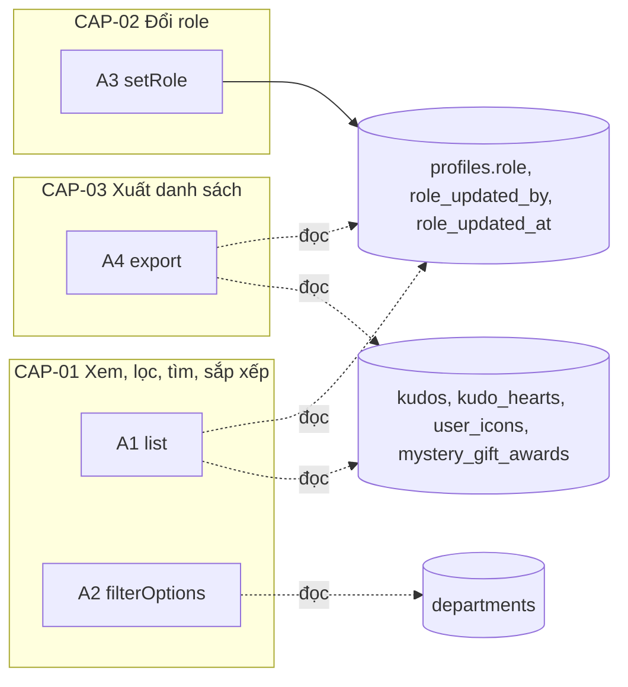
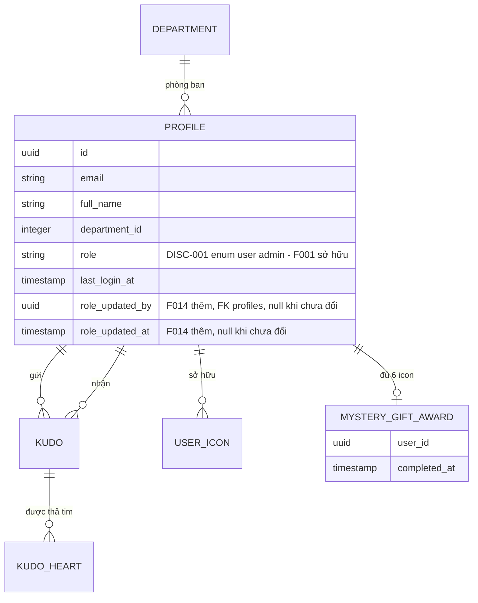
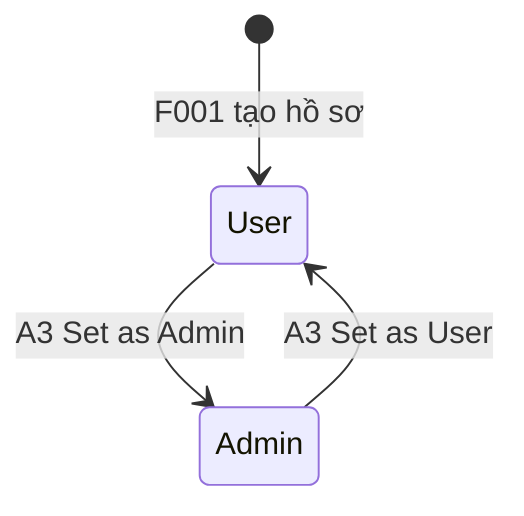

# F014_AdminUserManagement — Technical Spec

**Priority**: P2
**Type**: ui
**Generated**: 2026-11-08

**See also:** [`functional-spec.md`](./functional-spec.md) — tổng quan, quyết định còn mở, yêu cầu/quy tắc nghiệp vụ dạng một dòng, màn hình, user story, kịch bản, edge case và cấu hình cho BA/QA.

**How to read this file:** § 2 là bảng chỉ mục — chọn action cần xem rồi đọc block của nó ở § 3 một mạch từ trên xuống. § 4 là phụ lục dùng chung — chỉ nhảy vào khi một block ở § 3 trỏ tới.

## 1. Technical Overview

F014 cho Admin xem bảng Sunner kèm số liệu tham gia, lọc theo phòng ban / Level / Role, tìm theo tên hoặc email, sắp theo các cột số liệu, đổi role từng người và xuất danh sách đang lọc ra CSV. F014 **không tạo bảng mới**: nó đọc `profiles` và `departments` (F001), `kudos` (F003, trạng thái do F007 sở hữu), `kudo_hearts` (F005), `user_icons` và `mystery_gift_awards` (F010), và **chỉ ghi `profiles.role`** cùng hai cột ghi nhận người và thời điểm đổi role. Mọi xử lý nằm ở server (Next.js App Router + Drizzle trên Supabase Postgres); Drizzle chạy bằng vai trò server nên bỏ qua RLS, vì vậy **mỗi action của F014 tự gọi `AdminGuard#requireAdmin` (F001)** trước khi đụng dữ liệu. Cột Level lấy qua giao diện `LevelQuery` chưa có cài đặt (D001 ở functional-spec); chưa có nguồn thì cột hiện dấu gạch.



> **Thực tế implement (phase 14, 2026-11-23) — đọc trước khi đối chiếu tên "planned" bên dưới.** Mã nguồn thắng khi lệch.
>
> | Spec nói | Mã thực tế |
> |---|---|
> | A1 `GET /api/admin/users` | **Không có endpoint danh sách.** `app/admin/users/page.tsx` là server component, đọc `searchParams` qua `parseUserListParams` rồi gọi `UserAdminQuery.listPage` (YAGNI) |
> | A2 filter options | `UserFilterOptionsQuery.get` (`features/admin-users/server/user-filter-options-query.ts`); lỗi đọc → dropdown rỗng, không phải `loadError` |
> | A3 `AdminUserRole#setRole` | Server action `setUserRoleAction` (`set-user-role-action.ts`) → `UserRoleService.setRole`. Lỗi trả **trong thân** `{ ok: false, error }` theo C-18, không phải mã HTTP: `NOT_FOUND`, `SELF_DEMOTE`, `ENV_ADMIN`, `LAST_ADMIN`, `FORBIDDEN` |
> | A4 `GET /api/admin/users/export` | Có đúng như spec (`app/api/admin/users/export/route.ts`); 401/403 JSON trước khi đọc tham số, 400 `invalid_params`, 422 `export_too_large`, `Cache-Control: private, no-store` |
> | `LevelQuery` (D001) | **Không có.** Level = hạng Hero (C-12): `HeroTierQuery.distinctSenderCountSubquery` + `tierCountRange` + `tierFromCount` của F009; tim = `heartCountsSubquery` của F005 trên Kudo public gửi bởi người đó |
> | `AdminUserFilterSchema` | `parseUserListParams` (`schemas/user-list-params-schema.ts`); tham số URL `page, unit, level, role, q, sort, dir`; `sort` ∈ `sent, received, hearts, level, badges, six_badges_at, last_login_at`; `unit` là uuid hoặc `none` (id phòng ban là uuid, không phải số) |
> | `role_updated_by/at` | Migration `0022_profiles_role_audit` (+ `.down.sql`), cột nullable, FK tự tham chiếu `ON DELETE SET NULL` |
> | Hằng cấu hình | `ADMIN_USER_PAGE_SIZE = 20` và `USER_SEARCH_MAX_LENGTH = 100` là hằng trong mã, **không phải biến môi trường**; chỉ `ADMIN_TIMEZONE`, `EXPORT_MAX_ROWS`, `ADMIN_EMAILS` đọc từ env (đã có sẵn; phase 14 không thêm biến mới) |

## 2. Action Index

| # | Action (handler) | Method · Path | Codes | Writes | Detail |
|---|---|---|---|---|---|
| **A0** | *cross-cutting — belongs to no single action* | — | FR-601, FR-602 | — | § 4.4 |
| **A1** | `AdminUserList#list` (planned) | `GET` `/api/admin/users` | FR-101, FR-201, FR-202, FR-203, FR-204, FR-205, FR-206, FR-207, FR-208, FR-402, FR-407, FR-408, BR-004, BR-005, DEC-003, US001_BrowseUserTable, US002_FilterSearchSortUsers | — *(read-only)* | § 3.1 |
| **A2** | `AdminUserFilterOptions#get` (planned) | `server function` · — | FR-203, FR-204, FR-205, US002_FilterSearchSortUsers | — *(read-only)* | § 3.1 |
| **A3** | `AdminUserRole#setRole` (planned) | `server action` | FR-001, FR-002, FR-209, FR-401, FR-404, FR-405, FR-406, BR-001, BR-002, BR-003, DEC-001, SM-001, US003_ChangeUserRole | `profiles` | § 3.2 |
| **A4** | `AdminUserExport#download` (planned) | `GET` `/api/admin/users/export` | FR-403, FR-603, BR-004, BR-005, BR-006, DEC-002, US004_ExportUsers | — *(read-only; trả tệp)* | § 3.3 |

**Rung set** theo template: Who → FE → Request → BE → Rule → Result → State → Source. Rung vắng thì bỏ hẳn. **State** bỏ trong bản nháp vì chưa có nguồn xác nhận; vòng đời role nằm ở SM-001 (§ 4.3).

## 3. Actions

### 3.1 CAP-01 — Xem, lọc, tìm kiếm, sắp xếp người dùng

#### A1 · Lấy một trang người dùng cho bảng User
`GET /api/admin/users` → `` `AdminUserList#list` `` (planned)
`FR-101` `FR-201` `FR-202` `FR-203` `FR-204` `FR-205` `FR-206` `FR-207` `FR-208` `FR-402` `FR-407` `FR-408` `BR-004` `BR-005` `DEC-003` `US001_BrowseUserTable` `US002_FilterSearchSortUsers` · `SCR026_AdminUser` (draft)

**Who** · Admin *(gate A0 — § 4.4)*
**FE** · Trang User (FR-101: Admin vào từ mục "User" của menu khu Admin, menu thuộc F002). Bảng gồm cột ID, User, Email, tổng Kudo gửi, tổng Kudo nhận, Total Heart, Level, Number of Badges, Time to get 6 Badges, Last Logged in, Role, Actions (FR-201). Ba dropdown Unit / Level / Role (FR-203, FR-204, FR-205) và ô Search (FR-206). Bấm đầu cột số liệu để đảo chiều sắp xếp (FR-207). Phân trang đánh số (FR-202). Đổi bất kỳ điều kiện nào thì gọi lại action và về trang 1 (FR-402). Ô không có dữ liệu hiện dấu gạch (FR-208). Không có dòng thì hiện trạng thái trống, gọi lỗi thì hiện lỗi kèm nút thử lại (FR-407).
**Request** · param `unitId` *(số nguyên, tuỳ chọn)*, `level` *(giá trị do `LevelQuery` liệt kê, tuỳ chọn)*, `role` *(`user` | `admin`; vắng = tất cả)*, `q` *(1–`USER_SEARCH_MAX_LENGTH` ký tự, tuỳ chọn)*, `sortBy` *(`name` mặc định | `sentKudos` | `receivedKudos` | `totalHeart` | `level` | `badges` | `completedAt` | `lastLoginAt`)*, `sortDir` *(`asc` | `desc`)*, `page` *(số nguyên ≥ 1)*; kiểm bằng `AdminUserFilterSchema` (Zod). Cỡ trang do server cố định (`ADMIN_USER_PAGE_SIZE`), client không gửi.
**BE** · `` `AdminUserList#list` `` gọi `AdminGuard#requireAdmin`, kiểm tham số, rồi chạy `UserAdminQuery` (planned): đọc `profiles` nối `departments`, kèm các số liệu gộp theo từng người (đếm Kudo gửi, Kudo nhận, tổng tim, số icon khác nhau, thời điểm đủ 6 icon) và Level lấy từ `LevelQuery`. Lọc, sắp xếp và phân trang chạy trong SQL để sắp theo cột số liệu vẫn đúng qua các trang (không gộp ở bộ nhớ). Trả `items`, `total`, `page`, `pageSize`.
**Rule** · quyết định ô "Time to get 6 Badges", áp bộ lọc và nguồn số liệu:

| DEC | subtype | Condition | What the user sees | Source |
|---|---|---|---|---|
| **DEC-003** | render | `mystery_gift_awards.completed_at` có giá trị cho người dùng | thời điểm dạng `dd/mm/yyyy hh:mm` theo `ADMIN_TIMEZONE` | TBD (draft) |
| **DEC-003** | render | không có dòng `mystery_gift_awards` cho người dùng | dấu gạch; khi sắp xếp người này luôn nằm cuối ở cả hai chiều | TBD (draft) |

- **BR-004 — Danh sách và Export dùng chung một bộ lọc AND và một thứ tự.** Các điều kiện kết hợp AND, điều kiện vắng nghĩa là không lọc; mặc định theo tên A–Z, bằng nhau thì `id` tăng dần để phân trang ổn định; giá trị rỗng luôn nằm cuối. *(§ 4.4)*
- **BR-005 — Số Kudo gửi, Kudo nhận, tim và Badge chỉ tính Kudo Public.** Truy vấn gộp lọc `kudos.status = 'public'` nên Kudo Spam không vào số, Un Spam thì số tự khôi phục (FR-408). *(§ 4.4)*

**Result** · read-only — **không ghi DB**. Trang `items` đã định dạng (số, ngày giờ) và `total` để dựng phân trang. Trang vượt tổng trang thì trả `items` rỗng kèm `total` để FE chuyển về trang cuối.
**Source:** TBD (draft)

<!-- Không có diagram: dưới ngưỡng (chỉ đọc, đồng bộ, không ghi bảng). Nội dung chính là bảng DEC và bộ tham số. -->

---

#### A2 · Lấy lựa chọn cho ba dropdown lọc
`—` → `` `AdminUserFilterOptions#get` `` (planned)
`FR-203` `FR-204` `FR-205` `US002_FilterSearchSortUsers` · `SCR026_AdminUser` (draft)

**Who** · Admin *(gate A0 — § 4.4)*
**FE** · Nạp một lần khi mở trang, đổ vào dropdown "Chọn phòng ban" (FR-203), "Chọn Level" (FR-204), "Chọn Role" (FR-205). Chưa có Level để liệt kê thì dropdown Level không có lựa chọn và bị khoá.
**Request** · không có tham số.
**BE** · `` `AdminUserFilterOptions#get` `` gọi `AdminGuard#requireAdmin`, đọc toàn bộ `departments` (sắp theo tên), gọi `LevelQuery#listLevels` lấy danh sách Level, và trả hai giá trị Role cố định `user`, `admin`.
**Result** · read-only — **không ghi DB**. Trả `{ departments: [{id, name}], levels: [...], roles: ["user", "admin"] }`; `levels` rỗng khi `LevelQuery` chưa có nguồn (D001).
**Source:** TBD (draft)

<!-- Không có diagram: dưới ngưỡng (chỉ đọc, đồng bộ). -->

### 3.2 CAP-02 — Đổi role người dùng

#### A3 · Đặt role cho một người dùng
`server action` → `` `AdminUserRole#setRole` `` (planned)
`FR-001` `FR-002` `FR-209` `FR-401` `FR-404` `FR-405` `FR-406` `BR-001` `BR-002` `BR-003` `DEC-001` `SM-001` `US003_ChangeUserRole` · `SCR026_AdminUser` (draft)

**Who** · Admin *(gate A0 — § 4.4)*
**FE** · Nút "⋯" ở mỗi dòng mở menu (FR-209). Nội dung menu theo DEC-001 `[INFERRED]` — thiết kế chưa chụp menu này. Chọn xong có popover xác nhận hay đổi ngay là D007; trong lúc chờ nút bị khoá để chống bấm đúp. Thành công thì dòng cập nhật cột Role tại chỗ, không tải lại trang (FR-401). Lỗi chốt an toàn hiện thông báo ngay tại dòng.
**Request** · `userId` *(uuid, Zod)*, `role` *(`user` | `admin`)*; `adminId` lấy từ session, không nhận từ client.
**BE** · `` `AdminUserRole#setRole` `` gọi `AdminGuard#requireAdmin`, kiểm tham số, rồi chạy một giao dịch: khoá các dòng Admin hiện có, đọc role hiện tại của người dùng, kiểm hai chốt an toàn, ghi. Sau khi ghi, làm mới trang Admin. Role luôn được `AdminGuard` đọc lại từ DB ở mỗi request nên người bị hạ mất quyền ngay ở request kế (F001).
**Rule**
- **BR-001 — Đổi role chỉ ghi khi role hiện tại khác role đích; lệnh trùng không lỗi.** Hai Admin cùng đặt một người làm Admin: lần đến sau nhận trạng thái hiện tại, không ghi đè `role_updated_*` (FR-406).
- **BR-002 — Admin không được tự hạ role của chính mình.** `userId` bằng `adminId` và `role = 'user'` thì từ chối, kể cả khi còn nhiều Admin (FR-404).
- **BR-003 — Luôn còn ít nhất một Admin.** Đếm số Admin trong lúc đã khoá các dòng Admin, nên hai Admin hạ nhau cùng lúc cũng không thể cùng thành công và để hệ thống hết Admin (FR-405, FR-406).

```text
BEGIN
  admins = SELECT id FROM profiles WHERE role='admin' ORDER BY id FOR UPDATE
  cur = SELECT role FROM profiles WHERE id=:userId           # null -> NotFound(404)
  if cur == :role: return {id, role: cur}                    # BR-001, không ghi
  if :role == 'user':
      if :userId == :adminId: raise Forbidden(self_demote)   # BR-002 (403)
      if count(admins) <= 1: raise Conflict(last_admin)      # BR-003 (409)
  UPDATE profiles SET role=:role, role_updated_by=:adminId, role_updated_at=now()
    WHERE id=:userId
COMMIT
```

Menu của dòng quyết định bởi:

| DEC | subtype | Condition | What the user sees | Source |
|---|---|---|---|---|
| **DEC-001** | render | `row.role = 'user'` | menu có "Set as Admin" | TBD (draft) |
| **DEC-001** | render | `row.role = 'admin'` và `row.id ≠ viewer.id` | menu có "Set as User" | TBD (draft) |
| **DEC-001** | render | `row.role = 'admin'` và `row.id = viewer.id` | "Set as User" bị khoá kèm giải thích (BR-002) | TBD (draft) |

**Result**
- Ghi `profiles.role` ← role đích; `profiles.role_updated_by` ← `adminId`; `profiles.role_updated_at` ← thời điểm hiện tại (FR-001: mỗi người đúng một role; FR-002: lưu người và thời điểm đổi gần nhất).
- User sees: cột Role của dòng đổi giá trị và menu đổi theo DEC-001; lỗi chốt an toàn hiện "Không thể hạ Admin cuối cùng." hoặc "Bạn không thể tự hạ role của mình."
**Source:** TBD (draft)

<!-- Không có diagram: dưới ngưỡng (một bảng, đồng bộ). Chuỗi kiểm tra nằm trong khối pseudocode; SM-001 (§ 4.3) giữ sơ đồ trạng thái. -->

### 3.3 CAP-03 — Xuất danh sách người dùng

#### A4 · Tải tệp CSV các người dùng đang lọc
`GET /api/admin/users/export` → `` `AdminUserExport#download` `` (planned)
`FR-403` `FR-603` `BR-004` `BR-005` `BR-006` `DEC-002` `US004_ExportUsers` · `SCR026_AdminUser` (draft)

**Who** · Admin *(gate A0 — § 4.4)*
**FE** · Nút "Export" (màu vàng) ở góc trên bên phải tiêu đề. Bấm thì tải về tệp của **toàn bộ** kết quả khớp bộ lọc hiện tại, không chỉ trang đang xem (FR-403); trong lúc chuẩn bị nút bị khoá kèm trạng thái chờ.
**Request** · cùng tham số lọc và sắp xếp như A1, **không có `page`**; kiểm bằng cùng `AdminUserFilterSchema`.
**BE** · `` `AdminUserExport#download` `` gọi `AdminGuard#requireAdmin`, kiểm tham số, đếm số dòng khớp, rồi truyền (stream) từng dòng từ `UserAdminQuery` ra phản hồi CSV, `Content-Disposition: attachment`. Cột: ID, User, Email, Sent Kudos, Received Kudos, Total Heart, Level, Number of Badges, Time to get 6 Badges, Last Logged in, Role (không có cột Actions).
**Rule** · quyết định định dạng và giới hạn của tệp:

| DEC | subtype | Condition | What the user sees | Source |
|---|---|---|---|---|
| **DEC-002** | flow | số dòng khớp ≤ `EXPORT_MAX_ROWS` | tải về tệp CSV UTF-8 có BOM (Excel đọc đúng tiếng Việt), tên `users-{yyyymmdd-hhmm}.csv` | TBD (draft) |
| **DEC-002** | flow | số dòng khớp > `EXPORT_MAX_ROWS` | không tải tệp; hiện lỗi yêu cầu thu hẹp bộ lọc (HTTP 422) | TBD (draft) |

- **BR-004 — Cùng bộ lọc và thứ tự với A1.** Tệp khớp từng dòng với những gì Admin thấy khi duyệt hết các trang. *(§ 4.4)*
- **BR-005 — Số liệu cùng nguồn với A1, chỉ tính Kudo Public.** Dùng chung `UserAdminQuery` nên bảng và tệp không lệch nhau. *(§ 4.4)*
- **BR-006 — Ô văn bản bắt đầu bằng `=`, `+`, `-`, `@` (hoặc tab/CR) phải bị vô hiệu hoá công thức khi ghi CSV.** Thêm dấu `'` đứng đầu; tên và email do người dùng và Google cung cấp nên không tin nội dung (FR-603). `[INFERRED]` từ rủi ro CSV injection; cùng quy ước CSV với trang Review content của F007 nên dùng chung một hàm ghi CSV (§ 5.3).

**Result** · read-only — không ghi DB. Phản hồi là tệp CSV; thời điểm định dạng `dd/mm/yyyy hh:mm` giống bảng `[INFERRED]`.
**Source:** TBD (draft)

<!-- Không có diagram: không ghi bảng, một bước đồng bộ (stream). Không dùng XLSX: tránh thêm thư viện cho yêu cầu chưa ai xác nhận (YAGNI), xem D012. -->

### 3.4 Edge cases

| Action | Scenario | Behavior |
|---|---|---|
| A3 | Hai Admin cùng đặt một người làm Admin | Giao dịch tuần tự: chỉ lần đầu ghi; lần sau trả role hiện tại, không lỗi (BR-001) |
| A3 | Hai Admin hạ nhau cùng lúc khi chỉ có hai Admin | Cả hai giao dịch cùng khoá các dòng Admin theo thứ tự `id`; lần thứ hai thấy chỉ còn một Admin và bị từ chối 409 (BR-003) |
| A3 | `userId` không tồn tại hoặc không phải uuid | 404 / 400 (Zod); không ghi gì |
| A3 | Admin bị hạ trong lúc đang mở trang, rồi bấm đổi role | `requireAdmin` đọc lại role từ DB và từ chối 403; không ghi gì |
| A1 | `page` vượt tổng trang | `items` rỗng kèm `total`; FE chuyển về trang cuối |
| A1 · A4 | `q` quá `USER_SEARCH_MAX_LENGTH` hoặc chỉ khoảng trắng | quá dài: 400; chỉ khoảng trắng: coi như không lọc |
| A1 · A4 | Người dùng chưa đăng nhập lần nào (`last_login_at` rỗng) | Ô hiện dấu gạch; khi sắp xếp luôn nằm cuối ở cả hai chiều (BR-004) |
| A1 · A4 | Người dùng chưa có phòng ban | Dòng hiện dấu gạch ở phòng ban; chỉ khớp khi không lọc Unit |
| A2 | `LevelQuery` chưa có nguồn | `levels` rỗng; dropdown Level khoá; cột Level hiện dấu gạch (D001) |
| A4 | Số dòng khớp > `EXPORT_MAX_ROWS` | 422, không tạo tệp (DEC-002) |
| A4 | Tên chứa `=HYPERLINK(...)` hoặc dấu phẩy, nháy kép | Dấu `'` đứng đầu cho ô nguy hiểm (BR-006); ô có dấu phẩy/nháy kép được bọc nháy kép theo CSV chuẩn |
| A1-A4 | User thường gọi trực tiếp API hoặc server action | `requireAdmin` từ chối 403 trước mọi truy vấn (A0 § 4.4); dữ liệu không đổi |

## 4. Shared Foundation

### 4.1 Components

| Component | Responsibility | Used in | File |
|---|---|---|---|
| `AdminUserList` (planned) | Điểm vào đọc trang người dùng | A1 | TBD (draft) |
| `AdminUserFilterOptions` (planned) | Danh sách lựa chọn cho ba dropdown | A2 | TBD (draft) |
| `AdminUserRole` (planned) | Server action đổi role kèm giao dịch và hai chốt an toàn | A3 | TBD (draft) |
| `AdminUserExport` (planned) | Route handler stream CSV | A4 | TBD (draft) |
| `UserAdminQuery` (planned) | Truy vấn Drizzle dùng chung: lọc AND, sắp xếp, đếm, gộp số liệu theo người dùng; đưa Kudo Spam ra khỏi số | A1, A4 | TBD (draft) |
| `AdminUserFilterSchema` (planned) | Schema Zod chung cho tham số lọc của A1 và A4 | A1, A4 | TBD (draft) |
| `LevelQuery` (planned, **chưa có cài đặt — D001**) | Giao diện thay thế được: `listLevels()` và một subquery `(user_id, level)` để `UserAdminQuery` lọc và sắp xếp trong SQL; cài đặt mặc định trả rỗng | A1, A2, A4 | TBD (draft) |
| `AdminGuard#requireAdmin` *(F001)* | Kiểm role Admin đọc từ DB; F014 chỉ gọi lại, không tự kiểm role | A1-A4 | TBD (draft) |

### 4.2 Data Model



| Entity | Table | Used for | Action |
|---|---|---|---|
| `Profile` *(F001)* | `profiles` | Nguồn của bảng; F014 ghi `role` và hai cột mới `role_updated_by`, `role_updated_at` | A1-A4 |
| `Department` *(F001)* | `departments` | Tên phòng ban cho cột và dropdown Unit | A1, A2, A4 |
| `Kudo` *(F003; `status` của F007)* | `kudos` | Đếm Kudo gửi (`sender_id`) và nhận (`recipient_id`), chỉ `status = 'public'` | A1, A4 |
| `KudoHeart` *(F005)* | `kudo_hearts` | Tổng tim theo định nghĩa của F005; chỉ Kudo Public | A1, A4 |
| `UserIcon` *(F010)* | `user_icons` | Number of Badges = số dòng icon khác nhau của người dùng (D002) | A1, A4 |
| `MysteryGiftAward` *(F010)* | `mystery_gift_awards` | `completed_at` cho cột "Time to get 6 Badges" | A1, A4 |

Không có bảng lịch sử đổi role ở bản đầu (D007, YAGNI). Mã `MODEL###` do bước data-model cấp sau; bản nháp không đặt mã.

#### Polymorphic Behavior

##### profiles.role — mã DISC-### theo F001 (DISC-001, tạm)

| Value | Render | Validation | Persistence |
|-------|--------|------------|-------------|
| user | Cột Role hiện "User"; menu dòng có "Set as Admin" | Mặc định khi F001 tạo hồ sơ | F001 đặt lúc tạo; A3 đặt khi hạ từ Admin (qua BR-002, BR-003) |
| admin | Cột Role hiện "Admin"; menu dòng có "Set as User" (khoá ở dòng của chính mình) | Phải qua `AdminGuard#requireAdmin` | A3 đặt khi nâng từ User; Admin đầu tiên do F001 tạo (câu hỏi đã nêu ở F001) |

**Source:** TBD (draft)

### 4.3 State Management

### Vòng đời role của một người dùng: User và Admin chuyển qua lại có chốt an toàn (SM-001)
**kind:** entity
**Linked FR:** FR-401
**Source:** TBD (draft)



**Action transitions:** điều kiện chuyển và ghi `role_updated_*` nằm ở rung **Result** của action ghi trên mỗi cạnh (§ 3.2); cạnh Admin → User chỉ đi qua khi qua đủ BR-002 và BR-003 — không lặp lại ở đây (DRY).

### 4.4 Shared Rules

#### Bin 3 — cross-cutting, belongs to no single action

**A0 · FR-601 / FR-602 — Mọi action của F014 (A1-A4) yêu cầu role Admin kiểm ở server, và role chỉ đổi được qua A3.**
Mỗi route handler / server action gọi `AdminGuard#requireAdmin` (F001) **trước** mọi truy vấn; role đọc từ DB, không tin cookie hay tham số. Drizzle chạy bằng vai trò server nên bỏ qua RLS, vì vậy việc kiểm này không được dựa vào RLS. Để Sunner không tự nâng role qua API Supabase công khai: `profiles` không có policy UPDATE cho cột `role` với vai trò `authenticated` (mọi ghi đi qua server). Vi phạm: 403, không ghi gì. Cổng đăng nhập chung thuộc F001; không phải rule riêng của F014.
**Source:** TBD (draft)

#### Bin 2 — used by ≥2 named actions

**BR-004 — Danh sách và Export dùng chung một bộ lọc AND và một thứ tự.**
Used in: **A1** · **A4**. Cùng `AdminUserFilterSchema` và cùng `UserAdminQuery` nên tệp luôn khớp bảng đang xem. Giá trị rỗng luôn nằm cuối kể cả khi đảo chiều; `id` làm khoá phụ cuối cùng.
**Source:** TBD (draft)
```text
where = []
if unitId: where += profiles.department_id = unitId
if level:  where += levelOf(user) = level           # qua LevelQuery, D001
if role:   where += profiles.role = role
if q:      where += (full_name ILIKE %q% OR email ILIKE %q%)   # bỏ dấu: D009
order = (sortBy col) dir NULLS LAST, id asc          # mặc định: full_name asc
```

**BR-005 — Số Kudo gửi, Kudo nhận, tim và Badge chỉ tính Kudo Public.**
Used in: **A1** · **A4**. Các số gộp lọc `kudos.status = 'public'` ngay trong truy vấn, không lưu số riêng, nên Mark Spam / Un Spam của F007 tự phản ánh. Badge là số dòng `user_icons` (không phụ thuộc Kudo) — Kudo Spam không thu hồi icon đã có (cùng mặc định thu hồi của F007).
**Source:** TBD (draft)
```text
sent(u)     = COUNT(kudos WHERE sender_id=u AND status='public')
received(u) = COUNT(kudos WHERE recipient_id=u AND status='public')
heart(u)    = COUNT(kudo_hearts JOIN kudos WHERE sender_id=u AND status='public')   # định nghĩa F005, D010
badges(u)   = COUNT(user_icons WHERE user_id=u)                                      # D002
```

### 4.5 Algorithms & Integrations

None.

<!-- Không có ALG/INT: lọc và sắp xếp là truy vấn SQL (BR-004), CSV là serialize tuần tự. Level đi qua `LevelQuery` nội bộ (§ 4.1), chưa phải tích hợp bên ngoài. -->

### 4.6 Configuration

```text
ADMIN_USER_PAGE_SIZE = 20          # số dòng mỗi trang bảng người dùng (A1) — đề xuất, D006
EXPORT_MAX_ROWS = 10000            # trần số dòng của một lần Export (A4) — dùng chung giá trị với F007, D012
USER_SEARCH_MAX_LENGTH = 100       # độ dài tối đa ô Search (A1, A4)
ADMIN_TIMEZONE = Asia/Ho_Chi_Minh  # cách hiển thị ngày giờ (A1, A4)
EXPORT_CSV_BOM = true              # thêm BOM UTF-8 để Excel đọc đúng tiếng Việt (A4)
```

Giá trị nghiệp vụ nhìn thấy được (cỡ trang, trần Export, độ dài ô tìm) cũng ghi ở functional-spec § 13; phần kỹ thuật (múi giờ, BOM) chỉ ở đây.

**Client behavior:** trạng thái chờ của nút Export, popover xác nhận và nút "⋯", xem [`../../screens/SCR026_AdminUser/spec.md`](../../screens/SCR026_AdminUser/spec.md).

## 5. Verification & Technical Notes

### 5.1 Technical Verification

- **SC-001** *(A1)* Lọc Unit, Level, Role và Search kết hợp AND; đổi điều kiện về trang 1 (covers FR-203, FR-204, FR-205, FR-206, FR-402, BR-004)
- **SC-002** *(A1)* Sắp theo từng cột số liệu ổn định qua các trang, không lặp, không sót; giá trị rỗng luôn cuối ở cả hai chiều (covers FR-207, FR-202, BR-004, DEC-003)
- **SC-003** *(A1, A4)* Mark Spam một Kudo làm giảm đúng một đơn vị ở Kudo gửi của người gửi và Kudo nhận của người nhận; Un Spam khôi phục; số Badge không đổi (covers FR-408, BR-005)
- **SC-004** *(A3)* Nâng User lên Admin ghi `role`, `role_updated_by`, `role_updated_at`; lệnh trùng không ghi đè (covers FR-001, FR-002, FR-401, BR-001, SM-001)
- **SC-005** *(A3)* Admin tự hạ mình bị 403; hạ Admin cuối cùng bị 409; hai Admin hạ nhau cùng lúc (chỉ có hai Admin) chỉ một lệnh thành công, còn đúng một Admin (covers FR-404, FR-405, FR-406, BR-002, BR-003)
- **SC-006** *(A4)* Tệp CSV khớp từng dòng với bảng đã lọc, có BOM, ô bắt đầu bằng `=`/`+`/`-`/`@` bị vô hiệu hoá; vượt `EXPORT_MAX_ROWS` thì 422 (covers FR-403, FR-603, BR-004, BR-006, DEC-002)
- **SC-007** *(A0)* User thường gọi trực tiếp bất kỳ route/action nào của F014 đều bị 403 và dữ liệu không đổi, kể cả gọi API Supabase công khai để sửa `role` (covers FR-601, FR-602)
- **SC-008** *(A2)* Trả đủ phòng ban, hai Role và danh sách Level (rỗng khi chưa có nguồn) (covers FR-203, FR-204, FR-205)

#### US001_BrowseUserTable *(A1)*

**Independent Test:** Với dữ liệu nhiều Sunner (có người chưa đăng nhập, chưa đủ Badge), gọi A1 không lọc rồi duyệt các trang.

**Acceptance Scenarios:**

1. **Given** 45 Sunner và `ADMIN_USER_PAGE_SIZE = 20`, **When** Admin duyệt ba trang, **Then** thấy 20, 20, 5 dòng theo tên A–Z, không lặp, không sót.
2. **Given** người dùng chưa từng đăng nhập, **When** xem dòng đó, **Then** ô "Last Logged in" là dấu gạch.

#### US002_FilterSearchSortUsers *(A1, A2)*

**Independent Test:** Gọi A1 với từng điều kiện rồi với tất cả cùng lúc; gọi A2 lấy lựa chọn.

**Acceptance Scenarios:**

1. **Given** Sunner ở nhiều phòng ban và role, **When** lọc Unit = A, Role = Admin, **Then** mọi dòng thuộc phòng A và là Admin.
2. **Given** ô tìm "nguyen" (không dấu), **When** tìm, **Then** thấy cả người có tên "Nguyễn" (D009).
3. **Given** sắp theo Number of Badges giảm dần, **When** có người chưa có Badge nào, **Then** họ nằm cuối.

#### US003_ChangeUserRole *(A3)*

**Independent Test:** Đổi role một Sunner rồi kiểm tra dòng DB và quyền vào khu Admin của người đó.

**Acceptance Scenarios:**

1. **Given** Sunner X role User, **When** Admin Set as Admin, **Then** `role = admin`, có `role_updated_by` và `role_updated_at`, X vào được khu Admin ở request kế.
2. **Given** chỉ có một Admin, **When** người đó (hoặc Admin khác) gọi hạ chính họ, **Then** bị từ chối và role giữ nguyên.
3. **Given** hai Admin, **When** mỗi người hạ người kia cùng lúc, **Then** đúng một lệnh thành công và còn một Admin.

#### US004_ExportUsers *(A4)*

**Independent Test:** Lọc Role = Admin rồi Export, mở tệp bằng Excel.

**Acceptance Scenarios:**

1. **Given** bộ lọc cho 37 người trải trên 2 trang, **When** Export, **Then** tệp có đúng 37 dòng theo thứ tự đang xem.
2. **Given** bộ lọc cho hơn `EXPORT_MAX_ROWS` dòng, **When** Export, **Then** không có tệp và hiện lỗi yêu cầu thu hẹp bộ lọc.

### 5.2 Assumptions

- *(A1-A4)* Đã đọc `node_modules/next/dist/docs/` ở phase 14 (route handler trả tệp, `searchParams` là Promise, prop `retry` của `error.tsx`); các điểm vào dùng đúng API đó.
- *(A3)* Menu dòng chỉ có "Set as Admin" / "Set as User"; Figma không vẽ menu, xác nhận, nhãn "Admin · env" nên các phần này dựng theo token phase 06/08. `[INFERRED]`
- *(tiếng Anh)* Văn bản tiếng Anh và tiêu đề CSV tiếng Anh là bản nháp, chờ BTC. `[UNVERIFIED]`

### 5.3 Unresolved Questions

Đã giải quyết ở phase 14: Level trong SQL (dùng mảnh SQL của F009, khớp bằng test parity với `HeroTierQuery`), tổng tim theo lô (`heartCountsSubquery`), tìm không dấu (`public.f_unaccent`, migration 0007), CSV dùng chung (`shared/admin/csv-serializer.ts`), thứ tự migration (F014 có migration riêng 0022), khoá giao dịch (`FOR UPDATE` các dòng admin theo thứ tự id).

Còn mở:

1. **Xác nhận với BTC**: chặn hạ quyền admin trong `ADMIN_EMAILS` (409 `ENV_ADMIN`), tiêu đề CSV tiếng Anh, bản tiếng Anh.
2. **Hiệu năng**: truy vấn đọc hết tim của Kudo public mỗi trang/lần export (233 ms ở 5k user / 100k Kudo, tăng tuyến tính); xét lại khi dữ liệu gấp 10 lần. Mỗi lần đọc chạy trong transaction với `SET LOCAL enable_nestloop = off` vì ước lượng sai số dòng của `f_unaccent(...) ILIKE` làm planner chọn nested loop (15,7 s, sau sửa 48 ms).
3. **Nhiễu trạng thái (Low)**: admin vừa bị hạ trong lúc thao tác có thể nhận `ok: true`, `ENV_ADMIN` hoặc `LAST_ADMIN` trước `FORBIDDEN`; không ghi được gì. Hoãn.
4. **Test**: `test:prod` chưa phủ `/admin/users` và route export; chưa đo coverage; test kế hoạch truy vấn (ngưỡng 500 ms) có thể chập chờn trên CI chậm; `user-role-concurrency` hạ mọi admin khác trong DB dùng chung đến `afterAll`, không chạy cùng Playwright.

### 5.4 Source References

Mã nguồn (phase 14):

| Vùng | Đường dẫn |
|---|---|
| Trang | `app/admin/users/{page,loading,error}.tsx` |
| Export | `app/api/admin/users/export/route.ts` |
| Server | `features/admin-users/server/`: `user-admin-query.ts`, `user-admin-sql-fragments.ts`, `user-filter-options-query.ts`, `user-role-service.ts`, `set-user-role-action.ts`, `user-export-columns.ts`, `env-admin-email.ts` |
| Schema, lib, UI | `features/admin-users/{schemas,lib,components}/` |
| Dùng chung | `shared/admin/`: `admin-csv-filename.ts`, `admin-date-time-format.ts`, `csv-serializer.ts`, `export-limit.ts`, `timezone.ts` |
| Migration | `db/migrations/0022_profiles_role_audit.sql` (+ `.down.sql`), `shared/db/schema/profiles.ts` |
| Test | `tests/{unit,integration,e2e}/admin-users/` (e2e dùng `admin-users-e2e-steps.ts`) |
| Bằng chứng | `plans/261108-0048-saa-2025-kudos-platform/evidence/phase-14/`, `.../evidence/screenshots/phase-14/` |

#### Data Flow

Derived from § 3 above:

```text
Bộ lọc (unit, level, role, q, sortBy, sortDir, page) -> AdminUserFilterSchema -> UserAdminQuery (+ LevelQuery) -> items + total -> bảng User
Set as Admin / Set as User -> requireAdmin -> giao dịch khoá dòng Admin + kiểm BR-001/002/003 -> UPDATE profiles.role -> dòng cập nhật; AdminGuard đọc lại role ở request kế
Bộ lọc -> A4 (cùng UserAdminQuery) -> stream CSV (BOM, vô hiệu công thức) -> tệp tải về
```

### 5.5 Artifact References

| Artifact | File | Codes Used | Reviewed |
|----------|------|------------|----------|
| System Overview | TBD (draft) | TBD (draft) | [ ] |
| Architecture | TBD (draft) | TBD (draft) | [ ] |
| Feature List | [feature-list.md](../feature-list.md) | F014 | [x] |
| API Map | TBD (draft) | TBD (draft) | [ ] |
| Entities | TBD (draft) | TBD (draft) | [ ] |
| Screens | [functional-spec.md § 6](./functional-spec.md#6-screens) | TBD (draft) | [ ] |
| Behavior Logic | TBD (draft) | TBD (draft) | [ ] |
| Permissions Matrix | TBD (draft) | TBD (draft) | [ ] |
| User Stories | TBD (draft) | TBD (draft) | [ ] |

**Rule:** Mọi mã trong Codes Used phải tồn tại trong artifact nguồn. Mã `F014` là tạm (PROVISIONAL), cấp lại khi promote.
