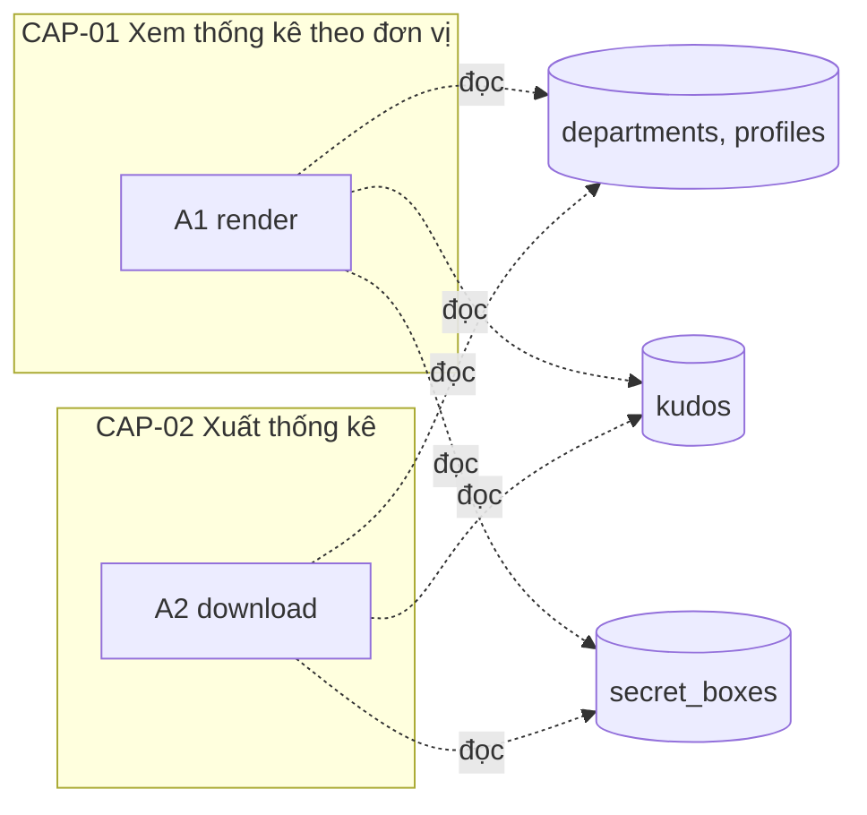
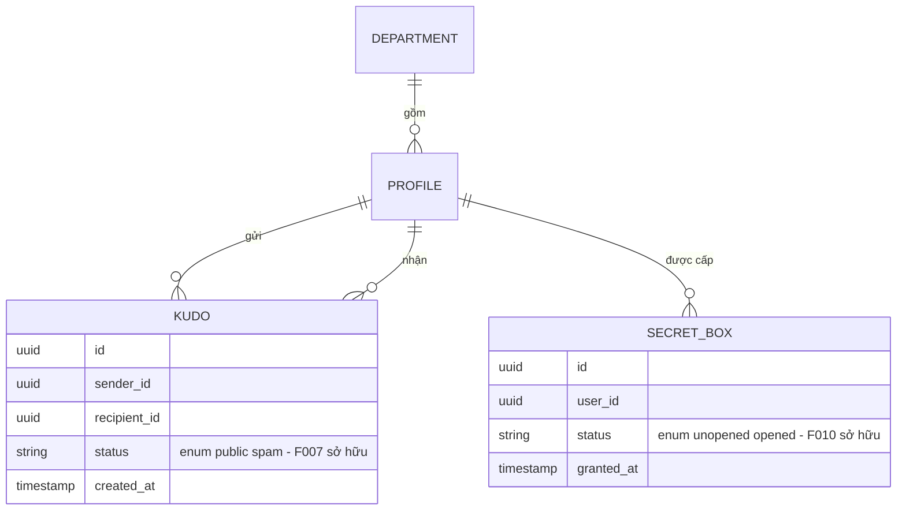

# F015_AdminOverview — Technical Spec

**Priority**: P3
**Type**: ui
**Generated**: 2026-11-08

**See also:** [`functional-spec.md`](./functional-spec.md) — tổng quan, quyết định còn mở, yêu cầu/quy tắc nghiệp vụ dạng một dòng, màn hình, user story, kịch bản, edge case và cấu hình cho BA/QA.

**How to read this file:** § 2 là bảng chỉ mục — chọn action cần xem rồi đọc block của nó ở § 3 một mạch từ trên xuống. § 4 là phụ lục dùng chung — chỉ nhảy vào khi một block ở § 3 trỏ tới.

## 1. Technical Overview

F015 cho Admin xem bảng thống kê theo đơn vị (phòng ban): tổng thành viên, Kudo gửi, Kudo nhận, số người có Kudo, Secret Box nhận, kèm dòng tổng "All", lọc theo khoảng ngày và xuất CSV. F015 **chỉ đọc**: không có bảng mới, không có migration, mọi số liệu lấy từ `departments`, `profiles` (F001), `kudos` (F003, trạng thái do F007 sở hữu) và `secret_boxes` (F010). Mọi xử lý nằm ở server (Next.js App Router + Drizzle trên Supabase Postgres); vì Drizzle chạy bằng vai trò server nên bỏ qua RLS, **mỗi action phải tự gọi `AdminGuard#requireAdmin` của F001** trước khi đụng dữ liệu. Với vài nghìn người dùng, một câu truy vấn tổng hợp (`GROUP BY` theo đơn vị) chạy trực tiếp trên bảng gốc là đủ — chưa dùng view vật chất hoá hay bảng đếm sẵn.



> **Thực tế implement (phase 14, 2026-11-23) — đọc trước khi đối chiếu tên "planned" bên dưới.** Mã nguồn thắng khi lệch.
>
> | Spec nói | Mã thực tế |
> |---|---|
> | A1 `AdminOverviewPage#render` | `app/admin/overview/page.tsx` (server component, `requireAdmin()`), kèm `loading.tsx`, `error.tsx`; gọi `UnitStatsQuery.forRange` rồi `addAllRow` |
> | A2 `GET /api/admin/overview/export` | `app/api/admin/overview/export/route.ts`; tệp `overview-{yyyyMMdd-HHmm}.csv` (`shared/admin/admin-csv-filename.ts`); 401/403 JSON trước khi đọc tham số, 400 `invalid_date_range` / `invalid_params`; không có trần số dòng (số đơn vị ở mức hàng chục) |
> | Tham số `dateFrom`, `dateTo` | **`from`, `to`** (`schemas/overview-params-schema.ts`, dùng `adminDateRangeSchema` nửa mở `[from 00:00, to+1 ngày 00:00)` theo `ADMIN_TIMEZONE`); tham số sai → bảng "toàn thời gian" kèm `filterError`, không ném lỗi |
> | `AdminOverviewFilterSchema`, `AdminDateRangeFilter` | `parseOverviewParams` và `shared/admin/date-range-filter.ts` (phase 01) |
> | Dòng "All" | Tính ở TypeScript từ chính các dòng đã đọc (`add-all-row.ts`), bằng tổng các đơn vị cộng dòng "Chưa gán đơn vị"; CSV có dòng All đầu, cột No trống; đơn vị đánh số từ 1 |
> | Tên đơn vị chưa gán | `Chưa gán đơn vị` (vi) / `Unassigned` (en), do server trả |
> | Migration | Không có (F015 chỉ đọc); giữ nguyên |
> | Biến môi trường | Dùng `ADMIN_TIMEZONE`, `EXPORT_MAX_ROWS` đã có; không thêm biến mới |

## 2. Action Index

| # | Action (handler) | Method · Path | Codes | Writes | Detail |
|---|---|---|---|---|---|
| **A0** | *cross-cutting — belongs to no single action* | — | FR-601 | — | § 4.4 |
| **A1** | `AdminOverviewPage` (`app/admin/overview/page.tsx`) | `GET` `/admin/overview` | FR-001, FR-002, FR-101, FR-201, FR-202, FR-203, FR-204, FR-205, FR-206, FR-207, FR-401, FR-403, BR-001, BR-002, BR-003, BR-004, BR-005, BR-006, DEC-001, DEC-002, ALG-001, US001_ViewUnitStatistics, US002_FilterByDateRange | — *(read-only)* | § 3.1 |
| **A2** | route handler `GET` (`app/api/admin/overview/export/route.ts`) | `GET` `/api/admin/overview/export` | FR-402, FR-602, BR-001, BR-002, BR-003, BR-004, BR-005, BR-006, DEC-002, ALG-001, US003_ExportUnitStatistics | — *(read-only; trả tệp)* | § 3.2 |

**Rung set** theo template: Who → FE → Request → BE → Rule → Result → State → Source. Rung vắng thì bỏ hẳn. Không có **State**: F015 không có vòng đời trạng thái nào.

## 3. Actions

### 3.1 CAP-01 — Xem thống kê theo đơn vị

#### A1 · Dựng trang Overview với bảng thống kê theo đơn vị
`GET /admin/overview?from&to` → `` `AdminOverviewPage` ``
`FR-001` `FR-002` `FR-101` `FR-201` `FR-202` `FR-203` `FR-204` `FR-205` `FR-206` `FR-207` `FR-401` `FR-403` `BR-001` `BR-002` `BR-003` `BR-004` `BR-005` `BR-006` `DEC-001` `DEC-002` `ALG-001` `US001_ViewUnitStatistics` `US002_FilterByDateRange` · `SCR027_AdminOverview` (draft)

**Who** · Admin *(gate A0 — § 4.4)*
**FE** · Trang Overview (FR-101: Admin vào từ mục "Overview" của menu khu Admin, menu thuộc F002). Bảng bảy cột No, Unit, Total member, Total sent kudos, Total received kudos, Total users with at least 1 kudo, Total received secret box (FR-201); dòng "All" đầu tiên rồi từng đơn vị (FR-202); không phân trang (FR-206). Ô khoảng ngày (FR-203, FR-204) — chọn xong thì đẩy `dateFrom`, `dateTo` lên địa chỉ trang để server dựng lại bảng; địa chỉ giữ khoảng ngày nên tải lại hoặc chia sẻ vẫn ra đúng số (FR-401). Ngày bắt đầu sau ngày kết thúc thì FE chặn và hiện lỗi cạnh ô ngày, không gọi server (FR-403). Trong lúc dựng lại hiện trạng thái chờ, lỗi thì hiện thông báo kèm nút thử lại (FR-207). Dropdown chọn nhanh khoảng thời gian chưa làm ở bản đầu (D009 ở functional-spec).
**Request** · param `dateFrom`, `dateTo` *(ngày `YYYY-MM-DD`, tuỳ chọn; vắng = không giới hạn đầu đó)*; kiểm bằng `AdminOverviewFilterSchema` (Zod): đúng định dạng ngày hợp lệ và `dateFrom` ≤ `dateTo`, sai thì 400 (FR-403).
**BE** · `` `AdminOverviewPage` `` (server component) gọi `AdminGuard#requireAdmin`, kiểm tham số, rồi chạy `UnitStatsQuery.forRange` theo `ALG-001`. Trả mảng dòng gồm dòng "All" và các dòng đơn vị đã sắp thứ tự. Không cache: số liệu đọc trực tiếp ở mỗi lần dựng.
**Rule** · quyết định dòng nào hiện và cách hiểu khoảng ngày:

| DEC | subtype | Condition | What the user sees | Source |
|---|---|---|---|---|
| **DEC-001** | render | tồn tại `profiles` có `department_id IS NULL` | dòng "Chưa gán đơn vị" ở cuối bảng | TBD (draft) |
| **DEC-001** | render | không có `profiles` nào chưa gán đơn vị | không có dòng "Chưa gán đơn vị" | TBD (draft) |
| **DEC-002** | flow | cả `dateFrom` và `dateTo` vắng | tính toàn thời gian | TBD (draft) |
| **DEC-002** | flow | chỉ có `dateFrom` / chỉ có `dateTo` | tính từ đầu ngày đó đến hiện tại / từ đầu đến hết ngày đó | TBD (draft) |
| **DEC-002** | flow | có cả hai | khoảng kín, hai đầu đều trọn ngày giờ Việt Nam | TBD (draft) |

- **BR-001 — Một Kudo chỉ tính khi `status = 'public'` và `created_at` nằm trong khoảng; ngày cắt theo giờ Việt Nam.** `dateFrom` từ 00:00, `dateTo` hết 23:59:59 giờ `ADMIN_TIMEZONE`. FR-002 *(Kudo Spam không tính)*. *(§ 4.4)*
- **BR-002 — Kudo gửi tính cho đơn vị của người gửi, Kudo nhận cho đơn vị của người nhận; Kudo ẩn danh vẫn tính cho đơn vị người gửi.** Đơn vị lấy từ `profiles.department_id` hiện tại, không có lịch sử. FR-001. *(§ 4.4)*
- **BR-003 — "Total users with at least 1 kudo" đếm người nhận khác nhau.** Mỗi người một lần dù nhận nhiều Kudo; cách hiểu "nhận" chờ D001. *(§ 4.4)*
- **BR-004 — "Total member" là số `profiles` hiện thuộc đơn vị, không lọc theo ngày.** Gồm cả Admin (D004). FR-203. *(§ 4.4)*
- **BR-005 — "Total received secret box" đếm `secret_boxes` có `granted_at` trong khoảng, mọi `status`.** Không trừ hộp khi Kudo sinh ra nó sau này bị Spam. *(§ 4.4)*
- **BR-006 — Dòng "All" là tổng toàn hệ thống, bằng tổng dòng đơn vị cộng dòng "Chưa gán đơn vị".** Tính bằng cách cộng các dòng đã nhóm, không chạy lại truy vấn riêng. Cộng được cả cột người có Kudo vì mỗi người chỉ thuộc một đơn vị. *(§ 4.4)*

**Result** · read-only — **không ghi DB**. Danh sách dòng đã sắp: "All" đầu, đơn vị theo tên tự nhiên A-Z (CECV2 trước CECV10, D011), "Chưa gán đơn vị" cuối. Đơn vị không có hoạt động vẫn có dòng với số 0 (FR-205); chưa có đơn vị nào thì chỉ có dòng "All" cùng thông báo "Chưa có đơn vị nào.".
**Source:** TBD (draft)

<!-- Không có diagram: dưới ngưỡng (chỉ đọc, một câu truy vấn đồng bộ). Thứ tự các bước của truy vấn nằm ở ALG-001 (§ 4.5). -->

### 3.2 CAP-02 — Xuất thống kê

#### A2 · Tải tệp CSV bảng thống kê đang xem
`GET /api/admin/overview/export?from&to` → route handler `GET`
`FR-402` `FR-602` `BR-001` `BR-002` `BR-003` `BR-004` `BR-005` `BR-006` `DEC-002` `ALG-001` `US003_ExportUnitStatistics` · `SCR027_AdminOverview` (draft)

**Who** · Admin *(gate A0 — § 4.4)*
**FE** · Nút "Export" (màu vàng) cạnh ô khoảng ngày. Bấm thì tải về tệp theo đúng khoảng ngày đang chọn (FR-402); trong lúc chuẩn bị nút bị khoá kèm trạng thái chờ. FE chỉ trỏ trình duyệt tới đường dẫn xuất kèm `dateFrom`, `dateTo` hiện tại, không tự dựng CSV.
**Request** · cùng `dateFrom`, `dateTo` như A1; kiểm bằng cùng `AdminOverviewFilterSchema`.
**BE** · `` route handler export `` gọi `AdminGuard#requireAdmin`, kiểm tham số, chạy cùng `UnitStatsQuery.forRange` như A1 (nên tệp luôn khớp bảng), rồi ghi từng dòng ra phản hồi CSV với `Content-Disposition: attachment`. Cột đúng bảy cột của bảng (FR-201), hàng đầu là dòng "All". Số dòng bằng số đơn vị nên không cần stream hay trần số dòng.
**Rule** · dùng lại nguyên các quy tắc tính của A1 vì cùng một truy vấn: BR-001 (Kudo Public, ngày giờ Việt Nam), BR-002 (gán theo đơn vị người gửi/người nhận), BR-003 (đếm người nhận khác nhau), BR-004 (Total member không lọc ngày), BR-005 (Secret Box theo ngày cấp), BR-006 (dòng "All" là tổng), DEC-002 (đầu ngày vắng nghĩa là không giới hạn); chi tiết ở *(§ 4.4)*. Riêng FR-602 *(tệp an toàn khi mở bằng Excel)*: ô văn bản bắt đầu bằng `=`, `+`, `-`, `@`, tab hoặc CR bị thêm dấu `'` đứng đầu; ghi tệp UTF-8 có BOM để Excel đọc đúng tiếng Việt; tên tệp `overview-{dateFrom|all}-{dateTo|now}.csv`. Dùng chung bộ serialize CSV với F007 (không viết lại, DRY — § 5.3 mục 3). Tên đơn vị do Admin quản trị nhưng vẫn qua bước vô hiệu hoá công thức vì nguồn danh mục chưa chốt.
**Result** · read-only — không ghi DB. Phản hồi là tệp CSV. Khoảng ngày sai (400) hoặc lỗi truy vấn (500) thì không có tệp, FE hiện "Không xuất được số liệu. Vui lòng thử lại."
**Source:** TBD (draft)

<!-- Không có diagram: không ghi bảng, một bước đồng bộ. Không dùng XLSX (YAGNI, cùng lý do F007). -->

### 3.3 Edge cases

| Action | Scenario | Behavior |
|---|---|---|
| A1 · A2 | `dateFrom` sau `dateTo` | 400 từ Zod; FE chặn từ trước và hiện lỗi cạnh ô ngày |
| A1 · A2 | `dateFrom` / `dateTo` không phải ngày hợp lệ (ví dụ `2026-02-30`) | 400 từ Zod; không chạy truy vấn |
| A1 · A2 | Kudo gửi 23:30 ngày `dateTo` giờ Việt Nam (16:30 UTC cùng ngày) | Có mặt trong kết quả: biên trên là `< startOfDay(dateTo + 1 ngày, TZ)` (BR-001) |
| A1 · A2 | Khoảng ngày không có Kudo hay hộp nào | Mọi cột hoạt động bằng 0, "Total member" giữ nguyên |
| A1 · A2 | Không có đơn vị nào trong `departments` | Chỉ dòng "All" (và "Chưa gán đơn vị" nếu có); FE hiện "Chưa có đơn vị nào." |
| A1 · A2 | Kudo giữa hai người cùng đơn vị | Một lần ở Kudo gửi và một lần ở Kudo nhận của đơn vị đó (BR-002) |
| A1 · A2 | Người nhận Kudo chưa thuộc đơn vị nào | Tính vào dòng "Chưa gán đơn vị" và vào "All" (BR-006) |
| A1 · A2 | Người nhận 10 Kudo trong khoảng | "Total users with at least 1 kudo" tăng 1 (BR-003) |
| A1 · A2 | Kudo vừa bị Mark Spam giữa hai lần dựng | Lần dựng kế loại Kudo đó; hộp đã cấp giữ nguyên (BR-001, BR-005) |
| A2 | Giá trị ô bắt đầu bằng `=` | Thêm `'` đứng đầu (FR-602) |
| A1 · A2 | User thường gọi trực tiếp trang hoặc API | `requireAdmin` từ chối 403 trước mọi truy vấn (A0 § 4.4) |

## 4. Shared Foundation

### 4.1 Components

| Component | Responsibility | Used in | File |
|---|---|---|---|
| `AdminOverviewPage` | Server component dựng trang: gọi guard, đọc tham số, gọi truy vấn, render bảng | A1 | `app/admin/overview/page.tsx` |
| route handler export | Ghi CSV | A2 | `app/api/admin/overview/export/route.ts`, `features/admin-overview/server/overview-export-columns.ts` |
| `UnitStatsQuery` | Truy vấn tổng hợp theo đơn vị theo `ALG-001`, dùng chung cho A1 và A2 | A1, A2 | `features/admin-overview/server/unit-stats-query.ts` (`forRange`), `add-all-row.ts` |
| `parseOverviewParams` | Schema Zod chung cho `from`, `to` | A1, A2 | `features/admin-overview/schemas/overview-params-schema.ts` |
| `adminDateRangeSchema` / date-range-filter | Khoảng ngày nửa mở theo `ADMIN_TIMEZONE`, dùng chung với F007 | A1 (FE) | `shared/admin/date-range-filter.ts` |
| `serializeCsv` (dùng chung với F007) | Ghi CSV UTF-8 có BOM, vô hiệu hoá công thức, bọc nháy kép | A2 | `shared/admin/csv-serializer.ts` |
| `AdminGuard#requireAdmin` *(F001 A7)* | Kiểm role Admin đọc từ DB; F015 chỉ gọi lại, không tự kiểm role | A1, A2 | TBD (draft) |

### 4.2 Data Model



| Entity | Table | Used for | Action |
|---|---|---|---|
| `Department` *(F001)* | `departments` | Danh sách đơn vị và tên hiển thị; nguồn dữ liệu TBD (draft) ở F001 | A1, A2 |
| `Profile` *(F001)* | `profiles` | `department_id` của người; đếm "Total member"; nối người gửi/nhận/nhận hộp về đơn vị | A1, A2 |
| `Kudo` *(F003 tạo bảng, F007 sở hữu `status`)* | `kudos` | Đếm Kudo gửi, Kudo nhận, người nhận khác nhau | A1, A2 |
| `SecretBox` *(F010)* | `secret_boxes` | Đếm hộp đã cấp theo `granted_at` | A1, A2 |

F015 **không tạo bảng, cột hay migration**. Chỉ mục cần có để truy vấn không quét toàn bảng (đề xuất, thêm vào migration của feature sở hữu bảng nếu chưa có): `kudos (status, created_at)`, `kudos (sender_id)`, `kudos (recipient_id)`, `secret_boxes (granted_at)`, `profiles (department_id)`. Mã `MODEL###` do bước data-model cấp sau; bản nháp không đặt mã.

#### Polymorphic Behavior

##### kudos.status — mã DISC-### cấp ở bước reconcile (TBD (draft))

| Value | Render | Validation | Persistence |
|-------|--------|------------|-------------|
| public | Được tính vào Kudo gửi, Kudo nhận, người có Kudo | — (F015 chỉ đọc) | Không ghi |
| spam | Không tính vào bất kỳ cột Kudo nào | — (F015 chỉ đọc) | Không ghi |

**Source:** TBD (draft)

`secret_boxes.status` (`unopened`, `opened`) không rẽ nhánh trong F015: mọi hộp đã cấp đều được đếm (BR-005), nên không lập bảng riêng.

### 4.3 State Management

None.

### 4.4 Shared Rules

#### Bin 3 — cross-cutting, belongs to no single action

**A0 · FR-601 — Mọi action của F015 (A1, A2) yêu cầu role Admin kiểm ở server.**
Trang và route handler đều gọi `AdminGuard#requireAdmin` (F001 A7) **trước** mọi truy vấn; role đọc từ DB, không tin cookie hay tham số. Drizzle chạy bằng vai trò server nên bỏ qua RLS, vì vậy việc kiểm này không được dựa vào RLS. Vi phạm: trang trả 403, API trả 403, không đọc dữ liệu. Cổng đăng nhập chung thuộc F001, khung và trang 403 thuộc F002; không phải rule riêng của F015.
**Source:** TBD (draft)

#### Bin 2 — used by ≥2 named actions

**BR-001 — Một Kudo chỉ tính khi Public và `created_at` nằm trong khoảng; ngày cắt theo giờ Việt Nam.**
Used in: **A1** · **A2**. Cùng `UnitStatsQuery` nên bảng và tệp không thể lệch nhau. Biên dưới `>= startOfDay(dateFrom, TZ)`, biên trên `< startOfDay(dateTo + 1 ngày, TZ)` — không dùng `<= dateTo 23:59:59` để khỏi mất mili-giây cuối ngày.
**Source:** TBD (draft)
```text
w_from = dateFrom ? startOfDay(dateFrom, ADMIN_TIMEZONE) : -inf
w_to   = dateTo   ? startOfDay(dateTo + 1 day, ADMIN_TIMEZONE) : +inf
kudo_in_range(k) = k.status = 'public' AND k.created_at >= w_from AND k.created_at < w_to
```

**BR-002 — Kudo gửi tính cho đơn vị người gửi, Kudo nhận cho đơn vị người nhận; Kudo ẩn danh vẫn tính cho người gửi.**
Used in: **A1** · **A2**. Nối `kudos.sender_id` và `kudos.recipient_id` vào `profiles` rồi nhóm theo `profiles.department_id`. Không đọc `kudos.is_anonymous`: ẩn danh chỉ là chuyện hiển thị tên, không đổi việc tính số.
**Source:** TBD (draft)
```text
sent_by_unit = COUNT(k) GROUP BY sender.department_id
recv_by_unit = COUNT(k) GROUP BY recipient.department_id
```

**BR-003 — "Total users with at least 1 kudo" đếm người nhận khác nhau trong khoảng.**
Used in: **A1** · **A2**. `COUNT(DISTINCT recipient_id)` theo đơn vị người nhận. Nếu D001 chốt "gửi" hoặc "gửi hoặc nhận" thì đổi thành đếm khác nhau trên hợp hai tập người, vẫn một lần mỗi người.
**Source:** TBD (draft)
```text
users_by_unit = COUNT(DISTINCT k.recipient_id) GROUP BY recipient.department_id
# D001 = sent|either  ->  COUNT(DISTINCT user) trên UNION(sender_id, recipient_id) rồi nhóm theo đơn vị người đó
```

**BR-004 — "Total member" là số `profiles` hiện thuộc đơn vị, không lọc ngày.**
Used in: **A1** · **A2**. Đếm mọi dòng `profiles` kể cả Admin; không dùng `created_at` của hồ sơ (D004).
**Source:** TBD (draft)
```text
members_by_unit = COUNT(p) GROUP BY p.department_id
```

**BR-005 — "Total received secret box" đếm `secret_boxes` theo `granted_at`, mọi trạng thái.**
Used in: **A1** · **A2**. Nối `secret_boxes.user_id` vào `profiles` rồi nhóm theo đơn vị người nhận hộp. Hộp đã cấp không bị thu hồi khi Kudo bị Spam (F007), nên không có điều kiện `status` nào ở đây.
**Source:** TBD (draft)
```text
boxes_by_unit = COUNT(b) WHERE b.granted_at IN [w_from, w_to) GROUP BY owner.department_id
```

**BR-006 — Dòng "All" là tổng các dòng đã nhóm, kể cả "Chưa gán đơn vị".**
Used in: **A1** · **A2**. Cộng cả năm cột; cột người có Kudo cộng được vì mỗi người chỉ có một `department_id`. Nhờ vậy tổng đơn vị + "Chưa gán đơn vị" luôn bằng "All".
**Source:** TBD (draft)
```text
all = { members: SUM, sent: SUM, recv: SUM, users: SUM, boxes: SUM } over rows (kể cả hàng department_id = NULL)
```

### 4.5 Algorithms & Integrations

### Tổng hợp năm chỉ số theo đơn vị bằng một lượt truy vấn (ALG-001)
**Linked FR:** FR-201
**Used in:** A1, A2
**Source:** TBD (draft)
**Input:** `dateFrom?`, `dateTo?` · **Output:** mảng dòng `{ unitId|null, unitName, members, sentKudos, receivedKudos, usersWithKudo, receivedBoxes }` đã sắp, dòng "All" đầu · **Complexity:** O(K + B + P) với K = số Kudo trong khoảng, B = số hộp trong khoảng, P = số hồ sơ
**Description:** Mỗi chỉ số là một truy vấn con `GROUP BY department_id` riêng, rồi `LEFT JOIN` vào danh sách đơn vị để đơn vị không hoạt động vẫn ra 0. Không nối ngang `kudos` với `secret_boxes` (sẽ nhân đôi dòng). Đủ nhanh với vài nghìn người dùng nhờ các chỉ mục ở § 4.2; chưa dùng view vật chất hoá (§ 5.3 mục 1).

**Pseudocode:**
```text
w = window(dateFrom, dateTo, ADMIN_TIMEZONE)                 # BR-001
members = count profiles group by department_id             # BR-004
sent    = count kudos(public, in w) group by sender.department_id        # BR-002
recv    = count kudos(public, in w) group by recipient.department_id     # BR-002
users   = count distinct recipient_id (public, in w) by recipient.department_id   # BR-003
boxes   = count secret_boxes(granted_at in w) by owner.department_id     # BR-005
units   = departments + (NULL if exists profile with department_id NULL) # DEC-001
rows    = units LEFT JOIN members, sent, recv, users, boxes (coalesce 0)
rows    = sort by natural name asc, NULL last                # D011
return [ sumRow(rows) ] + rows                               # BR-006
```

Không có INT-###: F015 không gọi dịch vụ ngoài và không phát sự kiện.

### 4.6 Configuration

```text
ADMIN_TIMEZONE = Asia/Ho_Chi_Minh   # cách cắt ngày của bộ lọc (A1, A2) — dùng chung với F007
EXPORT_CSV_BOM = true               # BOM UTF-8 để Excel đọc đúng tiếng Việt (A2) — dùng chung với F007
```

Giá trị nghiệp vụ nhìn thấy được (khoảng ngày mặc định) ghi ở functional-spec § 13. Hai khoá trên là cấu hình dùng chung của khu Admin, khai báo một lần ở nơi F007 đã khai báo, không khai báo lại.

**Client behavior:** trạng thái chờ khi đổi ngày, ô khoảng ngày và nút Export, xem [`../../screens/SCR027_AdminOverview/spec.md`](../../screens/SCR027_AdminOverview/spec.md).

## 5. Verification & Technical Notes

### 5.1 Technical Verification

- **SC-001** *(A1)* Với dữ liệu mẫu có ba đơn vị, dòng "All" bằng tổng ba dòng cộng dòng "Chưa gán đơn vị", cả năm cột (covers FR-201, FR-202, FR-205, BR-006, ALG-001)
- **SC-002** *(A1)* Kudo gửi lúc 23:30 ngày `dateTo` giờ Việt Nam vẫn được tính; Kudo lúc 00:00 ngày kế tiếp không (covers FR-204, BR-001, DEC-002)
- **SC-003** *(A1)* Kudo Spam không vào bất kỳ cột Kudo nào; Un Spam trả lại ở lần dựng kế; hộp đã cấp không đổi (covers FR-002, BR-001, BR-005)
- **SC-004** *(A1)* Người nhận nhiều Kudo chỉ tăng "Total users with at least 1 kudo" một lần; Kudo ẩn danh vẫn tính cho đơn vị người gửi (covers BR-002, BR-003)
- **SC-005** *(A1)* "Total member" không đổi khi đổi khoảng ngày, còn bốn cột còn lại đổi (covers FR-203, BR-004)
- **SC-006** *(A1)* `dateFrom` sau `dateTo` hoặc ngày không hợp lệ bị 400 và không chạy truy vấn; đơn vị không hoạt động vẫn ra dòng số 0 (covers FR-403, FR-205)
- **SC-007** *(A1)* Đổi khoảng ngày cập nhật địa chỉ trang; mở lại địa chỉ đó cho đúng số liệu (covers FR-401)
- **SC-008** *(A2)* Tệp CSV trùng từng số với bảng cùng tham số, có BOM, dòng "All" đầu; ô bắt đầu bằng `=`/`+`/`-`/`@` bị vô hiệu hoá (covers FR-402, FR-602)
- **SC-009** *(A1, A2)* User thường gọi trực tiếp trang hoặc API đều bị 403 (covers FR-601)

#### US001_ViewUnitStatistics *(A1)*

**Independent Test:** Với dữ liệu có Kudo, hộp và người ở nhiều đơn vị, gọi A1 không tham số.

**Acceptance Scenarios:**

1. **Given** ba đơn vị và một Sunner chưa gán đơn vị, **When** Admin mở Overview, **Then** thấy "All", ba đơn vị, "Chưa gán đơn vị", và "All" bằng tổng các dòng còn lại.
2. **Given** một đơn vị chưa có hoạt động, **When** Admin mở Overview, **Then** đơn vị đó hiện số 0 ở bốn cột hoạt động và đúng "Total member".

#### US002_FilterByDateRange *(A1)*

**Independent Test:** Gọi A1 với từng kiểu khoảng ngày: trống, chỉ đầu, chỉ cuối, kín.

**Acceptance Scenarios:**

1. **Given** Kudo gửi lúc 23:30 ngày 05/12 giờ Việt Nam, **When** chọn khoảng 01/12–05/12, **Then** Kudo đó được tính, "Total member" không đổi.
2. **Given** `dateFrom` = 10/12, `dateTo` = 05/12, **When** áp dụng, **Then** FE chặn và hiện lỗi; gọi thẳng server cho 400.

#### US003_ExportUnitStatistics *(A2)*

**Independent Test:** Chọn khoảng ngày, Export, so tệp với bảng, mở bằng Excel.

**Acceptance Scenarios:**

1. **Given** khoảng 01/12–05/12, **When** Export, **Then** tệp có dòng "All" và mọi đơn vị với số liệu giống bảng.
2. **Given** tên đơn vị bắt đầu bằng `=`, **When** Export, **Then** ô đó mở ra như chữ thường.

### 5.2 Assumptions

- *(A1, A2)* Đã đọc `node_modules/next/dist/docs/` ở phase 14 (server component đọc `searchParams` dạng Promise, route handler trả tệp, `error.tsx`).
- *(A1, A2)* Mỗi Kudo có một `recipient_id`, mỗi người thuộc tối đa một đơn vị, nên tổng "Total users with at least 1 kudo" của các đơn vị cộng lại đúng cho dòng All. Nếu sau này một Kudo có nhiều người nhận hoặc một người thuộc nhiều đơn vị thì BR-002, BR-003 và `addAllRow` phải làm lại.
- *(A1)* Số đơn vị ở mức hàng chục, dựng cả bảng một lần, không phân trang.
- *(tiếng Anh)* Bản tiếng Anh và tiêu đề CSV tiếng Anh là bản nháp, chờ BTC. `[UNVERIFIED]`

### 5.3 Unresolved Questions

Đã giải quyết ở phase 14: hiệu năng (`EXPLAIN ANALYZE` ở 5k user / 100k Kudo: 82-90 ms, nằm trong ngưỡng 500 ms nên không cần chỉ mục hay view vật chất hoá), Drizzle hay hàm SQL (Drizzle, một câu với bốn truy vấn con nhóm riêng), CSV dùng chung (`shared/admin/csv-serializer.ts`), cắt ngày theo múi giờ (TypeScript, `shared/admin/date-range-filter.ts`), đơn vị đã xoá mềm (không có cờ này; mọi `departments` đều hiện).

Còn mở:

1. **Bản tiếng Anh và chữ "All" in đậm hay thường**: Figma để chữ thường, spec suy ra đậm; hiện là Medium. Chờ BTC.
2. **Câu lỗi xuất tệp**: dùng chung câu của phase 08 ("Không xuất được tệp…"), không dùng câu riêng "Không xuất được số liệu…" của spec.
3. **Test**: `test:prod` chưa phủ route export; chưa đo coverage.

### 5.4 Source References

Mã nguồn (phase 14):

| Vùng | Đường dẫn |
|---|---|
| Trang | `app/admin/overview/{page,loading,error}.tsx` |
| Export | `app/api/admin/overview/export/route.ts` |
| Server | `features/admin-overview/server/`: `unit-stats-query.ts`, `add-all-row.ts`, `overview-export-columns.ts` |
| Schema, lib, UI | `features/admin-overview/{schemas,lib,components}/` |
| Dùng chung | `shared/admin/`: `admin-csv-filename.ts`, `csv-serializer.ts`, `date-range-filter.ts`, `timezone.ts` |
| Test | `tests/{unit,integration,e2e}/admin-overview/` |
| Bằng chứng | `plans/261108-0048-saa-2025-kudos-platform/evidence/phase-14/`, `.../evidence/screenshots/phase-14/` |

#### Data Flow

Derived from § 3 above:

```text
dateFrom, dateTo (địa chỉ trang) -> AdminOverviewFilterSchema -> UnitStatsQuery (ALG-001) -> dòng "All" + dòng đơn vị -> bảng Overview
Cùng tham số -> A2 (cùng UnitStatsQuery) -> CsvSerializer (BOM, vô hiệu công thức) -> tệp tải về
```

### 5.5 Artifact References

| Artifact | File | Codes Used | Reviewed |
|----------|------|------------|----------|
| System Overview | TBD (draft) | TBD (draft) | [ ] |
| Architecture | TBD (draft) | TBD (draft) | [ ] |
| Feature List | [feature-list.md](../feature-list.md) | F015 | [x] |
| API Map | TBD (draft) | TBD (draft) | [ ] |
| Entities | TBD (draft) | TBD (draft) | [ ] |
| Screens | [functional-spec.md § 6](./functional-spec.md#6-screens) | TBD (draft) | [ ] |
| Behavior Logic | TBD (draft) | TBD (draft) | [ ] |
| Permissions Matrix | TBD (draft) | TBD (draft) | [ ] |
| User Stories | TBD (draft) | TBD (draft) | [ ] |

**Rule:** Mọi mã trong Codes Used phải tồn tại trong artifact nguồn. Mã `F015` là tạm (PROVISIONAL), cấp lại khi promote.
