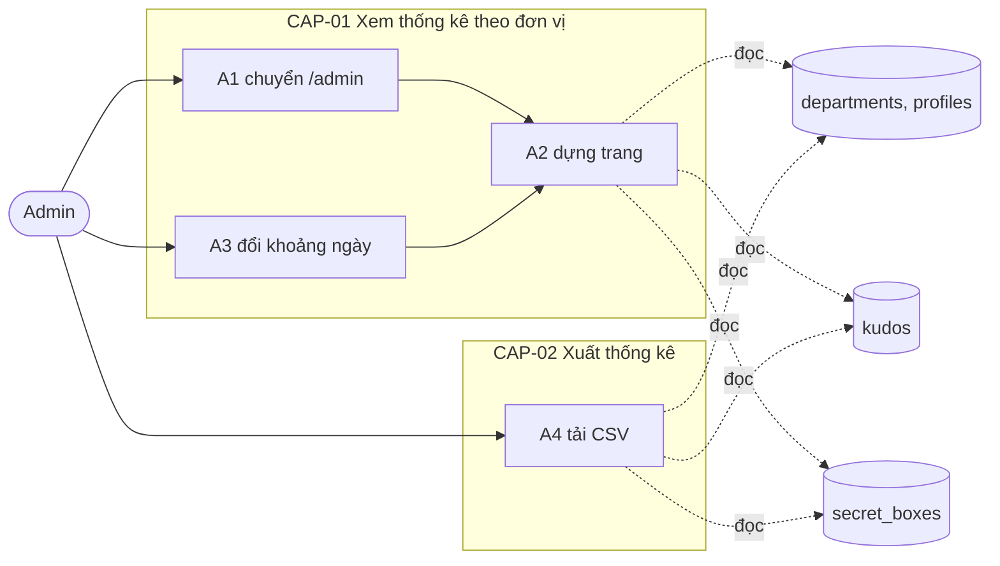
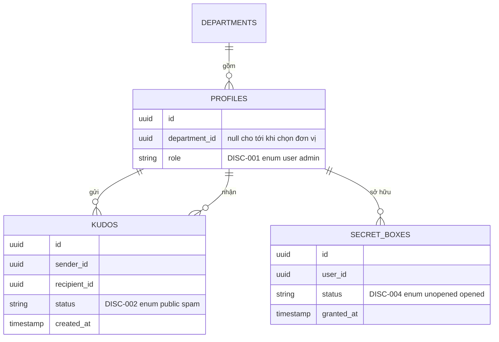

<!-- layout-exempt: rebuild-spec owns all docs/system|features|generated|flows paths — all references here are output targets or internal definitions -->
<!-- Contract: references/feature-spec-researcher-contract.md -->
<!-- Nửa Dev/QA/SA của cặp spec. Mọi mã FR/BR/SM/DEC/ALG/INT được PHÁT BIỂU một lần ở functional-spec.md và CÀI ĐẶT một lần ở đây; không lặp câu quy tắc thuần ngôn ngữ ở file này. -->

# F015_AdminOverview — Technical Spec

**Priority**: P3
**Type**: ui
**Generated**: 2026-11-24

**See also:** [`functional-spec.md`](./functional-spec.md) — tổng quan, quyết định còn mở, yêu cầu và quy tắc nghiệp vụ dạng một dòng, màn hình, user story, kịch bản, edge case và cấu hình cho BA/QA.

**How to read this file:** § 2 là bảng chỉ mục action; chọn action cần xem rồi đọc khối của nó ở § 3 từ đầu đến cuối, mỗi khối là một luồng hoàn chỉnh. § 4 là phụ lục dùng chung, chỉ nhảy vào khi § 3 trỏ tới.

## 1. Technical Overview

F015 cho Admin xem bảng thống kê theo đơn vị (phòng ban) ở `/admin/overview`: tổng thành viên, Kudo gửi, Kudo nhận, số người nhận được Kudo, Secret Box nhận, kèm dòng "All", lọc theo khoảng ngày nằm trên địa chỉ trang và xuất CSV. F015 **chỉ đọc**: không bảng, cột hay migration nào; mọi số liệu đến từ `departments`, `profiles` (F001), `kudos` (F003, `status` do F007 giữ) và `secret_boxes` (F010). Trang là server component (Next.js App Router, Drizzle trên Supabase Postgres), route xuất CSV dùng chung đúng một truy vấn với trang nên tệp không thể lệch bảng. Drizzle chạy bằng vai trò server nên bỏ qua RLS: trang và route đều tự gọi guard Admin của F001 trước khi đụng dữ liệu.



## 2. Action Index

| # | Action (handler) | Method · Path | Codes | Writes | Detail |
|---|---|---|---|---|---|
| **A0** | *cross-cutting — belongs to no single action* | — | FR-601 | — | § 4.4 |
| **A1** | `AdminIndexPage` | `GET` `/admin` | FR-102 | — *(read-only)* | § 3.1 |
| **A2** | `AdminOverviewPage` | `GET` `/admin/overview` | FR-001, FR-002, FR-101, FR-201, FR-202, FR-203, FR-204, FR-205, FR-206, FR-207, FR-404, BR-001, BR-002, BR-003, BR-004, BR-005, BR-006, DEC-001, DEC-002, DEC-003, ALG-001, ALG-002, US003 | — *(read-only)* | § 3.1 |
| **A3** | `AdminOverviewScreen#navigate` *(client, no BE of its own)* | — | FR-203, FR-401, FR-403, DEC-004, US003 | — *(client only)* | § 3.1 |
| **A4** | `overview/export/route#GET` | `GET` `/api/admin/overview/export` | FR-402, FR-405, FR-602, BR-001, BR-002, BR-003, BR-004, BR-005, BR-006, BR-007, DEC-002, DEC-003, ALG-001, ALG-002, US004 | — *(read-only)* | § 3.2 |

**Rung set** theo template: Who → FE → Request → BE → Rule → Result → State → Source. Rung vắng thì bỏ hẳn. Không có **State**: F015 không ghi dữ liệu và không có máy trạng thái nào (§ 4.3). Không action nào chạm ngưỡng diagram (không ghi bảng nào, không chạy nền) nên không vẽ `sequenceDiagram`.

## 3. Actions

### 3.1 CAP-01 — Xem thống kê theo đơn vị

#### A1 · Chuyển `/admin` về trang Overview
`GET /admin` → `` `AdminIndexPage` ``
`FR-102` · `SCR019_AdminOverview`

**Who** · Admin *(gate A0 — § 4.4)*
**BE** · `AdminIndexPage` chỉ gọi `redirect(ADMIN_ROUTES.overview)` với `ADMIN_ROUTES.overview = "/admin/overview"`; không đọc dữ liệu.
**Rule** · không tự gọi guard: `/admin` nằm trong `isAdminPath` nên proxy bước 4b đã trả 403 cho người không phải Admin trước khi trang chạy, và trang đích tự guard lại *(A0 — § 4.4)*.
**Result** · điều hướng, không ghi DB.
**Source:** `app/admin/page.tsx:4-6` → `shared/ui/app-routes.ts:19` → `shared/auth/route-access-policy.ts:25-27`

<!-- Không có diagram: dưới ngưỡng (một lệnh chuyển hướng, không chạm bảng nào). -->

---

#### A2 · Dựng trang Overview với bảng thống kê theo đơn vị
`GET /admin/overview?from&to` → `` `AdminOverviewPage` ``
`FR-001` `FR-002` `FR-101` `FR-201` `FR-202` `FR-203` `FR-204` `FR-205` `FR-206` `FR-207` `FR-404` `BR-001` `BR-002` `BR-003` `BR-004` `BR-005` `BR-006` `DEC-001` `DEC-002` `DEC-003` `ALG-001` `ALG-002` `US003` · `SCR019_AdminOverview`

**Who** · Admin *(gate A0 — § 4.4)*
**FE** · `page.tsx` dựng `AdminOverviewScreen` (`admin-overview-screen.tsx:26-73`): tiêu đề, ô khoảng ngày (A3), nút Export (A4), dòng cảnh báo `role="alert"` khi có `filterError`, rồi bảng `OverviewUnitStatsTable` hoặc `AdminLoadErrorPanel` khi `loadError` / không có `data`. Bảng có bảy cột No, Unit, Total member, Total sent kudos, Total received kudos, Total users with at least 1 kudo, Total received secret box (`overview-unit-stats-table.tsx:10, 50-64`); hàng "All" đứng đầu với ô No trống (`:66-72`), đơn vị đánh số từ 1 (`:73-81`), hàng "Chưa có đơn vị nào." chỉ hiện khi `rows` rỗng (`:82-88`); không phân trang, không sắp xếp bằng cách bấm đầu cột, cuộn ngang trong khung của bảng (`:38`). Lối vào (FR-101) là tab "Overview" của thanh trên khu Admin (`admin-top-bar.tsx:22`) và mục "Dashboard" của menu tài khoản (`account-menu.tsx:66`), cả hai thuộc F002. Trạng thái chờ là `loading.tsx` dùng `AdminOverviewSkeleton` (`admin-overview-skeleton.tsx:9-22`); lỗi render bất ngờ vào `error.tsx:12-22` (thông báo "Không tải được số liệu. Vui lòng thử lại." và nút "Thử lại" gọi `retry()`).
**Request** · `searchParams` (Promise, `page.tsx:35-41`) `from`, `to` *(ngày `yyyy-MM-dd`, tuỳ chọn)*; `parseOverviewParams` (`overview-params-schema.ts:30-37`) chấp nhận ngày ISO hợp lệ hoặc trống: tham số lặp, ngày không có thật (`2026-02-30`), định dạng khác → `invalid_params`; `from` sau `to` → `invalid_date_range`. Lỗi không ném ra: trang rơi về bảng toàn thời gian (DEC-003).
**BE** · `AdminOverviewPage` gọi `requireAdmin()` đầu tiên (`page.tsx:40`), `parseOverviewParams`, đọc `getLocale` (rơi về `defaultLocale` nếu lạ, `:42-43`) rồi `loadTable` → `UnitStatsQuery.forRange(range, locale)` (`:19-26`). `forRange` chạy một câu lệnh Drizzle theo `ALG-001` (một truy vấn con nhóm riêng cho từng chỉ số, `unit-stats-query.ts:65-88`) rồi `addAllRow` (`ALG-002` — cộng dòng "All" và sắp thứ tự đơn vị, `add-all-row.ts:18-28`). `loadTable` bắt lỗi đọc, ghi log và trả `null` để trang truyền `loadError` cho màn hình thay vì hỏng cả trang (`page.tsx:19-26, 51`). Không cache: session, `searchParams` và DB đọc trên mỗi request (`page.tsx:28-34`).
**Rule** · quyết định ba điều của trang — có hàng "Chưa gán đơn vị" hay không, khoảng ngày được hiểu ra sao, và bộ lọc sai thì hiện gì:

| DEC | subtype | Condition | What the user sees | Source |
|---|---|---|---|---|
| **DEC-001** | render | tồn tại `profiles` có `department_id IS NULL` (nhánh `FULL JOIN` của `members` không khớp `departments`) | hàng "Chưa gán đơn vị" ở cuối bảng, nhãn lấy từ `table.unassigned` | `features/admin-overview/server/unit-stats-query.ts:78-87` |
| **DEC-001** | render | không có `profiles` nào chưa gán đơn vị | không có hàng đó; "All" vẫn bằng tổng các đơn vị | `features/admin-overview/server/unit-stats-query.ts:78-87` |
| **DEC-002** | flow | `from` và `to` đều trống | `start` và `end` đều `undefined`, `inRange` bỏ cả hai điều kiện: tính toàn thời gian | `features/admin-overview/server/unit-stats-query.ts:27-29` |
| **DEC-002** | flow | chỉ có `from` | `created_at >= 00:00 ngày from` giờ `ADMIN_TIMEZONE`, không chặn trên: từ đầu ngày đó đến hiện tại | `shared/admin/date-range-filter.ts:28-31` |
| **DEC-002** | flow | chỉ có `to` | `created_at < 00:00 ngày kế tiếp của to`, không chặn dưới: từ đầu đến hết ngày `to` | `shared/admin/date-range-filter.ts:28-31` |
| **DEC-002** | flow | có cả hai | khoảng nửa mở `[00:00 ngày from, 00:00 ngày sau to)`, hai đầu đều trọn ngày giờ Việt Nam | `shared/admin/date-range-filter.ts:28-31` |
| **DEC-003** | render, flow | `parsed.ok` đúng | bảng của khoảng ngày trên địa chỉ, không có `filterError` | `app/admin/overview/page.tsx:44-51` |
| **DEC-003** | render, flow | `parsed.ok` sai (`invalid_date_range` hoặc `invalid_params`) | bảng toàn thời gian kèm dòng "Khoảng ngày không hợp lệ, đang hiện số liệu toàn thời gian." hoặc "Bộ lọc không hợp lệ, đang hiện số liệu toàn thời gian." | `app/admin/overview/page.tsx:44-51` |
| **DEC-003** | render, flow | `filterError` có giá trị | nút Export trỏ tới địa chỉ xuất toàn thời gian (đúng bảng đang hiện), không mang `from`/`to` lỗi | `features/admin-overview/components/admin-overview-screen.tsx:57` |

- **BR-001 — Kudo chỉ tính khi `status = 'public'` và `created_at` nằm trong khoảng nửa mở; ngày cắt theo giờ `ADMIN_TIMEZONE`.** Kudo Spam không vào cột nào, và được tính lại ngay ở lần đọc sau khi Un Spam vì điều kiện chạy lúc truy vấn. *(§ 4.4)*
- **BR-002 — Kudo gửi tính cho đơn vị người gửi, Kudo nhận cho đơn vị người nhận; Kudo ẩn danh vẫn tính cho người gửi.** Đơn vị là `profiles.department_id` hiện tại, không có lịch sử; truy vấn không đọc `is_anonymous`. *(§ 4.4)*
- **BR-003 — "Total users with at least 1 kudo" đếm người nhận khác nhau.** `COUNT(DISTINCT recipient_id)` theo đơn vị người nhận; người nhận nhiều Kudo chỉ tăng một lần (cách hiểu "có Kudo" chờ D001). *(§ 4.4)*
- **BR-004 — "Total member" là số `profiles` hiện thuộc đơn vị, không lọc theo ngày.** Đếm mọi hồ sơ kể cả Admin (D004). *(§ 4.4)*
- **BR-005 — "Total received secret box" đếm `secret_boxes` theo `granted_at` trong khoảng, mọi `status`.** Hộp đã cấp không bị trừ khi Kudo sinh ra nó sau này bị Spam. *(§ 4.4)*
- **BR-006 — Dòng "All" là tổng các dòng đã nhóm, kể cả "Chưa gán đơn vị".** Cộng ở TypeScript từ chính kết quả đã đọc, không chạy truy vấn riêng. *(§ 4.4)*

**Result** · read-only — **không ghi DB**. Trả `UnitStatsTable` gồm `all` và `rows`: đơn vị xếp tự nhiên A-Z theo tên (CECV2 trước CECV10), "Chưa gán đơn vị" cuối cùng (`ALG-002`). Đơn vị không có hoạt động vẫn có hàng với số 0 (FR-205, `coalesce`). Chưa có đơn vị nào và không có profile chưa gán thì `rows` rỗng: bảng chỉ có hàng "All" cùng dòng "Chưa có đơn vị nào.". Trang không bao giờ trả 400: mọi lỗi tham số đi qua DEC-003 với HTTP 200.
**Source:** `features/admin-overview/components/admin-overview-screen.tsx:26-73` → `app/admin/overview/page.tsx:19-54` → `features/admin-overview/schemas/overview-params-schema.ts:30-37` → `features/admin-overview/server/unit-stats-query.ts:31-95` → `features/admin-overview/server/add-all-row.ts:18-28`

<!-- Không có diagram: dưới ngưỡng (chỉ đọc, một câu truy vấn đồng bộ, không ghi bảng). Thứ tự các bước truy vấn nằm ở ALG-001 (§ 4.5); bảng DEC ở trên là nội dung rẽ nhánh nên đọc tốt hơn dạng bảng. -->

---

#### A3 · Đổi khoảng ngày trên bảng
`router.replace /admin/overview?from&to` → `` `AdminOverviewScreen#navigate` ``
`FR-203` `FR-401` `FR-403` `DEC-004` `US003` · `SCR019_AdminOverview`

**Who** · Admin *(gate A0 — § 4.4)*
**FE** · `ReviewDateRangeFilter` (`review-date-range-filter.tsx:57-99`, dùng chung với trang Review của F007): hai ô `<input type="date">` "Ngày bắt đầu" và "Ngày kết thúc", mỗi ô đặt `min`/`max` theo ô kia (`:18-48, 77, 86`). `AdminOverviewScreen` nhận `onChange` (`admin-overview-screen.tsx:47-56`): đánh dấu giá trị đã gửi để ô không bị dựng lại giữa lúc người dùng đang gõ (`useExternalResetKey`, `use-external-reset-key.ts:13-20`) rồi gọi `navigate` (`:35-40`) — trong một transition, `useOptimistic` đổi `view` ngay và `router.replace(overviewHref(next), { scroll: false })` ghi khoảng ngày lên địa chỉ. Bảng mờ 60% và đặt `aria-busy` tới khi máy chủ trả lời (`overview-unit-stats-table.tsx:38-39`). Địa chỉ đổi từ ngoài ô (nút back của trình duyệt) làm prop `filter` đổi, ô được dựng lại theo giá trị mới (`admin-overview-screen.tsx:33, 48`).
**Request** · `overviewHref({ from, to })` (`overview-url-params.ts:8-19`): chỉ ghi tham số khác trống; cả hai trống thì về `/admin/overview` trơn (toàn thời gian). Không có lời gọi dữ liệu riêng: đổi địa chỉ khiến router yêu cầu lại RSC của trang, tức chạy lại A2.
**Rule** · phía giao diện quyết định khi nào gửi khoảng ngày lên máy chủ:

| DEC | subtype | Condition | What the user sees | Source |
|---|---|---|---|---|
| **DEC-004** | interaction | cả `start` và `end` có giá trị và `start > end` | không gọi `onChange`: bảng và địa chỉ giữ nguyên, nhóm ô viền lỗi và dòng `role="alert"` "Ngày bắt đầu phải trước hoặc bằng ngày kết thúc" | `features/admin-moderation/components/review-date-range-filter.tsx:62-69` |
| **DEC-004** | interaction | một đầu trống, hoặc `start <= end` | gọi `onChange({ from: start \|\| null, to: end \|\| null })`; đầu trống thành `null` nên không có trong địa chỉ | `features/admin-moderation/components/review-date-range-filter.tsx:64-69` |

**Result** · không ghi DB. Địa chỉ trang mang khoảng ngày (FR-401) nên tải lại hoặc chia sẻ link ra cùng số liệu; đọc lỗi ở máy chủ hiện `AdminLoadErrorPanel` của A2, không có bước hoàn tác riêng vì địa chỉ là nguồn sự thật (mục Optimistic UI của behavior-logic).
**Source:** `features/admin-overview/components/admin-overview-screen.tsx:26-57` → `features/admin-moderation/components/review-date-range-filter.tsx:57-99` → `features/admin-overview/lib/overview-url-params.ts:8-19`

<!-- Không có diagram: hành động thuần phía client, không có BE của riêng nó; nội dung chính là bảng DEC-004. -->

### 3.2 CAP-02 — Xuất thống kê

#### A4 · Tải tệp CSV của bảng đang xem
`GET /api/admin/overview/export?from&to` → `` `overview/export/route#GET` ``
`FR-402` `FR-405` `FR-602` `BR-001` `BR-002` `BR-003` `BR-004` `BR-005` `BR-006` `BR-007` `DEC-002` `DEC-003` `ALG-001` `ALG-002` `US004` · `ROUTE003` · `SCR019_AdminOverview`

**Who** · Admin *(gate A0 — § 4.4)*
**FE** · `ReviewExportButton` (`review-export-button.tsx:36-61`, dùng chung với F007 và F014) nhận `href = overviewExportHref(filterError ? ALL_TIME : filter)` (`admin-overview-screen.tsx:57`): `fetch(href)` với `accept: text/csv`, `cache: no-store`, rồi lưu blob dưới tên lấy từ `Content-Disposition` (không có thì `overview.csv`, `review-export-button.tsx:40-53`). Trong lúc chờ nút khoá (`aria-disabled`, bấm lần hai bị bỏ qua) kèm spinner và chữ "Đang xuất…" (`:55-60`); `!response.ok` hoặc ngoại lệ mạng thì toast "Không xuất được tệp. Vui lòng thử lại." qua `CampaignSettingsToast` (`admin-overview-screen.tsx:70`). Nhánh 422 "quá nhiều dòng" của nút là mã dùng chung cho F007; route này không bao giờ trả 422.
**Request** · query `from`, `to` như A2, qua cùng `parseOverviewParams` (`route.ts:25`); header `Accept` không được route đọc.
**BE** · `GET` bọc `exportOverview` và luôn gắn `Cache-Control: private, no-store` lên mọi câu trả lời (`route.ts:15-19`). `exportOverview` (`:21-40`): `requireAdminApi()` đầu tiên (A0 — 401/403 JSON trước khi đọc tham số), `parseOverviewParams` sai thì `adminApiError(400, error)`, rồi `UnitStatsQuery.forRange(range, "vi")` — cùng truy vấn với A2 nên tệp khớp bảng — và `serializeOverviewCsv` ghi ra chuỗi CSV (`overview-export-columns.ts:31-34`, `serializeCsv`, `csv-serializer.ts:39-53`). Truy vấn lỗi thì ghi log và `adminApiError(500, "unexpected")` (`route.ts:36-39`).
**Rule** · dùng lại nguyên các quy tắc đếm của A2 (cùng một truy vấn), nêu lại ngắn từng điều:
- **BR-001 — Kudo chỉ tính khi Public và `created_at` trong khoảng nửa mở, ngày cắt theo giờ Việt Nam.** Cùng điều kiện `publicInRange` của truy vấn dùng chung. *(§ 4.4)*
- **BR-002 — Kudo gửi tính cho đơn vị người gửi, Kudo nhận cho đơn vị người nhận.** Kudo ẩn danh vẫn tính cho người gửi. *(§ 4.4)*
- **BR-003 — "Total users with at least 1 kudo" đếm người nhận khác nhau.** Mỗi người một lần dù nhận nhiều Kudo. *(§ 4.4)*
- **BR-004 — "Total member" là số hồ sơ hiện thuộc đơn vị, không lọc ngày.** Cột đầu tiên của tệp không đổi theo khoảng ngày. *(§ 4.4)*
- **BR-005 — "Total received secret box" đếm hộp theo `granted_at`, mọi trạng thái.** Cùng khoảng ngày với Kudo. *(§ 4.4)*
- **BR-006 — Hàng "All" là tổng các hàng đã nhóm, kể cả "Chưa gán đơn vị".** Tệp lấy hàng này từ `table.all`, không tính lại. *(§ 4.4)*
- **BR-007 — Tệp luôn dùng tên đơn vị tiếng Việt và tiêu đề cột tiếng Anh, bất kể ngôn ngữ giao diện.** Route truyền cố định `"vi"` cho `forRange` nên "Chưa gán đơn vị" và tên đơn vị lấy `name_vi` (`route.ts:29`); tiêu đề lấy từ `OVERVIEW_CSV_HEADER` (`overview-export-columns.ts:11-19`); hàng đầu có `No` rỗng và nhãn `All`, các đơn vị đánh số 1..n theo thứ tự bảng.
- DEC-002 (đầu khoảng ngày trống nghĩa là không giới hạn đầu đó) áp nguyên như A2. DEC-003 (địa chỉ có bộ lọc sai thì nút Export trỏ tới bản toàn thời gian) được quyết ở FE của A2, nên route chỉ trả 400 khi bị gọi thẳng với tham số sai.
- FR-602 (tệp an toàn khi mở bằng Excel): `serializeCsv` thêm BOM UTF-8, bọc nháy kép ô chứa `"`, `,`, xuống dòng và thêm `'` đứng đầu ô bắt đầu bằng `=`, `+`, `-`, `@`, TAB hoặc CR; tên đơn vị do Admin quản trị nhưng vẫn qua bước này (`csv-serializer.ts:9-21`).

**Result** · read-only — **không ghi DB**. 200 `text/csv; charset=utf-8` với `Content-Disposition: attachment; filename="overview-{yyyyMMdd-HHmm}.csv"` — thời điểm xuất theo `ADMIN_TIMEZONE`, không phải khoảng ngày (`admin-csv-filename.ts:5-9`); UTF-8 BOM, dòng kết thúc CRLF, bảy cột; hàng "All" đầu rồi từng đơn vị, "Chưa gán đơn vị" cuối khi có. Mỗi đơn vị một dòng nên không áp `EXPORT_MAX_ROWS`. Lỗi trả JSON `{ code }` không kèm số liệu: 401 `unauthorized`, 403 `forbidden`, 400 `invalid_date_range` / `invalid_params`, 500 `unexpected` (`admin-api-guard.ts:12-17`); FE đều hiện cùng một toast, không tải tệp (FR-405).
**Source:** `features/admin-moderation/components/review-export-button.tsx:36-61` → `app/api/admin/overview/export/route.ts:15-40` → `features/admin-overview/server/unit-stats-query.ts:31-95` → `features/admin-overview/server/overview-export-columns.ts:11-34` → `shared/admin/csv-serializer.ts:9-53`

<!-- Không có diagram: dưới ngưỡng (một bước đồng bộ, không ghi bảng). Không dùng XLSX (YAGNI, cùng lý do F007). -->

### 3.3 Edge cases

| Action | Scenario | Behavior |
|---|---|---|
| A2 · A4 | Khoảng ngày không có hoạt động, hoặc hệ thống chưa có Kudo nào | Mọi cột hoạt động bằng 0 (`coalesce(…, 0)`, `unit-stats-query.ts:62`); "Total member" giữ nguyên (BR-004) |
| A2 · A4 | `from` sau `to` (trên địa chỉ hoặc gọi thẳng) | `invalid_date_range`: trang hiện `filterError` trên bảng toàn thời gian (HTTP 200); route trả 400 `invalid_date_range` |
| A2 · A4 | Tham số lặp (`from=a&from=b`), ngày không có thật (`2026-02-30`), định dạng khác `yyyy-MM-dd` | `invalid_params`: như dòng trên (trang 200 kèm `filterError`, route 400 `invalid_params`) |
| A3 | Gõ khoảng ngược trong ô chọn ngày | Không điều hướng, không gọi máy chủ; cảnh báo inline (DEC-004) |
| A3 | Xoá một đầu của khoảng | Điều hướng với đầu còn lại, đầu trống bỏ khỏi địa chỉ (DEC-002) |
| A2 · A4 | Kudo gửi 23:59:59 ngày `to` giờ Việt Nam; Kudo 00:00:00 ngày kế tiếp | Kudo đầu có mặt, Kudo sau không: biên trên là `< 00:00` ngày kế tiếp (BR-001) |
| A2 · A4 | Không có đơn vị nào trong `departments` | `rows` chỉ có "Chưa gán đơn vị" nếu có profile chưa gán, hoặc rỗng; dòng "Chưa có đơn vị nào." chỉ hiện khi `rows` rỗng (`overview-unit-stats-table.tsx:82-88`, DEC-001) |
| A2 · A4 | Người nhận Kudo chưa thuộc đơn vị nào | Tính vào "Chưa gán đơn vị" và "All" (BR-002, BR-006) |
| A2 · A4 | Kudo giữa hai người cùng đơn vị | +1 Kudo gửi và +1 Kudo nhận của đơn vị đó; người nhận +1 ở cột người có Kudo (BR-002, BR-003) |
| A2 · A4 | Kudo vừa bị Mark Spam, hoặc Un Spam, giữa hai lần đọc | Lần đọc kế loại hoặc tính lại Kudo đó; hộp đã cấp giữ nguyên (BR-001, BR-005) |
| A2 | Đọc DB lỗi trong `forRange` | `loadTable` trả `null` → `loadError` → `AdminLoadErrorPanel` với "Thử lại" (`router.refresh()` trong transition, `admin-load-error-panel.tsx:12-28`); ô ngày vẫn dùng được. Lỗi render bất ngờ vào `error.tsx` |
| A2 · A3 · A4 | Địa chỉ có lỗi lọc | Bảng toàn thời gian; `href` của Export cũng toàn thời gian (DEC-003) |
| A2 | Giao diện tiếng Anh | Bảng dùng `name_en` và nhãn tiếng Anh; tệp CSV vẫn tiếng Việt (BR-007) |
| A2 | Màn hình 375 px | Bảng cuộn ngang trong khung riêng, trang không cuộn ngang (`overview-unit-stats-table.tsx:38-39`) |
| A4 | Tên đơn vị bắt đầu bằng `=`, `+`, `-`, `@`, TAB hoặc CR | Thêm `'` đứng đầu ô (FR-602, `csv-serializer.ts:11-17`) |
| A4 | Tên đơn vị chứa dấu phẩy, nháy kép hoặc xuống dòng | Bọc nháy kép, nháy kép nhân đôi (`csv-serializer.ts:13, 19-21`) |
| A4 | Bấm Export hai lần liên tiếp | Lần sau bị bỏ qua khi `exporting` còn đúng (`review-export-button.tsx:40-42`) |
| A4 | Phiên hết hạn, hoặc role bị hạ giữa chừng | 401 `unauthorized` / 403 `forbidden` JSON, không tệp; FE hiện toast lỗi chung |
| A4 | Truy vấn lỗi | 500 `unexpected` kèm log phía server; toast lỗi chung |
| A1 · A2 · A4 | Khách chưa đăng nhập, hoặc Sunner thường | Cổng A0: trang bị proxy trả 403 (khách chuyển `/login`), route trả 401/403 JSON trước mọi truy vấn |

## 4. Shared Foundation

### 4.1 Components

| Component | Responsibility | Used in | File |
|---|---|---|---|
| `AdminIndexPage` | Chuyển `/admin` về `/admin/overview` | A1 | `app/admin/page.tsx` |
| `AdminOverviewPage` | Server component: guard, đọc tham số, gọi truy vấn, dựng màn hình | A2 | `app/admin/overview/page.tsx` |
| `AdminOverviewLoading`, `AdminOverviewSkeleton` | Trạng thái chờ của route | A2 | `app/admin/overview/loading.tsx`, `features/admin-overview/components/admin-overview-skeleton.tsx` |
| `AdminOverviewError` | Error boundary: thông báo và nút "Thử lại" | A2 | `app/admin/overview/error.tsx` |
| `AdminOverviewScreen` | Màn hình client: ô ngày, Export, cảnh báo lọc, bảng hoặc lỗi | A2, A3, A4 | `features/admin-overview/components/admin-overview-screen.tsx` |
| `OverviewUnitStatsTable` | Bảng bảy cột, hàng "All", hàng rỗng | A2 | `features/admin-overview/components/overview-unit-stats-table.tsx` |
| `ReviewDateRangeFilter` *(F007)* | Hai ô ngày và chặn khoảng ngược | A3 | `features/admin-moderation/components/review-date-range-filter.tsx` |
| `ReviewExportButton` *(F007)* | Tải CSV bằng `fetch`, khoá nút, báo lỗi | A4 | `features/admin-moderation/components/review-export-button.tsx` |
| `AdminLoadErrorPanel` *(F007)* | Thông báo lỗi đọc và "Thử lại" | A2 | `features/admin-moderation/components/admin-load-error-panel.tsx` |
| `overviewHref`, `overviewExportHref` | Dựng địa chỉ trang và địa chỉ xuất theo khoảng ngày | A3, A4 | `features/admin-overview/lib/overview-url-params.ts` |
| `parseOverviewParams` | Đọc `from`, `to`; đổi sang khoảng nửa mở | A2, A4 | `features/admin-overview/schemas/overview-params-schema.ts` |
| `adminDateRangeSchema` | Khoảng nửa mở UTC theo `ADMIN_TIMEZONE`, dùng chung khu Admin | A2, A4 | `shared/admin/date-range-filter.ts` |
| `UnitStatsQuery` | Truy vấn tổng hợp theo đơn vị (`ALG-001`) | A2, A4 | `features/admin-overview/server/unit-stats-query.ts` |
| `addAllRow` | Dòng "All" và thứ tự đơn vị (`ALG-002`) | A2, A4 | `features/admin-overview/server/add-all-row.ts` |
| `serializeOverviewCsv`, `serializeCsv` | Bảy cột, hàng "All" đầu; BOM, nháy kép, vô hiệu công thức | A4 | `features/admin-overview/server/overview-export-columns.ts`, `shared/admin/csv-serializer.ts` |
| `adminCsvFilename` | Tên tệp `overview-yyyyMMdd-HHmm.csv` theo giờ Admin | A4 | `shared/admin/admin-csv-filename.ts` |
| `requireAdmin`, `requireAdminApi` *(F001, F007)* | Guard Admin cho trang và cho route JSON | A0 | `shared/auth/admin-guard.ts`, `features/admin-moderation/server/admin-api-guard.ts` |

### 4.2 Data Model



| Entity | Table | Used for | Action |
|---|---|---|---|
| `Department` *(MODEL001, F001)* | `departments` | Danh sách đơn vị và tên hiển thị `name_vi`, `name_en` | A2, A4 |
| `Profile` *(MODEL004, F001)* | `profiles` | `department_id` của người; đếm "Total member"; nối người gửi, người nhận, chủ hộp về đơn vị | A2, A4 |
| `Kudo` *(MODEL003, F003)* | `kudos` | Đếm Kudo gửi, Kudo nhận, người nhận khác nhau (chỉ `status = 'public'`) | A2, A4 |
| `SecretBox` *(MODEL011, F010)* | `secret_boxes` | Đếm hộp đã cấp theo `granted_at` | A2, A4 |

F015 **không tạo bảng, cột hay migration**. Chỉ mục sẵn có mà truy vấn dựa vào: `profiles_department_id_idx` (`profiles.ts:31`), `kudos_status_created_at_id_idx`, `kudos_recipient_id_created_at_id_idx`, `kudos_sender_id_created_at_id_idx`, `kudos_public_recipient_sender_idx` (`kudos.ts:64-69`); `secret_boxes` không có chỉ mục theo `granted_at` (§ 5.3 mục 1).

#### Polymorphic Behavior

##### DISC-001 — Profile.role

| Value | Render | Validation | Persistence |
|-------|--------|------------|-------------|
| user | Được đếm vào "Total member" của đơn vị (truy vấn `members` không lọc theo role, `unit-stats-query.ts:33-37`) | Không vào được trang và route: `resolveAdminAccess` trả `forbidden` (A0) | Không ghi |
| admin | Cũng được đếm vào "Total member" (D004); là role duy nhất qua guard | `resolveAdminAccess` đọc `profiles.role` từ DB ở mỗi lần gọi (`admin-guard.ts:17-23`) | Không ghi |

**Source:** docs/generated/entities.md § Profile > Discriminator Fields

##### DISC-002 — Kudo.status

| Value | Render | Validation | Persistence |
|-------|--------|------------|-------------|
| public | Được tính vào Kudo gửi, Kudo nhận và người có Kudo (`eq(kudos.status, "public")`, `unit-stats-query.ts:32`) | Không có rào kiểm tra khác: F015 chỉ đọc | Không ghi |
| spam | Không tính vào cột Kudo nào; tính lại ngay khi Un Spam (BR-001) | Như trên | Không ghi; F007 là bên đổi giá trị |

**Source:** docs/generated/entities.md § Kudo > Discriminator Fields

##### DISC-004 — SecretBox.status

| Value | Render | Validation | Persistence |
|-------|--------|------------|-------------|
| unopened | Được đếm vào "Total received secret box" theo `granted_at` (`unit-stats-query.ts:52-58` không có điều kiện `status`) | Không có | Không ghi |
| opened | Cũng được đếm, cùng cách (BR-005) | Không có | Không ghi |

**Source:** docs/generated/entities.md § SecretBox > Discriminator Fields

### 4.3 State Management

None.

<!-- F015 không có máy trạng thái nào đủ ngưỡng: khoảng ngày nằm trên địa chỉ trang (nguồn sự thật), `useOptimistic` + `useTransition` ở A3 chỉ có hai trạng thái (đang chờ / xong) và `exporting` ở A4 là một cờ boolean; không có SM-### và không rung State nào. -->

### 4.4 Shared Rules

#### Bin 3 — cross-cutting, belongs to no single action

**A0 · FR-601 — mọi action của F015 (A1-A4) yêu cầu role Admin, kiểm ở server.** Đây là rule cross-cutting của cả khu Admin, **không phải rule riêng của F015**; F015 chỉ gọi lại guard của F001/F007. Bốn lớp: (1) proxy bước 4b trả 403 (trang access-denied) cho người đã đăng nhập mà không phải Admin trên `/admin` và `/admin/*`, nhưng **không phủ `/api/admin/*`**; (2) layout Admin gọi `requireShellAdmin` trước khi dựng khung; (3) trang gọi `requireAdmin()` (khách → `/login`, không phải Admin → `forbidden()`); (4) route xuất gọi `requireAdminApi()` đầu tiên, trước khi đọc tham số (khách 401 `unauthorized`, không phải Admin 403 `forbidden`). Role đọc từ DB ở mỗi lần gọi nên hạ quyền có hiệu lực ngay ở request kế; Drizzle bỏ qua RLS nên không được dựa vào RLS. Với `/api/admin/*`, `requireAdminApi` trong handler là lớp chặn duy nhất sau cổng session của proxy (khách 401). Quy tắc chặn thuộc `PERM003`, `PERM014`, `PERM015` trong `permissions-matrix.md`.
**Source:** `shared/auth/admin-guard.ts:17-35` · `features/admin-moderation/server/admin-api-guard.ts:19-24` · `shared/auth/session-proxy.ts:92-110` · `shared/auth/route-access-policy.ts:25-27` · `app/admin/overview/page.tsx:40` · `app/api/admin/overview/export/route.ts:22-23`

#### Bin 2 — used by ≥2 named actions

**BR-001 — Kudo chỉ tính khi Public và `created_at` nằm trong khoảng nửa mở; ngày cắt theo giờ Việt Nam.**
Used in: **A2** · **A4**. Cùng `publicInRange` nên bảng và tệp không thể lệch nhau. Biên dưới `>= 00:00 ngày from`, biên trên `< 00:00 ngày sau to` (không dùng `<= to 23:59:59` để khỏi mất mili-giây cuối ngày); ngày đổi sang UTC bằng `startOfDayInZone` theo `ADMIN_TIMEZONE`.
**Source:** `features/admin-overview/server/unit-stats-query.ts:27-32` · `shared/admin/date-range-filter.ts:16-31` · `shared/admin/timezone.ts:99-102`
```text
start = from ? startOfDayInZone(from) : -inf
end   = to   ? startOfDayInZone(day_after(to)) : +inf
counted(k) = k.status = 'public' AND k.created_at >= start AND k.created_at < end
```

**BR-002 — Kudo gửi tính cho đơn vị người gửi, Kudo nhận cho đơn vị người nhận; Kudo ẩn danh vẫn tính cho người gửi.**
Used in: **A2** · **A4**. Nối `kudos.sender_id` và `kudos.recipient_id` vào hai bí danh của `profiles` rồi nhóm theo `department_id` hiện tại; không đọc `is_anonymous` nên ẩn danh chỉ là chuyện hiển thị tên ở nơi khác.
**Source:** `features/admin-overview/server/unit-stats-query.ts:23-25, 38-51`
```text
sent_by_unit = COUNT(k) GROUP BY sender.department_id
recv_by_unit = COUNT(k) GROUP BY recipient.department_id
```

**BR-003 — "Total users with at least 1 kudo" đếm người nhận khác nhau trong khoảng.**
Used in: **A2** · **A4**. `countDistinct(kudos.recipient_id)` trong cùng truy vấn con nhóm theo đơn vị người nhận với Kudo nhận. Nếu D001 chốt "người gửi" hoặc "một trong hai" thì phải đổi nguồn đếm.
**Source:** `features/admin-overview/server/unit-stats-query.ts:45-51`
```text
users_by_unit = COUNT(DISTINCT k.recipient_id) GROUP BY recipient.department_id
```

**BR-004 — "Total member" là số `profiles` hiện thuộc đơn vị, không lọc ngày.**
Used in: **A2** · **A4**. Truy vấn `members` nhóm mọi dòng `profiles` theo `department_id`, kể cả Admin; không đọc `created_at` của hồ sơ (D004).
**Source:** `features/admin-overview/server/unit-stats-query.ts:33-37`
```text
members_by_unit = COUNT(p) GROUP BY p.department_id
```

**BR-005 — "Total received secret box" đếm `secret_boxes` theo `granted_at`, mọi trạng thái.**
Used in: **A2** · **A4**. Nối `secret_boxes.user_id` vào `profiles` (bí danh `owner`) rồi nhóm theo đơn vị chủ hộp; chỉ có điều kiện khoảng ngày, không có điều kiện `status` nên hộp đã cấp không bị trừ khi Kudo sinh ra nó bị Spam.
**Source:** `features/admin-overview/server/unit-stats-query.ts:52-58`
```text
boxes_by_unit = COUNT(b) WHERE b.granted_at IN [start, end) GROUP BY owner.department_id
```

**BR-006 — Dòng "All" là tổng các dòng đã nhóm, kể cả "Chưa gán đơn vị".**
Used in: **A2** · **A4**. Cộng năm cột ở TypeScript trên chính kết quả truy vấn; cột người có Kudo cộng được vì mỗi người thuộc tối đa một đơn vị. Nhờ vậy "All" luôn bằng tổng đơn vị cộng hàng chưa gán.
**Source:** `features/admin-overview/server/add-all-row.ts:11-28`
```text
all.metric = SUM(row.metric) over every row  # gồm hàng department_id = NULL
```

### 4.5 Algorithms & Integrations

### Tổng hợp năm chỉ số theo đơn vị bằng một câu truy vấn gồm bốn truy vấn con nhóm riêng (ALG-001)
**Linked FR:** FR-201
**Used in:** A2, A4
**Source:** `features/admin-overview/server/unit-stats-query.ts:31-95`
**Input:** `range: { start?, end? }`, `locale` · **Output:** mảng `UnitStatsRow { unitId | null, unitName, totalMembers, kudosSent, kudosReceived, usersWithReceivedKudo, secretBoxesReceived }` chưa sắp · **Complexity:** O(K + B + P) với K = Kudo public trong khoảng, B = hộp trong khoảng, P = số hồ sơ
**Description:** Bốn truy vấn con `members`, `sent`, `received`, `boxes`, mỗi cái nhóm theo `department_id` của người được quy kết (NULL là "chưa gán"), không bao giờ nối ngang `kudos` với `secret_boxes` (sẽ nhân dòng). `departments FULL JOIN members` cho ra mọi đơn vị (kể cả đơn vị không hoạt động, ra 0) cộng đúng một hàng NULL khi có profile chưa gán; ba chỉ số còn lại `LEFT JOIN` bằng `IS NOT DISTINCT FROM` để khoá NULL cũng khớp; `coalesce(…, 0)` bù số 0. Tên đơn vị lấy `name_en` khi `locale = "en"`, ngược lại `name_vi`; hàng NULL lấy "Chưa gán đơn vị" hoặc "Unassigned".

**Pseudocode:**
```text
publicInRange = status = 'public' AND created_at IN [start, end)        # BR-001
members  = count profiles                       group by department_id  # BR-004
sent     = count kudos(publicInRange)           group by sender.department_id     # BR-002
received = count + distinct recipient_id        group by recipient.department_id  # BR-002, BR-003
boxes    = count secret_boxes(granted_at IN range) group by owner.department_id   # BR-005
rows = departments FULL JOIN members ON unit = departments.id               # DEC-001
rows = rows LEFT JOIN sent, received, boxes ON unit IS NOT DISTINCT FROM departments.id
return rows with coalesce(metric, 0)
```

### Dòng "All" bằng tổng các dòng và đơn vị xếp tự nhiên A-Z, "Chưa gán đơn vị" cuối cùng (ALG-002)
**Linked FR:** FR-202
**Used in:** A2, A4
**Source:** `features/admin-overview/server/add-all-row.ts:9-28`
**Input:** `UnitStatsRow[]` · **Output:** `UnitStatsTable { all, rows }` · **Complexity:** O(n log n) với n = số đơn vị
**Description:** Hàm thuần: cộng năm cột của mọi hàng vào `all` (BR-006) rồi sắp bản sao của mảng, không đổi mảng gốc. So sánh bằng `Intl.Collator("vi", { numeric: true })` nên số trong tên xếp tự nhiên (CECV2 trước CECV10) và D đứng trước Đ; hàng `unitId = null` luôn đứng cuối. Bảng và tệp tải về dùng cùng thứ tự này.

**Pseudocode:**
```text
all = { members: 0, sent: 0, received: 0, users: 0, boxes: 0 }
for row in rows: for metric in METRICS: all[metric] += row[metric]
compare(a, b): if (a.unitId == null) != (b.unitId == null) -> unassigned last
               else collator_vi_numeric(a.unitName, b.unitName)
return { all, rows: sorted copy of rows }
```

Không có INT-###: F015 không gọi dịch vụ ngoài, không phát sự kiện, không đẩy hàng chờ.

### 4.6 Configuration

```text
ADMIN_TIMEZONE = Asia/Ho_Chi_Minh   # mặc định (env-schema.ts:73-75) — cắt ngày của bộ lọc (A2, A4) và giờ ghi trong tên tệp (A4); dùng chung khu Admin
```

`EXPORT_MAX_ROWS` (mặc định 10000) tồn tại trong cấu hình chung nhưng route của F015 không áp: mỗi đơn vị một dòng. BOM UTF-8, dòng kết thúc CRLF và danh sách ký tự công thức `= + - @ TAB CR` là hằng cố định trong `csv-serializer.ts:9-13`, không cấu hình được.

**Client behavior:** see
[`behavior-logic.md`](../../generated/behavior-logic.md) (client-side patterns — debounce, optimistic UI, polling, upload, realtime),
[`permissions.md`](../../system/permissions.md) (feature flags / experiments / env / locale gates),
[`architecture.md`](../../system/architecture.md) (guards / deep-link state restoration / unsaved-changes protection).

## 5. Verification & Technical Notes

### 5.1 Technical Verification

- **SC-001** *(A2)* Với dữ liệu có ba đơn vị và một Sunner chưa gán đơn vị, hàng "All" bằng tổng ba đơn vị cộng hàng "Chưa gán đơn vị" ở cả năm cột; đơn vị không hoạt động vẫn ra hàng số 0; nhiều đơn vị vẫn hiện hết trên một trang, không phân trang (covers FR-201, FR-202, FR-205, FR-206, BR-006, ALG-002)
- **SC-002** *(A2)* Kudo gửi 23:59:59 ngày `to` giờ Việt Nam được tính, Kudo 00:00:00 ngày kế tiếp thì không; để trống một đầu hoặc cả hai cho đúng phạm vi (covers FR-204, BR-001, DEC-002)
- **SC-003** *(A2)* Kudo Spam không vào cột Kudo nào; Un Spam tính lại ở lần đọc kế; hộp đã cấp không đổi (covers FR-002, BR-001, BR-005)
- **SC-004** *(A2)* Người nhận nhiều Kudo chỉ tăng "Total users with at least 1 kudo" một lần; Kudo ẩn danh vẫn tính cho đơn vị người gửi (covers BR-002, BR-003)
- **SC-005** *(A2, A3)* Đổi khoảng ngày làm "Total member" giữ nguyên, bốn cột còn lại đổi; địa chỉ chứa `from`/`to` và tải lại cho đúng số liệu (covers FR-203, FR-401, BR-004)
- **SC-006** *(A2, A3)* Khoảng ngược gõ trong ô bị chặn tại chỗ, bảng và địa chỉ giữ nguyên; địa chỉ có ngày sai, ngày không có thật hoặc tham số lặp hiện `filterError` trên bảng toàn thời gian (covers FR-403, FR-404, DEC-003, DEC-004)
- **SC-007** *(A2)* Đọc lỗi hiện `AdminLoadErrorPanel` kèm "Thử lại"; đơn vị xếp CECV2 trước CECV10, "Chưa gán đơn vị" cuối (covers FR-207, FR-202, ALG-002)
- **SC-008** *(A4)* Tệp CSV trùng từng số với bảng cùng tham số, có BOM, hàng "All" đầu, tên tệp `overview-yyyyMMdd-HHmm.csv`; ô bắt đầu bằng `=`, `+`, `-`, `@` bị vô hiệu hoá; mọi câu trả lời mang `Cache-Control: private, no-store` (covers FR-402, FR-602, BR-007)
- **SC-009** *(A4)* Khách nhận 401, người không phải Admin 403, kể cả khi khoảng ngày ngược; không đọc dữ liệu; FE báo lỗi và không tải tệp (covers FR-405, FR-601)
- **SC-010** *(A1)* `/admin` chuyển về `/admin/overview`; tab "Overview" và mục "Dashboard" cùng mở trang đó (covers FR-101, FR-102)
- **SC-011** *(A2)* Đổi `department_id` của một Sunner thì lần đọc kế số liệu của người đó chuyển sang đơn vị mới (hoặc "Chưa gán đơn vị"), không có lịch sử (covers FR-001)

#### US003_FilterOverviewByDateRange *(A2, A3)*

**Independent Test:** Với dữ liệu có Kudo public, Kudo Spam, hộp và người ở nhiều đơn vị, mở A2 không tham số, rồi với từng kiểu khoảng ngày (trống, chỉ đầu, chỉ cuối, kín, ngược, sai định dạng).

**Acceptance Scenarios:**

1. **Given** Kudo public rải trong tháng ở nhiều đơn vị, **When** Admin chọn `from=2026-11-01`, `to=2026-11-15`, **Then** địa chỉ đổi theo, bảng chỉ đếm Kudo public trong khoảng, "Total member" không đổi và "All" bằng tổng các hàng.
2. **Given** bảng đang hiện toàn thời gian, **When** Admin chọn "Ngày bắt đầu" sau "Ngày kết thúc", **Then** ô báo khoảng ngược ngay tại chỗ, không có request nào tới máy chủ, bảng và địa chỉ giữ nguyên.
3. **Given** địa chỉ `/admin/overview?from=2026-02-30`, **When** trang tải, **Then** hiện `invalid_params` ("Bộ lọc không hợp lệ, đang hiện số liệu toàn thời gian.") phía trên bảng toàn thời gian, HTTP 200.
4. **Given** đọc bảng lỗi, **When** Admin bấm "Thử lại", **Then** trang đọc lại trên máy chủ và bảng hiện nếu lần đọc thành công.

#### US004_ExportOverviewCsv *(A4)*

**Independent Test:** Chọn khoảng ngày, Export, so tệp với bảng, mở bằng Excel; gọi thẳng route với từng kiểu phiên và tham số.

**Acceptance Scenarios:**

1. **Given** bảng đang lọc `from` và `to` hợp lệ, **When** Admin bấm Export, **Then** tải về `overview-yyyyMMdd-HHmm.csv` có hàng "All" đầu và số liệu khớp bảng, `Cache-Control: private, no-store`.
2. **Given** địa chỉ có lỗi lọc và bảng đang hiện toàn thời gian, **When** Admin bấm Export, **Then** tệp là bảng toàn thời gian.
3. **Given** phiên hết hạn hoặc role bị hạ giữa chừng, **When** Admin bấm Export, **Then** route trả 401 hoặc 403 JSON, FE hiện toast "Không xuất được tệp. Vui lòng thử lại." và không có tệp.
4. **Given** một đơn vị có tên bắt đầu bằng `=`, **When** Export, **Then** ô tên đó có `'` đứng đầu nên Excel mở ra như chữ thường.

### 5.2 Assumptions

- *(A2, A4)* Mỗi Kudo có đúng một `recipient_id` và mỗi hồ sơ thuộc tối đa một `department_id`, nên tổng các số người-khác-nhau của đơn vị cộng lại đúng cho hàng "All". Nếu sau này một Kudo có nhiều người nhận hoặc một người thuộc nhiều đơn vị thì BR-003, BR-006 và `addAllRow` phải làm lại.
- *(A2)* Số đơn vị ở mức hàng chục nên dựng cả bảng một lần, không phân trang, không giới hạn số dòng xuất (FR-206).
- *(A2)* Lượt nghiên cứu này không chạy ứng dụng, DB hay test; hành vi mô tả suy ra từ mã nguồn và các test sẵn có, không phải từ lần chạy thật.
- *(A2)* Prop `retry` của `error.tsx` khớp tài liệu Next đi kèm trong `node_modules/next/dist/docs` (mục `error`, `retry`), nên `AdminOverviewError` hợp lệ với phiên bản đang dùng.

### 5.3 Unresolved Questions

1. **Hiệu năng truy vấn tổng hợp** *(A2, A4)*: spec đã xuất bản từng ghi số đo `EXPLAIN ANALYZE` ở 5k người dùng và 100k Kudo; lượt này không tìm thấy tệp bằng chứng cho con số đó nên không lặp lại. `secret_boxes` không có chỉ mục theo `granted_at` (chỉ có `(user_id, status)` và `(status, opened_at)`), nên khoảng ngày trên hộp phải quét theo `user_id` hoặc toàn bảng. Chưa xác nhận từ mã nguồn.
2. **Nhánh 422 của `ReviewExportButton`** *(A4)*: nút xử lý 422 "quá nhiều dòng" của F007, còn route Overview không bao giờ trả 422 và không áp `EXPORT_MAX_ROWS`; chưa rõ có chủ ý để trống không.
3. **Thứ tự đơn vị khi giao diện tiếng Anh** *(A2)*: `compareUnits` so sánh `unitName` đã đổi theo `locale` bằng collator tiếng Việt, nên thứ tự bảng tiếng Anh theo tên tiếng Anh còn thứ tự tệp theo tên tiếng Việt; chưa rõ có chủ ý.

### 5.4 Source References

| Action | Order | Symbol | Path | Purpose |
|---|---|---|---|---|
| — | 1 | `departments`, `profiles` | `shared/db/schema/reference-data.ts:9-14` · `shared/db/schema/profiles.ts:14-31` | đơn vị và hồ sơ: `department_id` nullable, chỉ mục theo đơn vị |
| — | 2 | `kudos`, `secret_boxes` | `shared/db/schema/kudos.ts:26-69` · `shared/db/schema/secret-box-rewards.ts:55-69` | Kudo (`status`, `created_at`, chỉ mục) và hộp (`granted_at`) |
| A0 | 3 | `resolveAdminAccess`, `requireAdmin`, `requireAdminApi` | `shared/auth/admin-guard.ts:17-35` · `features/admin-moderation/server/admin-api-guard.ts:12-24` | guard Admin cho trang và route JSON |
| A0 | 4 | `runSessionProxy` (bước 4b) | `shared/auth/session-proxy.ts:92-110` | cổng Admin ở proxy, chỉ phủ trang `/admin/*` |
| A1 | 5 | `AdminIndexPage` | `app/admin/page.tsx:4-6` | chuyển `/admin` về Overview |
| A2 | 6 | `AdminOverviewPage` | `app/admin/overview/page.tsx:19-54` | điểm vào trang: guard, tham số, truy vấn, lỗi đọc |
| A2, A4 | 7 | `parseOverviewParams` | `features/admin-overview/schemas/overview-params-schema.ts:21-37` · `shared/admin/date-range-filter.ts:11-33` | đọc `from`, `to` và đổi sang khoảng nửa mở |
| A2, A4 | 8 | `UnitStatsQuery.forRange` | `features/admin-overview/server/unit-stats-query.ts:21-95` | truy vấn tổng hợp theo đơn vị |
| A2, A4 | 9 | `addAllRow` | `features/admin-overview/server/add-all-row.ts:9-28` | dòng "All" và thứ tự đơn vị |
| A2, A3, A4 | 10 | `AdminOverviewScreen` | `features/admin-overview/components/admin-overview-screen.tsx:26-73` | màn hình client: ô ngày, Export, cảnh báo, bảng hoặc lỗi |
| A2 | 11 | `OverviewUnitStatsTable` | `features/admin-overview/components/overview-unit-stats-table.tsx:32-93` | bảng bảy cột |
| A3 | 12 | `ReviewDateRangeFilter` | `features/admin-moderation/components/review-date-range-filter.tsx:57-99` | hai ô ngày và chặn khoảng ngược |
| A4 | 13 | route `GET` | `app/api/admin/overview/export/route.ts:15-40` | điểm vào xuất CSV |
| A4 | 14 | `serializeOverviewCsv`, `serializeCsv` | `features/admin-overview/server/overview-export-columns.ts:11-34` · `shared/admin/csv-serializer.ts:9-53` | cột và an toàn công thức của tệp |
| A4 | 15 | `ReviewExportButton` | `features/admin-moderation/components/review-export-button.tsx:36-61` | tải tệp bằng `fetch`, khoá nút, báo lỗi |

Test sẵn có (không trích dòng): `tests/unit/admin-overview/` (`add-all-row`, `overview-export-columns`, `overview-params-schema`), `tests/integration/admin-overview/` (`unit-stats-query`, `admin-overview-page`, `overview-export-route`), `tests/e2e/admin-overview/overview-date-range.spec.ts`.

#### Data Flow

Derived from § 3 above:

```text
from, to (địa chỉ trang) -> parseOverviewParams (lỗi -> toàn thời gian + filterError) -> UnitStatsQuery (ALG-001) -> addAllRow (ALG-002) -> bảng Overview
from, to (cùng tham số) -> route xuất (cùng UnitStatsQuery, locale vi) -> serializeCsv (BOM, nháy kép, vô hiệu công thức) -> tệp tải về
```

### 5.5 Artifact References

| Artifact | File | Codes Used | Reviewed |
|----------|------|------------|----------|
| System Overview | [overview.md](../../system/overview.md) | — | [x] |
| Architecture | [architecture.md](../../system/architecture.md) | — | [x] |
| Feature List | [feature-list.md](../../generated/feature-list.md) | F015 | [x] |
| API Map | [api-map.md](../../generated/api-map.md) | ROUTE003 | [x] |
| Entities | [entities.md](../../generated/entities.md) | MODEL001, MODEL003, MODEL004, MODEL011 | [x] |
| Screens | [functional-spec.md § 6](./functional-spec.md#6-screens) | SCR019 | [x] |
| Behavior Logic | [behavior-logic.md](../../generated/behavior-logic.md) | — | [x] |
| Permissions Matrix | [permissions-matrix.md](../../generated/permissions-matrix.md) | PERM003, PERM014, PERM015 | [x] |
| User Stories | [user-stories.md](../../generated/user-stories.md) | US003, US004 | [x] |

**Rule:** Mọi mã trong Codes Used phải tồn tại trong artifact nguồn. `ROUTE003` ở hàng API Map là cầu tới cột `Code` của `route-list.md`; các mã `PERM###` là cổng dùng chung do F001, F002 và F007 sở hữu, F015 chỉ gọi lại.
