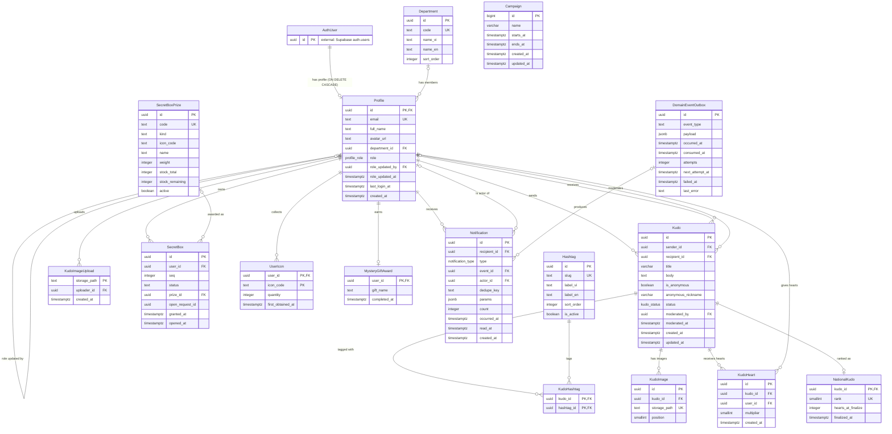

# Entities

**Project**: SAA 2025 Kudos Platform
**Generated**: 2026-11-23

## Entity Relationship Diagram

Nguồn: `shared/db/schema/*.ts` + `db/migrations/0000`–`0023`. Chỉ bảng trong schema `public` mới là entity (16 bảng, không có view). `AuthUser` là bảng ngoài của Supabase Auth, vẽ để thể hiện khóa ngoại `profiles.id`, không mang mã MODEL###. Ba enum Postgres (`profile_role`, `kudo_status`, `notification_type`) là trường phân biệt bên trong entity chủ, không phải entity riêng.

## Entities

<!-- domain: Identity & Reference -->
### MODEL001_Department

**Description**: Danh mục phòng ban của Sunner, mỗi Sunner chọn một phòng ban ở lần đăng nhập đầu. Là dữ liệu tham chiếu, nạp bằng `db/seeds/departments.ts` theo kiểu upsert trên `code`, nên BTC sửa file seed rồi chạy lại là an toàn. Bảng bật RLS và không có policy cho client, `anon`/`authenticated` bị thu hết quyền (server-only qua Drizzle). Nguồn: `shared/db/schema/reference-data.ts`, `db/migrations/0000_reference_data.sql`, `db/migrations/0002_rls_baseline.sql`.

| Attribute | Type | Constraints | Description |
|-----------|------|-------------|-------------|
| id | uuid | PK, NOT NULL, DEFAULT `gen_random_uuid()` | Khóa chính của phòng ban |
| code | text | NOT NULL, UNIQUE (`departments_code_unique`) | Mã phòng ban, khóa nghiệp vụ để upsert seed |
| name_vi | text | NOT NULL | Tên hiển thị tiếng Việt |
| name_en | text | NOT NULL | Tên hiển thị tiếng Anh |
| sort_order | integer | NOT NULL, DEFAULT 0 | Thứ tự trong danh sách chọn |

**Relationships**:
- Department → Profile: One-to-Many (0..n) via `profiles.department_id`, ON DELETE NO ACTION. Phòng ban còn Sunner tham chiếu thì không xóa được.

**Discriminator Fields**: None.

---

### MODEL002_Hashtag

**Description**: Danh sách hashtag cố định để gắn vào Kudo (mỗi Kudo 1–5 hashtag). Là dữ liệu tham chiếu, nạp bằng `db/seeds/hashtags.ts` theo kiểu upsert trên `slug`; chạy lại seed sẽ khôi phục nhãn, thứ tự và cờ `is_active` về giá trị trong file. Mỗi lần ghi Kudo (tạo hoặc sửa), mọi hashtag gửi lên phải có `is_active = true`, nếu không thì lỗi `HASHTAG_INVALID` (kiểm tra trong transaction ghi, `features/kudos-authoring/server/kudo-write-repository.ts`). Bảng bật RLS, không có policy cho client. Nguồn: `shared/db/schema/reference-data.ts`, `db/migrations/0000_reference_data.sql`, `db/migrations/0002_rls_baseline.sql`.

| Attribute | Type | Constraints | Description |
|-----------|------|-------------|-------------|
| id | uuid | PK, NOT NULL, DEFAULT `gen_random_uuid()` | Khóa chính của hashtag |
| slug | text | NOT NULL, UNIQUE (`hashtags_slug_unique`) | Định danh dạng slug (ví dụ `go-fast`), khóa nghiệp vụ để upsert seed |
| label_vi | text | NOT NULL | Nhãn hiển thị tiếng Việt |
| label_en | text | NOT NULL | Nhãn hiển thị tiếng Anh |
| sort_order | integer | NOT NULL, DEFAULT 0 | Thứ tự trong danh sách chọn |
| is_active | boolean | NOT NULL, DEFAULT true | Hashtag còn cho gắn khi ghi Kudo hay không; tắt cờ này không xóa dòng `kudo_hashtags` đã có |

**Relationships**:
- Hashtag → KudoHashtag: One-to-Many (0..n) via `kudo_hashtags.hashtag_id`, ON DELETE RESTRICT. Hashtag đã được gắn vào Kudo thì không xóa được. Qua bảng nối này, Hashtag và Kudo (MODEL003_Kudo) quan hệ Many-to-Many.

**Discriminator Fields**: None.

---

### MODEL004_Profile

**Description**: Hồ sơ Sunner, mỗi dòng ứng với đúng một dòng `auth.users` của Supabase Auth. Trigger `create_sunner_profile` tạo dòng này ở lần đăng nhập đầu (tên và avatar lấy từ metadata Google, `ON CONFLICT (id) DO NOTHING` nên idempotent); trigger `sync_profile_email` giữ `email` theo auth. Hai trigger này được mô tả ở BL019_CreateSunnerProfile và BL022_SyncProfileEmail (behavior-logic). Khóa ngoại `id` → `auth.users.id` được thêm bằng SQL tay ở migration 0005 vì Drizzle không nhìn thấy schema `auth`. Role luôn đọc từ bảng này, không đọc từ cookie. `role_updated_by` / `role_updated_at` chỉ lưu lần đổi role gần nhất (không có bảng lịch sử), do `UserRoleService` (`features/admin-users/server/user-role-service.ts`) ghi trong transaction đổi role. Tài khoản có email trong `ADMIN_EMAILS` được `completeLogin` (`features/auth/server/complete-login.ts`) đặt lại `role = 'admin'` ở mọi lần đăng nhập, và `UserRoleService` từ chối hạ quyền tài khoản đó (`ENV_ADMIN`). Chỉ mục: `profiles_department_id_idx` (`department_id`). Bảng bật RLS, không có policy cho client, `anon`/`authenticated` bị REVOKE ALL. Nguồn: `shared/db/schema/profiles.ts`, `db/migrations/0004_profiles.sql`, `db/migrations/0005_auth_user_triggers.sql`, `db/migrations/0022_profiles_role_audit.sql`.

| Attribute | Type | Constraints | Description |
|-----------|------|-------------|-------------|
| id | uuid | PK, FK → `auth.users.id` ON DELETE CASCADE (`profiles_id_auth_users_id_fk`), NOT NULL | Trùng với id của user trong Supabase Auth, không tự sinh |
| email | text | NOT NULL, UNIQUE (`profiles_email_unique`) | Email công ty, trigger ghi dạng `lower(email)` và cập nhật theo auth; chỉ nhận miền `sun-asterisk.com` |
| full_name | text | NOT NULL | Họ tên, lấy từ metadata Google, thiếu thì dùng phần trước `@` của email |
| avatar_url | text | NULL | URL avatar từ metadata Google, có thể trống |
| department_id | uuid | FK → `departments.id` ON DELETE NO ACTION (`profiles_department_id_departments_id_fk`), NULL | Phòng ban; NULL tới khi Sunner tự chọn lần đầu |
| role | profile_role | NOT NULL, DEFAULT `'user'` | Vai trò của Sunner, xem Discriminator Fields bên dưới |
| role_updated_by | uuid | FK → `profiles.id` ON DELETE SET NULL (`profiles_role_updated_by_profiles_id_fk`), NULL | Admin đã đổi role gần nhất; NULL khi chưa đổi lần nào hoặc admin đó đã bị xóa |
| role_updated_at | timestamptz | NULL | Thời điểm đổi role gần nhất; vẫn giữ nguyên khi admin đổi role bị xóa |
| last_login_at | timestamptz | NULL | Lần đăng nhập gần nhất, `completeLogin` ghi `now()` ở mỗi lần đăng nhập |
| created_at | timestamptz | NOT NULL, DEFAULT `now()` | Thời điểm tạo hồ sơ |

**Relationships**:
- Profile → AuthUser (`auth.users`, ngoài schema `public`, không có MODEL###): One-to-One (0..1 hồ sơ cho mỗi user) via `id`, ON DELETE CASCADE. Xóa user Auth thì hồ sơ bị xóa theo.
- Profile → Department: Many-to-One (0..1) via `department_id`, ON DELETE NO ACTION.
- Profile → Profile: Many-to-One (0..1, tự tham chiếu) via `role_updated_by`, ON DELETE SET NULL.
- Profile → Kudo (người gửi): One-to-Many (0..n) via `kudos.sender_id`, ON DELETE RESTRICT.
- Profile → Kudo (người nhận): One-to-Many (0..n) via `kudos.recipient_id`, ON DELETE RESTRICT.
- Profile → Kudo (người kiểm duyệt): One-to-Many (0..n) via `kudos.moderated_by`, ON DELETE SET NULL.
- Profile → KudoImageUpload: One-to-Many (0..n) via `kudo_image_uploads.uploader_id`, ON DELETE CASCADE.
- Profile → KudoHeart: One-to-Many (0..n) via `kudo_hearts.user_id`, ON DELETE CASCADE.
- Profile → SecretBox: One-to-Many (0..n) via `secret_boxes.user_id`, ON DELETE CASCADE.
- Profile → UserIcon: One-to-Many (0..n) via `user_icons.user_id`, ON DELETE CASCADE.
- Profile → MysteryGiftAward: One-to-One (0..1) via `mystery_gift_awards.user_id`, ON DELETE CASCADE.
- Profile → Notification (người nhận): One-to-Many (0..n) via `notifications.recipient_id`, ON DELETE CASCADE.
- Profile → Notification (người gây ra): One-to-Many (0..n) via `notifications.actor_id`, ON DELETE SET NULL.

**Discriminator Fields**:

| Field | DISC-### | Values | Description |
|-------|----------|--------|-------------|
| role | DISC-001 | user, admin | Enum Postgres `profile_role`. `user`: Sunner thường, là giá trị mặc định của mọi hồ sơ mới. `admin`: quản trị viên của BTC, được vào khu vực Admin. |

---

<!-- domain: Kudos -->
### MODEL003_Kudo

**Description**: Lời cảm ơn một Sunner gửi cho Sunner khác, là bảng ghi chính của luồng Kudo. Nội dung là Markdown rút gọn (không HTML), 1–1000 ký tự tính theo code point. Người nhận không đổi được sau khi tạo (luật ở tầng ứng dụng, DB không chặn). Kudo ẩn danh vẫn lưu `sender_id` (CHECK chống gửi cho chính mình dựa vào cột này), còn giao diện chỉ hiện `anonymous_nickname`. `status` luôn là `public` lúc tạo; admin đánh dấu spam rồi ghi `moderated_by`/`moderated_at` (chỉ lưu lần kiểm duyệt gần nhất, không có bảng lịch sử). `updated_at` do ứng dụng đặt `now()` khi sửa Kudo (`features/kudos-authoring/server/kudo-write-repository.ts`), không có trigger. Chỉ mục: `kudos_status_created_at_id_idx` (`status`, `created_at DESC`, `id DESC`) cho Live board và Highlight; `kudos_recipient_id_created_at_id_idx` và `kudos_sender_id_created_at_id_idx` cho trang theo người nhận và người gửi; `kudos_public_recipient_sender_idx` (`recipient_id`, `sender_id`, một phần `WHERE status = 'public'`) cho phép đếm số người gửi khác nhau trong tính hạng Hero. Trigger `spotlight_publish_kudo_event` (AFTER INSERT OR UPDATE OF `status`) phát sự kiện Realtime cho Spotlight Board, mô tả ở BL023_SpotlightPublishKudoEvent (behavior-logic). Bảng bật RLS, không có policy cho client, `anon`/`authenticated` bị REVOKE ALL. Nguồn: `shared/db/schema/kudos.ts`, `db/migrations/0006_kudos.sql`, `0007_kudos_constraints.sql`, `0008_kudos_review_fixes.sql`, `0009_kudos_feed_indexes.sql`, `0013_kudos_moderation_columns.sql`, `0014_kudos_hero_tier_index.sql`, `0017_spotlight_realtime.sql`.

| Attribute | Type | Constraints | Description |
|-----------|------|-------------|-------------|
| id | uuid | PK, NOT NULL, DEFAULT `gen_random_uuid()` | Khóa chính của Kudo |
| sender_id | uuid | FK → `profiles.id` ON DELETE RESTRICT (`kudos_sender_id_profiles_id_fk`), NOT NULL; CHECK `sender_id <> recipient_id` (`kudos_no_self_send`) | Người gửi; không được trùng người nhận |
| recipient_id | uuid | FK → `profiles.id` ON DELETE RESTRICT (`kudos_recipient_id_profiles_id_fk`), NOT NULL | Người nhận; bất biến sau khi tạo (ứng dụng) |
| title | varchar(50) | NULL; CHECK `title IS NULL OR btrim(title) <> ''` (`kudos_title_not_blank`) | Danh hiệu, tùy chọn; "không có danh hiệu" là NULL, không phải chuỗi rỗng |
| body | text | NOT NULL; CHECK `char_length(body) BETWEEN 1 AND 1000` (`kudos_body_length`); CHECK `body ~ '[^[:space:]]'` (`kudos_body_not_blank`) | Nội dung Markdown thô, 1–1000 ký tự và phải có ít nhất một ký tự không phải khoảng trắng |
| is_anonymous | boolean | NOT NULL, DEFAULT false | Gửi ẩn danh hay không |
| anonymous_nickname | varchar(30) | NULL; CHECK `kudos_anonymous_nickname` | Biệt danh hiện thay tên người gửi; có đúng khi `is_anonymous` (1–30 ký tự sau trim), ngược lại phải NULL |
| status | kudo_status | NOT NULL, DEFAULT `'public'` | Trạng thái kiểm duyệt, xem Discriminator Fields bên dưới |
| moderated_by | uuid | FK → `profiles.id` ON DELETE SET NULL (`kudos_moderated_by_profiles_id_fk`), NULL | Admin kiểm duyệt gần nhất; NULL khi chưa kiểm duyệt hoặc admin đó đã bị xóa |
| moderated_at | timestamptz | NULL; CHECK `moderated_by IS NULL OR moderated_at IS NOT NULL` (`kudos_moderated_by_needs_moderated_at`) | Thời điểm kiểm duyệt gần nhất; có giá trị bất cứ khi nào `moderated_by` có, và vẫn giữ khi admin bị xóa |
| created_at | timestamptz | NOT NULL, DEFAULT `now()` | Thời điểm tạo; cùng `id` làm khóa phân trang của feed |
| updated_at | timestamptz | NOT NULL, DEFAULT `now()` | Thời điểm sửa gần nhất, do ứng dụng cập nhật |

**Relationships**:
- Kudo → Profile (người gửi): Many-to-One via `sender_id`, ON DELETE RESTRICT.
- Kudo → Profile (người nhận): Many-to-One via `recipient_id`, ON DELETE RESTRICT.
- Kudo → Profile (người kiểm duyệt): Many-to-One (0..1) via `moderated_by`, ON DELETE SET NULL.
- Kudo → KudoHashtag: One-to-Many (1..5, ràng buộc ở transaction ghi) via `kudo_hashtags.kudo_id`, ON DELETE CASCADE.
- Kudo → KudoImage: One-to-Many (0..5) via `kudo_images.kudo_id`, ON DELETE CASCADE.
- Kudo → KudoHeart: One-to-Many (0..n) via `kudo_hearts.kudo_id`, ON DELETE CASCADE.
- Kudo → NationalKudo: One-to-One (0..1) via `national_kudos.kudo_id`, ON DELETE CASCADE.

**Discriminator Fields**:

| Field | DISC-### | Values | Description |
|-------|----------|--------|-------------|
| status | DISC-002 | public, spam | Enum Postgres `kudo_status`. `public`: Kudo hiển thị công khai, mặc định của mọi Kudo mới. `spam`: Kudo bị admin đánh dấu spam, bị ẩn khỏi các màn hình công khai; admin có thể khôi phục về `public`. |

---

### MODEL005_KudoHashtag

**Description**: Bảng nối Kudo với Hashtag (Many-to-Many). Mỗi Kudo gắn 1–5 hashtag đang hoạt động, không trùng; giới hạn này kiểm tra trong transaction ghi Kudo (`features/kudos-authoring/server`), DB chỉ giữ khóa chính ghép. Sửa Kudo thì bộ hashtag được thay trọn bộ (xóa hết rồi chèn lại). Chỉ mục phụ: `kudo_hashtags_hashtag_id_idx` (`hashtag_id`), vì khóa chính ghép chỉ phục vụ tra theo `kudo_id`. Bảng bật RLS, không có policy cho client, `anon`/`authenticated` bị REVOKE ALL. Nguồn: `shared/db/schema/kudos.ts`, `db/migrations/0006_kudos.sql`.

| Attribute | Type | Constraints | Description |
|-----------|------|-------------|-------------|
| kudo_id | uuid | PK (thành phần 1, `kudo_hashtags_kudo_id_hashtag_id_pk`), FK → `kudos.id` ON DELETE CASCADE (`kudo_hashtags_kudo_id_kudos_id_fk`), NOT NULL | Kudo được gắn hashtag |
| hashtag_id | uuid | PK (thành phần 2), FK → `hashtags.id` ON DELETE RESTRICT (`kudo_hashtags_hashtag_id_hashtags_id_fk`), NOT NULL | Hashtag được gắn vào Kudo |

**Relationships**:
- KudoHashtag → Kudo: Many-to-One via `kudo_id`, ON DELETE CASCADE. Xóa Kudo thì các dòng gắn hashtag bị xóa theo.
- KudoHashtag → Hashtag: Many-to-One via `hashtag_id`, ON DELETE RESTRICT.

**Discriminator Fields**: None.

---

### MODEL006_KudoImage

**Description**: Ảnh đính kèm của Kudo, tối đa 5 ảnh, xếp theo `position` 0..4. Tệp nằm trong bucket Storage `kudo-images` (private, tối đa 5 MiB mỗi tệp, MIME `image/jpeg`, `image/png`, `image/webp`; bucket do migration 0003 tạo; quyền truy cập ở PERM036_KudoImageStorageAccess, ký URL tải lên ở BL008_KudoImageUploadSigning) và chỉ đọc qua URL ký bởi server. `storage_path` có dạng `kudos/{uuid}.{jpg|png|webp}`, không chứa id người gửi để Kudo ẩn danh không lộ tác giả qua URL ảnh. Sửa Kudo thì bộ ảnh được thay trọn bộ (xóa hết rồi chèn lại theo thứ tự mới). Không có khóa ngoại tới `kudo_image_uploads`: transaction ghi Kudo đối chiếu hai bảng qua `storage_path` rồi xóa dòng upload đã dùng. Bảng bật RLS, không có policy cho client, `anon`/`authenticated` bị REVOKE ALL. Nguồn: `shared/db/schema/kudos.ts`, `db/migrations/0006_kudos.sql`, `0007_kudos_constraints.sql`, `0003_storage_kudo_images_bucket.sql`.

| Attribute | Type | Constraints | Description |
|-----------|------|-------------|-------------|
| id | uuid | PK, NOT NULL, DEFAULT `gen_random_uuid()` | Khóa chính của ảnh |
| kudo_id | uuid | FK → `kudos.id` ON DELETE CASCADE (`kudo_images_kudo_id_kudos_id_fk`), NOT NULL; UNIQUE (`kudo_id`, `position`) (`kudo_images_kudo_id_position_unique`) | Kudo chứa ảnh |
| storage_path | text | NOT NULL, UNIQUE (`kudo_images_storage_path_unique`); CHECK regex `^kudos/{uuid}\.(jpg\|png\|webp)$`, uuid chữ thường (`kudo_images_storage_path_format`) | Đường dẫn object trong bucket `kudo-images`; một object chỉ gắn được vào một ảnh |
| position | smallint | NOT NULL; CHECK `position BETWEEN 0 AND 4` (`kudo_images_position_range`) | Thứ tự hiển thị, 0 đến 4 |

**Relationships**:
- KudoImage → Kudo: Many-to-One via `kudo_id`, ON DELETE CASCADE. Xóa Kudo thì dòng ảnh bị xóa theo.

**Discriminator Fields**: None.

---

### MODEL007_KudoImageUpload

**Description**: Sổ ghi các đường dẫn upload đã được cấp bởi `POST /api/kudos/images/sign`, chờ gắn vào Kudo. Một đường dẫn chỉ được nhận khi dòng ở đây thuộc đúng người gửi và object thật sự tồn tại trong `storage.objects` (`claimKudoImageUploads` trong `features/kudos-authoring/server/kudo-image-upload-service.ts`). Dòng bị xóa khi đường dẫn được gắn vào Kudo (`kudo-write-repository.ts`), hoặc khi tạo signed URL lỗi. Giới hạn số upload đang chờ: tối đa `PENDING_UPLOADS_MAX = 20` dòng của một người trong cửa sổ trượt `PENDING_UPLOADS_WINDOW_HOURS = 24` giờ (`features/kudos-authoring/kudo-authoring-limits.ts`); vượt thì từ chối `UPLOAD_LIMIT`. Việc đếm và thêm dòng được tuần tự hóa theo từng người bằng `pg_advisory_xact_lock`. Dòng bỏ dở chưa có job dọn (việc dọn đã hoãn, xem comment ở `kudo-authoring-limits.ts`): cửa sổ trượt chỉ làm dòng cũ thôi bị tính vào giới hạn. Chỉ mục: `kudo_image_uploads_uploader_id_created_at_idx` (`uploader_id`, `created_at`) phục vụ phép đếm. Bảng bật RLS, không có policy cho client, `anon`/`authenticated` bị REVOKE ALL. Nguồn: `shared/db/schema/kudos.ts`, `db/migrations/0006_kudos.sql`, `0007_kudos_constraints.sql`, `0008_kudos_review_fixes.sql`.

| Attribute | Type | Constraints | Description |
|-----------|------|-------------|-------------|
| storage_path | text | PK, NOT NULL; CHECK cùng regex với `kudo_images.storage_path` (`kudo_image_uploads_storage_path_format`) | Đường dẫn object đã cấp, dạng `kudos/{uuid}.{jpg\|png\|webp}` |
| uploader_id | uuid | FK → `profiles.id` ON DELETE CASCADE (`kudo_image_uploads_uploader_id_profiles_id_fk`), NOT NULL | Người đã xin đường dẫn upload |
| created_at | timestamptz | NOT NULL, DEFAULT `now()` | Thời điểm cấp đường dẫn; mốc của cửa sổ trượt |

**Relationships**:
- KudoImageUpload → Profile (người upload): Many-to-One via `uploader_id`, ON DELETE CASCADE.

**Discriminator Fields**: None.

---

<!-- domain: Hearts & Campaigns -->
### MODEL008_KudoHeart

**Description**: Một lượt thả tim của Sunner lên một Kudo, mỗi cặp (Kudo, Sunner) tối đa một dòng. UNIQUE (`kudo_id`, `user_id`) cho phép ghi bằng `INSERT … SELECT … ON CONFLICT DO NOTHING`, nên bấm đồng thời nhiều lần vẫn chỉ ra một dòng và một sự kiện `HeartAdded` (`features/kudos-hearts/server/kudo-heart-service.ts`). Câu INSERT cũng gói các điều kiện: Kudo đang `public`, người thả không phải người gửi, và chưa tới `EVENT_END_AT`. `multiplier` là ảnh chụp tại lúc thả tim: bằng 1, hoặc `HEART_CAMPAIGN_MULTIPLIER` (x2) khi có campaign đang chạy (`heart-multiplier-resolver.ts`), và không cập nhật về sau. Bỏ tim là `DELETE` thẳng, idempotent, không có sự kiện riêng. Kudo bị spam không xóa tim, chỉ lọc khi đọc nên dòng được giữ nguyên. Không có khóa ngoại tới Campaign: quan hệ với campaign chỉ thể hiện qua giá trị `multiplier` đã chụp. Chỉ mục: UNIQUE (`kudo_id`, `user_id`) phục vụ mọi tra cứu theo `kudo_id`; `kudo_hearts_user_id_idx` (`user_id`) cho truy vấn theo người thả. Bảng bật RLS, không có policy cho client, `anon`/`authenticated` bị REVOKE ALL. Nguồn: `shared/db/schema/kudo-hearts.ts`, `db/migrations/0010_kudo_hearts.sql`, `db/migrations/0012_campaigns_no_overlap_exclude.sql` (phần REVOKE).

| Attribute | Type | Constraints | Description |
|-----------|------|-------------|-------------|
| id | uuid | PK, NOT NULL, DEFAULT `gen_random_uuid()` | Khóa chính của lượt thả tim |
| kudo_id | uuid | FK → `kudos.id` ON DELETE CASCADE (`kudo_hearts_kudo_id_kudos_id_fk`), NOT NULL; UNIQUE (`kudo_id`, `user_id`) (`kudo_hearts_kudo_id_user_id_unique`) | Kudo được thả tim |
| user_id | uuid | FK → `profiles.id` ON DELETE CASCADE (`kudo_hearts_user_id_profiles_id_fk`), NOT NULL | Sunner thả tim |
| multiplier | smallint | NOT NULL, DEFAULT 1; CHECK `multiplier >= 1` (`kudo_hearts_multiplier_positive`) | Hệ số của lượt tim, chụp lúc thả (1 hoặc hệ số campaign x2); tổng `multiplier` dùng cho tiến độ Secret Box, còn số hiển thị trên thẻ là số tim thô |
| created_at | timestamptz | NOT NULL, DEFAULT `now()` | Thời điểm thả tim |

**Relationships**:
- KudoHeart → Kudo: Many-to-One via `kudo_id`, ON DELETE CASCADE.
- KudoHeart → Profile (người thả): Many-to-One via `user_id`, ON DELETE CASCADE.

**Discriminator Fields**: None.

---

### MODEL009_Campaign

**Description**: Campaign nhân đôi tim (x2) do admin cấu hình ở Admin › Settings: trong khung thời gian của campaign, mỗi tim mới thả được chụp `multiplier` x2. Mốc thời gian lưu theo UTC, nhập và hiển thị theo `ADMIN_TIMEZONE`. Pha của campaign (upcoming / active / ended) được tính từ `starts_at`, `ends_at` và giờ hiện tại, không lưu thành cột. `id` là số định danh `GENERATED ALWAYS AS IDENTITY` (sequence `campaigns_id_seq`) vì màn Settings hiện nó ở cột ID hẹp; Drizzle đọc thành `number`. Hai campaign không được chồng khung `[starts_at, ends_at)`, ràng buộc EXCLUDE bằng GiST (`campaigns_no_overlap`) viết tay ở migration 0012 vì Drizzle không biểu diễn được; campaign bắt đầu đúng lúc campaign khác kết thúc là hợp lệ. Chỉ mục GiST đi kèm EXCLUDE chỉ nhằm thi hành ràng buộc: `CampaignActiveReader` (`features/admin-campaigns/server/campaign-active-reader.ts`) lọc bằng so sánh cột thường (`starts_at <= at < ends_at`) và quét tuần tự trên bảng chỉ vài dòng, dù comment trong migration 0012 viết ngược lại. `updated_at` do Server Action đặt `now()` khi sửa (`campaign-admin-actions.ts`), không có trigger. Bảng bật RLS, không có policy cho client, `anon`/`authenticated` bị REVOKE ALL. Nguồn: `shared/db/schema/campaigns.ts`, `db/migrations/0011_campaigns.sql`, `db/migrations/0012_campaigns_no_overlap_exclude.sql`.

| Attribute | Type | Constraints | Description |
|-----------|------|-------------|-------------|
| id | bigint | PK, NOT NULL, GENERATED ALWAYS AS IDENTITY | Số định danh tăng dần, hiện ở cột ID của Admin › Settings; không được chèn tay giá trị |
| name | varchar(100) | NOT NULL; CHECK `btrim(name) <> ''` (`campaigns_name_not_blank`) | Tên campaign, 1–100 ký tự sau trim; cho phép trùng tên |
| starts_at | timestamptz | NOT NULL; thành phần của EXCLUDE USING gist (`tstzrange(starts_at, ends_at, '[)')` WITH `&&`) (`campaigns_no_overlap`, SQLSTATE `23P01`) | Thời điểm bắt đầu (bao gồm), lưu UTC |
| ends_at | timestamptz | NOT NULL; CHECK `ends_at > starts_at` (`campaigns_ends_after_starts`); thành phần của EXCLUDE `campaigns_no_overlap` | Thời điểm kết thúc (không bao gồm), lưu UTC |
| created_at | timestamptz | NOT NULL, DEFAULT `now()` | Thời điểm tạo |
| updated_at | timestamptz | NOT NULL, DEFAULT `now()` | Thời điểm sửa gần nhất, do ứng dụng cập nhật |

**Relationships**:
- Không có khóa ngoại nào. Campaign liên hệ với KudoHeart (MODEL008_KudoHeart) chỉ gián tiếp (logic, 0..n, không có FK): `HeartMultiplierResolver` tra campaign đang chạy tại lúc thả tim rồi chụp hệ số vào `kudo_hearts.multiplier`, sau đó hai bên không còn liên kết.

**Discriminator Fields**: None.

---

<!-- domain: Secret Box & Rewards -->
### MODEL010_SecretBoxPrize

**Description**: Danh mục giải thưởng của Hộp bí mật, bảng `secret_box_prizes` (`shared/db/schema/secret-box-rewards.ts`, `db/migrations/0015_secret_box_rewards.sql`). Dữ liệu nạp bằng `npm run db:seed` từ `db/seeds/secret-box-prize-catalog.ts` theo `code`, không seed trong migration. Icon không giới hạn (`stock_total` NULL) nên nhóm dự phòng icon không bao giờ cạn; quà giữ `stock_total` (số lượng BTC cấp) và `stock_remaining` (trừ nguyên tử mỗi lần rút trúng, `features/secret-box-rewards/server/prize-draw-service.ts`), nên seed lại vẫn giữ số đã phát. Bật RLS, không policy và không quyền cho client (server-only qua Drizzle); không có trigger. Index một phần UNIQUE `secret_box_prizes_icon_code_unique` trên `icon_code` với điều kiện `kind = 'icon'`.

| Attribute | Type | Constraints | Description |
|-----------|------|-------------|-------------|
| id | uuid | PK, NOT NULL, DEFAULT gen_random_uuid() | Khóa chính của giải thưởng |
| code | text | NOT NULL, UNIQUE `secret_box_prizes_code_unique` | Mã giải thưởng; khóa để nạp seed không nhân đôi dòng |
| kind | text | NOT NULL, CHECK `secret_box_prizes_kind_valid` (`kind in ('icon', 'gift')`); kiểu TS `"icon"` hoặc `"gift"` | Loại giải: icon sưu tập hoặc quà; xem Discriminator Fields |
| icon_code | text | NULL, CHECK `secret_box_prizes_icon_code_matches_kind` (`(kind = 'icon') = (icon_code is not null)`), CHECK `secret_box_prizes_icon_code_valid` (NULL hoặc thuộc REVIVAL, TOUCH_OF_LIGHT, STAY_GOLD, FLOW_TO_HORIZON, BEYOND_THE_BOUNDARY, ROOT_FURTHER), UNIQUE một phần `secret_box_prizes_icon_code_unique` (`WHERE kind = 'icon'`) | Mã icon trong bộ 6; có giá trị khi và chỉ khi `kind = 'icon'`, mỗi icon đúng một giải. Cùng danh sách `SECRET_BOX_ICON_CODES` ở `features/secret-box-rewards/schemas/secret-box-views.ts` |
| name | text | NOT NULL, CHECK `secret_box_prizes_name_not_blank` (`btrim(name) <> ''`) | Tên giải hiển thị cho người dùng |
| weight | integer | NOT NULL, CHECK `secret_box_prizes_weight_positive` (`weight > 0`) | Trọng số trong lần rút ngẫu nhiên có trọng số |
| stock_total | integer | NULL, CHECK `secret_box_prizes_stock_valid` (cùng NULL hoặc cùng có giá trị với `stock_remaining`), CHECK `secret_box_prizes_icons_unlimited` (`kind <> 'icon' or stock_total is null`) | Tổng số quà BTC cấp; NULL nghĩa là không giới hạn (bắt buộc với icon) |
| stock_remaining | integer | NULL, CHECK `secret_box_prizes_stock_valid` (nếu có giá trị thì `BETWEEN 0 AND stock_total`) | Số quà còn lại; giảm bằng `UPDATE … WHERE stock_remaining > 0` nên không âm, không phát lố |
| active | boolean | NOT NULL, DEFAULT true | Cờ bật/tắt; chỉ giải `active = true` tham gia lần rút (boolean, không phải discriminator) |

**Relationships**:
- One-to-Many với MODEL011_SecretBox qua `secret_boxes.prize_id` (FK `secret_boxes_prize_id_secret_box_prizes_id_fk`, ON DELETE NO ACTION); `prize_id` còn NULL tới khi hộp được mở
- Liên hệ logic, 0..n, không có FK: `icon_code` khớp `user_icons.icon_code` của MODEL012_UserIcon chỉ nhờ cùng bộ 6 mã trong CHECK

**Discriminator Fields**:

| Field | DISC-### | Values | Description |
|-------|----------|--------|-------------|
| kind | DISC-003 | icon, gift | `icon`: giải là một icon trong bộ 6 sưu tập, không giới hạn số lượng. `gift`: giải là quà vật phẩm có số lượng giới hạn do BTC cấp |

---

### MODEL011_SecretBox

**Description**: Một Hộp bí mật đã cấp cho người dùng, bảng `secret_boxes` (`shared/db/schema/secret-box-rewards.ts`, `db/migrations/0015_secret_box_rewards.sql`). `seq` đánh số hộp của mỗi người từ 1 tới n: UNIQUE `(user_id, seq)` đỡ việc cấp bù đồng thời, UNIQUE `(user_id, open_request_id)` đỡ việc phát lại theo header `Idempotency-Key` khi mở. Chỉ chuyển `unopened` sang `opened`, kèm kết quả (giải, thời điểm mở, mã yêu cầu mở); CHECK `secret_boxes_opened_has_result` (`(status = 'opened') = (prize_id is not null and opened_at is not null and open_request_id is not null)`) buộc hộp đã mở có đủ ba trường kết quả và hộp chưa mở không có trường nào. Bật RLS, không policy cho client; không có trigger. Index: `secret_boxes_user_id_status_idx` (`user_id`, `status`) và `secret_boxes_status_opened_at_idx` (`status`, `opened_at` DESC NULLS LAST). `db/migrations/0016_secret_box_tick_cron.sql` không đổi cột nào, chỉ lập lịch job pg_cron `saa-secret-box-tick` mỗi phút gọi endpoint tick (mô tả ở BL028_SecretBoxTickCron).

| Attribute | Type | Constraints | Description |
|-----------|------|-------------|-------------|
| id | uuid | PK, NOT NULL, DEFAULT gen_random_uuid() | Khóa chính của hộp |
| user_id | uuid | NOT NULL, FK → profiles.id ON DELETE CASCADE (`secret_boxes_user_id_profiles_id_fk`), UNIQUE `secret_boxes_user_id_seq_unique` cùng `seq`, UNIQUE `secret_boxes_user_id_open_request_id_unique` cùng `open_request_id` | Chủ sở hữu hộp |
| seq | integer | NOT NULL, CHECK `secret_boxes_seq_positive` (`seq >= 1`), UNIQUE `(user_id, seq)` | Số thứ tự hộp của người dùng, bắt đầu từ 1 |
| status | text | NOT NULL, DEFAULT 'unopened', CHECK `secret_boxes_status_valid` (`status in ('unopened', 'opened')`), CHECK `secret_boxes_opened_has_result`; kiểu TS `"unopened"` hoặc `"opened"` | Trạng thái hộp; xem Discriminator Fields |
| prize_id | uuid | NULL, FK → secret_box_prizes.id ON DELETE NO ACTION (`secret_boxes_prize_id_secret_box_prizes_id_fk`) | Giải rút được; NULL tới khi hộp mở |
| open_request_id | uuid | NULL, UNIQUE `(user_id, open_request_id)`; không có FK | `Idempotency-Key` (UUID v4) của lần mở; NULL tới khi mở. UNIQUE coi NULL là khác nhau nên nhiều hộp chưa mở vẫn hợp lệ |
| granted_at | timestamptz | NOT NULL, DEFAULT now() | Thời điểm cấp hộp |
| opened_at | timestamptz | NULL | Thời điểm mở; NULL tới khi mở |

**Relationships**:
- Many-to-One với MODEL004_Profile qua `user_id` (bắt buộc, ON DELETE CASCADE)
- Many-to-One với MODEL010_SecretBoxPrize qua `prize_id` (tùy chọn, ON DELETE NO ACTION)

**Discriminator Fields**:

| Field | DISC-### | Values | Description |
|-------|----------|--------|-------------|
| status | DISC-004 | unopened, opened | `unopened`: hộp đã cấp, đang chờ người dùng mở, chưa có kết quả. `opened`: hộp đã mở, lưu giải trúng, thời điểm mở và mã yêu cầu mở |

---

### MODEL012_UserIcon

**Description**: Bộ sưu tập icon của từng người dùng, bảng `user_icons` (`shared/db/schema/secret-box-rewards.ts`, `db/migrations/0015_secret_box_rewards.sql`). Mỗi cặp (người dùng, icon) một dòng; nhận icon trùng chỉ tăng `quantity` (ghi bởi `features/secret-box-rewards/server/icon-collection-service.ts`). Bật RLS, không policy cho client; không có trigger. Bộ 6 mã icon chỉ khác nhau ở ảnh huy hiệu hiển thị (chiều cao ảnh trong `features/secret-box-rewards/components/secret-box-format.ts`), không có nhánh nghiệp vụ nên không lập discriminator.

| Attribute | Type | Constraints | Description |
|-----------|------|-------------|-------------|
| user_id | uuid | PK (thành phần 1 của `user_icons_pk`), NOT NULL, FK → profiles.id ON DELETE CASCADE (`user_icons_user_id_profiles_id_fk`) | Người sở hữu icon |
| icon_code | text | PK (thành phần 2 của `user_icons_pk`), NOT NULL, CHECK `user_icons_icon_code_valid` (thuộc REVIVAL, TOUCH_OF_LIGHT, STAY_GOLD, FLOW_TO_HORIZON, BEYOND_THE_BOUNDARY, ROOT_FURTHER) | Mã icon trong bộ 6; cùng danh sách với `secret_box_prizes.icon_code`, không có FK tới bảng giải |
| quantity | integer | NOT NULL, DEFAULT 1, CHECK `user_icons_quantity_positive` (`quantity >= 1`) | Số lần đã nhận icon này |
| first_obtained_at | timestamptz | NOT NULL, DEFAULT now() | Thời điểm lần đầu nhận icon |

**Relationships**:
- Many-to-One với MODEL004_Profile qua `user_id` (bắt buộc, ON DELETE CASCADE)
- Liên hệ logic, 0..n, không có FK: `icon_code` tương ứng icon của MODEL010_SecretBoxPrize (`kind = 'icon'`)

**Discriminator Fields**: None.

---

### MODEL013_MysteryGiftAward

**Description**: Quà bí ẩn mỗi người nhận đúng một lần khi gom đủ bộ 6 icon, bảng `mystery_gift_awards` (`shared/db/schema/secret-box-rewards.ts`, `db/migrations/0015_secret_box_rewards.sql`). `user_id` vừa là khóa chính vừa là FK nên "mỗi người một quà" do DB bảo đảm; ghi bằng `INSERT … ON CONFLICT (user_id) DO NOTHING` và chỉ phát sự kiện `SetCompleted` khi dòng mới (`features/secret-box-rewards/server/icon-collection-service.ts`). `completed_at` bằng `opened_at` của hộp vừa mở (cùng transaction, cùng `now()`), là số liệu "thời gian gom đủ 6 huy hiệu" của phase 14. Bật RLS, không policy cho client; không có trigger.

| Attribute | Type | Constraints | Description |
|-----------|------|-------------|-------------|
| user_id | uuid | PK, NOT NULL, FK → profiles.id ON DELETE CASCADE (`mystery_gift_awards_user_id_profiles_id_fk`) | Người nhận quà; mỗi người tối đa một dòng |
| gift_name | text | NOT NULL, CHECK `mystery_gift_awards_gift_name_not_blank` (`btrim(gift_name) <> ''`) | Tên quà bí ẩn; lấy từ hằng số trong `features/secret-box-rewards/secret-box-config.ts` (nội dung tạm, chờ BTC xác nhận) |
| completed_at | timestamptz | NOT NULL, DEFAULT now() | Thời điểm gom đủ bộ 6 icon |

**Relationships**:
- One-to-One với MODEL004_Profile qua `user_id` (khóa chính đồng thời là FK, ON DELETE CASCADE)

**Discriminator Fields**: None.

---

### MODEL014_NationalKudo

**Description**: Kudos Quốc Dân, các Kudo được chốt vào top theo số tim, bảng `national_kudos` (`shared/db/schema/secret-box-rewards.ts`, `db/migrations/0015_secret_box_rewards.sql`). Tối đa 5 dòng, ghi một lần: `NationalKudosFinalizeJob` (`features/secret-box-rewards/server/national-kudos-finalize-job.ts`) chạy một lần tại mốc `NATIONAL_KUDOS_FINALIZE_AT`; UNIQUE `rank` và khóa chính `kudo_id` làm chạy đồng thời vẫn chỉ ghi 5 dòng và một sự kiện `NationalKudosFinalized`. Bật RLS, không policy cho client; không có trigger.

| Attribute | Type | Constraints | Description |
|-----------|------|-------------|-------------|
| kudo_id | uuid | PK, NOT NULL, FK → kudos.id ON DELETE CASCADE (`national_kudos_kudo_id_kudos_id_fk`) | Kudo được chốt; mỗi Kudo tối đa một dòng |
| rank | smallint | NOT NULL, UNIQUE `national_kudos_rank_unique`, CHECK `national_kudos_rank_range` (`rank between 1 and 5`) | Hạng từ 1 tới 5, không trùng hạng giữa các dòng |
| hearts_at_finalize | integer | NOT NULL, CHECK `national_kudos_hearts_positive` (`hearts_at_finalize >= 1`) | Số tim chụp lại lúc chốt, không cập nhật về sau |
| finalized_at | timestamptz | NOT NULL, DEFAULT now() | Thời điểm chốt |

**Relationships**:
- One-to-One với MODEL003_Kudo qua `kudo_id` (khóa chính đồng thời là FK, ON DELETE CASCADE)

**Discriminator Fields**: None.

---

<!-- domain: Outbox & Notifications -->
### MODEL015_DomainEventOutbox

**Description**: Hộp thư sự kiện giao dịch (transactional outbox) dùng chung cho mọi tính năng, bảng `domain_event_outbox` (`shared/db/schema/domain-event-outbox.ts`, `shared/events/domain-event-types.ts`, `db/migrations/0001_domain_event_outbox.sql`). Dòng chỉ được ghi qua `DomainEventOutbox.add(tx, …)` (`shared/events/domain-event-outbox.ts`) bên trong transaction nghiệp vụ của bên phát (Kudo, tim, kiểm duyệt, Hộp bí mật), payload chỉ chứa id; `NotificationEventProcessor` là bên đọc duy nhất, quét các dòng chờ bằng `FOR UPDATE SKIP LOCKED` và biến thành `notifications`. Cột `event_type` không có CHECK ở DB; tập giá trị và hình dạng payload do Zod `domainEventSchema` (discriminated union theo `type`, `strictObject`) bảo đảm trước khi ghi. RLS bật ở `db/migrations/0002_rls_baseline.sql` (schema Drizzle không gọi `.enableRLS()`), không policy và không quyền cho client. Index một phần `domain_event_outbox_pending_idx` (`occurred_at`, `id`) với điều kiện `consumed_at is null and failed_at is null` phục vụ thứ tự quét. `next_attempt_at` thêm ở `db/migrations/0021_notifications_retry_backoff_and_event_fk.sql` cho backoff lũy thừa 1, 2, 4, 8 phút. Job pg_cron `saa-outbox-prune` (`db/migrations/0023_housekeeping_outbox_and_cron_history_prune.sql`) mỗi ngày xóa dòng đã xử lý quá 30 ngày; dòng chờ và dòng bị đỗ (`failed_at` có giá trị, `consumed_at` NULL) không bao giờ bị xóa. Không có trigger.

| Attribute | Type | Constraints | Description |
|-----------|------|-------------|-------------|
| id | uuid | PK, NOT NULL, DEFAULT gen_random_uuid() | Khóa chính của sự kiện |
| event_type | text | NOT NULL; không có CHECK ở DB, tập giá trị do Zod `domainEventSchema` ép | Loại sự kiện; xem Discriminator Fields |
| payload | jsonb | NOT NULL | Dữ liệu sự kiện, chỉ gồm id và giá trị tối thiểu (không có nội dung Kudo hay tên người); hình dạng theo `event_type`, khóa lạ bị Zod từ chối |
| occurred_at | timestamptz | NOT NULL, DEFAULT now() | Thời điểm sự kiện phát sinh; khóa sắp xếp của lần quét |
| consumed_at | timestamptz | NULL | Thời điểm đã xử lý xong; NULL nghĩa là chưa xử lý. Đặt trong cùng transaction với việc ghi thông báo |
| attempts | integer | NOT NULL, DEFAULT 0 | Số lần xử lý đã thử |
| next_attempt_at | timestamptz | NULL | Sớm nhất được thử lại sau một lần lỗi; NULL nghĩa là đến hạn ngay |
| failed_at | timestamptz | NULL | Thời điểm bị đỗ khi `attempts` chạm `OUTBOX_MAX_ATTEMPTS` (`features/notifications/notification-config.ts`); NULL nghĩa là chưa đỗ. Phát lại thủ công bằng cách đặt lại `failed_at`, `attempts`, `next_attempt_at` |
| last_error | text | NULL | Thông điệp lỗi gần nhất (lần thử lỗi, hoặc sự kiện sai hợp đồng được đánh dấu đã xử lý), giữ để điều tra sự cố |

**Relationships**:
- One-to-Many với MODEL016_Notification qua `notifications.event_id` (FK `notifications_event_id_domain_event_outbox_id_fk`, nullable, ON DELETE SET NULL, nên dọn outbox không làm mất lịch sử thông báo)

**Discriminator Fields**:

| Field | DISC-### | Values | Description |
|-------|----------|--------|-------------|
| event_type | DISC-005 | KudoCreated, HeartAdded, KudoMarkedSpam, BoxGranted, SetCompleted, NationalKudosFinalized | `KudoCreated`: Kudo mới được tạo (payload `kudoId`). `HeartAdded`: có người thả tim cho Kudo (`kudoId`, `heartUserId`). `KudoMarkedSpam`: admin chuyển Kudo từ public sang spam (`kudoId`, `ownerId` là người gửi, `moderatedAt`). `BoxGranted`: người dùng được cấp thêm Hộp bí mật (`userId`, `count`). `SetCompleted`: người dùng gom đủ bộ 6 icon và nhận quà bí ẩn (`userId`, `giftName`). `NationalKudosFinalized`: Kudos Quốc Dân được chốt một lần (`items` gồm `kudoId`, `senderId`, `rank`) |

---

### MODEL016_Notification

**Description**: Thông báo trong ứng dụng, bảng `notifications` (`shared/db/schema/notifications.ts`, `db/migrations/0018_notifications.sql`). Mỗi dòng ứng với một bộ (sự kiện outbox, người nhận, loại), chỉ do outbox processor ghi (`features/notifications/server`). Không lưu câu chữ: chỉ có `type`, `params`, `count`, phía client dựng văn bản bằng next-intl; `params` chỉ chứa id/giá trị (kudoId, tier, giftName…), không chứa id hay tên người gửi. Bật RLS, không policy và không quyền cho client; đọc/ghi đi qua mã server gắn phiên và luôn lọc theo `recipient_id`. Enum Postgres `notification_type` (7 giá trị) được tạo ở cùng migration `0018`. Index: UNIQUE `notifications_event_id_recipient_id_type_unique` (`event_id`, `recipient_id`, `type`, giữ tính idempotent vì NULL `event_id` coi là khác nhau), UNIQUE một phần `notifications_unread_heart_dedupe_unique` (`recipient_id`, `dedupe_key` với `type = 'heart_received' and read_at is null`, nên tim gộp một dòng cho mỗi Kudo khi chưa đọc), UNIQUE một phần `notifications_hero_tier_dedupe_unique` (`recipient_id`, `dedupe_key` với `type = 'hero_tier_up'`, mỗi hạng một lần), `notifications_recipient_occurred_at_id_idx` (`recipient_id`, `occurred_at` DESC, `id` DESC; thứ tự danh sách) và `notifications_recipient_unread_idx` (`recipient_id` với `read_at is null`). Trigger `notifications_publish_signal` (`db/migrations/0019_notifications_realtime.sql`) AFTER INSERT OR UPDATE OF count, FOR EACH ROW: gọi `realtime.send` tới topic riêng `notifications:{recipient_id}`, sự kiện `notification`, payload chỉ `notificationId`, `type`, `occurredAt`; mọi lỗi chỉ ghi LOG và việc ghi thông báo vẫn commit; policy `notifications_recipient_read` trên `realtime.messages` cho người nhận đọc topic của mình. Job pg_cron `saa-notifications-drain` (`db/migrations/0020_notifications_drain_cron.sql`) gọi endpoint xả outbox mỗi 5 giây. `db/migrations/0021_notifications_retry_backoff_and_event_fk.sql` đổi `event_id` từ NOT NULL ON DELETE CASCADE sang nullable ON DELETE SET NULL.

| Attribute | Type | Constraints | Description |
|-----------|------|-------------|-------------|
| id | uuid | PK, NOT NULL, DEFAULT gen_random_uuid() | Khóa chính của thông báo |
| recipient_id | uuid | NOT NULL, FK → profiles.id ON DELETE CASCADE (`notifications_recipient_id_profiles_id_fk`), thuộc UNIQUE `(event_id, recipient_id, type)` | Người nhận thông báo |
| type | notification_type | NOT NULL; enum `notification_type` (7 giá trị), thuộc UNIQUE `(event_id, recipient_id, type)` | Loại thông báo; xem Discriminator Fields |
| event_id | uuid | NULL, FK → domain_event_outbox.id ON DELETE SET NULL (`notifications_event_id_domain_event_outbox_id_fk`), thuộc UNIQUE `notifications_event_id_recipient_id_type_unique` | Sự kiện outbox sinh ra dòng này (dòng tim gộp giữ sự kiện đầu tiên); processor luôn ghi khác NULL, về NULL khi sự kiện bị dọn khỏi outbox |
| actor_id | uuid | NULL, FK → profiles.id ON DELETE SET NULL (`notifications_actor_id_profiles_id_fk`) | Người gửi Kudo không ẩn danh của thông báo `kudo_received`; NULL ở các trường hợp còn lại (ẩn danh hoặc không có tác nhân) |
| dedupe_key | text | NULL, CHECK `notifications_dedupe_key_matches_type` (`(type in ('heart_received', 'hero_tier_up')) = (dedupe_key is not null)`) | Khóa gộp: `heart_received` là id Kudo (gộp khi chưa đọc), `hero_tier_up` là hạng đạt được; các loại khác NULL |
| params | jsonb | NOT NULL, DEFAULT '{}', CHECK `notifications_params_object` (`jsonb_typeof(params) = 'object'`); kiểu TS `Record<string, unknown>` | Giá trị để dựng văn bản (kudoId, tier, giftName, count…), chỉ id và giá trị, không có tên hay id người gửi |
| count | integer | NOT NULL, DEFAULT 1, CHECK `notifications_count_positive` (`count >= 1`) | Số sự kiện đã gộp vào dòng (dòng tim tăng khi chưa đọc); cập nhật cột này kích hoạt lại tín hiệu realtime |
| occurred_at | timestamptz | NOT NULL, DEFAULT now() | Thời điểm sự kiện mới nhất đã gộp vào dòng; khóa sắp xếp danh sách |
| read_at | timestamptz | NULL | Thời điểm người nhận đọc; NULL nghĩa là chưa đọc. Đọc không kích hoạt tín hiệu realtime |
| created_at | timestamptz | NOT NULL, DEFAULT now() | Thời điểm tạo dòng |

**Relationships**:
- Many-to-One với MODEL004_Profile qua `recipient_id` (bắt buộc, ON DELETE CASCADE)
- Many-to-One với MODEL004_Profile qua `actor_id` (tùy chọn, ON DELETE SET NULL)
- Many-to-One với MODEL015_DomainEventOutbox qua `event_id` (tùy chọn, ON DELETE SET NULL)

**Discriminator Fields**:

| Field | DISC-### | Values | Description |
|-------|----------|--------|-------------|
| type | DISC-006 | kudo_received, heart_received, secret_box_granted, hero_tier_up, kudo_hidden_spam, icon_set_completed, national_kudos | `kudo_received`: người nhận có Kudo mới. `heart_received`: Kudo của người gửi được thả tim. `secret_box_granted`: người dùng được cấp Hộp bí mật. `hero_tier_up`: người nhận kudo đạt hạng Hero mới. `kudo_hidden_spam`: Kudo của người gửi bị admin đánh dấu spam. `icon_set_completed`: người dùng gom đủ bộ 6 icon, nhận quà bí ẩn. `national_kudos`: Kudo của người gửi lọt top Kudos Quốc Dân |

---

## Validation Rules

Quy tắc lấy từ ràng buộc DB (CHECK/UNIQUE/EXCLUDE/FK trong migration), Zod ở `features/*/schemas/*.ts` và luật chạy trong transaction ghi. Cột `Error Message` ghi tên constraint kèm SQLSTATE (CHECK `23514`, UNIQUE `23505`, FK `23503`, EXCLUDE `23P01`) hoặc khóa lỗi Zod. Toàn bộ bảng bật RLS, không có policy cho client (server-only qua Drizzle).

### Department

| Rule | Field | Constraint | Error Message |
|------|-------|------------|---------------|
| code_unique | code | UNIQUE, NOT NULL (DB) | `departments_code_unique` (23505) |
| names_required | name_vi, name_en | NOT NULL (DB) | NOT NULL violation (23502) |
| choose_department_id | departmentId | Zod `z.uuid()`; `next` tối đa 2048 ký tự; field lạ bị bỏ | Zod issue `invalid_format` |

### Hashtag

| Rule | Field | Constraint | Error Message |
|------|-------|------------|---------------|
| slug_unique | slug | UNIQUE, NOT NULL (DB) | `hashtags_slug_unique` (23505) |
| labels_required | label_vi, label_en | NOT NULL (DB) | NOT NULL violation (23502) |
| active_only_for_new_kudo | is_active | Kudo mới chỉ gắn hashtag `is_active = true` (kiểm tra trong transaction ghi) | `HASHTAG_INVALID` (422) |

### Profile

| Rule | Field | Constraint | Error Message |
|------|-------|------------|---------------|
| email_unique | email | UNIQUE, NOT NULL; trigger ghi `lower(email)` | `profiles_email_unique` (23505) |
| email_domain_gate | email (auth.users) | `is_sunner_email`: `^[^@\s]+@sun-asterisk\.com$` (so khớp `COLLATE "C"`); chạy ở auth hook và hai trigger BEFORE INSERT/UPDATE | `domain_not_allowed` (P0001; hook trả HTTP 403) |
| role_enum | role | enum `profile_role` (user, admin), DEFAULT `user`, NOT NULL | invalid input value for enum (22P02) |
| set_role_input | userId, role | Zod: `userId` là uuid, `role` thuộc `admin`/`user`; actor lấy từ session, không từ client | Zod issue `invalid_format` / `invalid_value` |
| role_change_guards | role | `UserRoleService`: không tự hạ quyền, không hạ tài khoản `ADMIN_EMAILS`, không hạ admin cuối, actor phải còn là admin (transaction, khóa hàng admin theo `id`) | `SELF_DEMOTE`, `ENV_ADMIN`, `LAST_ADMIN`, `FORBIDDEN`, `NOT_FOUND` |
| role_audit_fk | role_updated_by | FK → profiles.id ON DELETE SET NULL; `role_updated_at` giữ nguyên khi admin bị xóa | `profiles_role_updated_by_profiles_id_fk` (23503) |
| department_fk | department_id | FK → departments.id ON DELETE NO ACTION; nullable tới khi chọn phòng ban lần đầu | `profiles_department_id_departments_id_fk` (23503) |
| auth_user_fk | id | FK → auth.users.id ON DELETE CASCADE; profile tạo bởi trigger `create_sunner_profile` (`ON CONFLICT (id) DO NOTHING`) | `profiles_id_auth_users_id_fk` (23503) |

### Kudo

| Rule | Field | Constraint | Error Message |
|------|-------|------------|---------------|
| no_self_send | sender_id, recipient_id | CHECK `sender_id <> recipient_id` (action cũng kiểm tra trước) | `kudos_no_self_send` (23514); `SELF_SEND` (422) |
| body_length | body | CHECK `char_length(body) BETWEEN 1 AND 1000`; Zod: trim, chuẩn hóa CRLF → LF, đếm theo code point | `kudos_body_length` (23514); Zod `required` / `bodyTooLong` |
| body_link_scheme | body | Zod: link Markdown chỉ http(s) | `linkScheme` |
| body_no_image | body | Zod: không cho ảnh Markdown | `imageNotAllowed` |
| title_optional | title | varchar(50); CHECK `title IS NULL OR btrim(title) <> ''`; Zod: trim, chuỗi rỗng → null, tối đa 50 ký tự | `kudos_title_not_blank` (23514); Zod `titleTooLong` |
| anonymous_nickname | is_anonymous, anonymous_nickname | CHECK: ẩn danh thì nickname 1–30 ký tự sau trim, không ẩn danh thì nickname NULL; Zod có cùng luật | `kudos_anonymous_nickname` (23514); Zod `nicknameRequired` / `nicknameWithoutAnonymous` / `nicknameTooLong` |
| recipient_required | recipient_id | NOT NULL, FK → profiles.id ON DELETE RESTRICT; Zod: uuid, trim, bắt buộc; bất biến sau khi tạo | Zod `required` / `invalid` / `recipientImmutable` |
| moderation_audit | moderated_by, moderated_at | CHECK `moderated_by IS NULL OR moderated_at IS NOT NULL`; FK moderated_by ON DELETE SET NULL | `kudos_moderated_by_needs_moderated_at` (23514) |
| status_enum | status | enum `kudo_status` (public, spam), DEFAULT `public`, NOT NULL | invalid input value for enum (22P02) |
| missing_required | recipientId, body, hashtagIds | `parseKudoInput`: thiếu một trong ba trường → toàn bộ lỗi thành `MISSING_REQUIRED` (DEC-001) | `MISSING_REQUIRED` |

### KudoHashtag

| Rule | Field | Constraint | Error Message |
|------|-------|------------|---------------|
| pk_pair | kudo_id, hashtag_id | PRIMARY KEY (kudo_id, hashtag_id) | `kudo_hashtags_kudo_id_hashtag_id_pk` (23505) |
| hashtag_count | hashtagIds | 1–5 hashtag hoạt động mỗi Kudo, không trùng, mỗi phần tử là uuid (Zod + kiểm tra chéo hàng trong transaction ghi) | `required` / `hashtagsTooMany` / `hashtagsDuplicate` |
| kudo_fk | kudo_id | FK → kudos.id ON DELETE CASCADE | `kudo_hashtags_kudo_id_kudos_id_fk` (23503) |
| hashtag_fk | hashtag_id | FK → hashtags.id ON DELETE RESTRICT | `kudo_hashtags_hashtag_id_hashtags_id_fk` (23503) |

### KudoImage

| Rule | Field | Constraint | Error Message |
|------|-------|------------|---------------|
| position_range | position | CHECK `position BETWEEN 0 AND 4`; UNIQUE (kudo_id, position) | `kudo_images_position_range` (23514); `kudo_images_kudo_id_position_unique` (23505) |
| storage_path_format | storage_path | CHECK regex `^kudos/{uuid}\.(jpg\|png\|webp)$` (chữ thường, không chứa sender id); UNIQUE | `kudo_images_storage_path_format` (23514); `kudo_images_storage_path_unique` (23505); Zod `imagePathInvalid` |
| images_max | imagePaths | Tối đa 5 ảnh, không trùng path (Zod + transaction) | `imagesTooMany` / `imagesDuplicate` |
| upload_ownership | storage_path | Path chỉ được nhận khi có dòng `kudo_image_uploads` của đúng người gửi và object tồn tại trong `storage.objects` (transaction ghi) | `IMAGE_INVALID` (422) |
| file_type_size | contentType, size | Bucket `kudo-images`: private, tối đa 5 MiB, MIME jpeg/png/webp; Zod ký trước: `contentType` thuộc danh sách, `size` nguyên 1 tới 5 MiB | Zod `invalid` |
| kudo_fk | kudo_id | FK → kudos.id ON DELETE CASCADE | `kudo_images_kudo_id_kudos_id_fk` (23503) |

### KudoImageUpload

| Rule | Field | Constraint | Error Message |
|------|-------|------------|---------------|
| storage_path_pk | storage_path | PRIMARY KEY; CHECK cùng regex `kudos/{uuid}.(jpg\|png\|webp)` | `kudo_image_uploads_storage_path_format` (23514) |
| uploader_fk | uploader_id | FK → profiles.id ON DELETE CASCADE, NOT NULL | `kudo_image_uploads_uploader_id_profiles_id_fk` (23503) |
| pending_cap | uploader_id, created_at | Route sign giới hạn số path đang chờ mỗi người trong cửa sổ trượt (index `kudo_image_uploads_uploader_id_created_at_idx`); dòng bị xóa khi path gắn vào Kudo; vượt `PENDING_UPLOADS_MAX` thì từ chối | `UPLOAD_LIMIT` (429) |
| sign_body | contentType, size | Zod `KudoImageSignSchema` (xem KudoImage `file_type_size`); body request tối đa 4 KiB | Zod `invalid`; `PAYLOAD_TOO_LARGE` (413) |

### KudoHeart

| Rule | Field | Constraint | Error Message |
|------|-------|------------|---------------|
| one_heart_per_user | kudo_id, user_id | UNIQUE (kudo_id, user_id); ghi bằng `INSERT … ON CONFLICT DO NOTHING` nên idempotent khi bấm đồng thời | `kudo_hearts_kudo_id_user_id_unique` (23505) |
| multiplier_positive | multiplier | CHECK `multiplier >= 1`, DEFAULT 1; chụp lại giá trị lúc thả tim (1 hoặc hệ số x2 của campaign), không cập nhật về sau | `kudo_hearts_multiplier_positive` (23514) |
| kudo_fk | kudo_id | FK → kudos.id ON DELETE CASCADE | `kudo_hearts_kudo_id_kudos_id_fk` (23503) |
| user_fk | user_id | FK → profiles.id ON DELETE CASCADE | `kudo_hearts_user_id_profiles_id_fk` (23503) |

### Campaign

| Rule | Field | Constraint | Error Message |
|------|-------|------------|---------------|
| ends_after_starts | starts_at, ends_at | CHECK `ends_at > starts_at` | `campaigns_ends_after_starts` (23514); Zod `endBeforeStart` |
| name_not_blank | name | varchar(100) NOT NULL; CHECK `btrim(name) <> ''`; Zod: trim, 1–100 ký tự; tên trùng vẫn được phép | `campaigns_name_not_blank` (23514); Zod `nameRequired` |
| no_overlap | starts_at, ends_at | EXCLUDE USING gist (`tstzrange(starts_at, ends_at, '[)') WITH &&`); khung nửa mở nên campaign bắt đầu đúng lúc campaign khác kết thúc là hợp lệ | `campaigns_no_overlap` (23P01) → lỗi OVERLAP |
| window_input | startsAt, endsAt | Zod: `yyyy-MM-ddTHH:mm` là ngày giờ thật từ năm 2000, hiểu theo `ADMIN_TIMEZONE`; thiếu thì `startRequired` / `endRequired` | `invalidDateTime` / `startRequired` / `endRequired` |
| end_not_in_past | endsAt | `endsAt` phải sau thời điểm hiện tại (BR-003) | `endInPast` |
| start_locked | startsAt | Khi sửa, chỉ đổi được `startsAt` lúc campaign còn upcoming | `startLocked` |
| update_id | id | Zod: số nguyên dương (identity `GENERATED ALWAYS`) | Zod issue bị bỏ khỏi field errors |

### SecretBoxPrize

| Rule | Field | Constraint | Error Message |
|------|-------|------------|---------------|
| code_unique | code | UNIQUE, NOT NULL | `secret_box_prizes_code_unique` (23505) |
| kind_valid | kind | CHECK `kind in ('icon','gift')` | `secret_box_prizes_kind_valid` (23514) |
| icon_code_matches_kind | kind, icon_code | CHECK `(kind = 'icon') = (icon_code IS NOT NULL)` | `secret_box_prizes_icon_code_matches_kind` (23514) |
| icon_code_valid | icon_code | CHECK NULL hoặc thuộc 6 mã: REVIVAL, TOUCH_OF_LIGHT, STAY_GOLD, FLOW_TO_HORIZON, BEYOND_THE_BOUNDARY, ROOT_FURTHER | `secret_box_prizes_icon_code_valid` (23514) |
| icon_code_unique_per_icon | icon_code | UNIQUE index một phần `WHERE kind = 'icon'` | `secret_box_prizes_icon_code_unique` (23505) |
| name_not_blank | name | CHECK `btrim(name) <> ''` | `secret_box_prizes_name_not_blank` (23514) |
| weight_positive | weight | CHECK `weight > 0` | `secret_box_prizes_weight_positive` (23514) |
| stock_valid | stock_total, stock_remaining | CHECK cùng NULL hoặc cùng có giá trị, và `stock_remaining BETWEEN 0 AND stock_total` | `secret_box_prizes_stock_valid` (23514) |
| icons_unlimited | kind, stock_total | CHECK `kind <> 'icon' OR stock_total IS NULL` | `secret_box_prizes_icons_unlimited` (23514) |

### SecretBox

| Rule | Field | Constraint | Error Message |
|------|-------|------------|---------------|
| seq_per_user | user_id, seq | UNIQUE (user_id, seq); CHECK `seq >= 1` | `secret_boxes_user_id_seq_unique` (23505); `secret_boxes_seq_positive` (23514) |
| idempotent_open | user_id, open_request_id | UNIQUE (user_id, open_request_id); header `Idempotency-Key` phải là UUID v4 (route chuẩn hóa về chữ thường) | `secret_boxes_user_id_open_request_id_unique` (23505); HTTP 400 `invalid_idempotency_key` |
| status_valid | status | CHECK `status in ('unopened','opened')`, DEFAULT `unopened`; chỉ chuyển `unopened` → `opened` | `secret_boxes_status_valid` (23514) |
| opened_has_result | status, prize_id, opened_at, open_request_id | CHECK `(status = 'opened') = (prize_id, opened_at, open_request_id đều NOT NULL)` | `secret_boxes_opened_has_result` (23514) |
| user_fk | user_id | FK → profiles.id ON DELETE CASCADE | `secret_boxes_user_id_profiles_id_fk` (23503) |
| prize_fk | prize_id | FK → secret_box_prizes.id (NO ACTION), nullable tới khi mở | `secret_boxes_prize_id_secret_box_prizes_id_fk` (23503) |

### UserIcon

| Rule | Field | Constraint | Error Message |
|------|-------|------------|---------------|
| pk_user_icon | user_id, icon_code | PRIMARY KEY `user_icons_pk` (user_id, icon_code); trùng icon chỉ tăng `quantity` | `user_icons_pk` (23505) |
| icon_code_valid | icon_code | CHECK thuộc 6 mã icon như SecretBoxPrize | `user_icons_icon_code_valid` (23514) |
| quantity_positive | quantity | CHECK `quantity >= 1`, DEFAULT 1 | `user_icons_quantity_positive` (23514) |
| user_fk | user_id | FK → profiles.id ON DELETE CASCADE | `user_icons_user_id_profiles_id_fk` (23503) |

### MysteryGiftAward

| Rule | Field | Constraint | Error Message |
|------|-------|------------|---------------|
| one_per_user | user_id | PRIMARY KEY; FK → profiles.id ON DELETE CASCADE; mỗi người một quà bí ẩn (BR-005) | `mystery_gift_awards_pkey` (23505) |
| gift_name_not_blank | gift_name | CHECK `btrim(gift_name) <> ''` | `mystery_gift_awards_gift_name_not_blank` (23514) |

### NationalKudo

| Rule | Field | Constraint | Error Message |
|------|-------|------------|---------------|
| one_per_kudo | kudo_id | PRIMARY KEY; FK → kudos.id ON DELETE CASCADE | `national_kudos_pkey` (23505) |
| rank_range | rank | CHECK `rank BETWEEN 1 AND 5`; UNIQUE (tối đa 5 dòng, ghi một lần) | `national_kudos_rank_range` (23514); `national_kudos_rank_unique` (23505) |
| hearts_positive | hearts_at_finalize | CHECK `hearts_at_finalize >= 1` | `national_kudos_hearts_positive` (23514) |

### DomainEventOutbox

| Rule | Field | Constraint | Error Message |
|------|-------|------------|---------------|
| event_contract | event_type, payload | Zod `domainEventSchema` (discriminated union theo `type`, `strictObject`, key lạ bị từ chối); `DomainEventOutbox.add(tx, …)` kiểm tra trước khi ghi, payload chỉ chứa id | Zod issue; DB không có CHECK trên `event_type` |
| payload_shapes | payload | `KudoCreated {kudoId}`; `HeartAdded {kudoId, heartUserId}`; `KudoMarkedSpam {kudoId, ownerId, moderatedAt ISO datetime có offset}`; `BoxGranted {userId, count nguyên dương}`; `SetCompleted {userId, giftName trim 1–200 ký tự}`; `NationalKudosFinalized {items[{kudoId, senderId, rank nguyên dương}]}` | Zod issue |
| required_columns | event_type, payload, occurred_at, attempts | NOT NULL; `attempts` DEFAULT 0 | NOT NULL violation (23502) |
| retry_state | consumed_at, failed_at, next_attempt_at | NULL nghĩa là chưa xử lý, chưa lỗi, đến hạn ngay; processor quét index một phần `consumed_at IS NULL AND failed_at IS NULL` bằng `FOR UPDATE SKIP LOCKED`, backoff 1/2/4/8 phút | không có CHECK |

### Notification

| Rule | Field | Constraint | Error Message |
|------|-------|------------|---------------|
| count_positive | count | CHECK `count >= 1`, DEFAULT 1 | `notifications_count_positive` (23514) |
| params_object | params | CHECK `jsonb_typeof(params) = 'object'`, DEFAULT `{}`; chỉ chứa id/giá trị, không chứa id hay tên người gửi (BR-006) | `notifications_params_object` (23514) |
| dedupe_key_matches_type | type, dedupe_key | CHECK `(type in ('heart_received','hero_tier_up')) = (dedupe_key IS NOT NULL)` | `notifications_dedupe_key_matches_type` (23514) |
| one_per_event_recipient_type | event_id, recipient_id, type | UNIQUE (event_id, recipient_id, type); NULL `event_id` coi là khác nhau | `notifications_event_id_recipient_id_type_unique` (23505) |
| one_unread_heart | recipient_id, dedupe_key | UNIQUE index một phần `WHERE type = 'heart_received' AND read_at IS NULL` (BR-004) | `notifications_unread_heart_dedupe_unique` (23505) |
| one_tier_up | recipient_id, dedupe_key | UNIQUE index một phần `WHERE type = 'hero_tier_up'` (BR-005) | `notifications_hero_tier_dedupe_unique` (23505) |
| type_enum | type | enum `notification_type` (7 giá trị), NOT NULL | invalid input value for enum (22P02) |
| recipient_fk | recipient_id | FK → profiles.id ON DELETE CASCADE | `notifications_recipient_id_profiles_id_fk` (23503) |
| actor_fk | actor_id | FK → profiles.id ON DELETE SET NULL | `notifications_actor_id_profiles_id_fk` (23503) |
| event_fk | event_id | FK → domain_event_outbox.id ON DELETE SET NULL (lịch sử còn sau khi dọn outbox) | `notifications_event_id_domain_event_outbox_id_fk` (23503) |

---

## Summary

- **Total Entities**: 16
- **Total Relationships**: 19 (khóa ngoại giữa các entity; chưa tính `profiles.id` → `auth.users.id` ở ngoài schema `public`)
- **Total Discriminator Fields**: 6 (DISC-001 … DISC-006, cấp phát trong `_slice-plan.json`)

| Domain | Slug | MODEL range | Entities |
|--------|------|-------------|----------|
| Identity & Reference | identity-reference | MODEL001, MODEL002, MODEL004 | 3 |
| Kudos | kudos | MODEL003, MODEL005–MODEL007 | 4 |
| Hearts & Campaigns | hearts-campaigns | MODEL008–MODEL009 | 2 |
| Secret Box & Rewards | secret-box-rewards | MODEL010–MODEL014 | 5 |
| Outbox & Notifications | outbox-notifications | MODEL015–MODEL016 | 2 |

Ngoài phạm vi của artifact này (stack web-js-ts không sinh artifact db-objects): hàm và trigger được mô tả ở behavior-logic (`is_sunner_email` qua BL018/BL020/BL021, `create_sunner_profile` BL019, `sync_profile_email` BL022, `spotlight_publish_kudo_event` BL023, `notifications_publish_signal` BL024; `f_unaccent` không có mục riêng), job pg_cron ở BL028-BL031, policy RLS/Realtime ở PERM035, PERM037, PERM038, bucket Storage `kudo-images` ở PERM036 và BL008, extension không được liệt kê. `features/*/schemas/*.ts` là DTO/view, không phải bảng.
