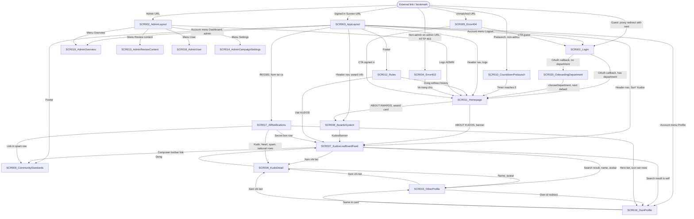
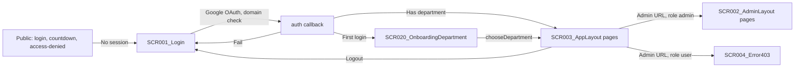

# Screen Flow

**Project**: SAA 2025 Kudos Platform
**Generated**: 2026-11-23
**Analysis Scope**: 20 SCR (18 URL trang, `app/not-found.tsx`, hai layout shell) và 7 REG trong `screen-list.md`; nguồn điều hướng là `shared/ui/app-routes.ts`, link/`router` trong `features/*/components`, `proxy.ts` cùng `shared/auth/*`

**Code Format**: All SCR codes MUST follow `SCR###_NameSlug` format (e.g., SCR001_LoginForm, SCR002_Dashboard) | `SCR###/REG###` for region-scoped transitions

## Navigation Map



## Feature Entry Points

{Populated by FS.1 researchers (feature-specs pass) AFTER feature-list.md exists. W2 ScreenFlow researcher leaves this section as the placeholder below — do NOT populate it during W2.}

<!-- Feature Entry Points: run /tkm:rebuild-spec --feature-specs to populate -->

{FS.1 researcher pattern: each FS.1 researcher emits a fragment file `plans/<active>/artifacts/_feature-entry-points/F###.md` (one file per feature, no write contention). After all FS.1 tasks complete, the orchestrator consolidates all fragment files into this section (FS.1.5).}

---

## Screen Access Paths

| From Screen | To Screen | Action/Trigger | Conditions | Region |
|-------------|-----------|----------------|------------|--------|
| START | SCR001_Login | Khách mở trang cần phiên, proxy chuyển tới `/login?next=` | Chưa có phiên | |
| START | SCR010_CountdownPrelaunch | Mở bất kỳ trang nào ngoài danh sách công khai | Trước `LAUNCH_AT` và không phải admin | |
| START | SCR011_Homepage | Mở `/` | Đã đăng nhập, có phòng ban, đã qua `LAUNCH_AT` (hoặc là admin) | |
| START | SCR004_Error403 | Mở `/admin/*` | Đã đăng nhập nhưng role không phải admin (proxy trả HTTP 403) | |
| START | SCR005_Error404 | Mở URL không khớp route nào | Không có | |
| SCR001_Login | SCR020_OnboardingDepartment | Hoàn tất OAuth tại `/auth/callback` | Hồ sơ chưa có phòng ban | |
| SCR001_Login | SCR011_Homepage | Hoàn tất OAuth tại `/auth/callback` | Đã có phòng ban và `next` rỗng | |
| SCR001_Login | START | Lỗi OAuth hoặc sai tên miền, quay lại `/login?error=` | Lỗi `domain_not_allowed` / `auth_failed` | |
| SCR020_OnboardingDepartment | SCR011_Homepage | Chọn phòng ban rồi gửi form | `departmentId` hợp lệ; `next` mặc định `/` | |
| SCR010_CountdownPrelaunch | SCR011_Homepage | Đồng hồ máy chủ về 0 (`router.replace`) | Proxy cho `/` qua (sau `LAUNCH_AT`) | |
| SCR010_CountdownPrelaunch | SCR001_Login | Mở `/login` | Khách; `/login` luôn công khai | |
| SCR011_Homepage | SCR008_AwardsSystem | Bấm ABOUT AWARDS hoặc thẻ giải `/awards#<slug>` | Không có | |
| SCR011_Homepage | SCR007_KudosLiveBoardFeed | Bấm ABOUT KUDOS hoặc banner Kudos | Không có | |
| SCR008_AwardsSystem | SCR007_KudosLiveBoardFeed | Bấm nút trong KudosBanner | Không có | |
| SCR012_Rules | SCR007_KudosLiveBoardFeed | Bấm "Viết KUDOS" | Không có | |
| SCR012_Rules | SCR011_Homepage | Bấm Đóng | Không có trang trước cùng origin để quay lại | |
| SCR003_AppLayout | SCR011_Homepage | Bấm logo hoặc mục Về SAA | Không có | |
| SCR003_AppLayout | SCR008_AwardsSystem | Bấm mục Thông tin giải | Không có | |
| SCR003_AppLayout | SCR007_KudosLiveBoardFeed | Bấm mục Sun* Kudos | Không có | |
| SCR003_AppLayout | SCR012_Rules | Bấm link Thể lệ ở footer | Không có | |
| SCR003_AppLayout | SCR009_CommunityStandards | Bấm link Tiêu chuẩn cộng đồng ở footer | Không có | |
| SCR003_AppLayout | SCR016_OwnProfile | Menu tài khoản › Profile | Không có | |
| SCR003_AppLayout | SCR019_AdminOverview | Menu tài khoản › Dashboard | Chỉ hiện với admin (cosmetic, quyền thật do proxy và layout kiểm) | |
| SCR003_AppLayout | SCR001_Login | Menu tài khoản › Logout (`signOut`) | Đăng xuất thành công | |
| SCR003_AppLayout | SCR017_AllNotifications | Bấm "Xem tất cả" trong dropdown chuông | Không có | SCR003_AppLayout/REG001_NotificationBell |
| SCR003_AppLayout | SCR006_KudoDetail | Bấm dòng thông báo nhận Kudo, tim, Kudo bị ẩn hoặc Kudos Quốc Dân | Dòng có `kudoId` | SCR003_AppLayout/REG001_NotificationBell |
| SCR003_AppLayout | SCR007_KudosLiveBoardFeed | Bấm dòng thông báo hộp quà (`/kudos?secretBox=open`) | Dòng loại `secret_box_granted` | SCR003_AppLayout/REG001_NotificationBell |
| SCR003_AppLayout | SCR016_OwnProfile | Bấm dòng thông báo lên bậc Hero hoặc đủ bộ icon | Dòng loại `hero_tier_up` / `icon_set_completed` | SCR003_AppLayout/REG001_NotificationBell |
| SCR007_KudosLiveBoardFeed | SCR006_KudoDetail | Bấm "Xem chi tiết" trên thẻ Kudo | Kudo công khai, hoặc spam của chính chủ | SCR007_KudosLiveBoardFeed/REG003_HighlightKudos |
| SCR007_KudosLiveBoardFeed | SCR006_KudoDetail | Bấm "Xem chi tiết" trên thẻ Kudo | Kudo công khai, hoặc spam của chính chủ | SCR007_KudosLiveBoardFeed/REG005_AllKudosFeed |
| SCR007_KudosLiveBoardFeed | SCR015_OtherProfile | Chọn một Sunner trong kết quả tìm | Không phải chính mình | SCR007_KudosLiveBoardFeed/REG002_SunnerProfileSearch |
| SCR007_KudosLiveBoardFeed | SCR016_OwnProfile | Chọn chính mình trong kết quả tìm | Ô tìm không loại chính mình (`excludeSelf=false`) | SCR007_KudosLiveBoardFeed/REG002_SunnerProfileSearch |
| SCR007_KudosLiveBoardFeed | SCR015_OtherProfile | Bấm tên người nhận trong đám mây Spotlight | Không có | SCR007_KudosLiveBoardFeed/REG004_SpotlightBoard |
| SCR007_KudosLiveBoardFeed | SCR015_OtherProfile | Bấm tên hoặc avatar người có tên trên thẻ Kudo | Người gửi không ẩn danh | SCR007_KudosLiveBoardFeed/REG005_AllKudosFeed |
| SCR007_KudosLiveBoardFeed | SCR009_CommunityStandards | Bấm link trong thanh công cụ của composer | Composer đang mở | SCR007_KudosLiveBoardFeed/REG001_KudoComposer |
| SCR006_KudoDetail | SCR007_KudosLiveBoardFeed | Bấm Đóng hoặc nút về Live board ở trạng thái 404 | Không có | |
| SCR006_KudoDetail | SCR015_OtherProfile | Bấm tên hoặc avatar người có tên | Người gửi không ẩn danh | |
| SCR015_OtherProfile | SCR016_OwnProfile | Mở `/profile/{userId}` | `userId` là chính mình (`redirect`) | |
| SCR015_OtherProfile | SCR006_KudoDetail | Bấm "Xem chi tiết" trên thẻ | Không có | |
| SCR015_OtherProfile | SCR007_KudosLiveBoardFeed | Bấm nút về Live board ở trạng thái 404 | `userId` sai định dạng hoặc không tồn tại | |
| SCR016_OwnProfile | SCR006_KudoDetail | Bấm "Xem chi tiết" trên thẻ | Không có | |
| SCR016_OwnProfile | SCR015_OtherProfile | Bấm tên người trong thẻ | Không phải chính mình | |
| SCR017_AllNotifications | SCR006_KudoDetail | Bấm dòng thông báo có `kudoId` | Không có | |
| SCR017_AllNotifications | SCR007_KudosLiveBoardFeed | Bấm dòng thông báo hộp quà | Dòng loại `secret_box_granted` | |
| SCR017_AllNotifications | SCR016_OwnProfile | Bấm dòng thông báo lên bậc Hero hoặc đủ bộ icon | Không có | |
| SCR017_AllNotifications | SCR009_CommunityStandards | Bấm link trong dòng Kudo bị ẩn | Dòng loại `kudo_hidden_spam` | |
| SCR002_AdminLayout | SCR019_AdminOverview | Bấm mục Overview, hoặc mở `/admin` (redirect) | Admin | |
| SCR002_AdminLayout | SCR013_AdminReviewContent | Bấm mục Review content | Admin | |
| SCR002_AdminLayout | SCR018_AdminUser | Bấm mục User | Admin | |
| SCR002_AdminLayout | SCR014_AdminCampaignSettings | Bấm mục Settings | Admin | |
| SCR002_AdminLayout | SCR011_Homepage | Bấm logo ADMIN | Không có | |
| SCR004_Error403 | SCR011_Homepage | Bấm "Về trang chủ" | Không có | |
| SCR005_Error404 | SCR011_Homepage | Bấm nút Home | Đã đăng nhập | |
| SCR005_Error404 | SCR001_Login | Bấm nút Login | Khách | |

> Region column: fill with `SCR###/REG###` for region-scoped transitions; leave blank for whole-screen transitions.

## Screen Transitions

### SCR001_Login (Login)

**Entry Points**:
- Khách mở bất kỳ trang bảo vệ: proxy chuyển tới `/login?next=<đường dẫn gốc>`
- Truy cập trực tiếp `/login` (luôn công khai, kể cả trước `LAUNCH_AT`)
- Từ `/auth/callback` khi OAuth hoặc kiểm tra tên miền lỗi: `/login?error=<code>`
- Từ SCR003_AppLayout: Logout

**Exit Points**:
- Tới SCR020_OnboardingDepartment: OAuth xong, chưa có phòng ban
- Tới `next` (mặc định SCR011_Homepage): OAuth xong, đã có phòng ban
- Tới SCR010_CountdownPrelaunch: trước `LAUNCH_AT`, người không phải admin đi tiếp

**Decision Points**:
- Đã có phiên: proxy đưa `/login` về `/` ngay, không hiện màn đăng nhập
- `/auth/callback` có `code`: đổi phiên rồi `completeLogin`; không có `code` hoặc lỗi → `/login?error=`

---

### SCR002_AdminLayout (AdminLayout)

**Entry Points**:
- Mọi URL `/admin/*` đã qua cổng proxy (admin)
- Từ SCR003_AppLayout: Dashboard

**Exit Points**:
- Tới SCR019_AdminOverview, SCR013_AdminReviewContent, SCR018_AdminUser, SCR014_AdminCampaignSettings: mục menu
- Tới SCR011_Homepage: logo ADMIN

**Decision Points**:
- Role không phải admin: proxy trả HTTP 403 với thân là SCR004_Error403; guard `requireShellAdmin()` là lớp thứ hai
- Guest: chuyển `/login?next=`

---

### SCR003_AppLayout (AppLayout)

**Entry Points**:
- Mọi URL Sunner (9 route) đã qua `requireSunner()`

**Exit Points**:
- Tới SCR011_Homepage, SCR008_AwardsSystem, SCR007_KudosLiveBoardFeed: header
- Tới SCR012_Rules, SCR009_CommunityStandards: footer
- Tới SCR017_AllNotifications: "Xem tất cả" trong dropdown chuông
- Tới SCR016_OwnProfile, SCR019_AdminOverview, SCR001_Login: menu tài khoản

**Decision Points**:
- Không có phiên: `/login`; chưa có phòng ban: `/onboarding/department?next=`; có phiên nhưng không có profile: HTTP 401 (không redirect để tránh vòng lặp với luật `/login` → `/`)
- Dòng thông báo chọn đích theo loại: Kudo/tim/Kudo bị ẩn/Quốc Dân → SCR006_KudoDetail; hộp quà → `/kudos?secretBox=open`; bậc Hero/bộ icon → SCR016_OwnProfile

---

### SCR004_Error403 (Error403)

**Entry Points**:
- Proxy fetch `/access-denied` để dựng thân HTTP 403 cho người không phải admin vào `/admin/*`
- Guard gọi `forbidden()` (cùng view qua `app/forbidden.tsx`)
- Truy cập trực tiếp `/access-denied` (trang tĩnh, status 200)

**Exit Points**:
- Tới SCR011_Homepage: "Về trang chủ"

**Decision Points**:
- Không có

---

### SCR005_Error404 (Error404)

**Entry Points**:
- URL không khớp route nào

**Exit Points**:
- Tới SCR011_Homepage: nút Home (đã đăng nhập)
- Tới SCR001_Login: nút Login (khách)

**Decision Points**:
- Có phiên → Home, không có phiên → Login (`getShellUser()`)

---

### SCR006_KudoDetail (KudoDetail)

**Entry Points**:
- Từ SCR007_KudosLiveBoardFeed: "Xem chi tiết"
- Từ SCR015_OtherProfile và SCR016_OwnProfile: "Xem chi tiết"
- Từ SCR017_AllNotifications và dropdown chuông: dòng thông báo
- Link chia sẻ `/kudos/{id}` (nút Copy Link)

**Exit Points**:
- Tới SCR007_KudosLiveBoardFeed: Đóng, hoặc nút về ở trạng thái 404
- Tới SCR015_OtherProfile hoặc SCR016_OwnProfile: bấm tên/avatar

**Decision Points**:
- Id sai định dạng, không có, hoặc spam của người khác: `notFound()` cùng một nội dung (soft 404, không lộ sự tồn tại)
- Đọc lỗi: hiện khối báo lỗi và link thử lại, không `notFound()`
- Spam của chính chủ: overlay mờ, không có tim và Copy Link, chỉ còn Đóng

---

### SCR007_KudosLiveBoardFeed (KudosLiveBoardFeed)

**Entry Points**:
- Từ SCR003_AppLayout: mục Sun* Kudos
- Từ SCR011_Homepage, SCR008_AwardsSystem, SCR012_Rules: nút/banner Kudos
- Từ SCR006_KudoDetail và SCR015_OtherProfile: Đóng, nút về ở trạng thái 404
- Từ thông báo hộp quà: `/kudos?secretBox=open` (mở modal Secret Box)

**Exit Points**:
- Tới SCR006_KudoDetail: "Xem chi tiết"
- Tới SCR015_OtherProfile hoặc SCR016_OwnProfile: kết quả tìm Sunner, tên/avatar, tên trong Spotlight
- Tới SCR009_CommunityStandards: link trong thanh công cụ composer

**Decision Points**:
- Mỗi vùng đọc lỗi riêng thành trạng thái lỗi cục bộ (xem Error Handling Flows), không làm hỏng cả trang
- Hết cửa sổ ghi (`EVENT_END_AT`): ô viết Kudo và tim bị khoá, server vẫn trả `WRITING_CLOSED`
- `?secretBox=open`: mở modal Secret Box; đóng modal thì xoá tham số bằng `history.replaceState` rồi `router.refresh()`

---

### SCR008_AwardsSystem (AwardsSystem)

**Entry Points**:
- Từ SCR003_AppLayout: mục Thông tin giải
- Từ SCR011_Homepage: ABOUT AWARDS hoặc thẻ giải `/awards#<slug>`

**Exit Points**:
- Tới SCR007_KudosLiveBoardFeed: KudosBanner

**Decision Points**:
- Hash `#<slug>` hợp lệ: cuộn tới khối giải; hash lạ: ở đầu trang

---

### SCR009_CommunityStandards (CommunityStandards)

**Entry Points**:
- Từ SCR003_AppLayout: footer
- Từ SCR007_KudosLiveBoardFeed: link trong composer
- Từ SCR017_AllNotifications và dropdown chuông: link trong dòng Kudo bị ẩn

**Exit Points**:
- Quay lại bằng điều hướng trình duyệt hoặc header/footer (trang không có nút riêng)

**Decision Points**:
- Không có

---

### SCR010_CountdownPrelaunch (CountdownPrelaunch)

**Entry Points**:
- Proxy cổng prelaunch: người không phải admin, trước `LAUNCH_AT`, mở trang ngoài danh sách công khai
- Truy cập trực tiếp `/countdown`

**Exit Points**:
- Tới SCR011_Homepage: đồng hồ về 0 (`router.replace`), hoặc proxy đưa `/countdown` về `/` sau `LAUNCH_AT`
- Tới SCR001_Login: khách vẫn vào được `/login`

**Decision Points**:
- Sau `LAUNCH_AT`: `/countdown` chuyển về `/` cho mọi người, kể cả khách
- Client chỉ rời trang khi đồng hồ theo giờ máy chủ về 0, nên không có vòng `/countdown` ↔ `/`

---

### SCR011_Homepage (Homepage)

**Entry Points**:
- Từ SCR003_AppLayout: logo và mục Về SAA
- Từ SCR001_Login, SCR020_OnboardingDepartment, SCR010_CountdownPrelaunch: đích mặc định
- Từ SCR004_Error403, SCR005_Error404, SCR002_AdminLayout, SCR012_Rules: nút về trang chủ

**Exit Points**:
- Tới SCR008_AwardsSystem: ABOUT AWARDS, thẻ giải
- Tới SCR007_KudosLiveBoardFeed: ABOUT KUDOS, banner

**Decision Points**:
- Trước `LAUNCH_AT`: người không phải admin không tới được `/` (proxy chuyển về `/countdown`)

---

### SCR012_Rules (Rules)

**Entry Points**:
- Từ SCR003_AppLayout: footer

**Exit Points**:
- Tới SCR007_KudosLiveBoardFeed: "Viết KUDOS"
- Quay lại trang trước hoặc tới SCR011_Homepage: Đóng

**Decision Points**:
- Đóng: có lịch sử và `document.referrer` cùng origin → `router.back()`; ngược lại → `router.push('/')`

---

### SCR013_AdminReviewContent (AdminReviewContent)

**Entry Points**:
- Từ SCR002_AdminLayout: mục Review content

**Exit Points**:
- Điều hướng khu admin qua SCR002_AdminLayout

**Decision Points**:
- Đổi bộ lọc, tìm kiếm, sắp xếp, trang: `router.replace` URL, giữ nguyên màn hình
- Tham số URL sai: báo lỗi lọc trên trang 1 chưa lọc
- Mark Spam / Un Spam: cập nhật dòng tại chỗ từ kết quả action, không tải lại trang

---

### SCR014_AdminCampaignSettings (AdminCampaignSettings)

**Entry Points**:
- Từ SCR002_AdminLayout: mục Settings

**Exit Points**:
- Điều hướng khu admin qua SCR002_AdminLayout

**Decision Points**:
- Add / Edit / Delete: mở hộp thoại (client-state, URL không đổi); thành công thì action `revalidatePath` và toast
- Campaign đã bị xoá (`NOT_FOUND`) hoặc đã kết thúc (`ENDED`): hộp thoại đóng, toast lỗi, bảng tải lại; chồng giờ (`OVERLAP`) và lỗi nhập liệu hiện ngay trong hộp thoại

---

### SCR015_OtherProfile (OtherProfile)

**Entry Points**:
- Từ SCR007_KudosLiveBoardFeed: ô tìm Sunner, tên trong Spotlight, tên/avatar trên thẻ
- Từ SCR006_KudoDetail và SCR016_OwnProfile: tên/avatar

**Exit Points**:
- Tới SCR016_OwnProfile: `userId` là chính mình
- Tới SCR006_KudoDetail: "Xem chi tiết"
- Tới SCR007_KudosLiveBoardFeed: nút về ở trạng thái 404

**Decision Points**:
- `userId` trùng người xem: `redirect('/profile')`; sai định dạng hoặc không có profile: `notFound()`
- Nút gửi Kudo mở composer với người nhận khoá sẵn (client-state)

---

### SCR016_OwnProfile (OwnProfile)

**Entry Points**:
- Từ SCR003_AppLayout: Profile
- Từ SCR015_OtherProfile: redirect khi mở id của mình
- Từ SCR017_AllNotifications và dropdown chuông: thông báo lên bậc Hero, đủ bộ icon

**Exit Points**:
- Tới SCR006_KudoDetail: "Xem chi tiết"
- Tới SCR015_OtherProfile: tên người trong thẻ

**Decision Points**:
- Chiều lọc KUDOS mặc định "Đã gửi"; đổi sang "Đã nhận" tải lại danh sách qua API (URL không đổi)
- Không có profile cho user của phiên: lỗi nội bộ (không phải 404)

---

### SCR017_AllNotifications (AllNotifications)

**Entry Points**:
- Từ SCR003_AppLayout: "Xem tất cả" trong dropdown chuông
- Truy cập trực tiếp `/notifications`

**Exit Points**:
- Tới SCR006_KudoDetail, SCR007_KudosLiveBoardFeed, SCR016_OwnProfile, SCR009_CommunityStandards: theo loại dòng thông báo

**Decision Points**:
- Bấm dòng chưa đọc: đánh dấu đã đọc optimistic rồi điều hướng; lỗi action thì hoàn tác
- "Đánh dấu đọc tất cả": gọi `markAllNotificationsRead`, chuông tắt chấm ngay

---

### SCR018_AdminUser (AdminUser)

**Entry Points**:
- Từ SCR002_AdminLayout: mục User

**Exit Points**:
- Điều hướng khu admin qua SCR002_AdminLayout

**Decision Points**:
- Đổi bộ lọc, tìm kiếm, sắp xếp, trang: `router.replace` URL
- Đổi role: hộp xác nhận; chặn tự hạ quyền, hạ admin env, hạ admin cuối cùng (thành công thì dòng cập nhật ngay và có toast; bị từ chối thì lỗi nằm trong hộp xác nhận)

---

### SCR019_AdminOverview (AdminOverview)

**Entry Points**:
- Từ SCR002_AdminLayout: mục Overview; `/admin` chuyển hướng về đây
- Từ SCR003_AppLayout: Dashboard của admin

**Exit Points**:
- Điều hướng khu admin qua SCR002_AdminLayout

**Decision Points**:
- Đổi khoảng ngày đủ cả hai đầu: `router.replace` URL; khoảng ngược bị từ chối ngay trong ô chọn
- URL có khoảng ngược hoặc sai định dạng: hiện lỗi lọc trên bảng toàn thời gian

---

### SCR020_OnboardingDepartment (OnboardingDepartment)

**Entry Points**:
- `requireSunner()` đưa người chưa có phòng ban tới `/onboarding/department?next=`
- Từ SCR001_Login: sau OAuth lần đầu

**Exit Points**:
- Tới `next` đã làm sạch (mặc định SCR011_Homepage): chọn phòng ban thành công

**Decision Points**:
- Khách: `/login?next=…`; không có profile: HTTP 401; đã có phòng ban: chuyển thẳng tới `next`

---

## Region Transitions

> Region transitions are typically client-state (no URL change); document only transitions that change user-visible state within the region or cross region boundary.

| From Region | To Target | Action/Trigger | Client-State Only |
|-------------|-----------|----------------|-------------------|
| SCR003_AppLayout/REG001_NotificationBell | NotificationPanel (dropdown) | Bấm chuông | Yes |
| SCR003_AppLayout/REG001_NotificationBell | SCR017_AllNotifications (full screen) | Bấm "Xem tất cả" | No (URL changes) |
| SCR003_AppLayout/REG001_NotificationBell | SCR006_KudoDetail (full screen) | Bấm dòng thông báo Kudo | No (URL changes) |
| SCR007_KudosLiveBoardFeed/REG001_KudoComposer | KudoComposerModal (modal, tạo mới) | Bấm ô "Hôm nay, bạn muốn gửi lời cảm ơn…" | Yes |
| SCR007_KudosLiveBoardFeed/REG003_HighlightKudos | KudoComposerModal (modal, sửa) | Bấm bút sửa trên thẻ của chính mình | Yes |
| SCR007_KudosLiveBoardFeed/REG005_AllKudosFeed | KudoComposerModal (modal, sửa) | Bấm bút sửa trên thẻ của chính mình | Yes |
| SCR007_KudosLiveBoardFeed/REG002_SunnerProfileSearch | SCR015_OtherProfile (full screen) | Chọn một Sunner | No (URL changes) |
| SCR007_KudosLiveBoardFeed/REG003_HighlightKudos | SCR006_KudoDetail (full screen) | Bấm "Xem chi tiết" | No (URL changes) |
| SCR007_KudosLiveBoardFeed/REG004_SpotlightBoard | SCR015_OtherProfile (full screen) | Bấm tên người nhận trong đám mây | No (URL changes) |
| SCR007_KudosLiveBoardFeed/REG004_SpotlightBoard | Chế độ toàn màn hình của bảng | Bấm nút fullscreen | Yes |
| SCR007_KudosLiveBoardFeed/REG005_AllKudosFeed | SCR006_KudoDetail (full screen) | Bấm "Xem chi tiết" | No (URL changes) |
| SCR007_KudosLiveBoardFeed/REG006_RewardsColumn | SecretBoxModal (modal) | Bấm "Mở Secret Box" hoặc mở `?secretBox=open` | Yes |

---

## Authentication Flow



| Screen | Authentication Required | Authorization Level |
|--------|------------------------|-------------------|
| SCR001_Login | No | Public (đã đăng nhập thì chuyển về `/`) |
| SCR002_AdminLayout | Yes | Admin |
| SCR003_AppLayout | Yes | Sunner (có phòng ban); trước `LAUNCH_AT` chỉ admin qua cổng prelaunch |
| SCR004_Error403 | No | Public (không cần phiên) |
| SCR005_Error404 | No | Public |
| SCR006_KudoDetail | Yes | Sunner |
| SCR007_KudosLiveBoardFeed | Yes | Sunner |
| SCR008_AwardsSystem | Yes | Sunner |
| SCR009_CommunityStandards | Yes | Sunner |
| SCR010_CountdownPrelaunch | No | Public (sau `LAUNCH_AT` chuyển về `/`) |
| SCR011_Homepage | Yes | Sunner |
| SCR012_Rules | Yes | Sunner |
| SCR013_AdminReviewContent | Yes | Admin |
| SCR014_AdminCampaignSettings | Yes | Admin |
| SCR015_OtherProfile | Yes | Sunner |
| SCR016_OwnProfile | Yes | Sunner |
| SCR017_AllNotifications | Yes | Sunner |
| SCR018_AdminUser | Yes | Admin |
| SCR019_AdminOverview | Yes | Admin |
| SCR020_OnboardingDepartment | Yes | Có phiên, chưa có phòng ban |

---

## Error Handling Flows

| Screen | Error | Handling | Scope |
|--------|-------|----------|-------|
| SCR001_Login | Tên miền email không được phép | Banner `domain_not_allowed` | screen |
| SCR001_Login | OAuth hoặc đổi phiên lỗi | Đăng xuất phiên dở, về `/login?error=auth_failed` | screen |
| SCR003_AppLayout | Phiên hết hạn hoặc thiếu | `requireSunner()` và proxy chuyển `/login?next=` (API trả 401 JSON) | screen |
| SCR003_AppLayout | Prelaunch, người không phải admin | Chuyển `/countdown` (action và API trả JSON 403 `prelaunch`) | screen |
| SCR003_AppLayout | Đọc số chưa đọc lỗi | Không hiện chấm; chuông đọc lại khi kênh Realtime join | region:REG001 |
| SCR003_AppLayout | Kênh Realtime rớt | Supabase tự nối lại, mỗi lần SUBSCRIBED yêu cầu đồng bộ lại; offline đóng kênh, online mở kênh mới | region:REG001 |
| SCR004_Error403 | Người không phải admin vào khu admin | Proxy trả HTTP 403 với thân là trang này | screen |
| SCR005_Error404 | URL không tồn tại | Hiện trang 404 với nút Home hoặc Login | screen |
| SCR006_KudoDetail | Id sai, không có, spam của người khác | `notFound()` → KudoNotFound (một nội dung chung) | screen |
| SCR006_KudoDetail | Đọc Kudo lỗi | Khối `role="alert"` kèm link thử lại | screen |
| SCR007_KudosLiveBoardFeed | Đọc feed lỗi | Thông báo lỗi trong vùng kèm thử lại; cursor bị từ chối (400) thì bắt đầu lại sau trang đầu | region:REG005 |
| SCR007_KudosLiveBoardFeed | Đọc Highlight lỗi | Thông báo lỗi trong vùng kèm thử lại, bộ lọc vẫn dùng được | region:REG003 |
| SCR007_KudosLiveBoardFeed | Đọc lựa chọn lọc hashtag/phòng ban lỗi | Dropdown rỗng, trang vẫn dùng được | region:REG003 |
| SCR007_KudosLiveBoardFeed | Đọc snapshot Spotlight lỗi | `SpotlightLoadError` kèm thử lại (tải phía client) | region:REG004 |
| SCR007_KudosLiveBoardFeed | Kênh Spotlight thất bại 5 lần liên tiếp | Gỡ kênh, hiện nhãn mất kết nối cùng nút thử lại | region:REG004 |
| SCR007_KudosLiveBoardFeed | Đọc cột phần thưởng lỗi | Từng panel hiện lỗi riêng với thử lại (`router.refresh()`) | region:REG006 |
| SCR007_KudosLiveBoardFeed | Mở Secret Box lỗi mạng, 5xx, 401 | Thông báo `openFailed` / `sessionExpired`; lần bấm kế dùng lại cùng Idempotency-Key | region:REG006 |
| SCR007_KudosLiveBoardFeed | Hết cửa sổ ghi | Ô viết Kudo bị khoá kèm thông báo `WRITING_CLOSED`; server vẫn trả `WRITING_CLOSED` | region:REG001 |
| SCR007_KudosLiveBoardFeed | Gửi Kudo lỗi (validation, tự gửi cho mình, ảnh) | Lỗi hiện trong composer, không đóng modal, giữ nội dung | region:REG001 |
| SCR007_KudosLiveBoardFeed | Thả tim lỗi | `KudoHeartErrorToast` và hoàn tác tim optimistic | screen |
| SCR015_OtherProfile | `userId` sai định dạng hoặc không có | `notFound()` → SunnerNotFound với nút về Live board | screen |
| SCR016_OwnProfile | Đọc danh sách Kudo lỗi | Lỗi cục bộ kèm thử lại; thiếu huy hiệu hoặc icon thì bỏ hàng đó chứ không hỏng trang | screen |
| SCR017_AllNotifications | Tải danh sách hoặc tải thêm lỗi | Trạng thái lỗi trong danh sách kèm thử lại | screen |
| SCR013_AdminReviewContent | Đọc bảng lỗi | `AdminLoadErrorPanel` kèm thử lại | screen |
| SCR013_AdminReviewContent | Tham số URL sai | Lỗi lọc trên trang 1 chưa lọc | screen |
| SCR013_AdminReviewContent | Mark Spam / Un Spam lỗi | Toast `moderation.failed` hoặc `moderation.notFound` | screen |
| SCR013_AdminReviewContent | Xuất CSV lỗi (kể cả server từ chối quá `EXPORT_MAX_ROWS` bằng 422 `export_too_large`) | Toast lỗi chung `failed`, nút xuất mở khoá lại | screen |
| SCR014_AdminCampaignSettings | Đọc danh sách lỗi | Trạng thái lỗi E14 kèm link tải lại | screen |
| SCR014_AdminCampaignSettings | Campaign đã xoá hoặc đã kết thúc (`NOT_FOUND`, `ENDED`) | Đóng hộp thoại, toast lỗi theo mã `errors.<code>`, bảng tải lại | screen |
| SCR014_AdminCampaignSettings | Chồng giờ (`OVERLAP`), nhập sai | Lỗi hiện trong hộp thoại, không đóng | screen |
| SCR018_AdminUser | Đọc bảng lỗi | `AdminLoadErrorPanel` kèm thử lại | screen |
| SCR018_AdminUser | Đọc lựa chọn Unit lỗi | Dropdown rỗng, bảng vẫn dùng được | screen |
| SCR018_AdminUser | Server từ chối đổi role (`SELF_DEMOTE`, `LAST_ADMIN`, `ENV_ADMIN`, `NOT_FOUND`, `FORBIDDEN`) | Lỗi `roleErrors.*` hiện trong hộp xác nhận và hộp không đóng; menu đã khoá sẵn cho chính mình và admin env | screen |
| SCR019_AdminOverview | Đọc số liệu lỗi | `AdminLoadErrorPanel` kèm thử lại | screen |
| SCR018_AdminUser | Lỗi render bất ngờ | `error.tsx` hiện thông báo kèm nút thử lại | screen |
| SCR019_AdminOverview | Lỗi render bất ngờ | `error.tsx` hiện thông báo kèm nút thử lại | screen |
| SCR020_OnboardingDepartment | Phòng ban không hợp lệ | Thông báo `invalid_department` dưới nhóm radio | screen |

> Scope values: `screen` (affects entire screen) | `region:REG###` (error contained within the named region).

---

## Circular Dependencies Check

- [x] Không có vòng lặp chuyển hướng tự động: các redirect (`/login` → `/` khi đã đăng nhập, `requireSunner` → `/onboarding/department` → `next`, prelaunch `/countdown` ↔ `/`) đều một chiều và có điều kiện dừng; trường hợp có phiên nhưng không có profile trả 401 thay vì redirect để không tạo vòng với luật `/login` → `/`
- [x] Mọi screen có ít nhất một đường vào và một đường ra (SCR009, SCR013, SCR014, SCR018, SCR019 thoát qua header/footer hoặc khung admin)
- [x] Mọi đường điều hướng đều kết thúc: các liên kết quay lại do người dùng chủ động (SCR006 → SCR007 rồi SCR007 → SCR006, SCR015 ↔ SCR016) là vòng có chủ đích, không phải phụ thuộc vòng

---

## Guard Logic

Route guards chặn điều hướng để áp điều kiện ngoài đăng nhập: nạp dữ liệu bắt buộc, kiểm quyền, luật nghiệp vụ. Mỗi guard dưới đây đang chạy trên route thật.

### GUARD-001 — SessionRequired on mọi đường dẫn không công khai
**trigger:** `middleware` (Next 16 `proxy.ts` → `runSessionProxy`, bước 4)
**source:** `shared/auth/route-access-policy.ts:29`
**logic:**
```pseudo
if (isPublicPath(path)) → pass            // /login, /auth/callback, /countdown, /access-denied, 2 endpoint /api/internal
if (isSignedIn) → pass
if (path startsWith /api/) → 401 JSON { code: unauthorized }
else → redirect /login?next=<path+search>
```
**failure path:** khách → `/login?next=<đường dẫn gốc>`; API → 401 JSON

---

### GUARD-002 — SignedInLoginRedirect on /login
**trigger:** `middleware` (`runSessionProxy`, bước 3)
**source:** `shared/auth/route-access-policy.ts:32`
**logic:**
```pseudo
if (path == /login && isSignedIn) → redirect /
```
**failure path:** người đã đăng nhập không bao giờ thấy SCR001_Login

---

### GUARD-003 — AdminOnly on /admin pages
**trigger:** `middleware` (`runSessionProxy`, bước 4b) + `requireShellAdmin()` ở layout + `requireAdmin()` ở page và action
**source:** `shared/auth/session-proxy.ts:108`
**logic:**
```pseudo
if (isAdminPath(path) && profile.role != admin) {
  if (GET/HEAD and not a Server Action) → HTTP 403 with body of /access-denied
  else → JSON 403 { code: forbidden }
}
// layout/page/action: requireAdmin() → guest → redirect /login ; non-admin → forbidden()
```
**failure path:** trang → SCR004_Error403 (status 403); action và API → JSON 403; role đọc từ DB ở mỗi request

---

### GUARD-004 — PrelaunchGate on mọi đường dẫn
**trigger:** `middleware` (`runSessionProxy`, bước 5)
**source:** `features/awards-portal/server/prelaunch-gate.ts:56`
**logic:**
```pseudo
if (now >= LAUNCH_AT) → /countdown (page load) redirects to / ; else pass
if (isPublicPath(path)) → pass
if (signed in and role == admin) → pass
if (page load) → redirect /countdown
else → JSON 403 { code: prelaunch }
```
**failure path:** trang → `/countdown`; Server Action và `/api/*` → JSON 403; `LAUNCH_AT` tính theo giờ máy chủ ở mỗi request

---

### GUARD-005 — RequireSunner on nhóm route (app)
**trigger:** `layout` (`app/(app)/layout.tsx`) + gọi lại ở từng page và action
**source:** `shared/auth/current-user.ts:48`
**logic:**
```pseudo
if (!session) → redirect /login
if (!profile) → 401 unauthorized()          // không redirect, tránh vòng /login ↔ /
if (!profile.departmentId) → redirect /onboarding/department
```
**failure path:** khách → `/login`; chưa chọn phòng ban → SCR020_OnboardingDepartment; không có profile → HTTP 401

---

### GUARD-006 — OnboardingState on /onboarding/department
**trigger:** `page` (server component)
**source:** `app/onboarding/department/page.tsx:29`
**logic:**
```pseudo
if (!user) → redirect /login?next=<onboarding path>
if (!profile) → 401 unauthorized()
if (profile.departmentId) → redirect next
```
**failure path:** khách → `/login`; đã onboard → `next`

---

### GUARD-007 — OwnProfileRedirect on /profile/:userId
**trigger:** `page` (server component)
**source:** `app/(app)/profile/[userId]/page.tsx:33`
**logic:**
```pseudo
if (userId == viewerId) → redirect /profile
data = loadProfilePageData(viewerId, userId)
if (!data) → notFound()                      // uuid sai hoặc không có profile
```
**failure path:** id của mình → SCR016_OwnProfile; id sai/không có → SunnerNotFound (soft 404)

---

### GUARD-008 — KudoVisibility on /kudos/:id
**trigger:** `page` (server component)
**source:** `app/(app)/kudos/[id]/page.tsx:48`
**logic:**
```pseudo
kudo = findForViewer(id, viewerId)           // uuid sai, không có, spam của người khác → null
if (kudo == null) → notFound()               // cùng nội dung cho mọi nguyên nhân
if (read failed) → inline error with retry
```
**failure path:** KudoNotFound (soft 404, không lộ sự tồn tại); đọc lỗi → khối báo lỗi, không 404

---

### GUARD-009 — AdminIndexRedirect on /admin
**trigger:** `page` (server component)
**source:** `app/admin/page.tsx:5`
**logic:**
```pseudo
redirect /admin/overview
```
**failure path:** không có (chỉ chuyển hướng; proxy bước 4b vẫn chạy trước)

---

### GUARD-010 — InternalJobSecret on ROUTE005 và ROUTE006
**trigger:** `route handler` (`POST /api/internal/notifications/drain`, `POST /api/internal/secret-box/tick`)
**source:** `app/api/internal/notifications/drain/route.ts:16`, `app/api/internal/secret-box/tick/route.ts:17`
**logic:**
```pseudo
secret = header x-drain-secret | x-job-secret        // so SHA-256 + timingSafeEqual
if (env secret not set) → 503 { code: not_configured }
if (secret mismatch) → 401 { code: unauthorized }
```
**failure path:** 503 `not_configured` hoặc 401 `unauthorized`; hai đường dẫn này nằm trong danh sách công khai của proxy nên chỉ guard này bảo vệ

---

## Deep-Link State Restoration

Các màn khôi phục trạng thái UI không tầm thường từ URL khi truy cập thẳng (bookmark, link chia sẻ, tải lại).

### SCR001_Login
**URL pattern:** `/login?next={path}&error={code}`
**State restored:**

| Param | Restores | Default if missing |
|-------|----------|--------------------|
| next | Đường dẫn quay lại sau OAuth (`safeNextPath`) | `/` |
| error | Banner lỗi đăng nhập | không có banner |

**Failure mode:** `next` ngoài whitelist (`safeNextPath`) hoặc `error` lạ bị bỏ qua; `app/(public)/login/page.tsx:26`

---

### SCR020_OnboardingDepartment
**URL pattern:** `/onboarding/department?next={path}`
**State restored:**

| Param | Restores | Default if missing |
|-------|----------|--------------------|
| next | Đích sau khi chọn phòng ban | `/` |

**Failure mode:** `next` không an toàn bị `safeNextPath` thay bằng `/`

---

### SCR007_KudosLiveBoardFeed
**URL pattern:** `/kudos?secretBox=open`
**State restored:**

| Param | Restores | Default if missing |
|-------|----------|--------------------|
| secretBox | Modal Secret Box (REG006) tự mở | modal đóng |

**Failure mode:** giá trị khác `open` bị bỏ qua; đóng modal xoá tham số bằng `history.replaceState` (`features/secret-box-rewards/components/secret-box-launcher.tsx:40`)

---

### SCR008_AwardsSystem
**URL pattern:** `/awards#{slug}`
**State restored:**

| Param | Restores | Default if missing |
|-------|----------|--------------------|
| hash slug | Cuộn tới khối giải và đánh dấu mục menu neo (`top-talent`, `top-project`, `top-project-leader`, `best-manager`, `signature-2025-creator`, `mvp`) | đầu trang |

**Failure mode:** hash lạ không khớp `id` nào nên trang đứng ở đầu

---

### SCR013_AdminReviewContent
**URL pattern:** `/admin/review?page={n}&sort={s}&status={s}&sender={uuid}&receiver={uuid}&from={date}&to={date}&q={text}`
**State restored:**

| Param | Restores | Default if missing |
|-------|----------|--------------------|
| page | Vị trí phân trang | 1 |
| sort | Sắp xếp theo tim (`newest`, `hearts_desc`, `hearts_asc`) | `newest` |
| status | Bộ lọc trạng thái (public/spam) | tất cả |
| sender, receiver | Người gửi, người nhận đã chọn (nhãn tra lại qua `resolveSelectedPeople`) | không lọc |
| from, to | Khoảng ngày | không lọc |
| q | Ô tìm theo nội dung (tối đa 200 ký tự) | rỗng |

**Failure mode:** khoá lặp, uuid/ngày/trạng thái/sort sai, trang < 1 hoặc `q` quá dài → `filterError` trên trang 1 chưa lọc (`app/admin/review/page.tsx:42`)

---

### SCR018_AdminUser
**URL pattern:** `/admin/users?page={n}&unit={id}&level={tier}&role={r}&q={text}&sort={col}&dir={asc|desc}`
**State restored:**

| Param | Restores | Default if missing |
|-------|----------|--------------------|
| page | Vị trí phân trang | 1 |
| unit | Bộ lọc phòng ban (`none` = chưa gán) | tất cả |
| level | Bộ lọc bậc Hero | tất cả |
| role | Bộ lọc role | tất cả |
| q | Tìm theo tên hoặc email (tối đa 100 ký tự) | rỗng |
| sort, dir | Cột và chiều sắp xếp | thứ tự cố định tên A–Z rồi id; `dir` mặc định `desc` |

**Failure mode:** khoá lặp hoặc giá trị ngoài whitelist → `filterError`; `q` quá dài → `query_too_long`; đều hiện trên trang 1 chưa lọc (`app/admin/users/page.tsx:46`)

---

### SCR019_AdminOverview
**URL pattern:** `/admin/overview?from={date}&to={date}`
**State restored:**

| Param | Restores | Default if missing |
|-------|----------|--------------------|
| from, to | Khoảng ngày của bảng (nửa mở theo `ADMIN_TIMEZONE`); thiếu một đầu là không giới hạn | toàn thời gian |

**Failure mode:** khoảng ngược → `invalid_date_range`; sai định dạng, ngày không tồn tại hoặc lặp khoá → `invalid_params`; bảng toàn thời gian kèm lỗi lọc (`app/admin/overview/page.tsx:41`)

---

### SCR006_KudoDetail
**URL pattern:** `/kudos/{id}`
**State restored:**

| Param | Restores | Default if missing |
|-------|----------|--------------------|
| id (path) | Kudo cần đọc | không có (route bắt buộc id) |

**Failure mode:** id sai, không có hoặc spam của người khác → `notFound()`

---

### SCR015_OtherProfile
**URL pattern:** `/profile/{userId}`
**State restored:**

| Param | Restores | Default if missing |
|-------|----------|--------------------|
| userId (path) | Hồ sơ cần xem | không có (route bắt buộc id) |

**Failure mode:** id của mình → `redirect('/profile')`; id sai định dạng hoặc không có → `notFound()`

---

## Unsaved-Changes Protection

Các form cảnh báo trước khi bỏ nội dung đang nhập. Trang không dùng `beforeunload` hay `useBeforeUnload`; chỉ có bảo vệ khi đóng modal.

### KudoComposerModal (SCR007_KudosLiveBoardFeed/REG001_KudoComposer)
**trigger:** `modal close handler` (Esc hoặc nút "Hủy" qua `requestClose`; bấm lớp nền không đóng)
**source:** `features/kudos-authoring/components/kudo-composer-dialog.tsx:51`
**dirty detection:** so sánh giá trị và ảnh với trạng thái ban đầu (`sameValues` / `sameImages`), tắt khi composer đang khoá; `features/kudos-authoring/components/use-kudo-composer-form-state.ts:85`
**prompt:** "Bỏ nội dung đang soạn? — Nội dung bạn đã nhập sẽ không được lưu." (nút "Tiếp tục soạn" / "Bỏ nội dung"; bản en: "Discard your draft? — What you have written will not be saved.")

---

*Các form khác (đăng nhập, chọn phòng ban, hộp Add/Edit Campaign, đổi role) không có bảo vệ thay đổi chưa lưu: `N/A — no unsaved-changes guards detected.`*

---

## Extraction Signatures

Framework-agnostic identifier patterns for locating the above constructs.

### Guard Logic
Function/method definitions tied to a route: `beforeEnter|canActivate|middleware|loader|before_action|authenticate|authorize` — check if called from a router config or route registration.

### Deep-Link State Restoration
URL param reads at component mount synced to state: `useSearchParams|useQuery|router\.query|URLSearchParams|params\[|$route\.query` — look for these at top of component with corresponding `setState` or reactive assignment.

### Unsaved-Changes Protection
`beforeunload|onbeforeunload|usePrompt|useBeforeUnload|leaveGuard|isDirty|formState\.isDirty|data-turbo-confirm` — presence confirms protection; absence is a potential gap to flag.
