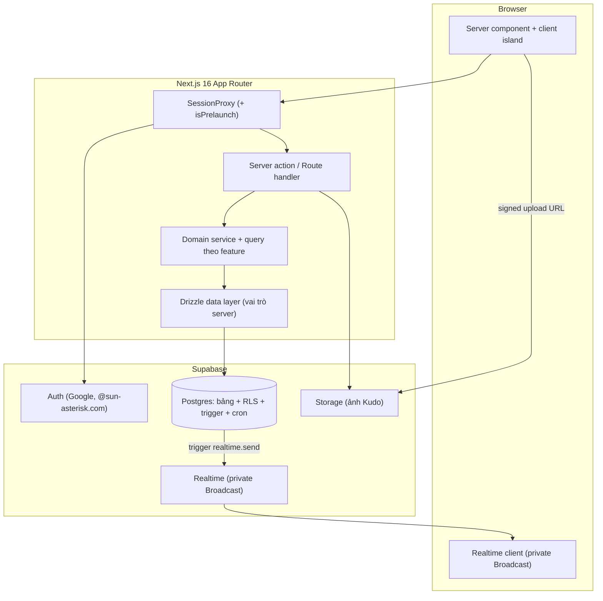

# Architecture

> Bản nháp forward-authored cho hệ thống SAA 2025 (Cổng giải thưởng + Sun* Kudos + gamification + Admin). Chỉ chứa phần mô tả cấu trúc; lý do chọn kiến trúc thuộc về ADR (do con người sở hữu), không nằm ở đây. Mọi mã `MODEL###`, `ROUTE###`, `BL###`, `PERM###`, `SCR###`, `US###` = `TBD (draft)`, sẽ được cấp ở bước reconcile. Mã `F###` là tạm (PROVISIONAL).
> F013_Notifications: đã đọc `notifications/technical-spec.md`; `functional-spec.md` của F013 chưa có trong thư mục tại thời điểm viết nên các chi tiết chỉ nằm ở functional-spec được đánh dấu `[INFERRED]`.

## System Architecture

Web only (desktop + responsive), một ứng dụng Next.js duy nhất. Không có API gateway riêng, không có dịch vụ nền tách rời: logic miền chạy trong tiến trình Next.js (server component, server action, route handler) và trong Postgres (trigger, hàm, cron).



### Layers

| Layer | Trách nhiệm | Quy tắc |
|-------|-------------|---------|
| Pages / Server Components (`app/`) | Dựng trang, nạp dữ liệu ban đầu bằng gọi thẳng query của feature; client island chỉ cho phần tương tác (tim, modal, carousel, chuông, Spotlight) | Không chứa SQL; chữ lấy từ next-intl (cookie locale, không tiền tố URL) |
| Entry: `SessionProxy`, server action, route handler | Xác thực session, kiểm Zod, kiểm quyền (`AdminGuard#requireAdmin` cho khu Admin), map lỗi sang mã HTTP | `userId` luôn lấy từ session, không từ body/path/query; mọi mutation kiểm lại ở server dù client đã kiểm |
| Domain service / query (theo feature) | Quy tắc nghiệp vụ, giao dịch, truy vấn dùng chung (vd. `KudoPublicQuery`, `HeartStatsQuery`) | Mỗi feature chỉ ghi bảng của mình; đọc bảng feature khác qua query/hàm đã công bố ở mục Cross-Feature Contracts |
| Drizzle data layer | Schema TS, migration (drizzle-kit + SQL viết tay cho `EXCLUDE`, trigger, policy `realtime.messages`), truy vấn | Chạy bằng vai trò server nên bỏ qua RLS: phân quyền và che dữ liệu nằm ở tầng server (xem `permissions.md`) |
| Supabase services | Auth, Postgres, Realtime, Storage | RLS bật ở mọi bảng nghiệp vụ, không có policy ghi cho client |

Bố cục thư mục/tệp: xem `docs/code-standards.md` (chốt ở phase 01; AGENTS.md yêu cầu đọc `node_modules/next/dist/docs/` trước khi code vì Next.js 16 có thay đổi phá vỡ).

Tiến trình nền (không có FE): trigger Postgres (`auth.users` của F001: chặn domain khi INSERT và khi đổi email, tạo hồ sơ, đồng bộ email; phát Spotlight của F008; `notify_realtime` của F013), bộ xử lý outbox (F013 A1, kích hoạt sau commit và quét định kỳ), job chốt Kudos Quốc Dân (F010 A7, cron bằng khoá dịch vụ). Cơ chế kích hoạt cron (`pg_cron` / Vercel Cron / Edge Function): `TBD (draft)`.

## Session proxy và cổng truy cập (F001, đã implement ở phase 02)

Next.js 16 gọi lớp này là Proxy. `proxy.ts` chỉ khai báo `matcher` và gọi `runSessionProxy()` trong `shared/auth/session-proxy.ts`. Matcher loại `_next/static/`, `_next/image`, `images/`, `fonts/`, `favicon.ico`, `robots.txt`, `sitemap.xml`; không loại theo đuôi file, nên Route Handler như `/api/admin/export.xml` vẫn qua cổng. Server action là POST tới đường dẫn trang nên cũng được phủ.

Thứ tự bước cố định cho mọi request khớp matcher:

| Bước | Việc | Kết quả |
|------|------|---------|
| 2 | Làm mới session Supabase, xác thực bằng `getUser()` (hỏi Supabase Auth, không chỉ kiểm chữ ký JWT). Auth không trả lời: coi như chưa đăng nhập | Cookie mới đi theo cả request lẫn response |
| 3 | Đường dẫn công khai (`/login`, `/auth/callback`, `/countdown`, `/access-denied`) đi tiếp; đã đăng nhập mà vào `/login` thì về `/` | `decideRouteAccess()` trong `route-access-policy.ts`, hàm thuần |
| 4 | Chưa có session, đường dẫn được bảo vệ: chuyển `/login?next=<đường dẫn>`; đường dẫn `/api/` trả JSON 401 `{ code: "unauthorized" }` | Redirect/401 vẫn mang cookie vừa làm mới |
| 4b | Đã đăng nhập, vào `/admin/*`, `profiles.role` khác `admin` (hoặc không có profile): 403 | Xem dưới |
| 5 | Cổng prelaunch (phase 07, xem mục "Cổng prelaunch" bên dưới): trước `LAUNCH_AT`, người đã đăng nhập không phải Admin ngoài danh sách cho phép bị chuyển `/countdown` (action/API: JSON 403 `{ code: "prelaunch" }`); từ `LAUNCH_AT`, `/countdown` chuyển `/` | `prelaunchGateStep` (`features/awards-portal/server/prelaunch-gate-step.ts`) gọi hàm thuần `decidePrelaunchRoute`; chạy cho cả khách và đường công khai |

Role chỉ đọc DB (một lần mỗi request, memoized) khi vào `/admin/*` hoặc khi đang prelaunch trên đường bị chặn của người đã đăng nhập; request khác, và mọi request sau `LAUNCH_AT`, không tốn truy vấn DB. Onboarding (chưa chọn phòng ban) nằm ở `requireSunner()` chứ không ở proxy.

### 403 của khu Admin do proxy trả

Dưới Cache Components, server gửi shell status 200 trước khi `forbidden()` trong layout kịp chạy, và Next đặt lại status 200 cho proxy rewrite. Vì vậy proxy tự dựng response (`shared/auth/access-denied-response.ts`):

- Trang tải (GET/HEAD, không có header `next-action`): proxy fetch `/access-denied` từ `INTERNAL_APP_ORIGIN` (tùy chọn; chỉ origin http/https) hoặc `http://127.0.0.1:$PORT`, rồi trả HTML đó với status 403, `cache-control: private, no-store`. Chỉ cookie locale và `Accept-Language` được chuyển đi, không có cookie session. `redirect: "manual"`, timeout 5 giây. Fetch lỗi: vẫn 403, body text thuần, ghi log.
- Non-GET hoặc server action: JSON 403 `{ code: "forbidden" }`.
- Origin của fetch không bao giờ lấy từ `Host` hay `x-forwarded-*` (chống SSRF). Hosting phải cho server tự gọi được origin nội bộ này; phase 07 phải cho khách vào `/access-denied`.

`app/forbidden.tsx` (khi guard gọi `forbidden()`, bật bằng `authInterrupts: true` trong `next.config.ts`) và `app/access-denied` dùng chung `ForbiddenPanel`. Kiểm status thật bằng `npm run build` rồi `npm run test:prod`.

### Hai lớp kiểm session

`getUser()` chạy ở cả proxy lẫn trang (`getSessionUser()` trong `shared/auth/current-user.ts`, memoized theo lượt render). Có chủ đích: proxy chỉ là lớp lạc quan, còn mỗi page/action tự gọi `requireSunner()` hoặc `requireAdmin()`; hai bên cùng dùng `getUser()` để không lệch nhau và gây vòng lặp `/login` ↔ `/`. Session có user nhưng không có profile: `requireSunner()` trả 401 (`unauthorized()`).

### Cổng domain trên `auth.users` (migration `0005_auth_user_triggers.sql`)

Một vị từ duy nhất `public.is_sunner_email()` (domain `@sun-asterisk.com`), hai lớp chặn:

1. Auth hook `before_user_created` (`public.before_user_created_hook`): từ chối với message `domain_not_allowed`, nên `/auth/callback` nhận được `error_description` đủ để phân biệt với lỗi hệ thống. Bật trong `supabase/config.toml` cho local; hosted phải bật cùng hook trong dashboard.
2. Trigger chốt chặn, vẫn từ chối nếu hook chưa bật (lúc đó chỉ ra lỗi chung `auth_failed`): `reject_foreign_domain_on_insert` (BEFORE INSERT) và `reject_foreign_domain_on_email_change` (BEFORE UPDATE, chỉ khi `NEW.email IS DISTINCT FROM OLD.email`). Update không đổi email không kiểm lại, nên tài khoản có sẵn ngoài domain không bị khóa khi GoTrue ghi lại các cột khác.

Sau đó: `create_sunner_profile` (AFTER INSERT, `ON CONFLICT DO NOTHING`) tạo `profiles` lần đăng nhập đầu; `sync_profile_email` (AFTER UPDATE khi email đổi) giữ `profiles.email` khớp `auth.users.email`. Mọi hàm đặt `search_path` rỗng và thu hồi `EXECUTE` của `PUBLIC`, `anon`, `authenticated`.

## Ghi Kudo (F003, đã implement ở phase 04)

Hợp đồng đầy đủ (mã lỗi, shape input, phạm vi cú pháp Markdown cho renderer phase 05): `plans/261108-0048-saa-2025-kudos-platform/research/phase-04-backend-contracts.md`.

| Điểm vào | Vai trò | Lỗi chính |
|----------|---------|-----------|
| `createKudo(input)` (server action) | Một transaction: `kudos` + `kudo_hashtags` + `kudo_images` + outbox `KudoCreated { kudoId }`; `sender_id` từ session | `WRITING_CLOSED`, `MISSING_REQUIRED`, `VALIDATION`, `SELF_SEND`, `RECIPIENT_INVALID`, `HASHTAG_INVALID`, `IMAGE_INVALID` |
| `updateKudo(kudoId, input)` (server action) | Một `UPDATE` có điều kiện (chủ bài và `status = 'public'`), thay tập hashtag/ảnh; không đổi người nhận, không phát event | `FORBIDDEN` (403), `SPAM_LOCKED` (423), `NOT_FOUND`, `WRITING_CLOSED` |
| `GET /api/sunners/search?q&limit&excludeSelf` | Tìm người nhận / người được nhắc | 400 `VALIDATION`, 401, 403 `ONBOARDING_REQUIRED` |
| `GET /api/hashtags` | Hashtag đang hoạt động, nhãn theo locale | 401, 403 |
| `POST /api/kudos/images/sign` | Cấp signed upload URL; ghi `kudo_image_uploads` | 413 (body > 4 KB), 429 `UPLOAD_LIMIT` (20 lượt chưa dùng / người / 24 giờ), 403 `WRITING_CLOSED` |
| `GET /api/kudos/{id}/edit` | Nạp dữ liệu sửa, `Cache-Control: private, no-store`; `locked: true` khi Kudo là spam | 403 `FORBIDDEN`, 404 `NOT_FOUND` |

- **Cửa ghi mở trong `LAUNCH_AT ≤ now < EVENT_END_AT`** (`isEventWritingOpen`, `shared/config/event-window.ts`; cận `LAUNCH_AT` thêm ở phase 07): hai action và route ký ảnh tự kiểm lại mỗi lần gọi (`isEventWritingOpen`); `isKudoWritingOpen()` chỉ để server component truyền `writingOpen` cho `KudoComposerLauncher`.
- **Route handler tự gác cổng bằng `requireApiSunner()`** (trả JSON 401/403, không redirect); proxy chỉ là lớp lạc quan. Body lỗi chỉ có `{ code, fieldErrors? }`, không chứa nội dung Kudo.
- **Ảnh**: trình duyệt xin URL ký, tải thẳng lên bucket `kudo-images`, rồi gửi `imagePaths`. Khi ghi, server chỉ nhận đường dẫn mà chính người đó đã ký và object đã tồn tại. Đường dẫn không chứa id người gửi (Kudo ẩn danh không lộ tác giả qua URL ảnh).
- **Lời nhắn** là Markdown rút gọn lưu nguyên văn, không HTML, không ảnh Markdown, không link tham chiếu. Server chỉ chặn ở bước ghi; renderer whitelist ở phase 05 mới là ranh giới an toàn.

## Đọc Kudo (F004, đã implement ở phase 05)

Hợp đồng đầy đủ: `plans/261108-0048-saa-2025-kudos-platform/research/phase-05-backend-contracts.md`. Feature chỉ đọc, không thêm bảng; migration `0009_kudos_feed_indexes.sql` thêm ba index `(cột, created_at DESC, id DESC)` trên `kudos` cho `status`, `recipient_id`, `sender_id`.

| Điểm vào | Vai trò | Lỗi chính |
|----------|---------|-----------|
| Trang `/kudos` (Live board) | Server component: ô viết Kudo, tìm Sunner, Highlight, All Kudos, slot Spotlight và cột phần thưởng. Vùng nào đọc lỗi thì chỉ vùng đó hiện lỗi inline | Khách bị đưa về đăng nhập |
| Trang `/kudos/{id}` | Chi tiết một Kudo (`instant = false`) | `notFound()` cho id sai dạng, id lạ, spam của người khác. Trên production là soft 404: shell có thể đã stream nên status không đảm bảo 404 (decision-log 2026-11-16) |
| `GET /api/kudos?cursor` | Trang tiếp của All Kudos: `{ items, nextCursor? }`, 10 Kudo mỗi trang, mới nhất trước | 401 `UNAUTHENTICATED`, 403 `ONBOARDING_REQUIRED`, 400 `VALIDATION` (cursor), 500 `UNEXPECTED` |
| `GET /api/kudos/highlight?hashtag&department` | Carousel: `{ items, total }`, tối đa 5; hashtag AND phòng ban người nhận; vắng tham số là "Tất cả" | 401, 403, 400 `VALIDATION` (uuid sai), 500 |

- **Cả hai route** gác bằng `requireApiSunner()` và luôn trả `Cache-Control: private, no-store` (có `isOwner` và URL ảnh ký theo người xem). Param có mặt mà rỗng hoặc sai dạng là 400; key lạ bị bỏ qua.
- **`KudoPublicQuery` (`list`, `count`, `findForViewer`)**: chỉ `status = public`; riêng `findForViewer` còn trả Kudo spam cho chính người gửi (`isSpam: true`, chỉ đọc). Thẻ dựng từ whitelist cột ở `kudo-row-mask.ts`: Kudo ẩn danh chỉ còn `{ anonymous: true, nickname }`, không id, tên, ảnh, phòng ban, cấp. `isOwner` tính ở server nên chủ bài ẩn danh vẫn có nút sửa. `count(filters)` (phase 12) đếm bằng đúng `listConditions` của `list`, nên số đếm luôn khớp danh sách (xem mục Profile).
- **Cursor**: base64url của `{c, i}` (`created_at` giữ độ chính xác micro giây, và `id`), sắp `(created_at DESC, id DESC)`, trang sau là `(created_at, id) < (c, i)`. Giải mã nghiêm ngặt, dài tối đa 200 ký tự; cursor không do encoder sinh ra bị từ chối.
- **Ảnh**: bucket `kudo-images` riêng tư, ký URL đọc 30 phút, một lần gọi Storage cho cả trang. Ký lỗi thì thẻ hiện placeholder, trang vẫn dựng.
- **Renderer Markdown** (`features/kudos-feed/markdown/`): parser tự viết theo whitelist, không dùng thư viện, không bao giờ coi là HTML. Link chỉ nhận `http(s)` có host và không có `user:pass@` (cả `[chữ](url)` lẫn URL trần); cú pháp ảnh `` giữ nguyên dạng chữ; chuỗi dài quá 5.000 đơn vị UTF-16 không được phân tích.
- **Seam**: `enrich-heart-summary.ts` đã được phase 06 viết lại bằng dữ liệu thật (xem mục Thả tim); `enrich-hero-tier.ts` đã được phase 09 viết lại (xem mục Hero tier). Cột phần thưởng đã được phase 10 viết lại (xem mục Secret Box); slot Spotlight còn là chỗ giữ chỗ cho phase 11.
- **Ô viết Kudo** (`KudoComposerLauncher`) chuyển từ `/` sang `/kudos`; deep link tạm `/?editKudo` đã bỏ, sửa Kudo mở modal ngay trên thẻ bằng nút bút của chủ bài.

## Hero tier (F009, đã implement ở phase 09)

- **Nguồn duy nhất**: `HeroTierQuery` (`features/hero-badges/server/hero-tier-query.ts`): `getDistinctSenderCounts(ids, executor = db)`, `getTiersByRecipientIds(ids)`, `distinctSenderCountSubquery()`. Cấp tính khi đọc, không lưu, không cache. Đếm `COUNT(DISTINCT sender_id)` trên Kudo `status = 'public'` và `sender_id <> recipient_id`; Kudo ẩn danh vẫn được đếm. Id được khử trùng lặp, lô rỗng không chạy truy vấn, mỗi câu lệnh tối đa `HERO_QUERY_MAX_IDS` (500) id.
- **Hàm thuần** (`tier-from-count.ts`): `tierFromCount(count)` trả `HeroTier | null`; `tierCountRange(tier)` trả `{ min, max }` từ cùng hằng số (`hero-tier-constants.ts`: 1 / 5 / 10 / 21). Kiểu `HeroTier` ở `features/hero-badges/schemas/hero-tier.ts` (client import được).
- **Index**: migration `0014_kudos_hero_tier_index` tạo chỉ mục từng phần `kudos_public_recipient_sender_idx (recipient_id, sender_id) WHERE status = 'public'` (có `.down.sql`). Chỉ mục này chỉ được dùng khi pool giữ `prepare: false`; dùng prepared statement có tên thì planner có thể quay về chỉ mục feed (vẫn đúng, chậm hơn).
- **Seam**: `enrich-hero-tier.ts` gom id người nhận và người gửi có tên của cả trang, gọi một lần; người gửi ẩn danh không có id nên không có `tier`. Truy vấn lỗi thì `console.error` và thẻ hiện không huy hiệu. `kudo-card-hero-badge-slot.tsx` vẽ `HeroBadgeTooltip`; không có tier thì không vẽ gì.
- **UI**: `HeroBadge` (không directive, dùng được ở RSC lẫn client); `HeroBadgeTooltip` (client, portal ra `<body>`, mở bằng hover/focus/chạm, đóng bằng Esc, mỗi lúc một tooltip). Chữ ở `hero.<tier>.{label,tooltipTitle,tooltipBody}`, dùng chung với trang Thể lệ (đã bỏ `awardsPortal.rules.tiers`).

## Thả tim và Campaign x2 (F005, F011, đã implement ở phase 06)

Hợp đồng đầy đủ: `plans/261108-0048-saa-2025-kudos-platform/research/phase-06-backend-contracts.md`. Không có route REST cho tim và Campaign: cả hai đi qua server action (`"use server"`).

**Bảng** (migration `0010_kudo_hearts`, `0011_campaigns`, `0012_campaigns_no_overlap_exclude`; mỗi file có `.down.sql`): RLS bật, không policy, `REVOKE ALL` với `anon`/`authenticated`. `0012` viết tay: `EXCLUDE USING gist (tstzrange(starts_at, ends_at, '[)') WITH &&)`.

| Điểm vào | Vai trò | Lỗi chính |
|----------|---------|-----------|
| `addHeartAction`, `removeHeartAction` (`features/kudos-hearts/server/kudo-heart-actions.ts`) | Thả / bỏ tim, idempotent; trả `{ ok, heartCount, heartedByMe }` (đếm thô) | `SELF_HEART`, `KUDO_UNAVAILABLE`, `EVENT_ENDED`, `UNEXPECTED` |
| `createCampaign`, `updateCampaign`, `removeCampaign` (`features/admin-campaigns/server/campaign-admin-actions.ts`) | Thêm/sửa/xoá Campaign; `requireAdmin()` chạy đầu tiên; xoá cứng | `VALIDATION` (`fieldErrors`, có `startLocked`), `OVERLAP` (kèm campaign xung đột), `NOT_FOUND`, `ENDED`, `UNEXPECTED` |
| Trang `/admin/settings` (`app/admin/settings/page.tsx`) | Bảng Campaign từ `CampaignAdminQuery.list()` | Không phải Admin: 403 |

- **Thả tim nguyên tử**: `KudoHeartService.add` chạy một câu `INSERT … SELECT … ON CONFLICT DO NOTHING` (chỉ Kudo `public`, người thả khác người gửi, trước `EVENT_END_AT`). Chỉ khi chèn được dòng mới ghi outbox `HeartAdded` cùng transaction; tim thứ hai là no-op im lặng. Không chèn được thì một câu truy vấn thứ hai phân loại lỗi. Cột `multiplier` chốt lúc thả qua `HeartMultiplierResolver` (không bao giờ ném lỗi, mặc định 1). `remove` không kiểm trạng thái Kudo nhưng cũng bị khoá sau `EVENT_END_AT`.
- **Truy vấn**: `KudoHeartQuery.summaryForKudos` (một query nhóm cho cả trang); `HeartStatsQuery.receivedByUsers(userIds, asOf)` và `receivedByUser` trả `{weightedTotal, rawTotal, campaignActive}` (tim trên các Kudo người đó gửi, chỉ Kudo `public`, bỏ tim sau `asOf`); `HeartRankingQuery` gồm `heartCountsSubquery(kudoIds, asOf?)` và `rankKudoIds` (tim thô giảm dần, rồi `created_at`, rồi `id`).
- **Campaign đang chạy**: `ActiveCampaignReader` là giao diện F005 khai báo (`features/kudos-hearts/server/active-campaign-reader.ts`); `campaignActiveReader` của F011 là bản cài đặt duy nhất, không còn mặc định `null`. Không gác Admin vì chỉ gọi trong tiến trình. Hệ số là `HEART_CAMPAIGN_MULTIPLIER` khi có campaign `[starts_at, ends_at)` chứa thời điểm xét.
- **Quy tắc Campaign**: giai đoạn `ended | active | upcoming` tính ở server, lấy lại trong transaction ghi (không tin giai đoạn trình duyệt thấy). Đã `ended` thì không sửa/xoá (DEC-001: không có menu hàng); đang `active` thì không đổi giờ bắt đầu (DEC-002). Trùng khung giờ: `CampaignOverlapCheck` kiểm trước, đua nhau thì SQLSTATE `23P01` được ánh xạ về `OVERLAP`. Giờ nhập là `datetime-local` đọc theo `ADMIN_TIMEZONE`, lưu UTC qua `zonedDateTimeToUtc` (`shared/admin/timezone.ts`).
- **UI**: nút tim lạc quan; trạng thái tim xác nhận lần cuối được chia sẻ giữa mọi bản sao của thẻ trên trang (`heart-summary-store.ts`) vì action không `revalidatePath`.
- **Seam đã thật**: `enrich-heart-summary.ts` đọc `KudoHeartQuery`; Highlight xếp theo tim thô qua `HeartRankingQuery.rankKudoIds` (hình dạng API không đổi).

## Cổng prelaunch và cổng thông tin (F006, đã implement ở phase 07)

Quyết định: `plans/261108-0048-saa-2025-kudos-platform/spec/decision-log.md` (phiên 2026-11-17 và 2026-11-22). Cổng chỉ là bước 5 của proxy, không có layout hay route riêng.

| Thành phần | Vai trò |
|------------|---------|
| `isPrelaunch(nowMs, launchAtMs)` | `nowMs < launchAtMs`; suy ra từ giờ máy chủ mỗi request, không lưu cờ (BR-002). Đúng `LAUNCH_AT` là đã mở |
| `decidePrelaunchRoute` (`server/prelaunch-gate.ts`) | Hàm thuần: nhận giờ, `LAUNCH_AT`, đường dẫn, method, `isServerAction`, `isSignedIn` và `getRole` lười; trả `pass`, `redirect` hoặc `forbidden` |
| `prelaunchGateStep` (`server/prelaunch-gate-step.ts`) | Cầu nối: đọc `env.LAUNCH_AT`, `Date.now()`, header `next-action`; chuyển quyết định thành `NextResponse` |

Quyết định theo thứ tự:

| Điều kiện | Kết quả |
|-----------|---------|
| Đã mở, `/countdown`, tải trang (GET/HEAD) | Chuyển `/` |
| Đã mở, còn lại | Cho qua, không đọc DB |
| Prelaunch, đường công khai (`/login`, `/auth/callback`, `/countdown`, `/access-denied`) | Cho qua, không đọc role |
| Prelaunch, đã đăng nhập, `profiles.role = admin` | Cho qua (Admin xem mọi trang) |
| Prelaunch, còn lại, tải trang | Chuyển `/countdown` |
| Prelaunch, còn lại, Server Action / `/api/*` / method khác GET, HEAD | JSON 403 `{ code: "prelaunch" }` (redirect 307 sẽ làm `fetch` gửi lại POST tới `/countdown`) |

- **Role fail closed**: lỗi tra role hoặc không có profile coi như không phải Admin.
- **Proxy chỉ chặn đường dẫn**: Server Action giải theo id nên vẫn chạy khi gửi tới đường được phép. Ghi Kudo, tim và ký ảnh được chặn bằng `isEventWritingOpen` (mở từ `LAUNCH_AT`, kể cả Admin: Admin xem được trang trước giờ mở nhưng không ghi được). Chấp nhận còn chạy được: chọn phòng ban và đổi ngôn ngữ (chỉ ghi hồ sơ của chính người dùng); đăng xuất phải luôn mở.
- **Giờ máy chủ cho trang**: `readRequestTimeMs()` (`request-time.ts`, gọi `connection()`) cấp "bây giờ" cho trang; trang đặt `instant = false`. `CountdownTimer` (client) nhận `targetIso` và `serverNowIso`, lưu độ lệch máy chủ một lần khi mount, cập nhật khi phút hiển thị đổi và khi tab hiện lại (`countdown-parts.ts`: `remainingParts`, `msUntilNextMinuteChange`). Về 0 trên `/countdown` thì `router.replace("/")`; nếu proxy vẫn thấy prelaunch (lệch giờ) sẽ chuyển lại `/countdown`.
- **Một nguồn giải**: `AWARDS` (`data/awards-data.ts`) giữ slug (neo `/awards#<slug>`), số lượng, loại người nhận, giá trị VND; chữ nằm ở `messages/*.json` key `awardsPortal` nên BTC đổi chữ không đụng code. Homepage và `/awards` cùng đọc (BR-003).
- **Font số đếm ngược**: DSEG7 Classic (SIL OFL 1.1), woff2 tự chứa trong `features/awards-portal/fonts/`, chỉ nạp ở component đếm ngược.
- **`/rules`** vẽ thành khung phải 553px trên nền keyvisual làm tối; nút "Đóng" quay lại trang trước cùng origin, không có thì về `/`; "Viết KUDOS" tới `/kudos`.

## Kiểm duyệt của Admin (F007, đã implement ở phase 08)

Quyết định: `plans/261108-0048-saa-2025-kudos-platform/spec/decision-log.md` (phiên 2026-11-08 và 2026-11-22). Migration `0013_kudos_moderation_columns` (có `.down.sql`) thêm `kudos.moderated_by` (FK `profiles`, `ON DELETE SET NULL`) và `kudos.moderated_at`, kèm CHECK `moderated_by IS NULL OR moderated_at IS NOT NULL`. Cột `status` đã có từ phase 04; chỉ giữ lần kiểm duyệt gần nhất, không có bảng lịch sử.

| Điểm vào | Vai trò | Lỗi chính |
|----------|---------|-----------|
| Trang `/admin/review` | Server component: `requireAdmin()`, URL → bộ lọc → một trang bảng; đọc lỗi thì màn hiện trạng thái lỗi kèm thử lại | Khách → `/login`, không phải Admin → 403 (proxy bước 4b trả trước) |
| `GET /api/admin/kudos` | Cùng tham số và cùng `KudoAdminQuery.list` với trang: `{ rows, total, page, pageCount }` | 401 `unauthorized`, 403 `forbidden`, 400 `invalid_params` / `invalid_date_range`, 500 `unexpected` |
| `GET /api/admin/kudos/export` | CSV của bộ lọc hiện tại, mọi dòng, bỏ qua `page` | Như trên, thêm 422 `export_too_large` |
| `markKudoSpam`, `unSpamKudo` (server action) | `requireAdmin()` trước, rồi `KudoModerationService.transition` | Kết quả trong thân: `{ ok: false, code: "invalid" \| "not_found" \| "unexpected" }` |

- **Đường ghi**: `UPDATE kudos SET status, moderated_by, moderated_at = now() WHERE id AND status = :from RETURNING` trong một transaction. Hai admin cùng bấm chỉ đổi một lần; bên chậm nhận `changed: false` và `moderated_*` giữ nguyên. Không ghi bộ đếm nào: Kudo spam bị loại ở lúc truy vấn (D002).
- **Producer `KudoMarkedSpam`** (phần nguồn của C-01): chỉ khi lần đổi public → spam thật sự xảy ra, `DomainEventOutbox.add(tx, "KudoMarkedSpam", { kudoId, ownerId, moderatedAt })` chạy trong cùng transaction. Un Spam không phát sự kiện. Chưa có bộ tiêu thụ (F013, phase 13).
- **Mô hình đọc admin tách khỏi `KudoPublicQuery`** (C-13): `KudoAdminQuery` không lọc Public và trả người gửi thật của Kudo ẩn danh kèm cờ `isAnonymous`; `AdminKudoRow` là DTO chỉ dành cho admin, không dùng chung mapper với `KudoCardView`. Query không tự gác cổng: nơi gọi phải qua `requireAdmin()` hoặc `requireAdminApi()` trước (Drizzle bỏ qua RLS, C-20).
- **Một bộ lọc cho ba nơi**: `buildAdminKudoWhere` (AND mọi điều kiện) dùng chung cho bảng, đếm và Export; `parseAdminKudoFilter` là parser tham số duy nhất của trang và hai route. Tìm nội dung gấp hoa/thường và dấu bằng `public.f_unaccent` (migration 0007) trên tiêu đề + lời nhắn; `%`, `_`, `\` được escape. Ngày cắt theo `ADMIN_TIMEZONE`.
- **Cổng admin cho route handler**: `requireAdminApi()` đọc role từ DB mỗi request, trả JSON 401/403 (không redirect), gọi đầu tiên trước khi đọc tham số; proxy chỉ là lớp lạc quan. Mọi phản hồi `Cache-Control: private, no-store`; thân lỗi chỉ có `{ code }`.
- **Chặn Export** (`EXPORT_MAX_ROWS`): đọc một lần tối đa `EXPORT_MAX_ROWS + 1` dòng rồi `assertWithinExportLimit(rows.length)`; có dòng thừa thì 422 và không tạo tệp, nên Kudo chèn thêm giữa chừng không đẩy tệp quá trần. Tệp đi qua serializer chung (BOM, chặn công thức).
- **Chủ bài với Kudo spam của mình**: `KudoPublicQuery.findForViewer` trả `isSpam: true`; `KudoDetailView` và `KudoCard` đặt `SpamAlertOverlay` và `KudoSpamTag` (`features/admin-moderation/components/`). Chữ nằm trong DOM, mọi link dưới lớp phủ `tabIndex=-1`, chỉ "Đóng" nhận focus. Live board không liệt kê Kudo spam (`includeOwnSpam` chỉ Profile "Đã gửi" của phase 12 gọi, xem mục Profile).

## Secret Box (F010, đã implement ở phase 10)

Module `features/secret-box-rewards/`; bảng ở `shared/db/schema/secret-box-rewards.ts` (migration `0015`): `secret_box_prizes`, `secret_boxes`, `user_icons`, `mystery_gift_awards`, `national_kudos`. RLS bật, không có policy (C-20); server dùng kết nối chủ nên không qua RLS. Mọi module server có `import "server-only"`.

### Cấp, mở, bốc quà

- **Cấp** (`secret-box-grant-service.ts`): `entitled = floor(weightedTotal / SECRET_BOX_HEARTS_PER_BOX)`, tổng đọc từ `HeartStatsQuery` (phase 06) tại `min(now, EVENT_END_AT)`; chèn `seq = max+1 .. entitled` với `ON CONFLICT DO NOTHING`; `BoxGranted{userId,count}` cùng transaction, chỉ khi có dòng mới. Tổng giảm thì không chèn và không xoá. Gọi lại khi đọc (cột phần thưởng, `GET /api/secret-boxes/me`, trước mỗi lần mở) và từ tick; module không đọc `consumed_at`, không tiêu thụ outbox.
- **Thứ tự khoá**: tim đọc qua pool **trước** khi lấy `pg_advisory_xact_lock` theo người dùng, không đọc qua pool khi đang giữ khoá (pool 10 kết nối bị cạn khi 20 lần đua). Lệnh kiểm `max(seq)` rẻ bỏ qua khoá khi chưa đến hạn.
- **Mở** (`secret-box-open-service.ts`): một transaction: khoá người dùng, tra kết quả cũ theo `(user_id, open_request_id)`, lấy hộp chưa mở có `seq` nhỏ nhất `FOR UPDATE`, bốc quà, đánh dấu đã mở, cộng icon, kiểm đủ bộ. Replay suy `setCompleted` từ `mystery_gift_awards.completed_at = secret_boxes.opened_at` và `duplicate` từ `user_icons.first_obtained_at <> secret_boxes.opened_at` (đều là `now()` của giao dịch mở), không cần cột thêm.
- **Bốc quà** (`prize-weighted-pick.ts` thuần, `prize-draw-service.ts`): `crypto.randomInt` có trọng số trên prize đang bật còn hàng; quà trừ kho bằng `UPDATE ... WHERE stock_remaining > 0`; thua đua thì bốc lại tối đa `MAX_REDRAW` (3) lần, rồi chỉ còn icon (không giới hạn kho). Một transaction giữ tối đa một khoá dòng prize.
- **Quà bí ẩn**: đủ 6 `user_icons` thì `INSERT mystery_gift_awards ... ON CONFLICT (user_id) DO NOTHING RETURNING`; chỉ khi chèn mới phát `SetCompleted{userId,giftName}` (`MYSTERY_GIFT_NAME`, giá trị tạm chờ BTC). Mở hộp vẫn được sau `EVENT_END_AT`.
- **Nạp kho** (`db/seeds/secret-box-prize-loader.ts`, gọi từ `apply-all-seeds.ts`): upsert theo `code`; chạy lại giữ số đã phát (`stock_remaining` tính lại từ `stock_total` mới trừ số đã phát, không âm).

### Route

| Route | Guard | Trả |
|-------|-------|-----|
| `GET /api/secret-boxes/me` | `getSessionUser` (401 trước khi đọc DB) | `{ unopened }`, `private, no-store` |
| `POST /api/secret-boxes/open` | session + header `Idempotency-Key` (uuid v4, 400 `invalid_idempotency_key`) | `OpenSecretBoxResult` (`kind`, `iconCode`, `name`, `setCompleted`, `giftName`, `unopenedLeft`, `replayed`, `duplicate`); 409 `no_box_left` |
| `POST /api/internal/secret-box/tick` | header `x-job-secret` (không session) | xem dưới |

`userId` chỉ lấy từ session; body lỗi chỉ `{ code }`.

### Tick, cron và đường công khai

- `SecretBoxTickJob.run` chạy trong một transaction giữ `pg_try_advisory_xact_lock(hashtext('secret_box_tick'))`: khoá đang bị giữ thì trả 200 `{ skipped: true }`. Có khoá thì chạy `SecretBoxSweepJob` (người gửi có tim trong `SWEEP_WINDOW_MIN` = 10 phút, chỉ người đến hạn, tối đa `SWEEP_MAX_SENDERS_PER_TICK` = 500 mỗi tick, phần dư vào `sweep.deferred`), rồi `NationalKudosFinalizeJob`; hai job lỗi độc lập. Trả 200 `{ sweep: { senders, granted, failed, deferred }, nationalKudos: { status, count } }`; 500 `unexpected` nếu một job lỗi. Tick giữ 1 trong 10 kết nối pool trong lúc chạy.
- **Guard** (`internal-job-guard.ts`): `INTERNAL_JOB_SECRET` chưa đặt thì 503 `not_configured`; thiếu hoặc sai header thì 401; so sánh SHA-256 của hai giá trị bằng `timingSafeEqual`; không log secret. Mọi phản hồi `Cache-Control: no-store`.
- **Đường công khai**: `SECRET_BOX_TICK_PATH` nằm trong `PUBLIC_PATHS` (`shared/auth/public-paths.ts`) vì cron không có cookie; khớp đúng một đường, `/api/internal/secret-box/tick/x` hay đường giống tên vẫn bị chặn. Cổng prelaunch cho đường công khai đi qua, nên trước `LAUNCH_AT` job chạy không làm gì.
- **Lịch**: migration `0016_secret_box_tick_cron` tạo job pg_cron `saa-secret-box-tick` (`* * * * *`) gọi `net.http_post` (pg_net) với URL và secret đọc từ Vault, không gửi gì khi thiếu một trong hai. Migration tự bỏ qua kèm NOTICE khi thiếu `pg_cron`/`pg_net` (hoặc chưa preload) hay `vault.decrypted_secrets`; `.down.sql` chỉ gỡ lịch, giữ extension. Cài đặt theo môi trường: mục Deployment View.
- **Chưa kiểm đầu-cuối**: pg_cron → pg_net → endpoint chưa chạy thật vì môi trường dev chưa đặt `INTERNAL_JOB_SECRET`; 200 và 401 của tick chỉ có test tích hợp với env ghi đè.

### Kudos Quốc Dân

`national-kudos-finalize-job.ts`: trước `NATIONAL_KUDOS_FINALIZE_AT` trả `not_due`. Sau đó `HeartRankingQuery.rankKudoIds(KudoPublicQuery.publicKudoIdsSubquery(), 5, { asOf, tieBreak: "oldest" })` ghép `heartCountsSubquery`, giữ Kudo có tim ≥ 1; khoá toàn cục, kiểm lại, chèn tối đa 5 dòng `national_kudos` (`UNIQUE (rank)`, `UNIQUE (kudo_id)`), một `NationalKudosFinalized{items[{kudoId,senderId,rank}]}`. Không Kudo public nào có tim thì không ghi gì. `senderId` là người gửi thật kể cả Kudo ẩn danh: outbox đóng RLS và chưa ai đọc; phase 13 không được hiển thị hay suy ra từ nó.

### Sự kiện phát ra (outbox, ghi cùng transaction nghiệp vụ)

| Sự kiện | Payload | Khi nào |
|---------|---------|---------|
| `BoxGranted` | `{ userId, count }` | Có dòng `secret_boxes` mới |
| `SetCompleted` | `{ userId, giftName }` | Lần đầu đủ 6 icon |
| `NationalKudosFinalized` | `{ items: [{ kudoId, senderId, rank }] }` | Lần chốt duy nhất |

Phase 13 là consumer duy nhất của `consumed_at`; phase 10 chỉ INSERT.

### Cột phần thưởng và modal

- `rewards-column-data-loader.ts` gọi `requireSunner()` rồi `PersonalRewardStatsQuery.forUser` (cấp bù trước khi đọc) và `LatestGiftWinnersQuery.top10` (quà hiện vật, tên thật, chỉ người đã đăng nhập); mỗi panel lỗi riêng thành `null`. Seam `live-board-rewards-column-slot.tsx` chỉ dựng `RewardsColumn` dưới `<Suspense fallback={null}>` riêng. Host nào dựng `PersonalStatsPanel` cũng phải đặt trong `<Suspense>` (launcher đọc `useSearchParams`).
- Modal `?secretBox=open`: bộ điều khiển SM-002 không phụ thuộc framework (`secret-box-opener.ts`). Mỗi lần bấm một khoá mới; giữ khoá khi kết quả chưa rõ (lỗi mạng, hết 15 giây, 5xx, 401, 200 không đọc được) để lần bấm sau replay; bỏ khoá khi có kết quả dứt khoát (200, 409, 400). Đóng modal khi đang mở bị khoá. `prefers-reduced-motion` tắt hoạt ảnh.
- `IconCollection({ slots })` cho phase 12; `IconCollectionQuery.forUser(userId)` trả 6 ô theo thứ tự `SECRET_BOX_ICON_CODES`.

## Tech Stack

| Layer | Technology | Version |
|-------|------------|---------|
| Frontend | Next.js App Router + React + TypeScript + Tailwind CSS | next 16.4.5, react 19.3, Tailwind 4 (theo `package.json`) |
| i18n | next-intl (vi/en, cookie, không tiền tố URL) | next-intl ^4.15 |
| Validation | Zod (dùng chung client + server) | zod ^4.6 |
| Backend | Next.js server action + route handler (cùng tiến trình) | theo Next.js 16 |
| ORM | Drizzle ORM + drizzle-kit | drizzle-orm ^0.45, drizzle-kit ^0.31, driver postgres-js |
| Database | Supabase Postgres (RLS, trigger, advisory lock, `EXCLUDE` gist, `FOR UPDATE SKIP LOCKED`) | Supabase CLI ^3.1 + Docker cho local |
| Auth | Supabase Auth, Google OAuth, giới hạn `@sun-asterisk.com` | @supabase/supabase-js ^2.119, @supabase/ssr ^0.12 |
| Realtime | Supabase Realtime, Broadcast riêng tư (không dùng kênh công khai) | `@supabase/ssr` cho client trình duyệt (supabase-js 2.119 khi kiểm phase 11); phiên bản Realtime hosted chưa xác nhận |
| Storage | Supabase Storage (ảnh Kudo, signed upload URL) | bucket `kudo-images` riêng tư, JPG/PNG/WEBP, 5 MB (migration 0003) |
| Cache | Không có (đếm bằng truy vấn tổng hợp có index) | — |
| Queue | Bảng `domain_event_outbox` trong Postgres | — |

## Data Flow

Luồng tiêu biểu nhất, đi qua nhiều feature: gửi Kudo → sự kiện → thông báo → realtime.

```mermaid
sequenceDiagram
    participant UI as Composer modal (F003)
    participant API as KudoActions#createKudo
    participant PG as Postgres
    participant SP as Trigger Spotlight (F008)
    participant NP as NotificationEventProcessor (F013)
    participant RT as Realtime private Broadcast

    UI->>API: server action (Zod, session)
    API->>PG: tx: kudos + kudo_hashtags + kudo_images + domain_event_outbox(KudoCreated)
    PG-->>SP: trigger AFTER INSERT kudos
    SP->>RT: realtime.send(topic spotlight, payload không có người gửi)
    NP->>PG: drain outbox (SKIP LOCKED) -> notifications(new_kudo, hero_tier_up)
    PG-->>RT: trigger notify_realtime(topic notifications:{recipient_id})
    RT-->>UI: chuông cập nhật; client gọi lại unread-count khi nối lại kênh
```

Luồng thả tim → hộp: server action `addHeartAction` ghi `kudo_hearts` (kèm `multiplier` chốt lúc thả) → `HeartAdded` → F010 `reconcileForSender` cấp `secret_boxes` → `BoxGranted` → F013 `box_granted`. Mọi `HeartAdded`/`BoxGranted` đi qua outbox (xem mục Consistency Check, C-01/C-16).

## Deployment View

> Derived from repository infrastructure-as-code — not verified against production.

N/A — no infrastructure-as-code found in repository.

Chưa quyết định nơi chạy Next.js (nền tảng hosting): `TBD (draft)`. Cron của F010 đã chọn (phase 10), xem bên dưới; cách kích hoạt job outbox của F013 vẫn `TBD (draft)`. Supabase là dịch vụ managed ngoài (Auth, Postgres, Realtime, Storage); cấu hình provider Google, tắt kênh Realtime công khai, bật Broadcast riêng tư nằm ở dashboard Supabase, không lưu trong repo.

### Cài đặt tick Secret Box theo môi trường (F010)

Tick là `POST /api/internal/secret-box/tick`, mỗi phút. Thiếu tick chỉ làm chậm thông báo `BoxGranted` (hộp vẫn được cấp mỗi lần Sunner mở trang hay mở hộp), nên dựng sau khi app chạy cũng được.

1. Sinh secret (tối thiểu 32 ký tự) và đặt cùng một giá trị cho app và cho Vault:
   ```bash
   node -e "console.log(require('crypto').randomBytes(32).toString('hex'))"
   ```
   App: biến môi trường `INTERNAL_JOB_SECRET` (tuỳ chọn; chưa đặt thì endpoint trả 503 `not_configured`; ngắn hơn 32 ký tự thì app không khởi động và thông báo lỗi không in giá trị).
2. Cách chính, pg_cron + pg_net (Supabase). Chạy một lần trên DB của môi trường (SQL Editor hoặc `psql`), sau khi migration `0016` đã áp dụng:
   ```sql
   select vault.create_secret('<INTERNAL_JOB_SECRET>', 'saa_internal_job_secret');
   select vault.create_secret('https://<app-origin>/api/internal/secret-box/tick', 'saa_secret_box_tick_url');
   -- Supabase local chạy trong Docker: http://host.docker.internal:3000/api/internal/secret-box/tick
   ```
   Job `saa-secret-box-tick` không gửi gì cho tới khi cả hai secret cùng tồn tại. Kiểm: `select jobname, schedule from cron.job;`.
3. Dự phòng, cron máy chủ (khi DB không có pg_cron/pg_net, migration 0016 sẽ bỏ qua kèm NOTICE): gọi mỗi phút từ máy chủ có mạng tới app:
   ```bash
   curl -fsS -X POST -H "x-job-secret: $INTERNAL_JOB_SECRET" https://<app-origin>/api/internal/secret-box/tick
   ```
4. Kiểm thủ công: không header hoặc sai secret → 401; đúng secret → 200 với `sweep` và `nationalKudos`. Bước này **chưa từng chạy thật** ở môi trường dev (secret chưa đặt, endpoint trả 503); làm một lần với header đúng và một lần với header sai trước khi mở sự kiện.

### Release checklist — Realtime (F008)

Làm ở từng môi trường (staging, production) trước khi mở Spotlight Board. Cả ba mục đều nằm ở dashboard Supabase, không có trong repo, nên migration `0017_spotlight_realtime` không tự lo được.

1. **Tắt kênh công khai.** Realtime → Settings: tắt "Allow public access", chỉ cho kênh riêng tư. Local đang để `private_only = false` (tenant `realtime-dev`), nên chạy thử ở local không thay được bước này.
2. **Không bao giờ mở schema `realtime` qua Data API.** Project Settings → Data API → Exposed schemas không được có `realtime`. `realtime.send` cấp EXECUTE cho PUBLIC: mở schema ra là client tự phát được sự kiện giả lên kênh `spotlight`.
3. **Kiểm kênh riêng tư trên staging (Supabase hosted)**, sau khi `0017` đã áp dụng:
   - Sunner đăng nhập mở `/kudos`: kênh `spotlight` (private) vào được; tạo một Kudo Public từ trình duyệt khác, tên người nhận hiện trên bảng trong 5 giây, không cần tải lại.
   - Client chỉ có anon key, không session, vào kênh private `spotlight`: bị từ chối (`CHANNEL_ERROR`, Unauthorized).
   - Client vào kênh *công khai* tên `spotlight`: bị từ chối khi mục 1 đã tắt (và kể cả khi chưa tắt cũng không nhận được tin của kênh riêng tư).
   - Admin Mark Spam rồi Un Spam một Kudo: bộ đếm giảm rồi tăng lại, không thêm dòng ticker.

   Ghi kết quả vào evidence của phase 11 trước khi mở sự kiện; chưa ai chạy bước này trên Supabase hosted.

## Profile (F012, đã implement ở phase 12)

Module `features/profile/`; trang `/profile` (của mình) và `/profile/{userId}` (người khác) trong `app/(app)/profile/`. Feature chỉ đọc, không thêm bảng hay migration. Quyết định: `plans/261108-0048-saa-2025-kudos-platform/spec/decision-log.md` (phiên 2026-11-23). Mọi lần đọc đi qua server (Drizzle, C-20).

| Điểm vào | Vai trò | Lỗi chính |
|----------|---------|-----------|
| Trang `/profile` | Server component: header, `HeroTierQuery`, `IconCollection`, `PersonalStatsPanel` (Suspense riêng), mục KUDOS mặc định "Đã gửi" | Khách bị đưa về đăng nhập |
| Trang `/profile/{userId}` | Như trên, không có bảng thống kê (BR-004); nút gửi Kudo mở `KudoComposerModal` khoá người nhận. Id của chính mình → `redirect('/profile')`; id lạ hoặc sai dạng → trang "Không tìm thấy Sunner này." | `notFound()`; `instant = false` nên trên production redirect và 404 là mềm (như `/kudos/[id]`) |
| `GET /api/profile/{userId}/kudos?direction=received\|sent&cursor` | `{ items, nextCursor?, counts: { received, sent? } }`, 10 Kudo mỗi trang, `(created_at, id)` giảm dần; Kudo spam của chính chủ mang `isSpam` | 401 `UNAUTHENTICATED`, 403 `ONBOARDING_REQUIRED` / `FORBIDDEN`, 400 `VALIDATION` (có `fieldErrors`), 404 `NOT_FOUND`, 500 `UNEXPECTED` |
| `GET /api/sunners/{userId}/card` | Thẻ nhanh: `{ id, fullName, departmentName, heroTier, kudosReceived, kudosSent, canSendKudo }`, không email/role/avatar | 401, 403 `ONBOARDING_REQUIRED`, 404 `NOT_FOUND`, 500 |

- **Thứ tự kiểm của route Kudo**: session (401/403) → tham số (400) → id sai dạng (404) → `sent` của người khác (403, trước mọi lần đọc nên không phân biệt được "có/không có người dùng") → người dùng không tồn tại (404) → 200. Cả hai route trả `Cache-Control: private, no-store`, thân lỗi chỉ có `{ code }`.
- **Bộ lọc người gửi chỉ lấy từ session** (`profileKudosFilter`, `features/profile/lib/profile-kudos-filter.ts`): `sent` = `{ senderId: viewerId, includeOwnSpam: true }`, không tham số request nào đặt được `senderId` (lọc người gửi của người khác sẽ lộ người gửi ẩn danh theo hiệu tập hợp, BR-002). Khoá lạ trong query bị bỏ qua.
- **ALG-001 nằm trong SQL (C-05)**: `KudoPublicQuery.list` với `senderId === viewerId` và `includeOwnSpam` lấy `status IN (public, spam)` bằng một cursor `(created_at, id)`; không có hàm gộp trong tiến trình. Kudo spam đi qua cùng mapper thẻ nên Kudo ẩn danh vẫn che người gửi (BR-003).
- **`KudoPublicQuery.count(filters)`**: dùng đúng `listConditions` của `list` (BR-006: số đếm = số mục duyệt hết được); guard che ẩn danh C-05 áp cho mọi lần đếm; bộ lọc sai dạng ném `RangeError`. Nhãn trang: `received` = Kudo public nhận được; `sent` của chính mình = public đã gửi + spam của mình. Thẻ nhanh: `kudosSent` = public đã gửi qua `count({ viewerId, senderId })`, nên Kudo ẩn danh của người khác không được đếm, spam không bao giờ được đếm; thẻ của chính mình đếm cả Kudo public ẩn danh của mình (như bảng thống kê phase 10).
- **Thẻ nhanh (`AvatarHoverCard`)** bọc khối người gửi/người nhận có tên trên thẻ Kudo (`kudo-card-sender.tsx`); người gửi ẩn danh không bọc (BR-007), lớp phủ spam của chủ bài tắt thẻ. Mở sau 300 ms (`HOVER_CARD_OPEN_DELAY_MS`) khi chuột vào avatar hoặc `:focus-visible` rơi vào link tên; đóng khi rời khối + thẻ (ân hạn 150 ms), Esc, bấm chỗ khác; mỗi trang một thẻ; màn cảm ứng không mở (chạm = vào profile). Thẻ là `role="dialog"` không modal trong portal ở `body` (đường Highlight có transform sẽ cắt thẻ nếu để trong cây).
- **Bàn phím**: `use-hover-card-keyboard.ts` chuyển focus bằng tay giữa link tên và thẻ (Tab vào "link tên → Gửi KUDO", Shift+Tab/Esc về tên, Tab khỏi nút cuối thì đóng và đi tiếp theo thứ tự trang); `aria-expanded`/`aria-controls` đặt trên link tên; sau Esc hoặc gửi, thẻ không tự mở lại cho tới khi focus rời tên.
- **Bộ nhớ đệm thẻ** (`sunner-card-cache.ts`): theo trang (module `Map`, đặt lại khi đổi đường dẫn), TTL `SUNNER_CARD_TTL_MS = 60_000` (hết hạn thì hiện bản cũ trong lúc tải bản mới), lỗi không được nhớ; `invalidateSunnerCard(recipientId)` sau khi hộp viết khoá người nhận lưu xong (nút "Gửi KUDO" trên thẻ và nút trên profile). Gửi từ `KudoComposerLauncher` ở Live board và số "đã gửi" của chính người xem chỉ được làm mới bằng TTL (≤ 60 giây).
- **Người nhận khoá** truyền cho hộp viết có `email: ""`: hộp chỉ hiển thị tên và gửi id; DTO profile không bao giờ mang email.
- **`ProfileQuery.getById`** bọc `cache()` của React nên trang và dịch vụ danh sách dùng chung một lần đọc trong một lượt render.
- **Sửa ngoài module** (nhỏ, do hợp đồng buộc): `KudoPublicQuery.count`, bọc thẻ nhanh ở `kudo-card-sender.tsx`, tham số `returnTo` tuỳ chọn của `kudo-feed-status-message.tsx` (link đăng nhập 401, mặc định `/kudos`), cỡ `hoverCard` của `HeroBadge`.

## Module Boundaries

Mỗi feature là một module; ranh giới = bảng nó ghi + hàm/component nó công bố. Chữ "đọc" nghĩa là chỉ SELECT qua query đã công bố.

| Feature | Module sở hữu | Ghi | Đọc từ feature khác | Công bố cho feature khác |
|---------|---------------|-----|---------------------|---------------------------|
| F001_Auth | Đăng nhập, `SessionProxy`, `AdminGuard`, trigger `auth.users` | `profiles`, `departments` | — | `AdminGuard#requireAdmin`, session/`userId`, `profiles.role` |
| F002_AppShell | Layout Sunner/Admin, `LanguageSwitcher`, `AccountMenu`, trang 404/403, `I18nRequestConfig` | cookie locale | session, role (F001) | Slot chuông, layout |
| F003_KudosAuthoring | `features/kudos-authoring/` (modal `KudoComposerModal`, server action `createKudo`/`updateKudo`, dịch vụ ký upload ảnh, `isKudoWritingOpen`), `features/sunner-search/` | `kudos` (khởi tạo `status=public`), `kudo_hashtags`, `kudo_images`, `kudo_image_uploads` | `hashtags`, `profiles` | `KudoComposerModal`, `KudoComposerLauncher`, `searchSunners`, `KudoInputSchema` / `KUDO_LIMITS` (module client-safe) |
| F004_KudosFeed | `features/kudos-feed/` (`KudoPublicQuery`, `listHighlightKudos`, `KudoCard`, trang `/kudos` và `/kudos/[id]`, `GET /api/kudos`, `GET /api/kudos/highlight`) | — (chỉ đọc) | `kudos`, hashtag, ảnh, `kudo_hearts` (F005), `profiles`, `departments` | `KudoPublicQuery`, `KudoCard`, `AvatarHoverCard` host |
| F005_KudosHearts | `features/kudos-hearts/` (`KudoHeartService/Query`, `HeartStatsQuery`, `HeartRankingQuery`, `HeartMultiplierResolver`, `KudoHeartButton`, `addHeartAction`/`removeHeartAction`) | `kudo_hearts` | `campaigns` qua `ActiveCampaignReader` | `KudoHeartQuery#summaryForKudos`, `HeartStatsQuery#receivedByUsers`/`receivedByUser`, `HeartRankingQuery`, `ActiveCampaignReader` (giao diện) |
| F006_AwardsPortal | `features/awards-portal/` (5 trang `/countdown`, `/`, `/awards`, `/rules`, `/community-standards`; `decidePrelaunchRoute`/`prelaunchGateStep`; `AWARDS`; `CountdownTimer`) | — | — | `isPrelaunch(nowMs, launchAtMs)`, `decidePrelaunchRoute`, `AWARDS` |
| F007_AdminModeration | `features/admin-moderation/` (`KudoAdminQuery`, `KudoModerationService`, `markKudoSpam`/`unSpamKudo`, `requireAdminApi`, `admin-kudo-export`, `ReviewContentScreen`, `SpamAlertOverlay`, `KudoSpamTag`), trang `/admin/review`, `GET /api/admin/kudos[/export]` | `kudos.status`, `kudos.moderated_by`, `kudos.moderated_at`, `domain_event_outbox` (`KudoMarkedSpam`) | `kudo_hearts` (`heartCountsSubquery`), hashtag, `profiles` | `KudoAdminQuery`, `requireAdminApi`, `SpamAlertOverlay`, `KudoSpamTag` |
| F008_SpotlightBoard | `features/spotlight-board/` (`SpotlightBoardRegion`, `SpotlightBoardSkeleton`, `SpotlightSnapshotQuery`, `loadSpotlightSnapshot`, `SpotlightEventSchema`/`SpotlightSnapshotSchema`, `GET /api/spotlight`); migration `0017`: hàm `spotlight_publish_kudo_event`, trigger cùng tên, policy `spotlight_authenticated_read` | — (đối tượng DB: hàm + trigger + policy `realtime.messages`) | `kudos`, `profiles` | Vùng Spotlight nhúng vào slot R4 của Live board (`live-board-spotlight-slot.tsx`) |
| F009_HeroBadges | `HeroTierQuery`, `HeroBadge`, `HeroBadgeTooltip`, `tierFromCount` | — | `kudos` | `HeroTierQuery#getTiersByRecipientIds`, `HeroBadge`, `tierFromCount` |
| F010_SecretBoxRewards | Cấp/mở hộp, kho quà, icon, Kudos Quốc Dân, panel thống kê | `secret_boxes`, `secret_box_prizes`, `user_icons`, `mystery_gift_awards`, `national_kudos`, `domain_event_outbox` (xem C-16) | `HeartStatsQuery` (F005), `kudo_hearts`, `kudos`, `profiles` | `IconCollection`, `PersonalStatsPanel`, `PersonalRewardStatsQuery`, `DomainEventOutbox#add` |
| F011_AdminCampaigns | `features/admin-campaigns/` (`createCampaign`/`updateCampaign`/`removeCampaign`, `CampaignAdminQuery`, `campaignActiveReader`, trang `/admin/settings`) | `campaigns` | — | Bản cài đặt thật của `ActiveCampaignReader` |
| F012_Profile | `features/profile/` (trang `/profile`, `/profile/[userId]`; `GET /api/profile/{userId}/kudos`; `GET /api/sunners/{userId}/card`; `AvatarHoverCard`; bộ nhớ đệm thẻ) — đã implement ở phase 12 | — | F004, F007, F009, F010, F003 (xem bảng hợp đồng) | `AvatarHoverCard` (dùng lại ở thẻ Kudo) |
| F013_Notifications | `NotificationEventProcessor`, `notify_realtime`, `NotificationBell`, `NotificationQuery/Controller` | `notifications`, `domain_event_outbox.consumed_at` (+ `attempts`, `failed_at`) | `domain_event_outbox`, `kudos`, `profiles`, `tierFromCount` (F009) | Slot chuông lấp đầy |
| F014_AdminUserManagement | `AdminUserList/Role/Export`, `UserAdminQuery` | `profiles.role`, `profiles.role_updated_by`, `profiles.role_updated_at` | `profiles`, `departments`, `kudos`, `kudo_hearts`, `user_icons`, `mystery_gift_awards` | `LevelQuery` (chưa có cài đặt) |
| F015_AdminOverview | `AdminOverviewPage/Export`, `UnitStatsQuery` | — | `departments`, `profiles`, `kudos`, `secret_boxes` | — |

## Shared Data Model Ownership

Quy ước: mỗi bảng có đúng một feature chủ (tạo bảng + migration); feature khác chỉ thêm cột khi được ghi rõ ở đây. Mã `MODEL###` = `TBD (draft)`.

| Bảng / cột | Feature chủ | Ghi chú |
|------------|-------------|---------|
| `auth.users` (Supabase) + trigger chặn domain / tạo hồ sơ | F001 | Hook `before_user_created` + trigger `reject_foreign_domain_on_insert`, `reject_foreign_domain_on_email_change`, `create_sunner_profile`, `sync_profile_email` (migration `0005`) |
| `profiles` (`id`, `email`, `full_name`, `avatar_url`, `department_id`, `role`, `last_login_at`) | F001 | `role` enum `user\|admin`, mặc định `user` |
| `profiles.role_updated_by`, `profiles.role_updated_at` | F014 thêm vào bảng của F001 | Migration do chủ bảng (F001) áp |
| `departments` | F001 | Nguồn nạp dữ liệu: `TBD (draft)` (xem C-15) |
| `kudos` (`id`, `sender_id`, `recipient_id`, `title`, `body`, `is_anonymous`, `anonymous_nickname`, `status`, `created_at`, `updated_at`) | F003 (`shared/db/schema/kudos.ts`, migration `0006`–`0008`) | F003 chỉ ghi `status = public` lúc tạo; enum `kudo_status` (`public|spam`) đã có từ phase 04. CHECK: `kudos_no_self_send`, `kudos_body_length` (1–1000), `kudos_body_not_blank`, `kudos_title_not_blank`, `kudos_anonymous_nickname` (1–30 khi ẩn danh, NULL khi không). RLS bật, không có policy cho client |
| `kudos.moderated_by`, `moderated_at` | F007 thêm vào bảng của F003 | Migration 0009 đã thêm `(status, created_at DESC, id DESC)`, `(recipient_id, …)`, `(sender_id, …)`; index từng phần cho F009/F015: `TBD (draft)` |
| `kudo_hashtags`, `kudo_images` | F003 | Tối đa 5 ảnh, `position` 0–4, `storage_path` duy nhất dạng `kudos/{uuid}.{jpg|png|webp}` (không chứa id người gửi) |
| `kudo_image_uploads` | F003 | Đường dẫn do `POST /api/kudos/images/sign` cấp; bản ghi bị xóa khi ảnh gắn vào Kudo. Trần 20 lượt chưa dùng / người / 24 giờ |
| `hashtags` | F003 (chỉ đọc ở F003) | Nạp bằng seed phase 01 (`db/seeds/`, 8 hashtag); F003 chỉ đọc hashtag đang hoạt động |
| `kudo_hearts` (`kudo_id`, `user_id`, `multiplier`, `created_at`; `UNIQUE (kudo_id, user_id)`) | F005 | `multiplier` là ảnh chụp lúc thả |
| `campaigns` (`name`, `starts_at`, `ends_at`; `EXCLUDE` gist) | F011 | Constraint `EXCLUDE` nằm trong migration SQL viết tay |
| `secret_boxes`, `secret_box_prizes`, `user_icons`, `mystery_gift_awards`, `national_kudos` | F010 | Có các `UNIQUE` chống cấp/mở đôi |
| `domain_event_outbox` | Hiện phác ở F010; đề xuất chuyển về nền tảng (C-16) | F013 cần thêm `id`, `attempts`, `failed_at` |
| `notifications` | F013 | `UNIQUE (event_id, recipient_id, type)` + chỉ mục duy nhất từng phần cho tim chưa đọc và `hero_tier_up` |
| Hàm + trigger Spotlight (`spotlight_publish_kudo_event`), policy `realtime.messages` (`spotlight_authenticated_read`, topic `spotlight`) | F008 | Đối tượng DB, không phải bảng; migration `0017` |
| Hàm `notify_realtime`, policy `realtime.messages` (topic `notifications:{auth.uid()}`) | F013 | |
| Storage bucket ảnh Kudo `kudo-images` | F003 | Riêng tư, JPG/PNG/WEBP, 5 MB (migration 0003, phase 01). Ảnh mồ côi chưa có job dọn (hoãn) |
| `awardsData` (hằng số có kiểu) | F006 | Không phải bảng |

## Cross-Feature Contracts

| Hợp đồng | Chủ | Người dùng | Hình dạng / hành vi | Trạng thái |
|----------|-----|------------|----------------------|------------|
| `AdminGuard#requireAdmin` | F001 | F002 layout, F007, F011, F014, F015 | Đọc `profiles.role` từ DB mỗi request/action; không từ cookie; từ chối → 403 | Rõ |
| `SessionProxy` + `isPrelaunch(now)` | F001 / F006 | Mọi route | Proxy làm mới session, chặn khách, trả 403 cho `/admin/*` (xem mục Session proxy); `isPrelaunch` là hàm thuần của F006 | Đã implement: bước 5 chạy ở phase 07 (C-09) |
| `KudoPublicQuery` | F004 | F012 (và mọi chỗ đọc Kudo công khai) | Chỉ `status = public`; che người gửi khi `is_anonymous` ngay ở server; tính `isOwner` ở server | Đã implement ở phase 05 (`list`, `findForViewer`, một cursor duy nhất); có bộ lọc `recipientId`/`senderId`/`includeOwnSpam`; phase 12 thêm `count(filters)` dùng chung `listConditions` (C-05 xong ở phía F012); index ở migration 0009 |
| `KudoAdminQuery` | F007 | F007 (A1, A4) | Không lọc Public, không che ẩn danh; chỉ gọi sau `requireAdmin` / `requireAdminApi`; `list` phân trang 10 dòng, `listForExport` đọc tối đa `EXPORT_MAX_ROWS + 1` | Đã implement ở phase 08; chính sách ẩn danh phía admin đã chốt (C-13) |
| `OwnSpamKudoQuery#listBySender` | F007 | F012 | Chỉ Kudo spam của chính người gửi (từ session) | Không có cài đặt riêng (phase 08 chỉ làm phần hiển thị: `SpamAlertOverlay`, `KudoSpamTag`); danh sách "Đã gửi" của F012 đọc qua `KudoPublicQuery.list({ senderId, includeOwnSpam })`, một cursor trong SQL (phase 12, C-05) |
| `KudoHeartQuery#summaryForKudos` | F005 | F004 | `heartCount`, `heartedByMe` theo lô, gọi trong tiến trình | Phase 06 đã implement; `enrich-heart-summary.ts` đọc hàm này, Highlight xếp qua `HeartRankingQuery.rankKudoIds` (C-19) |
| `HeartStatsQuery#receivedByUsers(userIds, asOf)`, `#receivedByUser` | F005 | F010, (F014) | Theo lô; trả `{weightedTotal, rawTotal, campaignActive}`, chỉ Kudo Public, bỏ tim sau `asOf` | Phase 06 đã implement, hết thiếu `asOf` (C-02); F010/F014 chưa dùng |
| `ActiveCampaignReader` | F005 khai báo; F011 cài đặt (`campaignActiveReader`) | F005 resolver, F010 (tooltip x2) | `findActive(at)`; F011 cài đặt, không khai báo lại | Phase 06 đã implement; không còn mặc định `null` |
| `HeartMultiplierResolver#resolve` | F005 | F005 | Không bao giờ ném lỗi, không trả < 1 | Rõ |
| `HeroTierQuery#getTiersByRecipientIds`, `tierFromCount` | F009 | F004, F012, F014 (qua Level?), F013 | Chỉ tên cấp, không lộ người gửi; hàm thuần đơn điệu | F013 tự đếm lại người gửi (C-04) |
| `DomainEventOutbox#add(tx, type, payload)` | Chung (xem C-16) | F003, F005, F007, F010 ghi; F013 đọc | Ghi cùng giao dịch nghiệp vụ; payload không có nội dung nhạy cảm | F003, F005, F007 đã ghi (`KudoCreated`, `HeartAdded`, `KudoMarkedSpam`); F010 chưa; chưa có bộ tiêu thụ (C-01) |
| Bảng sự kiện outbox | — | F013 | `KudoCreated{kudoId}`, `HeartAdded{kudoId,heartUserId}`, `KudoMarkedSpam{kudoId,ownerId,moderatedAt}`, `BoxGranted{userId,count}`, `SetCompleted{userId,giftName}`, `NationalKudosFinalized{items[{kudoId,senderId,rank}]}` | Lệch payload `SetCompleted` (C-03) |
| `CsvSerializer`, `ADMIN_TIMEZONE`, `EXPORT_MAX_ROWS`, bộ lọc ngày | F007 (đề xuất) | F014, F015 | CSV UTF-8 BOM, vô hiệu hoá ô bắt đầu bằng `= + - @`; cắt ngày theo giờ Việt Nam | Chưa có chủ chính thức (C-14) |
| `GET /api/sunners/search` · `searchSunners(q, { viewerId, limit, excludeSelf, locale })` | F003 (`features/sunner-search/`) | F004, F007 | Tên khớp chuỗi con không phân biệt dấu/hoa thường, email khớp tiền tố; `limit` ≤ 20; `excludeSelf` (mặc định false) | Đã có `excludeSelf` (hướng C-06); handler F004 A5 chưa làm, vẫn phải dùng chung đường dẫn |
| `KudoComposerModal` (props) | F003 | F004 (ô trên Live board), F012 | `{ mode: "create", recipient?, lockRecipient? } | { mode: "edit", kudoId }`; chế độ sửa luôn khóa người nhận | Props đã có (hướng C-07); lối vào Live board là `KudoComposerLauncher`, nhận `writingOpen` từ `isKudoWritingOpen()`; phase 12 mở hộp khoá người nhận từ thẻ nhanh và nút trên profile (`LockedRecipientComposer`) |
| `HeroBadge`, `IconCollection`, `PersonalStatsPanel`, `AvatarHoverCard` | F009, F010, F010, F012 | F004, F012, F014 | Component dùng lại | Rõ |
| `LevelQuery` | F014 | F014 | Giao diện thay thế được, mặc định rỗng | Level chưa được định nghĩa (C-12) |
| Slot chuông | F002 | F013 | Chỗ đặt component chuông trong header | Props chưa chốt |
| `SpotlightBoardRegion({ snapshot })` · `GET /api/spotlight` · `SpotlightEvent` | F008 | F004 (slot R4 của Live board) | Vùng client nhận snapshot `{total, names[], recent[]}` (`recent` cũ nhất trước) hoặc `null` (hiện trạng thái lỗi); API chỉ cần session (401 `{code}`), `private, no-store`; sự kiện đúng 5 khoá, không có người gửi | Phase 11 đã implement; link tên đi tới `/profile/{id}` (trang có từ phase 12) |

## Realtime Design

Hai kênh Broadcast **riêng tư**, đều phát từ trigger Postgres bằng `realtime.send`, giới hạn người nhận bằng RLS trên `realtime.messages`. Kênh công khai phải tắt trong cài đặt Realtime.

| Kênh | Chủ | Nguồn phát | Người nhận | Payload |
|------|-----|-----------|------------|---------|
| `spotlight` (`SPOTLIGHT_TOPIC`, event `kudo`) | F008 | Trigger `spotlight_publish_kudo_event` trên `kudos`: INSERT `public` → `added`; UPDATE `public→spam` → `removed`; `spam→public` → `restored` | Mọi Sunner đã xác thực (policy `spotlight_authenticated_read`: `realtime.topic() = 'spotlight'` và `topic = 'spotlight'` của dòng và `extension = broadcast`) | `{type, kudoId, recipientId, recipientName, occurredAt}`; không có `sender_id`, `is_anonymous`, `body`. `realtime.send` tự thêm khoá `id`; client bỏ qua khoá này (Zod không strict) |
| `notifications:{recipient_id}` | F013 | Trigger `notify_realtime` trên `notifications` | Chỉ chủ: policy so topic với `'notifications:' \|\| auth.uid()` | `{notificationId, type, occurredAt}`; không có câu chữ, tên, tham số |

Quy tắc chung:
- Payload do hàm trigger tự chọn từng trường, không chuyển cả dòng.
- Hàm phát bắt mọi lỗi và chỉ ghi log; không bao giờ huỷ giao dịch ghi dữ liệu; không retry.
- Mất tin được bù ở client: Spotlight gọi lại `GET /api/spotlight` rồi thay toàn bộ số liệu (quy tắc ở mục "Spotlight phía client" dưới đây); chuông gọi lại `GET /api/notifications/unread-count` khi nối lại hoặc tab hiện lại.
- Quyền nhận được kiểm lúc vào kênh và cache theo kết nối: gỡ quyền chỉ có hiệu lực khi token hết hạn.
- **Đã kiểm trên Supabase local (phase 11, Realtime v2.154.0)**: `realtime.send(payload jsonb, event text, topic text, private boolean DEFAULT true)` đúng chữ ký; quyền vào kênh riêng tư lấy từ RLS của `realtime.messages` (authenticated vào được sau migration `0017`, anon bị từ chối, kênh công khai cùng tên không nhận được tin riêng tư); ghi Kudo bị rollback thì không phát. `realtime.send` không phải SECURITY DEFINER và tự nuốt lỗi của nó (`RAISE WARNING`).
- `[UNVERIFIED]` Trên **Supabase hosted** chưa kiểm: làm theo "Release checklist — Realtime (F008)" ở Deployment View trước khi mở sự kiện.
- Policy `realtime.messages` là bảng hệ thống, không phải bảng nghiệp vụ; chính sách mỗi topic phải tự kèm điều kiện `topic = '<tên>'` của dòng. Chỉ có `realtime.topic()` thì `authenticated` tự đặt `realtime.topic` và đọc được dòng của topic khác (các policy cộng bằng OR). Phase 13 thêm policy `notifications:*` riêng, độc lập.

### Spotlight phía client (F008)

- Nối kênh: `realtime.setAuth(access_token)` rồi vào kênh private `spotlight`, nghe event `kudo`; `TOKEN_REFRESHED` gọi lại `setAuth`. Client trình duyệt nằm ở `features/spotlight-board/lib/spotlight-browser-supabase.ts` (chưa có client dùng chung ở `shared/`; chuyển sang `shared/` khi phase 13 cần).
- Mỗi lần vào kênh thành công (`SUBSCRIBED`): trạng thái `live`, rồi lấy lại snapshot sau 0–1999 ms ngẫu nhiên và THAY toàn bộ (không cộng dồn). 5 lần lỗi liên tiếp (`CHANNEL_ERROR`/`TIMED_OUT`/`CLOSED`) thì `failed` kèm nút thử lại. `offline` đóng kênh, `online` mở kênh mới rồi lấy lại snapshot. Tab hiện lại: lấy ngay.
- Sau `removed`/`restored`: lấy lại snapshot 2000 + 0–999 ms sau sự kiện cuối của một loạt (gộp theo trailing debounce, không có thời gian chờ tối đa); snapshot là tiếng nói cuối cùng về số đếm. `added` không lên lịch vì đã chống trùng theo `kudoId`.
- Reducer (DEC-001): chống trùng theo `kudoId`; `removed` của id chưa thấy vẫn trừ; số đếm không âm, tên về 0 thì bỏ. `restoredIds` (Kudo vừa Un Spam khi bảng đang mở) được giữ qua mỗi lần THAY và bị loại khỏi ticker sau khi cắt còn 5 dòng, để dòng của Kudo đó không quay lại. Tải lại trang thì dòng hiện ở giờ gốc.
- Sự kiện đến khi một lần lấy lại snapshot đang chạy có thể bị THAY đè nếu snapshot cũ hơn sự kiện; cửa sổ vài mili giây, lần lấy lại sau sửa lại (RISK-04 chấp nhận).
- Tên ngoài top 60 xuất hiện trên sự kiện sống với số 1 cho đến lần lấy lại kế tiếp (snapshot chỉ có top N).
- Ngoài phạm vi: xoá cứng Kudo không phát sự kiện (chưa có luồng xoá; bảng giữ Kudo đã xoá đến lần lấy lại kế tiếp). Gỡ quyền chỉ có hiệu lực khi token hết hạn. `removed` cho mọi client đã đăng nhập biết một Kudo vừa bị kiểm duyệt (Kudo đó từng công khai, chấp nhận).

## Concurrency-Critical Paths

Quy tắc chung: ràng buộc duy nhất / điều kiện `WHERE` trong câu ghi là chốt chặn cuối; khoá ứng dụng chỉ là phụ.

| Đường | Feature | Cơ chế |
|-------|---------|--------|
| Thả tim | F005 | `UNIQUE (kudo_id, user_id)`; chèn trùng không lỗi (idempotent); bỏ tim khi chưa có vẫn thành công; `multiplier` chốt lúc chèn |
| Cấp Secret Box | F010 | `pg_advisory_xact_lock` theo `user_id`; `UNIQUE (user_id, seq)` + `ON CONFLICT DO NOTHING`; chạy lặp không đổi; không bao giờ xoá hộp |
| Mở Secret Box | F010 | Cùng khoá advisory theo `user_id`; `Idempotency-Key` → `UNIQUE (user_id, open_request_id)`; hộp chưa mở `seq` nhỏ nhất `FOR UPDATE`; trừ kho `UPDATE ... WHERE stock_remaining > 0`; bốc lại tối đa `MAX_REDRAW` lần rồi rơi về icon; cùng khoá trả cùng kết quả (`replayed: true`) |
| Quà bí ẩn | F010 | `UNIQUE (user_id)` trên `mystery_gift_awards`, `ON CONFLICT DO NOTHING` |
| Chốt Kudos Quốc Dân | F010 | Advisory lock toàn cục; bỏ qua nếu `national_kudos` đã có; `UNIQUE (kudo_id)`, `UNIQUE (rank)` |
| Tick Secret Box | F010 | `pg_try_advisory_xact_lock(hashtext('secret_box_tick'))`: tick đến sau thấy khoá bị giữ thì trả `{ skipped: true }`; tối đa 500 người gửi mỗi tick |
| Campaign không chồng giờ | F011 | `EXCLUDE USING gist (tstzrange(starts_at, ends_at, '[)') WITH &&)`; app kiểm trước, bắt `23P01` khi đua |
| Mark Spam / Un Spam | F007 | `UPDATE kudos ... WHERE id AND status = :from`; lệnh trùng không lỗi, không ghi đè `moderated_*` |
| Đổi role + chốt Admin cuối | F014 | Một giao dịch: `SELECT ... FOR UPDATE` mọi dòng Admin, rồi kiểm "không tự hạ" và "còn ≥ 1 Admin" trước khi ghi |
| Tạo hồ sơ Sunner | F001 | `profiles.id` = `auth.users.id` (khoá chính) chặn hồ sơ trùng khi hai tab đăng nhập lần đầu |
| Sinh thông báo | F013 | Chọn lô outbox `FOR UPDATE SKIP LOCKED`, mỗi sự kiện một giao dịch ghi `notifications` + `consumed_at`; `UNIQUE (event_id, recipient_id, type)`; gộp tim bằng upsert trên chỉ mục từng phần; đánh dấu đọc có `WHERE read_at IS NULL` |

## Consistency Check — Conflicts Between Feature Drafts

Danh sách để planner xử lý. Mức: **blocking** = phải chốt trước khi build feature liên quan; **non-blocking** = chốt được trong lúc build. Không sửa file spec của feature trong bước này.

| ID | Mức | Feature | Vấn đề | Đề xuất |
|----|-----|---------|--------|---------|
| C-01 | blocking | F003, F005, F007, F010, F013 | F013 INT-001 kỳ vọng `KudoCreated` (F003), `HeartAdded` (F005), `KudoMarkedSpam` (F007) ghi vào outbox, nhưng F003 §5.2 nói "không tự đẩy sự kiện", F005 không có sự kiện nào, F007 INT-001 chưa chọn cơ chế (trigger / Realtime / ghi thẳng). F010 A1 lại kỳ vọng `HeartAdded` trong tiến trình sau commit của F005 (không qua outbox) | Một cơ chế duy nhất: mọi feature nguồn gọi `DomainEventOutbox#add(tx, ...)` trong cùng giao dịch; F010 A1 tiêu thụ `HeartAdded` từ outbox (hoặc gọi sau commit nhưng không để F005 phụ thuộc ngược vào F010); bổ sung rung Writes `domain_event_outbox` vào F003 A4, F005 A1, F007 A2. **Phần producer F007 đã giải ở phase 08**: `KudoMarkedSpam` ghi cùng transaction **Phần F010 đã giải ở phase 10: F010 không tiêu thụ `HeartAdded`; cấp hộp bằng đọc bù khi đọc và tick quét, chỉ ghi `BoxGranted`, `SetCompleted`, `NationalKudosFinalized`, không đụng `consumed_at`** |
| C-02 | blocking | F005, F010 | F010 INT-001 cần `HeartStatsQuery#receivedByUser(userId, asOf)` trả `{weightedTotal, rawTotal, campaignActive}`; F005 A4 chưa có tham số `asOf` (cần để loại tim thả sau `SECRET_BOX_LOCK_AT`) và chưa nêu kiểu trả. F010 §5.3 còn phương án tự đếm lại từ `kudo_hearts` (nhân đôi trách nhiệm) | F005 bổ sung `asOf` + kiểu trả; F010 không tự đếm tim **Phase 06**: `HeartStatsQuery` đã có `asOf` và kiểu trả; **Phase 10: F010 dùng `HeartStatsQuery.receivedByUser(s)(…, asOf).weightedTotal`, không đếm `kudo_hearts`; `asOf = min(now, EVENT_END_AT)`** |
| C-03 | blocking | F010, F013 | Outbox: F010 phác `type, payload, created_at, consumed_at`; F013 cần `id`, `attempts`, `failed_at`. F010 INT-002 `SetCompleted {userId}` thiếu `giftName` mà F013 cần | Định nghĩa schema outbox một lần (cột đủ cho F013) và payload `SetCompleted {userId, giftName}`; cập nhật F010 INT-002 **Phase 10: `SetCompleted{userId, giftName}` đã phát từ F010 (`giftName` lưu trong `mystery_gift_awards`); F013 chưa làm** |
| C-04 | non-blocking | F009, F013 | F013 ALG-002 tự đếm người gửi khác nhau trước/sau một Kudo (cùng điều kiện `public`, `sender <> recipient` như F009) — trùng logic đếm của F009; chỉ chia sẻ `tierFromCount` | F009 công bố hàm đếm người gửi khác nhau theo vị trí `(created_at, id)`; F013 gọi lại, không tự viết truy vấn thứ hai **Phần F009 đã giải ở phase 09**: `getDistinctSenderCounts(ids, executor?)` nhận `Db | DbTx` để F013 đọc trước/sau trong transaction ghi Kudo (đếm theo trạng thái hiện tại, không theo vị trí `(created_at, id)`); F013 chưa làm |
| C-05 | blocking | F004, F012 | F012 A3 cần `KudoPublicQuery` lọc theo người nhận (`received`) và người gửi (`sent`, gắn từ session, không từ client); F004 chỉ có lọc hashtag + phòng ban. Cursor `(created_at, id)` của F004 và khoá gộp ALG-001 của F012 phải trùng định nghĩa | F004 mở rộng `KudoPublicQuery` với `recipientId`, `senderId`, cursor chung; che ẩn danh vẫn chỉ ở một nơi **Phase 12 (phía F012): `KudoPublicQuery` đã có `recipientId`/`senderId`/`includeOwnSpam` và cursor chung; thêm `count(filters)` dùng chung `listConditions`; `senderId` của danh sách "Đã gửi" chỉ lấy từ session (người khác → 403); ALG-001 làm trong SQL bằng một cursor, không có hàm gộp riêng** |
| C-06 | non-blocking | F003, F004, F007 | Hai handler cùng `GET /api/sunners/search`: F003 A1 (`SunnerSearch#search`, có thể loại chính mình) và F004 A5 (`SunnerSearchHandler#search`, ô tìm profile theo tên/email). F007 dùng lại bản F003 nhưng cần tìm được cả chính mình | Một handler duy nhất, một chủ (đề xuất F001, bảng `profiles`), tham số `excludeSelf`; F003/F004/F007 cùng gọi **Phase 04**: F003 đã công bố `excludeSelf`; handler F004 A5 chưa làm. |
| C-07 | blocking | F003, F004, F012 | `KudoComposerModal` chưa có tham số `recipient` điền sẵn và khoá (F012 A4, D008); F003 D014 ghi lối vào từ profile "chưa có thiết kế xác nhận"; ô "gửi lời cảm ơn" trên Live board nằm ở F003 hay F004 chưa rõ | F003 công bố props `{mode, recipient?, lockRecipient?}`; F004 chỉ nhúng **Phase 04**: modal đã có props `recipient`/`lockRecipient`; ô trên Live board là `KudoComposerLauncher` của F003. **Phase 12: lối vào từ profile (nút gửi) và từ thẻ nhanh mở hộp viết khoá người nhận; `SunnerOption` truyền vào có `email: ""`** |
| C-08 | non-blocking | F001, F007, F014, F003, F010, F013 | Mã `DISC-001` đã dùng cho `profiles.role` (F001, F014 nhắc lại "tạm"); các spec khác để `kudos.status` (F003, F004, F007, F009, F015), `SecretBoxPrize.kind`, `SecretBox.status`, `Notification.type` là `DISC-### TBD` — nếu mỗi feature đánh số từ 001 khi reconcile sẽ va nhau (đặc biệt `role` vs `kudos.status`) | Cấp `DISC-###` một lần ở reconcile theo bảng toàn hệ thống; mỗi trường phân loại một mã, có một chủ (`profiles.role` → F001, `kudos.status` → F007) |
| C-09 | blocking | F001, F006 | Hai cổng route chồng nhau: `SessionProxy` (F001 A5) chuyển khách tới Login, trong khi `PrelaunchGate` (F006 A1, allowlist login/countdown/awards) phục vụ cả khách. Danh sách đường dẫn công khai của proxy còn TBD (F001 §5.3 mục 3); F006 D001/D002 chưa chốt khách có xem Countdown/`/awards`; "người dùng thường bị chặn" ngụ ý Admin được vào trước giờ mở nhưng chưa ghi. Đích sau đăng nhập (F001 DEC-001) phụ thuộc F006 | Một điểm vào proxy duy nhất ghép hai bước theo thứ tự cố định: (1) allowlist công khai, (2) session, (3) `isPrelaunch` (F006 chỉ cấp hàm thuần); chốt Admin có bypass trước giờ mở hay không. **Đã giải ở phase 07**: proxy chạy session rồi bước 5; allowlist chỉ Login, Countdown, `/auth/callback`, `/access-denied` (không có `/awards`); Admin bypass |
| C-10 | non-blocking | F003, F005, F008, F009, F010, F013, F015 | Kudo tự gửi cho chính mình: F003 để TBD; F009 và F013 loại `sender = recipient`; F005 cấm tự thả tim; F008, F015, F004, F010 không loại | Chốt ở F003: cấm tạo (loại khỏi kết quả tìm), bỏ các nhánh đặc biệt ở feature khác **Phase 04 đã chốt phần F003**: cấm tạo (CHECK `kudos_no_self_send`, lỗi `SELF_SEND` 422, picker gọi `excludeSelf=true`); các nhánh `sender = recipient` ở feature khác chưa gỡ. **Phase 11: trigger Spotlight không có nhánh riêng cho Kudo tự gửi (không tồn tại do CHECK).** |
| C-11 | non-blocking | F005, F010, F014 | F014 "Total Heart" = `COUNT(kudo_hearts ...)` nhưng ghi "định nghĩa F005"; F005/F010 dùng tổng `multiplier` (weighted). F014 còn tự viết truy vấn thay vì dùng `HeartStatsQuery` | Chốt định nghĩa (weighted hay thô) và dùng `HeartStatsQuery` |
| C-12 | blocking | F009, F014 | F014 cột/bộ lọc Level qua `LevelQuery` chưa có cài đặt; Level chưa được định nghĩa; Hero tier của F009 là khái niệm phân cấp duy nhất hiện có | Chốt Level = Hero tier (dùng `HeroTierQuery`) hoặc bỏ cột Level khỏi phạm vi **Phase 09 đã chuẩn bị phía F009**: `getTiersByRecipientIds`, `distinctSenderCountSubquery`, `tierCountRange` sẵn cho `LevelQuery`; F014 chưa làm |
| C-13 | blocking | F007, F014, F015, F010, F013 | Chính sách hiển thị người gửi Kudo ẩn danh với Admin chưa chốt (F007 D001/RISK-01, mặc định Admin thấy người gửi thật kèm nhãn "Ẩn danh" trong bảng, lọc và Export). Thông báo Kudos Quốc Dân (F010) mang `senderId` tới chính người gửi | Chốt một chính sách toàn hệ thống; `permissions.md` đang ghi mặc định `[INFERRED]`. **Đã giải ở phase 08 (phía F007)**: Admin thấy người gửi thật kèm nhãn "Ẩn danh" trong bảng, lọc và Export; `KudoAdminQuery` tách khỏi `KudoPublicQuery`. F014, F015, F010, F013 chưa làm |
| C-14 | non-blocking | F007, F014, F015, F011, F006 | Tiện ích dùng chung chưa có chủ: `CsvSerializer` (F007 vs F014/F015), `AdminDateRangeFilter`, hàm đổi múi giờ, `ADMIN_TIMEZONE` (F007, F011, F014, F015) và `EVENT_TIMEZONE` (F006), `EXPORT_MAX_ROWS` (F007, F014) lặp hằng số | Một module quản trị dùng chung (chủ đề xuất: F007, build trước F014/F015) và một hằng số múi giờ |
| C-15 | blocking | F001, F003, F010 | Dữ liệu không có chủ nạp: `departments` (F001 "nguồn TBD", F004/F014/F015 phụ thuộc, `department_id` null lúc tạo hồ sơ), `hashtags` (F003 chỉ đọc, F004 lọc), kho `secret_box_prizes` (F010 §5.3 mục 6), bucket Storage ảnh Kudo và việc dọn tệp mồ côi | Giao mỗi tập dữ liệu cho một feature kèm cách nạp (seed/migration/Admin); chốt ở planner **Phase 04**: bucket `kudo-images` và seed `hashtags` đã có (phase 01); job dọn ảnh mồ côi vẫn hoãn. **Phase 10: kho `secret_box_prizes` do F010 giữ, nạp bằng `db/seeds/secret-box-prize-loader.ts` (chạy lại giữ số đã phát); trọng số, tồn kho và tên quà bí ẩn là giá trị tạm chờ BTC** |
| C-16 | blocking | F010, F003, F005, F007, F013 | Thứ tự build: bảng `domain_event_outbox` đang do F010 (P2) giới thiệu, nhưng F003 (P0), F005, F007 (P1) phải ghi vào nó theo C-01 | Chuyển chủ sở hữu bảng + helper `DomainEventOutbox#add` về nền tảng (F001/migration nền) để có trước F003 **Phase 10: F010 là producer của `BoxGranted`, `SetCompleted`, `NationalKudosFinalized` qua `DomainEventOutbox#add` trong transaction nghiệp vụ; không tiêu thụ outbox** |
| C-17 | non-blocking | F003, F004, F007, F012 | Đường của chủ bài với Kudo spam: F004 A3 trả 404 cho spam (cả chủ bài); F007 A5 chỉ liệt kê; F003 A5/A6 (sửa) chưa nói chủ bài có sửa được Kudo spam hay không; thẻ spam bấm vào đâu chưa rõ | Chốt: chủ bài xem/sửa Kudo spam của mình hay chỉ xem cảnh báo; nếu sửa thì không đổi `status` (F003 BR-005) **Phase 12: chủ bài thấy Kudo spam của mình ở "Đã gửi" với thẻ "Spam" + lớp phủ, chỉ đọc; không có trong "Đã nhận" của người nhận và không vào số đếm của thẻ nhanh** |
| C-18 | non-blocking | F003, F005, F007, F010, F011, F013, F014 | Kiểu mutation không thống nhất: F005 (`PUT/DELETE` route handler), F010 (`POST` route handler + `Idempotency-Key`), F013 (`POST` route handler) so với F003/F007/F011/F014 (server action). Next.js 16 (đổi tên middleware → proxy, `forbidden()`, route chặn) chưa được xác nhận bằng tài liệu trong `node_modules/next/dist/docs/` ở bất kỳ spec nào | Quy ước: route handler cho đọc + endpoint cần header đặc thù (idempotency); server action cho form/mutation nội bộ; đọc tài liệu Next.js 16 trước khi code **Phase 11: đọc ảnh chụp Spotlight qua Route Handler `GET /api/spotlight`, cùng truy vấn `SpotlightSnapshotQuery` với lần dựng đầu của Server Component (DRY); không có mutation nào ở F008. Việc đọc tài liệu Next.js 16 không được ghi lại trong báo cáo phase 11** |
| C-19 | non-blocking | F004, F005, F010 | Xếp hạng theo tim nằm rải rác: F004 A1 Highlight (tim thô, SQL), F010 A7 Kudos Quốc Dân (đếm `kudo_hearts` trực tiếp), F005 A3 (tổng hợp theo lô); F005 §5.3 mục 2 chưa chốt hiệu năng | Một truy vấn xếp hạng tim của F005, F004 và F010 cùng dùng **Phase 06**: `HeartRankingQuery` (`heartCountsSubquery`, `rankKudoIds`) đã có; F004 Highlight dùng. **Phase 10: Kudos Quốc Dân dùng `rankKudoIds(…, { asOf, tieBreak: 'oldest' })` và `heartCountsSubquery`; tham số thứ 3 của `rankKudoIds` là object, mặc định `'newest'` giữ nguyên Highlight** |
| C-20 | blocking | F001 và mọi feature | F001 FR-604 viết "mỗi bảng bật RLS yêu cầu đã đăng nhập" (gợi ý policy SELECT cho `authenticated`) — nếu có, người dùng gọi thẳng API Supabase bằng khoá công khai đọc được `kudos` (lộ `sender_id` Kudo ẩn danh, thấy Kudo spam). F005/F010/F013 viết policy `user_id = auth.uid()` làm lớp phụ | Quy ước hệ thống: RLS bật, **không** có policy SELECT/INSERT/UPDATE/DELETE cho `anon`/`authenticated` trên bảng nghiệp vụ; chỉ ngoại lệ policy theo chủ ở bảng riêng tư theo người dùng nếu thật sự có truy cập trực tiếp (hiện chưa có); sửa lại câu chữ FR-604 **Phase 10: 5 bảng F010 bật RLS, không có policy; test RLS baseline vẫn xanh. Phase 11: `kudos` vẫn không có policy cho client; ngoại lệ duy nhất là policy SELECT `spotlight_authenticated_read` trên bảng hệ thống `realtime.messages` (topic `spotlight`, không INSERT), kèm điều kiện topic của dòng để không chồng lên `notifications:*` của phase 13** |
| C-21 | non-blocking | F003, F005, F013, các feature khác | Tên cùng một bảng `profiles` khác nhau: `SUNNER` (F003), `SUNNER_PROFILE` (F005, F010, F013), `PROFILE` (F001, F007, F014) | Dùng `Profile`/`profiles` (tên của F001) |

## Limits

- Không có `functional-spec.md` của F013 trong thư mục; mục F013 dựa trên `notifications/technical-spec.md`.
- Mốc thời gian `SECRET_BOX_LOCK_AT`, `NATIONAL_KUDOS_FINALIZE_AT` (2025-12-26) và `LAUNCH_AT`, `EVENT_AT` là `[INFERRED]`/`TBD (draft)`.
- Proxy, `forbidden()`, hook và trigger trên `auth.users` đã được thử thực tế ở phase 02/03. Supabase Realtime `realtime.send`/policy đã đối chiếu trên local ở phase 11, chưa đối chiếu trên hosted; các spec nguồn còn lại vẫn đánh `[UNVERIFIED]`.
- Phiên bản các thư viện ngoài Next/React/Tailwind chưa được cố định.
