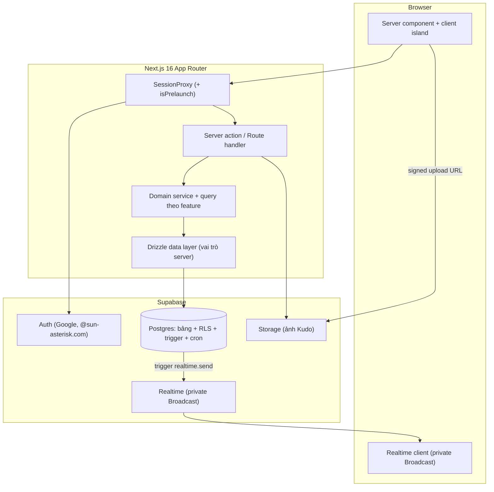

# Architecture

> Bản nháp forward-authored cho hệ thống SAA 2025 (Cổng giải thưởng + Sun* Kudos + gamification + Admin). Chỉ chứa phần mô tả cấu trúc; lý do chọn kiến trúc thuộc về ADR (do con người sở hữu), không nằm ở đây. Mọi mã `MODEL###`, `ROUTE###`, `BL###`, `PERM###`, `SCR###`, `US###` = `TBD (draft)`, sẽ được cấp ở bước reconcile. Mã `F###` là tạm (PROVISIONAL).
> F013_Notifications: đã đọc `notifications/technical-spec.md`; `functional-spec.md` của F013 chưa có trong thư mục tại thời điểm viết nên các chi tiết chỉ nằm ở functional-spec được đánh dấu `[INFERRED]`.

## System Architecture

Web only (desktop + responsive), một ứng dụng Next.js duy nhất. Không có API gateway riêng, không có dịch vụ nền tách rời: logic miền chạy trong tiến trình Next.js (server component, server action, route handler) và trong Postgres (trigger, hàm, cron).



### Layers

| Layer | Trách nhiệm | Quy tắc |
|-------|-------------|---------|
| Pages / Server Components (`app/`) | Dựng trang, nạp dữ liệu ban đầu bằng gọi thẳng query của feature; client island chỉ cho phần tương tác (tim, modal, carousel, chuông, Spotlight) | Không chứa SQL; chữ lấy từ next-intl (cookie locale, không tiền tố URL) |
| Entry: `SessionProxy`, server action, route handler | Xác thực session, kiểm Zod, kiểm quyền (`AdminGuard#requireAdmin` cho khu Admin), map lỗi sang mã HTTP | `userId` luôn lấy từ session, không từ body/path/query; mọi mutation kiểm lại ở server dù client đã kiểm |
| Domain service / query (theo feature) | Quy tắc nghiệp vụ, giao dịch, truy vấn dùng chung (vd. `KudoPublicQuery`, `HeartStatsQuery`) | Mỗi feature chỉ ghi bảng của mình; đọc bảng feature khác qua query/hàm đã công bố ở mục Cross-Feature Contracts |
| Drizzle data layer | Schema TS, migration (drizzle-kit + SQL viết tay cho `EXCLUDE`, trigger, policy `realtime.messages`), truy vấn | Chạy bằng vai trò server nên bỏ qua RLS: phân quyền và che dữ liệu nằm ở tầng server (xem `permissions.md`) |
| Supabase services | Auth, Postgres, Realtime, Storage | RLS bật ở mọi bảng nghiệp vụ, không có policy ghi cho client |

Bố cục thư mục/tệp: xem `docs/code-standards.md` (chốt ở phase 01; AGENTS.md yêu cầu đọc `node_modules/next/dist/docs/` trước khi code vì Next.js 16 có thay đổi phá vỡ).

Tiến trình nền (không có FE): trigger Postgres (`auth.users` BEFORE/AFTER INSERT của F001; phát Spotlight của F008; `notify_realtime` của F013), bộ xử lý outbox (F013 A1, kích hoạt sau commit và quét định kỳ), job chốt Kudos Quốc Dân (F010 A7, cron bằng khoá dịch vụ). Cơ chế kích hoạt cron (`pg_cron` / Vercel Cron / Edge Function): `TBD (draft)`.

## Tech Stack

| Layer | Technology | Version |
|-------|------------|---------|
| Frontend | Next.js App Router + React + TypeScript + Tailwind CSS | next 16.4.5, react 19.3, Tailwind 4 (theo `package.json`) |
| i18n | next-intl (vi/en, cookie, không tiền tố URL) | next-intl ^4.15 |
| Validation | Zod (dùng chung client + server) | zod ^4.6 |
| Backend | Next.js server action + route handler (cùng tiến trình) | theo Next.js 16 |
| ORM | Drizzle ORM + drizzle-kit | drizzle-orm ^0.45, drizzle-kit ^0.31, driver postgres-js |
| Database | Supabase Postgres (RLS, trigger, advisory lock, `EXCLUDE` gist, `FOR UPDATE SKIP LOCKED`) | Supabase CLI ^3.1 + Docker cho local |
| Auth | Supabase Auth, Google OAuth, giới hạn `@sun-asterisk.com` | @supabase/supabase-js ^2.119, @supabase/ssr ^0.12 |
| Realtime | Supabase Realtime, Broadcast riêng tư (không dùng kênh công khai) | TBD (draft) |
| Storage | Supabase Storage (ảnh Kudo, signed upload URL) | bucket `kudo-images` riêng tư, JPG/PNG/WEBP, 5 MB (migration 0003) |
| Cache | Không có (đếm bằng truy vấn tổng hợp có index) | — |
| Queue | Bảng `domain_event_outbox` trong Postgres | — |

## Data Flow

Luồng tiêu biểu nhất, đi qua nhiều feature: gửi Kudo → sự kiện → thông báo → realtime.

```mermaid
sequenceDiagram
    participant UI as Composer modal (F003)
    participant API as KudoActions#createKudo
    participant PG as Postgres
    participant SP as Trigger Spotlight (F008)
    participant NP as NotificationEventProcessor (F013)
    participant RT as Realtime private Broadcast

    UI->>API: server action (Zod, session)
    API->>PG: tx: kudos + kudo_hashtags + kudo_images + domain_event_outbox(KudoCreated)
    PG-->>SP: trigger AFTER INSERT kudos
    SP->>RT: realtime.send(topic spotlight, payload không có người gửi)
    NP->>PG: drain outbox (SKIP LOCKED) -> notifications(new_kudo, hero_tier_up)
    PG-->>RT: trigger notify_realtime(topic notifications:{recipient_id})
    RT-->>UI: chuông cập nhật; client gọi lại unread-count khi nối lại kênh
```

Luồng thả tim → hộp: `PUT /api/kudos/:kudoId/heart` ghi `kudo_hearts` (kèm `multiplier` chốt lúc thả) → `HeartAdded` → F010 `reconcileForSender` cấp `secret_boxes` → `BoxGranted` → F013 `box_granted`. Mọi `HeartAdded`/`BoxGranted` đi qua outbox (xem mục Consistency Check, C-01/C-16).

## Deployment View

> Derived from repository infrastructure-as-code — not verified against production.

N/A — no infrastructure-as-code found in repository.

Chưa quyết định nơi chạy Next.js (nền tảng hosting) và cách kích hoạt cron/outbox: `TBD (draft)`. Supabase là dịch vụ managed ngoài (Auth, Postgres, Realtime, Storage); cấu hình provider Google, tắt kênh Realtime công khai, bật Broadcast riêng tư nằm ở dashboard Supabase, không lưu trong repo.

## Module Boundaries

Mỗi feature là một module; ranh giới = bảng nó ghi + hàm/component nó công bố. Chữ "đọc" nghĩa là chỉ SELECT qua query đã công bố.

| Feature | Module sở hữu | Ghi | Đọc từ feature khác | Công bố cho feature khác |
|---------|---------------|-----|---------------------|---------------------------|
| F001_Auth | Đăng nhập, `SessionProxy`, `AdminGuard`, trigger `auth.users` | `profiles`, `departments` | — | `AdminGuard#requireAdmin`, session/`userId`, `profiles.role` |
| F002_AppShell | Layout Sunner/Admin, `LanguageSwitcher`, `AccountMenu`, trang 404/403, `I18nRequestConfig` | cookie locale | session, role (F001) | Slot chuông, layout |
| F003_KudosAuthoring | `KudoComposerModal`, `KudoActions`, `KudoRepository`, `KudoImageUpload`, `SunnerSearch` | `kudos` (khởi tạo `status=public`), `kudo_hashtags`, `kudo_images` | `hashtags`, `profiles` | `KudoComposerModal`, `SunnerSearch`, `KudoInputSchema` |
| F004_KudosFeed | `KudosFeedHandler`, `KudoCard`, `KudoPublicQuery`, trang Live board | — (chỉ đọc) | `kudos`, hashtag, ảnh, `kudo_hearts` (F005), `profiles`, `departments` | `KudoPublicQuery`, `KudoCard`, `AvatarHoverCard` host |
| F005_KudosHearts | `KudoHeartService/Query`, `HeartStatsQuery`, `HeartMultiplierResolver`, `KudoHeartButton` | `kudo_hearts` | `campaigns` qua `ActiveCampaignReader` | `KudoHeartQuery#summaryForKudos`, `HeartStatsQuery#receivedByUser`, `ActiveCampaignReader` (giao diện) |
| F006_AwardsPortal | 5 trang tĩnh, `PrelaunchGate`, `awardsData`, `CountdownTimer` | — | — | `isPrelaunch(now)` |
| F007_AdminModeration | `AdminKudoReview/Moderation/Export`, `KudoAdminQuery`, `OwnSpamKudoQuery`, `SpamAlertOverlay` | `kudos.status`, `kudos.moderated_by`, `kudos.moderated_at` | `kudo_hearts`, hashtag, `profiles` | `OwnSpamKudoQuery#listBySender`, `KudoSpamCard`, `CsvSerializer` |
| F008_SpotlightBoard | `SpotlightBoardRegion`, `SpotlightPublicQuery`, trigger phát sự kiện, policy kênh | — (đối tượng DB: hàm + trigger + policy `realtime.messages`) | `kudos`, `profiles` | Vùng Spotlight nhúng vào Live board |
| F009_HeroBadges | `HeroTierQuery`, `HeroBadge`, `HeroBadgeTooltip`, `tierFromCount` | — | `kudos` | `HeroTierQuery#getTiersByRecipientIds`, `HeroBadge`, `tierFromCount` |
| F010_SecretBoxRewards | Cấp/mở hộp, kho quà, icon, Kudos Quốc Dân, panel thống kê | `secret_boxes`, `secret_box_prizes`, `user_icons`, `mystery_gift_awards`, `national_kudos`, `domain_event_outbox` (xem C-16) | `HeartStatsQuery` (F005), `kudo_hearts`, `kudos`, `profiles` | `IconCollection`, `PersonalStatsPanel`, `PersonalRewardStatsQuery`, `DomainEventOutbox#add` |
| F011_AdminCampaigns | `CampaignAdminActions`, `CampaignAdminQuery`, `CampaignActiveReader` | `campaigns` | — | Bản cài đặt thật của `ActiveCampaignReader` |
| F012_Profile | `ProfilePage`, `ProfileKudosHandler`, `SunnerCardHandler`, `AvatarHoverCard` | — | F004, F007, F009, F010, F003 (xem bảng hợp đồng) | `AvatarHoverCard` (dùng lại ở thẻ Kudo) |
| F013_Notifications | `NotificationEventProcessor`, `notify_realtime`, `NotificationBell`, `NotificationQuery/Controller` | `notifications`, `domain_event_outbox.consumed_at` (+ `attempts`, `failed_at`) | `domain_event_outbox`, `kudos`, `profiles`, `tierFromCount` (F009) | Slot chuông lấp đầy |
| F014_AdminUserManagement | `AdminUserList/Role/Export`, `UserAdminQuery` | `profiles.role`, `profiles.role_updated_by`, `profiles.role_updated_at` | `profiles`, `departments`, `kudos`, `kudo_hearts`, `user_icons`, `mystery_gift_awards` | `LevelQuery` (chưa có cài đặt) |
| F015_AdminOverview | `AdminOverviewPage/Export`, `UnitStatsQuery` | — | `departments`, `profiles`, `kudos`, `secret_boxes` | — |

## Shared Data Model Ownership

Quy ước: mỗi bảng có đúng một feature chủ (tạo bảng + migration); feature khác chỉ thêm cột khi được ghi rõ ở đây. Mã `MODEL###` = `TBD (draft)`.

| Bảng / cột | Feature chủ | Ghi chú |
|------------|-------------|---------|
| `auth.users` (Supabase) + trigger chặn domain / tạo hồ sơ | F001 | Hai hàm DB `rejectForeignDomain`, `createSunnerProfile` |
| `profiles` (`id`, `email`, `full_name`, `avatar_url`, `department_id`, `role`, `last_login_at`) | F001 | `role` enum `user\|admin`, mặc định `user` |
| `profiles.role_updated_by`, `profiles.role_updated_at` | F014 thêm vào bảng của F001 | Migration do chủ bảng (F001) áp |
| `departments` | F001 | Nguồn nạp dữ liệu: `TBD (draft)` (xem C-15) |
| `kudos` (`id`, `sender_id`, `recipient_id`, `title`, `body`, `is_anonymous`, `created_at`, `updated_at`) | F003 | F003 chỉ ghi `status = public` lúc tạo |
| `kudos.status` (enum `kudo_status`), `moderated_by`, `moderated_at` | F007 thêm vào bảng của F003 | Index gợi ý `(status, created_at DESC)`, index từng phần cho F009/F015: `TBD (draft)` |
| `kudo_hashtags`, `kudo_images` | F003 | |
| `hashtags` | F003 (chỉ đọc ở F003) | Chưa ai sở hữu việc nạp dữ liệu (xem C-15) |
| `kudo_hearts` (`kudo_id`, `user_id`, `multiplier`, `created_at`; `UNIQUE (kudo_id, user_id)`) | F005 | `multiplier` là ảnh chụp lúc thả |
| `campaigns` (`name`, `starts_at`, `ends_at`; `EXCLUDE` gist) | F011 | Constraint `EXCLUDE` nằm trong migration SQL viết tay |
| `secret_boxes`, `secret_box_prizes`, `user_icons`, `mystery_gift_awards`, `national_kudos` | F010 | Có các `UNIQUE` chống cấp/mở đôi |
| `domain_event_outbox` | Hiện phác ở F010; đề xuất chuyển về nền tảng (C-16) | F013 cần thêm `id`, `attempts`, `failed_at` |
| `notifications` | F013 | `UNIQUE (event_id, recipient_id, type)` + chỉ mục duy nhất từng phần cho tim chưa đọc và `hero_tier_up` |
| Hàm + trigger Spotlight, policy `realtime.messages` (topic `spotlight`) | F008 | Đối tượng DB, không phải bảng |
| Hàm `notify_realtime`, policy `realtime.messages` (topic `notifications:{auth.uid()}`) | F013 | |
| Storage bucket ảnh Kudo | F003 | Tên bucket, giới hạn dung lượng/định dạng: `TBD (draft)` |
| `awardsData` (hằng số có kiểu) | F006 | Không phải bảng |

## Cross-Feature Contracts

| Hợp đồng | Chủ | Người dùng | Hình dạng / hành vi | Trạng thái |
|----------|-----|------------|----------------------|------------|
| `AdminGuard#requireAdmin` | F001 | F002 layout, F007, F011, F014, F015 | Đọc `profiles.role` từ DB mỗi request/action; không từ cookie; từ chối → 403 | Rõ |
| `SessionProxy` + `isPrelaunch(now)` | F001 / F006 | Mọi route | Proxy làm mới session và chặn khách; `isPrelaunch` là hàm thuần của F006 | Cần thống nhất thứ tự (C-09) |
| `KudoPublicQuery` | F004 | F012 (và mọi chỗ đọc Kudo công khai) | Chỉ `status = public`; che người gửi khi `is_anonymous` ngay ở server; tính `isOwner` ở server | Thiếu bộ lọc người nhận/người gửi cho F012 (C-05) |
| `KudoAdminQuery` | F007 | F007 (A1, A4) | Không lọc Public, không che ẩn danh; chỉ gọi sau `requireAdmin` | Rõ; chính sách hiển thị ẩn danh cho Admin còn mở (C-13) |
| `OwnSpamKudoQuery#listBySender` | F007 | F012 | Chỉ Kudo spam của chính người gửi (từ session) | Rõ |
| `KudoHeartQuery#summaryForKudos` | F005 | F004 | `heartCount`, `heartedByMe` theo lô, gọi trong tiến trình | Rõ; F004 còn đọc `kudo_hearts` trực tiếp để xếp Highlight (C-19) |
| `HeartStatsQuery#receivedByUser` | F005 | F010, (F014) | Tổng tim nhận đã nhân `multiplier`, chỉ Kudo Public | Thiếu tham số `asOf` và kiểu trả `{weightedTotal, rawTotal, campaignActive}` (C-02) |
| `ActiveCampaignReader` | F005 khai báo (mặc định trả `null`) | F005 resolver, F010 (tooltip x2) | `findActive(now)`; F011 cài đặt, không khai báo lại | Rõ |
| `HeartMultiplierResolver#resolve` | F005 | F005 | Không bao giờ ném lỗi, không trả < 1 | Rõ |
| `HeroTierQuery#getTiersByRecipientIds`, `tierFromCount` | F009 | F004, F012, F014 (qua Level?), F013 | Chỉ tên cấp, không lộ người gửi; hàm thuần đơn điệu | F013 tự đếm lại người gửi (C-04) |
| `DomainEventOutbox#add(tx, type, payload)` | Chung (xem C-16) | F003, F005, F007, F010 ghi; F013 đọc | Ghi cùng giao dịch nghiệp vụ; payload không có nội dung nhạy cảm | Nhiều nguồn chưa ghi (C-01) |
| Bảng sự kiện outbox | — | F013 | `KudoCreated{kudoId}`, `HeartAdded{kudoId,heartUserId}`, `KudoMarkedSpam{kudoId,ownerId,moderatedAt}`, `BoxGranted{userId,count}`, `SetCompleted{userId,giftName}`, `NationalKudosFinalized{items[{kudoId,senderId,rank}]}` | Lệch payload `SetCompleted` (C-03) |
| `CsvSerializer`, `ADMIN_TIMEZONE`, `EXPORT_MAX_ROWS`, bộ lọc ngày | F007 (đề xuất) | F014, F015 | CSV UTF-8 BOM, vô hiệu hoá ô bắt đầu bằng `= + - @`; cắt ngày theo giờ Việt Nam | Chưa có chủ chính thức (C-14) |
| `SunnerSearch#search` | F003 | F004, F007 | Tìm Sunner theo tên | Trùng đường dẫn với F004 (C-06) |
| `KudoComposerModal` (tham số) | F003 | F004 (ô trên Live board), F012 | Chế độ tạo/sửa; cần `recipient` điền sẵn + khoá | Chưa có tham số (C-07) |
| `HeroBadge`, `IconCollection`, `PersonalStatsPanel`, `AvatarHoverCard` | F009, F010, F010, F012 | F004, F012, F014 | Component dùng lại | Rõ |
| `LevelQuery` | F014 | F014 | Giao diện thay thế được, mặc định rỗng | Level chưa được định nghĩa (C-12) |
| Slot chuông | F002 | F013 | Chỗ đặt component chuông trong header | Props chưa chốt |

## Realtime Design

Hai kênh Broadcast **riêng tư**, đều phát từ trigger Postgres bằng `realtime.send`, giới hạn người nhận bằng RLS trên `realtime.messages`. Kênh công khai phải tắt trong cài đặt Realtime.

| Kênh | Chủ | Nguồn phát | Người nhận | Payload |
|------|-----|-----------|------------|---------|
| `spotlight` (`SPOTLIGHT_TOPIC`, tên chốt khi triển khai) | F008 | Trigger trên `kudos`: INSERT `public` → `added`; UPDATE `public→spam` → `removed`; `spam→public` → `restored` | Mọi Sunner đã xác thực (policy: `extension = broadcast` và topic khớp) | `{type, kudoId, recipientId, recipientName, occurredAt}`; không có `sender_id`, `is_anonymous`, `body` |
| `notifications:{recipient_id}` | F013 | Trigger `notify_realtime` trên `notifications` | Chỉ chủ: policy so topic với `'notifications:' \|\| auth.uid()` | `{notificationId, type, occurredAt}`; không có câu chữ, tên, tham số |

Quy tắc chung:
- Payload do hàm trigger tự chọn từng trường, không chuyển cả dòng.
- Hàm phát bắt mọi lỗi và chỉ ghi log; không bao giờ huỷ giao dịch ghi dữ liệu; không retry.
- Mất tin được bù ở client: Spotlight gọi lại `GET /api/spotlight` khi nối lại; chuông gọi lại `GET /api/notifications/unread-count` khi nối lại hoặc tab hiện lại.
- Quyền nhận được kiểm lúc vào kênh và cache theo kết nối: gỡ quyền chỉ có hiệu lực khi token hết hạn.
- `[UNVERIFIED]` Hành vi chính xác của `realtime.send` / policy `realtime.messages` trên Supabase hosted cần thử thực tế trước khi implement.

## Concurrency-Critical Paths

Quy tắc chung: ràng buộc duy nhất / điều kiện `WHERE` trong câu ghi là chốt chặn cuối; khoá ứng dụng chỉ là phụ.

| Đường | Feature | Cơ chế |
|-------|---------|--------|
| Thả tim | F005 | `UNIQUE (kudo_id, user_id)`; chèn trùng không lỗi (idempotent); bỏ tim khi chưa có vẫn thành công; `multiplier` chốt lúc chèn |
| Cấp Secret Box | F010 | `pg_advisory_xact_lock` theo `user_id`; `UNIQUE (user_id, seq)` + `ON CONFLICT DO NOTHING`; chạy lặp không đổi; không bao giờ xoá hộp |
| Mở Secret Box | F010 | `Idempotency-Key` → `UNIQUE (user_id, open_request_id)`; chọn hộp `FOR UPDATE SKIP LOCKED`; trừ kho `UPDATE ... WHERE stock_remaining > 0`; bốc lại tối đa `MAX_REDRAW` lần rồi rơi về icon; cùng khoá trả cùng kết quả |
| Quà bí ẩn | F010 | `UNIQUE (user_id)` trên `mystery_gift_awards`, `ON CONFLICT DO NOTHING` |
| Chốt Kudos Quốc Dân | F010 | Advisory lock toàn cục; bỏ qua nếu `national_kudos` đã có; `UNIQUE (kudo_id)`, `UNIQUE (rank)` |
| Campaign không chồng giờ | F011 | `EXCLUDE USING gist (tstzrange(starts_at, ends_at, '[)') WITH &&)`; app kiểm trước, bắt `23P01` khi đua |
| Mark Spam / Un Spam | F007 | `UPDATE kudos ... WHERE id AND status = :from`; lệnh trùng không lỗi, không ghi đè `moderated_*` |
| Đổi role + chốt Admin cuối | F014 | Một giao dịch: `SELECT ... FOR UPDATE` mọi dòng Admin, rồi kiểm "không tự hạ" và "còn ≥ 1 Admin" trước khi ghi |
| Tạo hồ sơ Sunner | F001 | `profiles.id` = `auth.users.id` (khoá chính) chặn hồ sơ trùng khi hai tab đăng nhập lần đầu |
| Sinh thông báo | F013 | Chọn lô outbox `FOR UPDATE SKIP LOCKED`, mỗi sự kiện một giao dịch ghi `notifications` + `consumed_at`; `UNIQUE (event_id, recipient_id, type)`; gộp tim bằng upsert trên chỉ mục từng phần; đánh dấu đọc có `WHERE read_at IS NULL` |

## Consistency Check — Conflicts Between Feature Drafts

Danh sách để planner xử lý. Mức: **blocking** = phải chốt trước khi build feature liên quan; **non-blocking** = chốt được trong lúc build. Không sửa file spec của feature trong bước này.

| ID | Mức | Feature | Vấn đề | Đề xuất |
|----|-----|---------|--------|---------|
| C-01 | blocking | F003, F005, F007, F010, F013 | F013 INT-001 kỳ vọng `KudoCreated` (F003), `HeartAdded` (F005), `KudoMarkedSpam` (F007) ghi vào outbox, nhưng F003 §5.2 nói "không tự đẩy sự kiện", F005 không có sự kiện nào, F007 INT-001 chưa chọn cơ chế (trigger / Realtime / ghi thẳng). F010 A1 lại kỳ vọng `HeartAdded` trong tiến trình sau commit của F005 (không qua outbox) | Một cơ chế duy nhất: mọi feature nguồn gọi `DomainEventOutbox#add(tx, ...)` trong cùng giao dịch; F010 A1 tiêu thụ `HeartAdded` từ outbox (hoặc gọi sau commit nhưng không để F005 phụ thuộc ngược vào F010); bổ sung rung Writes `domain_event_outbox` vào F003 A4, F005 A1, F007 A2 |
| C-02 | blocking | F005, F010 | F010 INT-001 cần `HeartStatsQuery#receivedByUser(userId, asOf)` trả `{weightedTotal, rawTotal, campaignActive}`; F005 A4 chưa có tham số `asOf` (cần để loại tim thả sau `SECRET_BOX_LOCK_AT`) và chưa nêu kiểu trả. F010 §5.3 còn phương án tự đếm lại từ `kudo_hearts` (nhân đôi trách nhiệm) | F005 bổ sung `asOf` + kiểu trả; F010 không tự đếm tim |
| C-03 | blocking | F010, F013 | Outbox: F010 phác `type, payload, created_at, consumed_at`; F013 cần `id`, `attempts`, `failed_at`. F010 INT-002 `SetCompleted {userId}` thiếu `giftName` mà F013 cần | Định nghĩa schema outbox một lần (cột đủ cho F013) và payload `SetCompleted {userId, giftName}`; cập nhật F010 INT-002 |
| C-04 | non-blocking | F009, F013 | F013 ALG-002 tự đếm người gửi khác nhau trước/sau một Kudo (cùng điều kiện `public`, `sender <> recipient` như F009) — trùng logic đếm của F009; chỉ chia sẻ `tierFromCount` | F009 công bố hàm đếm người gửi khác nhau theo vị trí `(created_at, id)`; F013 gọi lại, không tự viết truy vấn thứ hai |
| C-05 | blocking | F004, F012 | F012 A3 cần `KudoPublicQuery` lọc theo người nhận (`received`) và người gửi (`sent`, gắn từ session, không từ client); F004 chỉ có lọc hashtag + phòng ban. Cursor `(created_at, id)` của F004 và khoá gộp ALG-001 của F012 phải trùng định nghĩa | F004 mở rộng `KudoPublicQuery` với `recipientId`, `senderId`, cursor chung; che ẩn danh vẫn chỉ ở một nơi |
| C-06 | non-blocking | F003, F004, F007 | Hai handler cùng `GET /api/sunners/search`: F003 A1 (`SunnerSearch#search`, có thể loại chính mình) và F004 A5 (`SunnerSearchHandler#search`, ô tìm profile theo tên/email). F007 dùng lại bản F003 nhưng cần tìm được cả chính mình | Một handler duy nhất, một chủ (đề xuất F001, bảng `profiles`), tham số `excludeSelf`; F003/F004/F007 cùng gọi |
| C-07 | blocking | F003, F004, F012 | `KudoComposerModal` chưa có tham số `recipient` điền sẵn và khoá (F012 A4, D008); F003 D014 ghi lối vào từ profile "chưa có thiết kế xác nhận"; ô "gửi lời cảm ơn" trên Live board nằm ở F003 hay F004 chưa rõ | F003 công bố props `{mode, recipient?, lockRecipient?}`; F004 chỉ nhúng |
| C-08 | non-blocking | F001, F007, F014, F003, F010, F013 | Mã `DISC-001` đã dùng cho `profiles.role` (F001, F014 nhắc lại "tạm"); các spec khác để `kudos.status` (F003, F004, F007, F009, F015), `SecretBoxPrize.kind`, `SecretBox.status`, `Notification.type` là `DISC-### TBD` — nếu mỗi feature đánh số từ 001 khi reconcile sẽ va nhau (đặc biệt `role` vs `kudos.status`) | Cấp `DISC-###` một lần ở reconcile theo bảng toàn hệ thống; mỗi trường phân loại một mã, có một chủ (`profiles.role` → F001, `kudos.status` → F007) |
| C-09 | blocking | F001, F006 | Hai cổng route chồng nhau: `SessionProxy` (F001 A5) chuyển khách tới Login, trong khi `PrelaunchGate` (F006 A1, allowlist login/countdown/awards) phục vụ cả khách. Danh sách đường dẫn công khai của proxy còn TBD (F001 §5.3 mục 3); F006 D001/D002 chưa chốt khách có xem Countdown/`/awards`; "người dùng thường bị chặn" ngụ ý Admin được vào trước giờ mở nhưng chưa ghi. Đích sau đăng nhập (F001 DEC-001) phụ thuộc F006 | Một điểm vào proxy duy nhất ghép hai bước theo thứ tự cố định: (1) allowlist công khai, (2) session, (3) `isPrelaunch` (F006 chỉ cấp hàm thuần); chốt Admin có bypass trước giờ mở hay không |
| C-10 | non-blocking | F003, F005, F008, F009, F010, F013, F015 | Kudo tự gửi cho chính mình: F003 để TBD; F009 và F013 loại `sender = recipient`; F005 cấm tự thả tim; F008, F015, F004, F010 không loại | Chốt ở F003: cấm tạo (loại khỏi kết quả tìm), bỏ các nhánh đặc biệt ở feature khác |
| C-11 | non-blocking | F005, F010, F014 | F014 "Total Heart" = `COUNT(kudo_hearts ...)` nhưng ghi "định nghĩa F005"; F005/F010 dùng tổng `multiplier` (weighted). F014 còn tự viết truy vấn thay vì dùng `HeartStatsQuery` | Chốt định nghĩa (weighted hay thô) và dùng `HeartStatsQuery` |
| C-12 | blocking | F009, F014 | F014 cột/bộ lọc Level qua `LevelQuery` chưa có cài đặt; Level chưa được định nghĩa; Hero tier của F009 là khái niệm phân cấp duy nhất hiện có | Chốt Level = Hero tier (dùng `HeroTierQuery`) hoặc bỏ cột Level khỏi phạm vi |
| C-13 | blocking | F007, F014, F015, F010, F013 | Chính sách hiển thị người gửi Kudo ẩn danh với Admin chưa chốt (F007 D001/RISK-01, mặc định Admin thấy người gửi thật kèm nhãn "Ẩn danh" trong bảng, lọc và Export). Thông báo Kudos Quốc Dân (F010) mang `senderId` tới chính người gửi | Chốt một chính sách toàn hệ thống; `permissions.md` đang ghi mặc định `[INFERRED]` |
| C-14 | non-blocking | F007, F014, F015, F011, F006 | Tiện ích dùng chung chưa có chủ: `CsvSerializer` (F007 vs F014/F015), `AdminDateRangeFilter`, hàm đổi múi giờ, `ADMIN_TIMEZONE` (F007, F011, F014, F015) và `EVENT_TIMEZONE` (F006), `EXPORT_MAX_ROWS` (F007, F014) lặp hằng số | Một module quản trị dùng chung (chủ đề xuất: F007, build trước F014/F015) và một hằng số múi giờ |
| C-15 | blocking | F001, F003, F010 | Dữ liệu không có chủ nạp: `departments` (F001 "nguồn TBD", F004/F014/F015 phụ thuộc, `department_id` null lúc tạo hồ sơ), `hashtags` (F003 chỉ đọc, F004 lọc), kho `secret_box_prizes` (F010 §5.3 mục 6), bucket Storage ảnh Kudo và việc dọn tệp mồ côi | Giao mỗi tập dữ liệu cho một feature kèm cách nạp (seed/migration/Admin); chốt ở planner |
| C-16 | blocking | F010, F003, F005, F007, F013 | Thứ tự build: bảng `domain_event_outbox` đang do F010 (P2) giới thiệu, nhưng F003 (P0), F005, F007 (P1) phải ghi vào nó theo C-01 | Chuyển chủ sở hữu bảng + helper `DomainEventOutbox#add` về nền tảng (F001/migration nền) để có trước F003 |
| C-17 | non-blocking | F003, F004, F007, F012 | Đường của chủ bài với Kudo spam: F004 A3 trả 404 cho spam (cả chủ bài); F007 A5 chỉ liệt kê; F003 A5/A6 (sửa) chưa nói chủ bài có sửa được Kudo spam hay không; thẻ spam bấm vào đâu chưa rõ | Chốt: chủ bài xem/sửa Kudo spam của mình hay chỉ xem cảnh báo; nếu sửa thì không đổi `status` (F003 BR-005) |
| C-18 | non-blocking | F003, F005, F007, F010, F011, F013, F014 | Kiểu mutation không thống nhất: F005 (`PUT/DELETE` route handler), F010 (`POST` route handler + `Idempotency-Key`), F013 (`POST` route handler) so với F003/F007/F011/F014 (server action). Next.js 16 (đổi tên middleware → proxy, `forbidden()`, route chặn) chưa được xác nhận bằng tài liệu trong `node_modules/next/dist/docs/` ở bất kỳ spec nào | Quy ước: route handler cho đọc + endpoint cần header đặc thù (idempotency); server action cho form/mutation nội bộ; đọc tài liệu Next.js 16 trước khi code |
| C-19 | non-blocking | F004, F005, F010 | Xếp hạng theo tim nằm rải rác: F004 A1 Highlight (tim thô, SQL), F010 A7 Kudos Quốc Dân (đếm `kudo_hearts` trực tiếp), F005 A3 (tổng hợp theo lô); F005 §5.3 mục 2 chưa chốt hiệu năng | Một truy vấn xếp hạng tim của F005, F004 và F010 cùng dùng |
| C-20 | blocking | F001 và mọi feature | F001 FR-604 viết "mỗi bảng bật RLS yêu cầu đã đăng nhập" (gợi ý policy SELECT cho `authenticated`) — nếu có, người dùng gọi thẳng API Supabase bằng khoá công khai đọc được `kudos` (lộ `sender_id` Kudo ẩn danh, thấy Kudo spam). F005/F010/F013 viết policy `user_id = auth.uid()` làm lớp phụ | Quy ước hệ thống: RLS bật, **không** có policy SELECT/INSERT/UPDATE/DELETE cho `anon`/`authenticated` trên bảng nghiệp vụ; chỉ ngoại lệ policy theo chủ ở bảng riêng tư theo người dùng nếu thật sự có truy cập trực tiếp (hiện chưa có); sửa lại câu chữ FR-604 |
| C-21 | non-blocking | F003, F005, F013, các feature khác | Tên cùng một bảng `profiles` khác nhau: `SUNNER` (F003), `SUNNER_PROFILE` (F005, F010, F013), `PROFILE` (F001, F007, F014) | Dùng `Profile`/`profiles` (tên của F001) |

## Limits

- Không có `functional-spec.md` của F013 trong thư mục; mục F013 dựa trên `notifications/technical-spec.md`.
- Mốc thời gian `SECRET_BOX_LOCK_AT`, `NATIONAL_KUDOS_FINALIZE_AT` (2025-12-26) và `LAUNCH_AT`, `EVENT_AT` là `[INFERRED]`/`TBD (draft)`.
- Chưa đối chiếu API thực của Next.js 16, Supabase Realtime `realtime.send`/policy, trigger trên `auth.users` bằng tài liệu hay thử nghiệm; các spec nguồn đều đã đánh `[UNVERIFIED]`.
- Phiên bản các thư viện ngoài Next/React/Tailwind chưa được cố định.
