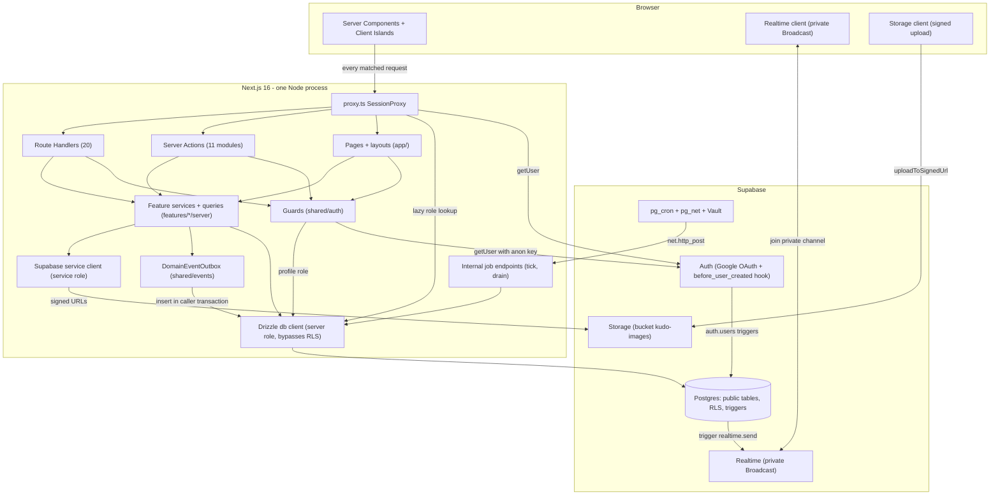
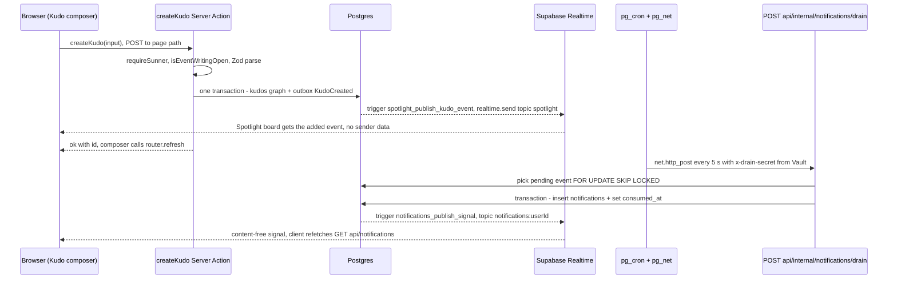
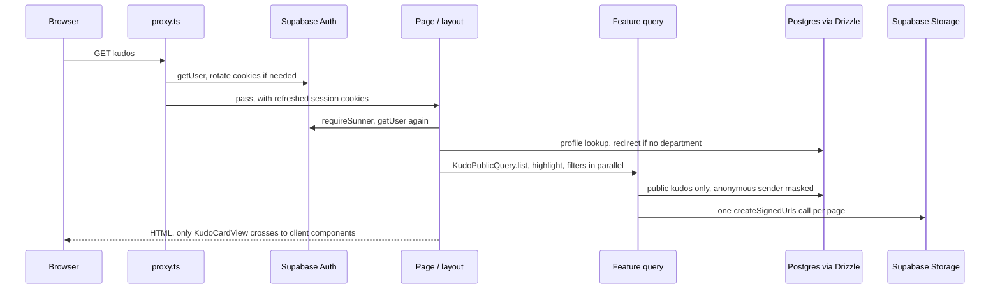

# Architecture

Hệ thống là một ứng dụng web Next.js 16 (App Router) duy nhất, chạy trong một tiến trình, dựa vào Supabase cho Auth, Postgres, Realtime và Storage. Không có API gateway riêng, không có worker hay hàng đợi ngoài: việc nền do `pg_cron` trong Postgres gọi các route nội bộ của chính app. Mọi thành phần và cạnh dưới đây suy ra từ code; cột `Source` ghi đường dẫn (kèm dòng khi cần).

## System Architecture

| Node / Edge | Mô tả | Source |
|-------------|-------|--------|
| PX `proxy.ts` | Proxy của Next 16 (thay middleware): chỉ khai báo `matcher` và gọi `runSessionProxy`. Matcher loại `_next/static`, `_next/image`, `images/`, `fonts/`, favicon/robots/sitemap; không loại theo đuôi file | `proxy.ts:5`, `proxy.ts:9` |
| PX → AUTH | `supabase.auth.getUser()` hỏi Auth server mỗi request (không chỉ kiểm chữ ký JWT); Auth lỗi thì coi như chưa đăng nhập (fail closed) | `shared/auth/session-proxy.ts:98` (`refreshSession`) |
| PX → DBC | Đọc `profiles.role` lười, memoize một lần mỗi request, chỉ khi vào `/admin/*` hoặc đang prelaunch | `shared/auth/session-proxy.ts:98`, `shared/auth/session-profile-query.ts:25` |
| PAGES | 18 `page.tsx` trong ba nhóm route: `(app)` (Sunner, layout gọi `requireSunner()`), `(public)` (`/login`, `/countdown`), `admin` (layout gọi `requireShellAdmin()`), thêm `/access-denied` và `/onboarding/department` | `app/(app)/layout.tsx:18`, `app/(public)/layout.tsx`, `app/admin/layout.tsx:11` |
| ACT | 11 module `"use server"`: 9 trong `features/*/server` cộng `shared/auth/sign-out-action.ts` và `shared/i18n/set-locale-action.ts`. Server Action là POST tới đường dẫn trang nên vẫn đi qua proxy | `features/kudos-authoring/server/create-kudo-action.ts:19`, `features/kudos-hearts/server/kudo-heart-actions.ts`, `features/admin-moderation/server/kudo-moderation-actions.ts` |
| API | 20 Route Handler: 19 dưới `app/api/**` cộng `app/auth/callback/route.ts`. Handler dữ liệu trả JSON 401 khi không có session; 16 trong 20 handler đặt `Cache-Control` có `no-store` ngay trong file (trừ `hashtags`, `kudos/images/sign`, `sunners/search`, `auth/callback`) | `app/api/kudos/route.ts:13`, `app/auth/callback/route.ts:14` |
| GUARD | `requireSunner` (chưa chọn đơn vị thì đẩy sang `/onboarding/department`), `requireAdmin`/`resolveAdminAccess` (đọc role từ DB mỗi lần gọi), `getSessionUser` (memoize theo lượt render, gọi `connection()` để không prerender) | `shared/auth/current-user.ts:18`, `shared/auth/current-user.ts:48`, `shared/auth/admin-guard.ts:17`, `shared/auth/admin-guard.ts:30` |
| GUARD → AUTH | Client Supabase theo request, gắn cookie (`@supabase/ssr`), dùng anon key | `shared/auth/supabase-server-client.ts:12` |
| SVC | Nghiệp vụ theo feature: query, service, repository, job; mỗi feature có `components/`, `schemas/`, `server/` (và `lib/`, `hooks/` khi cần) | `features/*/server/*`, `features/kudos-hearts/server/kudo-heart-service.ts` |
| OUTBOX | `DomainEventOutbox.add(tx, type, payload)`: không tự mở transaction, validate payload bằng Zod, ghi cùng transaction nghiệp vụ. Sáu loại sự kiện: `KudoCreated`, `HeartAdded`, `KudoMarkedSpam`, `BoxGranted`, `SetCompleted`, `NationalKudosFinalized` | `shared/events/domain-event-outbox.ts:18`, `shared/events/domain-event-types.ts:12` |
| DBC → PGDB | Drizzle trên postgres-js, vai trò server nên bỏ qua RLS; pool 10 kết nối, `prepare: false` (tương thích transaction pooler), một pool mỗi tiến trình lưu trên `globalThis` | `shared/db/client.ts:35` |
| SRK → STO | Client service-role cho Storage: ký URL upload và URL đọc (30 phút). Không bao giờ gửi xuống client | `shared/db/supabase-service-client.ts:12`, `features/kudos-authoring/server/kudo-image-upload-service.ts:26`, `features/kudos-feed/server/kudo-image-read-urls.ts:17` |
| STC → STO | Trình duyệt up ảnh trực tiếp lên Storage bằng token đã ký; client này không giữ session riêng | `features/kudos-authoring/components/kudo-image-upload-client.ts:53` |
| RTC ↔ RT | `browserSupabase()` (singleton mỗi tab) gọi `realtime.setAuth(token)` rồi join kênh private; chỉ join kênh, không đọc bảng | `shared/auth/supabase-browser-client.ts:14`, `features/spotlight-board/hooks/use-spotlight-channel.ts:66`, `features/notifications/hooks/use-notification-channel.ts:50` |
| PGDB → RT | Trigger `AFTER INSERT/UPDATE` gọi `realtime.send` trong cùng transaction ghi | `db/migrations/0017_spotlight_realtime.sql:69`, `db/migrations/0019_notifications_realtime.sql:46` |
| AUTH → PGDB | Trigger trên `auth.users`: chặn domain lạ khi INSERT và khi đổi email, tạo `profiles`, đồng bộ email. Hook `before_user_created` bật trong cấu hình local | `db/migrations/0005_auth_user_triggers.sql:80`, `supabase/config.toml:299` |
| CRON → JOBS | `pg_cron` gọi `net.http_post` tới route nội bộ; URL và secret đọc từ Vault, không nằm trong file | `db/migrations/0016_secret_box_tick_cron.sql:33`, `db/migrations/0020_notifications_drain_cron.sql:35` |
| JOBS → DBC | `SecretBoxTickJob.run` (sweep + Kudos Quốc Dân, khóa advisory chống chạy chồng) và `NotificationEventProcessor.drain` | `app/api/internal/secret-box/tick/route.ts:16`, `app/api/internal/notifications/drain/route.ts:15`, `features/secret-box-rewards/server/secret-box-tick-job.ts:29`, `features/notifications/server/notification-event-processor.ts:110` |

### Layers

| Layer | Thành phần | Quy tắc quan sát được | Source |
|-------|------------|-----------------------|--------|
| Cổng vào | `proxy.ts` → `runSessionProxy` | Thứ tự cố định: làm mới session, allowlist công khai, khách chuyển `/login?next=` (API trả 401), non-admin vào `/admin/*` nhận 403, cổng prelaunch theo `LAUNCH_AT`. Chỉ là lớp tối ưu: trang, layout, action vẫn tự gọi guard | `shared/auth/session-proxy.ts`, `shared/auth/route-access-policy.ts:29`, `shared/auth/public-paths.ts:33` |
| Giao diện | `app/**`, `features/*/components` | Server Component nạp dữ liệu qua query của feature; client island chỉ cho phần tương tác. Root layout, layout `(app)`, layout `admin` và phần lớn trang `(app)`, `(public)`, `onboarding` đặt `instant = false` (route blocking vì đọc session hoặc locale mỗi request) | `app/layout.tsx:25`, `app/(app)/kudos/page.tsx:42` |
| Entry | Server Action, Route Handler | Lấy `userId` từ session, validate Zod, kiểm quyền, map lỗi sang mã HTTP/kết quả có kiểu | `features/kudos-authoring/server/create-kudo-action.ts:19`, `app/api/secret-boxes/open/route.ts:13` |
| Dịch vụ miền | `features/*/server` | Quy tắc nghiệp vụ, transaction, advisory lock; ghi sự kiện outbox cùng transaction | `features/kudos-hearts/server/kudo-heart-service.ts`, `features/secret-box-rewards/server/secret-box-advisory-lock.ts` |
| Shared kernel | `shared/{auth,config,db,events,i18n,admin,ui}` | Chỉ `shared/auth/session-proxy.ts` import ngược vào một feature (`awards-portal`, cho cổng prelaunch) | `shared/auth/session-proxy.ts` |
| Dữ liệu | `shared/db/schema` (16 bảng, 3 enum), `db/migrations` (0000-0023) | drizzle-kit giữ một journal duy nhất, SQL viết tay (RLS, trigger, cron, bucket) cũng đánh số trong đó; `supabase/migrations` để trống | `drizzle.config.ts:23`, `shared/db/schema/index.ts` |

### Cross-cutting Concerns

| Chủ đề | Cách làm | Source |
|--------|----------|--------|
| Ủy quyền | Mọi phân quyền ở code server; RLS bật trên cả 16 bảng `public` nhưng không có policy cho `anon`/`authenticated`, đồng thời thu hồi quyền bảng của hai vai trò này. Hai policy duy nhất trong migration nằm trên `realtime.messages`, chỉ để cho phép join kênh Broadcast | `db/migrations/0002_rls_baseline.sql`, `db/migrations/0017_spotlight_realtime.sql:79`, `db/migrations/0019_notifications_realtime.sql:53` |
| Xác thực | Google OAuth qua Supabase, PKCE; `/auth/callback` đổi code lấy session, kiểm domain lần hai, đặt `role = admin` cho email trong `ADMIN_EMAILS` ở mỗi lần đăng nhập, rồi chọn đích đến an toàn (`safeNextPath`) | `app/auth/callback/route.ts:14`, `features/auth/server/complete-login.ts:37`, `shared/auth/safe-next-path.ts` |
| Cấu hình | Schema Zod cho env, kiểm lúc khởi động trong `next.config.ts` và lúc import `env.ts`; mốc thời gian (`LAUNCH_AT`, `EVENT_END_AT`, `NATIONAL_KUDOS_FINALIZE_AT`) lưu dạng epoch ms. Có thể tắt kiểm bằng `SKIP_ENV_VALIDATION=1` cho bước không có secret | `next.config.ts:10`, `shared/config/env-schema.ts:54`, `shared/config/env.ts:9` |
| Cửa sổ ghi | Ghi Kudo/tim chỉ mở từ `LAUNCH_AT` đến `EVENT_END_AT`; kiểm cả ở Server Action vì cổng prelaunch của proxy chỉ chặn tải trang | `shared/config/event-window.ts:11` |
| i18n | `next-intl` không tiền tố URL; locale theo cookie `NEXT_LOCALE`, rồi `Accept-Language`, rồi `vi`; thông điệp nạp động từ `messages/{vi,en}.json` | `shared/i18n/request.ts:12`, `shared/i18n/resolve-locale.ts:31` |
| Kết xuất | `cacheComponents` và `partialPrefetching` bật, nhưng không có chỉ thị `"use cache"`, `unstable_cache`, `cacheLife` hay `cacheTag` nào trong source | `next.config.ts:22`, `next.config.ts:23` |
| Trang 403 của admin | Proxy tự dựng body 403 (fetch `/access-denied` từ `INTERNAL_APP_ORIGIN` hoặc `http://127.0.0.1:$PORT`, không lấy origin từ header request) vì dưới Cache Components status 200 đã gửi trước khi `forbidden()` chạy | `shared/auth/access-denied-response.ts:26`, `shared/auth/access-denied-response.ts:40` |

### Background and Realtime

| Việc | Lịch / kích hoạt | Điểm vào | Source |
|------|------------------|----------|--------|
| `saa-secret-box-tick` | `* * * * *` (mỗi phút) | `POST /api/internal/secret-box/tick`, header `x-job-secret`, so sánh hằng thời gian | `db/migrations/0016_secret_box_tick_cron.sql:33`, `features/secret-box-rewards/server/internal-job-guard.ts` |
| `saa-notifications-drain` | `5 seconds` | `POST /api/internal/notifications/drain`, header `x-drain-secret` | `db/migrations/0020_notifications_drain_cron.sql:35`, `features/notifications/server/outbox-drain-guard.ts` |
| `saa-outbox-prune` | `0 19 * * *` | SQL xóa sự kiện outbox đã consume quá 30 ngày | `db/migrations/0023_housekeeping_outbox_and_cron_history_prune.sql:32` |
| `saa-cron-history-prune` | `15 19 * * *` | SQL xóa `cron.job_run_details` quá 7 ngày | `db/migrations/0023_housekeeping_outbox_and_cron_history_prune.sql:36` |

Hai route `/api/internal/*` nằm trong allowlist công khai của proxy (không cần cookie) và tự bảo vệ bằng secret; chưa cấu hình secret thì trả 503 `not_configured` (`shared/auth/public-paths.ts:24`, `shared/auth/public-paths.ts:30`). Các migration cron chỉ ghi NOTICE và bỏ qua khi thiếu `pg_cron`, `pg_net` hoặc Vault (cách thay: cron của host, ghi trong chú thích SQL). Không có bộ lập lịch, thư viện hàng đợi hay mailer nào ở phía Node.

| Kênh Realtime | Phát bởi | Policy đọc | Client | Source |
|---------------|----------|------------|--------|--------|
| `spotlight`, sự kiện `kudo` | Trigger `spotlight_publish_kudo_event` trên `public.kudos` (INSERT trạng thái `public`, đổi `public`↔`spam`); payload không có người gửi | `spotlight_authenticated_read` (chỉ `authenticated`, chỉ topic `spotlight`, chỉ broadcast) | `useSpotlightChannel`, snapshot qua `GET /api/spotlight` | `db/migrations/0017_spotlight_realtime.sql:69`, `app/api/spotlight/route.ts:14` |
| `notifications:{userId}`, sự kiện `notification` | Trigger `notifications_publish_signal` trên `public.notifications` (INSERT, hoặc UPDATE `count`); chỉ mang id, loại, thời điểm | `notifications_recipient_read` (topic phải bằng `notifications:` + `auth.uid()`) | `useNotificationChannel`, danh sách qua `GET /api/notifications` | `db/migrations/0019_notifications_realtime.sql:46`, `app/api/notifications/route.ts:13` |

Broadcast không phát lại sự kiện đã lỡ, nên client luôn tải lại snapshot/danh sách sau mỗi lần join hoặc rejoin. Cả hai hàm trigger là `SECURITY DEFINER`, bắt mọi lỗi và chỉ `RAISE LOG` (một lỗi Realtime không làm hỏng ghi dữ liệu).

### Module Boundaries

16 thư mục feature trong `features/`. Bảng dưới liệt kê các feature mà mỗi feature import (đếm từ câu lệnh `from "@/features/..."`, chưa tách import kiểu và import giá trị).

| Feature | Import từ feature khác |
|---------|------------------------|
| `app-shell`, `auth` | không có |
| `admin-campaigns` | `app-shell`, `kudos-authoring`, `kudos-hearts` |
| `admin-moderation` | `admin-campaigns`, `app-shell`, `kudos-feed`, `kudos-hearts`, `sunner-search` |
| `admin-overview` | `admin-campaigns`, `admin-moderation` |
| `admin-users` | `admin-campaigns`, `admin-moderation`, `app-shell`, `hero-badges`, `kudos-hearts` |
| `awards-portal` | `app-shell`, `hero-badges`, `kudos-feed` |
| `hero-badges`, `sunner-search` | `app-shell` |
| `kudos-authoring` | `app-shell`, `sunner-search` |
| `kudos-feed` | `admin-moderation`, `app-shell`, `hero-badges`, `kudos-authoring`, `kudos-hearts`, `profile`, `secret-box-rewards`, `spotlight-board`, `sunner-search` |
| `kudos-hearts` | `admin-campaigns`, `app-shell`, `kudos-feed` |
| `notifications` | `app-shell`, `hero-badges`, `kudos-feed` |
| `profile` | `app-shell`, `hero-badges`, `kudos-authoring`, `kudos-feed`, `secret-box-rewards` |
| `secret-box-rewards` | `app-shell`, `kudos-authoring`, `kudos-feed`, `kudos-hearts` |
| `spotlight-board` | `app-shell`, `kudos-feed` |

`kudos-feed` là nút trung tâm; nó có vòng import hai chiều với `kudos-hearts`, `profile`, `secret-box-rewards`, `spotlight-board` và `admin-moderation`, ngoài ra còn vòng `admin-campaigns` ↔ `kudos-hearts`. `app-shell` đưa phần của feature khác vào qua slot (ví dụ `bellSlot` trong `app/(app)/layout.tsx:22`) nên không phụ thuộc ngược vào `notifications`.

## Tech Stack

| Layer | Technology | Version |
|-------|------------|---------|
| Frontend | Next.js App Router (Server Components, Cache Components bật, Turbopack) | `16.4.5` (khai báo, cài đúng bản này) |
| Frontend | React / React DOM | `19.3.0` |
| Frontend | Tailwind CSS v4 (qua `@tailwindcss/turbopack`), font Montserrat từ `next/font/google` | khai báo `^4`, cài `4.3.4` |
| Frontend | next-intl (vi mặc định, en) | khai báo `^4.15.1`, cài `4.15.1` |
| Backend | Next.js Server Actions và Route Handlers, cùng tiến trình với giao diện | theo Next.js `16.4.5` |
| Backend | Node.js runtime | N/A — không có `engines` hay `.nvmrc`; chỉ có `@types/node` `^24.19.2` |
| Validation | zod (client và server dùng chung) | khai báo `^4.6.7`, cài `4.6.7` |
| ORM | Drizzle ORM + drizzle-kit (migration), driver postgres-js | `drizzle-orm ^0.45.4` (cài `0.45.4`), `drizzle-kit ^0.31.11`, `postgres ^3.4.9` |
| Database | Postgres do Supabase quản lý: RLS, trigger, advisory lock, ràng buộc `EXCLUDE` gist, `FOR UPDATE SKIP LOCKED` | `17` theo `supabase/config.toml:42` (cấu hình local dev; bản production chưa xác nhận) |
| Auth | Supabase Auth, Google OAuth, giới hạn domain email | `@supabase/supabase-js ^2.119.0`, `@supabase/ssr ^0.12.7` |
| Realtime | Supabase Realtime, Broadcast kênh private | N/A — phiên bản Realtime không có trong source |
| Storage | Supabase Storage, bucket `kudo-images` riêng tư, JPG/PNG/WEBP, tối đa 5 MB | N/A — theo `db/migrations/0003_storage_kudo_images_bucket.sql` |
| Scheduler | `pg_cron` + `pg_net` + Vault trong Postgres | N/A — phiên bản extension không có trong source |
| Cache | N/A — không tìm thấy kho cache hay chỉ thị cache dữ liệu trong source | — |
| Queue | Bảng `domain_event_outbox` (outbox giao dịch tự viết, không dùng thư viện hàng đợi) | — |
| Test | Vitest (project `unit`, `integration`), Playwright (e2e, prelaunch), Testing Library + happy-dom (component), coverage-v8 | `vitest ^5.1.0`, `@playwright/test ^1.65.1`, `@testing-library/react 16.3.3`, `@testing-library/dom 10.4.2`, `happy-dom 21.0.4`, `@vitest/coverage-v8 5.1.0` |
| Tooling | TypeScript, ESLint, tsx, Supabase CLI | `typescript ^5` (cài `5.9.3`), `eslint ^9`, `tsx ^4.23.15`, `supabase ^3.1.0` |

Nguồn: `package.json`, các `node_modules/*/package.json` tương ứng, `next.config.ts`, `supabase/config.toml`.

## Data Flow

Luồng đi qua nhiều feature nhất: gửi Kudo, phát Spotlight, xử lý outbox, báo cho người nhận.

Điểm nối của luồng: `createKudo` ghi Kudo và dòng outbox trong một transaction (`features/kudos-authoring/server/create-kudo-action.ts:30`); trigger Spotlight chạy trong transaction đó (`db/migrations/0017_spotlight_realtime.sql:69`); mỗi sự kiện được xử lý trong transaction riêng, ghi `notifications` và `consumed_at` cùng lúc, lỗi thì tăng `attempts` với backoff theo cấp số nhân và treo sau số lần tối đa (`features/notifications/server/notification-event-processor.ts:60`, `features/notifications/server/notification-event-processor.ts:81`). `KudoCreated` sinh thông báo `kudo_received`, kèm `hero_tier_up` khi lên bậc (`features/notifications/server/map-event-to-notifications.ts`). Luồng thả tim đi cùng khuôn: `HeartAdded` ghi trong transaction của tim (`features/kudos-hearts/server/kudo-heart-service.ts`), job tick của Secret Box cấp hộp rồi phát `BoxGranted` (`features/secret-box-rewards/server/secret-box-sweep-job.ts`).

Luồng đọc một trang Sunner:

Nguồn: `app/(app)/kudos/page.tsx:42`, `shared/auth/current-user.ts:48`, `features/kudos-feed/server/kudo-image-read-urls.ts:14`.

## Deployment View

> Derived from repository infrastructure-as-code — not verified against production.

N/A — no infrastructure-as-code found in repository.

Đã tìm các mẫu trong `references/deployment-source-patterns.md` (docker-compose, Dockerfile, manifest k8s, `*.tf`, `*.service`, `Procfile`, `nginx.conf`, `fly.toml`, `wrangler.toml`, `vercel.json`, `app.yaml`) và không thấy file nào; thư mục `.github/` cũng không tồn tại. File duy nhất gần với hạ tầng là `supabase/config.toml`, đây là cấu hình Supabase CLI cho môi trường dev local, không phải manifest triển khai nên không vẽ node nào từ nó. Nơi chạy Next.js và dự án Supabase production không xác định được từ repository.

## Limits

- Nơi chạy Next.js, bản Postgres và Realtime ở production, và việc `pg_cron`/`pg_net`/Vault có sẵn trên project thật: chưa xác nhận (không có IaC; migration cron tự bỏ qua khi thiếu).
- Hai thiết lập nằm ngoài repo, chỉ có trong chú thích migration: tắt "Allow public access" của Realtime (chỉ dùng kênh private), và bật hook `before_user_created` trên Supabase hosted (`db/migrations/0017_spotlight_realtime.sql`, `db/migrations/0005_auth_user_triggers.sql`). Trigger domain trên `auth.users` vẫn chặn khi thiếu hook, chỉ khác thông báo lỗi.
- Số liệu phụ thuộc giữa các feature đếm bằng `grep` trên câu lệnh import, không phân biệt import kiểu với import giá trị và không chạy công cụ phân tích đồ thị.
- Đã đối chiếu `docs/system/architecture.md` (bản nháp) chỉ để định hướng; không có khẳng định nào chép từ đó mà chưa kiểm với code. Bản nháp gọi hàm trigger thông báo là `notify_realtime`, code thực tế là `notifications_publish_signal` (`db/migrations/0019_notifications_realtime.sql:46`).
