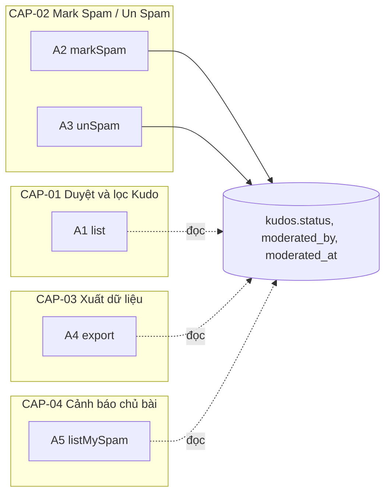
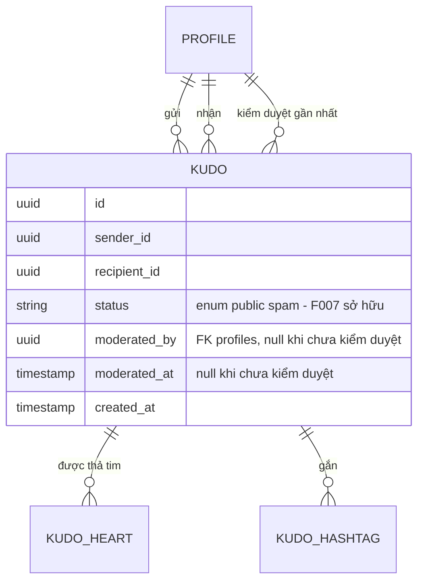
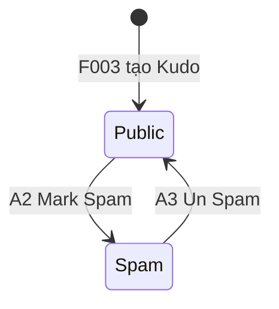

# F007_AdminModeration — Technical Spec

**Priority**: P1
**Type**: mixed
**Generated**: 2026-11-08

**See also:** [`functional-spec.md`](./functional-spec.md) — tổng quan, quyết định còn mở, yêu cầu/quy tắc nghiệp vụ dạng một dòng, màn hình, user story, kịch bản, edge case và cấu hình cho BA/QA.

**How to read this file:** § 2 là bảng chỉ mục — chọn action cần xem rồi đọc block của nó ở § 3 một mạch từ trên xuống. § 4 là phụ lục dùng chung — chỉ nhảy vào khi một block ở § 3 trỏ tới.

## 1. Technical Overview

F007 cho Admin duyệt mọi Kudo trên một bảng có lọc, tìm kiếm, sắp xếp, phân trang; đánh dấu Spam / bỏ Spam từng Kudo; xuất kết quả đang lọc ra tệp CSV. F007 **sở hữu trường `kudos.status`** (`public` | `spam`) và vòng đời chuyển trạng thái của nó (SM-001); bảng `kudos` do F003 tạo, F007 thêm hai cột ghi nhận người và thời điểm kiểm duyệt gần nhất. Mọi xử lý nằm ở server (Next.js App Router + Drizzle trên Supabase Postgres); vì Drizzle chạy bằng vai trò server nên bỏ qua RLS, **mỗi action của Admin phải tự gọi `AdminGuard#requireAdmin` của F001** trước khi đụng dữ liệu. Phía Sunner, F007 chỉ cấp truy vấn và component để chủ bài thấy Kudo spam của chính mình kèm Alert Overlay; việc ẩn Kudo spam khỏi feed là của F004 (lọc `status = 'public'`).



## 2. Action Index

| # | Action (handler) | Method · Path | Codes | Writes | Detail |
|---|---|---|---|---|---|
| **A0** | *cross-cutting — belongs to no single action* | — | FR-601, FR-602 | — | § 4.4 |
| **A1** | `AdminKudoReview#list` (planned) | `GET` `/api/admin/kudos` | FR-101, FR-201, FR-202, FR-203, FR-204, FR-205, FR-206, FR-207, FR-208, FR-402, FR-407, FR-603, BR-002, DEC-001, US001_ReviewKudoList, US002_FilterSearchKudos | — *(read-only)* | § 3.1 |
| **A2** | `AdminKudoModeration#markSpam` (planned) | `server action` | FR-001, FR-002, FR-401, FR-403, FR-404, FR-406, FR-408, BR-001, BR-003, SM-001, INT-001, US003_MarkKudoSpam | `kudos` | § 3.2 |
| **A3** | `AdminKudoModeration#unSpam` (planned) | `server action` | FR-001, FR-002, FR-401, FR-403, FR-404, FR-406, BR-001, BR-003, SM-001, US004_UnSpamKudo | `kudos` | § 3.2 |
| **A4** | `AdminKudoExport#download` (planned) | `GET` `/api/admin/kudos/export` | FR-203, FR-204, FR-205, FR-206, FR-405, FR-604, BR-002, BR-004, DEC-002, US005_ExportKudos | — *(read-only; trả tệp)* | § 3.3 |
| **A5** | `OwnSpamKudoQuery#listBySender` (planned) | `GET` `/api/kudos/mine/spam` | FR-301, FR-302, FR-303, FR-304, FR-603, BR-005, DEC-003, US006_OwnerSeesSpamAlert | — *(read-only)* | § 3.4 |

**Rung set** theo template: Who → FE → Request → BE → Rule → Result → State → Source. Rung vắng thì bỏ hẳn. **State** bỏ trong bản nháp vì chưa có nguồn xác nhận; vòng đời nằm ở SM-001 (§ 4.3).

## 3. Actions

### 3.1 CAP-01 — Duyệt và lọc Kudo

#### A1 · Lấy một trang Kudo cho bảng Review content
`GET /api/admin/kudos` → `` `AdminKudoReview#list` `` (planned)
`FR-101` `FR-201` `FR-202` `FR-203` `FR-204` `FR-205` `FR-206` `FR-207` `FR-208` `FR-402` `FR-407` `FR-603` `BR-002` `DEC-001` `US001_ReviewKudoList` `US002_FilterSearchKudos` · `SCR-admin-review-content` (draft)

**Who** · Admin *(gate A0 — § 4.4)*
**FE** · Trang Review content (FR-101: Admin vào từ mục "Review content" của menu khu Admin, menu thuộc F002). Bảng hiện cả Kudo Public lẫn Spam (FR-201: cột ID, Sender, Receiver, Content, Hashtag, Heart, Status, Actions). Thanh lọc gồm khoảng ngày (FR-203), dropdown Sender / Receiver (FR-204, dùng lại `SunnerSearch#search` của F003 để tìm người), dropdown Status (FR-205: Tất cả / Public / Spam), ô Search by content (FR-206). Cột Heart bấm để đảo chiều sắp xếp tăng/giảm (FR-207). Phân trang đánh số (FR-202). Đổi bất kỳ điều kiện nào thì gọi lại action và về trang 1 (FR-402). Không có dòng thì hiện trạng thái trống, gọi lỗi thì hiện lỗi kèm nút thử lại (FR-407). Nút ở cột Actions theo DEC-001 (FR-208).
**Request** · param `dateFrom`, `dateTo` *(ngày `YYYY-MM-DD`, tuỳ chọn)*, `senderId`, `recipientId` *(uuid, tuỳ chọn)*, `status` *(`public` | `spam`; vắng = tất cả)*, `q` *(1–100 ký tự, tuỳ chọn)*, `sort` *(`created_desc` mặc định | `hearts_desc` | `hearts_asc`)*, `page` *(số nguyên ≥ 1)*; kiểm bằng `AdminKudoFilterSchema` (Zod). Cỡ trang do server cố định (`ADMIN_REVIEW_PAGE_SIZE`), client không gửi.
**BE** · `` `AdminKudoReview#list` `` gọi `AdminGuard#requireAdmin`, kiểm tham số, rồi chạy `KudoAdminQuery` (planned): đọc `kudos` nối hồ sơ người gửi/nhận, danh sách hashtag, tổng tim. Truy vấn này **không đi qua `KudoPublicQuery` của F004**: không lọc `status = 'public'` và không che người gửi ẩn danh (cách hiển thị người gửi ẩn danh cho Admin — D001 ở functional-spec). Trả `items`, `total`, `page`, `pageSize`.
**Rule** · quyết định nút ở cột Actions và áp bộ lọc:

| DEC | subtype | Condition | What the user sees | Source |
|---|---|---|---|---|
| **DEC-001** | render | `kudo.status = 'public'` | huy hiệu "Public" (viền xanh) và nút "Mark Spam" | TBD (draft) |
| **DEC-001** | render | `kudo.status = 'spam'` | huy hiệu "Spam" (viền vàng) và nút "Un Spam" | TBD (draft) |

- **BR-002 — Danh sách và Export dùng chung một bộ lọc và một thứ tự.** Các điều kiện kết hợp AND, điều kiện vắng nghĩa là không lọc; `dateFrom` tính từ 00:00 và `dateTo` đến 23:59:59 giờ Việt Nam; mặc định mới nhất trước, bằng nhau thì `id` giảm dần để phân trang ổn định. *(§ 4.4)*
- FR-603 *(Admin xem được Kudo spam của mọi người)*: không có điều kiện `sender_id` nào được thêm ngầm cho Admin.

**Result** · read-only — **không ghi DB**. Trang `items` đã định dạng (số tim, thời gian), `total` để dựng phân trang. Trang vượt quá tổng trang thì trả `items` rỗng kèm `total` để FE chuyển về trang cuối.
**Source:** TBD (draft)

<!-- Không có diagram: dưới ngưỡng (chỉ đọc, đồng bộ). Nội dung chính là bảng DEC, sơ đồ chỉ làm khó đọc. -->

### 3.2 CAP-02 — Đánh dấu Spam / bỏ đánh dấu Spam

#### A2 · Đánh dấu Kudo là Spam
`server action` → `` `AdminKudoModeration#markSpam` `` (planned)
`FR-001` `FR-002` `FR-401` `FR-403` `FR-404` `FR-406` `FR-408` `BR-001` `BR-003` `SM-001` `INT-001` `US003_MarkKudoSpam` · `SCR-admin-review-content` (draft)

**Who** · Admin *(gate A0 — § 4.4)*
**FE** · Nút "Mark Spam" ở dòng Public (FR-401: bấm thì Kudo chuyển Spam, dòng cập nhật tại chỗ, không tải lại trang). Có bước xác nhận bằng popover "Action - Public" hay không là D004; nút bị khoá trong lúc chờ để chống bấm đúp.
**Request** · `kudoId` *(uuid, Zod)*
**BE** · `` `AdminKudoModeration#markSpam` `` gọi `AdminGuard#requireAdmin`, lấy `adminId` từ session (không nhận từ client), rồi chạy một câu `UPDATE` có điều kiện trạng thái nguồn. Không có dòng nào bị ghi thì đọc lại Kudo để phân biệt "không tồn tại" (404) với "đã là Spam" (trả thành công kèm trạng thái hiện tại). Sau khi ghi, làm mới trang Admin; các trang Sunner đọc trực tiếp nên thấy hiệu lực ở lần tải kế (F004 mặc định không cache).
**Rule**
- **BR-001 — Mark Spam chỉ ghi khi Kudo đang Public; Un Spam chỉ ghi khi đang Spam.** Lệnh trùng hoặc đến sau (hai Admin cùng thao tác) không báo lỗi và không ghi đè `moderated_*`; Admin đến sau nhận trạng thái hiện tại để cập nhật dòng (FR-406). *(§ 4.4)*
- **BR-003 — Mark Spam chỉ đổi trạng thái, không xoá hay sửa tim, huy hiệu, Secret Box, hashtag, ảnh.** Mọi số đếm ở F005, F008, F009, F010 phải loại Kudo Spam ngay lúc truy vấn (FR-403) và Kudo biến mất khỏi Highlight, All Kudos, chi tiết (FR-404); Un Spam khôi phục tất cả. Secret Box đã cấp không bị thu hồi (D002). *(§ 4.4)*

**Result**
- Ghi `kudos.status` ← `spam`; `kudos.moderated_by` ← `adminId`; `kudos.moderated_at` ← thời điểm hiện tại (FR-001: mỗi Kudo đúng một trạng thái; FR-002: lưu Admin và thời điểm kiểm duyệt gần nhất).
- Phát sự kiện `KudoMarkedSpam` qua `INT-001` — báo cho F013 biết chủ bài vừa có một Kudo bị tạm ẩn để F013 gửi thông báo "Tiếc quá! Bạn có một lời nhắn bị tạm ẩn…" (FR-408); F007 chỉ phát sự kiện, không soạn hay gửi thông báo *(§ 4.5)*. Chỉ phát khi ghi thành công (một dòng bị đổi), không phát khi lệnh trùng (BR-001).
- User sees: dòng đổi huy hiệu sang "Spam" và nút sang "Un Spam"; nếu đang lọc Status = Public thì dòng rời khỏi kết quả ở lần tải kế.
**Source:** TBD (draft)

<!-- Không có diagram: dưới ngưỡng (một bảng, một bước phát sự kiện đồng bộ). SM-001 (§ 4.3) giữ sơ đồ trạng thái. -->

---

#### A3 · Bỏ đánh dấu Spam
`server action` → `` `AdminKudoModeration#unSpam` `` (planned)
`FR-001` `FR-002` `FR-401` `FR-403` `FR-404` `FR-406` `BR-001` `BR-003` `SM-001` `US004_UnSpamKudo` · `SCR-admin-review-content` (draft)

**Who** · Admin *(gate A0 — § 4.4)*
**FE** · Nút "Un Spam" ở dòng Spam (FR-401: bấm thì Kudo về Public, dòng cập nhật tại chỗ). Xác nhận theo D004 như A2.
**Request** · `kudoId` *(uuid, Zod)*
**BE** · `` `AdminKudoModeration#unSpam` `` — đối xứng A2: `requireAdmin`, `UPDATE ... SET status = 'public', moderated_by = adminId, moderated_at = now() WHERE id = kudoId AND status = 'spam'`; không ghi được dòng nào thì xử lý như A2 (404 hoặc "đã Public").
**Rule**
- **BR-001 — Un Spam chỉ ghi khi Kudo đang Spam.** Cùng cơ chế điều kiện trạng thái nguồn với A2: lệnh trùng không lỗi, không ghi đè (FR-406). *(§ 4.4)*
- **BR-003 — Chỉ đổi trạng thái; số đếm tim, huy hiệu, Secret Box tự khôi phục vì được tính lại từ Kudo Public.** Không có thao tác "cộng lại" nào (FR-403, FR-404: Kudo hiện lại ở feed, Highlight, chi tiết). *(§ 4.4)*

**Result**
- Ghi `kudos.status` ← `public`; `kudos.moderated_by` ← `adminId`; `kudos.moderated_at` ← thời điểm hiện tại (FR-001, FR-002: ghi người/thời điểm của thao tác gần nhất, kể cả khi là Un Spam).
- User sees: dòng đổi huy hiệu sang "Public" và nút sang "Mark Spam".
**Source:** TBD (draft)

<!-- Không có diagram: dưới ngưỡng (một bảng, đồng bộ). -->

### 3.3 CAP-03 — Xuất dữ liệu Review content

#### A4 · Tải tệp CSV các Kudo đang lọc
`GET /api/admin/kudos/export` → `` `AdminKudoExport#download` `` (planned)
`FR-203` `FR-204` `FR-205` `FR-206` `FR-405` `FR-604` `BR-002` `BR-004` `DEC-002` `US005_ExportKudos` · `SCR-admin-review-content` (draft)

**Who** · Admin *(gate A0 — § 4.4)*
**FE** · Nút "Export" (màu vàng) cạnh bộ chọn khoảng ngày. Bấm thì tải về tệp của **toàn bộ** kết quả khớp bộ lọc hiện tại, không chỉ trang đang xem (FR-405); trong lúc chuẩn bị nút bị khoá kèm trạng thái chờ. Dùng cùng các điều kiện lọc ngày (FR-203), người gửi/nhận (FR-204), trạng thái (FR-205), nội dung (FR-206) đang chọn trên màn hình.
**Request** · cùng tham số lọc và `sort` như A1, **không có `page`**; kiểm bằng cùng `AdminKudoFilterSchema`.
**BE** · `` `AdminKudoExport#download` `` gọi `AdminGuard#requireAdmin`, kiểm tham số, đếm số dòng khớp, rồi truyền (stream) từng dòng từ `KudoAdminQuery` ra phản hồi CSV, `Content-Disposition: attachment`. Cột: ID, Sender, Receiver, Title, Content, Hashtags (nối bằng khoảng trắng), Heart, Status, Created at.
**Rule** · quyết định định dạng và giới hạn của tệp:

| DEC | subtype | Condition | What the user sees | Source |
|---|---|---|---|---|
| **DEC-002** | flow | số dòng khớp ≤ `EXPORT_MAX_ROWS` | tải về tệp CSV UTF-8 có BOM (mở bằng Excel không vỡ tiếng Việt), tên `kudos-{yyyymmdd-hhmm}.csv` | TBD (draft) |
| **DEC-002** | flow | số dòng khớp > `EXPORT_MAX_ROWS` | không tải tệp; hiện lỗi yêu cầu thu hẹp bộ lọc (HTTP 422) | TBD (draft) |

- **BR-002 — Cùng bộ lọc và thứ tự với A1.** Tệp khớp từng dòng với những gì Admin thấy khi duyệt hết các trang. *(§ 4.4)*
- **BR-004 — Ô văn bản bắt đầu bằng `=`, `+`, `-`, `@` (hoặc tab/CR) phải bị vô hiệu hoá công thức khi ghi CSV.** Thêm dấu `'` đứng đầu; Kudo do người dùng nhập nên không tin nội dung. FR-604 *(CSV an toàn khi mở bằng Excel)*. `[INFERRED]` từ rủi ro CSV injection.

**Result** · read-only — không ghi DB. Phản hồi là tệp CSV; người gửi ẩn danh hiển thị theo D001.
**Source:** TBD (draft)

<!-- Không có diagram: không ghi bảng, một bước đồng bộ (stream). Không dùng XLSX: tránh thêm thư viện cho yêu cầu chưa ai xác nhận (YAGNI), xem D007. -->

### 3.4 CAP-04 — Cảnh báo vi phạm cho chủ bài

#### A5 · Lấy Kudo spam của chính người đang đăng nhập
`GET /api/kudos/mine/spam` → `` `OwnSpamKudoQuery#listBySender` `` (planned)
`FR-301` `FR-302` `FR-303` `FR-304` `FR-603` `BR-005` `DEC-003` `US006_OwnerSeesSpamAlert` · `SCR-spam-alert-overlay` (draft)

**Who** · Sunner đã đăng nhập, chỉ với Kudo do chính mình gửi *(gate: F001 A0 — phiên hợp lệ; không cần `requireAdmin`)*
**FE** · Danh sách "Đã gửi" trong profile của chính chủ bài (màn do F012 sở hữu, D003; trên thiết kế Kudo spam vẫn nằm trong danh sách này) trộn Kudo Public với Kudo Spam từ action này. Kudo Spam dựng bằng `KudoSpamCard` (FR-301: biến thể "KUDO spam" có thẻ "Spam" màu cam ở góc trên bên phải) kèm `SpamAlertOverlay` với chữ "Cảnh báo vi phạm tiêu chuẩn cộng đồng" (FR-302). Thẻ spam không có nút tim, Copy Link, sửa (FR-303, D006). Người khác không bao giờ nhận dữ liệu này (FR-304). Cách nói với Sunner là "tạm ẩn"; nhãn "Spam" chỉ là nhãn của Admin và thẻ cam trên thẻ.
**Request** · không có tham số; `senderId` luôn lấy từ session
**BE** · `` `OwnSpamKudoQuery#listBySender` `` đọc `kudos` với `sender_id = session.userId AND status = 'spam'`, sắp mới nhất trước, trả đủ trường để dựng thẻ. Không có bản ghi thì trả mảng rỗng.
**Rule** · quyết định ai thấy biến thể spam:

| DEC | subtype | Condition | What the user sees | Source |
|---|---|---|---|---|
| **DEC-003** | render | `kudo.status = 'spam'` và người xem là chủ bài | thẻ biến thể "KUDO spam" kèm Alert Overlay | TBD (draft) |
| **DEC-003** | render | `kudo.status = 'spam'` và người xem không phải chủ bài | không có thẻ nào (không trả dữ liệu; chi tiết vẫn 404 theo F004) | TBD (draft) |

- **BR-005 — Chủ bài chỉ nhận Kudo spam do chính mình gửi, lọc ở server.** Điều kiện `sender_id` do server gắn từ session, không nhận từ client; FR-603 *(Sunner thường chỉ thấy spam của chính mình)*. `Kudo` ẩn danh vẫn là của chủ bài nên chủ bài thấy bài của mình.

**Result** · read-only — không ghi DB. Mảng thẻ spam của chủ bài, hoặc rỗng.
**Source:** TBD (draft)

<!-- Không có diagram: dưới ngưỡng (chỉ đọc, đồng bộ). Hành vi của overlay là thuần client, mô tả ở screens/SCR-spam-alert-overlay. -->

### 3.5 Edge cases

| Action | Scenario | Behavior |
|---|---|---|
| A2 · A3 | Hai Admin Mark Spam cùng một Kudo gần như đồng thời | Điều kiện trạng thái nguồn (BR-001): chỉ một lệnh ghi; lệnh sau trả "đã Spam", `moderated_*` giữ của lệnh đầu; không lỗi |
| A2 · A3 | Admin A Mark Spam, Admin B Un Spam ngay sau | Hai lệnh nối tiếp đều hợp lệ; kết quả cuối theo lệnh đến sau; `moderated_*` ghi người cuối |
| A2 · A3 | `kudoId` không tồn tại hoặc không phải uuid | 404 / 400 (Zod); không ghi gì |
| A1 | `dateFrom` sau `dateTo` | 400 từ Zod; FE chặn từ trước và hiện lỗi cạnh ô ngày |
| A1 | `page` vượt tổng trang (dữ liệu vừa giảm) | `items` rỗng kèm `total`; FE chuyển về trang cuối |
| A1 | `q` quá 100 ký tự hoặc chỉ khoảng trắng | quá dài: 400; chỉ khoảng trắng: coi như không lọc |
| A1 · A4 | Lọc theo Sender khi Kudo ẩn danh | theo D001; mặc định Admin thấy và lọc được theo người gửi thật |
| A4 | Số dòng khớp > `EXPORT_MAX_ROWS` | 422, không tạo tệp; FE báo thu hẹp bộ lọc (DEC-002) |
| A4 | Lời nhắn chứa `=HYPERLINK(...)` hoặc xuống dòng, dấu phẩy, nháy kép | Dấu `'` đứng đầu cho ô nguy hiểm (BR-004); ô có dấu phẩy/xuống dòng/nháy kép được bọc nháy kép theo CSV chuẩn |
| A4 | Admin đóng tab giữa chừng | Stream bị ngắt, server dừng đọc; không có tác dụng phụ |
| A5 | Chủ bài có Kudo spam đã Un Spam | Không còn trong kết quả; thẻ trở lại bình thường ở lần tải kế |
| A1-A4 | User thường gọi trực tiếp API hoặc server action | `requireAdmin` từ chối 403 trước mọi truy vấn (A0 § 4.4); trạng thái không đổi |

## 4. Shared Foundation

### 4.1 Components

| Component | Responsibility | Used in | File |
|---|---|---|---|
| `AdminKudoReview` (planned) | Điểm vào đọc trang Review content | A1 | TBD (draft) |
| `AdminKudoModeration` (planned) | Server action Mark Spam / Un Spam (chung một service ghi `status`) | A2, A3 | TBD (draft) |
| `AdminKudoExport` (planned) | Route handler stream CSV | A4 | TBD (draft) |
| `KudoAdminQuery` (planned) | Truy vấn Drizzle dùng chung: lọc AND, sắp xếp, đếm, nối hồ sơ/hashtag/tim; **không** lọc Public, **không** che ẩn danh | A1, A4 | TBD (draft) |
| `AdminKudoFilterSchema` (planned) | Schema Zod chung cho tham số lọc của A1 và A4 | A1, A4 | TBD (draft) |
| `OwnSpamKudoQuery` (planned) | Truy vấn Kudo spam theo người gửi | A5 | TBD (draft) |
| `KudoSpamCard`, `SpamAlertOverlay` (planned) | Biến thể thẻ và lớp cảnh báo cho chủ bài | A5 | TBD (draft) |
| `AdminGuard#requireAdmin` *(F001 A7)* | Kiểm role Admin đọc từ DB; F007 chỉ gọi lại, không tự kiểm role | A1-A4 | TBD (draft) |
| `SunnerSearch#search` *(F003 A1)* | Tìm người cho dropdown Sender / Receiver, dùng lại | A1 (FE) | TBD (draft) |

### 4.2 Data Model



| Entity | Table | Used for | Action |
|---|---|---|---|
| `Kudo` *(F003 tạo bảng)* | `kudos` | F007 sở hữu `status` (kiểu enum Postgres `kudo_status`, mặc định `public`, NOT NULL) và hai cột `moderated_by`, `moderated_at`; chỉ mục gợi ý `(status, created_at DESC)` | A1-A5 |
| `KudoHeart` *(F005)* | `kudo_hearts` | Đọc tổng tim cho cột Heart và sắp xếp | A1, A4 |
| `KudoHashtag`, `Hashtag` *(F003)* | `kudo_hashtags`, `hashtags` | Đọc danh sách hashtag cho cột Hashtag | A1, A4 |
| `Profile` *(F001)* | `profiles` | Đọc tên người gửi/nhận; `moderated_by` trỏ tới đây | A1-A4 |

Không có bảng lịch sử kiểm duyệt ở bản đầu (D008, YAGNI). Mã `MODEL###` do bước data-model cấp sau; bản nháp không đặt mã.

#### Polymorphic Behavior

##### kudos.status — mã DISC-### cấp ở bước reconcile (TBD (draft))

| Value | Render | Validation | Persistence |
|-------|--------|------------|-------------|
| public | Hiện ở Highlight, All Kudos, chi tiết, Spotlight; Admin thấy huy hiệu "Public" và nút "Mark Spam" | Giá trị khởi tạo của mọi Kudo mới (F003 không nhận trạng thái từ client) | Đặt bởi F003 lúc tạo; về lại bởi A3 |
| spam | Ẩn khỏi mọi nơi công khai và khỏi mọi số đếm; Admin thấy huy hiệu "Spam" và nút "Un Spam"; chủ bài thấy biến thể "KUDO spam" kèm Alert Overlay | Chỉ A2 đặt được, và chỉ từ `public` (BR-001) | A2 ghi `status`, `moderated_by`, `moderated_at` |

**Source:** TBD (draft)

### 4.3 State Management

### Vòng đời kiểm duyệt của một Kudo: Public và Spam chuyển qua lại (SM-001)
**kind:** entity
**Linked FR:** FR-401
**Source:** TBD (draft)



**Action transitions:** điều kiện chuyển và ghi `moderated_*` nằm ở rung **Result** của action ghi trên mỗi cạnh (§ 3.2) — không lặp lại ở đây (DRY). Không có trạng thái "đã xoá": Admin không xoá Kudo trong F007.

### 4.4 Shared Rules

#### Bin 3 — cross-cutting, belongs to no single action

**A0 · FR-601 / FR-602 — Mọi action của Admin (A1-A4) yêu cầu role Admin kiểm ở server, và trạng thái Kudo chỉ đổi được qua A2/A3.**
Mỗi route handler / server action của F007 gọi `AdminGuard#requireAdmin` (F001 A7) **trước** mọi truy vấn; role đọc từ DB, không tin cookie hay tham số. Drizzle chạy bằng vai trò server nên bỏ qua RLS, vì vậy việc kiểm này không được dựa vào RLS. Để chủ bài không tự gỡ spam qua API Supabase công khai: bảng `kudos` không có policy UPDATE cho vai trò `authenticated` (mọi ghi đi qua server), và luồng sửa của F003 không nhận `status` (F003 BR-005). Vi phạm: 403, không ghi gì. Cổng đăng nhập chung thuộc F001; không phải rule riêng của F007. A5 chỉ cần phiên hợp lệ.
**Source:** TBD (draft)

#### Bin 2 — used by ≥2 named actions

**BR-001 — Mark Spam chỉ ghi khi Kudo đang Public; Un Spam chỉ ghi khi đang Spam; lệnh trùng không lỗi.**
Used in: **A2** · **A3**. Trạng thái nguồn nằm ngay trong điều kiện `WHERE` của câu `UPDATE` nên hai Admin đồng thời không ghi đè nhau và không cần khoá. Không ghi được dòng nào thì đọc lại để trả 404 hoặc trạng thái hiện tại.
**Source:** TBD (draft)
```text
n = UPDATE kudos SET status=:to, moderated_by=:admin, moderated_at=now()
    WHERE id=:id AND status=:from            # from=public,to=spam (A2) | from=spam,to=public (A3)
if n == 1: return {id, status: to}
row = SELECT status FROM kudos WHERE id=:id
if row is null: raise NotFound(404)
return {id, status: row.status}              # đã ở trạng thái đích hoặc vừa bị đổi; không lỗi
```

**BR-002 — Danh sách và Export dùng chung một bộ lọc AND và một thứ tự.**
Used in: **A1** · **A4**. Cùng `AdminKudoFilterSchema` và cùng `KudoAdminQuery`, nên tệp xuất luôn khớp bảng đang xem. Ngày tính theo múi giờ Việt Nam (`ADMIN_TIMEZONE`).
**Source:** TBD (draft)
```text
where = []
if dateFrom: where += created_at >= startOfDay(dateFrom, TZ)
if dateTo:   where += created_at <  startOfDay(dateTo + 1 day, TZ)
if senderId / recipientId / status: where += equality
if q: where += (title ILIKE %q% OR body ILIKE %q%)      # dấu: D009
order = sort=='hearts_*' ? hearts dir, created_at desc, id desc
                         : created_at desc, id desc
```

**BR-003 — Mark Spam / Un Spam chỉ đổi trạng thái; số đếm tự loại hoặc khôi phục Kudo Spam khi truy vấn.**
Used in: **A2** · **A3**. Không xoá, không sửa `kudo_hearts`, huy hiệu, Secret Box. Các feature đếm (F005 tổng tim, F008 tổng Kudos, F009 số người gửi khác nhau, F010 tim và Kudos Quốc Dân) lọc `status = 'public'` trong truy vấn của chúng; F005 đã làm vậy ở truy vấn tổng tim. Secret Box đã cấp hay đã mở không bị thu hồi (D002). Mặc định đề xuất, chờ xác nhận.
**Source:** TBD (draft)
```text
count_for_rewards(kudos) = COUNT/SUM over kudos WHERE status = 'public'
# Mark Spam -> Kudo rời tập đếm; Un Spam -> quay lại; không có bước thu hồi/cộng bù
granted_boxes: không đụng tới (không clawback)
```

### 4.5 Algorithms & Integrations

### Phát sự kiện Kudo bị tạm ẩn cho F013 gửi thông báo (INT-001)
**Linked FR:** FR-408
**Used in:** A2
**Source:** TBD (draft)
**Type:** event-publish
**Target:** F013_Notifications (cơ chế nhận do F013 chốt: DB trigger trên `kudos`, Supabase Realtime, hoặc ghi thẳng bảng thông báo — TBD (draft))
**Payload:** `kudoId`, `ownerId` *(= `sender_id`)*, `newStatus = spam`, `moderatedAt`; không kèm nội dung Kudo
**Failure handling:** phát cùng giao dịch với việc ghi `status` nếu F013 chọn ghi thẳng bảng (thất bại thì huỷ cả hai); nếu F013 nghe thay đổi trên `kudos` thì không có bước phát riêng. Không retry ở F007. Chọn cách nào xem § 5.3 mục 3.

<!-- Chỉ có INT này; không có ALG: lọc và sắp xếp là truy vấn SQL (BR-002), CSV là serialize tuần tự. Thông báo cho Admin "Có <x> lời nhắn cần bạn xem xét" thuộc diện gắn cờ tự động, ngoài phạm vi (D014). -->

### 4.6 Configuration

```text
ADMIN_REVIEW_PAGE_SIZE = 10        # số dòng mỗi trang bảng Review content (A1) — đề xuất, D010
EXPORT_MAX_ROWS = 10000            # trần số dòng của một lần Export (A4) — đề xuất, D007
REVIEW_SEARCH_MAX_LENGTH = 100     # độ dài tối đa ô Search by content (A1, A4)
ADMIN_TIMEZONE = Asia/Ho_Chi_Minh  # cách cắt ngày của bộ lọc (A1, A4)
EXPORT_CSV_BOM = true              # thêm BOM UTF-8 để Excel đọc đúng tiếng Việt (A4)
```

Giá trị nghiệp vụ nhìn thấy được (cỡ trang, trần Export, độ dài ô tìm) cũng ghi ở functional-spec § 13; phần kỹ thuật (múi giờ, BOM) chỉ ở đây.

**Client behavior:** trạng thái chờ của nút Mark Spam / Un Spam / Export và dropdown tìm người, xem [`screens/SCR-admin-review-content/spec.md`](./screens/SCR-admin-review-content/spec.md); lớp cảnh báo cho chủ bài xem [`screens/SCR-spam-alert-overlay/spec.md`](./screens/SCR-spam-alert-overlay/spec.md).

## 5. Verification & Technical Notes

### 5.1 Technical Verification

- **SC-001** *(A2, A3)* Mark Spam đổi đúng một dòng `kudos` từ `public` sang `spam` và ghi `moderated_by`, `moderated_at`; Un Spam đổi ngược lại (covers FR-001, FR-002, FR-401, BR-001, SM-001)
- **SC-002** *(A2, A3)* Hai lệnh Mark Spam đồng thời lên cùng Kudo chỉ ghi một lần, không lỗi, `moderated_*` giữ của lệnh đầu (covers FR-406, BR-001)
- **SC-003** *(A2, A3)* Sau Mark Spam, Kudo không còn trong Highlight, All Kudos, chi tiết (404) và không tính vào tổng tim, huy hiệu Hero, Secret Box; sau Un Spam mọi thứ trở lại mà không có bước cộng bù; `kudo_hearts` không đổi (covers FR-403, FR-404, BR-003)
- **SC-004** *(A1)* Lọc ngày, người gửi, người nhận, trạng thái, nội dung kết hợp AND; ngày biên tính trọn ngày giờ Việt Nam (covers FR-203, FR-204, FR-205, FR-206, FR-402, BR-002)
- **SC-005** *(A1)* Sắp xếp Heart tăng/giảm ổn định qua các trang, không lặp, không sót (covers FR-207, FR-202, BR-002)
- **SC-006** *(A4)* Tệp CSV khớp từng dòng với bảng đã lọc, có BOM, ô bắt đầu bằng `=`/`+`/`-`/`@` bị vô hiệu hoá; vượt `EXPORT_MAX_ROWS` thì 422 (covers FR-405, FR-604, BR-002, BR-004, DEC-002)
- **SC-007** *(A1-A4)* User thường gọi trực tiếp bất kỳ route/action nào của F007 đều bị 403 và trạng thái không đổi, kể cả gọi API Supabase công khai để sửa `status` (covers FR-601, FR-602)
- **SC-009** *(A2)* Mark Spam thành công phát đúng một sự kiện `KudoMarkedSpam` với `ownerId` = người gửi; lệnh trùng không phát (covers FR-408, INT-001)
- **SC-008** *(A5)* Chủ bài chỉ nhận Kudo spam do mình gửi; người khác nhận mảng rỗng (covers FR-301, FR-302, FR-303, FR-304, FR-603, BR-005, DEC-003)

#### US001_ReviewKudoList *(A1)*

**Independent Test:** Với dữ liệu có Kudo Public và Spam của nhiều người, gọi A1 không lọc rồi duyệt các trang.

**Acceptance Scenarios:**

1. **Given** 25 Kudo cả hai trạng thái và `ADMIN_REVIEW_PAGE_SIZE = 10`, **When** Admin duyệt ba trang, **Then** thấy 10, 10, 5 dòng mới nhất trước, không lặp, không sót.
2. **Given** không có Kudo nào, **When** Admin mở trang, **Then** thấy trạng thái trống thay vì bảng trắng.

#### US002_FilterSearchKudos *(A1)*

**Independent Test:** Gọi A1 với từng điều kiện rồi với tất cả cùng lúc.

**Acceptance Scenarios:**

1. **Given** Kudo của nhiều người gửi và ngày, **When** lọc Sender = X và khoảng ngày D1–D2, **Then** mọi dòng thuộc X và nằm trong D1–D2 (kể cả trọn ngày D2).
2. **Given** ô tìm "người hùng", **When** tìm, **Then** chỉ còn Kudo có tiêu đề hoặc lời nhắn chứa chuỗi đó (cách xử lý dấu theo D009).

#### US003_MarkKudoSpam *(A2)*

**Independent Test:** Mark Spam một Kudo Public rồi kiểm tra dòng DB, feed của F004 và bảng Admin.

**Acceptance Scenarios:**

1. **Given** Kudo Public, **When** Admin Mark Spam, **Then** `status = spam`, có `moderated_by` và `moderated_at`, Kudo biến mất khỏi feed Sunner và chủ bài được báo "tạm ẩn" (FR-408).
2. **Given** Kudo đã Spam do Admin khác vừa đánh dấu, **When** Admin này Mark Spam, **Then** nhận trạng thái hiện tại, không lỗi, không ghi đè.

#### US004_UnSpamKudo *(A3)*

**Independent Test:** Un Spam một Kudo Spam rồi kiểm tra feed và số đếm.

**Acceptance Scenarios:**

1. **Given** Kudo Spam, **When** Admin Un Spam, **Then** `status = public` và Kudo hiện lại ở feed; tổng tim, huy hiệu, Secret Box tính lại đúng không cần bước bù.

#### US005_ExportKudos *(A4)*

**Independent Test:** Lọc Status = Spam rồi Export, mở tệp bằng Excel.

**Acceptance Scenarios:**

1. **Given** bộ lọc cho 37 Kudo trải trên 4 trang, **When** Export, **Then** tệp có đúng 37 dòng theo thứ tự đang xem.
2. **Given** bộ lọc cho hơn `EXPORT_MAX_ROWS` dòng, **When** Export, **Then** không có tệp và hiện lỗi yêu cầu thu hẹp bộ lọc.

#### US006_OwnerSeesSpamAlert *(A5)*

**Independent Test:** Đăng nhập chủ bài và một Sunner khác sau khi Kudo bị Mark Spam.

**Acceptance Scenarios:**

1. **Given** Kudo của tôi bị Mark Spam, **When** tôi mở danh sách Kudo đã gửi, **Then** thấy thẻ biến thể spam kèm "Cảnh báo vi phạm tiêu chuẩn cộng đồng".
2. **Given** Kudo của người khác bị Mark Spam, **When** tôi gọi A5, **Then** không nhận bản ghi nào của họ.

### 5.2 Assumptions

- *(A1-A5)* Next.js 16 có thể khác kiến thức cũ (route handler, server action, cơ chế làm mới trang); chưa đọc `node_modules/next/dist/docs/` ở bước này, cần xác nhận API trước khi implement, tên handler chỉ là dự kiến. `[UNVERIFIED]`
- *(A2, A3)* F003 tạo bảng `kudos` có sẵn cột `status` mặc định `public`; F007 thêm `moderated_by`, `moderated_at` bằng migration của mình. `[INFERRED]` từ kudos-authoring BR-005.
- *(A2, A3)* Các feature đếm lọc `status = 'public'` ở truy vấn của chúng thay vì lưu số đếm tách rời; F005 đã dùng cách này cho tổng tim. `[INFERRED]` — F008, F009, F010 chưa soạn, cần chốt khi họ viết spec.
- *(A5)* Chi tiết Kudo (F004 A3) trả 404 cho mọi người xem Kudo không Public, kể cả chủ bài, nên chủ bài chỉ thấy Kudo spam ở danh sách của mình. `[INFERRED]` từ F004.

### 5.3 Unresolved Questions

1. **Tổng tim ở bảng Admin** *(A1, A4)*: cột Heart và sắp xếp dùng cột đếm sẵn hay `SUM`/`COUNT` trên `kudo_hearts` (F005 quyết)? Ảnh hưởng chỉ mục cho `ORDER BY` khi sort theo Heart và trường hợp số rất lớn như "1.000.000".
2. **Tìm theo nội dung** *(A1, A4)*: `ILIKE` đủ cho khối lượng dự kiến không, hay cần `pg_trgm`/`unaccent` (liên quan D009)? Chỉ mục nào cho `title`, `body`?
3. **Cơ chế phát sự kiện và Realtime** *(A2, A3)*: đổi `status` tạo sự kiện UPDATE trên `kudos`. F013 nhận sự kiện "tạm ẩn" bằng trigger, Realtime hay ghi thẳng (INT-001)? Spotlight (F008) có lắng nghe UPDATE để bỏ Kudo spam khỏi đám mây tên và tổng số không, hay chỉ INSERT?
4. **Thứ tự migration với F003** *(A2, A3)*: thêm cột `moderated_*` vào bảng do F003 tạo — F003 tạo luôn các cột này cho gọn hay F007 có migration riêng?
5. **Thời gian chạy Export** *(A4)*: stream 10.000 dòng có vượt giới hạn thời gian của nền tảng triển khai không; có cần trần thấp hơn hay chạy nền?
6. **Dùng lại tìm người** *(A1)*: `SunnerSearch#search` của F003 còn loại bản thân khỏi kết quả (F003 đang TBD); Admin cần tìm được cả chính mình và mọi người đã gửi Kudo, kể cả người gửi ẩn danh.
7. **Làm mới sau ghi** *(A2, A3)*: nếu F004 sau này thêm cache, cần cơ chế huỷ cache nào khi Mark Spam để Kudo biến mất ngay.

### 5.4 Source References

Chưa có mã nguồn — xem `## 7. User Stories` trong `functional-spec.md` để biết hành vi dự kiến. Bảng tham chiếu sẽ được điền ở bước đối chiếu sau khi implement.

#### Data Flow

Derived from § 3 above:

```text
Bộ lọc (ngày, sender, receiver, status, q, sort, page) -> AdminKudoFilterSchema -> KudoAdminQuery -> items + total -> bảng Review content
Mark Spam / Un Spam -> requireAdmin -> UPDATE kudos có điều kiện trạng thái -> dòng cập nhật; F004/F005/... đọc lại status ở lần truy vấn kế
Bộ lọc -> A4 (cùng KudoAdminQuery) -> stream CSV (BOM, vô hiệu công thức) -> tệp tải về
```

### 5.5 Artifact References

| Artifact | File | Codes Used | Reviewed |
|----------|------|------------|----------|
| System Overview | TBD (draft) | TBD (draft) | [ ] |
| Architecture | TBD (draft) | TBD (draft) | [ ] |
| Feature List | [feature-list.md](../feature-list.md) | F007 | [x] |
| API Map | TBD (draft) | TBD (draft) | [ ] |
| Entities | TBD (draft) | TBD (draft) | [ ] |
| Screens | [functional-spec.md § 6](./functional-spec.md#6-screens) | TBD (draft) | [ ] |
| Behavior Logic | TBD (draft) | TBD (draft) | [ ] |
| Permissions Matrix | TBD (draft) | TBD (draft) | [ ] |
| User Stories | TBD (draft) | TBD (draft) | [ ] |

**Rule:** Mọi mã trong Codes Used phải tồn tại trong artifact nguồn. Mã `F007` là tạm (PROVISIONAL), cấp lại khi promote.
