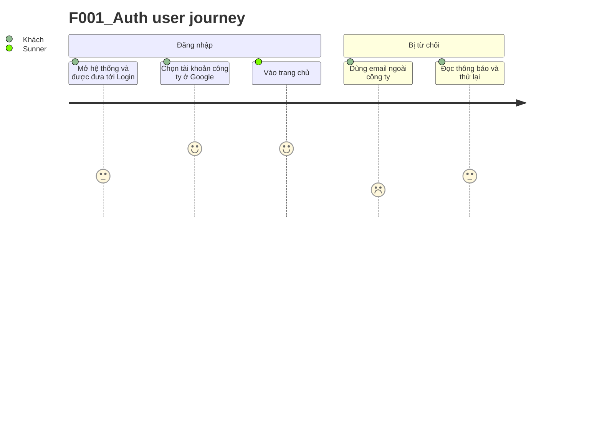

# Functional Spec — F001_Auth

**Priority**: P0
**Type**: mixed
**Generated**: 2026-11-08

**See also:** [`technical-spec.md`](./technical-spec.md) — handler, trigger, bảng dữ liệu và cách kiểm thử cho Dev/QA/SA.

**Traceability:** F001_Auth → SCR: TBD (draft) → US001_Login, US002_RejectForeignDomain, US003_FirstLoginProfile, US004_GuestRedirect, US005_Logout, US006_AdminAreaGuard → BL: TBD (draft) → ROUTE: TBD (draft) → TC: TBD (draft)

## 1. Overview

**Problem:** Hệ thống SAA 2025 là nội bộ Sun*, nên chỉ nhân viên mới được vào, và cần biết ai là ai (tên, avatar, phòng ban, vai trò) để mọi tính năng Kudos, huy hiệu, thông báo, quản trị có người dùng để gắn dữ liệu vào.
**Solution:** Sunner đăng nhập bằng tài khoản Google công ty, hệ thống tự tạo hồ sơ ở lần đầu, giữ phiên đăng nhập, chặn khách chưa đăng nhập và chặn người không phải Admin vào khu quản trị.
**Scope:** Đăng nhập Google giới hạn email `@sun-asterisk.com`; tạo hồ sơ Sunner lần đầu (role mặc định User); phiên đăng nhập và đăng xuất; chuyển khách về màn Login; phân quyền User/Admin cho khu Admin; màn Login.
**Non-Scope:** Header, footer, đổi ngôn ngữ, dropdown profile và giao diện trang 404/403 (thuộc F002_AppShell); màn Countdown prelaunch (thuộc F006_AwardsPortal); giao diện đổi role người dùng (thuộc F014_AdminUserManagement); xem hồ sơ cá nhân (thuộc F012_Profile).

**Actors**

| Actor | Description | Primary goal |
|-------|--------------|---------------|
| Khách chưa đăng nhập | Người mở hệ thống khi chưa có phiên | Đăng nhập bằng tài khoản Google công ty |
| Sunner | Nhân viên Sun* đã đăng nhập, role User | Vào hệ thống và dùng các tính năng dành cho nhân viên |
| Admin | Sunner có role Admin | Vào thêm khu quản trị mà User không vào được |

## 2. Functional Capabilities

| ID | Capability | What the user can do | User Stories | Requirements | Business Rules | Screens |
|----|------------|------------------------|-----------------|---------------|-------------------|---------|
| CAP-01 | Đăng nhập Google chỉ cho email công ty | Đăng nhập bằng Google; email ngoài công ty bị từ chối kèm thông báo rõ | US001_Login, US002_RejectForeignDomain | FR-201, FR-202, FR-203, FR-204, FR-601 | BR-001, DEC-001 | TBD (draft) |
| CAP-02 | Hồ sơ Sunner | Có hồ sơ được tạo tự động ở lần đăng nhập đầu và cập nhật lần đăng nhập cuối mỗi lần sau | US003_FirstLoginProfile | FR-001, FR-002, FR-003, FR-401, FR-402 | BR-002, BR-004, BR-005 | — |
| CAP-03 | Phiên đăng nhập và bảo vệ trang | Ở lại trong hệ thống khi đã đăng nhập, bị đưa về Login khi chưa, đăng xuất khi muốn | US004_GuestRedirect, US005_Logout | FR-101, FR-102, FR-403, FR-604 | DEC-002 | — |
| CAP-04 | Phân quyền User/Admin | Admin vào được khu quản trị; người khác nhận trang từ chối truy cập | US006_AdminAreaGuard | FR-602, FR-603 | BR-003 | — |

## 3. Open Decisions

| D### | Decision | Default proposal | Rationale | Blocks work |
|------|----------|-------------------|-----------|--------------|
| D001 | Khách chưa đăng nhập có được xem màn Countdown prelaunch không, và ai quyết định chuyển về Countdown khi chưa tới giờ mở? | Countdown công khai; F006 giữ logic "trước giờ mở"; F001 chỉ có danh sách trang công khai | Báo cáo ghi khách "chỉ thấy trang đăng nhập / đếm ngược" nên nhiều khả năng Countdown công khai | no |
| D002 | Danh sách phòng ban lấy từ đâu (nhập tay, import, đồng bộ từ hệ thống nhân sự)? | Bảng phòng ban nhập sẵn bằng seed; hồ sơ mới để phòng ban trống đến khi có nguồn | Google không trả phòng ban, không thể suy ra khi đăng nhập | yes |
| D003 | Admin đầu tiên được tạo bằng cách nào? | Đặt thủ công trong dữ liệu cho một vài tài khoản BTC; sau đó đổi qua F014 | Mặc định mọi hồ sơ là User nên cần một cửa vào ban đầu | yes |
| D004 | Phiên đăng nhập sống bao lâu (hết hạn cố định hay trượt theo hoạt động)? | Giữ đăng nhập theo mặc định của hệ thống xác thực, không đặt giới hạn riêng | Chưa có yêu cầu bảo mật cụ thể | no |
| D005 | Tên và avatar trong hồ sơ chỉ lấy lần đầu hay đồng bộ lại từ Google mỗi lần đăng nhập? | Chỉ lấy lần đầu; đổi sau này do F012 xử lý | Tránh ghi đè dữ liệu người dùng đã chỉnh | no |
| D006 | Chữ chính xác trên màn Login (nút, thông báo lỗi) và màn Login có header đổi ngôn ngữ hay không? | Lấy nguyên văn từ thiết kế Figma khi implement; header theo F002 | Bản nháp chưa đối chiếu hình, không đoán chữ | no |
| D007 | Có cần cờ vô hiệu hoá tài khoản (nhân viên nghỉ việc) trong hệ thống không? | Không; dựa vào việc Google Workspace khoá tài khoản công ty | Tránh thêm cơ chế khi chưa có nhu cầu | no |

## 4. Requirements

### Foundation (0xx)

- **FR-001** Mỗi Sunner có một hồ sơ gồm email, tên, avatar, phòng ban, role và thời điểm đăng nhập cuối.
- **FR-002** Phòng ban của hồ sơ lấy từ một danh mục phòng ban dùng chung cho toàn hệ thống.
- **FR-003** Mỗi hồ sơ có đúng một role, hoặc User hoặc Admin.

### Navigation (1xx)

- **FR-101** Khách chưa đăng nhập vào trang cần đăng nhập thì được đưa về Login, và sau khi đăng nhập quay lại đúng trang đó.
- **FR-102** Người đã đăng nhập mở màn Login thì được đưa về trang chủ.

### Login (2xx)

- **FR-201** Màn Login chỉ có một cách đăng nhập là nút đăng nhập bằng Google.
- **FR-202** Khi email không thuộc công ty, màn Login báo rõ rằng chỉ tài khoản công ty được phép.
- **FR-203** Khi đăng nhập thất bại hoặc bị huỷ, màn Login báo lỗi chung và cho thử lại.
- **FR-204** Trong lúc đang đăng nhập, nút bị khoá để không bấm đúp.

### Interaction (4xx)

- **FR-401** Lần đăng nhập đầu tiên của một email hợp lệ tự tạo hồ sơ cho người đó.
- **FR-402** Mỗi lần đăng nhập thành công cập nhật thời điểm đăng nhập cuối.
- **FR-403** Đăng xuất kết thúc phiên và đưa người dùng về Login.

### Security (6xx)

- **FR-601** Chỉ email thuộc công ty được đăng nhập, và việc này được kiểm tra ở phía máy chủ chứ không chỉ ở giao diện.
- **FR-602** Khu Admin chỉ dành cho Admin; người khác vào thì thấy trang từ chối truy cập.
- **FR-603** Vai trò của người dùng luôn được xác định ở máy chủ, không dựa vào dữ liệu người dùng tự gửi lên.
- **FR-604** Dữ liệu và thao tác của hệ thống chỉ dành cho người có phiên hợp lệ.

## 5. Business Rules

- Chỉ email `@sun-asterisk.com` được vào hệ thống; gợi ý ở màn Google chỉ để thuận tiện, kiểm tra thật nằm ở máy chủ (BR-001)
- Hồ sơ mới luôn có role User; không bao giờ tự tạo Admin (BR-002)
- Role được đọc từ dữ liệu ở máy chủ mỗi lần kiểm tra, nên đổi role có hiệu lực ngay ở lần truy cập kế tiếp (BR-003)
- Mỗi tài khoản đăng nhập có đúng một hồ sơ, đăng nhập lại không tạo thêm (BR-004)
- Mỗi lần đăng nhập thành công phải cập nhật thời điểm đăng nhập cuối, vì F014 hiển thị cột này (BR-005)
- Sau đăng nhập, người dùng về trang họ định vào nếu đó là trang nội bộ hợp lệ, ngược lại về trang chủ (DEC-001)
- Trang công khai (Login, Countdown nếu D001 xác nhận) cho đi tiếp; trang còn lại cần phiên, không có thì về Login (DEC-002)

## 6. Screens

| Screen Name | SCR### | What User Sees | What User Can Do |
|-------------|--------|-----------------|-------------------|
| Login | TBD (draft) | Màn đăng nhập thương hiệu ROOT FURTHER với một nút đăng nhập Google và vùng báo lỗi | Bấm đăng nhập Google; xem thông báo khi bị từ chối hoặc lỗi |

Bản nháp màn hình nằm ở `screens/SCR-login/spec.md`. Trang 403, 404, Countdown và dropdown profile thuộc feature khác, F001 chỉ quyết định khi nào chúng hiện ra.

### User Journey

1. Khách mở hệ thống, chưa có phiên, được đưa tới màn Login.
2. Khách bấm đăng nhập Google và chọn tài khoản công ty ở màn của Google.
3. Nếu email hợp lệ và là lần đầu, hệ thống tạo hồ sơ rồi đưa khách tới trang họ định vào hoặc trang chủ.
4. Nếu email ngoài công ty, khách quay lại Login và thấy thông báo chỉ tài khoản công ty được phép.
5. Khi muốn thoát, người dùng chọn Đăng xuất ở dropdown profile và về lại Login.



## 7. User Stories

### US001_Login — Đăng nhập bằng Google

**Actor:** Khách chưa đăng nhập
**Goal:** Đăng nhập vào hệ thống bằng tài khoản Google công ty.
**Business value:** Chỉ nhân viên Sun* vào được, không phải nhớ thêm mật khẩu.

**Acceptance Criteria:**
- [ ] Từ màn Login, chọn tài khoản `@sun-asterisk.com` thì vào được hệ thống.
- [ ] Sau khi vào, người dùng ở đúng trang họ định vào hoặc trang chủ.
- [ ] Huỷ giữa chừng thì quay về Login, có thể thử lại.

### US002_RejectForeignDomain — Từ chối email ngoài công ty

**Actor:** Khách chưa đăng nhập
**Goal:** Biết vì sao không vào được khi dùng email không thuộc công ty.
**Business value:** Giữ hệ thống nội bộ và giảm thắc mắc hỗ trợ.

**Acceptance Criteria:**
- [ ] Email ngoài công ty không vào được, kể cả khi bỏ qua gợi ý ở màn Google.
- [ ] Màn Login báo rõ chỉ tài khoản công ty được phép.
- [ ] Không có hồ sơ nào được tạo cho email đó.

### US003_FirstLoginProfile — Hồ sơ tạo tự động

**Actor:** Sunner
**Goal:** Có hồ sơ ngay sau lần đăng nhập đầu mà không phải khai báo.
**Business value:** Các tính năng sau (Kudos, huy hiệu, thông báo) có người dùng để gắn dữ liệu.

**Acceptance Criteria:**
- [ ] Lần đầu đăng nhập tạo đúng một hồ sơ với tên, avatar lấy từ Google và role User.
- [ ] Lần sau không tạo thêm hồ sơ và cập nhật thời điểm đăng nhập cuối.

### US004_GuestRedirect — Khách bị đưa về Login

**Actor:** Khách chưa đăng nhập
**Goal:** Được hướng dẫn đăng nhập khi mở trang cần phiên.
**Business value:** Nội dung nội bộ không lộ cho người chưa đăng nhập.

**Acceptance Criteria:**
- [ ] Mở trang cần đăng nhập khi chưa có phiên thì về Login.
- [ ] Đăng nhập xong quay lại đúng trang đã định vào.
- [ ] Người đã đăng nhập mở Login thì về trang chủ.

### US005_Logout — Đăng xuất

**Actor:** Sunner
**Goal:** Kết thúc phiên đăng nhập trên thiết bị đang dùng.
**Business value:** An toàn khi dùng máy chung.

**Acceptance Criteria:**
- [ ] Chọn Đăng xuất thì về Login.
- [ ] Sau đó mở lại trang cần phiên sẽ bị đưa về Login.

### US006_AdminAreaGuard — Chặn khu Admin trái quyền

**Actor:** Admin
**Goal:** Chỉ Admin dùng được khu quản trị.
**Business value:** Bảo vệ dữ liệu và thao tác kiểm duyệt khỏi người không có thẩm quyền.

**Acceptance Criteria:**
- [ ] Admin vào được khu Admin.
- [ ] User thường vào thì thấy trang từ chối truy cập.
- [ ] Đổi role có hiệu lực ở lần truy cập kế tiếp.

## 8. Scenarios

### US001_Login — Happy Path

**Given** khách ở màn Login, **When** chọn tài khoản `@sun-asterisk.com` ở màn Google, **Then** vào hệ thống và thấy trang họ định vào hoặc trang chủ.

### US001_Login — Error: huỷ giữa chừng

**Given** khách đang ở màn chọn tài khoản của Google, **When** huỷ, **Then** quay về Login và thấy thông báo lỗi chung kèm khả năng bấm đăng nhập lại.

### US002_RejectForeignDomain — Happy Path

**Given** khách ở màn Login, **When** đăng nhập bằng email ngoài công ty, **Then** quay về Login và thấy thông báo chỉ tài khoản công ty được phép.

### US002_RejectForeignDomain — Error: bỏ qua gợi ý ở màn Google

**Given** khách nhập tay một email ngoài công ty ở màn Google, **When** hoàn tất đăng nhập, **Then** vẫn bị từ chối và không có hồ sơ nào được tạo.

### US003_FirstLoginProfile — Happy Path

**Given** email công ty chưa từng đăng nhập, **When** đăng nhập thành công, **Then** hồ sơ mới có role User được tạo và người dùng vào được hệ thống.

### US003_FirstLoginProfile — Error: tạo hồ sơ thất bại

**Given** việc tạo hồ sơ gặp sự cố, **When** người dùng đăng nhập lần đầu, **Then** thấy lỗi chung ở Login và thử lại được, không bị kẹt ở trạng thái nửa vời.

### US004_GuestRedirect — Happy Path

**Given** khách chưa đăng nhập, **When** mở một trang cần phiên, **Then** về Login, và sau khi đăng nhập quay lại đúng trang đó.

### US004_GuestRedirect — Error: đích quay lại không hợp lệ

**Given** đường dẫn quay lại trỏ ra ngoài hệ thống, **When** đăng nhập xong, **Then** người dùng về trang chủ thay vì rời khỏi hệ thống.

### US005_Logout — Happy Path

**Given** người dùng đã đăng nhập, **When** chọn Đăng xuất, **Then** về Login và các trang cần phiên không còn mở được.

### US005_Logout — Error: phiên đã hết hạn

**Given** phiên đã hết hạn từ trước, **When** người dùng chọn Đăng xuất, **Then** vẫn về Login bình thường, không báo lỗi.

### US006_AdminAreaGuard — Happy Path

**Given** Admin đã đăng nhập, **When** mở khu Admin, **Then** vào được.

### US006_AdminAreaGuard — Error: User thường

**Given** User thường đã đăng nhập, **When** mở khu Admin, **Then** thấy trang từ chối truy cập (403).

## 9. Edge Cases

| Scenario | What Happens | User-Facing Message |
|----------|--------------|----------------------|
| Email ngoài công ty | Không tạo tài khoản, quay về Login | "Chỉ tài khoản công ty được phép đăng nhập" (chữ chính thức theo D006) |
| Huỷ ở màn Google hoặc lỗi mạng | Quay về Login, cho thử lại | "Đăng nhập không thành công, vui lòng thử lại" (chữ chính thức theo D006) |
| Hai tab cùng đăng nhập lần đầu | Chỉ một hồ sơ được tạo, tab còn lại đăng nhập như người đã có hồ sơ | None — xử lý im lặng |
| Phiên hết hạn khi đang dùng | Coi như chưa đăng nhập, về Login rồi quay lại trang cũ | "Phiên đăng nhập đã hết hạn, vui lòng đăng nhập lại" (chữ chính thức theo D006) |
| User thường mở khu Admin | Chặn, hiện trang 403 | "Bạn không có quyền truy cập trang này" (chữ chính thức do F002 quyết) |
| Admin bị hạ role khi đang dùng | Lần truy cập kế tiếp bị chặn như User thường | "Bạn không có quyền truy cập trang này" |
| Google không trả tên hoặc avatar | Vẫn tạo hồ sơ, tên lấy tạm theo phần đầu email, avatar để trống | None — xử lý im lặng |

## 10. Edge Behaviours to Verify

- **FR-101** → Mở trang cần phiên khi chưa đăng nhập, đăng nhập xong phải quay lại đúng trang; đích ngoài hệ thống bị bỏ qua.
- **FR-202** → Email ngoài công ty luôn bị từ chối và thấy thông báo, kể cả khi cố bỏ qua gợi ý ở màn Google.
- **FR-401** → Đăng nhập lần đầu tạo một hồ sơ; hai tab cùng lúc cũng chỉ ra một hồ sơ.
- **FR-402** → Thời điểm đăng nhập cuối thay đổi sau mỗi lần đăng nhập.
- **FR-602** → User thường không vào được khu Admin và cũng không gọi được thao tác của Admin.
- **FR-603** → Đổi role của một người thì lần truy cập kế tiếp của họ phản ánh ngay.
- **FR-604** → Khi chưa đăng nhập, không có cách nào đọc dữ liệu hệ thống.

## 11. Risks & Known Issues

| ID | Type | Description | Impact | Status |
|----|------|--------------|--------|--------|
| RISK-01 | risk | Chưa chắc việc chặn email ngoài công ty ở tầng dữ liệu cho ra thông báo lỗi đủ rõ để Login phân biệt với lỗi hệ thống | Người dùng ngoài công ty có thể thấy lỗi chung thay vì lý do cụ thể | [UNVERIFIED] |
| RISK-02 | risk | Phòng ban chưa có nguồn dữ liệu (D002) | Bộ lọc theo phòng ban ở F004, F014, F015 không có dữ liệu | [NEEDS_DOMAIN_CONFIRMATION] |

## 12. Dependencies

| Dependency | Type | Why this feature needs it | Evidence |
|------------|------|-----------------------------|----------|
| Google (tài khoản công ty) | external-service | Là nơi xác thực danh tính Sunner | FR-201, FR-601 |
| Dịch vụ xác thực và cơ sở dữ liệu (Supabase) | infrastructure | Giữ phiên, tài khoản và hồ sơ | FR-001, FR-604 |
| F002_AppShell | feature | Dựng trang 403/404, dropdown profile chứa mục Đăng xuất, header của màn Login | FR-403, FR-602 |
| F006_AwardsPortal | feature | Màn Countdown và logic trước giờ mở (D001) | DEC-002 |
| F014_AdminUserManagement | feature | Giao diện đổi role; đọc thời điểm đăng nhập cuối | BR-003, BR-005 |
| Nguồn dữ liệu phòng ban | data | Điền phòng ban cho hồ sơ | FR-002, D002 |

## 13. Configuration

```text
ALLOWED_EMAIL_DOMAIN = sun-asterisk.com   # chỉ email thuộc domain này được đăng nhập
DEFAULT_ROLE = user                       # role của hồ sơ mới
SESSION_LIFETIME = TBD (draft)            # thời gian giữ đăng nhập, chờ D004
```
