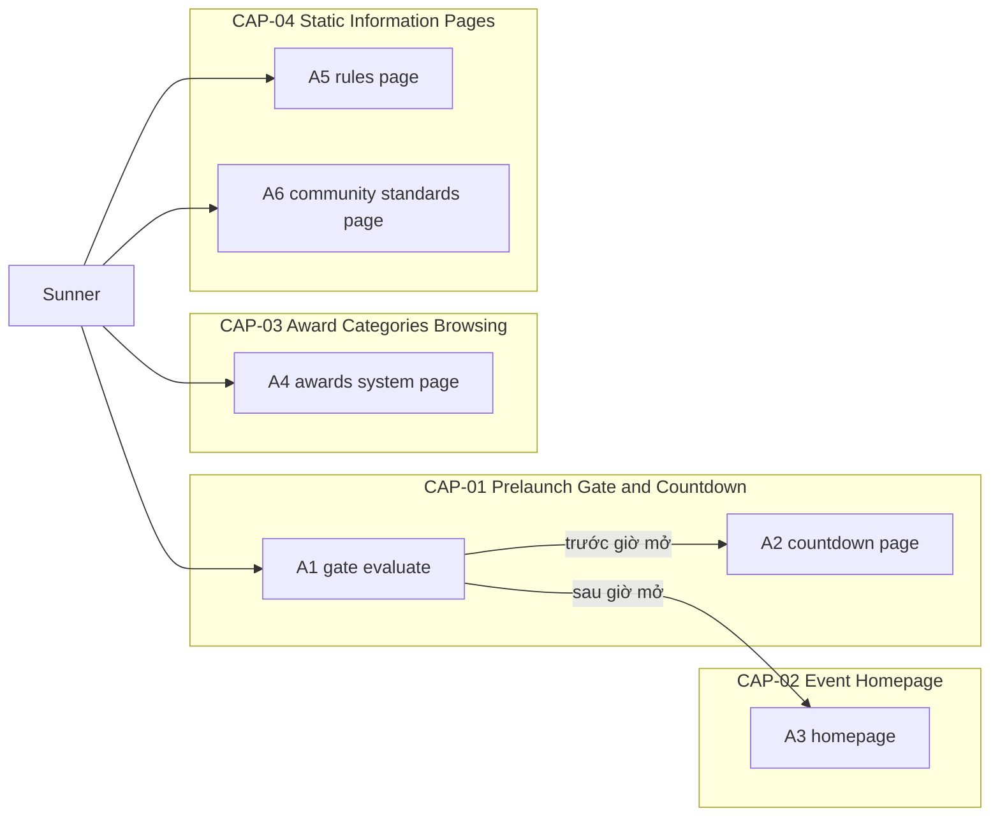

# F006_AwardsPortal — Technical Spec

**Priority**: P1
**Type**: ui
**Generated**: 2026-11-08

**See also:** [`functional-spec.md`](./functional-spec.md) — tổng quan, quyết định còn mở, yêu cầu và quy tắc nghiệp vụ dạng một dòng, màn hình, user story, kịch bản, edge case, cấu hình cho BA/QA.

**How to read this file:** § 2 là bảng chỉ mục — chọn action cần đọc rồi đọc block của nó ở § 3 từ trên xuống. § 4 là phụ lục dùng chung, chỉ nhảy vào khi một block ở § 3 trỏ tới.

## 1. Technical Overview

Cổng giải thưởng gồm năm trang server component trên Next.js 16 App Router với next-intl (vi/en), cùng một bước "cổng prelaunch" quyết định người dùng thấy Countdown hay trang thật. Nội dung gần như tĩnh: chữ nằm trong file bản dịch, dữ liệu 6 giải nằm trong một module hằng số có kiểu, dùng chung cho Homepage và trang Hệ thống giải. Feature không sở hữu bảng dữ liệu, không gọi dịch vụ ngoài; chỉ đọc giờ máy chủ và hai biến cấu hình `LAUNCH_AT`, `EVENT_AT`.



## 2. Action Index

| # | Action (handler) | Method · Path | Codes | Writes | Detail |
|---|---|---|---|---|---|
| **A0** | *cross-cutting — belongs to no single action* | — | FR-001, FR-402, FR-603 | — | § 4.4 |
| **A1** | `PrelaunchGate#evaluate` (planned) | `GET` `/(mọi route khu Sunner, trước khi vào trang)` | FR-002, FR-601, FR-602, BR-002, DEC-001 | — *(read-only)* | § 3.1 |
| **A2** | `CountdownPage#render` (planned) | `GET` `/countdown` | FR-201, FR-202, FR-203, FR-401, BR-001, DEC-002, US001_SeeCountdownBeforeLaunch | — *(read-only)* | § 3.1 |
| **A3** | `HomePage#render` (planned) | `GET` `/` | FR-101, FR-102, FR-103, FR-104, FR-211, FR-212, FR-213, FR-214, FR-215, FR-216, BR-001, BR-003, US002_ViewHomepage | — *(read-only)* | § 3.2 |
| **A4** | `AwardsSystemPage#render` (planned) | `GET` `/awards` | FR-301, FR-302, FR-303, FR-304, FR-305, FR-306, BR-003, US003_BrowseAwardCategories | — *(read-only)* | § 3.3 |
| **A5** | `RulesPage#render` (planned) | `GET` `/rules` | FR-311, FR-312, US004_ReadRules | — *(read-only)* | § 3.4 |
| **A6** | `CommunityStandardsPage#render` (planned) | `GET` `/community-standards` | FR-321, US005_ReadCommunityStandards | — *(read-only)* | § 3.4 |

**Rung set:** Who → FE → Request → BE → Rule → Result → State → Source. Rung vắng thì bỏ hẳn, không ghi N/A.

## 3. Actions

### 3.1 CAP-01 — Prelaunch Gate and Countdown

#### A1 · Evaluate prelaunch gate
`GET /(mọi route khu Sunner)` → `PrelaunchGate#evaluate` (planned)
`FR-002` `FR-601` `FR-602` `BR-002` `DEC-001` · TBD (draft) — SCR-countdown-prelaunch

**Who** · Mọi người dùng, kể cả khách chưa đăng nhập *(gate A0 — § 4.4)*
**Request** · mọi request tới route khu Sunner; chỉ đọc đường dẫn và giờ máy chủ
**BE** · `PrelaunchGate#evaluate` so giờ máy chủ với `LAUNCH_AT` (FR-002: giờ mở cấu hình được) rồi chọn chuyển hướng hay cho qua. Hàm thuần `isPrelaunch(now)` do F006 sở hữu để F001_Auth dùng trong guard (FR-602: phiên do F001 kiểm tra, F006 không tự kiểm tra phiên).
**Rule**
- **BR-002 — "Trước giờ mở" chỉ suy ra từ `now < LAUNCH_AT`, không lưu cờ ở đâu.** Đổi `LAUNCH_AT` là đổi hành vi ngay, không cần migrate hay sửa dữ liệu.

| DEC | subtype | Condition | What the user sees | Source |
|---|---|---|---|---|
| **DEC-001** | flow | `now < LAUNCH_AT AND path NOT IN allowlist(login, countdown, awards)` | Chuyển tới Countdown (FR-601: người dùng thường bị chặn khỏi trang chưa mở) | TBD (draft) |
| **DEC-001** | flow | `now < LAUNCH_AT AND path == "/awards"` | Trang Hệ thống giải (theo D002, chờ xác nhận) | TBD (draft) |
| **DEC-001** | flow | `now >= LAUNCH_AT AND path == "/countdown"` | Chuyển tới Homepage | TBD (draft) |
| **DEC-001** | flow | `now >= LAUNCH_AT` | Mọi trang như bình thường | TBD (draft) |

**Result** · read-only — **không ghi dữ liệu**; trả về chuyển hướng hoặc cho request đi tiếp.
**Source:** TBD (draft)

<!-- Không có diagram: read-only, một bước đồng bộ, không ghi bảng. -->

---

#### A2 · Render countdown page
`GET /countdown` → `CountdownPage#render` (planned)
`FR-201` `FR-202` `FR-203` `FR-401` `BR-001` `DEC-002` `US001_SeeCountdownBeforeLaunch` · TBD (draft) — SCR-countdown-prelaunch

**Who** · Khách chưa đăng nhập (nếu D001 xác nhận công khai), Sunner, Admin *(gate A1)*
**FE** · Server component truyền `serverNow` và `LAUNCH_AT` xuống `CountdownTimer` (client component). Timer hiện DAYS/HOURS/MINUTES (FR-201), tính độ lệch `serverNow − Date.now()` một lần lúc nạp (FR-401: tính theo giờ máy chủ) rồi cập nhật mỗi phút (FR-202). Hiệu ứng lật số tôn trọng `prefers-reduced-motion` *(mong muốn, chưa kiểm chứng)*. Có liên kết tới `/awards`.
**BE** · Trang chỉ render, không gọi API nào; bản dịch lấy qua next-intl.
**Rule**
- **BR-001 — Số còn lại = mốc − giờ máy chủ, làm tròn xuống ngày/giờ/phút, chặn ở 0.** Nghĩa là không bao giờ hiện số âm. *(§ 4.4)*

| DEC | subtype | Condition | What the user sees | Source |
|---|---|---|---|---|
| **DEC-002** | flow | `remaining <= 0` trên Countdown | Tự điều hướng tới Homepage (FR-203), không tải lại tay | TBD (draft) |

**Result** · read-only — không ghi dữ liệu. Trước khi JS chạy, trang vẫn hiện giá trị tính phía máy chủ.
**Source:** TBD (draft)

<!-- Không có diagram: read-only, không ghi bảng. -->

---

### 3.2 CAP-02 — Event Homepage

#### A3 · Render homepage
`GET /` → `HomePage#render` (planned)
`FR-101` `FR-102` `FR-103` `FR-104` `FR-211` `FR-212` `FR-213` `FR-214` `FR-215` `FR-216` `BR-001` `BR-003` `US002_ViewHomepage` · TBD (draft) — SCR-homepage

**Who** · Sunner, Admin *(gate A1, A0)*
**FE** · Các vùng theo thứ tự: hero (FR-211), nhãn sắp diễn ra + `CountdownTimer` tới `EVENT_AT` (FR-212), thời gian – địa điểm – livestream (FR-213), bài chủ đề (FR-214), lưới 6 thẻ giải (FR-215), banner Sun* Kudos (FR-216). Hai nút: "ABOUT AWARDS" dẫn `/awards`, "ABOUT KUDOS" dẫn Live board (FR-103). Mỗi thẻ giải: "Chi tiết" dẫn `/awards#<award-id>` (FR-102). Nút banner dẫn tới Sun* Kudos (FR-104). `/` là trang gốc sau giờ mở (FR-101).
**BE** · Đọc 6 giải từ module dữ liệu giải; chữ từ next-intl.
**Rule**
- **BR-001 — Số còn lại = mốc − giờ máy chủ, làm tròn xuống, chặn ở 0.** Ở đây mốc là `EVENT_AT`; sau mốc, timer dừng ở 00 (D005). *(§ 4.4)*
- **BR-003 — Thông tin 6 giải chỉ có một nguồn.** Thẻ ở Homepage chỉ lấy tên và mô tả ngắn từ nguồn đó, không có bản sao riêng. *(§ 4.4)*

**Result** · read-only — không ghi dữ liệu.
**Source:** TBD (draft)

<!-- Không có diagram: read-only, một request, không ghi bảng. -->

---

### 3.3 CAP-03 — Award Categories Browsing

#### A4 · Render awards system page
`GET /awards` → `AwardsSystemPage#render` (planned)
`FR-301` `FR-302` `FR-303` `FR-304` `FR-305` `FR-306` `BR-003` `US003_BrowseAwardCategories` · TBD (draft) — SCR-awards-system

**Who** · Sunner, Admin; người dùng thường trước giờ mở nếu D002 xác nhận *(gate A1, A0)*
**FE** · Hero + tiêu đề (FR-301). `AwardAnchorMenu` dính bên trái, mục đang xem được đánh dấu bằng `IntersectionObserver` (FR-302). Mỗi giải là một section có `id` ổn định để neo, gồm ảnh, tên, mô tả, "Số lượng giải thưởng", "Giá trị giải thưởng" (FR-303). Signature 2025 – Creator hiện hai dòng giá trị: cá nhân, tập thể (FR-304). Cuối trang banner Sun* Kudos (FR-306). Mobile: menu neo thành thanh chip ngang theo D009.
**BE** · Đọc 6 giải từ module dữ liệu giải (FR-305: giá trị đúng bảng ở spec màn hình SCR-awards-system § 3).
**Rule**
- **BR-003 — Thông tin 6 giải chỉ có một nguồn.** Trang này hiện đủ tên, mô tả, số lượng, giá trị, loại người nhận (cá nhân/tập thể) từ nguồn đó. *(§ 4.4)*

**Result** · read-only — không ghi dữ liệu.
**Source:** TBD (draft)

<!-- Không có diagram: read-only, không ghi bảng. -->

---

### 3.4 CAP-04 — Static Information Pages

#### A5 · Render rules page
`GET /rules` → `RulesPage#render` (planned)
`FR-311` `FR-312` `US004_ReadRules` · TBD (draft) — SCR-rules

**Who** · Sunner, Admin *(gate A1, A0)*
**FE** · Trang tĩnh: bốn bậc huy hiệu Hero (1–4 New, 5–9 Rising, 10–20 Super, >20 Legend), luật 5 tim = 1 Secret Box và thu đủ 6 biểu tượng để nhận quà bí ẩn, Kudos Quốc Dân (top 5 Kudos nhiều tim nhất) (FR-311).
**BE** · Chỉ render chữ từ next-intl; không đọc dữ liệu người dùng, không tính toán (FR-312: chỉ hiển thị). Số liệu luật thuộc F005/F009/F010 và chỉ được chép chữ ở đây, xem § 5.3.
**Result** · read-only — không ghi dữ liệu.
**Source:** TBD (draft)

---

#### A6 · Render community standards page
`GET /community-standards` → `CommunityStandardsPage#render` (planned)
`FR-321` `US005_ReadCommunityStandards` · TBD (draft) — SCR-community-standards

**Who** · Sunner, Admin *(gate A1, A0)*
**FE** · Trang tĩnh với nội dung tiêu chuẩn cộng đồng và mục "Tiêu chuẩn bảo mật" (FR-321). Nội dung đầy đủ chờ D007.
**BE** · Chỉ render chữ từ next-intl.
**Result** · read-only — không ghi dữ liệu.
**Source:** TBD (draft)

---

### 3.5 Edge cases

| Action | Scenario | Behavior |
|---|---|---|
| A1 | `LAUNCH_AT` thiếu hoặc không phải ngày giờ hợp lệ | Coi như đã mở, ghi log cảnh báo; không chặn ngầm toàn hệ thống *(đề xuất, chờ xác nhận)* |
| A1 · A2 | Hai request quanh đúng giờ mở | Mỗi request tự so giờ máy chủ; kết quả có thể khác nhau trong cùng giây, không gây lỗi |
| A2 · A3 | Tab ẩn lâu rồi quay lại | Timer tính lại từ giờ máy chủ + độ lệch đã lưu, không cộng dồn từng tick |
| A3 | Sau `EVENT_AT` | Timer dừng ở 00, ẩn nhãn sắp diễn ra (D005) |
| A3 · A4 | Ảnh giải lỗi tải | Khung thay thế, chữ vẫn hiện |
| A4 | Mục neo không khớp id nào | Trang mở từ đầu, không báo lỗi |
| A0 | Ngôn ngữ đổi khi đang xem | Chữ đổi ngay, vị trí cuộn giữ nguyên |

## 4. Shared Foundation

### 4.1 Components

| Component | Responsibility | Used in | File |
|---|---|---|---|
| `PrelaunchGate` (planned) | Quyết định chuyển hướng theo giờ mở; xuất `isPrelaunch(now)` | A1 | TBD (draft) |
| `CountdownTimer` (planned) | Client component đếm ngược DAYS/HOURS/MINUTES, dùng chung Countdown và Homepage | A2, A3 | TBD (draft) |
| `awardsData` (planned) | Một nguồn dữ liệu 6 giải: id, tên, mô tả, số lượng, giá trị, loại người nhận | A3, A4 | TBD (draft) |
| `AwardAnchorMenu` (planned) | Menu neo dính, đánh dấu mục đang xem | A4 | TBD (draft) |
| `KudosBanner` (planned) | Banner Sun* Kudos dùng ở Homepage và cuối trang Hệ thống giải | A3, A4 | TBD (draft) |

### 4.2 Data Model

None — F006 không sở hữu bảng; nội dung nằm trong file bản dịch và module hằng số. Mã `MODEL###` = TBD (draft).

N/A — no discriminator fields in Key Entities.

### 4.3 State Management

None.

### 4.4 Shared Rules

#### Bin 3 — cross-cutting, belongs to no single action

**A0 · FR-001 / FR-402 / FR-603 — Mọi trang có đủ vi/en, dùng được trên desktop và mobile, không có ô nhập chữ hay thông tin cá nhân.**
Chữ của năm trang lấy từ file bản dịch next-intl, không nhúng chữ cứng trong component. Bố cục tablet theo quyết định chung của dự án. Khung header/footer do F002_AppShell cấp, F006 không dựng lại.
**Source:** TBD (draft)

#### Bin 2 — used by ≥2 named actions

**BR-001 — Số còn lại = mốc − giờ máy chủ, làm tròn xuống ngày/giờ/phút, không âm.**
Used in: **A2** · **A3**. Mốc là `LAUNCH_AT` ở A2 và `EVENT_AT` ở A3; cả hai dùng cùng một hàm tính để hai màn không lệch nhau.
**Source:** TBD (draft)
```text
remaining_ms = max(0, target_ms - (client_now_ms + server_offset_ms))
days    = floor(remaining_ms / 86_400_000)
hours   = floor(remaining_ms / 3_600_000) % 24
minutes = floor(remaining_ms / 60_000) % 60
```

**BR-003 — Thông tin 6 giải chỉ có một nguồn (`awardsData`).**
Used in: **A3** · **A4**. Homepage lấy tên và mô tả ngắn; trang Hệ thống giải lấy toàn bộ trường. Sửa giải ở một nơi là cả hai trang đổi.
**Source:** TBD (draft)
```text
awardsData: [{ id, name, description, quantity, unitValue | valueByRecipient, recipientType }]
```

### 4.5 Algorithms & Integrations

None.

### 4.6 Configuration

```text
LAUNCH_AT = TBD (draft)             # ISO 8601 có múi giờ; giờ mở hệ thống (A1, D004)
EVENT_AT = TBD (draft)              # ISO 8601 có múi giờ; mốc đếm ngược Homepage (A3, D005)
EVENT_TIMEZONE = Asia/Ho_Chi_Minh   # múi giờ hiển thị và so sánh
COUNTDOWN_TICK_SECONDS = 60         # chu kỳ cập nhật timer (A2, A3)
```

## 5. Verification & Technical Notes

### 5.1 Technical Verification

- **SC-001** *(A1)* `LAUNCH_AT` ở tương lai: người dùng thường vào `/` bị chuyển tới `/countdown`; ở quá khứ: `/countdown` chuyển về `/` (covers FR-601, DEC-001, BR-002)
- **SC-002** *(A2, A3)* Chỉnh đồng hồ máy người dùng lệch: số còn lại không đổi (covers FR-401, BR-001)
- **SC-003** *(A2)* Đặt `LAUNCH_AT` sau hiện tại 1 phút: hết phút trang tự sang `/` (covers FR-203, DEC-002)
- **SC-004** *(A3, A4)* Sửa một giá trị trong `awardsData`: Homepage và `/awards` cùng đổi (covers BR-003, FR-305)
- **SC-005** *(A5, A6)* Hai trang tĩnh không có `<input>`/`<form>` (covers FR-603, FR-312)

#### US001_SeeCountdownBeforeLaunch *(A1, A2)*

**Independent Test:** Đặt `LAUNCH_AT` ở tương lai, vào `/`, quan sát Countdown và số phút giảm.

**Acceptance Scenarios:**

1. **Given** chưa tới giờ mở, **When** Sunner vào `/`, **Then** nhận `/countdown` với DAYS/HOURS/MINUTES.
2. **Given** Countdown đang mở, **When** tới giờ mở, **Then** tự sang `/`.

#### US002_ViewHomepage *(A3)*

**Independent Test:** Sau giờ mở, vào `/` và bấm "Chi tiết" ở từng thẻ.

**Acceptance Scenarios:**

1. **Given** đã mở, **When** bấm "Chi tiết" ở Top Talent, **Then** tới `/awards#top-talent` (id neo dự kiến).

#### US003_BrowseAwardCategories *(A4)*

**Independent Test:** Mở `/awards`, cuộn và bấm từng mục menu neo.

**Acceptance Scenarios:**

1. **Given** ở `/awards`, **When** cuộn tới giải thứ ba, **Then** mục menu tương ứng được đánh dấu.

#### US004_ReadRules *(A5)* và US005_ReadCommunityStandards *(A6)*

**Independent Test:** Mở `/rules` và `/community-standards`, so chữ với bản BTC cung cấp (D007).

**Acceptance Scenarios:**

1. **Given** đã mở, **When** mở `/rules`, **Then** thấy bốn bậc huy hiệu, Secret Box, Kudos Quốc Dân.
2. **Given** đã mở, **When** mở `/community-standards`, **Then** thấy mục Tiêu chuẩn bảo mật.

### 5.2 Assumptions

- *(A1)* F001_Auth gọi `isPrelaunch(now)` trong guard và giữ danh sách trang công khai; F006 không tự cài guard phiên (đang chờ D001 ở F001).
- *(A2, A3)* Đồng hồ máy chủ là chuẩn; độ lệch với máy người dùng chỉ tính một lần lúc nạp trang.
- *(A3, A4)* Id neo của giải (ví dụ `top-talent`) ổn định và không dịch theo ngôn ngữ.

### 5.3 Unresolved Questions

1. **`middleware` hay `proxy` trong Next.js 16** *(A1)*: AGENTS.md nói phiên bản này có breaking change; phải đọc `node_modules/next/dist/docs/` để biết tên file và API chuyển hướng đúng trước khi code cổng prelaunch.
2. **Đếm ngược chạy ở client hay streaming** *(A2, A3)*: chưa chốt cách truyền `serverNow` mà không làm trang mất cache tĩnh.
3. **Luật Thể lệ lệch số liệu gốc** *(A5)*: chép tay chữ vào bản dịch hay đọc hằng số của F009/F010 khi các feature đó có code (RISK-02).
4. **Cách lấy ảnh giải** *(A3, A4)*: xuất từ thiết kế vào repo hay lưu ở Supabase Storage.

### 5.4 Source References

Chưa có mã nguồn — xem `## 7. User Stories` trong functional-spec.md để biết hành vi dự kiến.

### 5.5 Artifact References

| Artifact | File | Codes Used | Reviewed |
|----------|------|------------|----------|
| System Overview | TBD (draft) | — | [ ] |
| Architecture | TBD (draft) | — | [ ] |
| Feature List | [feature-list.md](../feature-list.md) | F006 | [x] |
| API Map | TBD (draft) | TBD (draft) | [ ] |
| Entities | TBD (draft) | TBD (draft) | [ ] |
| Screens | [functional-spec.md § 6](./functional-spec.md#6-screens) | TBD (draft) | [ ] |
| Behavior Logic | TBD (draft) | TBD (draft) | [ ] |
| Permissions Matrix | TBD (draft) | TBD (draft) | [ ] |
| User Stories | TBD (draft) | TBD (draft) | [ ] |
