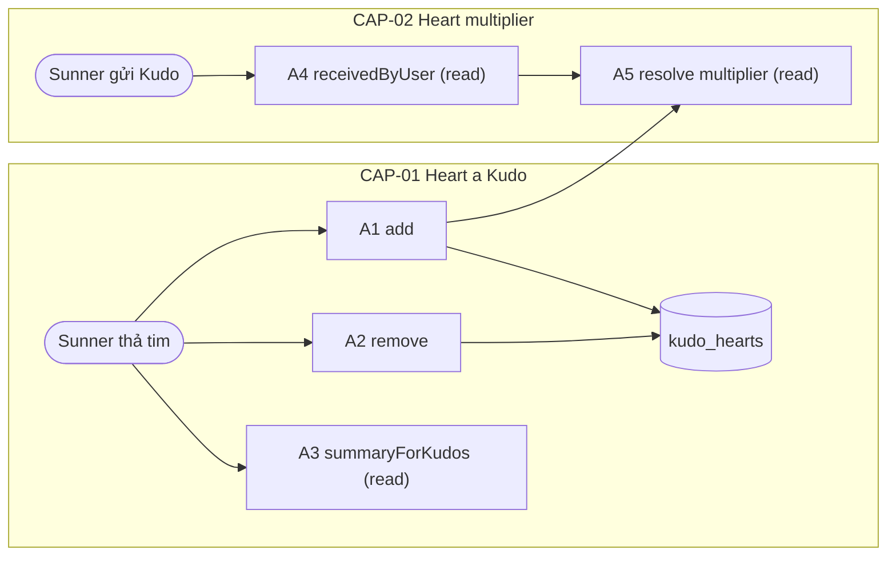
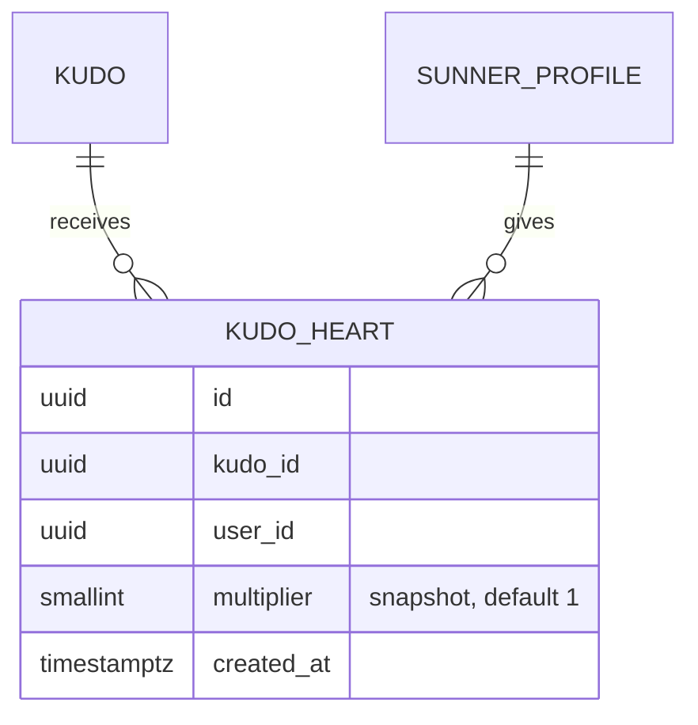
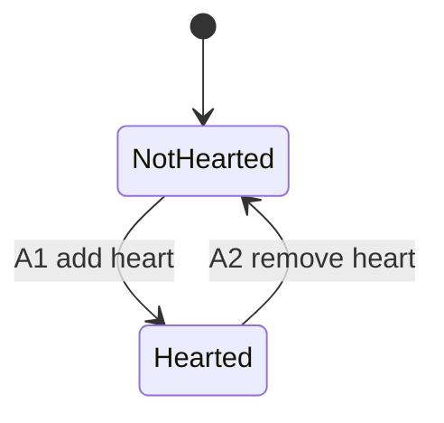

# F005_KudosHearts — Technical Spec

**Priority**: P1
**Type**: mixed
**Generated**: 2026-11-08

**See also:** [`functional-spec.md`](./functional-spec.md) — tổng quan, quyết định còn mở, yêu cầu/quy tắc nghiệp vụ dạng một dòng, user story, kịch bản, edge case cho BA/QA.

**How to read this file:** § 2 là bảng chỉ mục action; đọc khối tương ứng ở § 3 từ đầu đến cuối. § 4 là phụ lục dùng chung, chỉ nhảy vào khi § 3 trỏ tới.

## 1. Technical Overview

Feature cho Sunner đã đăng nhập thả/bỏ tim cho Kudo công khai, đếm tim an toàn khi nhiều request đồng thời, và gắn cho mỗi tim một hệ số (1, hoặc 2 khi chiến dịch "Ngày x2 tim" đang chạy). Tầng dữ liệu là một bảng `kudo_hearts` với ràng buộc duy nhất (kudo, user) trên Postgres (Supabase, Drizzle); tầng giao diện là nút tim (client component, cập nhật lạc quan) nhúng trong thẻ Kudo của F004. Feature chỉ ĐỌC chiến dịch hiệu lực qua một bộ đọc có sẵn mặc định "không có chiến dịch" nên chạy được khi F011 chưa tồn tại.



## 2. Action Index

| # | Action (handler) | Method · Path | Codes | Writes | Detail |
|---|---|---|---|---|---|
| **A0** | *cross-cutting — belongs to no single action* | — | FR-601, FR-602 | — | § 4.4 |
| **A1** | `KudoHeartController#add` (planned) | `PUT` `/api/kudos/:kudoId/heart` | FR-001, FR-002, FR-401, FR-403, FR-404, FR-405, BR-001, BR-002, BR-003, BR-004, SM-001, US001, US004 | `kudo_hearts` | § 3.1 |
| **A2** | `KudoHeartController#remove` (planned) | `DELETE` `/api/kudos/:kudoId/heart` | FR-402, FR-403, SM-001, US002 | `kudo_hearts` | § 3.1 |
| **A3** | `KudoHeartQuery#summaryForKudos` (planned) | — | FR-101, FR-201, FR-202, DEC-001, US003 | — *(read-only)* | § 3.1 |
| **A4** | `HeartStatsQuery#receivedByUser` (planned) | — | FR-301, FR-302, US005 | — *(read-only)* | § 3.2 |
| **A5** | `HeartMultiplierResolver#resolve` (planned) | — | FR-003, FR-302, FR-406, BR-005, DEC-002, ALG-001, US004 | — *(read-only)* | § 3.2 |

## 3. Actions

### 3.1 CAP-01 — Heart a Kudo

#### A1 · Add heart
`PUT /api/kudos/:kudoId/heart` → `` `KudoHeartController#add` (planned) ``
`FR-001` `FR-002` `FR-401` `FR-403` `FR-404` `FR-405` `BR-001` `BR-002` `BR-003` `BR-004` `SM-001` `US001` `US004`

**Who** · Sunner đã đăng nhập, thả tim dưới danh nghĩa chính mình (US001 — thả tim; US004 — tim thả trong chiến dịch x2 mang hệ số 2) *(gate A0 — § 4.4)*
**FE** · `KudoHeartButton` (client component trong thẻ Kudo của F004) đổi trạng thái ngay (cập nhật lạc quan, FR-401), gọi API, hoàn lại trạng thái cũ và hiện thông báo khi lỗi; chặn bấm lại khi request đang bay.
**Request** · param `kudoId` *(uuid, trong đường dẫn)*, không có body. Đáp: `{ heartCount, heartedByMe }`.
**BE** · `` `KudoHeartService#add` `` gọi A5 lấy hệ số rồi chạy MỘT câu `INSERT ... SELECT ... FROM kudos WHERE id = kudoId AND status = 'public' AND sender_id <> userId ON CONFLICT (kudo_id, user_id) DO NOTHING`. Nếu không chèn được dòng nào thì tra lại để phân biệt "đã có tim" (thành công, idempotent) với "Kudo không tồn tại/không Public" hoặc "Kudo của chính mình".
**Rule**
- **BR-001 — Một Sunner chỉ có tối đa một tim cho một Kudo.** Ràng buộc duy nhất `(kudo_id, user_id)` của Postgres đảm bảo; thả lần hai là no-op, không lỗi (FR-001, FR-403).
- **BR-002 — Người gửi không tự thả tim Kudo của mình.** Điều kiện `sender_id <> userId` nằm ngay trong câu chèn nên kiểm tra và ghi là một bước nguyên tử; áp dụng cả Kudo ẩn danh vì so sánh bằng id nội bộ (FR-405).
- **BR-003 — Chỉ Kudo Public nhận tim mới.** Điều kiện `status = 'public'` trong cùng câu chèn, nên Mark Spam xen giữa không để lọt tim (FR-404).
- **BR-004 — Hệ số được chốt lúc thả.** Cột `multiplier` ghi giá trị A5 trả về tại thời điểm xử lý và không bao giờ cập nhật lại (FR-002).

**Result**
- Writes `kudo_hearts` (`kudo_id`, `user_id`, `multiplier`, `created_at`) ← `multiplier` từ A5.
- Lỗi dự kiến: 401 chưa đăng nhập; 404 Kudo không tồn tại hoặc không Public; 403 tự thả tim Kudo của mình.
- User sees: tim tô đầy, số tim cộng một.
**Source:** TBD (draft)

<!-- No diagram: below threshold — ghi một bảng, đồng bộ, không phải async. -->

---

#### A2 · Remove heart
`DELETE /api/kudos/:kudoId/heart` → `` `KudoHeartController#remove` (planned) ``
`FR-402` `FR-403` `SM-001` `US002`

**Who** · Sunner đã đăng nhập, bỏ tim đã thả của chính mình (US002 — bỏ tim) *(gate A0 — § 4.4)*
**FE** · `KudoHeartButton` ở trạng thái đã thả; bấm lại thì đổi sang trống ngay, hoàn lại khi lỗi (FR-402).
**Request** · param `kudoId` *(uuid)*. Đáp: `{ heartCount, heartedByMe }`.
**BE** · `` `KudoHeartService#remove` `` chạy `DELETE FROM kudo_hearts WHERE kudo_id = kudoId AND user_id = userId`; không có dòng nào cũng trả thành công (idempotent). Không kiểm tra trạng thái Kudo để người dùng luôn rút được tim.
**Result**
- Xoá đúng một dòng `kudo_hearts` (kéo theo hệ số của tim đó bị trừ khỏi tổng).
- User sees: tim trống, số tim giảm một.
**Source:** TBD (draft)

<!-- No diagram: below threshold — một bảng, đồng bộ. -->

---

#### A3 · Heart summary for a list of Kudos
`—` → `` `KudoHeartQuery#summaryForKudos` (planned) ``
`FR-101` `FR-201` `FR-202` `DEC-001` `US003`

**Who** · Sunner đã đăng nhập xem feed/chi tiết (US003 — xem số tim và trạng thái đã thả) *(gate A0)*
**FE** · `KudoHeartButton` nhận `heartCount`, `heartedByMe`, `isOwnKudo` từ bộ nạp dữ liệu của F004 (FR-101 nút có trên mọi thẻ; FR-201 hiện số tim và trạng thái; FR-202 vô hiệu hoá khi là Kudo của mình).
**Request** · gọi trong tiến trình bởi bộ nạp feed của F004: `kudoIds[]` *(một trang, vài chục id)* và `viewerId`.
**BE** · `` `KudoHeartQuery#summaryForKudos` `` chạy một truy vấn `SELECT kudo_id, count(*), bool_or(user_id = viewerId) ... WHERE kudo_id IN (...) GROUP BY kudo_id`. Số đếm là số tim thô (số người đã thả), không nhân hệ số.
**Rule** · quyết định cách vẽ nút tim:

| DEC | subtype | Condition | What the user sees | Source |
|---|---|---|---|---|
| **DEC-001** | render | `kudo.senderId == viewer.id` | nút tim mờ, không bấm được, có chú thích lý do; ngược lại nút bấm được, tô đầy nếu `heartedByMe` | TBD (draft) |

**Result** · read-only — **no DB write**. Kudo không có tim trả `0`/`false`.
**Source:** TBD (draft)

<!-- No diagram: read-only, một truy vấn. -->

---

### 3.2 CAP-02 — Heart multiplier

#### A4 · Received hearts total
`—` → `` `HeartStatsQuery#receivedByUser` (planned) ``
`FR-301` `FR-302` `US005`

**Who** · Sunner gửi Kudo xem thống kê cá nhân (US005 — xem tổng tim nhận được); F010 gọi cùng hàm này để tính Secret Box *(gate A0)*
**FE** · vùng thống kê tim trong panel của F010 hiện tổng và nhãn "x2" khi A5 báo chiến dịch đang chạy (FR-301, FR-302).
**Request** · param `userId` *(người gửi)*.
**BE** · `` `HeartStatsQuery#receivedByUser` `` chạy `SELECT sum(h.multiplier), count(*) FROM kudo_hearts h JOIN kudos k ON k.id = h.kudo_id WHERE k.sender_id = userId AND k.status = 'public'` và gọi A5 chỉ để lấy cờ "chiến dịch đang chạy" cho nhãn. Trả cả tổng đã nhân hệ số lẫn số thô để F010 chọn (D005).
**Result** · read-only — **no DB write**. Kudo không còn Public bị loại khỏi tổng nhưng bản ghi tim còn nguyên, Un Spam thì tính lại (D006).
**Source:** TBD (draft)

<!-- No diagram: read-only, một truy vấn. -->

---

#### A5 · Resolve heart multiplier
`—` → `` `HeartMultiplierResolver#resolve` (planned) ``
`FR-003` `FR-302` `FR-406` `BR-005` `DEC-002` `ALG-001` `US004`

**Who** · *không có tác nhân người — hàm nội bộ gọi bởi A1 và A4* (US004 — tim thả trong chiến dịch x2 được nhân đôi)
**FE** · *none*
**Request** · `now` *(timestamp máy chủ)*.
**BE** · `` `HeartMultiplierResolver#resolve` `` hỏi `ActiveCampaignReader` (giao diện do F005 khai báo, cài đặt mặc định luôn trả `null`; F011 thay bằng bản đọc bảng chiến dịch khi được build).
**Rule**
- **BR-005 — Hệ số là 2 khi có chiến dịch x2 đang hiệu lực, còn lại là 1.** Theo `ALG-001` (tính hệ số từ chiến dịch đang hiệu lực) *(§ 4.5)* (FR-003, FR-406).

| DEC | subtype | Condition | What the user sees | Source |
|---|---|---|---|---|
| **DEC-002** | flow | `activeCampaign(now) != null` | có chiến dịch: hệ số 2 và nhãn "x2"; không có hoặc đọc lỗi: hệ số 1, không báo lỗi | TBD (draft) |

**Result** · read-only — **no DB write**. Đọc chiến dịch lỗi thì ghi log và dùng hệ số 1 (ưu tiên để tim luôn thả được).
**Source:** TBD (draft)

<!-- No diagram: read-only, một lời gọi. -->

---

### 3.3 Edge cases

| Action | Scenario | Behavior |
|---|---|---|
| A1 | Bấm tim hai lần liên tiếp / hai tab cùng lúc | Ràng buộc duy nhất + `ON CONFLICT DO NOTHING`: một dòng, cả hai request trả thành công (BR-001) |
| A1 · A2 | Thả và bỏ tim cùng lúc | Thứ tự do Postgres tuần tự hoá; trạng thái cuối khớp với request đến sau, số đếm luôn tính từ dòng thực tế nên không lệch |
| A1 | Kudo bị Mark Spam xen giữa lúc bấm | Điều kiện `status = 'public'` trong câu chèn: không chèn, trả 404, FE hoàn lại |
| A1 | Chiến dịch hết giờ ngay lúc xử lý | Hệ số chốt theo `now` khi A5 chạy, sai lệch tối đa vài trăm ms được chấp nhận |
| A1 | A5 báo lỗi / F011 chưa có | Hệ số 1, tim vẫn được ghi |
| A2 | Bỏ tim chưa từng thả | Không xoá gì, trả thành công |
| A3 | Truy vấn tim lỗi | F004 vẫn render thẻ Kudo, vùng tim hiện trạng thái lỗi nhẹ |
| A1-A5 | Gọi khi chưa đăng nhập | 401 từ cổng chung (A0 — § 4.4) |

## 4. Shared Foundation

### 4.1 Components

| Component | Responsibility | Used in | File |
|---|---|---|---|
| `KudoHeartController` | Route handler cho thả/bỏ tim, kiểm tra session, map lỗi sang mã HTTP | A1, A2 | TBD (draft) |
| `KudoHeartService` | Chèn/xoá tim nguyên tử, tra lý do khi chèn không thành | A1, A2 | TBD (draft) |
| `KudoHeartQuery` | Đếm tim và `heartedByMe` theo lô Kudo | A3 | TBD (draft) |
| `HeartStatsQuery` | Tổng tim nhận được đã nhân hệ số của một người gửi | A4 | TBD (draft) |
| `HeartMultiplierResolver` | Chọn hệ số theo chiến dịch hiệu lực | A1, A4, A5 | TBD (draft) |
| `ActiveCampaignReader` | Giao diện đọc chiến dịch hiệu lực; mặc định trả `null` | A5 | TBD (draft) |
| `KudoHeartButton` | Client component: nút tim, cập nhật lạc quan, hoàn lại khi lỗi | A1, A2, A3 | TBD (draft) |

### 4.2 Data Model



| Entity | Table | Used for | Action |
|---|---|---|---|
| `KudoHeart` | `kudo_hearts` | Một tim của một Sunner cho một Kudo, kèm hệ số chốt lúc thả. `UNIQUE (kudo_id, user_id)`, index trên `kudo_id`, `CHECK (multiplier >= 1)`, khoá ngoại tới `kudos` và hồ sơ Sunner (do F003/F001 sở hữu) | A1-A4 |

Không thêm cột đếm phi chuẩn hoá vào bảng `kudos` (thuộc F003): đếm bằng truy vấn tổng hợp, đủ cho quy mô công ty. Chỉ bổ sung khi đo thấy chậm (§ 5.3).

#### Polymorphic Behavior

N/A — no discriminator fields in Key Entities.

### 4.3 State Management

### Heart lifecycle: a heart row exists only while the Sunner has hearted the Kudo (SM-001)
**kind:** entity
**Linked FR:** FR-401
**Source:** TBD (draft)



**Action transitions:** guard và tác dụng phụ của từng cạnh nằm ở rung **Result** của action nêu trên cạnh (§ 3.1), không lặp lại ở đây.

### 4.4 Shared Rules

#### Bin 3 — cross-cutting, belongs to no single action

**A0 · FR-601 / FR-602 — Mọi action chỉ chạy với Sunner đã đăng nhập và chỉ dưới danh nghĩa chính họ.**
Route handler đọc session Supabase Auth do F001 cung cấp và lấy `userId` từ session, không bao giờ từ body hay đường dẫn; thiếu session trả 401 trước khi đụng cơ sở dữ liệu. RLS trên `kudo_hearts` (`user_id = auth.uid()`) làm lớp phòng thủ thứ hai nếu sau này có truy cập trực tiếp từ client. **Not a rule of this feature** — cổng này dùng chung toàn hệ thống.
**Source:** TBD (draft)

#### Bin 2 — used by ≥2 named actions

Chưa có quy tắc dùng chung bởi từ hai action trở lên ở bản nháp này.

### 4.5 Algorithms & Integrations

### Resolve the heart multiplier from the active campaign (ALG-001)
**Linked FR:** FR-406
**Used in:** A1, A4, A5
**Source:** TBD (draft)
**Input:** `now` (timestamp) · **Output:** số nguyên hệ số (1 hoặc 2) · **Complexity:** O(1)
**Description:** Trả hệ số nhân của một tim thả tại `now`. Bất biến: không bao giờ ném lỗi ra ngoài và không bao giờ trả giá trị nhỏ hơn 1, để việc thả tim không phụ thuộc vào F011.

**Pseudocode:**
```text
resolve(now):
  try:
    campaign = activeCampaignReader.findActive(now)   # null nếu F011 chưa có / không có chiến dịch
  catch:
    log warning; return DEFAULT_HEART_MULTIPLIER      # 1
  if campaign is null: return DEFAULT_HEART_MULTIPLIER
  return HEART_CAMPAIGN_MULTIPLIER                    # 2, mọi chiến dịch trùng giờ vẫn là 2
```

### 4.6 Configuration

```text
HEART_CAMPAIGN_MULTIPLIER = 2   # hệ số khi chiến dịch x2 đang chạy (A5)
DEFAULT_HEART_MULTIPLIER = 1    # hệ số mặc định (A5)
```

## 5. Verification & Technical Notes

### 5.1 Technical Verification

- **SC-001** *(A1, A2)* Gửi 20 request thả tim song song cho cùng (kudo, user) để lại đúng một dòng, mọi request thành công (covers FR-001, FR-403, BR-001)
- **SC-002** *(A1)* Người gửi thả tim Kudo của mình bị 403, Kudo Spam bị 404, không sinh dòng nào (covers FR-404, FR-405, BR-002, BR-003)
- **SC-003** *(A1, A5)* Khi không có chiến dịch (kể cả F011 chưa tồn tại) `multiplier = 1`; có chiến dịch hiệu lực `multiplier = 2` và giữ nguyên sau khi chiến dịch kết thúc (covers FR-002, FR-003, FR-406, BR-004, BR-005)
- **SC-004** *(A4)* Tổng nhận được bằng tổng `multiplier` của tim trên Kudo Public của người gửi (covers FR-301)
- **SC-005** *(A0)* Request không có session nhận 401 và không ghi gì (covers FR-601, FR-602)

#### US001_HeartKudo *(A1, A5)*

**Independent Test:** Đăng nhập một Sunner, thả tim Kudo của người khác, kiểm tra một dòng `kudo_hearts` với `multiplier` đúng và số tim tăng một.

**Acceptance Scenarios:**

1. **Given** Kudo Public của người khác chưa có tim của mình, **When** gọi thêm tim, **Then** có đúng một dòng và `heartCount` tăng một.
2. **Given** chiến dịch x2 đang hiệu lực, **When** gọi thêm tim, **Then** dòng mới có `multiplier = 2`.

#### US002_UnheartKudo *(A2)*

**Independent Test:** Thả tim rồi bỏ, kiểm tra dòng biến mất; bỏ lần hai vẫn thành công.

**Acceptance Scenarios:**

1. **Given** đã thả tim, **When** gọi bỏ tim, **Then** dòng bị xoá và `heartCount` giảm một.
2. **Given** chưa thả tim, **When** gọi bỏ tim, **Then** trả thành công và không đổi gì.

### 5.2 Assumptions

- *(A1)* Quy mô công ty (vài nghìn Sunner) đủ để đếm tim bằng truy vấn tổng hợp có index, không cần cột đếm phi chuẩn hoá.
- *(A1, A5)* Giờ máy chủ là nguồn thời gian duy nhất để xác định chiến dịch hiệu lực; sai lệch vài trăm ms ở biên chấp nhận được.
- *(A3)* F004 gọi A3 trong tiến trình bộ nạp feed (server component), không qua HTTP riêng.

### 5.3 Unresolved Questions

1. **Quy ước Next.js 16** *(A1, A2)*: chọn Route Handler hay Server Action cho thả/bỏ tim, và cách truyền session; phải đọc tài liệu trong `node_modules/next/dist/docs/` trước khi code (AGENTS.md cảnh báo có thay đổi lớn).
2. **Sắp xếp theo tim cho Highlight/Kudos Quốc Dân** *(A3)*: truy vấn tổng hợp có đủ nhanh khi sắp xếp toàn bộ Kudo theo tim không, hay cần cột đếm hoặc materialized view.
3. **Chủ sở hữu `ActiveCampaignReader`** *(A5)*: F005 khai báo giao diện và bản mặc định, F011 cung cấp bản thật; cần thống nhất khi promote để không trùng lặp.
4. **Giới hạn tần suất** *(A1, A2)*: có cần rate limit mỗi người dùng để chống bấm đi bấm lại (xem RISK-01 ở functional-spec.md) hay chỉ dựa vào ràng buộc duy nhất.

### 5.4 Source References

Chưa có mã nguồn — xem `## 7. User Stories` trong functional-spec.md để biết hành vi dự kiến.

### 5.5 Artifact References

| Artifact | File | Codes Used | Reviewed |
|----------|------|------------|----------|
| System Overview | TBD (draft) | — | [ ] |
| Architecture | TBD (draft) | — | [ ] |
| Feature List | [feature-list.md](../feature-list.md) | F005 | [x] |
| API Map | TBD (draft) | TBD (draft) | [ ] |
| Entities | TBD (draft) | TBD (draft) | [ ] |
| Screens | [functional-spec.md § 6](./functional-spec.md#6-screens) | TBD (draft) | [ ] |
| Behavior Logic | TBD (draft) | TBD (draft) | [ ] |
| Permissions Matrix | TBD (draft) | TBD (draft) | [ ] |
| User Stories | TBD (draft) | US001, US002, US003, US004, US005 | [ ] |

**Rule:** Mọi mã trong Codes Used phải tồn tại trong artifact nguồn; ở bản nháp, ô chưa có artifact để đối chiếu ghi `TBD (draft)`.
