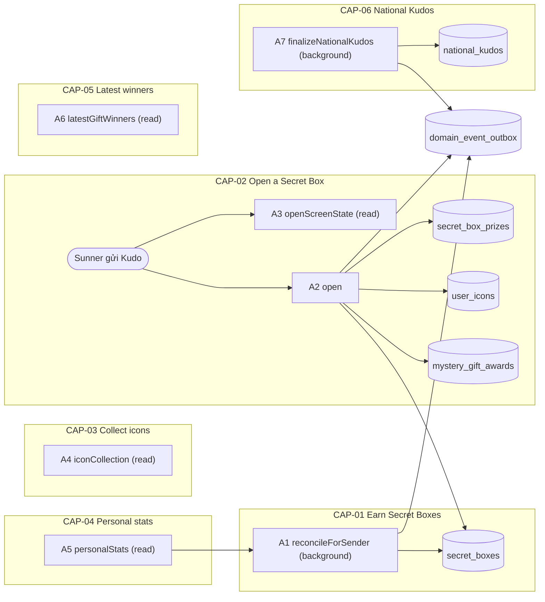
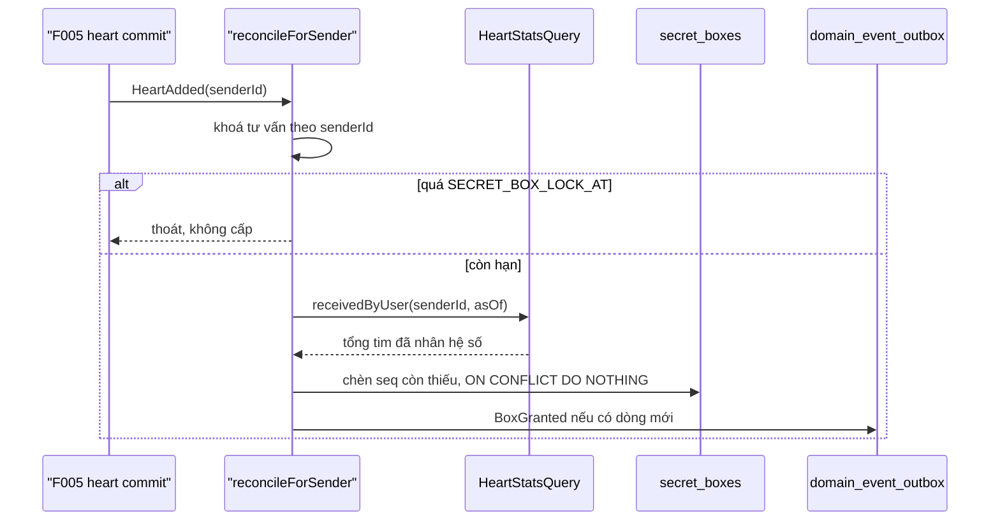
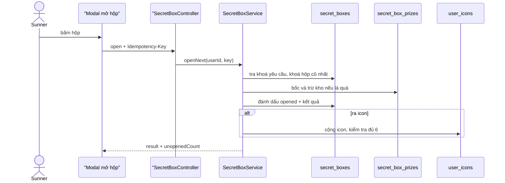
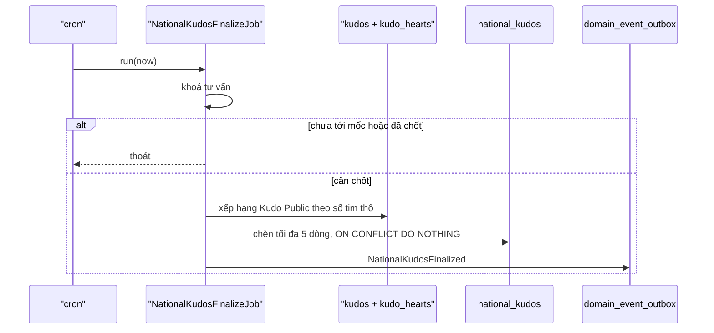
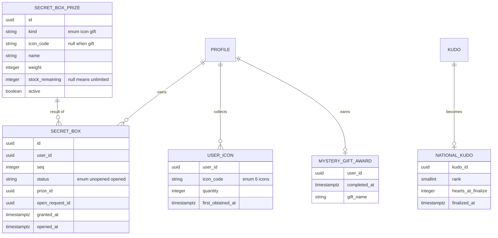
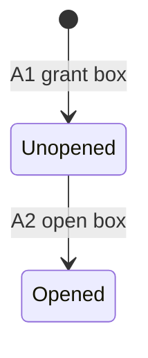
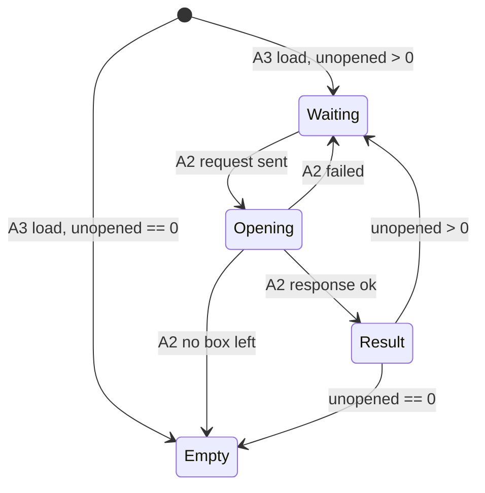

# F010_SecretBoxRewards — Technical Spec

**Priority**: P2
**Type**: mixed
**Generated**: 2026-11-08

**See also:** [`functional-spec.md`](./functional-spec.md) — tổng quan, quyết định còn mở, yêu cầu/quy tắc nghiệp vụ dạng một dòng, màn hình, user story, kịch bản, edge case và cấu hình cho BA/QA.

**How to read this file:** § 2 là bảng chỉ mục action; đọc khối tương ứng ở § 3 từ đầu đến cuối. § 4 là phụ lục dùng chung, chỉ nhảy vào khi § 3 trỏ tới.

## 1. Technical Overview

Feature quy đổi tổng tim nhận được của người gửi (đọc từ F005) thành Secret Box, cho Sunner mở hộp để bốc icon hoặc quà hiện vật, thu thập bộ 6 icon để nhận quà bí ẩn, hiển thị bảng thống kê cá nhân cùng danh sách 10 Sunner nhận quà mới nhất, và chốt 5 Kudos Quốc Dân. Dữ liệu nằm ở Postgres (Supabase, Drizzle); mọi thao tác cấp hộp, mở hộp, chốt đều chạy trong giao dịch với ràng buộc duy nhất làm chốt chặn cuối, nên chạy lặp hay song song vẫn không cấp thừa, không mở đôi. Kết quả bốc chỉ do máy chủ quyết định. Giao diện là hai vùng nhúng trong cột phải của trang Live board (F004), một modal mở hộp, và một thành phần bộ sưu tập icon dùng lại ở profile (F012). Feature phát sự kiện miền (hộp mới cấp, đủ 6 icon, Kudos Quốc Dân chốt) cho F013 qua bảng outbox, không gọi thẳng F013.



## 2. Action Index

| # | Action (handler) | Method · Path | Codes | Writes | Detail |
|---|---|---|---|---|---|
| **A0** | *cross-cutting — belongs to no single action* | — | FR-601 | — | § 4.4 |
| **A1** | `SecretBoxGrantService#reconcileForSender` (planned) *(background, no FE)* | event · `HeartAdded` (trong tiến trình, sau commit của F005) và gọi trực tiếp từ A5 | FR-001, FR-401, FR-405, FR-407, BR-001, BR-002, BR-006, BR-007, SM-001, ALG-001, INT-001, INT-002, US002_EarnSecretBox | `secret_boxes`, `domain_event_outbox` | § 3.1 ▸ **diagram** |
| **A2** | `SecretBoxController#open` (planned) | `POST` `/api/secret-boxes/open` | FR-002, FR-003, FR-004, FR-302, FR-304, FR-402, FR-403, FR-404, FR-408, FR-602, BR-003, BR-004, BR-005, DEC-002, SM-001, ALG-002, INT-002, US003_OpenSecretBox, US004_CollectIcons | `secret_boxes`, `secret_box_prizes`, `user_icons`, `mystery_gift_awards`, `domain_event_outbox` | § 3.2 ▸ **diagram** |
| **A3** | `SecretBoxQuery#openScreenState` (planned) | `GET` `/api/secret-boxes/me` | FR-102, FR-301, FR-303, SM-002, US003_OpenSecretBox | — *(read-only)* | § 3.2 |
| **A4** | `IconCollectionQuery#forUser` (planned) | — | FR-207, US004_CollectIcons | — *(read-only)* | § 3.3 |
| **A5** | `PersonalRewardStatsQuery#forUser` (planned) | — | FR-101, FR-201, FR-202, FR-203, DEC-001, INT-001, US001_ViewPersonalStats | — *(ghi gián tiếp qua A1, bản thân không ghi)* | § 3.4 |
| **A6** | `LatestGiftWinnersQuery#top10` (planned) | — | FR-204, FR-205, FR-206, FR-604, BR-009, DEC-003, US005_ViewLatestGiftWinners | — *(read-only)* | § 3.5 |
| **A7** | `NationalKudosFinalizeJob#run` (planned) *(background, no FE)* | scheduled · `cron` | FR-406, FR-603, BR-007, BR-008, ALG-003, INT-002, US006_NationalKudos | `national_kudos`, `domain_event_outbox` | § 3.6 ▸ **diagram** |

**Rung set** theo template: Who → FE → Request → BE → Rule → Result → State → Source. Rung vắng thì bỏ hẳn. **State** bỏ trong bản nháp vì chưa có nguồn xác nhận.

## 3. Actions

### 3.1 CAP-01 — Earn Secret Boxes

#### A1 · Reconcile Secret Boxes for a sender *(background, no FE)*
`event · HeartAdded` → `` `SecretBoxGrantService#reconcileForSender` (planned) ``
`FR-001` `FR-401` `FR-405` `FR-407` `BR-001` `BR-002` `BR-006` `BR-007` `SM-001` `US002_EarnSecretBox`

**Who** · *không có người dùng trực tiếp — chạy khi F005 báo một tim vừa được thả cho Kudo của người gửi (US002_EarnSecretBox — cấp hộp khi đủ tim), khi F007 Un Spam một Kudo, và khi A5 mở bảng thống kê (đường dự phòng nếu sự kiện bị lỡ)*
**BE** · `` `SecretBoxGrantService#reconcileForSender` `` lấy khoá tư vấn theo người dùng, đọc tổng tim đã nhân hệ số của người gửi qua `INT-001` (cổng đọc tổng tim do F005 cung cấp), tính số hộp đáng được cấp theo `ALG-001` rồi chèn các dòng `secret_boxes` còn thiếu và một dòng `domain_event_outbox` nếu có hộp mới. Hàm chạy lặp bao nhiêu lần cũng cho cùng kết quả.
**Rule**
- **BR-001 — Số hộp cấp bằng phần nguyên của tổng tim chia 5, trừ số hộp đã cấp.** Mỗi hộp mang số thứ tự `seq` của người dùng và ràng buộc duy nhất `(user_id, seq)` chặn cấp trùng một mốc dù hai tiến trình chạy song song (FR-001, FR-401).
- **BR-002 — Hộp đã cấp không thu hồi.** Tính lại chỉ thêm hộp, không bao giờ xoá hay đổi hộp đã có; tim bị bỏ hoặc Kudo bị Spam sau đó chỉ làm chậm hộp kế tiếp (D002).
- **BR-006 — Sau mốc khoá không cấp hộp mới.** Hàm kiểm `now` với `SECRET_BOX_LOCK_AT` và thoát sớm; tổng tim được đọc với tham số `asOf` bằng `min(now, SECRET_BOX_LOCK_AT)` để tim thả sau mốc không tính (FR-405, xem § 5.3 mục 2).
- **BR-007 — Kudo ẩn danh vẫn được tính cho người gửi.** Tổng tim của F005 tính theo người gửi nội bộ, không phụ thuộc cờ ẩn danh, nên hộp vẫn được cấp; danh tính chỉ ẩn ở lớp hiển thị. *(§ 4.4)*
**Result**
- Writes `secret_boxes` (`user_id`, `seq`, `status = unopened`, `granted_at`) cho mỗi mốc còn thiếu; mỗi dòng mới khởi đầu vòng đời `SM-001` (hộp chưa mở, chuyển một chiều sang đã mở ở A2) *(§ 4.3)*.
- Publishes `BoxGranted` qua `INT-002` — gói tin báo F013 gửi thông báo "bạn vừa nhận được lượt mở Secret Box mới" *(§ 4.5)* (FR-407).
**Source:** TBD (draft)



---

### 3.2 CAP-02 — Open a Secret Box

#### A2 · Open the next Secret Box
`POST /api/secret-boxes/open` → `` `SecretBoxController#open` (planned) ``
`FR-002` `FR-003` `FR-004` `FR-302` `FR-402` `FR-403` `FR-602` `BR-003` `BR-004` `DEC-002` `SM-001` `US003_OpenSecretBox` · `FR-304` `FR-404` `FR-408` `BR-005` `US004_CollectIcons` · màn mở hộp (draft `SCR-secret-box-open`)

**Who** · Sunner đã đăng nhập, mở hộp của chính mình (US003_OpenSecretBox — mở hộp; US004_CollectIcons — gom icon và quà bí ẩn) *(gate A0 — § 4.4)*
**FE** · Modal mở hộp: bấm hộp thì khoá nút, chạy hoạt ảnh trong lúc chờ phản hồi rồi hiện kết quả (FR-302); mỗi lần bấm sinh một `Idempotency-Key` (uuid) giữ nguyên cho tới khi nhận được phản hồi, nên thử lại sau lỗi mạng dùng lại đúng khoá đó. Phản hồi chỉ là dữ liệu, máy khách không bốc gì (FR-602).
**Request** · header `Idempotency-Key` *(uuid, bắt buộc)*, không có body. Đáp: `{ result: { kind: "icon" | "gift", code, name, setCompleted }, unopenedCount }`.
**BE** · `` `SecretBoxService#openNext` `` chạy một giao dịch theo `ALG-002`: tra kết quả cũ theo khoá yêu cầu, khoá dòng hộp chưa mở cũ nhất, bốc phần thưởng với bước trừ kho nguyên tử, ghi kết quả, cộng icon, và tạo quà bí ẩn khi đủ bộ.
**Rule**
- **BR-003 — Mỗi hộp mở đúng một lần.** Cập nhật chuyển `status` từ `unopened` sang `opened` chỉ thành công khi dòng còn `unopened`; ràng buộc duy nhất `(user_id, open_request_id)` làm yêu cầu lặp trả đúng kết quả đã lưu thay vì mở hộp khác (FR-002, FR-402).
- **BR-004 — Kết quả bốc theo trọng số trong phần thưởng còn khả dụng, quà hết hàng bị loại, luôn có icon dự phòng.** Bước trừ kho là `UPDATE ... WHERE stock_remaining > 0`; không có dòng nào bị cập nhật thì bốc lại, quá số lần thử thì chỉ bốc trong icon (FR-003, FR-004, FR-403).
- **BR-005 — Đủ 6 icon khác nhau thì nhận đúng một quà bí ẩn.** Khi cộng icon mà người dùng có đủ 6 `icon_code` khác nhau thì chèn `mystery_gift_awards` với `ON CONFLICT (user_id) DO NOTHING`; icon trùng chỉ tăng `quantity` (FR-404).

| DEC | subtype | Condition | What the user sees | Source |
|---|---|---|---|---|
| **DEC-002** | render, flow | `prize.kind == 'gift'` | tên quà hiện vật trong lời chúc mừng | TBD (draft) |
| **DEC-002** | render, flow | `prize.kind == 'icon'` AND `distinctIcons == 6` | icon vừa nhận kèm thông điệp đã gom đủ bộ và nhận quà bí ẩn | TBD (draft) |
| **DEC-002** | render, flow | `prize.kind == 'icon'` AND `distinctIcons < 6` | icon vừa nhận; icon trùng thì kèm chú thích đã có | TBD (draft) |

**Result**
- Writes `secret_boxes.status`, `opened_at`, `prize_id`, `open_request_id` ← kết quả của `ALG-002` (bốc phần thưởng ở máy chủ, trừ kho nguyên tử); đây là bước chuyển hộp từ chưa mở sang đã mở của `SM-001` *(§ 4.3, § 4.5)* (FR-002).
- Writes `secret_box_prizes.stock_remaining` ← trừ một khi ra quà hữu hạn (FR-403).
- Writes `user_icons` (`quantity` cộng một, hoặc dòng mới với `first_obtained_at`) khi ra icon (FR-304).
- Writes `mystery_gift_awards` (`user_id`, `completed_at`, `gift_name` ← `MYSTERY_GIFT_NAME`) khi vừa đủ 6 icon (FR-404).
- Publishes `SetCompleted` qua `INT-002` khi vừa đủ bộ — gói tin báo F013 gửi thông báo "đã thu thập đủ 6 huy hiệu" *(§ 4.5)* (FR-408).
- Lỗi dự kiến: 401 chưa đăng nhập; 400 thiếu `Idempotency-Key`; 409 không còn hộp chưa mở.
- User sees: lời chúc mừng với tên quà hoặc icon, số hộp chưa mở giảm một.
**Source:** TBD (draft)



---

#### A3 · Open-screen state
`GET /api/secret-boxes/me` → `` `SecretBoxQuery#openScreenState` (planned) ``
`FR-102` `FR-301` `FR-303` `SM-002` `US003_OpenSecretBox` · màn mở hộp (draft `SCR-secret-box-open`)

**Who** · Sunner đã đăng nhập vừa mở modal mở hộp (US003_OpenSecretBox — mở hộp) *(gate A0)*
**FE** · Modal hiện số hộp chưa mở khi mở ra và sau mỗi lần mở xong (FR-301, FR-303); nếu bằng 0 thì ở trạng thái hết hộp. Modal mở được từ nút ở bảng thống kê hoặc từ đường dẫn trong thông báo (FR-102). Trạng thái giao diện của modal theo `SM-002`: chờ mở → đang mở → kết quả → chờ hoặc hết hộp *(§ 4.3)*.
**Request** · không tham số; `userId` lấy từ session.
**BE** · `` `SecretBoxQuery#openScreenState` `` đếm `secret_boxes` theo `status` của người dùng, trả `{ unopenedCount, openedCount }`.
**Result** · read-only — **no DB write**. Không có dòng nào thì cả hai bằng `0`.
**Source:** TBD (draft)

<!-- No diagram: read-only, một truy vấn. -->

---

### 3.3 CAP-03 — Collect icons and mystery gift

#### A4 · Icon collection for a user
`—` → `` `IconCollectionQuery#forUser` (planned) ``
`FR-207` `US004_CollectIcons` · thành phần bộ sưu tập (nhúng ở profile F012)

**Who** · Sunner đã đăng nhập xem bộ sưu tập của mình hoặc của đồng nghiệp (US004_CollectIcons — gom icon) *(gate A0)*
**FE** · Thành phần `IconCollection` vẽ 6 vòng tròn theo thứ tự cố định REVIVAL, TOUCH OF LIGHT, STAY GOLD, FLOW TO HORIZON, BEYOND THE BOUNDARY, ROOT FURTHER; icon đã có sáng, chưa có hiện vòng xám rỗng; chú thích "Bộ sưu tập icon của tôi" ở profile của mình và "Bộ sưu tập icon của {tên}" ở profile người khác (FR-207).
**Request** · `userId` *(người được xem)*, truyền trong tiến trình bởi bộ nạp trang của F012.
**BE** · `` `IconCollectionQuery#forUser` `` đọc `user_icons` theo người dùng, trả 6 phần tử `{ code, owned, quantity }` đủ cả icon chưa có.
**Result** · read-only — **no DB write**.
**Source:** TBD (draft)

<!-- No diagram: read-only, một truy vấn. Việc gom đủ bộ và tạo quà bí ẩn nằm ở A2, không ở đây. -->

---

### 3.4 CAP-04 — Personal reward stats

#### A5 · Personal reward stats
`—` → `` `PersonalRewardStatsQuery#forUser` (planned) ``
`FR-101` `FR-201` `FR-202` `FR-203` `DEC-001` `INT-001` `US001_ViewPersonalStats` · vùng cột thưởng (draft `SCR-live-board-rewards-column`)

**Who** · Sunner đã đăng nhập xem bảng thống kê của chính mình (US001_ViewPersonalStats — xem thống kê) *(gate A0)*
**FE** · Vùng nhúng ở cột phải Live board (và dùng lại trên profile của mình) hiện năm số cùng nút "Mở Secret Box"; nhãn x2 cạnh số tim khi `campaignActive` (FR-201, FR-202). Nút mở modal ở A3 (FR-101).
**Request** · gọi trong tiến trình bởi bộ nạp trang của F004/F012: `userId` lấy từ session.
**BE** · `` `PersonalRewardStatsQuery#forUser` `` gọi A1 để chốt số hộp mới nhất, đọc tổng tim đã nhân hệ số và cờ chiến dịch qua `INT-001`, đếm Kudo nhận/gửi từ `kudos` (chỉ `status = 'public'`; Kudo gửi ẩn danh vẫn tính cho người gửi) và đếm hộp theo `status` từ `secret_boxes`.
**Rule** · quyết định nút Mở Secret Box:

| DEC | subtype | Condition | What the user sees | Source |
|---|---|---|---|---|
| **DEC-001** | interaction, render | `unopenedCount > 0` | nút "Mở Secret Box" bấm được, mở modal mở hộp | TBD (draft) |
| **DEC-001** | interaction, render | `unopenedCount == 0` | nút mờ, không bấm được, có chú thích chưa có hộp (FR-203) | TBD (draft) |

**Result** · read-only với dữ liệu hiển thị — **no DB write** trực tiếp (A1 là nơi ghi). Trả `{ kudosReceived, kudosSent, heartsReceived, campaignActive, boxesOpened, boxesUnopened }`.
**Source:** TBD (draft)

<!-- No diagram: read-only; chỉ một lời gọi A1 và vài truy vấn đọc, không ghi bảng nào ở chính action này. -->

---

### 3.5 CAP-05 — Latest gift winners

#### A6 · Latest 10 gift winners
`—` → `` `LatestGiftWinnersQuery#top10` (planned) ``
`FR-204` `FR-205` `FR-206` `FR-604` `BR-009` `DEC-003` `US005_ViewLatestGiftWinners` · vùng cột thưởng (draft `SCR-live-board-rewards-column`)

**Who** · Sunner đã đăng nhập xem Live board (US005_ViewLatestGiftWinners — xem người nhận quà mới nhất) *(gate A0)*
**FE** · Panel "10 SUNNER NHẬN QUÀ MỚI NHẤT": mỗi dòng avatar, tên (màu vàng) và "Nhận được {tên quà}", cuộn được (FR-204); trống thì hiện thông báo (FR-206).
**Request** · gọi trong tiến trình bởi bộ nạp trang của F004; không tham số.
**BE** · `` `LatestGiftWinnersQuery#top10` `` chạy `SELECT ... FROM secret_boxes b JOIN secret_box_prizes p ON p.id = b.prize_id JOIN profiles u ON u.id = b.user_id WHERE b.status = 'opened' AND p.kind = 'gift' ORDER BY b.opened_at DESC LIMIT LATEST_WINNERS_LIMIT`.
**Rule**
- **BR-009 — Danh sách lấy 10 lần mở hộp ra quà hiện vật gần nhất.** Lọc `p.kind = 'gift'` nên icon và quà bí ẩn không vào danh sách; sắp theo `opened_at` giảm dần (FR-205).

| DEC | subtype | Condition | What the user sees | Source |
|---|---|---|---|---|
| **DEC-003** | render | `rows.length > 0` | các dòng người nhận quà | TBD (draft) |
| **DEC-003** | render | `rows.length == 0` | thông báo "Chưa có Sunner nào nhận quà." | TBD (draft) |

**Result** · read-only — **no DB write**. Tên và avatar lấy từ `profiles` (F001); chỉ phục vụ người đã đăng nhập (FR-604).
**Source:** TBD (draft)

<!-- No diagram: read-only, một truy vấn nối ba bảng. -->

---

### 3.6 CAP-06 — National Kudos

#### A7 · Finalize National Kudos *(background, no FE)*
`scheduled · cron` → `` `NationalKudosFinalizeJob#run` (planned) ``
`FR-406` `FR-603` `BR-007` `BR-008` `ALG-003` `US006_NationalKudos`

**Who** · *không có người dùng — tiến trình định kỳ của hệ thống, Sunner không có đường kích hoạt (US006_NationalKudos — chốt Kudos Quốc Dân)* *(gate A0 — chạy bằng khoá dịch vụ phía máy chủ)*
**BE** · `` `NationalKudosFinalizeJob#run` `` chạy theo `ALG-003`: nếu chưa tới `NATIONAL_KUDOS_FINALIZE_AT` hoặc `national_kudos` đã có dòng thì thoát; ngược lại xếp hạng Kudo Public theo số tim thô, chèn tối đa 5 dòng và một sự kiện outbox.
**Rule**
- **BR-008 — Kudos Quốc Dân là 5 Kudo Public nhiều tim thô nhất, hoà thì Kudo gửi sớm hơn đứng trước, chốt đúng một lần.** Ràng buộc duy nhất trên `kudo_id` và `rank` cùng bước kiểm "đã chốt" trong cùng giao dịch làm job chạy lặp hay chạy song song vẫn cho một kết quả (FR-406).
- **BR-007 — Kudo ẩn danh vẫn được xếp hạng và người gửi vẫn nhận quà.** Truy vấn xếp hạng không lọc theo cờ ẩn danh; người gửi lấy theo `sender_id` nội bộ, chỉ ẩn danh khi hiển thị. *(§ 4.4)*
**Result**
- Writes `national_kudos` (`kudo_id`, `rank`, `hearts_at_finalize`, `finalized_at`, `gift_name` ← `NATIONAL_KUDOS_GIFT`).
- Publishes `NationalKudosFinalized` qua `INT-002` — gói tin báo F013 thông báo cho từng người gửi trong 5 Kudo *(§ 4.5)*.
**Source:** TBD (draft)



---

### 3.7 Edge cases

| Action | Scenario | Behavior |
|---|---|---|
| A2 | Bấm đúp / gửi lặp cùng `Idempotency-Key` | Ràng buộc duy nhất `(user_id, open_request_id)`: trả kết quả đã lưu, không mở hộp thứ hai (BR-003) |
| A2 | Hai tab với hai khoá khác nhau, chỉ còn một hộp | `FOR UPDATE SKIP LOCKED` cho một tab hộp duy nhất, tab kia không thấy hộp và trả 409 |
| A2 | Hai người cùng bốc khi chỉ còn một món quà hữu hạn | `UPDATE ... WHERE stock_remaining > 0` chỉ thành công một lần; người kia bốc lại trong phần thưởng còn lại (BR-004) |
| A2 | Hết toàn bộ quà hiện vật | Chỉ còn ứng viên là icon; hộp ra icon, không lỗi |
| A2 | Thiếu `Idempotency-Key` | 400, không đụng hộp |
| A2 | Lỗi giữa giao dịch | Giao dịch huỷ trọn vẹn: hộp vẫn `unopened`, kho không bị trừ, không có icon hay quà bí ẩn thừa |
| A2 | Mất kết nối sau khi giao dịch đã commit | Gửi lại cùng khoá trả đúng kết quả đã lưu |
| A1 | Hai lần chạy song song cho cùng người gửi | Khoá tư vấn tuần tự hoá; nếu khoá lỡ, ràng buộc `(user_id, seq)` vẫn chặn cấp trùng |
| A1 | Tổng tim giảm dưới số hộp đã cấp | Không cấp thêm, không thu hồi (BR-002) |
| A1 | Chạy sau `SECRET_BOX_LOCK_AT` | Thoát sớm, không cấp (BR-006) |
| A1 | F005 không đọc được / lỗi | Giao dịch thoát không ghi gì; lần chạy sau (sự kiện kế tiếp hoặc A5) cấp bù |
| A3 · A5 | Dữ liệu thống kê lỗi | Trả lỗi cục bộ; F004 vẫn dựng phần còn lại của trang |
| A6 | Chưa có quà nào | Trả danh sách rỗng, FE hiện thông báo trống (DEC-003) |
| A7 | Chạy hai lần hoặc song song | Lần sau thấy đã chốt và thoát (BR-008) |
| A7 | Ít hơn 5 Kudo Public | Chốt bấy nhiêu Kudo có |
| A1-A7 | Gọi khi chưa đăng nhập (trừ A7) | 401 từ cổng chung (A0 — § 4.4) |

## 4. Shared Foundation

### 4.1 Components

| Component | Responsibility | Used in | File |
|---|---|---|---|
| `SecretBoxController` | Route handler mở hộp và trạng thái màn mở hộp, kiểm session và `Idempotency-Key`, map lỗi sang mã HTTP | A2, A3 | TBD (draft) |
| `SecretBoxService` | Giao dịch mở hộp theo `ALG-002` | A2 | TBD (draft) |
| `SecretBoxGrantService` | Tính và cấp hộp theo `ALG-001` | A1, A5 | TBD (draft) |
| `SecretBoxQuery` | Đếm hộp theo trạng thái | A3, A5 | TBD (draft) |
| `IconCollectionQuery` | Đọc bộ sưu tập icon | A4 | TBD (draft) |
| `PersonalRewardStatsQuery` | Gom năm số cho bảng thống kê | A5 | TBD (draft) |
| `LatestGiftWinnersQuery` | Truy vấn 10 người nhận quà mới nhất | A6 | TBD (draft) |
| `NationalKudosFinalizeJob` | Chốt Kudos Quốc Dân theo `ALG-003` | A7 | TBD (draft) |
| `DomainEventOutbox` | Ghi và đọc bảng outbox cho F013 | A1, A2, A7 | TBD (draft) |
| `PersonalStatsPanel` | Client component: bảng thống kê, nhãn x2, nút mở hộp | A5 | TBD (draft) |
| `LatestWinnersList` | Server component: danh sách nhận quà mới nhất | A6 | TBD (draft) |
| `SecretBoxModal` | Client component: modal mở hộp, hoạt ảnh, khoá nút, khoá yêu cầu | A2, A3 | TBD (draft) |
| `IconCollection` | Component dùng lại: 6 vòng tròn icon | A4 | TBD (draft) |

### 4.2 Data Model



| Entity | Table | Used for | Action |
|---|---|---|---|
| `SecretBox` | `secret_boxes` | Một hộp đã cấp cho một Sunner. `UNIQUE (user_id, seq)`; `UNIQUE (user_id, open_request_id)` khi khác null; chỉ mục `(user_id, status)` và `(status, opened_at DESC)`; `CHECK` `opened` thì `prize_id` và `opened_at` không null | A1-A3, A5, A6 |
| `SecretBoxPrize` | `secret_box_prizes` | Kho phần thưởng: 6 icon (`stock_remaining` null = không giới hạn) và các quà hiện vật; `CHECK (weight > 0)`, `CHECK (stock_remaining >= 0)`; nạp bằng seed/migration và sửa bằng cấu hình (FR-004) | A2, A6 |
| `UserIcon` | `user_icons` | Số icon từng loại của một Sunner; khoá chính `(user_id, icon_code)` | A2, A4 |
| `MysteryGiftAward` | `mystery_gift_awards` | Quà bí ẩn đã trao, `UNIQUE (user_id)`; `completed_at` là nguồn cho cột "Time to get 6 Badges" của F014 | A2 |
| `NationalKudo` | `national_kudos` | Kudo thành Kudos Quốc Dân; `UNIQUE (kudo_id)`, `UNIQUE (rank)`, `CHECK (rank BETWEEN 1 AND 5)` | A7 |
| `DomainEventOutbox` | `domain_event_outbox` | Sự kiện miền chờ F013 đọc (`type`, `payload`, `created_at`, `consumed_at`) | A1, A2, A7 |
| `KudoHeart`, `Kudo`, `SunnerProfile` | `kudo_hearts`, `kudos`, `profiles` | Chỉ đọc; do F005, F003, F001 sở hữu | A1, A5, A6, A7 |

Mọi số đếm của bảng thống kê tính bằng truy vấn tổng hợp, không thêm cột đếm phi chuẩn hoá vào `kudos` hay `profiles` (§ 5.2).

#### Polymorphic Behavior

Hai trường rời rạc làm hành vi khác nhau; mã `DISC-###` cấp ở bước reconcile — TBD (draft).

##### DISC-### (TBD draft) — SecretBoxPrize.kind

| Value | Render | Validation | Persistence |
|-------|--------|------------|-------------|
| icon | màn kết quả hiện icon và chú thích bộ sưu tập; không vào danh sách nhận quà | `icon_code` phải thuộc 6 giá trị cố định | A2 cộng `user_icons`, có thể tạo quà bí ẩn |
| gift | màn kết quả hiện tên quà; có mặt trong danh sách nhận quà | `stock_remaining` không âm, trừ nguyên tử | A2 trừ `stock_remaining` |

##### DISC-### (TBD draft) — SecretBox.status

| Value | Render | Validation | Persistence |
|-------|--------|------------|-------------|
| unopened | tính vào "chưa mở", nút mở bấm được | không có `prize_id`, `opened_at` | A1 chèn dòng |
| opened | tính vào "đã mở"; hiện kết quả đã lưu | phải có `prize_id` và `opened_at`; không quay về `unopened` | A2 cập nhật một chiều |

**Source:** TBD (draft)

### 4.3 State Management

### Secret Box lifecycle: a box is created unopened and becomes opened exactly once (SM-001)
**kind:** entity
**Linked FR:** FR-002
**Source:** TBD (draft)



**Action transitions:** guard và tác dụng phụ của từng cạnh nằm ở rung **Result** của action nêu trên cạnh (§ 3.1, § 3.2), không lặp lại ở đây.

### The open-box modal moves from waiting, to opening, to result, then back to waiting or empty (SM-002)
**kind:** ui
**Linked FR:** FR-303
**Source:** TBD (draft)



**Action transitions:** hoạt ảnh và thông báo lỗi của từng cạnh được mô tả ở rung **FE** của A2 và A3, không lặp lại ở đây.

### 4.4 Shared Rules

#### Bin 3 — cross-cutting, belongs to no single action

**A0 · FR-601 — Mọi action phía Sunner chỉ chạy với Sunner đã đăng nhập và chỉ dưới danh nghĩa chính họ.**
Route handler và bộ nạp trang đọc session Supabase Auth do F001 cung cấp và lấy `userId` từ session, không bao giờ từ body, đường dẫn hay query; thiếu session trả 401 trước khi đụng cơ sở dữ liệu. Mở hộp luôn chỉ tìm hộp có `user_id` bằng `userId` đó. RLS trên `secret_boxes`, `user_icons`, `mystery_gift_awards` (`user_id = auth.uid()`) làm lớp thứ hai nếu sau này có truy cập trực tiếp từ client; danh sách nhận quà (A6) và bộ sưu tập của người khác (A4) đọc qua tầng máy chủ, không qua RLS của người xem. A7 chạy bằng khoá dịch vụ phía máy chủ, không có đường gọi từ trình duyệt (FR-603). **Not a rule of this feature** — cổng này dùng chung toàn hệ thống.
**Source:** TBD (draft)

#### Bin 2 — used by ≥2 named actions

**BR-007 — Kudo ẩn danh vẫn được tính tim, hộp và Kudos Quốc Dân cho người gửi.**
Used in: **A1** · **A7**. Cờ ẩn danh của `kudos` chỉ điều khiển lớp hiển thị. Tổng tim (F005) và truy vấn xếp hạng (A7) đều nhóm theo `sender_id` nội bộ và không lọc theo cờ ẩn danh; thông báo cho người gửi đi qua F013 bằng `sender_id`, không lộ danh tính cho Sunner khác.
**Source:** TBD (draft)
```text
progress(sender) = sum(hearts.multiplier) over kudos where sender_id = sender and status = 'public'
                   # không có điều kiện is_anonymous
rank(kudo)       = count(hearts) over kudos where status = 'public'
                   # không có điều kiện is_anonymous
```

### 4.5 Algorithms & Integrations

### Compute and grant the Secret Boxes a sender has earned (ALG-001)
**Linked FR:** FR-001
**Used in:** A1
**Source:** TBD (draft)
**Input:** `userId`, `now` · **Output:** số hộp mới được cấp (≥ 0) · **Complexity:** O(số hộp mới)
**Description:** Đưa số hộp đã cấp lên đúng bằng số hộp đáng được cấp từ tổng tim hiện tại. Bất biến: chạy lặp cho cùng đầu vào không đổi gì; không bao giờ xoá hộp; không bao giờ cấp một `seq` hai lần.

**Pseudocode:**
```text
reconcile(userId, now):
  if now > SECRET_BOX_LOCK_AT: return 0
  begin tx
    advisory_xact_lock(hash('secret_box', userId))
    asOf     = min(now, SECRET_BOX_LOCK_AT)
    progress = heartStats.receivedByUser(userId, asOf).weightedTotal   # INT-001
    entitled = floor(progress / HEARTS_PER_BOX)
    granted  = select coalesce(max(seq), 0) from secret_boxes where user_id = userId
    inserted = 0
    for seq in granted+1 .. entitled:
      inserted += insert secret_boxes(userId, seq) on conflict (user_id, seq) do nothing
    if inserted > 0: outbox.add('BoxGranted', userId, inserted)        # INT-002
  commit
  return inserted
```

### Draw one prize with atomic stock reservation (ALG-002)
**Linked FR:** FR-402
**Used in:** A2
**Source:** TBD (draft)
**Input:** `userId`, `requestId` · **Output:** kết quả `{ kind, code, name, setCompleted }` · **Complexity:** O(số phần thưởng × MAX_REDRAW)
**Description:** Mở đúng một hộp chưa mở và chọn phần thưởng ở máy chủ, trừ kho nguyên tử khi ra quà hữu hạn. Bất biến: cùng `requestId` luôn trả cùng kết quả; không phần thưởng nào bị phát vượt `stock_remaining`; số hộp mở không bao giờ vượt số hộp đã cấp; nguồn ngẫu nhiên là bộ sinh số an toàn mật mã của máy chủ.

**Pseudocode:**
```text
openNext(userId, requestId):
  begin tx
    prev = select box where user_id = userId and open_request_id = requestId
    if prev: return prev.result
    box = select * from secret_boxes where user_id = userId and status = 'unopened'
          order by seq limit 1 for update skip locked
    if not box: raise NoBoxLeft                                      # 409
    for try in 1..MAX_REDRAW:
      pool  = prizes where active and (stock_remaining is null or stock_remaining > 0)
      prize = weightedPick(pool, secureRandom)
      if prize.stock_remaining is null: break
      if update prizes set stock_remaining = stock_remaining - 1
         where id = prize.id and stock_remaining > 0: break
    else: prize = weightedPick(pool where kind = 'icon', secureRandom)
    update box set status='opened', opened_at=now, prize_id=prize.id, open_request_id=requestId
    if prize.kind = 'icon': upsert user_icons(+1); maybe insert mystery_gift_awards on conflict do nothing
  commit
```

### Pick the five most-hearted public Kudos exactly once (ALG-003)
**Linked FR:** FR-406
**Used in:** A7
**Source:** TBD (draft)
**Input:** `now` · **Output:** tối đa 5 dòng `national_kudos` · **Complexity:** O(số tim)
**Description:** Xếp hạng toàn bộ Kudo Public theo số tim thô và ghi 5 Kudo đầu một lần duy nhất. Bất biến: sau lần chốt đầu mọi lần chạy sau không đổi kết quả.

**Pseudocode:**
```text
finalize(now):
  if now < NATIONAL_KUDOS_FINALIZE_AT: return
  begin tx
    advisory_xact_lock(hash('national_kudos'))
    if exists(select 1 from national_kudos): return
    top = select k.id, count(h.*) hearts from kudos k join kudo_hearts h on h.kudo_id = k.id
          where k.status = 'public' and h.created_at <= NATIONAL_KUDOS_FINALIZE_AT
          group by k.id order by hearts desc, k.created_at asc, k.id asc
          limit NATIONAL_KUDOS_COUNT
    insert national_kudos(kudo_id, rank = row_number, hearts_at_finalize, finalized_at = now)
    outbox.add('NationalKudosFinalized', top)                        # INT-002
  commit
```

### Read the heart totals of a sender from F005 (INT-001)
**Linked FR:** FR-001
**Used in:** A1, A5
**Source:** TBD (draft)
**Type:** api-call *(gọi hàm trong tiến trình)*
**Target:** F005 `HeartStatsQuery#receivedByUser` (xem technical-spec của F005, action A4)
**Payload:** `userId`, `asOf` *(mốc thời gian tuỳ chọn)* → `{ weightedTotal, rawTotal, campaignActive }`
**Failure handling:** lỗi thì A1 thoát không ghi gì và lần chạy sau tính bù; A5 trả lỗi cục bộ cho vùng thống kê. Tham số `asOf` chưa có trong F005 và là yêu cầu bổ sung (§ 5.3 mục 2).

### Publish a domain event for notifications (INT-002)
**Linked FR:** FR-407
**Used in:** A1, A2, A7
**Source:** TBD (draft)
**Type:** event-publish
**Target:** bảng `domain_event_outbox`, F013 đọc và sinh thông báo
**Payload:** `BoxGranted { userId, count }`, `SetCompleted { userId }`, `NationalKudosFinalized { items: [{ kudoId, senderId, rank }] }`; không kèm dữ liệu nhạy cảm.
**Failure handling:** ghi outbox trong cùng giao dịch với dữ liệu nghiệp vụ nên không bao giờ mất hay phát thừa một sự kiện của giao dịch đã huỷ; F013 chịu trách nhiệm đọc lại và đánh dấu `consumed_at`; nếu F013 chưa được build thì sự kiện nằm chờ, không ảnh hưởng nghiệp vụ.

### 4.6 Configuration

```text
HEARTS_PER_BOX = 5                           # điểm tim đổi một hộp (A1)
SECRET_BOX_LOCK_AT = 2025-12-26T23:59:59+07:00   # sau mốc này không cấp hộp mới (A1) [INFERRED]
MAX_REDRAW = 3                               # số lần bốc lại khi tranh chấp kho quà (A2)
ICON_SET_SIZE = 6                            # số icon khác nhau để nhận quà bí ẩn (A2)
MYSTERY_GIFT_NAME = TBD (draft)              # tên quà bí ẩn (A2)
LATEST_WINNERS_LIMIT = 10                    # số dòng danh sách nhận quà (A6)
NATIONAL_KUDOS_COUNT = 5                     # số Kudo thành Kudos Quốc Dân (A7)
NATIONAL_KUDOS_FINALIZE_AT = 2025-12-26T23:59:59+07:00   # mốc chốt (A7) [INFERRED]
NATIONAL_KUDOS_GIFT = Root Further           # quà cho người gửi (A7)
```

Trọng số và số lượng từng phần thưởng nằm trong `secret_box_prizes`, nạp bằng seed theo số liệu BTC (D003), không phải biến môi trường.

**Client behavior:** xem `behavior-logic`, `permissions`, `architecture` của hệ thống — TBD (draft), chưa có artifact để dẫn liên kết. Feature không có debounce hay realtime; hoạt ảnh mở hộp và khoá nút ở `SecretBoxModal` là trạng thái giao diện cục bộ (SM-002).

## 5. Verification & Technical Notes

### 5.1 Technical Verification

- **SC-001** *(A1)* Tổng tim 4, 5, 9, 10, 12 cho lần lượt 0, 1, 1, 2, 2 hộp; chạy lại 20 lần song song không đổi số hộp (covers FR-001, BR-001)
- **SC-002** *(A1)* Bỏ tim làm tổng giảm không xoá hộp nào; Un Spam không cấp lại hộp đã có (covers BR-002)
- **SC-003** *(A1)* Sau `SECRET_BOX_LOCK_AT` không có dòng `secret_boxes` mới; tim thả sau mốc không tính (covers FR-405, BR-006)
- **SC-004** *(A1, A7)* Kudo ẩn danh vẫn tạo hộp và vẫn vào xếp hạng cho người gửi (covers BR-007)
- **SC-005** *(A2)* 20 yêu cầu song song cùng `Idempotency-Key` để lại đúng một hộp `opened` và cùng một kết quả (covers FR-002, FR-402, BR-003)
- **SC-006** *(A2)* N hộp, N+k yêu cầu khoá khác nhau song song: đúng N hộp mở, k yêu cầu nhận 409 (covers FR-402)
- **SC-007** *(A2)* Quà hữu hạn còn 1, 20 người mở cùng lúc: đúng 1 người nhận, `stock_remaining` không âm, những người còn lại ra phần thưởng khác (covers FR-403, BR-004)
- **SC-008** *(A2)* Cộng icon thứ sáu khác loại tạo đúng một `mystery_gift_awards` và một sự kiện `SetCompleted`; mở thêm hộp không tạo thêm (covers FR-404, FR-408, BR-005)
- **SC-009** *(A5, A6)* Bảng thống kê khớp số liệu nguồn; danh sách nhận quà không chứa icon, tối đa 10 dòng, sắp mới nhất trước (covers FR-201, FR-205, BR-009)
- **SC-010** *(A7)* Chạy job 5 lần (kể cả song song) cho đúng 5 dòng `national_kudos`; hoà phân định theo `created_at` (covers FR-406, BR-008)
- **SC-011** *(A0)* Yêu cầu không có session nhận 401 và không ghi gì; không mở được hộp của người khác (covers FR-601, FR-602)

#### US001_ViewPersonalStats *(A5)*

**Independent Test:** Dựng một Sunner có số liệu biết trước, tải bảng thống kê và so từng số.

**Acceptance Scenarios:**

1. **Given** Sunner có 7 tim, 1 hộp đã mở và 0 hộp chưa mở, **When** tải bảng, **Then** số liệu đúng và nút mở bị mờ.
2. **Given** chiến dịch x2 đang chạy, **When** tải bảng, **Then** số tim có nhãn x2.

#### US002_EarnSecretBox *(A1)*

**Independent Test:** Gọi A1 với tổng tim khác nhau và kiểm số dòng `secret_boxes`.

**Acceptance Scenarios:**

1. **Given** tổng tim 12 và 0 hộp, **When** chạy A1, **Then** có hộp `seq` 1 và 2.
2. **Given** tổng tim 12 và 2 hộp, **When** chạy A1 lần nữa, **Then** không đổi.

#### US003_OpenSecretBox *(A2, A3)*

**Independent Test:** Cấp hai hộp, mở một hộp, kiểm trạng thái và kết quả; mở lặp cùng khoá.

**Acceptance Scenarios:**

1. **Given** hai hộp chưa mở, **When** gọi mở với khoá mới, **Then** một hộp `opened`, `unopenedCount` còn 1.
2. **Given** hộp vừa mở bằng khoá K, **When** gọi lại với khoá K, **Then** trả đúng kết quả cũ, `unopenedCount` không đổi.
3. **Given** không còn hộp, **When** gọi mở, **Then** 409.

#### US004_CollectIcons *(A2, A4)*

**Independent Test:** Gán sẵn 5 icon khác nhau, cho hộp tiếp ra icon thứ sáu và kiểm quà bí ẩn.

**Acceptance Scenarios:**

1. **Given** 5 icon khác nhau, **When** hộp ra icon chưa có, **Then** có một `mystery_gift_awards` và `setCompleted = true`.
2. **Given** 5 icon, **When** hộp ra icon đã có, **Then** `quantity` tăng, không có quà bí ẩn.

#### US005_ViewLatestGiftWinners *(A6)*

**Independent Test:** Tạo 12 hộp đã mở ra quà, kiểm danh sách.

**Acceptance Scenarios:**

1. **Given** 12 lần mở ra quà và vài lần ra icon, **When** tải danh sách, **Then** đúng 10 dòng quà mới nhất, không có icon.

#### US006_NationalKudos *(A7)*

**Independent Test:** Dựng 7 Kudo Public có số tim khác nhau (có cặp hoà), chạy job hai lần.

**Acceptance Scenarios:**

1. **Given** 7 Kudo Public, **When** chạy job tới mốc, **Then** 5 dòng `national_kudos` đúng thứ tự.
2. **Given** đã chốt, **When** chạy lại, **Then** không đổi.

### 5.2 Assumptions

- *(A1, A5)* Quy mô công ty (vài nghìn Sunner) đủ để đếm hộp và thống kê bằng truy vấn tổng hợp có chỉ mục, không cần cột đếm phi chuẩn hoá.
- *(A1, A2)* Postgres của Supabase hỗ trợ khoá tư vấn theo giao dịch, `FOR UPDATE SKIP LOCKED` và `ON CONFLICT`; cả ba đều dùng được qua Drizzle (raw SQL ở các bước cần).
- *(A1)* F005 phát sự kiện `HeartAdded` trong tiến trình sau khi commit; nếu không thì A5 làm đường dự phòng và số hộp có thể chậm tới lần mở bảng kế tiếp.
- *(A2)* Một Sunner mở không quá vài hộp mỗi phút nên không cần giới hạn tần suất riêng; `Idempotency-Key` đủ để chặn bấm đúp.
- *(A6)* Tên và avatar lấy từ `profiles` của F001; ẩn danh của Kudo không liên quan tới người nhận quà.

### 5.3 Unresolved Questions

1. **Quy ước Next.js 16** *(A2, A3)*: chọn Route Handler hay Server Action cho mở hộp, cách truyền `Idempotency-Key`, và cách dựng modal mở được bằng đường dẫn (route chặn); phải đọc tài liệu trong `node_modules/next/dist/docs/` trước khi code (AGENTS.md cảnh báo có thay đổi lớn).
2. **Tham số `asOf` của F005** *(A1)*: `HeartStatsQuery#receivedByUser` hiện chưa nhận mốc thời gian nên không loại được tim thả sau `SECRET_BOX_LOCK_AT`; cần F005 bổ sung hoặc F010 tự đếm lại từ `kudo_hearts`.
3. **Cơ chế phát sự kiện `HeartAdded`** *(A1)*: gọi hàm sau commit trong F005, trigger Postgres hay hàng đợi; cần thống nhất với F005 khi promote để F005 không phụ thuộc ngược vào F010.
4. **Kích hoạt A7** *(A7)*: Supabase `pg_cron`, Vercel Cron hay Edge Function theo lịch; mỗi cách xác thực khác nhau và đều phải đảm bảo chỉ chạy bằng khoá dịch vụ.
5. **Thứ tự chuỗi giao dịch** *(A2)*: có cần `SERIALIZABLE` hay `READ COMMITTED` cùng khoá hàng là đủ cho kho quà; cần thử tải với nhiều người cùng bốc.
6. **Cấu trúc seed kho quà** *(A2)*: nạp bằng migration Drizzle hay lệnh seed riêng, và ai sở hữu việc cập nhật trọng số khi chiến dịch đã chạy.

### 5.4 Source References

Chưa có mã nguồn — xem `## 7. User Stories` trong functional-spec.md để biết hành vi dự kiến.

### 5.5 Artifact References

| Artifact | File | Codes Used | Reviewed |
|----------|------|------------|----------|
| System Overview | TBD (draft) | — | [ ] |
| Architecture | TBD (draft) | — | [ ] |
| Feature List | [feature-list.md](../feature-list.md) | F010 | [x] |
| API Map | TBD (draft) | TBD (draft) | [ ] |
| Entities | TBD (draft) | TBD (draft) | [ ] |
| Screens | [functional-spec.md § 6](./functional-spec.md#6-screens) | TBD (draft) | [ ] |
| Behavior Logic | TBD (draft) | TBD (draft) | [ ] |
| Permissions Matrix | TBD (draft) | TBD (draft) | [ ] |
| User Stories | TBD (draft) | TBD (draft) | [ ] |

**Rule:** Mọi mã trong Codes Used phải tồn tại trong artifact nguồn; ở bản nháp, ô chưa có artifact để đối chiếu ghi `TBD (draft)`.
